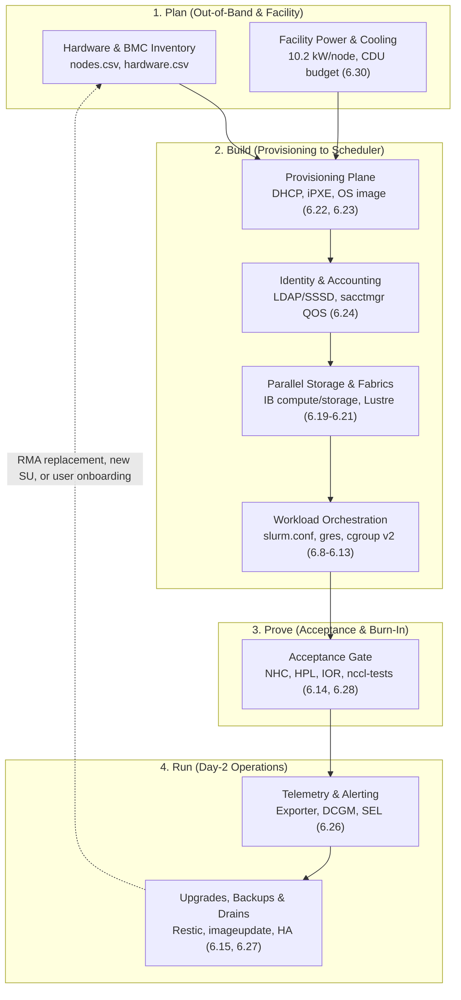
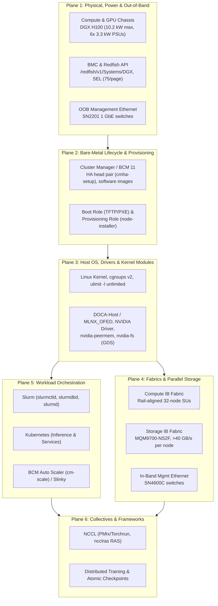
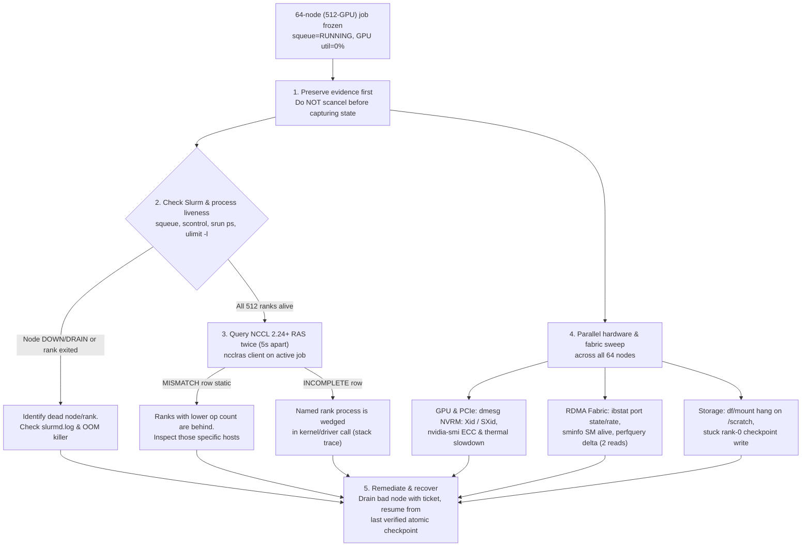

# 6.31 Capstone: build and operate a small Slurm GPU cluster

| | |
|---|---|
| Level | Advanced |
| Priority tier | 1 |
| Lab venue | Laptop (`code/part06/capstone_demo_lab.py` config pipeline) and a small GPU cluster |
| Part | Part 6: HPC and Slurm |
| Status | Validated. `code/part06/capstone_demo.sh` and `code/part06/capstone_demo_lab.py` (3/3 self-checks passed) were **run end to end** on a laptop with sample inputs: every generator ran and every linter and validator passed. SuperPOD, DGX H100, and BCM 11 architecture numbers are traced to the NVIDIA DGX SuperPOD H100 Reference Architecture, DGX H100/H200 User Guide, BCM 11 Administrator Manual, and `volume-10/00c-slurm-bcm-interview-lab.md` |

## Why this matters for AI infrastructure

Across Chapters 6.1 through 6.30, you studied each part of an AI supercomputer on its own. You met MPI and NUMA, the Slurm scheduler and its GPU isolation, rootless containers, node health checks, parallel storage, and network provisioning. You also met identity and accounting, monitoring and backup, acceptance benchmarks, and the power and cooling of a 130 kW liquid-cooled rack.

In production, and in a senior infrastructure architect interview, none of those layers live in separate chapters. Suppose a new pallet of GPU servers arrives on the loading dock. Or an interviewer hands you a marker and asks you to design a 128-node training factory, from bare metal to a running `torchrun` job. The skill that matters is **dependency order and single-source-of-truth automation**. Suppose you start the scheduler before identity and shared storage are ready. Jobs launch and then crash at once, with user ID mismatches or missing checkpoints. Suppose instead that people edit `slurm.conf`, `dnsmasq.conf`, and `/etc/passwd` by hand on each node. Within weeks, the configurations drift apart and GPUs sit stranded.

This capstone joins the tools from Part 6 into one deterministic pipeline. It starts from four CSV and batch files in `code/part06/capstone_inputs/`. You check the generated files with `code/part06/capstone_demo_lab.py`. You then work through the ten-gate acceptance and burn-in protocol that every cluster must pass before researchers use it. The chapter ends with three senior whiteboard scenarios, worked step by step.

## Prerequisites and outcomes

You need Chapters 6.1 through 6.30 before you start. Some of them matter more than others for this chapter. Lean hardest on 6.8, 6.10, 6.11, 6.14, 6.20, 6.21, 6.22, 6.24, 6.26, 6.28 and 6.30. When you finish, you will be able to:

- Explain the eight-layer build order of an AI cluster, from facility power to Prometheus alerting. You will also know exactly what breaks when layers are built out of sequence.
- Run a repeatable ten-stage pipeline with `capstone_demo.sh` and `capstone_demo_lab.py`. It turns one hardware and user inventory into DHCP/iPXE boot configs and LDAP/Slurm accounting specs.
- Produce `slurm.conf`, `gres.conf` and `cgroup.conf` from that same inventory. The pipeline also yields Prometheus metrics and rack thermal and electrical budgets.
- Execute a ten-layer cluster acceptance and burn-in test suite. It sets quantitative Day-1 baselines before you onboard users.
- Lead operations drills for dropped GPUs, silent collective hangs, controller failovers, storage exhaustion, corrupt checkpoints and bare-metal node rebuilds.
- Answer whiteboard questions on the DGX SuperPOD H100 architecture, with evidence. The details include the 32-node Scalable Units, the 127-versus-128-node question, the four fabrics, and the 10.2 kW power envelope.
- Triage a 64-node hang with `ncclras`, and explain how BCM Auto Scaler (`cm-scale`) lets Slurm and Kubernetes coexist.

Section 3 walks through the ten pipeline stages one by one.

---

## 1. The whole cluster from bare metal to job

A six-node lab rack and a 2,048-GPU DGX SuperPOD are built from the same pieces. Both have six stacked technical planes and a four-phase lifecycle of plan, build, prove, and run. The figure shows the loop that turns a hardware spreadsheet into a cluster that monitors itself.



Read Figure 1 from top to bottom. You start by sizing the physical envelope and recording every MAC address and BMC IP in one inventory. Then you build the software stack strictly bottom-up. Before any production job reaches the queue, you prove the hardware under synthetic stress. Telemetry and backup keep running after that, as continuous loops. The dashed line shows Day-2 reality. Every RMA motherboard swap, new rack expansion or user onboarding feeds back into the same inventory files and triggers the same automated pipeline.

Now look inside the cluster itself. The runtime architecture spans six distinct planes, from the rack PDU up to the PyTorch communication collective.



Plan the inventory first, because every later step reads from it.

---

## 2. Build order and dependency chains

Every layer in the build sequence depends on the invariants that the layer below it establishes. If you skip ahead, you get subtle failures that look like hardware or application bugs. Those are the hardest kind to trace, because the cause sits several layers down.

1. **Facility power, cooling, and rack layout (Chapter 6.30):** Before you bolt a chassis into a rack, check the rack power budget, the breaker rating, the PSU redundancy (`N+N` or `N+1`) and the cooling loop capacity (`kW` air or direct-to-chip cold plates). Take a rack capped at `30 kW` where each 8-GPU node draws `10.2 kW` at peak. Three nodes draw `30.6 kW` before switches are counted, so they will trip the branch circuit breaker during the first all-GPU burn-in test.
2. **Out-of-band (OOB) and in-band management networks (Chapters 6.22, 7.1):** Cable every BMC port to the OOB switch, which is `SN2201` in the H100 SuperPOD reference design. Cable the host management NICs to the in-band switch, `SN4600C`. Verify Redfish reachability next. Set strong BMC credentials as well: on DGX H100 they need `13–20` characters, including an uppercase letter, a lowercase letter, a digit and a special character. Verify DHCP relay and VLAN tagging before you attempt a network boot.
3. **Bare-metal provisioning and OS image delivery (Chapters 6.22, 6.23):** Configure DHCP and TFTP from `nodes.csv`, using `dnsmasq` or the **boot role** in BCM. Then set up the HTTP and image servers. Warewulf, xCAT, or the **provisioning role** in BCM can fill that job. Every compute node should boot into a golden Linux image. That image holds matched kernel headers, `MLNX_OFED`/`DOCA-Host`, the NVIDIA GPU driver, `nvidia-peermem`, `nvidia-fs`, and MUNGE/PMIx libraries.
4. **Cluster-wide identity and directory services (Chapter 6.24):** Deploy LDAP or FreeIPA with SSSD on every login and compute node. Do this before you mount shared user directories or start `slurmd`. Every user and service account, including `slurm` and `munge`, must resolve to the same POSIX `uidNumber` and `gidNumber` on every node. When UID resolution is missing or inconsistent, MUNGE credential verification fails. `slurmd` then refuses to launch job steps, and shared filesystem permissions start to corrupt across nodes.
5. **High-speed fabrics and parallel storage (Chapters 6.18–6.21):** Bring up the InfiniBand Subnet Manager, which is `opensm` or UFM. Check link speeds and rail cabling with `ibdiagnet`. Then mount the parallel filesystem on all nodes. Lustre, BeeGFS, WekaFS and GPFS are all options. Set directory striping with `lfs setstripe` and project quotas before users or jobs write a single byte.
6. **Workload scheduler and cgroup isolation (Chapters 6.7–6.13):** Generate `slurm.conf`, `gres.conf` and `cgroup.conf` from `hardware.csv`. Create `slurmdbd` accounts and QOS policies from `users.csv`. Then start `slurmctld` and `slurmd`. Last, configure Pyxis and Enroot through `plugstack.conf`. That lets container jobs bind-mount the parallel filesystem and import the PMIx and NCCL environment variables automatically.
7. **Acceptance gates and multi-day burn-in (Chapters 6.14, 6.28):** Run the acceptance tests on every node. These are NHC (`node_health_lab.py`), single-node and multi-node `HPL`, `IOR` and `mdtest`, `osu_bw` and `osu_bibw`, and `all_reduce_perf`. Then run a 24-to-72-hour thermal and electrical burn-in workload. The burn-in catches infant-mortality parts, such as DIMMs, optical transceivers and GPU voltage regulators, while they are still under warranty.
8. **Telemetry, alerting, and backup automation (Chapters 6.26, 6.27):** Turn on Prometheus scraping with `slurm_exporter.py`, `node_exporter` and `dcgm-exporter`. Validate the alert rules with `check_alert_rules.py`. Wire up the prolog and epilog drain triggers. Last, verify Restic or Borg backups of `/etc/slurm`, the `slurmdbd` MySQL/MariaDB database and LDAP. Do all of this before you onboard users.

A common rookie mistake is installing Slurm on day one. The `sinfo` output makes the cluster look alive, so the team feels finished. But Layer 4 gives you synchronized UIDs, Layer 5 gives you mounted scratch storage, and Layer 6 gives you cgroup device isolation. Without them, `sinfo` reports `idle` nodes, and every real multi-node training job crashes or tramples its neighbors.

Build from the bottom up, and check each layer before you move to the next.

---

## 3. Single-source-of-truth pipeline lab

Suppose someone replaces a failed node, then updates `dnsmasq.conf` and forgets `slurm.conf` or `gres.conf`. The result is `gpu004` either unbootable or invisible to the scheduler. This is configuration drift, and hand-editing files across a cluster makes it almost certain. The remedy is **single-source-of-truth generation**. You keep declarative inventory files in Git (`hardware.csv`, `nodes.csv`, `users.csv`) and compile every daemon configuration and validation check from those files.

### 3.1 Inventory inputs in `code/part06/capstone_inputs/`

The capstone toolchain in `code/part06/` takes four input files. Each one drives a different generator, so you can see exactly which file controls which config.

| Input File | Schema & Purpose | Sample Contents |
|---|---|---|
| `capstone_inputs/hardware.csv` | `name,sockets,cores_per_socket,threads_per_core,mem_mb,gpu_type,gpu_count,partition` — drives `gen_slurm_conf.py` | `cpu001`..`cpu002` (`2x32c`, `512000 MB`, `0` GPUs, `cpu`); `gpu001`..`gpu003,gpu005` (`2x56c`, `2063000 MB`, `8x h100`, `gpu`) |
| `capstone_inputs/nodes.csv` | `name,mac,ip,bmc_mac,bmc_ip,role,image` — drives `gen_provision.py` | `6` nodes (`10.10.1.11`–`10.10.2.15`, BMC IPs `10.10.101.11`–`10.10.102.15`, images `rocky9-cpu` and `rocky9-gpu-cuda12`) |
| `capstone_inputs/users.csv` | `uid,username,gid,group,account,qos,max_gpus,gecos` — drives `identity_gen.py` | `alice` (`uid=2001`, `ml-nlp`, `16` GPUs), `bob` (`uid=2002`, `ml-nlp`, `8` GPUs), `carol` (`uid=2003`, `ml-cv`, `32` GPUs) |
| `capstone_inputs/train.sbatch` | Sample multi-node GPU job script — checked by `sbatch_lint.py` | `2` nodes, `8` GPUs/node (`--gpus-per-node=8`), `--ntasks-per-node=8`, `--cpus-per-task=14`, `--mem=0`, `--time=04:00:00`, `srun python train.py` |

### 3.2 Ten-stage pipeline execution (`capstone_demo.sh`)

You can run the shell pipeline directly with `PY=python3 ./code/part06/capstone_demo.sh /tmp/capout`. Or you can run the self-checking Python harness with `python3 code/part06/capstone_demo_lab.py`. Each of the ten stages calls a tool that you built in earlier chapters of Part 6.

| Stage | Part 6 Tool (`code/part06/`) | Chapter Ref | Artifact Generated / Invariant Checked |
|---|---|---|---|
| **1** | `gen_provision.py` | 6.22 | Generates `provision/dnsmasq.conf` (`dhcp-host` bindings for `6` nodes) and per-node iPXE boot scripts (`provision/ipxe/<node>.ipxe`) with kernel `vmlinuz`, `initrd.img`, and `ip=dhcp` cmdline |
| **2** | `identity_gen.py` | 6.24 | Generates `identity/users.ldif` (`posixAccount` and `posixGroup` entries for `alice`, `bob`, `carol`), `identity/sacctmgr.sh` (`GrpTRES=gres/gpu=16` etc.), and `identity/mkhomes.sh` (`install -d -m 0750`) |
| **3** | `gen_slurm_conf.py` | 6.8, 6.10 | Compiles `hardware.csv` into `slurm/slurm.conf`, `slurm/gres.conf` (`AutoDetect=nvml`), and `slurm/cgroup.conf` (`ConstrainCores=yes`, `ConstrainRAMSpace=yes`, `ConstrainDevices=yes`) |
| **4** | `slurmconf_lint.py` | 6.8 | Audits `slurm/slurm.conf` and `slurm/gres.conf` for missing `ReturnToService`, `SlurmctldHost`, `GresTypes=gpu`, or mismatched GRES counts (`no findings`) |
| **5** | `sbatch_lint.py` | 6.11 | Statically checks `capstone_inputs/train.sbatch` for missing time limits, task/GPU count mismatches, or missing `srun` launcher (`no findings`) |
| **6** | `slurm_exporter.py --selftest` | 6.26 | Parses sample `sinfo`/`squeue` payloads and verifies Prometheus metric families (`slurm_nodes_total`, `slurm_gpus_allocated`, `slurm_queue_jobs`) |
| **7** | `check_alert_rules.py` | 6.26 | Validates `monitoring/alert_rules.yml` syntax, `expr:` PromQL presence, `for:` hold timers, and severity labels (`9 rules in 3 groups`) |
| **8** | `node_health.sh` / `node_health_lab.py` | 6.14 | Validates GPU count, ECC counters, Xid kernel logs, PCIe link width/speed, InfiniBand `ACTIVE` ports, mounted filesystems, and Zombie processes before/after jobs |
| **9** | `ckpt_atomic.py` | 6.21 | Writes `step-100` and `step-200` checkpoints with `fsync` + atomic `os.replace`, injects bit-rot corruption into `step-200/weights.bin`, detects the SHA-256 mismatch, and falls back cleanly to `step-100` |
| **10** | `facility_calc.py` | 6.30 | Computes total IT load (`57.2 kW`), facility PUE overhead (`68.6 kW` at `PUE=1.20`), liquid vs air cooling split (`45.8 kW` liquid / `11.4 kW` air at `80%` capture), chilled-water flow (`10.9 L/min` at `10 °C` $\Delta T$), and `3`-phase `415V` current (`94.2 A`) |

### 3.3 Inspecting the generated scheduler configuration

From the six rows in `capstone_inputs/hardware.csv`, Stage 3 (`gen_slurm_conf.py`) emits `slurm/slurm.conf`.

```ini
ClusterName=capstone
SlurmctldHost=ctrl01
AuthType=auth/munge
ProctrackType=proctrack/cgroup
TaskPlugin=task/cgroup,task/affinity
SelectType=select/cons_tres
SelectTypeParameters=CR_Core_Memory
GresTypes=gpu
AccountingStorageType=accounting_storage/slurmdbd
AccountingStorageHost=ctrl01
AccountingStorageTRES=gres/gpu
ReturnToService=1
SlurmctldTimeout=120
SlurmdTimeout=300
SwitchType=switch/none
MpiDefault=pmix

NodeName=cpu[001-002] CPUs=128 Sockets=2 CoresPerSocket=32 ThreadsPerCore=2 RealMemory=496640 State=UNKNOWN
NodeName=gpu[001-003,005] CPUs=224 Sockets=2 CoresPerSocket=56 ThreadsPerCore=2 RealMemory=2001110 Gres=gpu:h100:8 State=UNKNOWN
PartitionName=cpu Nodes=cpu[001-002] MaxTime=2-00:00:00 State=UP
PartitionName=gpu Nodes=gpu[001-003,005] Default=YES MaxTime=2-00:00:00 DefMemPerGPU=65536 DefCpuPerGPU=8 State=UP
```

Five details in this output are worth studying closely. Each one shows a decision the generator makes for you.

1. **Hostlist range folding with gaps (`gpu[001-003,005]`):** `gen_slurm_conf.py` groups identical hardware signatures and folds contiguous node numbers into compact Slurm hostlist expressions. `gpu004` is left out of `hardware.csv` on purpose, for example while it is out for RMA repair. The generator then produces `gpu[001-003,005]`. When you restore `gpu004` to `hardware.csv` and re-run the pipeline, the expression folds cleanly into `gpu[001-005]`.
2. **`RealMemory` OS headroom deduction (`2001110` vs `2063000 MB`):** The GPU nodes in `hardware.csv` have `2063000 MB` of physical RAM. Put `RealMemory=2063000` into `slurm.conf`, and the kernel's reserved pages, slab caches and `tmpfs` overhead leave less memory visible to `slurmd -C`. Slurm then marks the node `INVALID_REG` with `Low RealMemory`. The generator multiplies raw memory by `0.97`, which gives `int(2063000 * 0.97) = 2001110 MB`. That reserves `3%` for the OS and kernel page tables. On a `2 TB` host that is about `61.9 GB`, and on the CPU hosts it leaves `496640 MB` out of `512000 MB` (Chapter 6.8).
3. **Partition-scoped GPU defaults (`DefMemPerGPU=65536 DefCpuPerGPU=8`):** Only partitions whose nodes carry GPUs receive `DefMemPerGPU` and `DefCpuPerGPU`. Attach them to the `cpu` partition, and `slurmctld` warns or fails to schedule CPU-only allocations.
4. **Default partition selection (`Default=YES`):** The generator sets `Default=YES` on the first GPU partition, `gpu`, not on the first partition alphabetically, which is `cpu`. Jobs submitted without `-p` therefore land on the accelerator pool.
5. **Strict cgroup v2 enforcement (`cgroup.conf`):** Next to `slurm.conf`, the generator writes `ConstrainCores=yes`, `ConstrainRAMSpace=yes`, `ConstrainSwapSpace=yes` and `ConstrainDevices=yes`. A 1-GPU job on an 8-GPU node then sees only its assigned `/dev/nvidiaX` device inside its cgroup.

### 3.4 Self-checking verification lab (`code/part06/capstone_demo_lab.py`)

To verify the whole 10-stage pipeline automatically, run `code/part06/capstone_demo_lab.py`. It also tests what happens when `gpu004` returns from RMA repair and goes back into `hardware.csv`.

```bash
$ python3 code/part06/capstone_demo_lab.py
PASS: capstone_demo.sh generates dnsmasq.conf (6 nodes), users.ldif (3 users), and slurm.conf (gpu[001-003,005], RealMemory=2001110)
PASS: capstone_demo.sh passes slurmconf_lint, sbatch_lint, slurm_exporter selftest, check_alert_rules (9 rules in 3 groups), and ckpt_atomic
PASS: Adding gpu004 (2063000 MB raw -> 2001110 MB RealMemory) folds hostlist into NodeName=gpu[001-005]
Summary: 3 passed, 0 failed (total 3)
```

---

## 4. Ten-gate acceptance testing and burn-in protocol

Suppose every node has booted to a login prompt. That tells you the cluster powers on, but it does not tell you the cluster is ready for researchers. Before you hand a new cluster, or a newly added scalable unit, to its users, run a structured ten-layer acceptance protocol. Commit the resulting log files and JSON summaries to a baseline repository. Future performance regressions can then be proved with numbers instead of guesses.

| Gate | Subsystem | Tool / Command | Chapter | Pass Criterion & Baseline Recorded |
|---|---|---|---|---|
| **1** | **Out-of-Band & Sensors** | Redfish `/redfish/v1/Chassis/DGX/Sensors` & `/Managers/BMC/LogServices/SEL/Entries` | 6.30, 7.1 | All `6` PSUs healthy (`3.3 kW` each), inlet/exhaust/GPU temps within spec, `0` critical SEL assertions |
| **2** | **Host Health & PCIe/NVLink** | `node_health.sh` / `nvidia-smi -q` / `nvidia-smi nvlink -s` | 6.14 | `8/8` GPUs visible, `0` uncorrected volatile/aggregate ECC errors, `0` Xid/SXid kernel messages, PCIe Gen5 x16 (`64 GB/s`), all `18` NVLink lanes per H100 active (`900 GB/s` bidirectional) |
| **3** | **Cluster Identity & MUNGE** | `id <user>`, `munge -n \| ssh <node> unmunge` | 6.24 | Identical UID/GID across all login and compute nodes, `< 2 s` clock skew (`chronyc tracking`), `STATUS: Success (0)` from `unmunge` |
| **4** | **Single-Node GPU & Memory** | `HPL` (single node) & `dcgmi diag -r 3` | 6.28 | HPL achieves `>= 65–75%` of FP64 theoretical peak without thermal throttling (`SW Thermal Slowdown: Not Active`) |
| **5** | **Intra-Node NVLink Collectives** | `all_reduce_perf -b 8M -e 16G -f 2 -g 8` (`1` node) | 6.28 | Bus bandwidth (`busbw`) reaches `~350–390 GB/s` on NVSwitch H100 nodes at `4–16 GB` message sizes |
| **6** | **Inter-Node RDMA Fabric** | `ibdiagnet`, `osu_bw`, `osu_lat`, multi-node `all_reduce_perf` | 6.28 | `0` symbol/link integrity errors, rail-aligned `all_reduce_perf` busbw scales within `>= 85–90%` of single-node line rate across `2`, `4`, `8`, and `32` nodes |
| **7** | **Parallel Storage I/O** | `ior -w -r -t 4m -b 16g -F`, `mdtest`, and `iomix.py` | 6.20, 6.28 | Sequential read/write meets storage fabric target (`> 40 GB/s` per node in SuperPOD H100 spec) and `mdtest` metadata creation rate meets SLA without MDS lock timeouts |
| **8** | **Scheduler & cgroup Isolation** | Submit `1`-GPU, `8`-GPU, and `2`-node jobs (`sbatch`) | 6.8–6.12 | `1`-GPU job sees only `1` device in `nvidia-smi` (`ConstrainDevices=yes`), CPU affinity binds to local NUMA socket (`gpu_env_check_lab.py`), and `sacct` records `AllocTRES=billing=...,gres/gpu=...` |
| **9** | **Policy & Quota Enforcement** | Submit job exceeding `MaxTRESPerUser` or `GrpTRES` | 6.9, 6.24 | Job remains `PENDING` with `Reason=QOSMaxGRESPerUser` or `AssocGrpGRES`; fair-share priority (`sprio`) orders competing accounts accurately |
| **10** | **Fault Injection & 72h Burn-In** | Kill a rank, corrupt a checkpoint (`ckpt_atomic.py`), drain a node, run `72h` HPL/NCCL loop | 6.14, 6.21, 6.28 | Epilog drains unhealthy node automatically, training resumes from previous valid `latest.json` checkpoint, and `72`-hour continuous load completes with `0` unrecovered node drops |

Why save the Day-1 baseline numbers in Git? Six months into operations, a researcher will complain that "multi-node training is 30% slower than last month." Without saved per-node `HPL`, `osu_bibw`, `all_reduce_perf` and `ior` baselines, you are left guessing whether the regression is in their PyTorch DataLoader or in your hardware. With Day-1 baselines, a 10-minute binary-search `all_reduce_perf` sweep isolates the degraded leaf switch port or optical transceiver. The baseline turns a vague complaint into a short, testable search.

Save the Day-1 baselines in Git before any researcher logs in.

---

## 5. Day-2 operations drills: practicing the bad day

It is 03:00, a GPU has dropped off the bus, and the on-call engineer has never seen this fault on your cluster. The time to learn the response is before production cutover, not during the page. So run these eight operational drills on the cluster first. Then your team has the steps in muscle memory when the real incident arrives.

| Drill | Fault Injected | Detection & Recovery Procedure | Primary Chapters |
|---|---|---|---|
| **1. Dropped GPU (`Xid 79` / `Xid 48`)** | Simulate `NVRM: Xid (PCI:0000:c1:00): 79, pid=..., GPU has fallen off the bus` | Epilog/NHC exits non-zero $\rightarrow$ `scontrol update NodeName=gpu003 State=DRAIN Reason="NHC: GPU count 7/8 (Xid 79) [ticket=INC-1042]"` $\rightarrow$ cold power cycle via Redfish (`ForceOff`/`On`) or RMA $\rightarrow$ re-run Gate 2 & Gate 5 before `State=RESUME` | 6.14, 6.26 |
| **2. Silent 64-node collective hang** | Pause one rank with `kill -STOP` during multi-node `all_reduce` | Identify `RUNNING` job with `0%` GPU SM utilization (`dcgm_gpu_utilization`) $\rightarrow$ query `ncclras` twice `5 s` apart to spot `MISMATCH`/`INCOMPLETE` ranks $\rightarrow$ inspect `dmesg` and IB counters before killing job | 6.12, 6.28 |
| **3. Primary `slurmctld` crash** | Stop primary `slurmctld` service during active job execution | Backup `slurmctld` assumes control after `SlurmctldTimeout` (`120 s`), running `srun` steps continue uninterrupted on compute nodes, `scontrol ping` shows backup active | 6.15 |
| **4. Rolling Slurm major upgrade** | Upgrade `23.11` $\rightarrow$ `24.05` across cluster | Take `mysqldump` of `slurmdbd` $\rightarrow$ upgrade `slurmdbd` first $\rightarrow$ upgrade `slurmctld` (primary + backup) $\rightarrow$ upgrade `slurmd` and `slurmrestd` within the rolling `N-2` RPC compatibility window | 6.15 |
| **5. Parallel scratch capacity spike** | Fill `/scratch` beyond `85%` OST capacity | Prometheus `filesystem_avail_bytes` alert fires $\rightarrow$ run `lfs quota -p` / `beegfs-ctl --getquota` to identify top project $\rightarrow$ notify via targeted email (`6.25`) and enforce grace period | 6.19, 6.20, 6.24 |
| **6. Truncated checkpoint on node crash** | Kill training rank mid-checkpoint write | `ckpt_atomic.py` reader validates `meta.json` SHA-256 digests, rejects incomplete directory or corrupt `weights.bin`, and resumes cleanly from `step-100` | 6.21 |
| **7. Facility CDU / chilled-water temperature rise** | Simulate facility supply water rising above `32 °C` | Automated facility webhook sets `scontrol update PartitionName=gpu State=DOWN`, drains idle nodes, and signals running jobs (`scancel --signal=USR1`) to write emergency checkpoints before thermal trip | 6.30 |
| **8. Bare-metal node rebuild from Git** | Wipe OS disk on `gpu005` (`dd` partition table) | Run `capstone_demo.sh` from Git inventory $\rightarrow$ network-boot `gpu005` via iPXE $\rightarrow$ verify UID, mounts, `slurmd -C`, and Gate 2 health check within `20` minutes | 6.22, 6.31 |

Each drill has a fault to inject and a recovery path to follow. Read the arrows as the order of the steps, and practice them in that order. You can take one drill at a time and check each recovery path before you move on.

---

## 6. Senior infrastructure interview lab: three whiteboard scenarios

A senior AI infrastructure interview is not a flashcard quiz. The interviewer wants to see two things. First, can you reason across all six planes of the stack in dependency order? Second, can you separate what vendor reference documents specify from what you are inferring or measuring for one customer? Consider what happens when you state an unverified folklore number with confidence. That is worse than saying, *"The NVIDIA H100 SuperPOD reference architecture specifies X; if your facility constraint differs, here is how I calculate Y."*

The architecture facts and command patterns in this section trace back to the NVIDIA DGX SuperPOD with DGX H100 Reference Architecture, the NVIDIA DGX H100/H200 User Guide and Firmware Update Guide, the NVIDIA Base Command Manager (BCM) 11 Administrator Manual, the NCCL User Guide, and the Kubernetes scheduling documentation (`volume-10/00c-slurm-bcm-interview-lab.md`).

### 6.1 Facts to know cold (and their exact vendor sources)

#### DGX SuperPOD H100 Reference Architecture
- **Four segregated network fabrics:**
  1. **Compute InfiniBand fabric.** It is a rail-aligned, non-blocking NDR 400 Gb/s fat-tree for GPU-to-GPU collectives.
  2. **Storage InfiniBand fabric.** It is built on Quantum-2 MQM9700-NS2F switches and sized so per-node storage I/O exceeds 40 GB/s. Storage appliances connect at a 1:1 port-to-uplink ratio. DGX H100 storage NIC connections carry a slight 4:3 oversubscription ratio.
  3. **In-band management Ethernet fabric.** It is built on Spectrum SN4600C switches and serves Slurm, SSH, storage metadata and management, and monitoring.
  4. **Out-of-band (OOB) management Ethernet fabric.** It is built on SN2201 switches that connect every node BMC, switch management port and rack PDU.
- **Scalable Units (SUs):** The building block is a **32-node Scalable Unit (256 H100 GPUs)**. The primary reference architecture details **4 SUs (128 nodes, 1,024 GPUs)** and describes scaling to more than **64 SUs (2,000+ DGX H100 nodes)**.
- **The 127-node vs 128-node (31 vs 32) detail:** The full compute-fabric port tables of the H100 SuperPOD Reference Architecture list **127 DGX nodes (1,016 GPUs)** for a 4-SU deployment. A 1-SU deployment lists **31 DGX nodes (248 GPUs)**. The reason is that the document describes a 32-node-per-SU topology in which **one DGX system is removed from the compute fabric to free switch ports for redundant UFM (Unified Fabric Manager) appliance connectivity**. Knowing both numbers, 128 nominal and 127 with UFM ports allocated, shows that you have read the reference tables.
- **Rail alignment:** In each 32-node SU, the $k$-th compute NIC connects to the $k$-th H100 GPU through a PCIe switch. The $k$-th NIC of all 32 nodes plugs into the $k$-th leaf switch, which is `Rail k`. Traffic on any rail between two nodes in the same SU crosses **one leaf switch hop**. Cross-SU or cross-rail traffic goes up to the spine layer.
- **Rack power envelope:** The reference rack layout exceeds **40 kW per rack**. The guide adds that node density per rack must match the local data center power and cooling limits.

#### DGX H100/H200 User Guide & Firmware Update Guide
- **System power specification:** A single DGX H100 is rated at **10.2 kW maximum power** and carries six 3.3 kW power supply units (PSUs). Take a customer whose air-cooled racks are capped at 30 kW. Then `floor(30 / 10.2) = 2` systems, or 20.4 kW before top-of-rack switches, is the limit. That means at most **2 DGX H100 nodes per rack**.
- **Documented Redfish API URIs:** Do not guess OEM paths. Use the exact Redfish URIs documented in the DGX H100/H200 User Guide:

```bash
# 1. Host power control (documented ResetType values: On, GracefulShutdown,
#    ForceOff, GracefulRestart, ForceRestart, PowerCycle)
curl -k -u "<bmc-user>:<password>" --request POST \
  "https://<bmc-ip>/redfish/v1/Systems/DGX/Actions/ComputerSystem.Reset" \
  --header "Content-Type: application/json" \
  --data '{"ResetType": "GracefulRestart"}'

# 2. Chassis thermal and power sensors
curl -k -u "<bmc-user>:<password>" \
  "https://<bmc-ip>/redfish/v1/Chassis/DGX/Sensors"

# 3. Firmware inventory across BMC, BIOS, CPLD, and devices
curl -k -u "<bmc-user>:<password>" \
  "https://<bmc-ip>/redfish/v1/UpdateService/FirmwareInventory"

# 4. System Event Log (SEL) — returns 75 entries per page with Members@odata.nextLink
curl -k -u "<bmc-user>:<password>" \
  "https://<bmc-ip>/redfish/v1/Managers/BMC/LogServices/SEL/Entries"
```

- **Operational Redfish notes:**
  - The `/Managers/BMC/LogServices/SEL/Entries` endpoint returns **75 SEL members per page**. It also provides a `Members@odata.nextLink` URI for pagination.
  - The BMC password policy requires **13 to 20 characters** with uppercase, lowercase, digit and special characters.
  - Firmware updates use `nvfwupd` or the Redfish `UpdateService`. The `ipmitool` tool still appears in specific documented recovery procedures, such as a cold BMC reset (`ipmitool mc reset cold`).

For example, the 6.1 section works the `30 kW` rack case, so you can see how the arithmetic is done.

### 6.2 Scenario A: "Architect a 128-node AI factory plus inference capacity"

**Interviewer prompt:** *"A customer wants to deploy roughly 128 DGX H100 nodes for foundation-model training plus an elastic inference environment. Walk me through your architecture from the floor tiles to the job scheduler."*

**How to structure a senior-level answer:**

1. **Clarify workload and facility constraints, then anchor on the reference architecture.** Start by asking about rack power limits (`kW/rack`), the cooling medium (air or liquid), checkpoint frequency, and the split between multi-node pre-training and online inference. Then state the anchor: *"NVIDIA's H100 SuperPOD reference architecture targets this exact scale: four Scalable Units of 32 nodes (1,024 GPUs, or 127 nodes / 1,016 GPUs when one node slot is allocated for UFM fabric appliances). I start from that validated design and document every deviation forced by the customer's facility."*
2. **Size racks from the 10.2 kW node maximum.** Cite the 10.2 kW maximum rating per DGX H100 (6 x 3.3 kW PSUs) and the `> 40 kW` reference rack density. Then show how you calculate nodes per rack from the customer's PDU and cooling cap. Leave margin for the MQM9700, SN4600C and SN2201 switches.
3. **Keep the four fabrics physically and logically separate.**
   - **Compute InfiniBand:** It is rail-aligned in 32-node SUs. Same-rail GPU ranks within an SU are one hop apart during ring or tree `AllReduce`, and cross-SU traffic crosses the spine switches without competing with storage I/O.
   - **Storage InfiniBand:** It is a dedicated MQM9700-NS2F fabric engineered for `> 40 GB/s` per node. It uses a 1:1 uplink ratio on storage targets and about 4:3 on the DGX side, so checkpoint bursts never contend with gradient collectives.
   - **In-band management (SN4600C) and out-of-band management (SN2201):** They are isolated because BMC and Redfish traffic has a different security blast radius. That traffic must survive even when the in-band OS or IB fabric is wedged.
4. **Bare-metal lifecycle and high availability with BCM 11.** Deploy Base Command Manager (BCM) on an HA head-node pair configured with `cmha-setup`. That setup uses BMC-based STONITH power fencing, a dedicated heartbeat link, a node quorum check and shared NAS storage. To prevent boot storms across 128+ nodes, scale network boot (TFTP/PXE) with **boot-role** nodes per subnet. Scale image transfers (`node-installer`) with **provisioning-role** nodes per rack group.
5. **Dual-engine orchestration: Slurm and Kubernetes.** Use Slurm (`select/cons_tres`, `gres/gpu`, `cgroup` v2, Pyxis/Enroot) for gang-scheduled multi-node training. Use Kubernetes for inference services. Then use **BCM Auto Scaler (`cm-scale`)** to repurpose idle nodes between Slurm and Kubernetes configuration overlays as pending queue demand changes. The trade-off is that repurposing happens at job boundaries, not as sub-second per-request preemption.
6. **Close with acceptance gates and ring rollouts.** Require `ibdiagnet`, `dcgmi diag`, multi-node `all_reduce_perf`, GPUDirect Storage (`nvidia-fs`) `ior` checks, and a canary ring rollout policy for driver and firmware changes (`imageupdate` and `nvfwupd`).

### 6.3 Scenario B: "A 64-node training job is frozen at a step"

**Interviewer prompt:** *"A 64-node (512-GPU) training job has been running for 14 hours. `squeue` still shows `RUNNING`, no processes have exited, GPU utilization across the job is 0%, and the step timer hasn't advanced in 10 minutes. Walk me through how you triage it."*



**A line-by-line defensible triage sequence:**

1. **Preserve the crime scene first.** Do **not** scancel or reboot the nodes right away. Restarting the job destroys the in-memory NCCL communicator state and resets transient port counters.
2. **Verify allocation integrity and process limits.** Check `squeue` and `scontrol show job <id>` to confirm all 64 nodes are still allocated. Then check that all 512 rank processes are alive with `pdsh -w <nodelist> pgrep -c python`. Verify that `ulimit -l` (`Max locked memory`) in `/proc/<pid>/limits` is `unlimited`. A low `memlock` limit causes `ibv_reg_mr` and `ibv_create_qp` RDMA registration failures.
3. **Query the NCCL 2.24+ RAS (Reliability, Availability, and Serviceability) subsystem, `ncclras`.** Do not guess which of the 512 ranks stalled. Run the `ncclras` client against the live job **twice, a few seconds apart**:
   - A **`MISMATCH`** row identifies communicators where collective operation counts differ across ranks. It lists which ranks are behind and which nodes they run on. Running `ncclras` twice separates a normal in-flight collective, where the count advances, from a true hang, where the count stays static.
   - An **`INCOMPLETE`** row names a specific rank process that did not respond to the RAS health query. That points you straight to a wedged node or kernel thread.
4. **Sweep kernel Xid logs and GPU health in parallel.** Across all 64 nodes, grep `dmesg -T` for `NVRM: Xid` or `SXid`. If a single GPU hits an unrecoverable error, such as `Xid 79` for a fallen-off-the-bus GPU, `Xid 48` for double-bit ECC, or `Xid 119`/120 for a GSP timeout, that rank stops entering the next collective. The other 511 ranks then spin-wait or sleep for it.
5. **Check InfiniBand fabric state and error deltas.** Verify port state (`Active`) and link speed (400 Gbps NDR) with `ibstat`. Confirm the Subnet Manager responds with `sminfo`. Then read port error counters with `perfquery` or `/sys/class/infiniband/*/ports/1/counters/*`, **twice a few minutes apart**. A non-zero counter from last week is harmless. An actively incrementing `symbol_error_counter` or `port_rcv_remote_physical_errors` during the hang points to a bad cable or transceiver.
6. **Check parallel storage if the hang coincides with a checkpoint step.** If the step number is a multiple of the checkpoint interval, check `/proc/<rank0_pid>/stack` and `lfs check servers`. They show whether Rank 0 is blocked in `D` state, waiting on an unresponsive Lustre OST or MDS.
7. **Drain, quarantine, and resume.** Once you find the offending node, drain it with a structured reason, such as `scontrol update NodeName=gpu042 State=DRAIN Reason="Xid 79 on GPU 3 [ticket=INC-2088]"`. Then requeue the job on 64 healthy nodes, resuming from the newest verified atomic checkpoint (`latest.json`).

### 6.4 Scenario C: "Why not run the entire AI factory on Kubernetes?"

**Interviewer prompt:** *"Our platform engineering team already runs Kubernetes in production. Why shouldn't we run all training and inference on Kubernetes and skip Slurm completely?"*

| Dimension | Slurm Strengths | Kubernetes Strengths |
|---|---|---|
| **Primary Workload** | Large-scale synchronous multi-node training and HPC batch jobs (`64–2,048+` GPUs) | Long-running microservices, online inference endpoints, notebooks, and RAG pipelines |
| **Placement Model** | Native all-or-nothing gang scheduling, switch/rail topology awareness (`topology/tree`, `topology/block`), strict co-scheduling via `srun`/PMIx | Pod-by-pod declarative reconciliation; gang scheduling requires `PodGroup` API (feature-gated / alpha hierarchical groups upstream) or add-on schedulers (Kueue, Volcano, KAI) |
| **Multi-Tenant Policy** | Mature hierarchical Fair Tree (`fair_tree`), TRES billing weights, backfill (`sched/backfill`), and job-level preemption | Namespace quotas, PriorityClasses, horizontal/vertical pod autoscaling (HPA/KEDA), ingress routing, and canary rollouts |
| **Failure Recovery** | Whole-job atomic requeue (`--requeue`), prolog/epilog node draining, step-level PMIx signaling | Automatic single-pod restart and ReplicaSet self-healing behind a Service load balancer |

**How to deliver a balanced, evidence-backed answer:**

- **Decide by workload physics, not ideology.** Large synchronous training needs all-or-nothing gang placement across tens or hundreds of rail-aligned nodes. If 511 of 512 GPUs are scheduled and the 512th pod is pending, the 511 allocated GPUs sit idle while burning 80+ kW of power. Slurm provides gang scheduling, switch-topology placement and PMIx collective bootstrap natively out of the box.
- **State the exact upstream status of Kubernetes gang scheduling.** Upstream Kubernetes documents gang scheduling through the `PodGroup` API. That API sits behind feature gates, and parts of it, such as hierarchical groups, remain in alpha. So production Kubernetes training clusters still rely on third-party batch schedulers (Kueue, Volcano, Coscheduling) or on Slurm.
- **Explain how both coexist on the same physical GPUs.** Customers do not have to split their hardware permanently into two siloed clusters.
  1. **BCM Auto Scaler (`cm-scale`).** The BCM 11 Administrator Manual (§8.1.1–8.1.2) describes how `cm-scale` monitors pending queues in both Slurm and Kubernetes. It repurposes nodes between Slurm and Kubernetes configuration overlays, matching requested CPUs, memory and `nvidia.com/gpu` extended resources.
  2. **Slurm on Kubernetes (Slinky and Nebius Soperator, Chapter 6.16).** Run `slurmctld` and `slurmd` as Kubernetes pods managed by an operator. Researchers keep native `sbatch` and `srun` semantics, and platform teams manage a single Kubernetes substrate.
- **Frame daemon jitter as a measurable test.** If someone claims that Kubernetes `kubelet` or `containerd` agents degrade multi-node NCCL latency, do not argue the point. Propose a 32-node `all_reduce_perf` and `osu_bw` benchmark run with and without the node agents, then compare the p99 latency delta.

---

## 7. Corrections to common BCM and SuperPOD interview myths

Many candidates repeat outdated or inaccurate folklore about NVIDIA Base Command Manager (BCM), NCCL and DGX firmware. You can avoid that trap by checking each claim against the source. The table below pairs each common myth with the documented fact from the BCM 11 Administrator Manual, the NCCL User Guide or the DGX H100 User Guide, so you know what to say instead.

| Common Myth (What Loses Points) | Documented Reality (What to Say Instead) | Source Reference |
|---|---|---|
| *"BCM head-node HA is built on Pacemaker, Corosync, and DRBD."* | BCM HA is configured with **`cmha-setup`**. It uses BMC-based power fencing (STONITH), a dedicated heartbeat link, a node quorum check, and shared NAS storage—not Pacemaker + DRBD. | BCM 11 Admin Manual, §15 |
| *"Scale BCM provisioning to thousands of nodes using intermediate CMDaemon telemetry proxies or BitTorrent."* | BCM scales network boot via the **boot role** (TFTP/DHCP/PXE per subnet) and scales image distribution via the **provisioning role** (`node-installer` image servers per rack group). | BCM 11 Admin Manual, §5.1.7, §5.2 |
| *"BCM node images are immutable; changing a package requires a full PXE reboot."* | BCM updates the central **software image** and can push changes to running nodes in place using **`imageupdate`**, as well as reprovisioning at boot. | BCM 11 Admin Manual, §5.6 |
| *"To move nodes between Slurm and Kubernetes in BCM, manually change their category in `cmsh`."* | The documented automated mechanism is **BCM Auto Scaler (`cm-scale`)**, which dynamically switches nodes between Slurm and Kubernetes configuration overlays based on queue demand. | BCM 11 Admin Manual, §8.1.1, §8.1.2 |
| *"Always hardcode `NCCL_IB_GID_INDEX=3` for RoCEv2."* | Modern NCCL releases default to automatic GID selection (`AUTO`). Hardcoding `NCCL_IB_GID_INDEX` is only needed on legacy stacks or non-standard VLAN/RoCEv2 tables verified via `show_gids`. | NCCL User Guide |
| *"DGX firmware can never be downgraded once flashed."* | The DGX H100/H200 Firmware Update Guide documents a supported force-downgrade procedure (`nvfwupd`), though it must be treated as a rehearsed maintenance change. | DGX H100/H200 Firmware Update Guide |

Each row gives you the myth to recognize and the correction to offer. Use the source reference when an interviewer asks where the answer comes from.

---

## 8. Weak versus senior answers at a glance

Interviewers listen for the difference between a quick answer and a structured one. The table below sets a junior reply next to a senior one for five common questions. Read each pair and notice what the senior answer adds: a source of truth, a measurable check, or a named tool.

| Interview Question | Weak / Junior Answer | Senior Systems Architect Answer |
|---|---|---|
| **"How do you stand up a new GPU cluster?"** | *"Install Ubuntu and Slurm on the nodes and start running jobs."* | *"Validate rack power (`10.2 kW`/DGX H100) and OOB Redfish first, generate DHCP/iPXE, LDAP/SSSD, and Slurm configs from one Git inventory, mount parallel storage, and pass a 10-gate NHC/HPL/IOR/NCCL acceptance suite before opening queues."* |
| **"A 64-node training run is stuck at 0% GPU utilization."** | *"Cancel the job and resubmit it."* | *"Preserve the live state first. Check `squeue`/`ulimit -l`, run `ncclras` twice 5 seconds apart to pinpoint `MISMATCH` or `INCOMPLETE` ranks, grep `dmesg` for `NVRM: Xid`, check `perfquery` IB error deltas, drain the bad node, and resume from the last atomic checkpoint."* |
| **"How do you prevent configuration drift across 200 nodes?"** | *"Use `pdsh` to edit `/etc/slurm/slurm.conf` on every node."* | *"Maintain `hardware.csv`, `nodes.csv`, and `users.csv` in Git, generate `slurm.conf`, `gres.conf`, and `cgroup.conf` deterministically, lint in CI (`slurmconf_lint.py`), and distribute via BCM `imageupdate`, Warewulf overlays, or configless Slurm."* |
| **"Why is `RealMemory` in `slurm.conf` lower than physical RAM?"** | *"Someone typed the wrong number."* | *"Linux reserves kernel slab, page tables, and reserved pages (`~2–3%`). Setting `RealMemory` to raw physical DIMM capacity causes `slurmd -C` to report less RAM than configured, making `slurmctld` mark the node `INVALID_REG` (`drain`)."* |
| **"How do you protect multi-day training from corrupt checkpoints?"** | *"Save checkpoints every hour to NFS."* | *"Write per-rank shards to a parallel filesystem (`> 40 GB/s`/node), `fsync` files and parent directories, record SHA-256 digests in `meta.json`, flip `latest.json` via atomic `os.replace`, and auto-fallback on digest mismatch (`ckpt_atomic.py`)."* |
| **"How do you share GPUs between batch training and K8s inference?"** | *"Split the cluster 50/50 permanently."* | *"Use BCM Auto Scaler (`cm-scale`) to switch nodes between Slurm and Kubernetes configuration overlays based on pending work, or run Slurm on Kubernetes via Slinky / Soperator."* |

Use the senior column as a model for the shape of your answer. Lead with the check or the source, then name the tool and the number that backs it.

---

## Exercises

1. Copy `code/part06/capstone_inputs/hardware.csv` and `nodes.csv` into a temporary directory, so the real inventory stays untouched. Add a node `gpu004` with 2 sockets, 56 cores per socket, 2 threads per core, 2063000 MB of RAM, 8 `h100` GPUs, and the partition `gpu`. Run `gen_slurm_conf.py`.
2. In the output of exercise 1, `NodeName=gpu[001-003,005]` should fold into `NodeName=gpu[001-005]` with `RealMemory=2001110`. Which self-check in `code/part06/capstone_demo_lab.py` tests this?
3. Edit `slurm/slurm.conf` so that `RealMemory=2100000` on `gpu[001-003,005]`. That is more than the 2063000 MB of physical RAM. Run `slurmconf_lint.py`. Why does it still report no findings?
4. On a live node, which command reports the memory that the OS can really use? What does `slurmctld` do to a node whose `RealMemory` is larger than that figure?
5. Add a fourth user to `capstone_inputs/users.csv`: `dave`, uid 2004, group `ml-rl`, account `ml-rl`, QOS `normal`, and `max_gpus=24`. Re-run `identity_gen.py`. Which files does it produce?
6. In what order must `users.ldif`, `sacctmgr.sh`, and `mkhomes.sh` be applied? Name the system each one touches: the LDAP server, `slurmdbd`, or the parallel file system.
7. Write a bash wrapper around `code/part06/iomix_lab.py`, or around `ior`, for Gate 7. It records sequential write bandwidth, sequential read bandwidth, and small-file metadata operations per second in a timestamped JSON file.
8. Make the wrapper in exercise 7 exit non-zero when any metric falls more than 15 percent below a saved Day-1 baseline.
9. A customer wants 32 DGX H100 nodes, one full Scalable Unit, at 10.2 kW maximum per node. The racks are capped at 25 kW each. How many DGX nodes fit in one rack, and how many racks does the unit need?
10. The same unit needs 2 `MQM9700` compute switches, 1 `MQM9700` storage switch, 1 `SN4600C` switch, and 1 `SN2201` switch. They add about 2.5 kW in total. Does that change your answer to exercise 9?
11. Run `code/part06/facility_calc.py` for the 32-node unit. What chilled-water flow in litres per minute does it give at 80 percent liquid heat capture and a 10 degree temperature rise?
12. Write about 15 lines of shell or Python that query `https://<bmc-ip>/redfish/v1/Managers/BMC/LogServices/SEL/Entries`. Follow `Members@odata.nextLink` across the 75-entry pages, and keep only critical thermal or power events.
13. Combine the output of exercise 12 with `ncclras` and `dmesg | grep Xid` into a one-page incident runbook for Drill 2, the 64-node hang.

---

## Checkpoint questions (20)

<details>
<summary>1. In what exact order should you build these six layers of a new GPU cluster, and why: workload scheduler, bare-metal provisioning, cluster-wide identity, parallel storage, monitoring/alerting, and facility power/cooling?</summary>

Build facility power and cooling first, then bare-metal provisioning, cluster-wide identity, parallel storage, the workload scheduler, and monitoring and alerting. Run acceptance testing before you cut over to users. Each layer depends on the one below it. Nodes cannot boot without rack power and DHCP/iPXE provisioning. Shared storage and MUNGE/Slurm need identical UIDs and GIDs on every host. `slurmctld` and `slurmd` need resolved users and mounted filesystems. Monitoring has to verify the full stack before user jobs arrive.
</details>

<details>
<summary>2. Why must cluster-wide identity (LDAP/SSSD and MUNGE/service UIDs) be established before mounting shared storage and starting Slurm?</summary>

MUNGE needs the `munge` and `slurm` daemons, and every submitted user job, to resolve the same numeric UIDs and GIDs on the controller and on every compute node. If a user's UID differs between nodes, or the account is missing on a compute node, `slurmd` fails at the `setuid()` call as soon as it launches a job step. Files written to the parallel filesystem then end up with mismatched ownership across ranks.
</details>

<details>
<summary>3. Why is generating `dnsmasq.conf`, `users.ldif`, `slurm.conf`, `gres.conf`, and `cgroup.conf` from a single Git inventory better than editing those files directly?</summary>

Hand-edited files drift as soon as nodes are RMA'd, added or decommissioned. That leaves the DHCP MAC tables, the `NodeName` ranges in `slurm.conf` and the GPU counts in `gres.conf` out of step with each other. When every daemon config is compiled from `hardware.csv`, `nodes.csv` and `users.csv`, a single row change updates every subsystem together.
</details>

<details>
<summary>4. In `gen_slurm_conf.py`, why is `RealMemory=2001110` generated for a node with `2063000 MB` of physical RAM (`97%`)?</summary>

The Linux kernel reserves about `2–3%` of physical RAM for slab structures, page tables, the crashkernel reservation and initial ramdisk overhead. So `slurmd -C` always reports less usable memory than the DIMM total. If `RealMemory` in `slurm.conf` is higher than what `slurmd -C` reports on the booted node, `slurmctld` marks the node `INVALID_REG` with `Low RealMemory`. It then refuses to schedule jobs there.
</details>

<details>
<summary>5. Why must `DefMemPerGPU` and `DefCpuPerGPU` only be attached to GPU partitions and never to a CPU-only partition in `slurm.conf`?</summary>

These two settings scale the default memory and CPU allocation for each requested GPU GRES. On a partition whose nodes have `0` GPUs, there is no GPU to scale from. The result is `slurmctld` configuration warnings or allocation errors for CPU-only jobs.
</details>

<details>
<summary>6. What specific isolation guarantee does `ConstrainDevices=yes` in `cgroup.conf` enforce on an 8-GPU node?</summary>

`ConstrainDevices=yes` tells Slurm's `task/cgroup` plugin to set up a device filter for each job step. On cgroup v2 that is an eBPF device controller, and on v1 it is a `devices.allow`/`devices.deny` list. For example, a job that requests `--gpus=1` can then open only its allocated `/dev/nvidiaX` device node. It cannot see or allocate memory on the other `7` GPUs on the same host.
</details>

<details>
<summary>7. What is the purpose of a 24-to-72-hour cluster burn-in test after functional acceptance checks pass?</summary>

Functional checks show that components work for a few minutes. A sustained full-power run of `HPL`, multi-node `all_reduce_perf` and `IOR` shows what breaks over time. It exposes infant-mortality defects, such as marginal HBM stacks, optical transceivers that drop links at `65 °C`, loose cold plates and failing PSUs. You want to find these while the hardware is still in pre-production and under vendor warranty.
</details>

<details>
<summary>8. Why should you commit Day-1 `HPL`, `osu_bw`, `all_reduce_perf`, and `ior` benchmark outputs to version control before users log in?</summary>

Saved Day-1 baselines let you replace a vague complaint such as "training feels slow this week" with a measured comparison. For example, you can show that node `gpu014` still delivers `385 GB/s` of NVLink bandwidth, as on Day 1, while Rail 3 IB bandwidth between SU 1 and SU 2 fell from `48 GB/s` to `19 GB/s`. That comparison isolates the degraded hardware within minutes.
</details>

<details>
<summary>9. Name the four network fabrics in the NVIDIA DGX SuperPOD H100 reference architecture and the switch models specified for storage and management.</summary>

1. **Compute InfiniBand fabric** (rail-aligned NDR `400 Gb/s`).
2. **Storage InfiniBand fabric** (`MQM9700-NS2F` Quantum-2 InfiniBand switches, sized for `> 40 GB/s` per node).
3. **In-band management Ethernet fabric** (`SN4600C` Spectrum Ethernet switches).
4. **Out-of-band (OOB) management Ethernet fabric** (`SN2201` Ethernet switches).
</details>

<details>
<summary>10. Why does the DGX SuperPOD H100 reference architecture show `32` nodes per Scalable Unit (`128` nodes for `4` SUs) in the overview, but `31` nodes (`1` SU) and `127` nodes (`4` SUs, `1,016` GPUs) in the compute-fabric port tables?</summary>

The reference architecture is built on a `32`-node-per-SU design. In the full compute-fabric port layout, however, one DGX system slot is removed to free InfiniBand switch ports for UFM (Unified Fabric Manager) appliance connectivity. That leaves `31` compute nodes in a single-SU deployment and `127` compute nodes (`1,016` GPUs) in a four-SU deployment.
</details>

<details>
<summary>11. What is rail alignment in a `32`-node Scalable Unit, and why does it optimize multi-node training collectives?</summary>

In a rail-aligned `32`-node SU, the $k$-th compute NIC, paired with GPU $k$, on every node connects to the $k$-th leaf switch, which is `Rail k`. During collectives such as `AllReduce`, GPUs with the same number on different nodes in the SU exchange gradients across a **single leaf-switch hop**. That path avoids the spine switches, which keeps latency low and spine congestion down.
</details>

<details>
<summary>12. What is the maximum power specification and PSU configuration of a single DGX H100 system, and how many fit in a `30 kW`-capped rack?</summary>

The DGX H100/H200 User Guide specifies **`10.2 kW` maximum power** per system, backed by **six `3.3 kW` power supplies**. In a rack capped at `30 kW`, at most **`2` DGX H100 systems** fit. Two systems draw `2 x 10.2 kW = 20.4 kW` at most, which leaves `9.6 kW` for top-of-rack switches and PDU margin. A third system would bring the draw to `30.6 kW`, above the `30 kW` ceiling.
</details>

<details>
<summary>13. Which Redfish URI retrieves the System Event Log (SEL) on a DGX H100 BMC, and how many entries does it return per request?</summary>

Use `https://<bmc-ip>/redfish/v1/Managers/BMC/LogServices/SEL/Entries`. It returns **75 SEL members per page**. It also includes a `Members@odata.nextLink` field, which you follow to page through the remaining entries.
</details>

<details>
<summary>14. Why can a single unhealthy GPU or degraded InfiniBand link on one node freeze all `512` GPUs of a `64`-node training job?</summary>

Synchronous data-parallel, tensor-parallel and pipeline-parallel training runs collective barriers, such as `AllReduce`, `AllGather` and `ReduceScatter`, across every rank in the communicator at every optimizer step. A collective cannot finish until the slowest rank arrives. A single stalled rank therefore blocks the other `511` GPUs indefinitely.
</details>

<details>
<summary>15. How do you use NCCL 2.24+'s `ncclras` tool to diagnose a hung multi-node job, and why should you run it twice a few seconds apart?</summary>

Run `ncclras` against the live job to see communicator status across all ranks. A **`MISMATCH`** row lists the ranks whose collective operation counters are behind, along with their hostnames. An **`INCOMPLETE`** row names a process that does not answer RAS queries. Run it twice, a few seconds apart. A healthy collective shows counts that increase between reads. A truly hung communicator shows counts that stay frozen.
</details>

<details>
<summary>16. Why must you check InfiniBand error counter deltas (two reads separated by a few minutes) rather than a single `perfquery` snapshot during a hang?</summary>

Hardware port counters in `/sys/class/infiniband/*/ports/1/counters/` build up from the last counter reset or switch reboot. A non-zero value could have come from maintenance weeks ago. Reading the counters twice, a few minutes apart, shows whether symbol errors, link recoveries or packet drops are **still increasing right now**.
</details>

<details>
<summary>17. How is BCM 11 head-node High Availability actually architected, and which common open-source stack is it NOT based on?</summary>

According to the BCM 11 Administrator Manual (§15), head-node HA is configured with **`cmha-setup`**. It uses BMC-based power fencing (STONITH), a dedicated heartbeat network link, a node quorum check across the cluster and shared NAS storage. It is **not** a Pacemaker + Corosync + DRBD stack, despite a common interview myth.
</details>

<details>
<summary>18. What is the difference between the **boot role** and the **provisioning role** in Base Command Manager (BCM 11), and what is `imageupdate` used for?</summary>

The **boot role** serves the network boot protocols (DHCP, TFTP and PXE), which prevents boot storms on a subnet. The **provisioning role** (`node-installer`) moves the large root filesystem image to nodes across rack groups (§5.1.7, §5.2). **`imageupdate`** (§5.6) syncs changes from a modified software image on the head node directly onto **running** compute nodes, so they do not need a full PXE reinstall.
</details>

<details>
<summary>19. How does BCM Auto Scaler (`cm-scale`) allow Slurm and Kubernetes to share the same physical GPU nodes?</summary>

BCM 11 Administrator Manual §8.1.1–8.1.2 describes how `cm-scale` polls pending work in both Slurm and Kubernetes. It matches CPUs, memory, pods, ephemeral storage and `nvidia.com/gpu` extended resources. When demand shifts, it moves idle nodes between Slurm and Kubernetes **configuration overlays**.
</details>

<details>
<summary>20. Which operational drill proves that your single-source-of-truth cluster configuration pipeline works end-to-end?</summary>

**Drill 8 (Bare-metal node rebuild from Git).** You wipe a compute node's disk completely, run `capstone_demo.sh` from the Git inventory (`hardware.csv`, `nodes.csv`, `users.csv`) and network-boot the node via iPXE. The node then has to pass UID resolution, parallel storage mount checks, `slurmd -C` registration and NHC Gate 2, without a single manual file edit on the node.
</details>

---

## Sources and review notes

1. **Senior SA Interview Lab (`volume-10/00c-slurm-bcm-interview-lab.md`):** Primary source for the six-plane AI factory stack, the three whiteboard scenarios (128-node AI factory design, 64-node hang triage with `ncclras`, and Slurm vs Kubernetes coexistence), and the vendor-verified correction tables.
2. **NVIDIA DGX SuperPOD with DGX H100 Reference Architecture:** [docs.nvidia.com/dgx-superpod/reference-architecture-scalable-infrastructure-h100](https://docs.nvidia.com/dgx-superpod/reference-architecture-scalable-infrastructure-h100/latest/index.html). It describes four fabrics, the 32-node Scalable Units, rail alignment, and a reference rack density above 40 kW. The next table lists the figures this chapter uses.

   | Item | Figure from the reference architecture |
   |---|---|
   | Storage InfiniBand fabric | `MQM9700-NS2F` switches, more than 40 GB/s per node, 1:1 storage oversubscription and 4:3 compute oversubscription |
   | In-band Ethernet | `SN4600C` |
   | Out-of-band Ethernet | `SN2201` |
   | Full SuperPOD | 4 Scalable Units, 128 nominal nodes, 1,024 GPUs |
   | With one node given up for UFM connectivity | 127 nodes and 1,016 GPUs, or 31 nodes in one Scalable Unit |
3. **NVIDIA DGX H100/H200 User Guide and Firmware Update Guide:** [docs.nvidia.com/dgx/dgxh100-user-guide](https://docs.nvidia.com/dgx/dgxh100-user-guide/redfish-api-supp.html) and [docs.nvidia.com/dgx/dgxh100-fw-update-guide](https://docs.nvidia.com/dgx/dgxh100-fw-update-guide/index.html). They give the 10.2 kW maximum system power, six 3.3 kW power supplies, the 13 to 20 character BMC password rule, `nvfwupd` firmware management, and `ipmitool mc reset cold`. They also list the Redfish paths used in exercise 12: `/redfish/v1/Systems/DGX/Actions/ComputerSystem.Reset`, `/Chassis/DGX/Sensors`, `/UpdateService/FirmwareInventory`, and `/Managers/BMC/LogServices/SEL/Entries`, which returns 75 members per page with `Members@odata.nextLink`.
4. **NVIDIA Base Command Manager 11 Administrator Manual:** [docs.nvidia.com/base-command-manager/manuals/11/admin-manual.pdf](https://docs.nvidia.com/base-command-manager/manuals/11/admin-manual.pdf) — §5.1.7 and §5.2 (boot role vs provisioning role), §5.6 (`imageupdate` in-place updates on running nodes), §8.1.1–8.1.2 (BCM Auto Scaler `cm-scale` dynamic node repurposing between Slurm and Kubernetes configuration overlays), and §15 (`cmha-setup` HA head nodes with BMC fencing, quorum, and shared NAS).
5. **NVIDIA NCCL User Guide & Kubernetes Gang Scheduling Documentation:** [docs.nvidia.com/deeplearning/nccl/user-guide](https://docs.nvidia.com/deeplearning/nccl/user-guide/docs/index.html) (`ncclras` RAS client `MISMATCH` and `INCOMPLETE` diagnostics, automatic RoCE GID selection) and [kubernetes.io/docs/concepts/scheduling-eviction/gang-scheduling](https://kubernetes.io/docs/concepts/scheduling-eviction/gang-scheduling/) (`PodGroup` API feature-gate and alpha hierarchical group status).
6. **Part 6 Toolchain Verification (`code/part06/capstone_demo.sh` & `code/part06/capstone_demo_lab.py`):** Executed locally (`3/3` checks passed), exercising `gen_provision.py` (6.22), `identity_gen.py` (6.24), `gen_slurm_conf.py` and `slurmconf_lint.py` (6.8, 6.10), `sbatch_lint.py` (6.11), `slurm_exporter.py` and `check_alert_rules.py` (6.26), `node_health_lab.py` (6.14), `ckpt_atomic.py` (6.21), and `facility_calc.py` (6.30).
