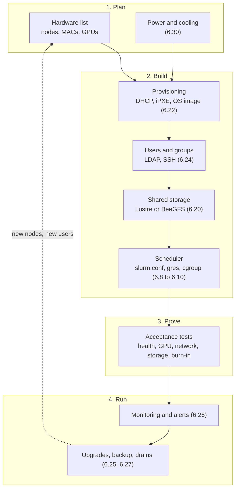
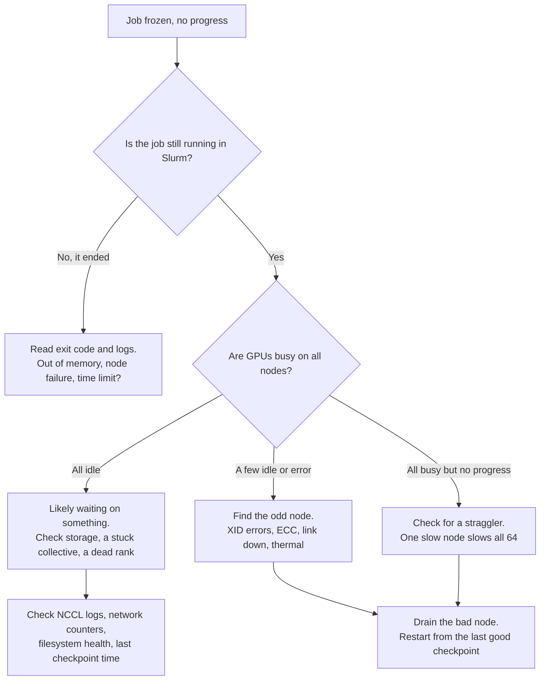

# 6.31 Capstone: build and operate a small Slurm GPU cluster

| | |
|---|---|
| Level | Advanced |
| Priority tier | 1 |
| Lab venue | Laptop (config pipeline) and a small GPU cluster (real build, not tested) |
| Part | Part 6: HPC and Slurm |
| Status | Drafted. `code/part06/capstone_demo.sh` was **run end to end** on a laptop with sample inputs: every generator ran and every checker passed. Nothing here was run on a real cluster, and no job was scheduled. The SuperPOD and BCM facts come from the user's own interview notes (NVIDIA-DevOps volume 10, chapter 0c), which I could not check against NVIDIA's live documents in this session |

## Why this matters for AI infrastructure

You have now met every piece of a GPU cluster: the hardware, the scheduler, storage, identity, provisioning, monitoring and the building around it. A capstone answers one question: can you put those pieces together and keep them running? This is also what an interviewer is really asking when they say "design a cluster for me."

## Prerequisites and outcomes

You need chapters 6.1 to 6.30 or at least a skim of them. After this chapter you can:

- explain the build order of a cluster and why that order matters
- run a pipeline that turns one hardware list into config files and checks them
- list the tests a new cluster must pass before users get it
- walk through three classic whiteboard scenarios without freezing
- spot weak answers and replace them with better ones

## 1. The whole cluster in one picture



Read it left to right. You plan, then build in layers, then prove it works, then run it. The dotted arrow is the loop that never ends: every new node or user starts a small trip through the same steps.

## 2. Build order, and why

Each layer needs the one before it.

1. **Facility.** No power or cooling, no cluster. Check the rack power budget first (6.30).
2. **Network and management network.** Nodes cannot be installed until they can find a DHCP server.
3. **Provisioning.** Machines boot from the network and get an OS image (6.22).
4. **Identity.** Users and groups must be the same on every node, or file permissions break (6.24).
5. **Shared storage.** Jobs need the same files on every node (6.20).
6. **Scheduler.** Slurm needs to know the nodes, GPUs and limits (6.8 to 6.10).
7. **Tests.** Prove each layer before the next team trusts it.
8. **Monitoring.** Turn on alerts before users arrive, not after the first outage (6.26).

A common beginner mistake is to install Slurm first because it feels like "the cluster." Without identity and storage, Slurm will happily start and every real job will fail.

## 3. The pipeline lab (works on a laptop)

The idea: keep **one source of truth**, a hardware list and a user list, and generate everything else from it. If a node is added, you edit one row and regenerate. Hand-edited config files drift; generated ones do not.

Files, all in `code/part06/`:

| Input | What it holds |
|---|---|
| `capstone_inputs/hardware.csv` | name, sockets, cores, threads, memory, GPU count and type, partition |
| `capstone_inputs/nodes.csv` | name, MAC, IP, BMC MAC, BMC IP, role, OS image |
| `capstone_inputs/users.csv` | users, groups and Slurm accounts |
| `capstone_inputs/train.sbatch` | a sample training job to lint |

Run it:

```bash
cd code/part06
PY=python3 ./capstone_demo.sh /tmp/capout
```

If you want the exporter and alert checks to run, `PY` must be a Python with `prometheus-client` and `pyyaml` installed. The script has ten steps. Here is what each did when I ran it:

| Step | Tool | Result |
|---|---|---|
| 1 | `gen_provision.py` | wrote `dnsmasq.conf` and one iPXE script per node (6 nodes) |
| 2 | `identity_gen.py` | wrote an LDIF file, Slurm account commands and home-directory setup for 3 users |
| 3 | `gen_slurm_conf.py` | wrote `slurm.conf`, `gres.conf`, `cgroup.conf`: 2 node groups, 2 partitions |
| 4 | `slurmconf_lint.py` | "no findings" |
| 5 | `sbatch_lint.py` | "no findings" |
| 6 | `slurm_exporter.py --selftest` | "selftest passed" |
| 7 | `check_alert_rules.py` | 9 rules in 3 groups |
| 8 | node health check | skipped in the script (needs stub commands, see 6.14) |
| 9 | `ckpt_atomic.py` | a corrupted newest checkpoint was detected, and the previous one was chosen |
| 10 | `facility_calc.py` | rack power table printed |

### What the scheduler generator produced

From six rows of hardware it wrote this node and partition section:

```text
GresTypes=gpu
NodeName=cpu[001-002] CPUs=128 Sockets=2 CoresPerSocket=32 ThreadsPerCore=2 RealMemory=496640 State=UNKNOWN
NodeName=gpu[001-003,005] CPUs=224 Sockets=2 CoresPerSocket=56 ThreadsPerCore=2 RealMemory=2001110 Gres=gpu:h100:8 State=UNKNOWN
PartitionName=cpu Nodes=cpu[001-002] MaxTime=2-00:00:00 State=UP
PartitionName=gpu Nodes=gpu[001-003,005] Default=YES MaxTime=2-00:00:00 DefMemPerGPU=65536 DefCpuPerGPU=8 State=UP
```

Things worth noticing, in plain words:

- `gpu[001-003,005]` is a **host list**. The generator folded four names into one short pattern. `gpu004` is missing on purpose, to show that gaps are fine.
- `RealMemory` is a bit **less** than the memory in the hardware list (2001110 versus 2063000 MB). Slurm should be told the memory the OS can really use, not the number on the sticker, or nodes can be marked invalid. The generator leaves headroom for the OS (6.8).
- Only the GPU partition gets `DefMemPerGPU` and `DefCpuPerGPU`. The CPU-only partition must not have GPU defaults. An earlier version of my generator got this wrong, and the test run caught it.
- The default partition is the first GPU partition, not the first one alphabetically.
- `cgroup.conf` turns on `ConstrainCores`, `ConstrainRAMSpace` and `ConstrainDevices`, so a job can only see the cores, memory and GPUs it was given.

**This is a teaching generator.** It makes a sensible starting file. A real cluster needs your own site settings, and every file needs review by a person before it is used.

## 4. Acceptance tests: prove it before users arrive

"It boots" is not "it works." A new cluster should pass a written checklist. Keep the results as files you can compare later.

| Layer | Test | Pass means |
|---|---|---|
| Node health | `node_health.sh` on every node (6.14) | no failed checks |
| GPU | all GPUs visible, no ECC or XID errors, expected clocks | counts match the hardware list |
| GPU interconnect | NCCL all-reduce on one node (6.28) | bandwidth near the vendor figure |
| Network | NCCL all-reduce across nodes | close to single-node scaling, not a sharp drop |
| Storage | `iomix.py` or IOR from several nodes (6.20) | meets the promised read and write speed |
| Scheduler | submit a one-GPU job, an 8-GPU job, a multi-node job | each lands on the right nodes with only its own GPUs visible |
| Limits | a job that asks for more than its share | is queued or rejected as designed |
| Identity | log in as a normal user on any node | same UID and home everywhere |
| Failure | drain a node, kill a job, corrupt a checkpoint | the system recovers as designed |
| Burn-in | run heavy jobs for hours or days | no node fails or throttles |

Two beginner notes:

- **Burn-in** means running the hardware hard for a while to make it fail early, while it is still under warranty and before real jobs depend on it. Weak parts often fail in the first days.
- **Compare against a baseline.** Save the first numbers. Next month, "the network feels slow" becomes "bandwidth is 30 percent below what we measured on day one."

## 5. Operations drills: practise the bad day

Do these on the test cluster so they are not new when they happen for real.

| Drill | What to practise | Chapter |
|---|---|---|
| A node's GPU drops out | find it from alerts, drain it, open a ticket, return it after repair | 6.14, 6.26 |
| A job hangs | tell "stuck" from "slow" using GPU use, network counters and logs | 6.28 |
| The controller restarts | confirm jobs and state survive | 6.25 |
| Upgrade Slurm | follow the allowed upgrade order: database, controller, nodes | 6.25 |
| Storage fills | find the biggest users, warn, clean | 6.20 |
| A checkpoint is corrupt | fall back to the newest valid one | 6.21 |
| Power loss | confirm the staged shutdown works | 6.30 |
| Lost the config | rebuild a node from the generator and the inventory | this chapter |

The last drill is the real test of the pipeline idea. If you can wipe a node and rebuild it from files alone, you can run the cluster.

## 6. The interview lab: three whiteboard scenarios

These come from the user's volume 10 interview lab. The facts about NVIDIA systems are in my notes as given. Check them against current NVIDIA documents before you quote numbers in an interview.

### Scenario A: "Design an AI factory"

A good answer follows the build order, not a product list.

1. Ask first: how many GPUs, what jobs (training or inference), how many users, what budget and deadline.
2. Facility: power per rack and cooling decide how many systems fit in a rack (6.30). For DGX H100, the notes give about 10.2 kW maximum per system and six 3.3 kW power supplies.
3. Building block: the notes describe a SuperPOD **scalable unit (SU)** of 32 nodes. They also point out the "127 versus 128" detail: with a fixed number of nodes in a unit, one is often kept out of the compute count for management or spare. Confirm the exact reason in NVIDIA's reference architecture.
4. Networks: the notes list **four fabrics**: compute, storage, in-band management and out-of-band management. Keep them separate so a storage burst cannot slow a training all-reduce.
5. **Rail alignment**: the n-th GPU of every node connects to the n-th leaf switch, so same-numbered GPUs are one hop apart. Mention it, then say why: all-reduce between same-numbered GPUs is the busiest traffic.
6. Storage: the notes say the storage fabric should give each node more than 40 GB/s. Treat it as a planning figure and ask what the real workload needs.
7. Management: BCM or an open stack (6.22 and 6.23), Slurm, monitoring, health checks.

### Scenario B: "A 64-node training job is frozen"

Do not guess. Walk down the stack and always say what you would check.



The key habit is to say **"one bad node out of 64 can freeze or slow the whole job"**, because collective operations wait for the slowest rank. Then say what you do: drain the bad node, resume from the last valid checkpoint, and add a check so it is caught earlier next time.

### Scenario C: "Slurm or Kubernetes?"

Do not pick a side. Compare by the work.

| Question | Slurm leans | Kubernetes leans |
|---|---|---|
| Job type | big multi-node training, batch | long-running services, inference |
| Scheduling | gang-style, queues, fair share | pods, autoscaling, rolling updates |
| Users | researchers who write batch scripts | platform teams who ship containers |
| Fault handling | re-queue, resume | restart pods, self-heal |
| Strength | simple, proven, tight resource control | rich ecosystem, standard APIs |

Then mention that many sites run **both**, and tools exist to share GPUs between them. The notes name BCM's **Auto Scaler (`cm-scale`)**, which can move nodes between Slurm and Kubernetes. Another option is running Slurm inside Kubernetes (the Soperator and Slurm operator projects, see 6.2 and 5.34). A good answer says what you would measure to decide, such as how bursty the demand is and how much of it is inference.

## 7. Corrections to common BCM claims

Part of the notes was written to fix mistakes people make in interviews. Remember these:

| Weak or wrong | Better |
|---|---|
| "BCM head node HA uses Pacemaker and DRBD." | BCM HA is set up with **`cmha-setup`**, with fencing, quorum and a shared NAS option. It is not a Pacemaker plus DRBD stack |
| "The boot role and the provisioning role are the same." | They are different roles. The boot role serves the network boot, the provisioning role serves the image. Know which node has which |
| "To change a node's software, reinstall it." | Update the software **image** and use `imageupdate` to push the change to running nodes |
| "Slurm and Kubernetes cannot share a cluster." | They can, with BCM Auto Scaler or by running Slurm on Kubernetes |

I could not confirm the BCM commands against a live BCM system. They come from the user's notes. BCM is covered in depth in Part 8.

## 8. Weak versus better answers

| Question | Weak | Better |
|---|---|---|
| "How would you build a cluster?" | "Install Slurm on the nodes." | "Plan power, network and identity first, provision from one inventory, then storage, then Slurm, then test and monitor before opening to users." |
| "A job is slow." | "Restart it." | "Find which layer: GPU use, network counters, storage latency, or one slow node. Compare against the baseline." |
| "How do you manage configs?" | "I edit them on each node." | "Generate them from one inventory in git, review changes, and roll out by tool." |
| "A node is bad." | "Reboot it." | "Drain it so no new jobs land, collect logs, check GPU errors, then repair or replace it and test before return." |
| "How do you stop a user taking all GPUs?" | "Ask them nicely." | "Accounts with limits, a fair share, and QOS, and enforce them through accounting." |
| "How do you keep training safe from failures?" | "Hope nodes stay up." | "Checkpoint often, write atomically, verify the newest checkpoint, and resume from the last good one." |

## 9. Exercises

1. Add a new node `gpu004` to `hardware.csv` and `nodes.csv`. Re-run the pipeline. What changes in `slurm.conf`? (Answer: the host list becomes `gpu[001-005]`.)
2. Break the hardware file on purpose: set a GPU node's memory far too high. I tried this: `slurmconf_lint.py` says "no findings", because it checks the file, not the real hardware. Which command on a real node would catch it? (Answer: `slurmd -C` prints what the node really has, and Slurm marks a node invalid if `RealMemory` is more than that.)
3. Add a user to `users.csv`. Which output files change?
4. Write the acceptance test for storage as a script. What numbers do you save as the baseline?
5. Pick one drill from section 5 and write its runbook in ten lines.
6. Say the "frozen 64-node job" scenario out loud in two minutes. Record yourself.

## 10. Checkpoint questions (20)

1. Put these in build order: scheduler, provisioning, identity, storage, monitoring, facility.
2. Why build identity before the scheduler?
3. Why keep one source of truth for the cluster?
4. Why does `RealMemory` in `slurm.conf` need to be less than the installed memory?
5. Why must the CPU-only partition not get GPU defaults?
6. What does `ConstrainDevices` do?
7. What is burn-in and why do it?
8. Why save baseline numbers from day one?
9. Name four fabrics of a SuperPOD, as in the notes.
10. What is rail alignment?
11. Why is one bad node out of 64 enough to freeze a job?
12. How do you tell a stuck job from a slow one?
13. What should happen after you drain a node?
14. What is the right way to update software on running BCM nodes?
15. How is BCM HA built, and what is it not?
16. Give two reasons to choose Slurm and two to choose Kubernetes.
17. How can both share one set of GPUs?
18. Why write checkpoints atomically?
19. Which drill proves your pipeline works?
20. What would you ask before designing anything?

## 11. Interview angles

- Start every design answer with questions about the workload.
- Describe the stack in layers and the order to build them.
- Always mention testing and monitoring, not only installing.
- Use one real story about a failure and how you found it, even from a lab.
- Be honest about what you have run and what you have only read.

## 12. Sources and review notes

- **User's interview lab:** NVIDIA-DevOps notes, volume 10, chapter 0c (Slurm and BCM interview lab). It is the source of the SuperPOD, DGX H100, BCM and scenario content. I took its facts as given and marked them above as not independently checked.
- **Part 6 chapters:** the generators and checkers are the ones built and run in chapters 6.8, 6.10, 6.11, 6.14, 6.20 to 6.22, 6.24, 6.26 and 6.30.
- **Run in this chapter:** `capstone_demo.sh` and the sample inputs. All ten steps ran on a laptop. Step 8 is a note, not a run.
- **Not done:** no real cluster was built, no multi-node test was run, and the scheduler files were not loaded into a real Slurm.
- **To verify before an interview:** the exact SU size and the reason for 127 versus 128, the rail layout of the current DGX generation, the storage bandwidth target, and the BCM commands.
