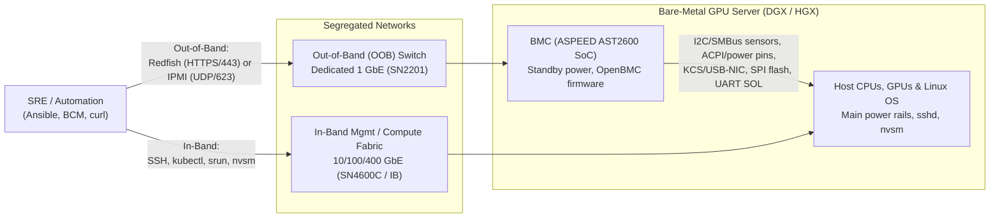
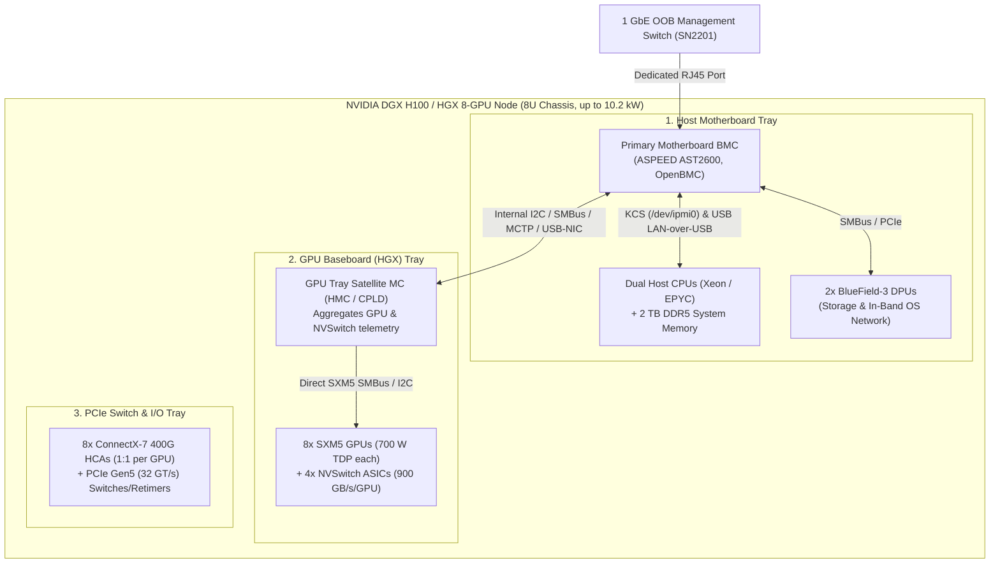
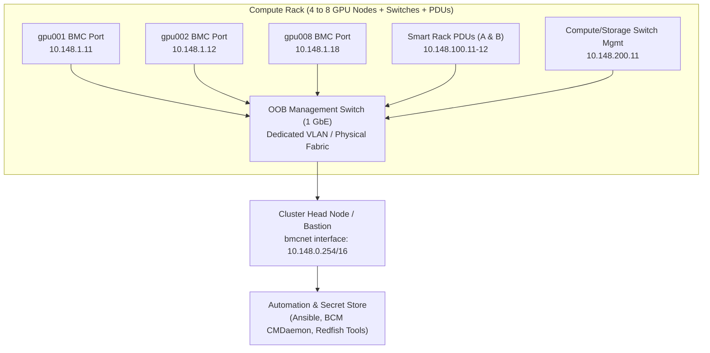

# 7.1 BMCs, IPMI and out-of-band management

| | |
|---|---|
| Level | Beginner to Intermediate |
| Priority tier | 1 |
| Lab venue | Laptop (`code/part07/oob_sim.py`, `cred_audit.py`, and `oob_cred_lab.py`) |
| Part | Part 7: Redfish and BMC |
| Status | Drafted. The scripts `oob_sim.py`, `cred_audit.py`, and `oob_cred_lab.py` passed 3/3 self-checks on a laptop. The `ipmitool` and `nvsm` commands come from vendor and textbook sources and have not been tried on a live physical BMC. |

## Why this matters for AI infrastructure

Picture a GPU server that stops answering in the middle of a long job. An eight-GPU server, such as an NVIDIA DGX H100 or HGX node, costs hundreds of thousands of dollars. It draws up to 10.2 kW, and it sits in a dense data center hall that may be thousands of miles from your desk. A training run may already have consumed days of compute, and every hour the box stays frozen is an hour of expensive hardware doing nothing.

In a public cloud, a frozen virtual machine is easy to recover. A hypervisor, which is a thin layer of software that splits one physical machine among several guests, sits underneath each virtual machine. You click "Reboot" in a web portal, and the hypervisor resets the guest from the outside. That outside layer is why a cloud user almost never needs to walk to a rack. On bare-metal AI infrastructure, **there is no hypervisor underneath your host operating system**. Nothing outside the server can reset it for you, so you need a different kind of door.

Say the Linux kernel panics during a 512-GPU training run. Or a PCIe bus lockup wedges the CPUs during Power-On Self-Test (POST), the self-check that runs each time the machine powers up. In either case, SSH drops at once. Kubernetes marks the node `NotReady`, Slurm marks it `DOWN*`, and the in-band 100G and 400G network interfaces go dark. The kernel is the core of the operating system, and when it panics it stops all work on the machine. The host cannot report its own failure, because the host is the thing that failed.

Without an independent recovery path, every hung kernel or BIOS change would need a technician with a crash cart. That person would walk down the hot aisle and press a physical power button. The Baseboard Management Controller, or BMC, removes that dependency. It is a small, independent computer soldered onto the server motherboard. Think of it as a second, much smaller computer that lives on the same board and has its own network cable. It runs from auxiliary standby power whenever AC power is connected, and it has its own dedicated out-of-band (OOB) management network. From there it can read thermal sensors, capture hardware fault logs, stream the serial console, flash firmware, and toggle the power-reset lines of the host CPUs.

Every later chapter in Part 7 builds on the BMC. So do the bare-metal provisioning and autonomous recovery pipelines in Parts 6 and 8. Before you plan any recovery runbook, confirm that every node has a working BMC path. A runbook that assumes a BMC which nobody has ever logged in to is a plan that will fail on the night you need it.

## Prerequisites and outcomes

You need basic IP networking knowledge and some comfort with the Linux command line. The essentials are MAC addresses, DHCP, subnets, VLANs, and TCP/UDP. If any of those terms feel shaky, go back to the networking basics earlier in this handbook before you continue.

The chapter starts with the BMC itself, how it gets power, and why it stays reachable when the host is down. It then looks at the two doors into every server, in-band management with `ssh` or `kubectl` and out-of-band management on its own network. It also looks at the parts inside a dual-tray `8U` DGX H100 or HGX node, such as the motherboard BMC (ASPEED `AST2600`), the GPU tray's Satellite Management Controller, the internal `I2C` and `SMBus` buses, and the local KCS interface. Then it shows how to design an isolated out-of-band network on `10.148.0.0/16`. After that come the `ipmitool` commands you will type most often, which are `lan`, `power`, `mc`, `sensor`, `sdr`, `user`, `channel` and `sol`. You will also see why `-I lan` differs from `-I lanplus` (UDP port `623`), and how to recover a wedged BMC from the host OS with `ipmitool mc reset cold`. Next come the console options (SOL, `conman`, `powerman` and `iKVM`) for boot and BIOS troubleshooting, a fleet credential audit built on `credentialsoverview --inverse` and `code/part07/cred_audit.py`, and the reasons modern AI factories moved to Redfish. Each part has a short script or command you can run yourself, including `code/part07/oob_sim.py`, which traces which failures break each path.

Start with the section that matches the problem in front of you, and work through its command or script first. Reading the theory afterward makes it stick much better.

## 1. The problem in one story: two doors into every server

It is 02:30 in a remote colocation facility, and a 64-node training cluster is running. One compute node hits an uncorrectable PCIe fatal error and triggers a Linux kernel panic. Its cooling fans stay spun up and its status LEDs still glow. But `ssh`, `ping`, `slurmd` and `dcgm-exporter` stop answering at once, because the host CPUs and the host networking stack are frozen. The page lands on your phone, and the question is not why the node crashed. The question is how you get back into it.

Every enterprise server gives you two completely separate doors into the machine. Learn to tell them apart, because the failure you are dealing with decides which door you can use.

The first door is in-band management. Traffic enters through the server's production or host-management adapters, such as `ConnectX-7` or `BlueField-3`. The running Linux kernel and user-space daemons (`sshd`, `slurmd`, `kubelet`, `nvsm`) process that traffic. In-band management is fast and feature-rich. But it works only when host power is on, the kernel is healthy, and the production network is up. When the node panics, this door closes with it.

The second door is out-of-band (OOB) management. Traffic enters through a dedicated `1 GbE` RJ45 port on the back of the chassis. That port connects to an isolated OOB switch, `SN2201` in the DGX SuperPOD reference architecture, and ends directly at the BMC. The BMC has its own ARM processor, its own RAM and flash storage, and its own embedded Linux firmware, such as OpenBMC. It runs from the power supply's auxiliary standby rail, named `5V_STBY` / `12V_STBY`. So it stays online even when the main CPUs and GPUs are powered off or locked in a kernel panic. The second door does not depend on the first one at all, and that independence is the whole point.

The DMTF Redfish Specification defines the BMC formally in section 3.1.1 of DSP0266 v1.21.0. It describes the BMC as an *"embedded device or service — typically an independent microprocessor or system on a chip with its own firmware"* that performs out-of-band monitoring and management of the host platform. The definition matters because it says the BMC is a device in its own right, not a feature of the operating system.



### 1.1 Modeling failure boundaries (`code/part07/oob_sim.py`)

Suppose you are on call and the alert says `gpu042` has gone quiet. Before you touch anything, you need to know which of your two doors still works. What happens to SSH and BMC access when one component fails? The state machine in `code/part07/oob_sim.py` answers that question. It checks six common data-center failure scenarios. Each scenario is built from five physical inputs: `ac_power`, `host_power`, `os_state`, `mgmt_switch_up` and `prod_network_up`. Because the answers come from a simple model, you can change one input and see the effect right away.

```bash
$ python3 code/part07/oob_sim.py
scenario                    SSH  BMC  reset  sensors  advice
healthy server              yes  yes    yes      yes  normal management
OS kernel panic              NO  yes    yes      yes  use the BMC (Redfish/IPMI) to inspect or reset
host powered off             NO  yes    yes      yes  use the BMC (Redfish/IPMI) to inspect or reset
production network down      NO  yes    yes      yes  use the BMC (Redfish/IPMI) to inspect or reset
management switch down      yes   NO     NO       NO  normal management
rack lost AC power           NO   NO     NO       NO  nothing remote works: smart hands or fix power/network
```

This table shows three rules that govern bare-metal reliability. Read them as a checklist you run through in your head whenever a node goes quiet.

The first rule is that the BMC rescues you from host-side failures. During an OS kernel panic, an accidental `shutdown -h now`, or a production leaf-switch outage, SSH is dead and shows `NO`. The BMC still shows `yes`. From there you can read the System Event Log (SEL), inspect thermal sensors, open a serial console, or trigger a power reset. In practice, this is the row you will use most often, because host-side failures are the common ones.

The second rule is that the OOB network and the standby power are single points of recovery failure. If the OOB management switch loses power, as in `management switch down`, jobs keep running over the production network, and SSH stays `yes`. Nothing is broken for the users. But you lose your recovery door to every server in the rack at once, and that is a worse position than it sounds. If the rack loses AC power (`rack lost AC power`), both the main and standby rails drop. Neither SSH nor the BMC can answer until power returns. That is why smart rack PDUs and UPS battery monitoring from Chapter 6.30 sit on the OOB plane. They are the last line of recovery, so they need the same care as the servers they feed.

The third rule covers the case where the BMC itself crashes while the host OS is still running. The BMC and the host CPUs are independent computers, so the BMC can hang on its own. A bad firmware flash or a memory leak in its web server can cause this. When it happens, the chassis fans usually fail safe to 100% speed. OOB Redfish and IPMI stop responding, which shows as `BMC = NO`. Yet SSH into the host OS still works, and it shows `SSH = yes`. The host talks to the BMC over an internal motherboard bus called KCS, short for Keyboard Controller Style. The `ipmi_si` kernel driver exposes it at `/dev/ipmi0`. So you can SSH into the host and reboot the hung BMC from the inside with `ipmitool mc reset cold`. This is the one case where the in-band door is the way back to the out-of-band door.

When one door closes, try the other, and check the BMC before you touch the hardware. A short check at the start saves a trip to the data hall.

---

## 2. Inside a GPU server: capabilities and dual-tray DGX/HGX anatomy

Suppose a temperature reading looks wrong, and you need to know which chip produced it. On a GPU server, the answer depends on which tray holds that chip. A standard server is simpler, so start there, and then move to the larger GPU systems.

In *Supercomputers for Linux SysAdmins*, chapter 10, Sergey Zhumatiy describes the management controller as *"a small independent server"*. It connects to the main motherboard through low-level hardware buses. Two of them matter most in this chapter. I2C and its close relative SMBus are two-wire buses that carry sensor readings. UART is a serial line that carries console text. Across standard 1U and 2U servers and 8U GPU systems, the BMC provides eight core capabilities. You will use most of them without thinking about the hardware behind them, so the table below ties each capability to the bus or pin that makes it work.

| Capability | Hardware Mechanism | Operational Use in an AI Cluster |
|---|---|---|
| **Power control** | Asserts physical power-good, ATX power-button, and hard-reset pins on the motherboard | Power on (`On`), clean ACPI shutdown (`GracefulShutdown`), hard power off (`ForceOff`), hard reset (`ForceRestart`), or diagnostic interrupt (`Nmi`) when the OS is locked |
| **Environmental sensors** | Polls voltage regulators, tachometers, and thermistors over `I2C` / `SMBus` / `PMBus` | Reads inlet/exhaust temperatures, PSU input/output watts, fan RPMs, and GPU/NVSwitch temperatures even when the host OS is unbooted |
| **System Event Log (SEL)** | Non-volatile flash ring buffer inside the BMC | Records hardware assertions (ECC double-bit faults, PSU cord pulls, thermal trips, PCIe AER fatal errors) that survive a host kernel panic and reboot |
| **Serial over LAN (SOL)** | Internal UART redirected from the host chipset to the BMC's network stack | Streams BIOS POST codes, GRUB menus, kernel boot messages, and `ttyS0`/`ttyS1` login prompts over the OOB network |
| **Remote KVM (`iKVM`)** | Built-in video frame grabber inside the ASPEED SoC + USB keyboard/mouse emulation | Renders the physical VGA/DisplayPort screen and injects keystrokes over a browser session for interactive BIOS or recovery troubleshooting |
| **Virtual Media** | Emulates a USB CD-ROM or NVMe/flash drive over the internal USB bus | Mounts a remote `.iso` recovery image over HTTPS so a server can boot a live rescue OS without plugging in a physical USB stick |
| **Out-of-band firmware update** | Direct access to SPI flash ROMs, CPLDs, and management buses (`nvfwupd` / Redfish `UpdateService`) | Flashes BMC, system BIOS/UEFI, GPU VBIOS, NVSwitch, and PCIe retimer firmware without relying on the host OS |
| **Hardware inventory** | Queries SMBIOS tables, SPD EEPROMs, and PCIe/MCTP endpoints | Reports CPU models, DIMM capacities and serial numbers, GPU SKUs, and NIC MAC addresses for CMDB reconciliation before an OS is installed |

Each row is a job the BMC can do without the host OS. Read the middle column for how it does the job, and the last column for why you would use it. For example, the sensor row explains why you can read a GPU temperature from a server whose OS has never been installed. The sensors sit on buses that the BMC reads directly.

Each vendor brands its BMC differently. Dell calls its BMC iDRAC, HPE calls it iLO, and Cisco calls it CIMC. Supermicro ships IPMI and Redfish. OpenBMC runs on NVIDIA DGX and hyperscale platforms. NVIDIA's Base Command Manager, or BCM 11, models all of these as variants of one node's **BMC interface**. That is good news for you. Once you learn the capabilities in the table, the brand name on the sticker changes only the menu you click through, not the job the BMC does.

### 2.1 Dual-tray physical hierarchy of an NVIDIA DGX H100 / HGX node

Standard 1U and 2U CPU servers put everything on one circuit board, and a single BMC chip manages it. Accelerated systems work differently. The **NVIDIA DGX H100/H200** uses an `8U` chassis and draws up to `10.2 kW` through six `3.3 kW` power supplies. The electrical and thermal load is too high for one board, so the hardware is split across several physical trays. A tray is a removable sub-assembly that slides into the chassis, and each one carries its own parts and its own management boundary.

The diagram below shows the three trays and the links between their controllers. Follow the arrow from the OOB switch to the primary BMC first, because that is the only door you can reach from the network. Every other link runs on the inside of the chassis.



Each tray has its own management boundary. Look at them one at a time, and ask which controller you would talk to for each kind of problem.

1. **Primary Motherboard BMC (ASPEED `AST2600`):** This chip sits on the host motherboard tray. It owns the external `1 GbE` OOB port. It authenticates Redfish and IPMI sessions, controls the chassis fans and PSUs, and manages the host CPUs and BIOS. When you need to talk to the box from the network, you talk to this chip.
2. **GPU Tray Satellite Management Controller (HMC):** The `8x` SXM GPUs and `4x` NVSwitch chips sit on a separate, removable **HGX GPU Baseboard Tray**. That tray carries its own **Satellite Management Controller**, a Hardware Management Controller implemented as an FPGA or CPLD. The satellite polls per-GPU die and HBM3 temperatures, board power, SXM voltage rails, and NVSwitch sensors. It passes them to the primary motherboard BMC over an internal management link, which is `MCTP` over `I2C`/`PCIe` or internal USB/Ethernet. When you query `/redfish/v1/Systems/HGX_Baseboard_0/Processors/GPU_SXM_0/EnvironmentMetrics` on a DGX BMC, the primary BMC is routing or aggregating telemetry from that satellite. You never talk to the satellite directly from the network. Chapter 7.13 covers this in depth.
3. **In-band `nvsm` versus out-of-band BMC:** Inside the running OS, the **NVIDIA System Management** daemon, `nvsm`, watches the hardware from the inside. It combines kernel logs, NVML GPU counters, PCIe link widths, and local BMC data over KCS. The NVML counters cover `18/18` NVLink lanes active at `900 GB/s`, and single- and double-bit ECC counts. Running `sudo nvsm show health` or `sudo nvsm show gpus` gives an immediate in-band summary. `sudo nvsm dump health` packages all system logs and hardware state into a support tarball, and NVIDIA RMA tickets require that tarball. When the OS is healthy, `nvsm` and `dcgm-exporter` give rich, high-frequency telemetry. When the OS crashes, the out-of-band BMC is your source of truth. Its Redfish paths `/redfish/v1/Chassis/DGX/Sensors` and `/redfish/v1/Managers/BMC/LogServices/SEL/Entries` are the authoritative record.

When you debug a DGX node, check `nvsm` first while the OS is up, and go to the BMC when it is not. That rule keeps you from reaching for the heavier tool when the lighter one will answer the question.

---

## 3. Designing the out-of-band management network

A new rack of servers has just been delivered, and every server in it needs a BMC address before anyone can reach it. The rack is on the loading dock, the cables are still in their bags, and the deadline for the cluster handover is next week. Mistakes made at this stage are slow to fix later, because every fix means visiting each server again. The BMC can power off nodes, mount virtual boot media, and flash motherboard and GPU firmware. That makes the out-of-band network the highest-privilege security domain in the data center. Design it as if an attacker would love to reach it, because one day one might.

Four engineering rules guide the layout. They come from *Supercomputers for Linux SysAdmins*, chapter 10, and from section 3.7 of the *BCM 11 Administrator Manual*. Each rule answers a problem you will hit during the first week of a new rack.

1. **Isolate the OOB network physically, or at minimum on a restricted VLAN.** *Supercomputers for Linux SysAdmins* warns bluntly that legacy BMC protocols *"are not really secure"*. The point is simple. If a user's job or a tenant's virtual machine can reach a BMC, that user can reach the power switch of every node on that subnet. *Supercomputers for Linux SysAdmins* recommends a physically separate 1 GbE switch fabric, such as the `SN2201` OOB fabric in a SuperPOD. At minimum, use a dedicated management VLAN that is **never trunked to user login nodes or tenant VMs**. A VLAN, or virtual LAN, is a tag that splits one physical switch into separate networks, and a trunk carries several of those tags to another device. If you tag VLANs on BMC ports, check hardware support first. Some BMCs need the VLAN ID set with `ipmitool lan set 1 vlan id <vid>` or through Redfish before they respond. Test that path on one node before you roll it out to the rest of the rack.
2. **Assign deterministic IP addresses from a single inventory.** In NVIDIA Base Command Manager (BCM 11, section 3.7), each node's BMC is a network interface of type `bmc`, usually named `ipmi0`. It attaches to a dedicated network called `bmcnet`, which defaults to **`10.148.0.0/16`**. In `cmsh`, you can define BMC interfaces across 150 nodes in one range command:
   ```text
   % device
   % addinterface -n node001..node150 bmc ipmi0 bmcnet 10.148.0.1
   % commit
   ```
   This assigns `10.148.0.1` through `10.148.0.150` sequentially to `node001..node150`. Think of the range as one line you write once. The first node gets `10.148.0.1`, and the 150th gets `10.148.0.150`, with no hand-typed address in between. The payoff comes later, when a typo cannot give two BMCs the same address, and a new engineer can predict any node's BMC address from its name.
3. **Collect BMC MAC addresses on day 0, and automate DHCP reservations.** A MAC address is the hardware address a network card carries, and a DHCP reservation ties one MAC address to one fixed IP address. *Supercomputers for Linux SysAdmins* shares a painful lesson from real cluster builds. Suppose you unbox 128 servers and never record their BMC MAC addresses. You have no source for the DHCP reservations, so you must connect a monitor, keyboard or laptop to each server and set its IPMI static IP by hand. That same book describes the work as something that *"may take weeks."* Recording the MAC addresses while the boxes are still open is a few minutes of work, and it saves the weeks.
4. **Give the cluster head node a direct leg on `bmcnet`.** The head node is the management server that runs the cluster software. For the management server or BCM head node to reach the BMCs without routing through external firewalls, BCM section 3.7 documents two topologies. The first is the better one, and the second is for small labs where you have no spare switch.
   - **Physically separate OOB switches (recommended):** Connect a dedicated physical NIC on the head node directly into the OOB switch fabric on `10.148.0.0/16`.
   - **Shared internal wiring (small labs only):** Configure a secondary IP alias interface on the head node's internal NIC so it can reach the BMC subnet.



The diagram puts everything that answers on the OOB network in one place. That includes the BMCs, the smart PDUs and even the top-of-rack switch management ports. The head node is the only bridge from the operators into that network, which is why it is the most important box to harden. Record every BMC MAC address on day 0, and build the DHCP reservations from that list rather than from memory.

---

## 4. IPMI 2.0 and `ipmitool` in practice

Picture a hung node and only a terminal on the head node. You need to read its sensors, check its event log and maybe power-cycle it. Which tool gets you into the box? The answer is often `ipmitool`, even though the industry has moved on from the protocol underneath it.

The **Intelligent Platform Management Interface (IPMI)** was started by Intel, Dell, HPE and NEC in 1998. It was standardized as **IPMI 2.0**. For two decades it was the universal command protocol for talking to a management controller (`MC`). `ipmitool` is the command-line client that speaks it. DMTF Redfish has since taken over most fleet automation, so you may wonder why you still need `ipmitool` at all. You still need it for three reasons.

1. It is the standard **in-band KCS tool**. You use it to configure or reset a hung BMC from inside the host Linux OS, with `ipmitool mc reset cold`. When the OOB door is locked and the in-band door still works, this is the command that opens the first one again.
2. It provides Serial over LAN (SOL), through `ipmitool sol activate`. That is still the fastest way to watch live BIOS POST codes and kernel boot messages in an SSH-like terminal.
3. Many brownfield (already built) HPC clusters and vendor recovery procedures still call `ipmitool` directly. The DGX H100/H200 Firmware Update Guide is one example. If you inherit a cluster, you will find scripts and runbooks full of these commands.

### 4.1 Local KCS kernel modules versus remote `lanplus` (`UDP 623`)

Sometimes a server's BMC network is disabled at the factory, or someone misconfigured it during an earlier install. Then the remote door is closed, and you need the local path. *Supercomputers for Linux SysAdmins*, chapter 10, covers this case. The fix is a local path. Load the three OpenIPMI kernel drivers, and the host can reach its own BMC over the motherboard KCS interface. Each driver has one job. `ipmi_si` talks to the KCS hardware, `ipmi_msghandler` routes messages between drivers and users, and `ipmi_devintf` creates the device file that `ipmitool` opens.

```bash
# Load Linux OpenIPMI kernel drivers for local in-band BMC access (/dev/ipmi0)
sudo modprobe ipmi_msghandler
sudo modprobe ipmi_si
sudo modprobe ipmi_devintf

# Query the local BMC directly without needing its IP address or network access
sudo ipmitool mc info
sudo ipmitool lan print 1
```

Once the drivers load, you can query the local BMC without its IP address or any network access. Run `ipmitool mc info` first, because it proves the KCS path works before you rely on it.

To talk to a remote server's BMC over the out-of-band network, `ipmitool` sends **RMCP+ (Remote Management Control Protocol Plus)** packets over **UDP port `623`**. UDP is a fast network protocol that does not confirm each packet, so the protocol builds its own session and encryption on top of it. The command below shows the safe form for a remote call.

```bash
# Safe remote invocation: read password from a 0600 file (-f) rather than CLI (-P)
ipmitool -I lanplus -H 10.148.1.11 -U bmcadmin -f /etc/bmc/passfile power status
```

The `-I` flag selects the interface, and the choice matters. *Supercomputers for Linux SysAdmins*, chapter 10, draws the line like this. Read the two bullets as a question and an answer: which protocol does this interface speak, and is that protocol safe to use today?

- **`-I lan`** speaks legacy **IPMI 1.5**. It lacks modern encryption and is incompatible with IPMI 2.0 sessions.
- **`-I lanplus`** speaks **IPMI 2.0 (RMCP+)** with AES session encryption. Always use `-I lanplus` for remote calls.
- **Never pass `-P <password>` on a multi-user system.** A password passed with `-P MYSECRET` shows up in `ps aux`, `/proc/<pid>/cmdline`, audit logs and `~/.bash_history`. Any other user on the box can read those places. Pass `-f <password_file>` instead, with a file that only you can read. You can also set the `IPMI_PASSWORD` environment variable from a vault.

On any remote call, use `-I lanplus` and a password file, and never `-P`. If you copy one habit from this chapter, copy that one.

### 4.2 Core `ipmitool` command groups and power operations

*Supercomputers for Linux SysAdmins*, chapter 10, sorts `ipmitool` into ten top-level functional groups. Each group covers one kind of task, so when you forget a command, first ask what kind of task you have. The table below lists the groups with an example for each. A group name tells you the family of work, and the example shows the exact syntax.

| Subcommand Group | Purpose | Example Command |
|---|---|---|
| `lan` | View or set BMC network configuration (IP source, address, netmask, MAC, gateway, VLAN) | `ipmitool lan print 1` / `ipmitool lan set 1 ipsrc dhcp` |
| `power` (or `chassis power`) | Query or change host chassis power state | `ipmitool power status`, `power on`, `power off`, `power cycle`, `power reset`, `power soft` |
| `mc` (or `bmc`) | Inspect or reset the Management Controller itself | `ipmitool mc info` / `ipmitool mc reset cold` |
| `sensor` / `sdr` | Read hardware Sensor Data Records (temperatures, fan RPMs, voltages, watts) | `ipmitool sdr list` / `ipmitool sensor list` |
| `sel` | Read or clear the non-volatile System Event Log | `ipmitool sel elist` / `ipmitool sel info` |
| `sol` | Start, configure, or close a Serial over LAN console session | `ipmitool sol info` / `ipmitool sol activate` / `ipmitool sol deactivate` |
| `user` | List or configure BMC user slots (`1..16`), names, and passwords | `ipmitool user list 1` |
| `channel` | Inspect BMC communication channels and per-slot access privileges | `ipmitool channel info 1` |
| `session` | List active IPMI sessions connected to the BMC | `ipmitool session info active` |
| `shell` / `exec` | Run multiple `ipmitool` commands interactively or from a batch file | `ipmitool exec setup_bmc.txt` |

When you control host power with `ipmitool power`, the six actions below do very different things. Read each hardware action before you run one, because a single wrong word here can cut power to a node in the middle of a job. The table is a lookup, so come back to it whenever you are unsure which action fits the moment.

| Power Command | Hardware Action | Operational Guidance (Supercomputers for Linux Sysadmins, chapter 10) |
|---|---|---|
| `power status` | Queries current main power rail state (`Chassis Power is on/off`) | Safe read-only check |
| `power soft` | Sends an ACPI power-button pulse to the host OS | Triggers a clean OS shutdown if the kernel is alive |
| `power on` | Turns on main host power rails | Boots a powered-off server |
| `power off` | Immediately drops main host power rails (equivalent to yanking AC cords from host PSUs) | **Hard power cut.** Does not sync filesystems; use only after `power soft` / SSH fails and the node is drained in Slurm |
| `power cycle` | Powers off main rails, waits briefly, and powers back on | Supercomputers for Linux Sysadmins, chapter 10 warns that `power cycle` is **not always reliable across all BMC firmwares**; in scripts, prefer an explicit `power off`, a `10–15 s` pause while polling `power status` for `off`, and then `power on` |
| `power reset` | Pulses the motherboard warm-reset pin without dropping PSU rails | Equivalent to pressing the front-panel reset button; note that PCIe switches/FPGA retimers keep standby/main power and only reload on a full `power off` → `power on` or AC cycle |

The gap between `power soft` and `power off` is the one that matters most. A soft power pulse lets the OS shut down cleanly, so its disks flush and its services stop in order. A hard power cut does not sync filesystems, which means data that was still in memory can be lost. Reserve `power off` for the case where `power soft` and SSH have both failed and the node is already drained in Slurm. Draining means you have told the scheduler to stop placing new jobs on the node, so nothing is running on it when you cut the power. For scripts, write the three steps out explicitly rather than trusting `power cycle`.

### 4.3 Configuring BMC network and user slots (Supercomputers for Linux Sysadmins, chapter 10 walkthrough)

You have just booted a brand-new compute node from a live image. Its BMC still has no network settings and no admin account. Nobody can reach it from the OOB network, and the rack is waiting for it to join the cluster. This is the moment to configure both.

Suppose you want Channel `1` to use a static IP. You also want an administrator account in User Slot `3`, named `adminuser`, with Serial over LAN access enabled. A channel is one of the BMC's network paths, and a user slot is one of its account entries. *Supercomputers for Linux SysAdmins*, chapter 10, walks through the exact sequence, and the commands below follow it. Run them one group at a time, and check the result before you move to the next group.

```bash
# 1. Inspect current network configuration on Channel 1 (IP source, IP, netmask, MAC, gateway, VLAN)
sudo ipmitool lan print 1

# 2. Configure static IP (or use 'ipsrc dhcp' if DHCP reservations are ready)
sudo ipmitool lan set 1 ipsrc static
sudo ipmitool lan set 1 ipaddr 10.148.1.11
sudo ipmitool lan set 1 netmask 255.255.0.0
sudo ipmitool lan set 1 defgw ipaddr 10.148.0.1

# 3. Create 'adminuser' in User Slot 3 and assign privilege level 4 (Administrator) on Channel 1
sudo ipmitool user set name 3 adminuser
sudo ipmitool user set password 3 "R9#vK2!mQ8$pL5@x"
sudo ipmitool user priv 3 4 1
sudo ipmitool user enable 3

# 4. Enable LAN channel access and SOL payload for Slot 3 on Channel 1
sudo ipmitool lan set 1 access on
sudo ipmitool channel setaccess 1 3 callin=on ipmi=on link=on privilege=4
sudo ipmitool sol payload enable 1 3
sudo ipmitool sol set enabled true 1
```

Step 2 gives the BMC a fixed address, which is the simplest option when you have not yet set up DHCP reservations. Step 3 creates the account and gives it full rights. Step 4 turns the network path on and allows that account to open a serial console. If you skip step 4, the account exists but cannot use SOL, and that failure looks confusing the first time you hit it.

A note on `lan set 1 auth`. Older IPMI 1.5 tutorials enabled `md5` authentication for legacy clients. One example line of that kind, `ipmitool lan set 1 auth admin md5`, appears in *Supercomputers for Linux SysAdmins*, chapter 10. On modern clusters, disable IPMI 1.5 (`lan`) completely. If IPMI is still required, use the IPMI 2.0 `lanplus` cipher suite `17`, which is HMAC-SHA256 with AES-CBC-128. Otherwise, disable IPMI over LAN and use Redfish over TLS 1.2 or later, as Chapter 7.15 covers. TLS is the encryption layer that protects HTTPS traffic, and it is the reason Redfish is the safer long-term choice.

Before you move on from a new node, confirm that `lan print 1` shows the address you set. A quick check now costs seconds, and a wrong address found later costs a return trip to the rack.

---

## 5. Out-of-band consoles: SOL, `conman`, `powerman`, and `iKVM`

A node hangs during UEFI POST and never reaches the network. Or it prints a kernel panic that never makes it to `rsyslog`, the system that collects log messages. In both cases the answer is on the console, the screen and keyboard that a person would normally use at the machine. You need to see what the console is printing, and this section explains the three ways to get that view over the network.

*Supercomputers for Linux SysAdmins*, chapter 10, and the Redfish Specification, section 5.5, compare three console mechanisms. Each one answers a different question, so the choice depends on what you need to see.

### 5.1 Serial over LAN (SOL)

IPMI 2.0 can carry a virtual serial port over UDP port `623`. A serial port is the old-fashioned text line that a server uses for its console. The port is usually `ttyS0` or `ttyS1`, typically running at `115200 8N1`. That setting means 115200 bits per second, eight data bits, no parity and one stop bit. The exact values matter only when you configure the host, so you can copy them from the example and move on.

- **How to connect:** Run `ipmitool -I lanplus -H <bmc-ip> -U <user> -f <passfile> sol activate`. The session starts, and whatever the host writes to its serial port appears in your terminal.
- **How to disconnect safely:** Type the escape sequence `~.` at the start of a new line. That is a tilde followed by a period.
  - **The SSH trap (*Supercomputers for Linux SysAdmins*, chapter 10):** OpenSSH uses the same `~.` sequence to end an SSH session. So if you are SSH'd into a bastion host and run `ipmitool sol activate`, a `~.` will kill your outer SSH connection to the bastion. To pass `~.` through one SSH hop to `ipmitool`, type `~~.`, which is two tildes and a period. You can also pass `-e <char>` to `ssh` or `ipmitool` to change the escape character. A bastion is a hardened gateway host that you log in through before you reach the cluster, and this trap catches people who work through one all day.
- **Required host OS configuration:** To see kernel boot messages and a login prompt over SOL when the network is down, two things must be in place. The kernel command line in `/etc/default/grub` must send the console to the serial port. And `systemd` must start an `agetty` on that port. `agetty` is the small program that puts a login prompt on a terminal. The kernel line looks like this.
  ```text
  GRUB_CMDLINE_LINUX="console=tty0 console=ttyS1,115200n8"
  ```
  The first console argument keeps the local screen working, and the second one sends the same output to the serial line. Without the second argument, the SOL session stays silent during boot.

### 5.2 Console aggregation with `conman` and power control with `powerman`

Opening `ipmitool sol activate` sessions by hand works for one node. It does not scale when you want to capture kernel panics across `128` nodes automatically. If a node panics at 04:00 and you were not watching, a manual session gives you nothing. You need a service that is always listening, and that is where the next two tools come in.

- **`conman` (Console Manager):** This daemon runs on the management or head node. It keeps persistent background connections to every compute node, over SOL, telnet or serial. It timestamps and logs every line of console output from every node to `/var/log/conman/<node>`. So when `gpu042` panics and reboots at 04:00, the full kernel oops stack trace is already in a text file on the head node. You can also attach to a console interactively with `conman gpu042`, or broadcast keystrokes across several consoles. A kernel oops is the kernel's own report of a serious error, and its stack trace is the first clue about what went wrong.
- **`powerman`:** `conman` handles consoles only, not power. *Supercomputers for Linux SysAdmins* points out that gap. **`powerman`** is the companion daemon. It hides IPMI BMCs and network-attached smart PDUs behind one CLI, so you do not need to remember which vendor each rack uses. For example, `pm -1 gpu042` powers on, `pm -0 gpu042` powers off, and `pm -c gpu042` cycles power. Cluster managers build the same capabilities into their own control daemons. xCAT offers `rcons` and `rpower`, and BCM offers the `power` and `console` commands in `cmsh`.

Set up `conman` before the first panic, so the stack trace is already on disk when you need it. Writing the log after the event is too late, because the event is already gone.

### 5.3 KVM over IP (`iKVM`) and why Redfish does not carry video streams

Text output is not always enough. An add-in card may show a graphical UEFI option ROM error before serial redirection starts, and then you need to see the screen. **KVM over IP (`iKVM`)** captures the server's video framebuffer and injects USB keyboard and mouse events over the network. A framebuffer is the memory that holds the picture on screen, so capturing it means you see what a monitor plugged into the server would show.

*Supercomputers for Linux SysAdmins*, chapter 10, makes two practical points about `iKVM`. Both points explain why you should use it rarely.

1. **Built-in BMC `iKVM` beats external KVM switches.** Modern BMCs include the video capture hardware inside the ASPEED chip. External rack KVM appliances need bulky dongles, and they cannot toggle motherboard power pins. A built-in path works even when the server has no operating system at all.
2. **A lack of a wire standard makes `iKVM` unsuitable for fleet automation.** Vendors have historically used proprietary HTML5 websockets, VNC variants or legacy Java applets. You cannot reliably script BIOS changes for 128 servers by clicking pixels in a browser window. Every vendor's picture protocol is different, so a script built for one breaks on the next.

**What the Redfish Specification says (DSP0266 §5.5):** The DMTF authors address this in section 5.5, *Service elements*. KVM (`GraphicalConsole`) and serial console (`SerialConsole`) are *"critical functionality"*. But streaming interactive video or terminal characters is not a job for a stateless JSON REST protocol. A stateless protocol treats each request as a separate event and does not keep a live stream open. Instead, Redfish exposes structured metadata under `/redfish/v1/Systems/<id>` and `/redfish/v1/Managers/<id>`. A client can discover which console types are enabled, such as `IPMI`, `SSH`, `Telnet`, `WebSocket` or `KVMIP`, and on which port. It can also use REST resources such as `/Bios/Settings` and `/Boot` to automate changes that once needed `iKVM`. In other words, Redfish tells you where the console is, and the console itself stays a separate tool.

For a fleet, rely on SOL and `conman` for text, and keep `iKVM` for the cases that need a picture. That split keeps your automation simple and keeps the graphical path for the rare problem that really needs eyes on the screen.

---

## 6. Fleet BMC credential hygiene and salted fingerprint auditing

Picture a technician replacing a motherboard on `node005`. The new board comes up with its vendor default password, and nobody rotates it. The node goes back into service, and the change ticket is closed. Three weeks later, a script that uses that default password is on a laptop in a coffee shop. A single compromised BMC credential lets an attacker boot malicious images or flash modified firmware, so this kind of slip matters. Across a large fleet, three anti-patterns keep coming back.

1. **Factory defaults left on RMA replacements.** A technician swaps a motherboard on `node005` and forgets to rotate the BMC password. The node stays on a well-known vendor default, such as `admin`/`admin`, `root`/`calvin`, `ADMIN`/`ADMIN` or `root`/`0penBmc`. It may also have an empty password. An RMA is a return-merchandise replacement, the process of sending a faulty part back to the vendor and getting a new one.
2. **Configuration drift across racks.** One batch of nodes gets one password. A later expansion gets another. Then the automated Redfish fence or STONITH calls fail during an outage. STONITH, short for "shoot the other node in the head," is the cluster step that forcibly powers off a node that might be misbehaving, and it depends on working BMC credentials.
3. **Cleartext passwords leaked in audit tools.** Naive scripts print passwords to stdout or to log files while they check whether nodes match. Anyone who reads that log now has the password for every node in it.

### 6.1 How BCM 11 manages and audits BMC credentials (`credentialsoverview`)

In the *BCM 11 Administrator Manual*, section 3.7, `CMDaemon` stores BMC credentials centrally at the **partition** level, under `bmcsettings`. CMDaemon is the BCM service that runs on the head node and manages the cluster. A partition is a top-level grouping of nodes that BCM uses for shared settings. The default username is `bright`, with a unique random password generated at installation. You can override these values at the **category** or **device** level. A category is a group of similar nodes, and a device is one node.

```text
% partition use base
% bmcsettings
% set username bmcadmin
% set password
% commit
```

Inheritance runs from partition to category to node. A node takes the value from its category if the category sets one, and from the partition if the category does not. That design is convenient, but it makes it hard to see which nodes have drifted. BCM therefore provides the **`credentialsoverview`** command, and **`credentialsoverview --inverse`**, to surface them. Its security design is worth studying, because it shows a textbook pattern.

- **Never display the password.** Instead of printing passwords, `credentialsoverview` hashes each username-and-password pair with SHA-256, adding a random salt for each session. A hash is a one-way scrambling of the text, and a salt is a random value mixed in before the scrambling, so the same password gives different output each time. It prints a short hex **fingerprint**.
- **Group by fingerprint (`--inverse`), smallest groups first.** Within one run, every node with the exact same username and password gets the same fingerprint. Sorting from the smallest group to the largest puts the 1 or 2 misconfigured outlier nodes at the very top of the screen. The random per-session salt also means a screenshot of a fingerprint cannot serve later as an offline rainbow-table target. A rainbow table is a precomputed list of hashes that attackers use to look up passwords, and a fresh salt makes that list useless.

### 6.2 Running the fleet credential auditor (`code/part07/cred_audit.py`)

We implemented this exact salted-fingerprint algorithm in `code/part07/cred_audit.py`. We tested it on `code/part07/sample_bmc_accounts.csv`, which covers seven nodes. The sample file stands in for the export you would get from your real inventory, so you can run the same audit on a laptop before you touch production.

```bash
$ python3 code/part07/cred_audit.py code/part07/sample_bmc_accounts.csv
count  user       fingerprint    nodes
    1  bmcadmin   a976aeb2f79b   node003
    1  admin      596fd789214c   node005
    1  bmcadmin   86daac35a5ea   node006
    4  bmcadmin   81c34f302ad8   node001,node002,node004,node007

4 different credential sets: the smallest group is probably the odd one out
PROBLEM node005: factory-default credentials (admin)
PROBLEM node006: empty BMC password
```

The auditor catches four separate problems in five lines of output, and it never prints a password. Read the table as groups. Each row is one set of credentials, and the node list tells you who shares it. The bottom two lines name the nodes that break a rule.

- `node001, node002, node004, node007` (`4` nodes) share the standard fleet credential (`bmcadmin`).
- `node003` (`1` node) has the right username, `bmcadmin`, but its password has drifted.
- `node005` (`1` node) is still on factory-default credentials, `admin`/`admin`.
- `node006` (`1` node) has an empty password.

Our self-checking lab script, `code/part07/oob_cred_lab.py`, verifies both `oob_sim.py` and `cred_audit.py` from end to end. It runs the simulation, then runs the auditor on a bad sample and on a fixed sample, and it checks that each run returns the right answer.

```bash
$ python3 code/part07/oob_cred_lab.py
PASS: oob_sim.py models in-band SSH vs out-of-band BMC reachability across all 6 scenarios
PASS: cred_audit.py detects 4 credential groups, node005 factory-default (admin), and node006 empty password (exit 1)
PASS: cred_audit.py exits 0 with 1 group (7 nodes) when all BMCs share a strong 16-char rotated credential
Summary: 3 passed, 0 failed (total 3)
```

Run the audit after every RMA swap, and treat an empty or factory-default password as a fault to fix at once. The audit is cheap, so make it a habit rather than a special event.

---

## 7. Why the industry moved from IPMI to DMTF Redfish

Most new automation you write for a GPU fleet will talk to Redfish, not IPMI. Why did the industry make that move? Why did the DMTF, the Distributed Management Task Force, create the Redfish standard (DSP0266) to succeed IPMI? And why does NVIDIA document Redfish as the primary management API for DGX H100, H200, B200, and GB200 systems? The short answer is that IPMI was built for one simple server, and AI systems are not simple. The table below compares the two designs one limit at a time.

| Architectural Dimension | Legacy IPMI 2.0 | DMTF Redfish (DSP0266 v1.21.0) |
|---|---|---|
| **Transport & Security** | Custom RMCP+ binary framing over **UDP port `623`**; historical cipher suite weaknesses (e.g., Cipher 0, RAKP hash exposure) | Standard **HTTPS over TCP port `443`**; Specification §13.1 mandates **TLS 1.2 or later** |
| **Data Model & Payload** | Fixed-size binary structs and flat Sensor Data Records (SDRs); no hierarchy for multi-tray systems | Human-readable **JSON payloads** backed by versioned **CSDL/JSON Schemas** and **OData** hypermedia conventions |
| **Authentication & Sessions** | Per-channel slot table (`1..16` users) with coarse privilege levels | HTTP Basic (over TLS) and stateful **`SessionService` tokens (`X-Auth-Token`)** + granular RBAC (`Administrator`, `Operator`, `ReadOnly`, DSP0266 §13.3) |
| **Accelerator & Fabric Coverage** | Almost non-existent in standard IPMI; requires undocumented vendor `raw` hex bytes | First-class schemas for `Systems`, `Chassis`, `Managers`, `Processors` (`GPU_SXM_<id>`), `Memory`, `PCIeDevices`, `NVSwitches`, `Sensors`, `UpdateService`, and `TelemetryService` |
| **Automation Ergonomics** | Requires shelling out to `ipmitool` and screen-scraping text tables | Works natively with `curl`, Python `requests`, Ansible `ansible.builtin.uri`, Go `gofish`, and standard CI/CD tooling |

Read the table row by row. Each row names a limit of IPMI 2.0 and what Redfish does instead. The transport row explains why Redfish can pass through the same firewalls and TLS tooling as any web service. The data model row explains why a JSON payload can describe a multi-tray system that a flat list of sensor records cannot. The automation row is the one you will feel every day, because a script that parses JSON is easier to write, test and review than one that parses hex.

### 7.1 The golden rule of Redfish: "Interoperable does not mean identical"

Suppose you write a script that works perfectly on one vendor's BMC, and then it fails on the next vendor's server in the same rack. You check the script and find nothing wrong. The paths look right, and the commands look right. The problem is an assumption that the two servers have the same resource names. Sections 5.1 through 5.4 of the Redfish Specification (DSP0266) set out the design tenets that explain this. They separate the protocol from the data model. Every resource is reachable from one Service Root, `/redfish/v1/`, by following `@odata.id` hypermedia links. The JSON payloads can be read by any programmer without a binary decoder.

DSP0266 §5.4 gives one warning that every infrastructure developer should remember: "Interoperable does not mean identical." Two servers can speak the same protocol and still expose different parts of the model. The protocol gives you a common grammar, and the hardware gives you different sentences.

- A 1U edge server, an 8U dual-tray DGX H100, and a liquid-cooled rack-scale GB200 NVL72 have very different physical layouts. So Redfish lets many properties and subtrees be optional. Platforms also name their collection members after their hardware. A DGX H100 uses `Systems/DGX` and `Systems/HGX_Baseboard_0`, while other OEM servers use `Systems/1` or `Systems/System.Embedded.1`. OEM means original equipment manufacturer, the company that built the server.
- **Never hard-code deep resource URIs across heterogeneous fleets, and never reuse `@odata.id` paths discovered on one vendor's BMC against another.** Start at `/redfish/v1/`, read the collection members, and follow `@odata.id` links dynamically. Every tool in `code/part07/` uses this pattern. The extra step costs one request per run, and it saves you from a script that breaks on the first mixed rack.

### 7.2 Why out-of-band firmware flashing beats an in-band SSH loop

Imagine a junior engineer who proposes updating firmware on 100 GPU servers with a Bash `for` loop. The loop would SSH into each host, download the firmware bundle, and flash the hardware in-band. It looks simple, and it is the design you should reject. The reason is not that loops are bad. The reason is where the loop runs, and what it depends on while it runs.

Why reject it in favor of out-of-band Redfish, through `UpdateService` or `nvfwupd --target ip=<bmc-ip>`? The answer has three parts.

1. **Independence from host OS and in-band network crashes.** An in-band SSH session depends on the Linux kernel, the PCIe bus, the host NIC driver and the production network. All of them must stay up for the whole flash. If the host kernel panics, the OOM killer fires, or a network adapter reset drops the SSH connection mid-transfer, the orchestrator loses control and visibility in the middle of the update. The OOM killer is the Linux process that shuts down memory hogs when the machine runs out of RAM. A half-flashed GPU is much harder to recover than a failed script, so the loop has to survive the crash, and an SSH session cannot.
2. **Asynchronous task tracking on standby power.** You can trigger an update through the BMC's Redfish `/redfish/v1/UpdateService`, with either a `SimpleUpdate` pull or a multipart push to `/UpdateService/upload`. A pull means the BMC downloads the image from a URL you give it, and a push means you upload the file yourself. The BMC runs on auxiliary standby power over the dedicated OOB network. It returns HTTP `202 Accepted` with a `/redfish/v1/TaskService/Tasks/<id>` monitor URI. Then it stages the image into flash, independent of the host OS. Your script gets a ticket number and can check on it later, without holding a connection open for the whole flash.
3. **State the engineering nuance accurately.** Out-of-band flashing is significantly safer than an uncoordinated SSH loop, **but it is not magic**. The *NVIDIA DGX H100/H200 Firmware Update Guide*, section 4.5, says you must still **drain and quiesce the host first**. Quiescing means stopping all activity so the hardware is idle and nothing writes to it during the change. That means stopping GPU workloads and `nvidia-smi` polling, which can block GPU VBIOS flashing. You must also run the activation step for each component, because a new firmware image often does nothing until the right kind of reset loads it.
   - **BMC firmware:** Cold reset of the BMC (`ipmitool mc reset cold` or Redfish `Manager.Reset`).
   - **System BIOS and GPU tray (VBIOS / NVSwitch):** Cold host system reset (`ForceOff` followed by `On`, or `GracefulRestart`).
   - **PCIe switches, retimers, EROT, and CPLDs:** Full **AC power cycle** (or virtual AC cycle via PSU/PDU).

Before you schedule a firmware push, drain the host and plan the reset step for each component. The out-of-band transfer alone does not finish the job. A firmware update is a sequence of three things, the transfer, the activation and the verification, and each one needs its own check.

---

## Exercises

Each exercise turns one idea from this chapter into something you can see on a screen. Work through them in order, because the later ones use what the earlier ones taught you. The labs for these exercises ran on a laptop, but the `ipmitool` and `nvsm` steps were not run on a live cluster. Treat those commands as untested until you run them against hardware you own.

1. Extend the failure state machine in `code/part07/oob_sim.py`. Add a seventh tuple to `SCENARIOS` for the case `"BMC firmware crashed"`. Set `ac_power=True`, `host_power=True`, `os_state="running"`, `mgmt_switch_up=True` and `prod_network_up=True`. Add a `bmc_alive` boolean parameter. Check that in-band `SSH` stays `yes` while out-of-band `BMC` shows `NO`. Then write down the exact in-band `ipmitool` command you would run over SSH to reboot the hung BMC over KCS.
2. Run `python3 code/part07/cred_audit.py code/part07/sample_bmc_accounts.csv` twice in a row. Watch how the 12-character hex fingerprints change between runs. Notice that the grouping (1, 1, 1, 4) stays the same. Then run `python3 code/part07/oob_cred_lab.py` and read how Check 3 builds a remediated CSV that exits with status `0`.
3. You are designing the management network for a 128-node DGX H100 cluster in 16 racks. Each rack has 2 smart PDUs. The cluster also has 32 compute leaf switches, 16 compute spine switches and 8 storage switches. Count the switches first. Then add 4 in-band switches, 4 OOB switches, 2 UFM appliances and 2 head nodes. Count the OOB addresses you need. Then pick a subnet size that leaves at least 50% headroom.
4. You SSH from your laptop into `bastion.cluster.local`. From the bastion you run `ipmitool -I lanplus -H 10.148.1.42 -U bmcadmin -f passfile sol activate` to inspect a hung node. Write the keystrokes that close the SOL session. Make sure the bastion session stays open after you do. Then write the kernel parameters that make `ttyS1` show boot messages at 115200 baud.
5. A compute node looks frozen because SSH times out. Write a six-step recovery checklist for it. Put the steps that destroy no evidence first, such as reading the event log and opening the SOL console. Move to a hard power cycle only after those steps have failed.
6. List the three trays of a DGX H100 and name the management controller on the host tray and on the GPU tray. Then say which Redfish URI trees hold host-level sensors and which hold per-GPU environment metrics.

---

## Checkpoint questions (20)

<details>
<summary>1. What is a Baseboard Management Controller (BMC), and how does the DMTF Redfish Specification (DSP0266 §3.1.1) define it?</summary>

A BMC is an independent, always-on microcontroller or System-on-Chip, such as an ASPEED `AST2600`, soldered onto a server motherboard. It has its own CPU, RAM, flash storage, firmware such as OpenBMC, and a dedicated network interface. DSP0266 §3.1.1 defines it as an *"embedded device or service — typically an independent microprocessor or system on a chip with its own firmware"* that provides out-of-band monitoring and management of the host system.
</details>

<details>
<summary>2. Why does the BMC continue working when the server's operating system panics or when the server is powered off?</summary>

The BMC runs its own OS and network stack on separate hardware. It draws power from the power supply's auxiliary standby rail, `5V_STBY` / `12V_STBY`. That rail stays energized whenever the server is plugged into live AC power. The main rails that feed the x86 or ARM CPUs and the GPUs can be off, and the BMC keeps running.
</details>

<details>
<summary>3. What two physical dependencies must be healthy for you to reach a BMC remotely over the network?</summary>

You need two things. The first is standby AC power to the server's power supplies. The second is a working out-of-band (OOB) management network path. That path covers the BMC's dedicated RJ45 link, the `1 GbE` OOB management switch, and the management interface on the head node or bastion.
</details>

<details>
<summary>4. Define in-band management and out-of-band (OOB) management, and give two tool examples of each.</summary>

- **In-band management:** You manage and monitor the server through its running host OS, over the production or in-band network. Examples are `ssh`, `kubectl`, `slurmd`, `nvsm` and `dcgm-exporter`.
- **Out-of-band management:** You manage and monitor the server through its independent BMC, over a segregated management network. This skips the host OS entirely. Examples are DMTF Redfish over HTTPS, `ipmitool` over RMCP+, Serial over LAN (SOL) and `iKVM`.
</details>

<details>
<summary>5. In the six scenarios modeled by code/part07/oob_sim.py, which three failure states kill SSH while leaving the BMC fully operational?</summary>

1. **OS kernel panic** (`os_state = "hung"`).
2. **Host powered off** (`host_power = False`).
3. **Production network down** (`prod_network_up = False`).

In all three cases, `SSH` shows `NO`, while `BMC`, `reset` and `sensors` stay `yes`.
</details>

<details>
<summary>6. Why must a DGX H100 / HGX 8-GPU server use both a primary motherboard BMC and a GPU tray Satellite Management Controller?</summary>

The chassis is 8U and can draw up to `10.2 kW`. To manage that load, the system splits the host motherboard tray from the removable HGX baseboard tray. That tray holds 8 GPUs and 4 NVSwitches. The GPU tray's Satellite Management Controller polls those high-density sensors locally over `I2C`/`SMBus`. It then aggregates the telemetry to the primary motherboard BMC (`AST2600`).
</details>

<details>
<summary>7. Why should the BMC out-of-band network be physically isolated (or placed on a strictly restricted VLAN), and what default subnet does NVIDIA Base Command Manager use for bmcnet?</summary>

A BMC has full hardware control. It can power off the node, boot virtual media, and flash BIOS and firmware. Protocols like IPMI should never be exposed to tenant or user networks. Isolating the OOB network stops lateral movement from a compromised compute node or user job. BCM's default `bmcnet` subnet is **`10.148.0.0/16`**.
</details>

<details>
<summary>8. Which three Linux kernel modules must be loaded to talk to a server's local BMC in-band over the motherboard KCS interface?</summary>

`ipmi_msghandler`, `ipmi_si` and `ipmi_devintf`. The `ipmi_si` module is the System Interface driver, which attaches to KCS, SMIC or BT. The `ipmi_devintf` module creates `/dev/ipmi0` for user-space tools such as `ipmitool`.
</details>

<details>
<summary>9. What is the difference between ipmitool -I lan and ipmitool -I lanplus, and which network port does IPMI over LAN use?</summary>

`-I lan` selects legacy **IPMI 1.5**. `-I lanplus` selects **IPMI 2.0 (RMCP+)** with session encryption. The two protocols are incompatible. Modern systems always use `-I lanplus`, which runs over **UDP port `623`**.
</details>

<details>
<summary>10. Why does Supercomputers for Linux Sysadmins, chapter 10, recommend running power off, waiting, and running power on instead of relying on ipmitool power cycle?</summary>

Some BMC firmware handles `power cycle` inconsistently. Others pulse the power rail too briefly for every capacitor and bus controller to reset cleanly. An explicit sequence avoids that. Send `power off`, poll `power status` until it reads `Chassis Power is off`, wait `10–15` seconds, and then send `power on`. The result is deterministic across all vendors.
</details>

<details>
<summary>11. Why should you never pass -P password on the ipmitool command line, and what flag should you use instead?</summary>

Anything passed after `-P` is visible to every user on the system through `ps aux` and `/proc/<pid>/cmdline`. It also lands in shell history files. Use **`-f <password_file>`** instead, pointing at a `0600`-permission file. You can also inject `IPMI_PASSWORD` from a secrets manager.
</details>

<details>
<summary>12. What is Serial over LAN (SOL), what must be configured in the host OS for it to work, and why is the ~. escape sequence dangerous over SSH?</summary>

SOL redirects the host's UART serial port, `ttyS0` or `ttyS1`, over the OOB network through IPMI. You start it with `ipmitool sol activate`. The host OS must pass `console=ttyS1,115200n8` on its kernel command line, and it must run a serial `agetty` service. The `~.` sequence is dangerous over SSH because OpenSSH and `ipmitool sol` both use it to disconnect. Typing `~.` inside an SSH session to a bastion closes the outer SSH session. Escape the tilde with `~~.` to avoid that.
</details>

<details>
<summary>13. What roles do conman and powerman play on a cluster management node?</summary>

**`conman`** keeps persistent background serial or SOL connections to all cluster nodes. It logs boot and kernel panic output to disk, and it lets you attach to any console. Because `conman` does not manage power, **`powerman`** fills that gap. It gives unified CLI power control across IPMI BMCs and smart rack PDUs.
</details>

<details>
<summary>14. Why is iKVM (KVM over IP) difficult to automate at fleet scale, and how does the Redfish Specification (DSP0266 §5.5) treat KVM and serial consoles?</summary>

`iKVM` streams video frames and mouse and keyboard events. It uses vendor-specific browser, WebSocket or VNC protocols with no common wire standard, so automating it means brittle pixel-level macros. DSP0266 §5.5 says KVM and serial streams cannot sensibly ride inside a REST interface. Redfish instead provides standard JSON metadata to discover console endpoints. It also provides REST resources such as `/Bios/Settings` and `/Boot` to replace manual BIOS and boot clicks.
</details>

<details>
<summary>15. How does BCM 11's credentialsoverview --inverse (and code/part07/cred_audit.py) spot drifted BMC passwords without printing cleartext secrets?</summary>

It hashes each node's username and password pair with SHA-256, salted by a random value for each session. That produces a short fingerprint. It groups nodes by identical fingerprint and sorts the smallest group first. Drifted nodes appear as small outlier groups with `count = 1` at the top of the report. The random per-session salt stops anyone from cracking the saved output offline.
</details>

<details>
<summary>16. What three specific BMC account problems should an automated fleet credential audit flag immediately?</summary>

1. **Empty passwords**, which give unauthenticated administrative access.
2. **Known factory-default credentials**, such as `admin`/`admin`, `root`/`calvin`, `ADMIN`/`ADMIN` and `root`/`0penBmc`.
3. **Outlier credential sets**, such as one or two RMA'd nodes whose username and password fingerprint differs from the rest of the rack or partition.
</details>

<details>
<summary>17. How do NVIDIA System Management (nvsm) and the BMC complement each other on a DGX node, and what does nvsm dump health do?</summary>

`nvsm` inspects the hardware in-band, from inside the running OS. It combines NVML GPU and NVLink metrics, kernel PCIe and ECC logs, and local KCS BMC data. The BMC watches the chassis out-of-band, from outside, even when the OS is dead. `sudo nvsm dump health` collects logs, configurations and hardware states into a diagnostic archive. NVIDIA Enterprise Support needs that archive for cases.
</details>

<details>
<summary>18. If a firmware bug or memory leak hangs the BMC itself (OOB Redfish/IPMI stops responding and fans spin at 100%) while the host Linux OS is still up, how do you recover the BMC in sequence?</summary>

1. **In-band KCS cold reset:** SSH into the host OS over the in-band network and run `sudo ipmitool mc reset cold`. That resets the BMC SoC over the motherboard KCS bus at `/dev/ipmi0`.
2. **Out-of-band AC power drain through a smart PDU:** If the host OS is also unreachable, or KCS fails, drain the node. Switch off its PDU outlets (`C19`/`C20`) for `60` seconds. That lets the BMC's auxiliary standby rail fully discharge, so the BMC cold-boots.
3. **Smart hands with the physical pinhole or USB SPI recovery:** If the BMC SPI flash image itself is corrupt, use the chassis BMC reset pinhole or the USB recovery port.
</details>

<details>
<summary>19. Why is flashing firmware out-of-band via Redfish (or nvfwupd targeting the BMC) safer than running an in-band SSH loop across 100 nodes, and what precautions are still required?</summary>

An in-band SSH loop fails if the host OS panics or the production NIC resets mid-update. Out-of-band updates run on the BMC's standby power over the OOB network, and you track progress through Redfish `TaskService` URIs. Still, you must drain and quiesce the host first. Stop GPU jobs and `nvidia-smi`, since `nvidia-smi` polling can block VBIOS flashing. Then run the activation step: `ipmitool mc reset cold` for the BMC, a host cold reset for BIOS or the GPU tray, or an AC power cycle for PCIe switches, retimers and CPLDs.
</details>

<details>
<summary>20. What does DSP0266 §5.4 mean by "interoperable does not mean identical," and how must your Redfish scripts handle it?</summary>

Different server architectures expose different optional resources and member IDs. A DGX H100 has `/redfish/v1/Systems/DGX` and `/redfish/v1/Systems/HGX_Baseboard_0`, while a generic 1U server has `/redfish/v1/Systems/1`. So scripts must never hard-code deep paths. They should start at the Service Root, `/redfish/v1/`, and follow `@odata.id` links.
</details>

---

## Sources and review notes

1. **DMTF Redfish Specification (DSP0266 v1.21.0):** §3.1.1 (definition of Baseboard Management Controller), §5.1–5.4 (design goals, separation of protocol and data model, Service Root `/redfish/v1/`, and *"interoperable does not mean identical"*), §5.5 (treatment of KVM and serial console as discovery metadata rather than REST streams), and §13.1–13.3 (mandatory TLS 1.2+, HTTP Basic vs `SessionService` `X-Auth-Token` authentication).
2. **Sergey Zhumatiy, *Supercomputers for Linux SysAdmins*, Chapter 10 (Remote Management):** Primary source for OOB network isolation and DHCP MAC collection advice, OpenIPMI kernel modules (`ipmi_msghandler`, `ipmi_si`, `ipmi_devintf`), `ipmitool` command groups (`lan`, `power`, `mc`, `sensor`, `sol`, `user`, `channel`, `session`, `shell`), `-I lan` vs `-I lanplus`, `power cycle` vs explicit `off`/wait/`on`, User Slot `3` configuration and `-f pass_file` security, `SOL` (`~.` SSH escape collision), `conman`, `powerman`, and built-in vs external `iKVM`.
3. **NVIDIA Base Command Manager 11 Administrator Manual (`bcm11-admin`):** §3.7 (BMC interface type `bmc`, `ipmi0` on `bmcnet` `10.148.0.0/16`, `addinterface -n node001..node150`, head-node alias vs physical OOB interface, central `bmcsettings` under `partition` mode, and `credentialsoverview --inverse` salted SHA-256 fingerprinting) and Appendix N (Redfish integration in BCM).
4. **NVIDIA Infrastructure Notes (`nvidia-zero-to-hero/volume-05/chapter-03-dgx-management-plane.md` and `volume-10/01-bare-metal-and-bmc-lifecycle.md`), the source of the 8U dual-tray layout in section 2.1 and the firmware-flashing scenario in section 7.2:** Source for the `8U` DGX H100/H200 dual-tray hardware hierarchy (`10.2 kW` max, Host Motherboard Tray with ASPEED `AST2600` BMC and BlueField-3 DPUs, HGX GPU Baseboard Tray with `8x` SXM5 GPUs, `4x` NVSwitches, and Satellite Management Controller, plus `8x` ConnectX-7 PCIe Gen5 tray), `nvsm` (`nvsm show health`, `nvsm show gpus`, `nvsm dump health`), Redfish vs IPMI comparison, out-of-band firmware flashing with `nvfwupd` and Redfish `UpdateService`, and split-brain BMC KCS recovery (`ipmitool mc reset cold`).
5. **Verification and Unverified Claims:** `code/part07/oob_sim.py`, `code/part07/cred_audit.py`, and `code/part07/oob_cred_lab.py` (`3/3` checks passed) were executed locally on a laptop. No live physical BMC was contacted during this session; `ipmitool` and `nvsm` commands are taken from the cited textbook and vendor manuals. Note on `volume-05/chapter-03`: where the original draft claimed that an interrupted SSH loop is guaranteed to permanently brick GPUs and that BMC updates "guarantee" success, this chapter states the accurate engineering position (OOB updates survive host OS/in-band crashes, but still require draining/quiescing the host and following component-specific reset procedures).
