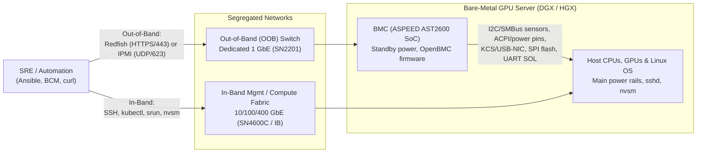
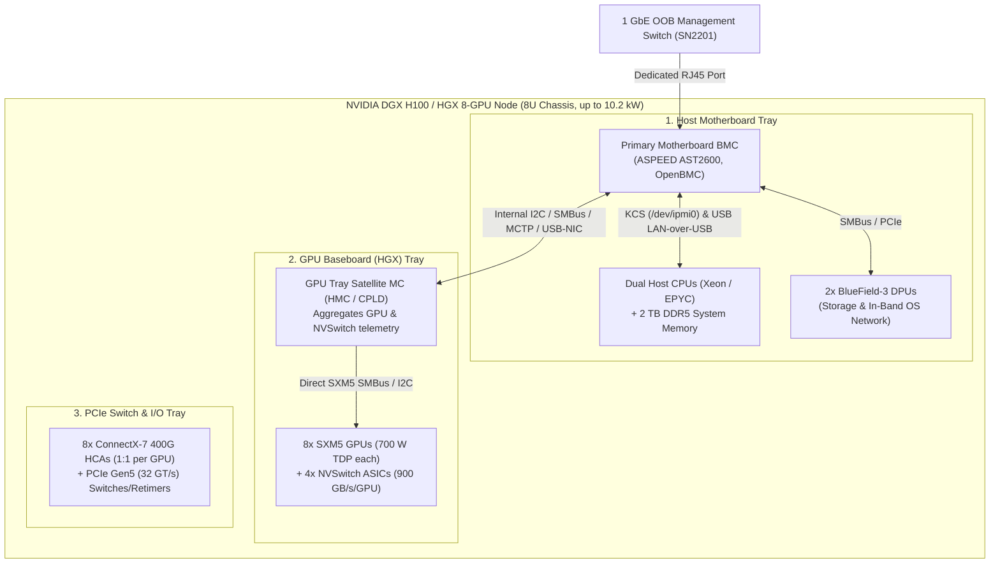
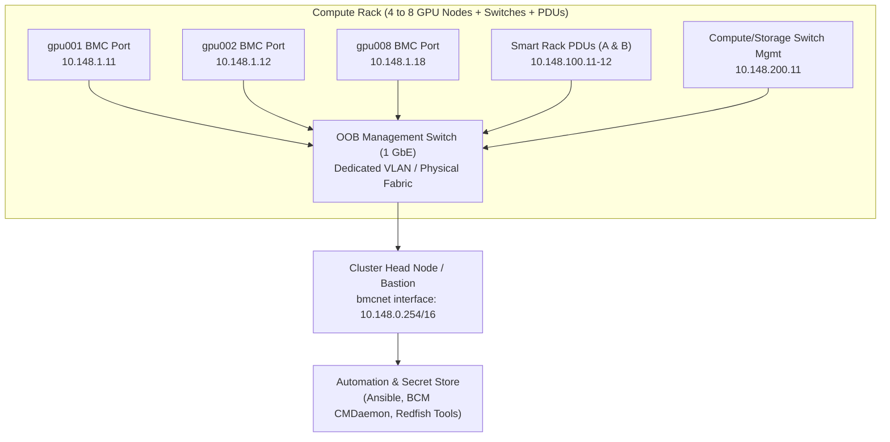

# 7.1 BMCs, IPMI and out-of-band management

| | |
|---|---|
| Level | Beginner to Intermediate |
| Priority tier | 1 |
| Lab venue | Laptop (`code/part07/oob_sim.py`, `cred_audit.py`, and `oob_cred_lab.py`) |
| Part | Part 7: Redfish and BMC |
| Status | Drafted (`oob_sim.py`, `cred_audit.py`, and `oob_cred_lab.py` 3/3 self-checks passed; `ipmitool` and `nvsm` commands are documented from vendor and textbook sources and **untested** / **not verified** on a live physical BMC in this session) |

## Why this matters for AI infrastructure

An eight-GPU server such as an NVIDIA DGX H100 or HGX node costs hundreds of thousands of dollars, draws up to `10.2 kW`, and sits inside a high-density data center hall that may be thousands of miles from your desk. In a public cloud, when a virtual machine freezes, you click "Reboot" in a web portal and the hypervisor resets the guest VM from the outside. On bare-metal AI infrastructure, **there is no hypervisor underneath your host operating system**. When the Linux kernel panics during a 512-GPU training run, or a PCIe bus lockup wedges the CPUs during Power-On Self-Test (POST), SSH drops immediately, Kubernetes marks the node `NotReady`, Slurm marks it `DOWN*`, and the in-band `100G`/`400G` network interfaces go dark.

Without an independent recovery path, every hung kernel or BIOS change would require a technician with a crash cart to walk down the hot aisle and press a physical power button. The **Baseboard Management Controller (BMC)** eliminates that dependency. It is a tiny, independent computer soldered onto the server motherboard, powered by auxiliary standby power rails whenever AC power is connected, wired to its own dedicated out-of-band (OOB) management network, and capable of reading thermal sensors, capturing hardware fault logs, streaming the serial console, flashing firmware, and toggling the physical power-reset lines of the host CPUs. Every subsequent chapter in Part 7—and the bare-metal provisioning and autonomous recovery pipelines in Parts 6 and 8—builds directly on the BMC.

## Prerequisites and outcomes

You need basic IP networking (MAC addresses, DHCP, subnets, VLANs, TCP/UDP) and familiarity with the Linux command line. After completing this chapter, you will be able to:

- Explain what a Baseboard Management Controller (BMC) is, how it is powered, and why it remains reachable when the host OS panics or the server is powered off.
- Distinguish **in-band** management (`ssh`, `kubectl`, `nvsm`) from **out-of-band** management (Redfish, IPMI, SOL) and trace exactly which failure modes break each path using `code/part07/oob_sim.py`.
- Describe the physical management plane inside a dual-tray `8U` DGX H100 / HGX node, including the motherboard BMC (ASPEED `AST2600`), the GPU tray **Satellite Management Controller**, internal `I2C`/`SMBus` buses, and the local KCS interface.
- Design an isolated OOB management network (`10.148.0.0/16` in Base Command Manager), configure DHCP/MAC reservations, and connect head nodes securely.
- Read and write essential `ipmitool` commands (`lan`, `power`, `mc`, `sensor`, `sdr`, `user`, `channel`, `sol`), explain `-I lan` versus `-I lanplus` (UDP port `623`), and recover a wedged BMC from the host OS (`ipmitool mc reset cold`).
- Configure and choose between Serial over LAN (`SOL`), `conman`/`powerman`, and `iKVM` for boot and BIOS troubleshooting.
- Audit BMC credentials across a fleet without exposing cleartext passwords using per-session salted SHA-256 fingerprints (`credentialsoverview --inverse` and `code/part07/cred_audit.py`).
- Explain why modern AI factories use **DMTF Redfish** (DSP0266) over HTTPS as their primary automation API while keeping `ipmitool` for specific low-level procedures.

---

## 1. The problem in one story: two doors into every server

Picture a 64-node training cluster in a remote colocation facility at 02:30. One compute node hits an uncorrectable PCIe fatal error and triggers a Linux kernel panic. Its cooling fans stay spun up and its status LEDs glow, but `ssh`, `ping`, `slurmd`, and `dcgm-exporter` stop answering instantly because the host CPUs and the host OS networking stack are frozen.

Every enterprise server gives you two completely independent doors into the machine:

- **In-band management:** Traffic enters through the server's production or host-management network adapters (`ConnectX-7` or `BlueField-3`) and is processed by the running Linux kernel and user-space daemons (`sshd`, `slurmd`, `kubelet`, `nvsm`). In-band management is fast and feature-rich, but it works **only when the host power is on, the OS kernel is healthy, and the production network is up**.
- **Out-of-band (OOB) management:** Traffic enters through a dedicated `1 GbE` RJ45 management port on the rear of the chassis wired to an isolated OOB management switch (`SN2201` in the DGX SuperPOD reference architecture) and terminates directly on the **BMC**. Because the BMC has its own ARM processor, its own RAM and flash storage, its own embedded Linux firmware (such as OpenBMC), and runs off the PSU's **auxiliary standby power rail** (`5V_STBY` / `12V_STBY`), it remains online even when the main CPUs and GPUs are powered off or locked in a kernel panic.

The DMTF Redfish Specification (DSP0266 v1.21.0, §3.1.1) formally defines the BMC as an *"embedded device or service — typically an independent microprocessor or system on a chip (SoC) with its own firmware"* that performs out-of-band monitoring and management of the host platform.



### 1.1 Modeling failure boundaries (`code/part07/oob_sim.py`)

What happens to in-band SSH versus out-of-band BMC access as individual components fail? The state machine in `code/part07/oob_sim.py` evaluates six classic data-center failure scenarios based on five physical inputs (`ac_power`, `host_power`, `os_state`, `mgmt_switch_up`, and `prod_network_up`):

```bash
$ python3 code/part07/oob_sim.py
scenario                    SSH  BMC  reset  sensors  advice
healthy server              yes  yes    yes      yes  normal management
OS kernel panic              NO  yes    yes      yes  use the BMC (Redfish/IPMI) to inspect or reset
host powered off             NO  yes    yes      yes  use the BMC (Redfish/IPMI) to inspect or reset
production network down      NO  yes    yes      yes  use the BMC (Redfish/IPMI) to inspect or reset
management switch down      yes   NO     NO       NO  normal management
rack lost AC power           NO   NO     NO       NO  nothing remote works: smart hands or fix power/network
```

Studying this table reveals three operational rules that govern bare-metal reliability:

1. **The BMC rescues you from host-side failures:** In an OS kernel panic, an accidental `shutdown -h now` (`host powered off`), or a production leaf-switch outage (`production network down`), SSH is dead (`NO`), but the BMC remains reachable (`yes`) to read the System Event Log (SEL), inspect thermal sensors, open a serial console, or trigger a power reset.
2. **The OOB network and standby power are single points of recovery failure:** If the OOB management switch loses power (`management switch down`), running jobs continue over the production network (`SSH = yes`), but you lose your recovery door across every server in the rack simultaneously. If the rack loses AC power (`rack lost AC power`), both main and standby rails drop and neither SSH nor the BMC can answer until power returns (which is why smart rack PDUs and UPS battery monitoring from Chapter 6.30 sit on the OOB plane).
3. **What if the BMC itself crashes while the host OS is still running?** Because the BMC and the host CPUs are independent computers, the BMC SoC can occasionally hang (for example, after a bad firmware flash or memory leak in its web server). When that happens, chassis fans typically fail-safe to **100% speed**, OOB Redfish/IPMI stops responding (`BMC = NO`), yet `SSH` into the host Linux OS still works (`SSH = yes`). Because the host CPU talks to the BMC over an internal motherboard bus (**KCS** — Keyboard Controller Style, exposed by the `ipmi_si` kernel driver at `/dev/ipmi0`), you can SSH into the host OS and reboot the hung BMC from the inside using `ipmitool mc reset cold`.

---

## 2. Inside a GPU server: capabilities and dual-tray DGX/HGX anatomy

In *Supercomputers for Linux SysAdmins* (`SCL` Chapter 10), Sergey Zhumatiy describes the management controller as *"a small independent server"* wired to the main motherboard through low-level hardware buses (`I2C`, `SMBus`, `PECI`, `LPC`/`eSPI`, and `UART`). Across standard 1U/2U servers and 8U GPU systems, the BMC provides eight core capabilities:

| Capability | Hardware Mechanism | Operational Use in an AI Cluster |
|---|---|---|
| **Power control** | Asserts physical power-good, ATX power-button, and hard-reset pins on the motherboard | Power on (`On`), clean ACPI shutdown (`GracefulShutdown`), hard power off (`ForceOff`), hard reset (`ForceRestart`), or diagnostic interrupt (`Nmi`) when the OS is locked |
| **Environmental sensors** | Polls voltage regulators, tachometers, and thermistors over `I2C` / `SMBus` / `PMBus` | Reads inlet/exhaust temperatures, PSU input/output watts, fan RPMs, and GPU/NVSwitch temperatures even when the host OS is unbooted |
| **System Event Log (SEL)** | Non-volatile flash ring buffer inside the BMC | Records hardware assertions (ECC double-bit faults, PSU cord pulls, thermal trips, PCIe AER fatal errors) that survive a host kernel panic and reboot |
| **Serial over LAN (SOL)** | Internal UART redirected from the host chipset to the BMC's network stack | Streams BIOS POST codes, GRUB menus, kernel boot messages, and `ttyS0`/`ttyS1` login prompts over the OOB network |
| **Remote KVM (`iKVM`)** | Built-in video frame grabber inside the ASPEED SoC + USB keyboard/mouse emulation | Renders the physical VGA/DisplayPort screen and injects keystrokes over a browser session for interactive BIOS or recovery troubleshooting |
| **Virtual Media** | Emulates a USB CD-ROM or NVMe/flash drive over the internal USB bus | Mounts a remote `.iso` recovery image over HTTPS so a server can boot a live rescue OS without plugging in a physical USB stick |
| **Out-of-band firmware update** | Direct access to SPI flash ROMs, CPLDs, and management buses (`nvfwupd` / Redfish `UpdateService`) | Flashes BMC, system BIOS/UEFI, GPU VBIOS, NVSwitch, and PCIe retimer firmware without relying on the host OS |
| **Hardware inventory** | Queries SMBIOS tables, SPD EEPROMs, and PCIe/MCTP endpoints | Reports CPU models, DIMM capacities and serial numbers, GPU SKUs, and NIC MAC addresses for CMDB reconciliation before an OS is installed |

Different server vendors brand their BMC implementations differently—**Dell iDRAC**, **HPE iLO**, **Cisco CIMC**, **Supermicro IPMI/Redfish**, and **OpenBMC** on NVIDIA DGX and hyperscale platforms. In NVIDIA Base Command Manager (BCM 11), all of these are modeled uniformly as variants of a node's **BMC interface**.

### 2.1 Dual-tray physical hierarchy of an NVIDIA DGX H100 / HGX node

Standard 1U/2U CPU servers house everything on a single PCB managed by a single BMC chip. High-density accelerated systems such as the **NVIDIA DGX H100/H200** (`8U` chassis, up to `10.2 kW` maximum power across six `3.3 kW` PSUs) split the hardware across multiple physical trays to handle the extreme electrical and thermal density (`volume-10/01-bare-metal-and-bmc-lifecycle.md`):



Look closely at the three management boundaries inside this `8U` chassis:

1. **Primary Motherboard BMC (ASPEED `AST2600`):** Sits on the host motherboard tray, owns the external `1 GbE` OOB network port, authenticates Redfish and IPMI sessions, controls chassis fans and PSUs, and manages the host CPUs and BIOS.
2. **GPU Tray Satellite Management Controller (HMC):** Because the `8x` SXM GPUs and `4x` NVSwitch chips live on a separate removable **HGX GPU Baseboard Tray**, that tray carries its own **Satellite Management Controller** (Hardware Management Controller / FPGA / CPLD). The satellite controller polls per-GPU die and HBM3 temperatures, board power, SXM voltage rails, and NVSwitch sensors, and exposes them to the primary motherboard BMC over an internal management link (`MCTP` over `I2C`/`PCIe` or internal USB/Ethernet). When you query `/redfish/v1/Systems/HGX_Baseboard_0/Processors/GPU_SXM_0/EnvironmentMetrics` on a DGX BMC, the primary BMC is routing or aggregating telemetry from that satellite controller (covered in depth in Chapter 7.13).
3. **In-band `nvsm` vs Out-of-band BMC (`volume-05/chapter-03` & `volume-10/01`):** Inside the running Linux OS on a DGX node, the **NVIDIA System Management (`nvsm`)** daemon monitors the hardware from the *inside*—combining kernel logs, NVML GPU counters (`18/18` NVLink lanes active at `900 GB/s`, single/double-bit ECC counts), PCIe link widths, and local BMC data via KCS. Running `sudo nvsm show health` or `sudo nvsm show gpus` gives an immediate in-band summary, and `sudo nvsm dump health` packages all system logs and hardware state into a support tarball required for NVIDIA RMA tickets. When the OS is healthy, `nvsm` and `dcgm-exporter` give rich high-frequency telemetry; when the OS crashes, the out-of-band BMC and Redfish `/redfish/v1/Chassis/DGX/Sensors` and `/redfish/v1/Managers/BMC/LogServices/SEL/Entries` are your authoritative source of truth.

---

## 3. Designing the out-of-band management network

Because the BMC can power off nodes, mount virtual boot media, and flash motherboard and GPU firmware, the out-of-band network is the **highest-privilege security domain in the data center**. Follow four engineering rules from `SCL` Chapter 10 and the *BCM 11 Administrator Manual* (§3.7) when laying out the BMC network:

1. **Isolate the OOB network physically (or at minimum on a restricted VLAN):** `SCL` Chapter 10 warns bluntly that legacy BMC protocols *"are not really secure"* and recommends a physically separate 1 GbE switch fabric (such as the `SN2201` OOB fabric in a SuperPOD), or at minimum a dedicated management VLAN that is **never trunked to user login nodes or tenant VMs**. If you plan to use VLAN tagging on BMC ports, verify hardware support first—some BMCs require VLAN IDs to be configured via `ipmitool lan set 1 vlan id <vid>` or Redfish before they respond.
2. **Assign deterministic IP addresses from a single inventory:** In NVIDIA Base Command Manager (BCM 11, §3.7), each node's BMC is represented as a network interface of type `bmc` (typically named `ipmi0`) attached to a dedicated network (`bmcnet`, which defaults to **`10.148.0.0/16`**). In `cmsh`, you can define BMC interfaces across 150 nodes in a single range command:
   ```text
   % device
   % addinterface -n node001..node150 bmc ipmi0 bmcnet 10.148.0.1
   % commit
   ```
   This assigns `10.148.0.1` through `10.148.0.150` sequentially to `node001..node150`.
3. **Collect BMC MAC addresses on Day 0 and automate DHCP reservations:** `SCL` Chapter 10 emphasizes a painful lesson from real cluster builds: if you unbox 128 servers without recording their BMC MAC addresses from the shipping manifest or chassis pull-tabs and configuring DHCP reservations, you will be forced to connect a monitor and keyboard or laptop to configure IPMI static IPs by hand on every server—*"which may take weeks."*
4. **Give the cluster head node a direct leg on `bmcnet`:** For the management server or BCM head node to reach the BMCs without routing through external firewalls, BCM §3.7 documents two topologies:
   - **Physically separate OOB switches (recommended):** Connect a dedicated physical NIC on the head node directly into the OOB switch fabric on `10.148.0.0/16`.
   - **Shared internal wiring (small labs only):** Configure a secondary IP alias interface on the head node's internal NIC so it can reach the BMC subnet.



---

## 4. IPMI 2.0 and `ipmitool` in practice

The **Intelligent Platform Management Interface (IPMI)**—originally spearheaded by Intel, Dell, HPE, and NEC in 1998 and standardized at **IPMI 2.0**—was for two decades the universal command protocol for talking to a management controller (`MC`). While DMTF Redfish has superseded IPMI for fleet automation, you must still master `ipmitool` for three reasons:
1. It is the standard **in-band KCS tool** for configuring or resetting a hung BMC from inside the host Linux OS (`ipmitool mc reset cold`).
2. It provides **Serial over LAN (`SOL`)** (`ipmitool sol activate`), which remains the fastest way to watch live BIOS POST codes and kernel boot messages over an SSH-like terminal.
3. Many brownfield HPC clusters and vendor recovery procedures (including the DGX H100/H200 Firmware Update Guide) still invoke `ipmitool` directly.

### 4.1 Local KCS kernel modules versus remote `lanplus` (`UDP 623`)

As documented in `SCL` Chapter 10, network access to a server's BMC is sometimes disabled from the factory or misconfigured. To inspect or configure a server's own BMC from inside its running Linux OS over the motherboard KCS interface, load the three OpenIPMI kernel drivers:

```bash
# Load Linux OpenIPMI kernel drivers for local in-band BMC access (/dev/ipmi0)
sudo modprobe ipmi_msghandler
sudo modprobe ipmi_si
sudo modprobe ipmi_devintf

# Query the local BMC directly without needing its IP address or network access
sudo ipmitool mc info
sudo ipmitool lan print 1
```

To talk to a remote server's BMC over the out-of-band network, `ipmitool` sends **RMCP+ (Remote Management Control Protocol Plus)** packets over **UDP port `623`**:

```bash
# Safe remote invocation: read password from a 0600 file (-f) rather than CLI (-P)
ipmitool -I lanplus -H 10.148.1.11 -U bmcadmin -f /etc/bmc/passfile power status
```

Pay close attention to the `-I` interface flag (`SCL` Chapter 10):
- **`-I lan`** speaks legacy **IPMI 1.5**, which lacks modern encryption and is incompatible with IPMI 2.0 sessions.
- **`-I lanplus`** speaks **IPMI 2.0 (RMCP+)** with AES session encryption. Always specify **`-I lanplus`** for remote calls.
- **Never pass `-P <password>` on a multi-user system:** Passing `-P MYSECRET` exposes the BMC password in `ps aux`, `/proc/<pid>/cmdline`, audit logs, and `~/.bash_history`. Always pass **`-f <password_file>`** (or `IPMI_PASSWORD` via environment variable from a vault).

### 4.2 Core `ipmitool` command groups and power operations

`SCL` Chapter 10 organizes `ipmitool` into ten top-level functional groups:

| Subcommand Group | Purpose | Example Command |
|---|---|---|
| `lan` | View or set BMC network configuration (IP source, address, netmask, MAC, gateway, VLAN) | `ipmitool lan print 1` / `ipmitool lan set 1 ipsrc dhcp` |
| `power` (or `chassis power`) | Query or change host chassis power state | `ipmitool power status`, `power on`, `power off`, `power cycle`, `power reset`, `power soft` |
| `mc` (or `bmc`) | Inspect or reset the Management Controller itself | `ipmitool mc info` / `ipmitool mc reset cold` |
| `sensor` / `sdr` | Read hardware Sensor Data Records (temperatures, fan RPMs, voltages, watts) | `ipmitool sdr list` / `ipmitool sensor list` |
| `sel` | Read or clear the non-volatile System Event Log | `ipmitool sel elist` / `ipmitool sel info` |
| `sol` | Start, configure, or close a Serial over LAN console session | `ipmitool sol info` / `ipmitool sol activate` / `ipmitool sol deactivate` |
| `user` | List or configure BMC user slots (`1..16`), names, and passwords | `ipmitool user list 1` |
| `channel` | Inspect BMC communication channels and per-slot access privileges | `ipmitool channel info 1` |
| `session` | List active IPMI sessions connected to the BMC | `ipmitool session info active` |
| `shell` / `exec` | Run multiple `ipmitool` commands interactively or from a batch file | `ipmitool exec setup_bmc.txt` |

When controlling host power with `ipmitool power`, distinguish the five actions carefully:

| Power Command | Hardware Action | Operational Guidance (`SCL` Ch. 10) |
|---|---|---|
| `power status` | Queries current main power rail state (`Chassis Power is on/off`) | Safe read-only check |
| `power soft` | Sends an ACPI power-button pulse to the host OS | Triggers a clean OS shutdown if the kernel is alive |
| `power on` | Turns on main host power rails | Boots a powered-off server |
| `power off` | Immediately drops main host power rails (equivalent to yanking AC cords from host PSUs) | **Hard power cut.** Does not sync filesystems; use only after `power soft` / SSH fails and the node is drained in Slurm |
| `power cycle` | Powers off main rails, waits briefly, and powers back on | `SCL` Chapter 10 warns that `power cycle` is **not always reliable across all BMC firmwares**; in scripts, prefer an explicit `power off`, a `10–15 s` pause while polling `power status` for `off`, and then `power on` |
| `power reset` | Pulses the motherboard warm-reset pin without dropping PSU rails | Equivalent to pressing the front-panel reset button; note that PCIe switches/FPGA retimers keep standby/main power and only reload on a full `power off` $\rightarrow$ `power on` or AC cycle |

### 4.3 Configuring BMC network and user slots (`SCL` Chapter 10 walkthrough)

Suppose you boot a brand-new compute node via live image and need to configure its BMC network interface (Channel `1`) and create an administrator account in User Slot `3` (`adminuser`) with Serial over LAN access enabled. `SCL` Chapter 10 walks through the exact sequence:

```bash
# 1. Inspect current network configuration on Channel 1 (IP source, IP, netmask, MAC, gateway, VLAN)
sudo ipmitool lan print 1

# 2. Configure static IP (or use 'ipsrc dhcp' if DHCP reservations are ready)
sudo ipmitool lan set 1 ipsrc static
sudo ipmitool lan set 1 ipaddr 10.148.1.11
sudo ipmitool lan set 1 netmask 255.255.0.0
sudo ipmitool lan set 1 defgw ipaddr 10.148.0.1

# 3. Create 'adminuser' in User Slot 3 and assign privilege level 4 (Administrator) on Channel 1
sudo ipmitool user set name 3 adminuser
sudo ipmitool user set password 3 "R9#vK2!mQ8$pL5@x"
sudo ipmitool user priv 3 4 1
sudo ipmitool user enable 3

# 4. Enable LAN channel access and SOL payload for Slot 3 on Channel 1
sudo ipmitool lan set 1 access on
sudo ipmitool channel setaccess 1 3 callin=on ipmi=on link=on privilege=4
sudo ipmitool sol payload enable 1 3
sudo ipmitool sol set enabled true 1
```

*(Note on `lan set 1 auth`: older IPMI 1.5 tutorials—including an example line `ipmitool lan set 1 auth admin md5` in `SCL` Chapter 10—enabled `md5` authentication for legacy IPMI 1.5 clients. On modern clusters, disable IPMI 1.5 (`lan`) completely, use IPMI 2.0 `lanplus` cipher suite `17` (HMAC-SHA256 / AES-CBC-128) if IPMI is required, or disable IPMI-over-LAN via Redfish and use Redfish over TLS 1.2+ as covered in Chapter 7.15.)*

---

## 5. Out-of-band consoles: SOL, `conman`, `powerman`, and `iKVM`

When a node hangs during UEFI POST, gets stuck in an `initramfs` emergency shell, or prints a kernel panic stack trace that never reaches `rsyslog`, you need to see its console output. `SCL` Chapter 10 and the Redfish Specification (§5.5) compare three console mechanisms:

### 5.1 Serial over LAN (`SOL`)
IPMI 2.0 can multiplex a virtual serial port (`ttyS0` or `ttyS1`, typically at `115200 8N1`) over UDP port `623`.
- **How to connect:** Run `ipmitool -I lanplus -H <bmc-ip> -U <user> -f <passfile> sol activate`.
- **How to disconnect safely:** Type the escape sequence **`~.`** (tilde followed by period) at the start of a new line.
  - **The SSH trap (`SCL` Chapter 10):** Because OpenSSH uses the **exact same `~.` escape sequence** to terminate an SSH session, typing `~.` when you are SSH'd into a bastion host and running `ipmitool sol activate` will kill your outer SSH connection to the bastion. To send `~.` to `ipmitool` through one SSH hop, type **`~~.`** (two tildes then a period), or pass `-e <char>` to `ssh` or `ipmitool` to change the escape character.
- **Required host OS configuration:** For `SOL` to show Linux kernel boot messages and offer a login prompt when the network is down, the host kernel command line in `/etc/default/grub` must redirect the console to the serial port and `systemd` must spawn an `agetty` on it:
  ```text
  GRUB_CMDLINE_LINUX="console=tty0 console=ttyS1,115200n8"
  ```

### 5.2 Console aggregation with `conman` and power control with `powerman`
Opening individual `ipmitool sol activate` sessions by hand does not scale when you want to capture kernel panics across `128` nodes automatically.
- **`conman` (Console Manager):** A daemon run on the management or head node that maintains persistent background `SOL` (or telnet/serial) connections to every compute node in the cluster (`SCL` Chapter 10). It timestamps and logs every line of console output from every node to `/var/log/conman/<node>`—so when `gpu042` panics and reboots at 04:00, the full kernel oops stack trace is already sitting in a text file on the head node. Engineers can also attach interactively (`conman gpu042`) or broadcast keystrokes across multiple consoles.
- **`powerman`:** As `SCL` Chapter 10 notes, `conman` manages consoles only, not power. **`powerman`** is its companion daemon that abstracts IPMI BMCs and network-attached smart PDUs behind a single unified CLI (`pm -1 gpu042` to power on, `pm -0 gpu042` to power off, `pm -c gpu042` to cycle). Cluster managers like xCAT (`rcons`, `rpower`) and BCM (`cmsh` `power` and `console`) build these exact capabilities natively into their control daemons.

### 5.3 KVM over IP (`iKVM`) and why Redfish does not carry video streams
Sometimes text serial output is not enough—for instance, when an add-in card displays a graphical UEFI option ROM error before serial redirection starts. **KVM over IP (`iKVM`)** captures the server's video framebuffer and injects USB keyboard and mouse events over the network.
- `SCL` Chapter 10 notes two practical facts about `iKVM`:
  1. **Built-in BMC `iKVM` beats external KVM switches:** Modern BMCs integrate the video capture hardware directly inside the ASPEED chip, whereas external rack KVM appliances require bulky dongles and cannot toggle motherboard power pins.
  2. **Lack of a wire standard makes `iKVM` unsuitable for fleet automation:** Vendors historically implemented `iKVM` using proprietary HTML5 websockets, VNC variants, or legacy Java applets. You cannot reliably script BIOS changes for 128 servers by clicking pixels in a browser window.
- **What the Redfish Specification says (DSP0266 §5.5):** The DMTF Redfish authors explicitly address this in Section 5.5 (*Service elements*): KVM (`GraphicalConsole`) and serial console (`SerialConsole`) are *"critical functionality"*, but streaming interactive video or terminal characters is not a job for a stateless JSON REST protocol. Instead, Redfish exposes structured metadata under `/redfish/v1/Systems/<id>` and `/redfish/v1/Managers/<id>` so a client can **discover** which console types (`IPMI`, `SSH`, `Telnet`, `WebSocket`, `KVMIP`) are enabled and on which port, and use Redfish REST resources (`/Bios/Settings`, `/Boot`) to automate changes that previously required `iKVM`.

---

## 6. Fleet BMC credential hygiene and salted fingerprint auditing

Because a single compromised BMC credential allows an attacker to boot malicious images or flash modified firmware, BMC account management is one of the highest-stakes tasks in cluster administration. Across a large fleet, three credential anti-patterns crop up repeatedly:
1. **Factory defaults left on RMA replacements:** A technician swaps a motherboard on `node005` and forgets to rotate the BMC password, leaving it at a well-known vendor default (`admin`/`admin`, `root`/`calvin`, `ADMIN`/`ADMIN`, `root`/`0penBmc`) or with an empty password.
2. **Configuration drift across racks:** One batch of nodes gets one password while a later expansion gets another, causing automated Redfish fence/STONITH calls to fail during an outage.
3. **Cleartext passwords leaked in audit tools:** Naive scripts print passwords to stdout or log files when checking whether nodes match.

### 6.1 How BCM 11 manages and audits BMC credentials (`credentialsoverview`)

In the *BCM 11 Administrator Manual* (§3.7), `CMDaemon` stores BMC credentials centrally at the **partition** level under `bmcsettings` (defaulting to username `bright` and a unique random password generated at installation), while allowing overrides at the **category** or **device** level:

```text
% partition use base
% bmcsettings
% set username bmcadmin
% set password
% commit
```

Because inheritance across partition $\rightarrow$ category $\rightarrow$ node can make it hard to see which nodes have drifted, BCM provides the **`credentialsoverview`** command (and **`credentialsoverview --inverse`**). Its security design is a textbook pattern worth studying:
- **Never display the password:** Instead of printing passwords, `credentialsoverview` hashes each `(username, password)` pair with a **random per-session salt** using SHA-256 and prints a short hex **fingerprint**.
- **Group by fingerprint (`--inverse`), smallest groups first:** Within a single run, every node sharing the exact same username and password produces the exact same fingerprint. Sorting groups from smallest count to largest immediately puts the 1 or 2 misconfigured outlier nodes at the very top of the screen—while the random per-session salt guarantees that a screenshot of the fingerprint cannot be used as an offline rainbow-table target later.

### 6.2 Running the fleet credential auditor (`code/part07/cred_audit.py`)

We implemented this exact salted-fingerprint algorithm in `code/part07/cred_audit.py` and tested it against `code/part07/sample_bmc_accounts.csv` (`7` nodes):

```bash
$ python3 code/part07/cred_audit.py code/part07/sample_bmc_accounts.csv
count  user       fingerprint    nodes
    1  bmcadmin   a976aeb2f79b   node003
    1  admin      596fd789214c   node005
    1  bmcadmin   86daac35a5ea   node006
    4  bmcadmin   81c34f302ad8   node001,node002,node004,node007

4 different credential sets: the smallest group is probably the odd one out
PROBLEM node005: factory-default credentials (admin)
PROBLEM node006: empty BMC password
```

Look at what `cred_audit.py` caught in five lines without printing a single password:
- `node001, node002, node004, node007` (`4` nodes) share the standard fleet credential (`bmcadmin`).
- `node003` (`1` node) has the right username (`bmcadmin`) but a drifted password.
- `node005` (`1` node) was left on factory-default credentials (`admin`/`admin`).
- `node006` (`1` node) has an empty password.

Our self-checking lab script `code/part07/oob_cred_lab.py` verifies both `oob_sim.py` and `cred_audit.py` end to end:

```bash
$ python3 code/part07/oob_cred_lab.py
PASS: oob_sim.py models in-band SSH vs out-of-band BMC reachability across all 6 scenarios
PASS: cred_audit.py detects 4 credential groups, node005 factory-default (admin), and node006 empty password (exit 1)
PASS: cred_audit.py exits 0 with 1 group (7 nodes) when all BMCs share a strong 16-char rotated credential
Summary: 3 passed, 0 failed (total 3)
```

---

## 7. Why the industry moved from IPMI to DMTF Redfish

Why did the DMTF (Distributed Management Task Force) create the **Redfish** standard (DSP0266) to succeed IPMI, and why does NVIDIA document Redfish as the primary management API for DGX H100, H200, B200, and GB200 systems?

| Architectural Dimension | Legacy IPMI 2.0 | DMTF Redfish (DSP0266 v1.21.0) |
|---|---|---|
| **Transport & Security** | Custom RMCP+ binary framing over **UDP port `623`**; historical cipher suite weaknesses (e.g., Cipher 0, RAKP hash exposure) | Standard **HTTPS over TCP port `443`**; Specification §13.1 mandates **TLS 1.2 or later** |
| **Data Model & Payload** | Fixed-size binary structs and flat Sensor Data Records (SDRs); no hierarchy for multi-tray systems | Human-readable **JSON payloads** backed by versioned **CSDL/JSON Schemas** and **OData** hypermedia conventions |
| **Authentication & Sessions** | Per-channel slot table (`1..16` users) with coarse privilege levels | HTTP Basic (over TLS) and stateful **`SessionService` tokens (`X-Auth-Token`)** + granular RBAC (`Administrator`, `Operator`, `ReadOnly`, DSP0266 §13.3) |
| **Accelerator & Fabric Coverage** | Almost non-existent in standard IPMI; requires undocumented vendor `raw` hex bytes | First-class schemas for `Systems`, `Chassis`, `Managers`, `Processors` (`GPU_SXM_<id>`), `Memory`, `PCIeDevices`, `NVSwitches`, `Sensors`, `UpdateService`, and `TelemetryService` |
| **Automation Ergonomics** | Requires shelling out to `ipmitool` and screen-scraping text tables | Works natively with `curl`, Python `requests`, Ansible `ansible.builtin.uri`, Go `gofish`, and standard CI/CD tooling |

### 7.1 The golden rule of Redfish: "Interoperable does not mean identical"

Section 5.1 through 5.4 of the Redfish Specification (DSP0266) lays out the design tenets of Redfish: **separation of protocol from data model**, a single **Service Root (`/redfish/v1/`)** from which every resource is reachable by following `@odata.id` hypermedia links, and JSON payloads that any programmer can inspect without a binary decoder.

At the same time, DSP0266 §5.4 gives an essential engineering warning that every infrastructure developer must memorize: **"Interoperable does not mean identical."**
- Because a 1U edge server, an 8U dual-tray DGX H100, and a liquid-cooled rack-scale GB200 NVL72 have completely different physical topologies, the Redfish standard allows many properties and subtrees to be optional and lets platforms name collection members according to their hardware (`Systems/DGX` and `Systems/HGX_Baseboard_0` on a DGX H100 versus `Systems/1` or `Systems/System.Embedded.1` on other OEM servers).
- **Never hard-code deep resource URIs across heterogeneous fleets, and never reuse `@odata.id` paths discovered on one vendor's BMC against another.** Start at `/redfish/v1/`, read the collection members, and follow `@odata.id` links dynamically—the exact pattern used by every tool in `code/part07/`.

### 7.2 Why out-of-band firmware flashing beats an in-band SSH loop

Consider a classic senior architecture scenario (`volume-05/chapter-03-dgx-management-plane.md` and `volume-10/01-bare-metal-and-bmc-lifecycle.md`): a junior engineer proposes updating firmware across 100 GPU servers by running a Bash `for` loop that SSHes into each host OS, downloads the firmware bundle, and flashes the hardware in-band.

Why should you reject that design in favor of out-of-band Redfish (`UpdateService` or `nvfwupd --target ip=<bmc-ip>`)?
1. **Independence from host OS and in-band network crashes:** An in-band SSH session depends on the Linux kernel, the PCIe bus, the host NIC driver, and the production network remaining up for the entire flash duration. If the host kernel panics, the OOM killer fires, or resetting a network adapter drops the in-band SSH connection mid-transfer, the orchestrator loses control and visibility mid-update.
2. **Asynchronous task tracking on standby power:** When you trigger an update via the BMC's Redfish `/redfish/v1/UpdateService` (either `SimpleUpdate` pull or `/UpdateService/upload` multipart push), the BMC runs on auxiliary standby power over the dedicated OOB network, returns HTTP `202 Accepted` with a `/redfish/v1/TaskService/Tasks/<id>` monitor URI, and stages the image into flash independently of the host OS.
3. **State the engineering nuance accurately:** Out-of-band flashing is significantly safer than an uncoordinated SSH loop, **but it is not magic**. As documented in the *NVIDIA DGX H100/H200 Firmware Update Guide* (`volume-10/01` §4.5), you must still **drain and quiesce the host first** (stopping GPU workloads and even `nvidia-smi` polling, which can block GPU VBIOS flashing) and execute the required post-flash activation step for each component:
   - **BMC firmware:** Cold reset of the BMC (`ipmitool mc reset cold` or Redfish `Manager.Reset`).
   - **System BIOS and GPU tray (VBIOS / NVSwitch):** Cold host system reset (`ForceOff` followed by `On`, or `GracefulRestart`).
   - **PCIe switches, retimers, EROT, and CPLDs:** Full **AC power cycle** (or virtual AC cycle via PSU/PDU).

---

## Exercises

1. **Extending the failure state machine (`code/part07/oob_sim.py`):** Open `code/part07/oob_sim.py` and add a seventh tuple to `SCENARIOS` representing `"BMC firmware crashed"` where `ac_power=True`, `host_power=True`, `os_state="running"`, `mgmt_switch_up=True`, `prod_network_up=True`, and add a `bmc_alive` boolean parameter. Verify that in-band `SSH` remains `yes` while out-of-band `BMC` is `NO`, and write down the exact in-band `ipmitool` command you would run over SSH to reboot the hung BMC over KCS.
2. **Auditing and remediating drifted BMC accounts (`code/part07/cred_audit.py` & `oob_cred_lab.py`):** Run `python3 code/part07/cred_audit.py code/part07/sample_bmc_accounts.csv` twice in a row and observe how the 12-character hex fingerprints change between runs while the grouping (`1, 1, 1, 4`) stays identical. Then run `python3 code/part07/oob_cred_lab.py` and inspect how Check 3 constructs a remediated CSV that exits with status `0`.
3. **Sizing an OOB management subnet for a 4-SU SuperPOD:** You are designing the out-of-band management network for a 128-node (`4`-SU) DGX H100 cluster spread across `16` racks, plus `2` smart PDUs per rack, `32` compute leaf switches, `16` compute spine switches, `8` storage switches, `4` in-band switches, `4` OOB switches, `2` UFM appliances, and `2` HA head nodes. Calculate the total number of OOB IP addresses required and choose a CIDR subnet size that leaves at least `50%` headroom for future expansion.
4. **Escaping a nested `SOL` session without dropping your bastion SSH connection:** You SSH from your laptop into `bastion.cluster.local`, and from `bastion` you run `ipmitool -I lanplus -H 10.148.1.42 -U bmcadmin -f passfile sol activate` to inspect a hung node. Write the exact keystroke sequence required to close the `ipmitool sol` session **without** disconnecting your laptop's SSH session from `bastion`, and write the `/etc/default/grub` kernel parameters required so `ttyS1` displays kernel boot messages at `115200` baud.
5. **Graceful-first recovery runbook for a frozen node:** Write a 6-step out-of-band recovery checklist for a compute node whose Linux kernel appears frozen (`SSH` timeout), starting with non-destructive evidence collection (`sel elist` / Redfish SEL, `sol activate` to check for a live stack trace, `power soft` ACPI signal, or `Nmi` crash dump) before resorting to `power off` $\rightarrow$ wait `15 s` $\rightarrow$ `power on`.
6. **Mapping the dual-tray DGX H100 management buses:** Draw or list the three trays of a DGX H100 node (Host Motherboard Tray, HGX GPU Baseboard Tray, PCIe Switch & I/O Tray), name the management controller on the host tray versus the GPU tray, and state which Redfish URI trees correspond to host-level sensors versus per-GPU environment metrics.

---

## Checkpoint questions (20)

<details>
<summary>1. What is a Baseboard Management Controller (BMC), and how does the DMTF Redfish Specification (DSP0266 §3.1.1) define it?</summary>

A BMC is an independent, always-on microcontroller or System-on-Chip (such as an ASPEED `AST2600`) soldered onto a server motherboard with its own CPU, RAM, flash storage, firmware (e.g., OpenBMC), and dedicated network interface. DSP0266 §3.1.1 defines it as an *"embedded device or service — typically an independent microprocessor or system on a chip with its own firmware"* that provides out-of-band monitoring and management of the host system.
</details>

<details>
<summary>2. Why does the BMC continue working when the server's operating system panics or when the server is powered off?</summary>

The BMC runs its own OS and network stack on separate hardware and draws power from the power supply's **auxiliary standby power rail** (`5V_STBY` / `12V_STBY`), which remains energized whenever the server's power cords are plugged into live AC power—even when the main host power rails feeding the x86/ARM CPUs and GPUs are turned off.
</details>

<details>
<summary>3. What two physical dependencies must be healthy for you to reach a BMC remotely over the network?</summary>

1. **Standby AC power** to the server's power supplies.
2. **A functioning out-of-band (OOB) management network path** (the BMC's dedicated RJ45 link, the `1 GbE` OOB management switch, and the management interface on the head node or bastion).
</details>

<details>
<summary>4. Define in-band management and out-of-band (OOB) management, and give two tool examples of each.</summary>

- **In-band management:** Administrating and monitoring the server *through its running host operating system* over the production or in-band network (examples: `ssh`, `kubectl`, `slurmd`, `nvsm`, `dcgm-exporter`).
- **Out-of-band management:** Administrating and monitoring the server *through its independent BMC* over a segregated management network, bypassing the host OS entirely (examples: DMTF Redfish over HTTPS, `ipmitool` over RMCP+, Serial over LAN `SOL`, `iKVM`).
</details>

<details>
<summary>5. In the six scenarios modeled by code/part07/oob_sim.py, which three failure states kill SSH while leaving the BMC fully operational?</summary>

1. **OS kernel panic** (`os_state = "hung"`).
2. **Host powered off** (`host_power = False`).
3. **Production network down** (`prod_network_up = False`).
In all three cases, `SSH` is `NO`, while `BMC`, `reset`, and `sensors` remain `yes`.
</details>

<details>
<summary>6. Why must a DGX H100 / HGX 8-GPU server use both a primary motherboard BMC and a GPU tray Satellite Management Controller?</summary>

To manage up to `10.2 kW` of thermal and electrical load in an `8U` chassis, the system physically separates the host CPU motherboard tray from the removable `8`-GPU + `4`-NVSwitch HGX baseboard tray. A Satellite Management Controller on the GPU tray polls the high-density GPU and NVSwitch sensors locally over `I2C`/`SMBus` and aggregates that telemetry to the primary motherboard BMC (`AST2600`).
</details>

<details>
<summary>7. Why should the BMC out-of-band network be physically isolated (or placed on a strictly restricted VLAN), and what default subnet does NVIDIA Base Command Manager use for bmcnet?</summary>

BMCs have full hardware control (power off, virtual media boot, BIOS/firmware flashing) and historically ran protocols like IPMI that should never be exposed to tenant or user networks. Isolating the OOB network prevents lateral movement from a compromised compute node or user job. BCM defaults its `bmcnet` network to **`10.148.0.0/16`**.
</details>

<details>
<summary>8. Which three Linux kernel modules must be loaded to talk to a server's local BMC in-band over the motherboard KCS interface?</summary>

`ipmi_msghandler`, `ipmi_si` (System Interface, which attaches to KCS/SMIC/BT), and `ipmi_devintf` (which creates `/dev/ipmi0` for user-space tools like `ipmitool`).
</details>

<details>
<summary>9. What is the difference between ipmitool -I lan and ipmitool -I lanplus, and which network port does IPMI over LAN use?</summary>

`-I lan` selects legacy **IPMI 1.5**, whereas `-I lanplus` selects **IPMI 2.0 (RMCP+)** with session encryption. The two protocols are incompatible; modern systems always use `-I lanplus`, which communicates over **UDP port `623`**.
</details>

<details>
<summary>10. Why does SCL Chapter 10 recommend running power off, waiting, and running power on instead of relying on ipmitool power cycle?</summary>

Some BMC firmware implementations handle `power cycle` inconsistently or pulse the power rail too briefly for all capacitors and bus controllers to reset cleanly. Explicitly issuing `power off`, polling `power status` until `Chassis Power is off`, waiting `10–15` seconds, and issuing `power on` is deterministic across all vendors.
</details>

<details>
<summary>11. Why should you never pass -P password on the ipmitool command line, and what flag should you use instead?</summary>

Command-line arguments passed after `-P` are visible to every user on the system via `ps aux` and `/proc/<pid>/cmdline` and are recorded in shell history files. Always pass **`-f <password_file>`** pointing to a `0600`-permission file (or inject `IPMI_PASSWORD` from a secrets manager).
</details>

<details>
<summary>12. What is Serial over LAN (SOL), what must be configured in the host OS for it to work, and why is the ~. escape sequence dangerous over SSH?</summary>

`SOL` redirects the host motherboard's physical/virtual UART serial port (`ttyS0`/`ttyS1`) over the OOB network via IPMI (`ipmitool sol activate`). The host OS must pass `console=ttyS1,115200n8` on the kernel command line and run a serial `agetty` service. Because both OpenSSH and `ipmitool sol` use `~.` as their disconnect escape sequence, typing `~.` inside an SSH session to a bastion host will close the outer SSH session unless you escape the tilde (`~~.`).
</details>

<details>
<summary>13. What roles do conman and powerman play on a cluster management node?</summary>

**`conman`** maintains persistent background serial/SOL connections to all cluster nodes, logging boot and kernel panic output continuously to disk and allowing interactive console attachment. Because `conman` does not manage power, **`powerman`** complements it by providing unified CLI power control across IPMI BMCs and smart rack PDUs.
</details>

<details>
<summary>14. Why is iKVM (KVM over IP) difficult to automate at fleet scale, and how does the Redfish Specification (DSP0266 §5.5) treat KVM and serial consoles?</summary>

`iKVM` streams graphical video frames and mouse/keyboard events using vendor-specific browser/WebSocket/VNC protocols that have no uniform wire standard and require brittle pixel-level macros. DSP0266 §5.5 states that KVM and serial console streams cannot sensibly be carried inside a REST interface, so Redfish provides standardized JSON metadata to **discover** console endpoints while replacing manual BIOS/boot GUI clicks with REST resources (`/Bios/Settings`, `/Boot`).
</details>

<details>
<summary>15. How does BCM 11's credentialsoverview --inverse (and code/part07/cred_audit.py) spot drifted BMC passwords without printing cleartext secrets?</summary>

It hashes each node's `(username, password)` pair with a **random per-session salt** using SHA-256 to produce a short fingerprint and groups nodes by identical fingerprint, sorted smallest group first. Nodes with drifted credentials appear as small outlier groups (`count = 1`) at the top of the report, while the random per-session salt prevents offline hash cracking from saved terminal output.
</details>

<details>
<summary>16. What three specific BMC account problems should an automated fleet credential audit flag immediately?</summary>

1. **Empty passwords** (unauthenticated administrative access).
2. **Known factory-default credentials** (`admin`/`admin`, `root`/`calvin`, `ADMIN`/`ADMIN`, `root`/`0penBmc`).
3. **Outlier credential sets** (e.g., 1 or 2 RMA'd nodes whose username/password fingerprint differs from the rest of the rack or partition).
</details>

<details>
<summary>17. How do NVIDIA System Management (nvsm) and the BMC complement each other on a DGX node, and what does nvsm dump health do?</summary>

`nvsm` inspects the hardware **in-band from inside the running Linux OS** (combining NVML GPU/NVLink metrics, kernel PCIe/ECC logs, and local KCS BMC data), whereas the BMC monitors the chassis **out-of-band from the outside** even when the OS is dead. `sudo nvsm dump health` collects a comprehensive diagnostic archive of logs, configurations, and hardware states required for NVIDIA Enterprise Support cases.
</details>

<details>
<summary>18. If a firmware bug or memory leak hangs the BMC itself (OOB Redfish/IPMI stops responding and fans spin at 100%) while the host Linux OS is still up, how do you recover the BMC in sequence?</summary>

1. **In-band KCS cold reset:** SSH into the host OS over the in-band network and run `sudo ipmitool mc reset cold` (which resets the BMC SoC over the motherboard KCS bus `/dev/ipmi0`).
2. **Out-of-band AC power drain via Smart PDU:** If the host OS is also unreachable or KCS fails, drain the node and switch off its PDU outlets (`C19`/`C20`) for `60` seconds so the BMC's auxiliary standby power rail fully discharges and cold-boots.
3. **Smart-hands physical pinhole or USB SPI recovery:** If the BMC SPI flash image itself is corrupt, use the chassis BMC reset pinhole or USB recovery port.
</details>

<details>
<summary>19. Why is flashing firmware out-of-band via Redfish (or nvfwupd targeting the BMC) safer than running an in-band SSH loop across 100 nodes, and what precautions are still required?</summary>

An in-band SSH loop fails if the host OS panics or the production NIC resets mid-update. Out-of-band updates run on the BMC's independent standby power and OOB network and track progress via asynchronous Redfish `TaskService` URIs. However, you must still **drain and quiesce the host first** (stopping GPU jobs and `nvidia-smi`, which can block VBIOS flashing) and run the documented activation step (`ipmitool mc reset cold` for BMC, host cold reset for BIOS/GPU tray, or AC power cycle for PCIe switches/retimers/CPLDs).
</details>

<details>
<summary>20. What does DSP0266 §5.4 mean by "interoperable does not mean identical," and how must your Redfish scripts handle it?</summary>

Different server architectures expose different optional resources and member IDs (for example, `/redfish/v1/Systems/DGX` and `/redfish/v1/Systems/HGX_Baseboard_0` on a DGX H100 vs `/redfish/v1/Systems/1` on a generic 1U server). Automation scripts must never hard-code deep paths; they must start at the Service Root `/redfish/v1/` and dynamically traverse `@odata.id` links.
</details>

---

## Sources and review notes

1. **DMTF Redfish Specification (DSP0266 v1.21.0):** §3.1.1 (definition of Baseboard Management Controller), §5.1–5.4 (design goals, separation of protocol and data model, Service Root `/redfish/v1/`, and *"interoperable does not mean identical"*), §5.5 (treatment of KVM and serial console as discovery metadata rather than REST streams), and §13.1–13.3 (mandatory TLS 1.2+, HTTP Basic vs `SessionService` `X-Auth-Token` authentication).
2. **Sergey Zhumatiy, *Supercomputers for Linux SysAdmins* (`SCL`), Chapter 10 (Remote Management):** Primary source for OOB network isolation and DHCP MAC collection advice, OpenIPMI kernel modules (`ipmi_msghandler`, `ipmi_si`, `ipmi_devintf`), `ipmitool` command groups (`lan`, `power`, `mc`, `sensor`, `sol`, `user`, `channel`, `session`, `shell`), `-I lan` vs `-I lanplus`, `power cycle` vs explicit `off`/wait/`on`, User Slot `3` configuration and `-f pass_file` security, `SOL` (`~.` SSH escape collision), `conman`, `powerman`, and built-in vs external `iKVM`.
3. **NVIDIA Base Command Manager 11 Administrator Manual (`bcm11-admin`):** §3.7 (BMC interface type `bmc`, `ipmi0` on `bmcnet` `10.148.0.0/16`, `addinterface -n node001..node150`, head-node alias vs physical OOB interface, central `bmcsettings` under `partition` mode, and `credentialsoverview --inverse` salted SHA-256 fingerprinting) and Appendix N (Redfish integration in BCM).
4. **NVIDIA Infrastructure Notes (`nvidia-zero-to-hero/volume-05/chapter-03-dgx-management-plane.md` and `volume-10/01-bare-metal-and-bmc-lifecycle.md`):** Source for the `8U` DGX H100/H200 dual-tray hardware hierarchy (`10.2 kW` max, Host Motherboard Tray with ASPEED `AST2600` BMC and BlueField-3 DPUs, HGX GPU Baseboard Tray with `8x` SXM5 GPUs, `4x` NVSwitches, and Satellite Management Controller, plus `8x` ConnectX-7 PCIe Gen5 tray), `nvsm` (`nvsm show health`, `nvsm show gpus`, `nvsm dump health`), Redfish vs IPMI comparison, out-of-band firmware flashing with `nvfwupd` and Redfish `UpdateService`, and split-brain BMC KCS recovery (`ipmitool mc reset cold`).
5. **Verification and Unverified Claims:** `code/part07/oob_sim.py`, `code/part07/cred_audit.py`, and `code/part07/oob_cred_lab.py` (`3/3` checks passed) were executed locally on a laptop. No live physical BMC was contacted during this session; `ipmitool` and `nvsm` commands are taken from the cited textbook and vendor manuals. Note on `volume-05/chapter-03`: where the original draft claimed that an interrupted SSH loop is guaranteed to permanently brick GPUs and that BMC updates "guarantee" success, this chapter states the accurate engineering position (OOB updates survive host OS/in-band crashes, but still require draining/quiescing the host and following component-specific reset procedures).
