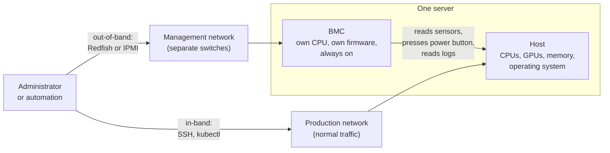
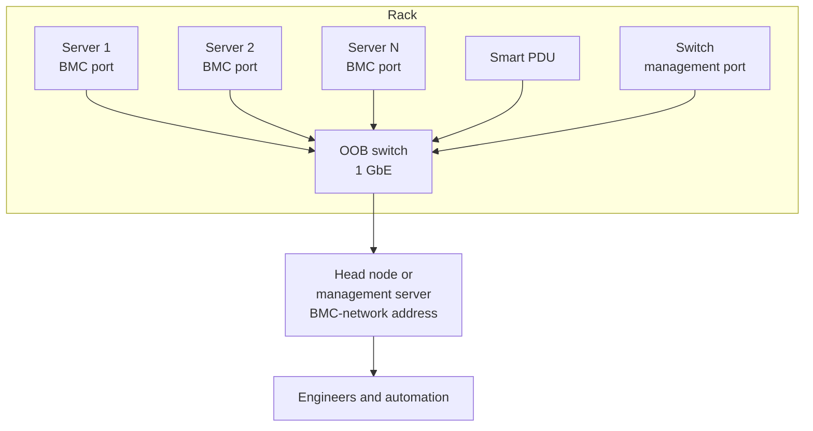

# 7.1 BMCs, IPMI and out-of-band management

| | |
|---|---|
| Level | Beginner |
| Priority tier | 1 |
| Lab venue | Laptop for the simulators |
| Part | Part 7: Redfish and BMC |
| Status | Drafted (`oob_sim.py`, `cred_audit.py` run; `ipmitool` commands **untested** on live BMC) |

## Why this matters for AI infrastructure

A GPU server can cost hundreds of thousands of dollars and sit in a data center you cannot visit. When its operating system freezes, SSH stops, the normal network is useless, and you still have to find out what is wrong and restart it. The tool for this is the **baseboard management controller (BMC)**. Every other chapter in this part, and most of the cluster tools in the rest of the handbook, rely on it: provisioning, firmware updates, power control, health monitoring.

## Prerequisites and outcomes

You need basic networking (IP address, DHCP, VLAN) and Linux commands. After this chapter you can:

- explain what a BMC is and why it works when the server's OS does not
- tell in-band from out-of-band management and pick the right one
- describe how the management network is laid out and addressed
- read and write basic `ipmitool` commands, and know their risks
- explain console access (SOL, conman, KVM) and why it matters
- audit BMC accounts for a whole cluster
- explain why the industry moved from IPMI to Redfish

## 1. The problem in one story

Imagine a server in another country. The kernel crashes. The server stops answering SSH and ping, but its fans are still running. You cannot walk over and press the power button. Without a BMC you would call someone at the data center and ask them to do it.

The BMC solves this. It is a **second, small computer inside the server** that is always on and has its own network port. The DMTF Redfish specification defines it as an "embedded device or service", typically an independent microprocessor or system on a chip with its own firmware, which does the out-of-band monitoring and management work.

## 2. Two doors into a server

There are two ways to reach a server.

- **In-band:** through the normal network and the server's operating system. Example: SSH. It works only if the OS and its network are healthy.
- **Out-of-band (OOB):** through the BMC, on a separate management network. It works even if the OS is hung or the server is powered off, as long as the BMC has power.



The picture shows why the BMC is trusted for recovery. It does not depend on the host, and the host does not depend on it.

### What fails, and what still works

I wrote `code/part07/oob_sim.py` to encode these rules and print the result. This is the output I got:

```text
scenario                    SSH  BMC  reset  sensors  advice
healthy server              yes  yes    yes      yes  normal management
OS kernel panic              NO  yes    yes      yes  use the BMC (Redfish/IPMI) to inspect or reset
host powered off             NO  yes    yes      yes  use the BMC (Redfish/IPMI) to inspect or reset
production network down      NO  yes    yes      yes  use the BMC (Redfish/IPMI) to inspect or reset
management switch down      yes   NO     NO       NO  normal management
rack lost AC power           NO   NO     NO       NO  nothing remote works: smart hands or fix power/network
```

Two lessons:

1. The BMC covers most failures that stop SSH.
2. The BMC has its own weak points: the management switch and the power feed. If the management network is down you lose all your recovery doors at once. That is why management switches deserve the same care as production ones.

## 3. What a BMC can do

The SCL book describes the controller as "a small independent server" that watches the main server through sensors on buses such as I2C and SMBus, manages its power, and often emulates a serial port. In a modern server it usually offers:

| Ability | What it means for you |
|---|---|
| **Power control** | on, off, reset, power cycle, even when the OS is dead |
| **Sensors** | temperatures, fan speeds, power supply voltage and power draw |
| **Event log** | a record of hardware events kept by the BMC, often useful after a crash |
| **Console** | see boot messages and log in on a serial console over the network |
| **Remote screen and keyboard (KVM over IP)** | see and control the screen, useful for BIOS setup |
| **Virtual media** | attach an ISO image as if it were a USB drive |
| **Firmware updates** | update BIOS and other firmware without the host OS (chapter 7.10) |
| **Inventory** | list CPUs, memory, GPUs and serial numbers (chapter 7.7) |

Vendors give their BMC different names: Dell iDRAC, HPE iLO, Cisco CIMC, and OpenBMC on many other systems. BCM treats IPMI, iLO, DRAC, CIMC and Redfish as different kinds of one thing, a "BMC interface" on a device.

## 4. The management network

The BMC has its own Ethernet port, wired to its own switches. Three practical rules:

1. **Keep it separate.** The SCL book says the IPMI network "is not really secure" and recommends a dedicated physical network, or at least a dedicated VLAN enabled only on management nodes, not on user-facing ones. Check that your BMC supports VLANs before you plan.
2. **Give every BMC a known address.** In BCM, a BMC is a network interface of type `bmc` on a dedicated network. BCM's default is `10.148.0.0/16`. The book shows creating one interface per node with `addinterface`, for example `addinterface -n node001..node150 bmc ipmi0 bmcnet 10.148.0.1`, then `commit`.
3. **Make DHCP work for the BMCs.** The SCL book warns that if you do not have the MAC address list and DHCP for BMCs, you may have to set up IPMI by hand on every node, "which may take weeks". Collect BMC MAC addresses when the hardware arrives (see the pipeline in chapter 6.22 and the inventory file in 6.31).

The head node also needs an address on the BMC network so it can reach the BMCs. The BCM book names two ways: an alias interface when the BMCs share the internal network, or a separate interface when the BMC network is physically separate.



## 5. IPMI: the older standard

**IPMI (Intelligent Platform Management Interface)** is an older, open standard for talking to a BMC. The SCL book calls the BMC part a "management controller (MC)". It is still common, and you will see it for years. Most Linux clusters use the `ipmitool` program (and `openipmi` for the kernel side).

### 5.1 Turning it on

The SCL book says network access to the controller is usually off by default. To configure it from the node's own OS, first load the kernel modules:

```bash
modprobe ipmi_devintf
modprobe ipmi_si
modprobe ipmi_msghandler
```

Then `ipmitool` works against the local controller. For a remote one the form is:

```bash
ipmitool -I lanplus -H <bmc-address> -U <user> -P <password> <command>
```

`-I` picks the protocol: `lan` for IPMI 1.5 and `lanplus` for 2.0 and later. The book warns these two are not compatible, so name the right one. Use `lanplus` for anything modern.

### 5.2 The main command groups

The book lists these top-level subcommands:

| Subcommand | Meaning |
|---|---|
| `lan` | network settings of the controller |
| `power` | power control |
| `mc` | manage the controller itself |
| `sensor` | print sensor values |
| `sol` | serial over LAN (remote console) |
| `user` | users on the controller |
| `channel` | channel setup |
| `session` | session information |
| `shell` | type commands interactively |

Power subcommands:

| Command | What it does |
|---|---|
| `power status` | show if the server is on |
| `power on` | power up |
| `power off` | power off |
| `power cycle` | off then on. The book says this is not always reliable and prefers explicit off, a pause, then on |
| `power reset` | like pressing the reset button |

`ipmitool lan print` shows the controller's network settings: IP source (static or DHCP), IP address, netmask, MAC address, gateway and VLAN ID. To change them: `ipmitool lan set <channel> <setting>` where the channel is usually 1.

:::warning Risk
`power off`, `power reset` and `power cycle` act on a **live server**. They are like pulling the plug and can lose data or kill a training job. Only use them when graceful methods have failed. In a cluster, first drain the node from the scheduler (chapter 6.14).
:::

### 5.3 Creating an account (from the SCL book)

```bash
ipmitool user set name 3 adminuser
ipmitool user set password 3 MYPASSWORD
ipmitool user priv 3 4 1
ipmitool lan set 1 access on
ipmitool lan set 1 auth admin md5
ipmitool channel setaccess 1 3 privilege=4
ipmitool sol payload enable 1 3
ipmitool sol set enabled true
```

In words: give user slot 3 a name and password, give it privilege level 4 (administrator) on channel 1, allow access on the channel, and enable the serial console payload. The book notes the settings partly repeat each other and some may not be needed, depending on the BMC model.

Safety notes:

- Do not put a real password on the command line. The book recommends reading it from a file with `-f pass_file` instead of `-P`, because command lines can be seen by other users and saved in shell history.
- `md5` is the weak password check from older IPMI. Treat these lines as the book's example of the old way. For your own systems prefer IPMI 2.0 with the strongest options your BMC offers, or turn IPMI off and use Redfish over HTTPS (chapter 7.15).
- **Change the default password.** The book says it plainly.

### 5.4 Why people moved on

IPMI works, but it has limits that matter at fleet scale:

- messages are compact binary, so every vendor extension is a private format
- sensors and commands vary between vendors, and accelerators are often only exposed through vendor extensions
- security options (ciphers, authentication types) vary by BMC and are easy to leave weak
- it is a command protocol, not a data model, so scripts need vendor knowledge

The NVIDIA notes give the accurate position: Redfish is the documented API for fleet automation on DGX H100 and H200, while `ipmitool` is still used for some jobs, for example a BMC cold reset (`ipmitool mc reset cold`) after a BMC firmware update. They also note IPMI uses UDP port 623. Treat "IPMI is dead" as wrong, and "IPMI is enough" as wrong too.

## 6. Seeing the console

When a server hangs during boot, you want to see its screen. Three tools:

- **Serial over LAN (SOL).** IPMI 2.0 can carry a serial port over the network. `ipmitool sol activate` starts a session and `~.` ends it. The book warns the same keys may close your SSH session too. For a login to work, the server must run a `getty` program on that serial port.
- **conman.** A console manager that keeps console connections open to many servers, so you can watch several at once and automate some actions. The book says it does not do power control, and recommends **powerman** for that, which supports IPMI and many smart PDUs. xCAT has a similar tool, `rcons`.
- **iKVM (KVM over IP).** Shows the screen and sends keyboard and mouse over the network. The book says there is no standard protocol for it, so vendors use different clients (browser plug-ins, Java), and it is hard to automate. It is still the only way to see a hung screen or change BIOS settings by hand. The book prefers built-in iKVM over external boxes because built-in ones can usually also control power.

The Redfish specification says the same about these: KVM and serial console are "critical functionality" but cannot sensibly be done through a REST interface, so Redfish only describes how to **find** them, not the protocols.

## 7. BMC accounts: the weakest link

The BMC can power-cycle servers, change firmware and read memory-adjacent data. Its passwords are therefore among the most sensitive in the data center. In a fleet, accounts drift: someone replaces a board, a node keeps a factory password, or one rack gets a different one.

BCM sets this centrally. The BCM book says BMCs get the username `bright` and a random password made at installation unless you change it, stored by CMDaemon and managed under `partition` mode, `bmcsettings` (set `username`, set `password`, `commit`). Settings can also be given per category or per node, so it is not obvious which level wins. For this the book provides the `credentialsoverview` command, which shows the effective BMC credentials per device.

Its design is worth copying. Passwords are never shown. Each password becomes a short **salted SHA-256 fingerprint**, so identical passwords look identical inside one session and outliers stand out. The salt changes each session so a fingerprint copied from someone's screen is useless later. The `--inverse` option groups devices by identical credentials with a count, smallest groups first.

I wrote `code/part07/cred_audit.py` using the same idea for a plain CSV. On the sample file `sample_bmc_accounts.csv` (7 nodes) it printed:

```text
count  user       fingerprint    nodes
    1  bmcadmin   a976aeb2f79b   node003
    1  admin      596fd789214c   node005
    1  bmcadmin   86daac35a5ea   node006
    4  bmcadmin   81c34f302ad8   node001,node002,node004,node007

4 different credential sets: the smallest group is probably the odd one out
PROBLEM node005: factory-default credentials (admin)
PROBLEM node006: empty BMC password
```

The fingerprints change on every run (that is intended). The tool also exits with status 1 when it finds a problem, so you can use it in a pipeline. Real use needs the passwords from your secret store, never a plain file in git.

## 8. DGX and HGX notes

The NVIDIA notes describe a DGX H100 as more than a pizza-box server: a host motherboard tray (CPUs, memory, BlueField DPUs) and a separate GPU tray (8 GPUs and NVSwitch chips), up to about 10.2 kW per system, with **satellite management controllers** on the GPU tray that report back to the main BMC. The notes say the BMC is often an ASPEED chip and runs a small Linux (such as OpenBMC). I have not checked these hardware details against NVIDIA's current documents, so treat them as background. Chapter 7.13 covers the DGX and HGX Redfish layout in detail.

Another note from the DGX chapter: the OS-side tool `nvsm` (NVIDIA System Management) looks at the hardware from the **inside**, and the BMC from the **outside**. If a DIMM starts failing, `nvsm` can see ECC errors in the OS. If the OS is down, the BMC is what you have. `nvsm dump health` collects logs and state into one archive for NVIDIA support.

## 9. Where Redfish comes in

Redfish is a standard from the DMTF, built to replace IPMI as the way to manage servers. Its own overview lists the goals: scalable, flexible, extensible, backward-compatible, interoperable, standards-based, simple, lightweight. Its design uses a REST interface with JSON, so any script or tool that can speak HTTP can manage hardware. It keeps the protocol separate from the data model so each can change on its own, and one **service root** URI lets a client discover everything by following links.

The spec is also honest about limits: "interoperable does not mean identical". Many parts are optional, different hardware gives different resource trees, and links must not be reused between different services. You must discover, not assume. The rest of this part teaches how.

## 10. Exercises

1. Run `python3 code/part07/oob_sim.py`. Add a scenario "BMC firmware crashed". What would still work?
2. Run `python3 code/part07/cred_audit.py code/part07/sample_bmc_accounts.csv`. Fix the CSV until it reports no problems.
3. Write the management network plan for 128 servers: one BMC per server, two PDUs per rack, switches. How many addresses do you need? Which subnet size fits with room to grow?
4. On paper, write the exact steps to recover a frozen server using only the BMC, without cutting power first if possible.
5. **Real hardware only:** install `ipmitool` on a test box and run `ipmitool -I lanplus -H <bmc> -U <user> -f <passfile> power status`. Do nothing else on production machines.

## 11. Interview angles

- "What is the difference between in-band and out-of-band management?" Say which fails when the OS crashes, and what the BMC depends on (standby power and the management network).
- "Why not just use SSH to update firmware?" If the OS or network fails mid-update, the flash can be left half-done. The NVIDIA notes recommend doing it through the BMC for this reason. Be careful not to overclaim: the BMC route is safer, it is not a guarantee, and you should still follow vendor procedures and quiesce the node first (chapter 7.10).
- "How would you secure BMCs?" Separate network, no factory passwords, per-purpose accounts, central audit, turn off unused protocols.
- "IPMI or Redfish?" Redfish for automation, IPMI only where needed, and say why.

## 12. Checkpoint questions (20)

1. What is a BMC?
2. Why does the BMC keep working when the OS is hung?
3. What does the BMC need in order to work?
4. Define in-band and out-of-band management.
5. In which cases from the table does SSH fail but the BMC still works?
6. What two things can take away all your BMC access at once?
7. Why must the management network be separate?
8. What is BCM's default network for BMCs?
9. What is the difference between `-I lan` and `-I lanplus`?
10. Why is `power cycle` sometimes replaced by off, wait, on?
11. Why use `-f pass_file` instead of `-P password`?
12. What is SOL and what must run on the server for it to work?
13. What does conman do and what does it not do?
14. Why is iKVM hard to automate?
15. What does Redfish say about KVM and serial console?
16. How does BCM's `credentialsoverview` avoid exposing passwords?
17. Why is the fingerprint salted per session?
18. Name three things a fleet credential audit should catch.
19. What does `nvsm` see that the BMC does not, and the reverse?
20. Why is "interoperable does not mean identical" important for scripts?

## 13. Sources and review notes

- **Supercomputers for Linux SysAdmins**, chapter 10 (Remote Management): IPMI, `ipmitool` tables, the account example, SOL, conman, powerman, iKVM, and the advice on separate management networks. I read the whole chapter.
- **Redfish Specification DSP0266 v1.21.0:** BMC definition (3.1.1), goals, design tenets and limitations (5.1 to 5.4), service elements including the statement about KVM and serial console (5.5), and TLS 1.2 or later (13.1).
- **BCM 11 Administrator Manual:** section 3.7 (BMC network, interface setup, authentication, `credentialsoverview`) and appendix N (Redfish in BCM).
- **NVIDIA-DevOps notes:** volume 05 chapter 3 and volume 10 chapter 1 (DGX management plane, `nvsm`, the IPMI versus Redfish position).
- **Corrections to the notes:** volume 05 says an SSH loop for firmware flashing would "permanently brick" GPUs and that a BMC update "guarantees" success. That is too strong: I did not find a source in the books that guarantees it, so I kept only the weaker, defensible claim (see section 11). Volume 10 key takeaways say to "completely abandon" IPMI, but the same chapter earlier says `ipmitool` is still used; I followed the more careful statement.
- **Not verified:** no real BMC was available. The `ipmitool` commands are from the book and are untested here. BMC hardware details (ASPEED, OpenBMC, satellite controllers, 10.2 kW) come from the notes and are unchecked.
