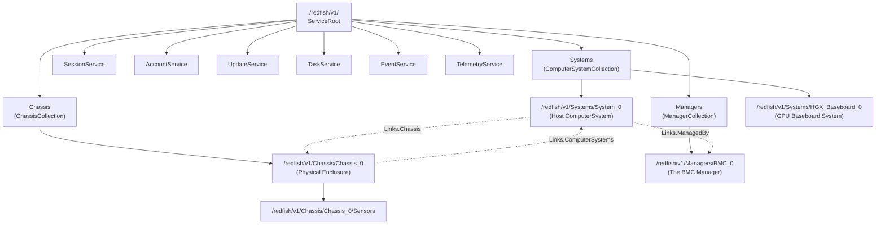

# 7.2 Redfish concepts: service root, resources, collections and OData

| | |
|---|---|
| Level | Beginner to Intermediate |
| Priority tier | 1 |
| Lab venue | Laptop (`code/part07/redfish_mock.py`, `redfish_crawl.py`, `rf_inventory.py`, and `crawl_concepts_lab.py`) |
| Part | Part 7: Redfish and BMC |
| Status | Drafted. `redfish_mock.py`, `redfish_crawl.py`, `rf_inventory.py`, and `crawl_concepts_lab.py` passed 3/3 self-checks on a laptop. They were not verified against a live physical BMC. |

## Why this matters for AI infrastructure

Picture a GPU server whose host operating system has frozen. You need to reset it, and you need to read its hardware state without logging in to that OS. Every modern GPU server gives you that path. Whether it is an 8-GPU NVIDIA DGX H100 or HGX node or a 72-GPU rack-scale GB200 NVL72, the server exposes its out-of-band hardware state through a **DMTF Redfish** service running on the BMC. Redfish is a web-style interface, which means you talk to it with ordinary HTTP requests and read JSON answers. Platform teams use that service every day. They inventory serial numbers and GPU VBIOS versions, watch inlet and SXM thermal sensors, stage BIOS tuning attributes, flash firmware bundles, and reset frozen nodes without touching the host OS. The VBIOS is the firmware on the GPU board itself, and the SXM sensors are the thermal readings on the GPU module in the HGX tray.

Now suppose your automation is a pile of memorized `curl` URLs. It will break the first time you move from one vendor's BMC to another. It can also break after a BMC firmware upgrade on the very same server, because the firmware may name things a little differently. The fix is to learn the shape of the data model instead. You need to see how the single Service Root (`/redfish/v1/`) links to collections and resources, how `@odata` and `@Redfish` annotations work, how active resources pair with pending `/Settings` resources, and how a hypermedia crawler finds its way through the graph without hard-coded paths. Hypermedia here means that every response carries links to the next places you can go, the same way a web page carries links to other pages. Once you have that shape, you can automate any vendor's server without first reading a vendor-specific manual. This chapter teaches that shape and tests it against two different server profiles in `code/part07/`.

## Prerequisites and outcomes

Before you start, read Chapter 7.1 on BMCs and out-of-band networks, so the words "BMC" and "out-of-band" feel familiar. You should also be comfortable with basic HTTP requests and JSON. If you have ever opened a web API in a browser and read the response, you already have enough.

The chapter builds the model in layers. It starts with the four ideas that every Redfish message uses, which are HTTP, REST, JSON and OData. Then it shows the Service Root and the well-known URIs that you can read without logging in, such as `/redfish`, `/redfish/v1/`, `/redfish/v1/odata` and `/redfish/v1/$metadata`. Next comes the anatomy of a single resource, where `@odata.id`, `@odata.type`, `Id`, `Name`, `Status`, `Links`, `Actions` and `Oem` do most of the work. The unit suffixes `MHz`, `Mbps`, `MB` and `Count` tell you what a number means, and the empty string `""` and `null` are two different signals you must not mix up. The duration strings `PT10S` and `PT1H30M` show how time spans are written. Then come the payload annotations such as `@Redfish.AllowableValues`, `@Redfish.AllowableNumbers`, `@Redfish.Settings` and `@Message.ExtendedInfo`, followed by the Settings pattern and the vendor extensions. The chapter then covers `Members`, `Members@odata.count`, `Members@odata.nextLink` and the `$skiptoken` that a BMC may hand you, so you can page through a collection safely. It ends with a lab that runs `redfish_mock.py`, `redfish_crawl.py`, `rf_inventory.py` and `crawl_concepts_lab.py` against two server profiles, `dgx` with `168` URIs and `generic` with `150` URIs, plus a short look at discovery and BCM's built-in commands. That path gives you what you need to read the four required properties on any resource, and to walk a collection to its last page without losing a member. The crawl relies only on link discovery and loop protection, so it never needs a hard-coded path.

---

## 1. Foundational building blocks: HTTP, REST, JSON, and OData

Imagine you have just joined a team that runs a few hundred GPU servers. Your first task is to write a script that reads the temperature of every node. Before you write a line, you will meet four terms in every request and every response. Every Redfish clause assumes these four terms, which come from the DMTF Redfish Specification (**DSP0266 v1.21.0**, §5.1–5.4). You will meet them in every request and every response, so it pays to pin them down first.

1. **HTTP (Hypertext Transfer Protocol):** HTTP is the request and response protocol of the web, carried over TCP/IP and TLS. TCP/IP is the basic network transport that moves bytes between machines, and TLS adds encryption on top of it. Your client sends a verb (`GET`, `POST`, `PATCH`, `PUT`, `DELETE`), a target path such as `/redfish/v1/Systems`, some headers, and an optional body. The verb says what you want to do, the path says what you want it to happen to, and the body carries any new values. The BMC answers with a numeric status code, such as `200 OK`, `201 Created`, `202 Accepted`, `401 Unauthorized`, or `404 Not Found`, followed by its own headers and payload. The number is the first thing to read, because it tells you the outcome before you read anything else.
2. **REST (Representational State Transfer):** REST is an architectural style. Every manageable entity on the BMC, whether a computer system, a fan sensor, a BIOS configuration, or an event log entry, is a **resource** with its own URI. A URI is the address of the resource, the same kind of string you would type into a browser. You change it with the standard HTTP verbs. DSP0266 §5.4.1 explains why Redfish chose it: REST needs fewer protocol layers than legacy standards such as IPMI or WS-Management, almost every language supports it, and existing HTTP and TLS libraries and CLI tools already work with it. In practice, this means the same tools you use for a web service also work for a server's BMC.
3. **JSON (JavaScript Object Notation):** JSON is a text format built from key-value objects, ordered arrays, strings, numbers, booleans (`true`/`false`), and `null`. Legacy IPMI returns packed binary Sensor Data Records. A Redfish response is different. An engineer can read it directly, and you can parse it in one line of Python, Go, or `jq`. The `jq` tool is a command-line JSON reader, and it is handy when you want to pull one field out of a long response.
4. **OData (Open Data Protocol) conventions:** Many web services call themselves "RESTful," yet each one invents its own way to name links, declare types, paginate lists, and filter results. That makes tools hard to share. Redfish adopts the standard OData v4 JSON conventions (DSP0266 §5.4.6). Metadata properties start with `@odata.`, such as `@odata.id`, `@odata.type`, `@odata.count`, and `@odata.nextLink`. Query parameters start with `$`, such as `$select`, `$expand`, `$filter`, `$top`, and `$skip`. Chapter 7.3 covers those in detail. The payoff is that a tool written for one OData service can read the metadata of another, because both use the same words for the same jobs.

The design rule behind all of this is the separation of protocol from data model (DSP0266 §5.2). The transport rules in Section 6 of the spec, the hardware schemas in Section 9, and the DMTF Resource and Schema Guide (**DSP2046**) evolve independently. Each has its own versioning rules, so a change to one does not force a change to the other. That separation is why a new hardware type can appear without a change to HTTP. When a Redfish script misbehaves, first decide whether the problem is in the transport or in the data model. A failed login or a 405 status points to transport. A missing field or a changed name points to the data model.

---

## 2. The Service Root (`/redfish/v1/`) and well-known URIs

Consider the way you used to talk to a BMC over IPMI. You sent a command to a flat controller address, and the controller answered with a packed reply. There was no map of the box and no list of what it contained. Redfish works differently, and the difference matters the first time you script it. The whole BMC is organized as a **hypermedia graph**, with one well-known entry point called the **Service Root**: **`/redfish/v1/`**. Think of it as the home page of a website. Every subsystem is one or more clicks away, and you do not need to memorize the address of each one.

From `/redfish/v1/`, you reach each subsystem by following the `@odata.id` links in the JSON responses. Your script never needs to know a path in advance. It reads a link, fetches that URI, and reads the next link. This is the same idea as a web crawler, and it is why the same script can run against servers it has never seen before.



Read Figure 1 with two arrow styles in mind. Solid arrows show **subordinate containment**, the parent-to-child layout of the URI tree. For example, `Chassis_0` contains `Sensors`. Dashed arrows show **associated cross-links** under the `Links` property. `System_0` links to `Chassis_0`, and `Chassis_0` links back to `System_0`. Those back-links create cycles, so DSP0266 §5.3 calls the Redfish data model a **directed graph, not a strict tree**. A tree has one path from the root to each node, but a graph can loop back on itself. Any crawler that follows `@odata.id` references must keep a `visited` set, or it will loop forever. The `visited` set is simply a list of addresses the crawler has already read, so it never reads the same one twice.

### 2.1 The three primary hardware collections under `/redfish/v1/`

The *Redfish Resource and Schema Guide* (DSP2046, `ServiceRoot`) describes what hangs off the root. It links to service singletons such as `SessionService`, `AccountService`, `UpdateService`, `TaskService`, `EventService`, `TelemetryService`, `Registries`, and `JsonSchemas`. A singleton is a resource that exists exactly once on the BMC, such as the login service. The guide also links to three hardware collections, which you will use in almost every script. The table below is a lookup, so return to it whenever you wonder where a piece of hardware lives.

| Root Collection | Schema Type | What It Models | Typical Subordinate Resources |
|---|---|---|---|
| **`Systems`** | `ComputerSystemCollection` | The **logical computer(s)** as seen by software and the OS | `Processors` (CPUs and GPUs), `Memory` (DIMMs), `Bios` (`/Bios/Settings`), `SecureBoot`, `Storage`, `EthernetInterfaces`, `LogServices`, `Reset` action |
| **`Chassis`** | `ChassisCollection` | The **physical sheet-metal enclosure(s)**, trays, and power/cooling envelope | `Sensors`, `ThermalSubsystem` (fans, temps), `PowerSubsystem` (PSUs), `PCIeDevices`, `NetworkAdapters`, `Drives` |
| **`Managers`** | `ManagerCollection` | The **management controller(s)** (BMCs, satellite HMCs, enclosure managers) | `NetworkProtocol` (HTTPS, IPMI, SSH, SSDP), `EthernetInterfaces` (OOB NIC), `LogServices` (`SEL`), `SerialInterfaces`, `VirtualMedia` |

A standard 1U server usually has one member in each collection: one in `Systems`, one in `Chassis`, and one in `Managers`. That is the simple case, and it is the one most documentation shows first. A DGX H100 or H200 or an HGX node is different. It often exposes several members in `Systems` and `Chassis`. Take `Systems/DGX` (or `System_0`) for the x86 host, and `Systems/HGX_Baseboard_0` for the 8-GPU baseboard. A satellite controller manages that baseboard. See Chapters 7.7 and 7.13 for that setup. When you see two members where you expected one, do not assume the server is broken. It is simply a multi-tray system.

### 2.2 Well-known Redfish URIs and unauthenticated endpoints (DSP0266 §6.7 & §13.3.2)

Never hard-code deep paths such as `/redfish/v1/Systems/1`. A deep path is one that names a specific member several levels down, and it breaks as soon as the member has a different name. Still, DSP0266 §6.7 (Table 4) fixes a small set of URIs at the root of every Redfish service, and those never change. DSP0266 §13.3.2 allows some of those root documents to be read with a `GET` and no authentication. That lets a client check the protocol version, inspect the schemas, and find the login endpoint (`SessionService/Sessions`) before it signs in. Think of these as the lobby of the building. You can walk in without a badge, but the offices behind the doors need one.

| Well-Known URI | Required by DSP0266 Table 4 | Unauthenticated `GET` Allowed (§13.3.2) | What It Returns |
|---|---|---|---|
| `/redfish` | **Yes** | **Yes** | Protocol version object: `{"v1": "/redfish/v1/"}` |
| `/redfish/v1/` (or `/redfish/v1`) | **Yes** | **Yes** | The `ServiceRoot` JSON resource (`RedfishVersion`, `UUID`, and top-level `@odata.id` links) |
| `/redfish/v1/odata` | **Yes** | **Yes** | OData service directory document for generic OData v4 clients |
| `/redfish/v1/$metadata` | **Yes** | **Yes** | CSDL XML metadata document declaring schemas and namespaces supported by this BMC |
| `/redfish/v1/openapi.yaml` | No (Optional, v1.6+) | **Yes** (if implemented) | OpenAPI v3.0 description of the service's URIs |
| Everything else (e.g., `/redfish/v1/Systems`) | Schema-dependent | **No (`401 Unauthorized`)** | Requires HTTP Basic over TLS or an `X-Auth-Token` session header (Chapter 7.4) |

The table is your lookup for this rule. Notice that the first four rows are open to an anonymous `GET`, and everything below the root needs a session. Your first script should probe the open documents, then authenticate before it touches a hardware subtree. The probing step costs almost nothing, and it tells you two things at once. It confirms the BMC answers at all, and it shows you which protocol version it speaks.

### 2.3 Inspecting `ServiceRoot` properties and `ProtocolFeaturesSupported` (DSP2046)

The first unauthenticated `GET /redfish/v1/` returns a `ServiceRoot` resource. It is defined in `ServiceRoot.v1_17_0` in the *Redfish Resource and Schema Guide* (DSP2046 §6.121). Its top-level links matter, but so do the fields that describe the BMC itself. Those fields tell you the protocol version, the service identity, and which optional OData query parameters this firmware supports. Read them once per BMC model, and you will know what the rest of the session can do.

- **`RedfishVersion`** is the version of the Redfish Specification (`DSP0266`) that this service follows. It uses the form `"Major.Minor.Errata"`, such as `"1.17.0"` or `"1.21.0"`. Major is the big number, Minor is the feature number, and Errata is the small fix number. Do not confuse it with the schema version in `@odata.type` (`#ServiceRoot.v1_17_0.ServiceRoot`), which tracks the schema, not the protocol. The two numbers can differ on the same BMC, and that is normal.
- **`UUID`** is a 36-character RFC 4122 identifier for this Redfish service instance, for example `"00000000-0000-0000-0000-000000000000"`. Suppose you discover the same BMC over several paths: IPv4, IPv6, and a host-side USB NIC. Matching `UUID` values prove that all of those endpoints belong to one BMC. That check matters when a script finds two addresses and needs to know whether they are one machine or two.
- **`Product` and `Vendor`** are optional strings that name the server product and its maker, such as `"NVIDIA DGX H100"` and `"NVIDIA"`. They are useful for inventory reports, and they are the first hint about which subtree names to expect.
- **`Links.Sessions`** points to the login URI. Alongside the authenticated `/redfish/v1/SessionService` link, `ServiceRoot` carries `"Links": {"Sessions": {"@odata.id": "/redfish/v1/SessionService/Sessions"}}`. An anonymous client can therefore find the exact `POST` login URI on its very first request, without guessing where the login lives.
- **`ProtocolFeaturesSupported`** is a structured object that lists which query parameters and deep operations the BMC supports. Read it before you send `$expand` or `$filter`, so you never have to guess. A parameter that the BMC does not support returns an error, so checking first saves a round trip:
  - `ExpandQuery` (`ExpandAll`, `Levels`, `Links`, `MaxLevels`, `NoLinks`) shows whether `?$expand=.($levels=1)` works. That call inlines child objects in one HTTP round-trip, so you get the children without a second request.
  - `FilterQuery` (`true`/`false`) shows whether `?$filter=` expressions work on collections.
  - `SelectQuery` (`true`/`false`) shows whether `?$select=` property projection works. A projection is a request for only some of the fields, which keeps the response small.
  - `OnlyMemberQuery` (`true`/`false`) shows whether `?only` works. It dereferences a collection that holds exactly `1` member automatically, so you get the member itself.
  - `ExcerptQuery` and `DeepOperations` (`DeepPATCH`, `DeepPOST`) show whether excerpt views and multi-resource deep edits are implemented. An excerpt is a short summary view, and a deep operation changes several linked resources in a single request.

Before you write any query-heavy script, read `ProtocolFeaturesSupported` on the target BMC and only use the parameters it lists. That one habit prevents most of the confusing errors that beginners hit with Redfish.

---

## 3. Anatomy of a Redfish resource

A **resource** is one JSON document returned at an `@odata.id` URI. When you request a resource, the response tells you what it is, where it lives, and what it contains. Think of it as a labeled card for one piece of hardware. The card says what kind of thing it is, where to find it again, and what state it is in. DSP0266 §9.5 and §9.6 require four properties in every individual resource: `@odata.id`, `@odata.type`, `Id`, and `Name`. Schema-defined properties come on top of those four. A schema is the formal definition of what a resource type is allowed to contain.

The example below is a live response from `code/part07/redfish_mock.py` (`dgx` profile) for `/redfish/v1/Systems/System_0`. Read it top to bottom once, and you will recognize the same pattern in every other resource. Start with the four required fields at the top, then look at `Status`, then look at the subordinate references and `Actions`.

```json
{
  "@odata.id": "/redfish/v1/Systems/System_0",
  "@odata.type": "#ComputerSystem.v1_17_0.ComputerSystem",
  "@odata.etag": "W/\"1\"",
  "Id": "System_0",
  "Name": "Compute node",
  "SystemType": "Physical",
  "Manufacturer": "ExampleCorp",
  "Model": "HGX-8GPU",
  "SerialNumber": "SN-SYS-0001",
  "UUID": "00000000-0000-0000-0000-000000000001",
  "PowerState": "On",
  "BiosVersion": "1.28.0",
  "Status": {
    "State": "Enabled",
    "Health": "OK",
    "HealthRollup": "OK"
  },
  "ProcessorSummary": {
    "Count": 2,
    "Model": "Dual Socket CPU"
  },
  "MemorySummary": {
    "TotalSystemMemoryGiB": 2048
  },
  "Processors": { "@odata.id": "/redfish/v1/Systems/System_0/Processors" },
  "Memory": { "@odata.id": "/redfish/v1/Systems/System_0/Memory" },
  "Bios": { "@odata.id": "/redfish/v1/Systems/System_0/Bios" },
  "Links": {
    "Chassis": [
      { "@odata.id": "/redfish/v1/Chassis/Chassis_0" }
    ],
    "ManagedBy": [
      { "@odata.id": "/redfish/v1/Managers/BMC_0" }
    ]
  },
  "Actions": {
    "#ComputerSystem.Reset": {
      "target": "/redfish/v1/Systems/System_0/Actions/ComputerSystem.Reset",
      "ResetType@Redfish.AllowableValues": [
        "On", "ForceOff", "GracefulShutdown", "GracefulRestart", "ForceRestart", "PowerCycle", "Nmi"
      ]
    }
  }
}
```

### 3.1 Core resource properties (DSP0266 §9.6)

The table below is your reference for each common property. The first column is the property name. The second says whether the specification requires it. The third explains what the property means and how a client should read it. Use it the way you would use a dictionary, looking up one property at a time as you meet it in a payload.

| Property | Required? | Specification Rule & Meaning |
|---|---|---|
| `@odata.id` | **Yes** | Canonical URI of this resource (`"/redfish/v1/Systems/System_0"`). Used by clients to re-fetch or link to the resource. |
| `@odata.type` | **Yes** | Schema type and version in the format `#<Namespace>.v<Major>_<Minor>_<Errata>.<ResourceType>` (or `#<CollectionType>.<CollectionType>` for unversioned collections). |
| `Id` | **Yes** | String that uniquely identifies this resource within its parent collection (`"System_0"`). Shall not contain RFC 1738 unsafe URL characters because it forms the final URI segment. |
| `Name` | **Yes** | Human-readable display label (`"Compute node"`). Unlike `Id`, `Name` is **not** required to be unique across sibling resources. |
| `@odata.etag` | Recommended | Entity tag (`W/"1"` or `"A89B03"`) used with `If-Match` / `If-None-Match` HTTP headers for optimistic concurrency control (Chapter 7.3). |
| `@odata.context` | Optional | OData context URL pointing into `$metadata` (e.g., `"/redfish/v1/$metadata#ComputerSystem.ComputerSystem"`). |
| `Status` | Common | Structured object with three key fields (§9.6.16): `State` (operational state such as `Enabled`, `Disabled`, `StandbyOffline`, `Absent`, `Updating`), `Health` (health of this resource alone: `OK`, `Warning`, `Critical`), and `HealthRollup` (worst-case aggregated health of this resource and all subordinate resources beneath it). |
| Subordinate refs | Schema-defined | Direct child collections or singletons at the root of the JSON object (`"Processors": {"@odata.id": "..."}`). |
| `Links` | Common | Cross-references to **associated (non-child)** resources elsewhere in the graph (`Links.Chassis`, `Links.ManagedBy`). |
| `Actions` | Common | Operations invoked via `POST` that do not map to simple property edits (`#ComputerSystem.Reset`, with a `target` URI). |
| `Oem` | Common | Vendor-specific extensions isolated under a company/organization key (`Oem.Nvidia`, `Oem.OpenBMC`). |

Two of these rows deserve a closer look. `Id` is the final segment of the URI, so it must stay URL-safe. Characters such as spaces or question marks would break the address. `Name` is only a label, and two siblings may share it. Use `Id` when you build a path and `Name` when you show something to a person. Mixing those two up is a common early bug, and it shows up as a path that works on one server and returns `404 Not Found` on another.

### 3.2 Naming rules, unit suffixes, and schema versioning (DSP0266 §9.7)

Redfish enforces strict naming rules (DSP0266 §9.7.1), so you can guess what a property means before you read its documentation. Every resource type, property, and action parameter uses PascalCase. PascalCase means each word starts with a capital letter and the words are joined with no spaces, and it starts with a letter and contains only letters and digits. Examples are `ComputerSystem`, `PowerState`, `SerialNumber`, and `TotalSystemMemoryGiB`. Two-letter acronyms capitalize both letters, as in `IPAddress` and `RemoteIP`. Well-known mixed-case names keep their standard form, such as `PCIe`, `iSCSI`, `NVMe`, `LDAP`, and `SNMPv2`. The rule means that you can read a name and know it is a single concept, not a sentence.

Units go in the name itself. That way you never have to guess whether a speed is in `MHz` or `GHz`, or whether a size is in `MB` or `GiB`. Bandwidth appears as `PortSpeedMbps` and `MaxBandwidthGbps`. Frequency appears as `ProcessorSpeedMHz` and `OperatingSpeedMHz`. Capacity appears as `MemoryMB`, `TotalSystemMemoryGiB`, and `CapacityBytes`. Temperature and power appear as `ReadingCelsius`, `TemperatureThresholdCelsius`, and `PowerCapacityWatts`. Counts end in `Count`, as in `ProcessorCount` and `FanCount`. The payoff is that a unit mistake shows up in the name. If a field says Gbps and you expected GBps, you know to check before you do the math.

Schema versions read like `#ComputerSystem.v1_17_0.ComputerSystem`. A minor bump, such as `v1_16_0` to `v1_17_0`, only adds optional properties or enumeration values. An enumeration is a fixed list of allowed words, such as On or Off. A minor bump never removes a property or changes an existing one's type. A client written against `v1_4_0` can therefore parse a `v1_17_0` payload, provided it ignores properties it does not know. That tolerance is what lets one script keep working across a whole fleet of firmware versions.

### 3.3 Special data value rules: `""` vs `null`, ISO 8601 dates, and durations

Four value conventions from DSP0266 §9.5 trip up parsers that are written too quickly. Learn them now, and your thermal dashboards will not show phantom zeros later. Each one looks harmless in a small test, and each one causes a silent bug in a large fleet report.

The first is the difference between an empty string and `null`. They mean different things. An empty string, `""`, says the property is supported and healthy, but its value is blank. An `AssetTag` of `""` is normal before an admin assigns one. A `null` says the BMC cannot get or compute the value right now. For example, `"Reading": null` on a host CPU temperature sensor is expected while the host is powered off, or when an `I2C` sensor bus read fails. Never coerce `null` to `0` or `""` in telemetry scripts. Treating `"Reading": null` as `0 °C` would corrupt your thermal data, and a dashboard would show a cold node that is actually unreadable. The safe habit is to keep it as a missing value in your code, and to count it as "no data" in your report.

The second is the timestamp format. Date-time strings follow ISO 8601 extended format. They always include the `T` separator and an explicit timezone offset, either `Z` for UTC or `+HH:MM` or `-HH:MM`. An example is `"2026-10-28T14:30:00Z"`. Because the offset is part of the string, you can compare timestamps from two BMCs in two different time zones without guessing.

The third is the duration format. Time intervals use `P[nD]T[nH][nM][nS]`. The letter P starts the period, `T` separates the date part from the time part, and each unit has its own letter. `"PT10S"` means 10 seconds, `"PT5M"` means 5 minutes, and `"PT1H30M"` means 1 hour and 30 minutes. A parser that expects plain numbers will fail on these strings, so use a duration parser or read the letters yourself.

The fourth is enumerations that grow over time. A firmware update can add a new enum string, such as a new `ResetType` or `ProcessorType`. Your parser should log an unknown value or fall back gracefully. It should not throw an unhandled exception. A script that crashes on a new word is a script that stops the whole fleet report, and that is a worse outcome than one unknown line in a log.

---

## 4. Payload annotations, `/Settings` resources, and OEM extensions

Look back at the `ComputerSystem` JSON in Section 3. You will see keys with an `@` sign in the middle, such as `"ResetType@Redfish.AllowableValues"`. These keys are **payload annotations**. They do not hold hardware data. They tell you what a value is allowed to be, which is information you would otherwise have to find in a separate manual. An annotation is like a sticky note on a form field that says which answers the form accepts. DSP0266 §9.9 gives them this form:

```text
[<PropertyName>]@<Namespace>.<TermName>
```

Redfish limits annotations to three official namespaces: **`odata`**, **`Redfish`** (an alias for `RedfishExtensions.v1_0_0`), and **`Message`**. A namespace is a labeled group of terms, so `Redfish` is the group that holds the Redfish-specific notes. Clients must ignore any annotation they do not recognize, and they must not fail when one shows up. That rule lets newer firmware add notes without breaking older scripts. The table below covers the annotations you will meet on real BMCs.

| Annotation | Example in JSON Payload | Purpose (DSP0266 §9.9 & §9.10) |
|---|---|---|
| `<Prop>@Redfish.AllowableValues` | `"ResetType@Redfish.AllowableValues": ["On", "ForceOff", "GracefulRestart"]` | Lists the exact string values *currently supported by this specific BMC instance* for a writable property or action parameter (§9.9.2). |
| `<Prop>@Redfish.AllowablePattern` | `"AssetTag@Redfish.AllowablePattern": "^[\\w:-]{0,31}$"` | Regular expression constraining valid string edits on non-enum properties (§9.9.3). |
| `<Prop>@Redfish.AllowableNumbers` | `"PacketSizeBytes@Redfish.AllowableNumbers": ["1024:65536:256"]` | Specifies numeric or duration ranges as `"<min>:<max>:<step>"` (e.g., `1024` to `65536` in steps of `256`, or `"PT5M:PT24H:PT5M"`, §9.9.4). |
| `@Redfish.ActionInfo` | `"@Redfish.ActionInfo": "/redfish/v1/Systems/1/ResetActionInfo"` | Links to a dedicated `ActionInfo` resource detailing required/optional parameters and data types for an action (§9.9.6). |
| `@Redfish.WriteableProperties` | `"@Redfish.WriteableProperties": ["AssetTag", "HostName"]` | Lists which properties on the current resource are actually writable right now (note the specification's spelling `Writeable` with an `e`, §9.9.15). |
| `@Redfish.Settings` | `"@Redfish.Settings": {"SettingsObject": {"@odata.id": "/redfish/v1/Systems/DGX/Bios/Settings"}}` | Points from the **active** resource (current boot state) to its subordinate **Settings resource** (`/Settings` or `/SD`) holding **pending future state** applied on the next reset (§9.10). |
| `[<Prop>]@Message.ExtendedInfo` | `"PinOut@Message.ExtendedInfo": [{"MessageId": "Base.1.8.PropertyValueNotInList", ...}]` | Attaches structured registry diagnostics, warnings, or resolution hints to a whole object or a single property (§9.9.5). |
| `<Prop>@Redfish.Deprecated` | `"VendorID@Redfish.Deprecated": "Deprecated in favor of ModuleManufacturerID."` | Warns that a property is deprecated in newer schema versions (§9.9.14). |

Two of these matter most when you write a script. `AllowableValues` tells you which strings the BMC will accept right now, so your script can check a value before it sends a `PATCH`. A `PATCH` is the request that changes a property, and checking first means a typo never reaches the hardware. `@Redfish.Settings` tells you where a pending change must go, and the next section explains why that matters.

### 4.1 Active resources vs `/Settings` resources (DSP0266 §9.10)

Why does `/redfish/v1/Systems/DGX/Bios` have a child at `/redfish/v1/Systems/DGX/Bios/Settings` (or `/SD`)? Some settings take effect the moment you change them, such as an `AssetTag` or an LED indicator. Others cannot change in live silicon while the host CPUs are running. BIOS attributes such as `SubNumaClustering` and `PcieRelaxedOrdering` fall in this group. UEFI firmware can only apply them during the next system reboot. UEFI is the firmware that starts the server before the operating system loads.

DSP0266 §9.10 handles this with the Settings resource pattern, and it works in two parts. Think of it as a draft and a published copy. The published copy is what the machine is running, and the draft is what you want it to run next. Keeping them separate means a half-finished change can never take down a live system.

- **The active resource (`/Bios`)** shows the current running state. It is read-only for attributes that wait for a reboot. It carries an `@Redfish.Settings` annotation whose `SettingsObject` points to `/Bios/Settings`. It also reports `Time`, `ETag`, and `Messages` from the last time pending settings were applied. The `Messages` field is where you read what the firmware said about the last change.
- **The Settings resource (`/Bios/Settings` or `/Bios/SD`)** uses the same schema as the active resource, but it holds the intended future state. You send your `PATCH` to `/Bios/Settings`. On the next host reset, such as `GracefulRestart` or `ForceRestart`, the BIOS consumes `/Bios/Settings`, updates `/Bios`, and records any validation messages under `@Redfish.Settings.Messages`. A validation message tells you whether the firmware accepted each staged value.

So a BIOS change is a two-step story. You stage it in the Settings resource, then you reset the host so the firmware applies it. If you skip the reset, the change sits in the draft and the running system never sees it. That is the most common reason a BIOS change looks like it did nothing.

### 4.2 OEM extensions (DSP0266 §9.8)

Sometimes a vendor builds a capability before any standard DMTF schema exists. DSP0266 §9.8 gives it a safe place to live: the **`Oem`** object. OEM here means the vendor's own extension. Everything inside `"Oem": { ... }` is keyed by a unique **OEM identifier**. That identifier can be the vendor's ICANN domain name with the dots replaced by underscores, and the `.com` may be left off. ICANN is the body that manages internet domain names, so a vendor's domain makes a name that nobody else can claim. Examples are `"Nvidia"`, `"Dell"`, `"Supermicro"`, and `"Contoso_org"`. It can also be an IANA Enterprise Number with an `"EID_"` prefix, such as `"EID_412"`, or a DMTF-reserved name such as **`"OpenBMC"`** (§9.8.3). IANA assigns those enterprise numbers, and each one belongs to a single company.

Subordinate OEM resources sit under `<BaseUri>/Oem/<OemIdentifier>/<ResourcePath>` (§9.8.6). OEM actions sit under `Actions.Oem.#<OEMSchemaName>.<Action>`, and their target is `<ResourceUri>/Actions/Oem/<OEMSchemaName>.<Action>` (§9.8.8). The result is that vendor code never collides with standard DMTF names. Two vendors can each add a property called FanCurve, and the naming rule keeps them apart.

When your client meets an unknown `Oem` subtree, treat it as opaque data. Opaque means you do not need to understand its inside to use the rest of the response. Read what you need and leave the rest alone. Your client should never fail just because that subtree is there. This habit keeps your standard code portable, and it keeps vendor features available for the one vendor that needs them.

---

## 5. Resource collections and pagination

A **Resource Collection** is a container of resources that share a base type, such as `ComputerSystemCollection`, `SensorCollection`, or `LogEntryCollection`. Think of a folder that holds only sensors, or only log entries. Every collection has the same basic shape, and that shape is what your loop has to handle. DSP0266 §9.2.1 and §9.6.10–9.6.12 require every collection response to carry five properties:

1. `@odata.id`, the collection's own URI.
2. `@odata.type`, in the unversioned form `#<Type>Collection.<Type>Collection`, for example `#SensorCollection.SensorCollection`.
3. `Name`.
4. `Members`, a JSON array of link objects like `[{"@odata.id": "..."}]`. It is never `null`. An empty collection is `[]`.
5. `Members@odata.count`, an integer giving the total number of members across all pages.

```json
{
  "@odata.id": "/redfish/v1/Chassis/Chassis_0/Sensors",
  "@odata.type": "#SensorCollection.SensorCollection",
  "Name": "Sensors",
  "Members": [
    { "@odata.id": "/redfish/v1/Chassis/Chassis_0/Sensors/Temp_Inlet" },
    { "@odata.id": "/redfish/v1/Chassis/Chassis_0/Sensors/Fan_1" }
  ],
  "Members@odata.count": 4,
  "Members@odata.nextLink": "/redfish/v1/Chassis/Chassis_0/Sensors?$skip=2&$top=2"
}
```

The payload above is a page, not the whole list. It holds two members out of four, and the next-link field tells you where the rest are. Pagination is where most collection scripts go wrong, so read the three rules below slowly. You will need every one of them, and each one prevents a different kind of silent data loss.

The first rule is that `Members@odata.count` and `len(Members)` are different numbers. Take a DGX H100 System Event Log that returns 75 entries per page out of 450 in total. Here `len(Members)` is 75 and `Members@odata.count` is 450. The first number is what you received in this response, and the second is what exists on the BMC. Query parameters `$top` and `$skip` do not change the count, because it still describes the whole collection. A `$filter` does change it, because the count then describes only the matching members. If your script reports the count as the number of rows it printed, it will undercount every time.

The second rule is to follow `Members@odata.nextLink` until it disappears. A BMC adds that link whenever more pages remain. Its URL may contain `$skip`, or an opaque `$skiptoken` such as `?$skiptoken=ffb559f3...`. An opaque token is a value the server made up, and only the server knows what it means. Do not parse that token or build one yourself. You simply send a `GET` to the exact `Members@odata.nextLink` URI, again and again, until the key is gone. The `collection()` function in `code/part07/rf_inventory.py` does this. Build your loop the same way, so that the last page is never skipped.

The third rule is about small collections. Never assume `Members[0]` is the only member, or that its `Id` is `"1"`. A collection can hold 0, 1, or N members. Even a single member still arrives wrapped in `"Members": [{"@odata.id": "..."}]`, so your loop must handle that shape every time. The most common bug here is a script that works on a 1U server, which has one member, and then fails on a DGX, which has many. Writing the loop for the general case from the start avoids that bug entirely.

---

## 6. Lab: Crawling heterogeneous Redfish services (`redfish_mock.py` & `crawl_concepts_lab.py`)

Why would the DSP0266 §5.3 and §12.3 insist that a client find resources at run time, starting from `/redfish/v1/`? Here is the reason. Two servers can run the exact same specification version and still name their members differently. One may have a single system, and the other may have two. Hard-coded paths work on one box and fail on the next. The lab in this section proves that claim with two mock servers you can run yourself, and it shows that one crawler handles both.

To prove the point, `code/part07/redfish_mock.py` is a teaching Redfish server. A mock is a stand-in that behaves like the real thing, so you can experiment without touching hardware. It uses only the Python standard library, which means you do not need to install anything extra, and it offers two hardware profiles:

- **`--profile dgx`** models a dual-tray GPU server. It has `Systems/System_0` for the host tray, `Systems/HGX_Baseboard_0` for the 8-GPU HGX tray, `Chassis/Chassis_0`, and `Managers/BMC_0`. That makes `168` URIs in total.
- **`--profile generic`** models a standard 1U server. It has `Systems/1`, `Chassis/1`, and `Managers/1`, for `150` URIs in total.

The same crawler has to work on both. You will see that it does, without any change to its code. If the crawler had a hard-coded name anywhere, one of the two profiles would fail, so the lab is a direct test of the design rule from Section 2.

### 6.1 How the hypermedia crawler works (`code/part07/redfish_crawl.py`)

Read the `crawl()` function in `code/part07/redfish_crawl.py`. It is short, and every line does a job. The function keeps a to-do list, starting from the root, and it works through that list one URI at a time. Each response can add more URIs to the list, and the loop ends when the list is empty.

```python
def crawl(c):
    seen, todo, types = {}, ["/redfish/v1/"], collections.defaultdict(list)
    while todo:
        uri = todo.pop()
        key = uri.rstrip("/")
        if key in seen:
            continue
        st, _, res = c.req("GET", uri)
        seen[key] = st
        if st != 200 or not isinstance(res, dict):
            continue
        types[(res.get("@odata.type") or "?").lstrip("#").split(".")[0]].append(key)
        own = res.get("@odata.id", "").rstrip("/")
        for l in links({k: v for k, v in res.items() if k not in ("@odata.id", "Actions")}):
            if l.startswith("/redfish/") and l.rstrip("/") not in seen and l.rstrip("/") != own:
                todo.append(l)
    return seen, types
```

Three safeguards in those 16 lines keep the crawl honest. Read them as three answers to three ways a crawler can go wrong.

The first is the starting point. The crawler begins only at `["/redfish/v1/"]`, and no hardware URI such as `Systems`, `Chassis`, `DGX`, or `1` is hard-coded anywhere. That is the design rule in action. Everything else the crawler reads was discovered from a link in a response, so the same code works on any server that follows the standard. The second is cycle protection. Every visited URI is normalized with `.rstrip("/")` and recorded in `seen`. Normalized means the trailing slash is removed, so a path with a trailing slash and the same path without one count as the same address. When `System_0` links to `Chassis_0` through `Links.Chassis`, and `Chassis_0` links back through `Links.ComputerSystems`, the `if key in seen: continue` guard stops the loop. Without that guard, the two resources would send the crawler back and forth forever. The third is that action targets are skipped. Targets such as `/Actions/ComputerSystem.Reset` accept only `POST`. A `GET` on one returns `405 Method Not Allowed`, so the crawler leaves `"Actions"` out when it collects `@odata.id` links. Sending a `GET` to an action would be harmless here, but it would fill the log with errors and make the report look broken.

### 6.2 Running the self-checking lab (`code/part07/crawl_concepts_lab.py`)

Run the lab with one command. It starts both mock profiles on ephemeral local ports. An ephemeral port is a temporary port number that the operating system picks for you, so the lab never collides with another service on your machine. It tests unauthenticated against authenticated endpoints, crawls both graphs in full, and then runs `rf_inventory.py` against each one.

```bash
$ python3 code/part07/crawl_concepts_lab.py
PASS: Unauthenticated GET succeeds (200) on /redfish, /redfish/v1/, /redfish/v1/odata, /redfish/v1/$metadata and returns 401 on /redfish/v1/Systems
PASS: redfish_crawl.py maps dgx profile (168 URIs, 2 ComputerSystems) and generic profile (150 URIs, 1 ComputerSystem) with 0 non-200 responses
PASS: rf_inventory.py discovers System_0 + HGX_Baseboard_0 on dgx profile and System 1 on generic profile
Summary: 3 passed, 0 failed (total 3)
```

All three checks should print PASS, and the summary line should read 3 passed, 0 failed. If one check fails, read its line, because each line names the exact rule it tests. A failure in the first check points to authentication, a failure in the second points to the crawler, and a failure in the third points to the inventory tool.

Run `redfish_crawl.py` directly against the `dgx` profile, and it prints a summary of all `168` resources it found, grouped by schema type. Each row shows one example URI so you can see what that type looks like in practice. Read the list as a map of the server. It tells you what the BMC contains before you write a single query of your own.

```text
visited 168 URIs, 0 not OK
  AccountService               1  e.g. /redfish/v1/AccountService
  Bios                         1  e.g. /redfish/v1/Systems/System_0/Bios
  Certificate                  2  e.g. /redfish/v1/Managers/BMC_0/NetworkProtocol/HTTPS/Certificates/1
  Chassis                      1  e.g. /redfish/v1/Chassis/Chassis_0
  ComputerSystem               2  e.g. /redfish/v1/Systems/HGX_Baseboard_0
  Drive                        4  e.g. /redfish/v1/Chassis/Chassis_0/Drives/NVMe_3
  LogEntry                    78  e.g. /redfish/v1/Managers/BMC_0/LogServices/SEL/Entries/75
  Manager                      1  e.g. /redfish/v1/Managers/BMC_0
  Memory                      12  e.g. /redfish/v1/Systems/System_0/Memory/DIMM_11
  NetworkAdapter               2  e.g. /redfish/v1/Chassis/Chassis_0/NetworkAdapters/Nic_1
  PCIeDevice                  10  e.g. /redfish/v1/Chassis/Chassis_0/PCIeDevices/GPU_7
  Processor                   10  e.g. /redfish/v1/Systems/HGX_Baseboard_0/Processors/GPU_7
  Sensor                      12  e.g. /redfish/v1/Chassis/Chassis_0/Sensors/Power_Total
  ServiceRoot                  1  e.g. /redfish/v1
  SoftwareInventory            5  e.g. /redfish/v1/UpdateService/FirmwareInventory/VBIOS_0
```

Notice the two `ComputerSystem` rows in that output. They are the host tray and the GPU baseboard, found by the same crawler that found everything else. The `LogEntry` row is the largest group, with 78 entries, so it is where pagination from Section 5 shows up in practice. If you want to practice paging, that is the collection to try first.

---

## 7. Network service discovery (SSDP) and BCM Redfish commands

### 7.1 Discovering BMCs on a lab subnet via SSDP (DSP0266 §12.4)

Say you need to find unknown BMCs on a lab network, and the DHCP logs are gone. The lease records that tied addresses to machines were lost in a reboot, and nobody wrote down the new ones. How would a management tool locate them? DSP0266 §12.4 describes an optional answer, **SSDP (Simple Service Discovery Protocol)**. SSDP is the multicast discovery protocol that UPnP uses. Multicast means one message reaches every listener on the local network segment, and UPnP is the consumer-device discovery system that older home equipment also uses. SSDP runs on **UDP port `1900`**, at `239.255.255.250` on IPv4 or `ff02::c` on IPv6. The search target for Redfish is shown below.

```text
ST: urn:dmtf-org:service:redfish-rest:1
```

A BMC that has SSDP enabled answers with an `AL:` or `Location:` header. That header points to its `/redfish/v1/` Service Root. DSP0266 requires that administrators can turn SSDP off, using `"SSDP": {"ProtocolEnabled": false}` under `/redfish/v1/Managers/<id>/NetworkProtocol`. In a production AI data center, you already know every BMC address from your `nodes.csv` file and your DHCP reservations (Chapters 6.22 and 7.1). So the discovery feature mostly helps on a lab bench. Turning SSDP off also shrinks the multicast attack surface, because an attacker on the segment can no longer ask every BMC to introduce itself. Disable it during BMC security hardening (Chapter 7.15).

### 7.2 Issuing fleet-wide Redfish calls from NVIDIA Base Command Manager (`bcm11-admin` Appendix N)

On a cluster run by NVIDIA Base Command Manager (BCM 11), you may not need a loop of your own for quick ad-hoc calls. An ad-hoc call is a one-off command you type to answer a question right now. Appendix N of the *BCM 11 Administrator Manual* lists seven built-in `cmsh` commands in `device` mode. `cmsh` is the BCM command shell, and `device` mode is the part of it that manages nodes. These commands send Redfish requests across nodes, categories, or racks, using the `-r <rack>`, `-n <nodes>`, and `-c <category>` selectors. The table below maps each command to its HTTP verb, so you can pick the right one by the kind of change you want.

| `cmsh` Command | HTTP Verb | Description & Example (`bcm11-admin` Appendix N) |
|---|---|---|
| `redfishget` | `GET` | Fetch a Redfish URI across one or many nodes (e.g., `redfishget -r a07 /redfish/v1/Chassis`) |
| `redfishpost` | `POST` | Create a resource or invoke an Action using a JSON template with parameter substitution |
| `redfishput` | `PUT` | Replace an entire resource representation |
| `redfishpatch` | `PATCH` | Partially update writable properties on a resource or `/Settings` object |
| `redfishdelete` | `DELETE` | Delete a resource (such as an event subscription or session) |
| `redfishsubscriptions` | — | Display the status of BCM-managed Redfish event subscriptions across BMCs |
| `redfishevent` | `POST` | Trigger a synthetic test event (`redfishevent -m test1`) to verify end-to-end event delivery |

Use the table as a lookup when you pick a command. A `redfishget` is safe to run at any time, because it only reads. The other commands change something, so read the target before you press enter. Appendix N also says that BCM's native `power on`, `power off`, and `power reset` commands go through the Redfish API on Redfish-capable nodes. This works as long as AC standby power reaches the BMC. That detail is worth remembering, because a node with no standby power will not answer any of these commands.

---

## Exercises

Each exercise uses the mock servers from Section 6, so start the lab first and keep one terminal open for the server. The exercises build on each other, so work through them in order. The lab scripts ran on a laptop, but the live-BMC steps were not run against real hardware, so treat any result that depends on a physical server as untested until you repeat it there.

1. Start the mock server with `python3 code/part07/redfish_mock.py --profile dgx --port 18441`. Then walk the graph by hand with `curl` (or `python3 -m json.tool`). Start at `/redfish/v1/`. Go through `Systems`, then `HGX_Baseboard_0`, then `Processors`, and finally `GPU_0`. Write down the exact `@odata.id` and `@odata.type` you get back at each of those five hops.
2. Run `python3 code/part07/crawl_concepts_lab.py`. Then run `redfish_crawl.py` against both `--profile dgx` and `--profile generic`. Explain why `ComputerSystem` appears twice on `dgx`. Count the total URIs on each profile, which should be `168` and `150`. Then explain why `rf_inventory.py` succeeds on both without any code change.
3. Inspect `/redfish/v1/Managers/BMC_0/LogServices/SEL/Entries` on the `dgx` mock server. It holds `78` entries across `2` pages, of `75` and `3`. Write a Python function of about 10 lines. It should fetch the first page. Then it should compare `Members@odata.count` with `len(Members)`. Last, it should follow `Members@odata.nextLink` until all `78` entries are collected.
4. Against a running `redfish_mock.py`, send `GET` requests with no Basic Auth and no `X-Auth-Token` to `/redfish`, `/redfish/v1/`, `/redfish/v1/odata`, `/redfish/v1/$metadata`, and `/redfish/v1/Systems`. Then explain why the first four return `200 OK`. Explain why `/redfish/v1/Systems` returns `401 Unauthorized` (DSP0266 §13.3.2).
5. Trace what `redfish_crawl.py` does when `System_0` contains `"Links": {"Chassis": [{"@odata.id": "/redfish/v1/Chassis/Chassis_0"}]}` and `Chassis_0` contains `"Links": {"ComputerSystems": [{"@odata.id": "/redfish/v1/Systems/System_0"}]}`. Then answer the harder question. What happens if you comment out `if key in seen: continue`?
6. A payload contains `"AssetTag": ""`, `"ReadingCelsius": null`, and `"@Redfish.Settings": {"SettingsObject": {"@odata.id": "/redfish/v1/Systems/System_0/Bios/Settings"}}`. Explain what each of those three fields means in operations terms. Then name the URI you must `PATCH` to stage a BIOS attribute change.

## Checkpoint questions (20)

<details>
<summary>1. In one sentence each, what are REST, JSON, and OData in the context of DMTF Redfish?</summary>

- **REST:** A style built on HTTP, where every entity on the BMC is a resource with its own URI, changed with standard verbs such as `GET`, `POST`, `PATCH`, and `DELETE`.
- **JSON:** The text format, made of `{key: value}` objects and arrays, that every Redfish request and response body uses.
- **OData:** The metadata and query conventions (`@odata.id`, `@odata.type`, `@odata.count`, `@odata.nextLink`, `$select`, `$expand`, `$filter`) that Redfish adopts so that tools from different vendors interoperate.
</details>

<details>
<summary>2. What is the Redfish Service Root URI, and what does it mean that Redfish is a "hypermedia API"?</summary>

The Service Root is at **`/redfish/v1/`**. Calling Redfish a hypermedia API means your client starts there and finds every collection, resource, and action by following `@odata.id` links in the JSON. It never has to hard-code a path.
</details>

<details>
<summary>3. Why does DSP0266 §5.2 separate the Redfish protocol from the Redfish data model?</summary>

The transport rules for HTTP and TLS stay separate from the CSDL and JSON hardware schemas. So the DMTF can add new hardware types, such as liquid cooling CDUs or NVSwitch fabrics, without touching the HTTP rules. The reverse holds too.
</details>

<details>
<summary>4. Which four properties are mandatory in every individual Redfish resource response (DSP0266 §9.5–9.6)?</summary>

**`@odata.id`** is the resource's own URI. **`@odata.type`** gives its schema namespace, version, and type. **`Id`** is its unique identifier inside its parent collection. **`Name`** is its human-readable label.
</details>

<details>
<summary>5. How is `@odata.type` formatted on a versioned resource, and how does backward compatibility work across minor schema versions?</summary>

The format is **`#<Namespace>.v<Major>_<Minor>_<Errata>.<ResourceType>`**, for example `#ComputerSystem.v1_17_0.ComputerSystem`. A minor version only adds optional properties or enum values, so a client built for `v1_4_0` can read a `v1_17_0` resource by ignoring the fields it does not know.
</details>

<details>
<summary>6. What is the difference between `State`, `Health`, and `HealthRollup` inside the `Status` object?</summary>

- **`State`:** Whether the resource is operationally enabled, shown as `Enabled`, `Disabled`, `StandbyOffline`, `Absent`, or `Updating`.
- **`Health`:** The health of **this resource alone**, shown as `OK`, `Warning`, or `Critical`.
- **`HealthRollup`:** The worst health among this resource **and everything beneath it**. A `ComputerSystem` can show `Health: "OK"` and still show `HealthRollup: "Warning"`, if one degraded DIMM sits under its `Memory` collection.
</details>

<details>
<summary>7. In a Redfish JSON payload, what is the exact semantic difference between an empty string (`""`) and `null`?</summary>

An empty string **`""`** means the property is supported and working, but its value is blank, as with an unset `AssetTag`. **`null`** means the BMC could not get or measure the value, for example a sensor that cannot be read while host power is off or after a bus error.
</details>

<details>
<summary>8. Which five properties are mandatory in every Redfish Resource Collection response?</summary>

**`@odata.id`**, **`@odata.type`** (for example, `#SensorCollection.SensorCollection`), **`Name`**, **`Members`** (an array of `{"@odata.id": "..."}` links, or `[]` when empty), and **`Members@odata.count`**, which is the total member count across all pages.
</details>

<details>
<summary>9. Why does `Members` in a standard collection hold `@odata.id` link objects rather than inlining the full JSON of every member?</summary>

Short link stubs keep collection responses small and fast on the modest processors inside a BMC. That matters when a collection holds dozens of sensors, PCIe devices, or log entries. Clients fetch only the members they need, or ask for inline expansion with `?$expand` when the BMC supports it.
</details>

<details>
<summary>10. What does `Members@odata.nextLink` indicate, and how do `$top`/`$skip` versus `$filter` affect `Members@odata.count`?</summary>

`Members@odata.nextLink` is the URL for the next page, and you get it when `len(Members)` is less than `Members@odata.count`. Under DSP0266 §9.6.10, `$top` and `$skip` leave `Members@odata.count` at the full collection size. `$filter` changes it to the number of members that match the filter.
</details>

<details>
<summary>11. Which well-known Redfish URIs are required by DSP0266 Table 4 and permitted to be read via `GET` without authentication (§13.3.2)?</summary>

They are **`/redfish`** (the protocol version object), **`/redfish/v1/`** (the Service Root), **`/redfish/v1/odata`** (the OData service document), and **`/redfish/v1/$metadata`** (the CSDL schema metadata). `/redfish/v1/openapi.yaml` is also open if the BMC implements it. Every hardware and management subtree, such as `/redfish/v1/Systems`, `/Managers`, and `/Chassis`, returns `401 Unauthorized` without a login.
</details>

<details>
<summary>12. What is `/redfish/v1/$metadata`, and why is it useful to client tools?</summary>

It returns an XML CSDL (Common Schema Definition Language) document. The document lists the exact schema namespaces, versions, and entity types that this particular BMC firmware implements.
</details>

<details>
<summary>13. What is the difference between a subordinate reference at the root of a resource and a reference inside `Links`, and what graph hazard do `Links` create?</summary>

A subordinate reference at the root of a resource, such as `"Processors": {"@odata.id": "..."}`, points to a direct child in the containment tree. A reference inside **`Links`**, such as `Links.Chassis` or `Links.ManagedBy`, points to an associated resource elsewhere in the model. `Links` are often two-way, which makes the model a cyclic graph. A naive recursive crawler can loop forever on it unless it keeps a `visited` set.
</details>

<details>
<summary>14. How do `Systems`, `Chassis`, and `Managers` divide the representation of a server, and why does the `dgx` mock profile have two `ComputerSystem` instances?</summary>

- **`Systems`:** The logical computer, with its CPUs, GPUs, RAM, BIOS, boot order, and power state.
- **`Chassis`:** The physical enclosure, with power supplies, fans, temperatures, physical drives, and PCIe slots.
- **`Managers`:** The management controller, meaning the BMC itself, along with its network settings, its accounts, and its System Event Log, or SEL.

The `dgx` profile has two `ComputerSystem` instances because `System_0` models the host x86 computer, while `HGX_Baseboard_0` models the 8-GPU HGX accelerator subsystem.
</details>

<details>
<summary>15. How are payload annotations formatted in Redfish (DSP0266 §9.9), and which three annotation namespaces are permitted?</summary>

They follow the form **`[<PropertyName>]@<Namespace>.<TermName>`**, for example `ResetType@Redfish.AllowableValues` or `@Redfish.Settings`. A service may use only three namespaces: **`odata`**, **`Redfish`**, and **`Message`**.
</details>

<details>
<summary>16. Explain the relationship between an active resource (such as `/Bios`) and its `@Redfish.Settings` subordinate resource (`/Bios/Settings` or `/Bios/SD`).</summary>

The active resource, `/Bios`, shows the state the hardware is running right now. The Settings resource, `/Bios/Settings` or `/SD`, holds the pending future state. The `@Redfish.Settings.SettingsObject` link points you to it. You `PATCH` `/Bios/Settings`, and the UEFI firmware applies those staged changes on the next system reboot.
</details>

<details>
<summary>17. How does Redfish isolate vendor-specific properties, resources, and actions so they never collide with standard DMTF names (DSP0266 §9.8)?</summary>

Vendor extensions go inside the **`Oem`** object, under a vendor key. That key can come from the company's ICANN domain name (`"Nvidia"`, `"Contoso_org"`), an IANA Enterprise ID (`"EID_412"`), or a reserved name (`"OpenBMC"`). Vendor URIs follow the pattern `<BaseUri>/Oem/<OemIdentifier>/<ResourcePath>`.
</details>

<details>
<summary>18. What is SSDP in Redfish (DSP0266 §12.4), what port and search target does it use, and why is it usually disabled in production AI data centers?</summary>

SSDP (Simple Service Discovery Protocol) is an optional UPnP multicast discovery mechanism. It uses **UDP port `1900`** and the search target **`urn:dmtf-org:service:redfish-rest:1`**. A lab bench finds it handy. A production data center already tracks every BMC address through DHCP and inventory, so it turns SSDP off in `NetworkProtocol` to reduce what an attacker can learn from the network.
</details>

<details>
<summary>19. In NVIDIA Base Command Manager (`cmsh` `device` mode), which built-in commands issue Redfish `GET`, `POST`, `PATCH`, and `DELETE` requests across nodes or racks?</summary>

The commands are **`redfishget`**, **`redfishpost`**, **`redfishpatch`**, and **`redfishdelete`**. The set also includes `redfishput` for `PUT`, plus `redfishsubscriptions` and `redfishevent`. Each one accepts a node (`-n`), category (`-c`), or rack (`-r`) filter.
</details>

<details>
<summary>20. Why can a hyperlink advertised in `/redfish/v1/` still return HTTP `404 Not Found` or `501 Not Implemented` on some BMCs, and how should a crawler handle it?</summary>

Some firmware builds fill `ServiceRoot` with template links, such as `TelemetryService` or `TaskService`, even on hardware or license tiers where that subsystem is not active. So a crawler must check the status code on every `GET` (`st == 200`). It should record any non-`200` response without crashing, then keep walking the rest of the graph.
</details>

---

## Sources and review notes

1. **DMTF Redfish Specification (DSP0266 v1.21.0):** §5.1–5.4 (goals, design tenets, separation of protocol from data model, OData conventions, graph cycles), §5.5 (service elements), §6.1 and §6.7 Table 4 (Redfish-defined URIs `/redfish`, `/redfish/v1/`, `/redfish/v1/odata`, `/redfish/v1/$metadata`, `/redfish/v1/openapi.yaml`), §9.1–9.10 (resources, collections, `@odata.id`, `@odata.type`, `Id`, `Name`, `Status`, `Members`, `Members@odata.count`, `Members@odata.nextLink`, `Links`, `Actions`, PascalCase naming and unit suffixes, `Oem` extensions, payload annotations in `odata`/`Redfish`/`Message` namespaces, and active vs `/Settings` resources), §12.3–12.4 (resource tree stability and SSDP discovery on UDP `1900` with `urn:dmtf-org:service:redfish-rest:1`), and §13.3.2 (unauthenticated root endpoints).
2. **DMTF Redfish Resource and Schema Guide (DSP2046, 2024.4) & Redfish Schema (`redfish-schema`):** `ServiceRoot` (`v1.17.0`), `ComputerSystem`, `Chassis`, and `Manager` collection and link definitions.
3. **NVIDIA Base Command Manager 11 Administrator Manual (`bcm11-admin`), Appendix N (Redfish Management):** Source for `cmsh` device-mode Redfish commands (`redfishget`, `redfishpost`, `redfishput`, `redfishpatch`, `redfishdelete`, `redfishsubscriptions`, `redfishevent`) and BCM's use of Redfish for `power on|off|reset`, inventory, sensors, and firmware management.
4. **Verification and Unverified Claims:** `code/part07/redfish_mock.py`, `code/part07/redfish_crawl.py`, `code/part07/rf_inventory.py`, and `code/part07/crawl_concepts_lab.py` (`3/3` self-checks passed) were run locally on a laptop across both the `dgx` (`168` URIs) and `generic` (`150` URIs) profiles. All mock sensor and inventory numbers are synthetic teaching values; no live physical BMC or BCM head node was queried in this session.
