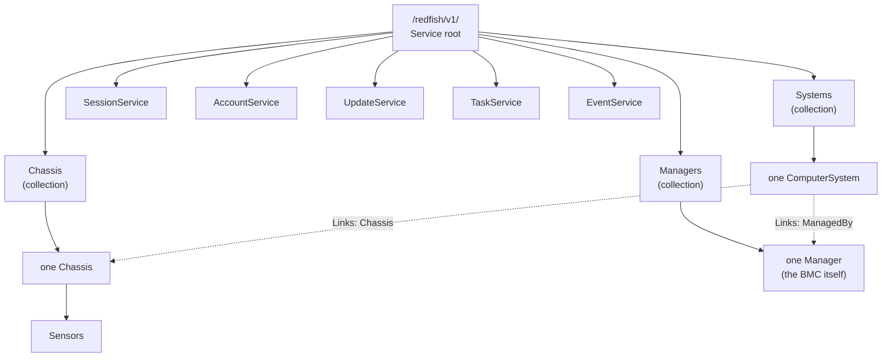

# 7.2 Redfish concepts: service root, resources, collections and OData

| | |
|---|---|
| Level | Beginner |
| Priority tier | 1 |
| Lab venue | Laptop |
| Part | Part 7: Redfish and BMC |
| Status | Drafted (`redfish_mock.py` and `redfish_crawl.py` run; **untested** on live BMC) |

## Why this matters for AI infrastructure

Every modern GPU server can be inspected and controlled by a standard web API called Redfish. A cluster team uses it to read temperatures, check power, list firmware and restart machines without logging into them. If you understand how Redfish is **shaped**, you can read any vendor's server without a manual. This chapter teaches the shape. The next ones teach the commands.

## Prerequisites and outcomes

You need chapter 7.1 and a basic idea of what a web request is. After this chapter you can:

- explain REST, JSON, a resource, a collection and a link
- find the service root and follow links from it to anything
- read the common `@odata` fields and the `Status` block
- explain why you must discover URIs instead of typing them from memory
- run a crawler that maps any Redfish service

## 1. Words you need first

**HTTP** is the language web browsers and servers speak. A client sends a request such as `GET /something`, and the server sends a response with a **status code** (200 means OK, 404 means not found) and usually some data.

**REST** is a style of API built on HTTP. Everything is a **resource** with its own address, and you use a few standard verbs on it. The Redfish spec gives the reasons it chose REST: it needs fewer layers than older standards, it is common in the industry, it is easy to learn and implement, and tools already exist.

**JSON** is a plain text format for data, made of named values `{"Name": "value"}`, lists `[1, 2]` and nested objects. People can read it, and Python, Go and shell tools can parse it.

So Redfish is: **a REST API on a BMC, with JSON data and a standard map of what a server contains.** The IPMI approach from 7.1 was commands. The Redfish approach is data you can browse.

## 2. The one rule that makes it work: start at the root and follow links

Redfish has one well-known address, the **service root**: `/redfish/v1/`. From there, every other resource is linked directly or indirectly. The spec calls this a *hypermedia API*: you discover things by following hyperlinks in the answers, the way you click through web pages.



Solid lines are parent to child. Dotted lines are **cross-links**, which make the data a graph, not a strict tree. The spec warns about this: references between resources "may result in a graph instead of a tree", so a client that walks the data must avoid infinite loops.

### The three families under the root

| Collection | What it stands for | Beginner meaning |
|---|---|---|
| `Systems` | the computer as software sees it | CPUs, memory, power state, boot settings, BIOS |
| `Chassis` | the physical box | sensors, fans, power supplies, the metal and wires |
| `Managers` | the thing doing the managing | the BMC itself: its network, users, logs |

A single server usually has one of each. A GPU server may have more than one `ComputerSystem` (for example one for the host and one for the GPU board). Chapter 7.7 explains how they relate.

## 3. What a resource looks like

A **resource** is one thing at one address. The spec says every resource answer must contain at least `@odata.id`, `@odata.type`, `Id` and `Name`. Here is a real answer from the mock server, trimmed:

```json
{
  "@odata.id": "/redfish/v1/Systems/System_0",
  "@odata.type": "#ComputerSystem.v1_17_0.ComputerSystem",
  "Id": "System_0",
  "Name": "Compute node",
  "PowerState": "On",
  "Status": { "State": "Enabled", "Health": "OK", "HealthRollup": "OK" },
  "Links": {
    "Chassis":   [ { "@odata.id": "/redfish/v1/Chassis/Chassis_0" } ],
    "ManagedBy": [ { "@odata.id": "/redfish/v1/Managers/BMC_0" } ]
  },
  "Actions": { "#ComputerSystem.Reset": { "target": "/redfish/v1/Systems/System_0/Actions/ComputerSystem.Reset" } }
}
```

The fields:

| Field | Meaning |
|---|---|
| `@odata.id` | this resource's own address |
| `@odata.type` | what kind of thing it is, as `#Schema.vMajor_Minor_Patch.Type` |
| `Id` | a short name that is unique among its siblings |
| `Name` | a human-readable name |
| `Status` | `State` (is it enabled), `Health` (is it OK), `HealthRollup` (worst health of it and everything below it) |
| `Links` | pointers to related resources elsewhere in the tree |
| `Actions` | things you can ask it to do (chapter 7.5) |
| `Oem` | vendor-specific extras |

The spec says a response "shall not include any properties not defined by that resource type", so the type tells you the allowed property names. Names use PascalCase, such as `ComputerSystem`, `PowerState` and `SerialNumber`. Names that carry units add a suffix such as `Mbps`, `MHz` or `Count`.

### The version inside `@odata.type`

`#ComputerSystem.v1_17_0.ComputerSystem` means the schema `ComputerSystem`, version 1.17.0. Newer versions only **add** things. A client that knows version 1.4 can still read a 1.17 answer by stepping back. The spec describes stepping backwards through the versions until the property is found. In practice: ignore properties you do not know, and never fail because something new appeared.

### Special values to expect

- **Empty string `""`** means "supported but not set yet" (for example an `AssetTag` nobody filled in).
- **`null`** means "the service could not find out" (an error or temporary condition). They are different: do not treat them the same.
- **Dates** look like `2026-10-24T12:30:00Z` (ISO 8601, with `T` and a zone).
- **Durations** look like `PT10S` (10 seconds) or `PT1H30M`.
- **Enumerations** (like `PowerState: On`) can gain new values over time. Be ready for values you do not know.

## 4. Collections

A **collection** is a list of resources of the same type. The spec requires these fields: `@odata.id`, `@odata.type`, `Name`, `Members` and `Members@odata.count`.

```json
{
  "@odata.id": "/redfish/v1/Chassis/Chassis_0/Sensors",
  "@odata.type": "#SensorCollection.SensorCollection",
  "Name": "Sensors",
  "Members": [
    { "@odata.id": "/redfish/v1/Chassis/Chassis_0/Sensors/Temp_Inlet" },
    { "@odata.id": "/redfish/v1/Chassis/Chassis_0/Sensors/Fan_1" }
  ],
  "Members@odata.count": 4,
  "Members@odata.nextLink": "/redfish/v1/Chassis/Chassis_0/Sensors?$skip=2&$top=2"
}
```

Points to notice:

- `Members` gives only **links**, not the full contents. You then follow each link.
- `Members@odata.count` is the total, which can be larger than the number of items shown.
- `Members@odata.nextLink` appears when there are more pages. Keep following it until it disappears.
- A collection may hold only one member, and is still a collection. Do not assume `Members[0]`.

## 5. The extra service documents

Besides the root, the spec requires a few more well-known addresses. From the spec's table of Redfish-defined URIs:

| URI | What you get |
|---|---|
| `/redfish` | the protocol version object |
| `/redfish/v1/` | the service root |
| `/redfish/v1/odata` | the OData service document (for generic OData tools) |
| `/redfish/v1/$metadata` | the metadata document, which describes the resource types |

An optional `openapi.yaml` is also defined. The spec also says these may be read **without logging in**: the service root, the metadata document, the OData document, the OpenAPI document and the version object. Everything else needs authentication (chapter 7.4). My mock does the same, and I confirmed that the root returns 200 with no login while `/redfish/v1/Systems` returns 401.

**OData** is the web-data convention that Redfish borrows for names like `@odata.id`, and for query options like `$select` (chapter 7.3).

## 6. Lab: run the mock server and crawl it

Start two mock services with different naming (this models two vendors):

```bash
cd code/part07
python3 redfish_mock.py --profile dgx     --port 18441 &
python3 redfish_mock.py --profile generic --port 18442 &
```

The `dgx` profile uses vendor-style names (`System_0`, `Chassis_0`, `BMC_0`, plus a second system `HGX_Baseboard_0`). The `generic` profile uses `1`, `1`, `1`. The mock speaks plain HTTP, which is fine **only** on a laptop. A real BMC uses HTTPS.

Now run the crawler against both. It logs in, starts at `/redfish/v1/`, follows every `@odata.id` once, and reports by type:

```bash
python3 redfish_crawl.py http://127.0.0.1:18441 admin adminpass
python3 redfish_crawl.py http://127.0.0.1:18442 admin adminpass
```

This is what I got for the `dgx` profile with the final version of the mock (it has grown a lot since I first wrote this chapter, so the numbers are much larger than in the early drafts):

```text
visited 168 URIs, 0 not OK
  AccountService               1  e.g. /redfish/v1/AccountService
  Chassis                      1  e.g. /redfish/v1/Chassis/Chassis_0
  ComputerSystem               2  e.g. /redfish/v1/Systems/System_0
  Manager                      1  e.g. /redfish/v1/Managers/BMC_0
  PCIeDevice                  16  e.g. /redfish/v1/Chassis/Chassis_0/PCIeDevices/NIC_8
  Processor                   10  e.g. /redfish/v1/Systems/System_0/Processors/CPU_2
  Sensor                       4  e.g. /redfish/v1/Chassis/Chassis_0/Sensors/Power_Total
  ServiceRoot                  1  e.g. /redfish/v1
  ...
```

The `generic` profile found 150 URIs of the same kinds at different addresses (for example `/redfish/v1/Systems/1`). Two profiles, two address layouts, one crawler and no code change: that is the point of discovery.

In the first draft of this chapter the crawler also printed three `404` lines, because the service root linked to update, task and event services that the mock did not implement yet. Later chapters added them. The lesson stays true for real equipment: a link in the root does not guarantee that the thing behind it works, so check the status code.

The crawler uses a `visited` set so a cross-link loop cannot run forever, and it finds things by `@odata.type`, never by a typed address. That is the discovery rule in practice.

## 7. Why you must discover and not hard-code

Section 5.3 of the spec lists the limits plainly:

- **"Interoperable does not mean identical."** Many parts are optional, so clients must discover what exists.
- **Different hardware gives different trees**, even for identical machines from the same maker.
- **Do not reuse links across services.** An address that works on one BMC may not exist on another.
- **Not everything is plain read and write.** For example you cannot just read a password or certificate from one service and write it to another.

Section 12.3 adds: the tree should stay stable on **one** service across restarts and small changes, but "a client shall not expect the resource tree to be consistent between instances of services."

So the working rule is: **start at `/redfish/v1/`, find things by `@odata.type`, and treat every address as opaque.** The NVIDIA notes say the same for DGX: a DGX H100 uses `/redfish/v1/Systems/DGX`, other makers use other member names, so start at the root. Chapter 7.13 lists the DGX paths.

If you are searching for a specific kind of thing, a short recipe:

1. `GET /redfish/v1/` and read the `Systems` link.
2. `GET` that collection and read `Members`.
3. For each member `GET` it and check `@odata.type` and `Id`.
4. Follow `Links` when you need related resources (for example the chassis of a system).

## 8. Finding the BMCs on a network

How do you find Redfish services in the first place? The spec offers **SSDP**, the same discovery protocol UPnP uses. A client multicasts a search on UDP port 1900 and a service replies with its address. The search target for Redfish is `urn:dmtf-org:service:redfish-rest:1`. SSDP is optional, and if a service offers it, it must be possible to turn it off in the manager's network protocol settings.

In a data center you rarely rely on this. You already know the BMC addresses from your inventory and DHCP reservations (7.1). Discovery by SSDP is useful on a lab network. Leaving it on in production widens what an attacker can learn, so it is a common item to disable in hardening (chapter 7.15).

## 9. Redfish and the BCM tools

BCM gives you commands that issue Redfish requests through the cluster manager. From the BCM Administrator Manual (appendix N), in `cmsh` device mode:

| Command | HTTP method | Use |
|---|---|---|
| `redfishget -r a07 /redfish/v1/Chassis` | GET | read a resource, for many devices at once (here a rack filter) |
| `redfishpost` | POST | create a resource or run an action, with a JSON template and parameter substitution |
| `redfishput` | PUT | replace a whole resource |
| `redfishpatch` | PATCH | update part of a resource |
| `redfishdelete` | DELETE | remove a resource, such as a subscription |
| `redfishsubscriptions` | | show event subscription status |
| `redfishevent -m test1` | | send a test event to check delivery |

All of them can be limited by node, category or rack. The same appendix says BCM uses Redfish for BMC communication, hardware inventory, power control, sensor and health monitoring, and firmware management. It also says BCM's `power on|off|reset` commands use the Redfish API on Redfish-enabled devices and assume AC power to the BMC is on. I have not run these commands (no BCM system). Part 8 covers BCM in full.

## 10. Exercises

1. Start the mock (`dgx` profile). With `curl`, read `/redfish/v1/`, then follow links by hand to a single sensor reading. Write down every address you used.
2. Run the crawler on both profiles. List the `@odata.type` values that appear in one but not the other.
3. Without looking at the code: what is the difference between `Members@odata.count` and the length of `Members`?
4. Request `/redfish/v1/Systems` without logging in. What status do you get, and why not for `/redfish/v1/`?
5. Change the mock so a resource links back to its parent. Does the crawler still finish? Why?
6. Write down three properties in section 3 that could be `null` or `""`. What does each mean?

## 11. Interview angles

- "How do you find the right Redfish address on a server you have never seen?" Start at `/redfish/v1/`, follow links, match on `@odata.type`.
- "Why not hard-code `/redfish/v1/Systems/1`?" Names differ between vendors and models, and the spec does not promise stability between service instances.
- "What is the difference between `Systems`, `Chassis` and `Managers`?" Logical computer, physical enclosure, and the management controller.
- "How can a Redfish client avoid breaking when a new firmware adds fields?" Ignore unknown properties and unknown enum values.

## 12. Checkpoint questions (20)

1. What do REST and JSON mean in one sentence each?
2. Why is the service root special?
3. What does "hypermedia API" mean?
4. Which fields must every resource contain?
5. What does `@odata.type` tell you?
6. What do `State`, `Health` and `HealthRollup` mean?
7. What is the difference between `""` and `null`?
8. Which fields must every collection contain?
9. Why does `Members` hold links and not full data?
10. What does `Members@odata.nextLink` mean?
11. Which URIs can be read without logging in?
12. What is `$metadata` for?
13. What is a cross-link and what danger does it create?
14. Why does the crawler keep a `visited` set?
15. What is the difference between `Systems`, `Chassis` and `Managers`?
16. Why is the same server model allowed to have different resource trees?
17. What should a client do with a property it does not know?
18. What is SSDP and why might you turn it off?
19. Which BCM command does a GET and which does a PATCH?
20. Why can a link in the service root still lead to a 404?

## 13. Sources and review notes

- **Redfish Specification DSP0266 v1.21.0:** goals and design tenets (5.1 to 5.4), service elements (5.5), URIs (6.1, 6.7), data model: resources, collections, OEM, common types, naming rules, annotations (9.1 to 9.9), resource tree stability and discovery (12.3, 12.4), unauthenticated resources (13.3.2). I read these clauses in the book text.
- **Redfish Resource and Schema Guide DSP2046 (2024.4):** `ServiceRoot` schema (used to confirm the root links such as Systems, Chassis, Managers, AccountService, EventService, UpdateService and TaskService).
- **BCM 11 Administrator Manual:** appendix N (Redfish management) for the `redfish*` commands.
- **NVIDIA-DevOps notes:** the "discover URIs, do not hard-code them" rule and the DGX example.
- **Run in this chapter:** the mock server on two profiles, the crawler, and `curl` checks of the unauthenticated and authenticated cases. All on a laptop.
- **Not done:** no real BMC was queried. The mock returns invented values (for example sensor readings), so none of its numbers describe real hardware.
