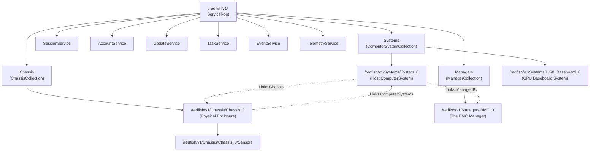

# 7.2 Redfish concepts: service root, resources, collections and OData

| | |
|---|---|
| Level | Beginner to Intermediate |
| Priority tier | 1 |
| Lab venue | Laptop (`code/part07/redfish_mock.py`, `redfish_crawl.py`, `rf_inventory.py`, and `crawl_concepts_lab.py`) |
| Part | Part 7: Redfish and BMC |
| Status | Drafted (`redfish_mock.py`, `redfish_crawl.py`, `rf_inventory.py`, and `crawl_concepts_lab.py` 3/3 self-checks passed; **untested** / **not verified** against a live physical BMC in this session) |

## Why this matters for AI infrastructure

Every modern GPU server—from an 8-GPU NVIDIA DGX H100 or HGX node to a 72-GPU rack-scale GB200 NVL72—exposes its out-of-band hardware state through a **DMTF Redfish** service running on the BMC. Platform teams use Redfish to inventory serial numbers and GPU VBIOS versions, monitor inlet and SXM thermal sensors, stage BIOS tuning attributes, flash firmware bundles, and reset frozen nodes without touching the host OS.

If you treat Redfish as a pile of memorized `curl` URLs, your scripts will break the first time you move from one vendor's BMC to another—or even after a BMC firmware upgrade on the same server. If instead you understand how the **Redfish data model is shaped**—how the single Service Root (`/redfish/v1/`) links to collections and resources, how `@odata` and `@Redfish` annotations work, how active resources pair with pending `/Settings` resources, and how a hypermedia crawler navigates the graph without hard-coding paths—you can automate any vendor's server without reading a vendor-specific manual first. This chapter teaches that shape and proves it against two different server profiles in `code/part07/`.

## Prerequisites and outcomes

You need Chapter 7.1 (BMCs and out-of-band networks) and a basic grasp of HTTP requests and JSON. After completing this chapter, you will be able to:

- Explain REST, JSON, OData conventions, and the Redfish design tenets in **DSP0266** (§5.1–5.4), including why Redfish separates the protocol from the data model.
- List the required well-known Redfish URIs (`/redfish`, `/redfish/v1/`, `/redfish/v1/odata`, `/redfish/v1/$metadata`) and distinguish which endpoints allow unauthenticated `GET` requests (DSP0266 §6.7, §13.3.2).
- Inspect any Redfish resource and interpret its required properties (`@odata.id`, `@odata.type`, `Id`, `Name`), common properties (`Status`, `Links`, `Actions`, `Oem`), PascalCase naming and unit suffixes (`MHz`, `Mbps`, `MB`, `Count`), and schema versioning rules.
- Distinguish empty strings (`""`) from `null`, parse ISO 8601 timestamps and durations (`PT10S`, `PT1H30M`), and read payload annotations (`@Redfish.AllowableValues`, `@Redfish.AllowableNumbers`, `@Redfish.Settings`, `@Message.ExtendedInfo`).
- Traverse resource collections using `Members`, `Members@odata.count`, and `Members@odata.nextLink` (`$skiptoken`) without losing pages.
- Run `redfish_mock.py`, `redfish_crawl.py`, `rf_inventory.py`, and `crawl_concepts_lab.py` across heterogeneous server profiles (`dgx` with `168` URIs vs `generic` with `150` URIs) using pure link discovery and loop protection.

---

## 1. Foundational building blocks: HTTP, REST, JSON, and OData

Before diving into Redfish clauses, let us anchor four core terms from the DMTF Redfish Specification (**DSP0266 v1.21.0**, §5.1–5.4):

1. **HTTP (Hypertext Transfer Protocol):** The request/response messaging protocol of the web over TCP/IP (and TLS). A client sends a request containing an HTTP verb (`GET`, `POST`, `PATCH`, `PUT`, `DELETE`), a target URI path (such as `/redfish/v1/Systems`), headers, and an optional body; the BMC returns a numeric **HTTP status code** (`200 OK`, `201 Created`, `202 Accepted`, `401 Unauthorized`, `404 Not Found`) along with response headers and a payload.
2. **REST (Representational State Transfer):** An architectural style where every manageable entity on the BMC—a computer system, a fan sensor, a BIOS configuration, an event log entry—is modeled as a **resource** with its own URI address, manipulated through standard HTTP verbs. As DSP0266 §5.4.1 notes, Redfish chose REST because it requires fewer protocol layers than legacy standards like IPMI or WS-Management, is ubiquitous across programming languages, and leverages existing HTTP/TLS libraries and CLI tools.
3. **JSON (JavaScript Object Notation):** A human-readable, text-based data format built from key-value objects (`{"PowerState": "On"}`), ordered arrays (`[1, 2, 3]`), strings, numbers, booleans (`true`/`false`), and `null`. Unlike IPMI's packed binary Sensor Data Records, a JSON response from Redfish can be read directly by an engineer and parsed in one line of Python, Go, or `jq`.
4. **OData (Open Data Protocol) conventions:** While thousands of web services call themselves "RESTful," most invent incompatible ways to name links, declare types, paginate lists, and filter results. To guarantee interoperability across tools, Redfish adopts standardized **OData v4 JSON conventions** (DSP0266 §5.4.6) for metadata properties starting with `@odata.` (such as `@odata.id`, `@odata.type`, `@odata.count`, and `@odata.nextLink`) and query parameters starting with `$` (`$select`, `$expand`, `$filter`, `$top`, `$skip`, covered in Chapter 7.3).

A key design tenet in DSP0266 §5.2 is the **strict separation of the protocol from the data model**. The HTTP/TLS transport rules (Section 6 of the spec) and the hardware resource schemas (Section 9 and the DMTF Resource and Schema Guide, **DSP2046**) evolve independently, with explicit versioning rules for each.

---

## 2. The Service Root (`/redfish/v1/`) and well-known URIs

In IPMI, you issue action commands to a flat controller address. In Redfish, the entire BMC is organized as a **hypermedia graph** anchored at one well-known entry point called the **Service Root**: **`/redfish/v1/`**.

From `/redfish/v1/`, every subsystem on the server is reachable by following `@odata.id` hyperlinks embedded in the JSON responses—just like clicking links from a website's home page.



Notice the two arrow styles in Figure 1:
- **Solid arrows** represent **subordinate (parent-to-child) containment** in the URI hierarchy (for example, `Chassis_0` contains `Sensors`).
- **Dashed arrows** represent **associated cross-links** under the `Links` property (`System_0` links to `Chassis_0`, and `Chassis_0` links back to `System_0`). Because cross-links can form cycles, DSP0266 §5.3 explicitly warns that the Redfish data model is a **directed graph, not a strict tree**. Any client or crawler that walks `@odata.id` references must maintain a `visited` set so it never enters an infinite loop.

### 2.1 The three primary hardware collections under `/redfish/v1/`

As detailed in the *Redfish Resource and Schema Guide* (DSP2046, `ServiceRoot`), the Service Root links to service singletons (`SessionService`, `AccountService`, `UpdateService`, `TaskService`, `EventService`, `TelemetryService`, `Registries`, `JsonSchemas`) and three foundational hardware collections:

| Root Collection | Schema Type | What It Models | Typical Subordinate Resources |
|---|---|---|---|
| **`Systems`** | `ComputerSystemCollection` | The **logical computer(s)** as seen by software and the OS | `Processors` (CPUs and GPUs), `Memory` (DIMMs), `Bios` (`/Bios/Settings`), `SecureBoot`, `Storage`, `EthernetInterfaces`, `LogServices`, `Reset` action |
| **`Chassis`** | `ChassisCollection` | The **physical sheet-metal enclosure(s)**, trays, and power/cooling envelope | `Sensors`, `ThermalSubsystem` (fans, temps), `PowerSubsystem` (PSUs), `PCIeDevices`, `NetworkAdapters`, `Drives` |
| **`Managers`** | `ManagerCollection` | The **management controller(s)** (BMCs, satellite HMCs, enclosure managers) | `NetworkProtocol` (HTTPS, IPMI, SSH, SSDP), `EthernetInterfaces` (OOB NIC), `LogServices` (`SEL`), `SerialInterfaces`, `VirtualMedia` |

A standard 1U server usually has `1` member in `Systems`, `1` in `Chassis`, and `1` in `Managers`. An 8-GPU NVIDIA DGX H100/H200 or HGX node frequently exposes **multiple** members in `Systems` and `Chassis`—for example, `Systems/DGX` (or `System_0`) for the x86 host system and `Systems/HGX_Baseboard_0` for the 8-GPU baseboard managed by its satellite controller (Chapter 7.7 and 7.13).

### 2.2 Well-known Redfish URIs and unauthenticated endpoints (DSP0266 §6.7 & §13.3.2)

While you must never hard-code deep paths like `/redfish/v1/Systems/1`, DSP0266 §6.7 (Table 4) defines five **fixed, well-known URIs** at the root of every Redfish service. Furthermore, DSP0266 §13.3.2 specifies that these root-level discovery documents **shall or may be accessible via `GET` without authentication** so clients can verify protocol versions, inspect schemas, and find the login endpoint (`SessionService/Sessions`) before authenticating:

| Well-Known URI | Required by DSP0266 Table 4 | Unauthenticated `GET` Allowed (§13.3.2) | What It Returns |
|---|---|---|---|
| `/redfish` | **Yes** | **Yes** | Protocol version object: `{"v1": "/redfish/v1/"}` |
| `/redfish/v1/` (or `/redfish/v1`) | **Yes** | **Yes** | The `ServiceRoot` JSON resource (`RedfishVersion`, `UUID`, and top-level `@odata.id` links) |
| `/redfish/v1/odata` | **Yes** | **Yes** | OData service directory document for generic OData v4 clients |
| `/redfish/v1/$metadata` | **Yes** | **Yes** | CSDL XML metadata document declaring schemas and namespaces supported by this BMC |
| `/redfish/v1/openapi.yaml` | No (Optional, v1.6+) | **Yes** (if implemented) | OpenAPI v3.0 description of the service's URIs |
| Everything else (e.g., `/redfish/v1/Systems`) | Schema-dependent | **No (`401 Unauthorized`)** | Requires HTTP Basic over TLS or an `X-Auth-Token` session header (Chapter 7.4) |

### 2.3 Inspecting `ServiceRoot` properties and `ProtocolFeaturesSupported` (DSP2046)

When your client performs its initial unauthenticated `GET /redfish/v1/`, the returned `ServiceRoot` resource (defined in `ServiceRoot.v1_17_0` in the *Redfish Resource and Schema Guide*, DSP2046 §6.121) tells you far more than just top-level links. It also advertises the BMC's protocol version, service identity, and which optional OData query parameters this specific BMC firmware supports:

- **`RedfishVersion`:** The version of the Redfish Specification (`DSP0266`) to which this service conforms, formatted as `"Major.Minor.Errata"` (for example, `"1.17.0"` or `"1.21.0"`). Do not confuse `RedfishVersion` (the protocol specification version) with the `ServiceRoot` schema version inside `@odata.type` (`#ServiceRoot.v1_17_0.ServiceRoot`).
- **`UUID`:** A 36-character RFC 4122 universally unique identifier for this Redfish service instance (`"00000000-0000-0000-0000-000000000000"`). If a client discovers the same BMC over multiple IP addresses (for example, IPv4, IPv6, and a host-side USB NIC), matching `UUID` proves both endpoints belong to the same BMC.
- **`Product` and `Vendor`:** Optional human-readable strings identifying the server product and manufacturer (`"NVIDIA DGX H100"`, `"NVIDIA"`).
- **`Links.Sessions`:** Alongside the authenticated `/redfish/v1/SessionService` link, `ServiceRoot` includes `"Links": {"Sessions": {"@odata.id": "/redfish/v1/SessionService/Sessions"}}` so an unauthenticated client can discover the exact `POST` login URI on its very first request.
- **`ProtocolFeaturesSupported`:** A structured object declaring which query parameters and deep operations the BMC supports, so clients never have to guess before sending `$expand` or `$filter`:
  - `ExpandQuery` (`ExpandAll`, `Levels`, `Links`, `MaxLevels`, `NoLinks`): whether `?$expand=.($levels=1)` is supported to inline child objects in one HTTP round-trip.
  - `FilterQuery` (`true`/`false`): whether `?$filter=` expressions are supported on collections.
  - `SelectQuery` (`true`/`false`): whether `?$select=` property projection is supported.
  - `OnlyMemberQuery` (`true`/`false`): whether `?only` is supported to automatically dereference a collection that contains exactly `1` member.
  - `ExcerptQuery` and `DeepOperations` (`DeepPATCH`, `DeepPOST`): whether excerpt views or multi-resource deep edits are implemented.

---

## 3. Anatomy of a Redfish resource

A **resource** is a single JSON document returned at an `@odata.id` URI. Under DSP0266 §9.5 and §9.6, every individual resource response **shall** include four mandatory properties—`@odata.id`, `@odata.type`, `Id`, and `Name`—alongside standard optional properties defined by its schema.

Here is a live response from `code/part07/redfish_mock.py` (`dgx` profile) for `/redfish/v1/Systems/System_0`:

```json
{
  "@odata.id": "/redfish/v1/Systems/System_0",
  "@odata.type": "#ComputerSystem.v1_17_0.ComputerSystem",
  "@odata.etag": "W/\"1\"",
  "Id": "System_0",
  "Name": "Compute node",
  "SystemType": "Physical",
  "Manufacturer": "ExampleCorp",
  "Model": "HGX-8GPU",
  "SerialNumber": "SN-SYS-0001",
  "UUID": "00000000-0000-0000-0000-000000000001",
  "PowerState": "On",
  "BiosVersion": "1.28.0",
  "Status": {
    "State": "Enabled",
    "Health": "OK",
    "HealthRollup": "OK"
  },
  "ProcessorSummary": {
    "Count": 2,
    "Model": "Dual Socket CPU"
  },
  "MemorySummary": {
    "TotalSystemMemoryGiB": 2048
  },
  "Processors": { "@odata.id": "/redfish/v1/Systems/System_0/Processors" },
  "Memory": { "@odata.id": "/redfish/v1/Systems/System_0/Memory" },
  "Bios": { "@odata.id": "/redfish/v1/Systems/System_0/Bios" },
  "Links": {
    "Chassis": [
      { "@odata.id": "/redfish/v1/Chassis/Chassis_0" }
    ],
    "ManagedBy": [
      { "@odata.id": "/redfish/v1/Managers/BMC_0" }
    ]
  },
  "Actions": {
    "#ComputerSystem.Reset": {
      "target": "/redfish/v1/Systems/System_0/Actions/ComputerSystem.Reset",
      "ResetType@Redfish.AllowableValues": [
        "On", "ForceOff", "GracefulShutdown", "GracefulRestart", "ForceRestart", "PowerCycle", "Nmi"
      ]
    }
  }
}
```

### 3.1 Core resource properties (DSP0266 §9.6)

| Property | Required? | Specification Rule & Meaning |
|---|---|---|
| `@odata.id` | **Yes** | Canonical URI of this resource (`"/redfish/v1/Systems/System_0"`). Used by clients to re-fetch or link to the resource. |
| `@odata.type` | **Yes** | Schema type and version in the format `#<Namespace>.v<Major>_<Minor>_<Errata>.<ResourceType>` (or `#<CollectionType>.<CollectionType>` for unversioned collections). |
| `Id` | **Yes** | String that uniquely identifies this resource within its parent collection (`"System_0"`). Shall not contain RFC 1738 unsafe URL characters because it forms the final URI segment. |
| `Name` | **Yes** | Human-readable display label (`"Compute node"`). Unlike `Id`, `Name` is **not** required to be unique across sibling resources. |
| `@odata.etag` | Recommended | Entity tag (`W/"1"` or `"A89B03"`) used with `If-Match` / `If-None-Match` HTTP headers for optimistic concurrency control (Chapter 7.3). |
| `@odata.context` | Optional | OData context URL pointing into `$metadata` (e.g., `"/redfish/v1/$metadata#ComputerSystem.ComputerSystem"`). |
| `Status` | Common | Structured object with three key fields (§9.6.16): `State` (operational state such as `Enabled`, `Disabled`, `StandbyOffline`, `Absent`, `Updating`), `Health` (health of this resource alone: `OK`, `Warning`, `Critical`), and `HealthRollup` (worst-case aggregated health of this resource and all subordinate resources beneath it). |
| Subordinate refs | Schema-defined | Direct child collections or singletons at the root of the JSON object (`"Processors": {"@odata.id": "..."}`). |
| `Links` | Common | Cross-references to **associated (non-child)** resources elsewhere in the graph (`Links.Chassis`, `Links.ManagedBy`). |
| `Actions` | Common | Operations invoked via `POST` that do not map to simple property edits (`#ComputerSystem.Reset`, with a `target` URI). |
| `Oem` | Common | Vendor-specific extensions isolated under a company/organization key (`Oem.Nvidia`, `Oem.OpenBMC`). |

### 3.2 Naming rules, unit suffixes, and schema versioning (DSP0266 §9.7)

Redfish enforces strict property naming rules (DSP0266 §9.7.1) so engineers and code generators can predict property semantics:
- **PascalCase everywhere:** Every standard resource type, property name, and action parameter uses `PascalCase` starting with a letter and containing only alphanumeric characters (`ComputerSystem`, `PowerState`, `SerialNumber`, `TotalSystemMemoryGiB`). Two-letter acronyms capitalize both letters (`IPAddress`, `RemoteIP`), while well-known mixed-case names keep their standard form (`PCIe`, `iSCSI`, `NVMe`, `LDAP`, `SNMPv2`).
- **Explicit unit suffixes:** Properties that express physical measurements or counts append their unit directly to the property name so you never have to guess whether a speed is in `MHz` or `GHz` or a size is in `MB` or `GiB`:
  - Bandwidth: `PortSpeedMbps`, `MaxBandwidthGbps`
  - Frequency: `ProcessorSpeedMHz`, `OperatingSpeedMHz`
  - Capacity: `MemoryMB`, `TotalSystemMemoryGiB`, `CapacityBytes`
  - Temperature & Power: `ReadingCelsius`, `TemperatureThresholdCelsius`, `PowerCapacityWatts`
  - Counts: `ProcessorCount`, `FanCount`
- **Schema versioning (`#ComputerSystem.v1_17_0.ComputerSystem`):** Minor version bumps (`v1_16_0` $\rightarrow$ `v1_17_0`) are **strictly additive and backward-compatible**—they add new optional properties or enumeration values without removing or changing the types of existing properties. A client written against `v1_4_0` can safely parse a `v1_17_0` payload as long as it **ignores unknown properties**.

### 3.3 Special data value rules: `""` vs `null`, ISO 8601 dates, and durations

When writing Python or Go parsers for Redfish, four value conventions from DSP0266 §9.5 prevent subtle bugs:
1. **Empty string `""` versus `null`:** These two values mean completely different things in Redfish:
   - **`""` (empty string):** The property is supported and healthy, but its value is currently **unset / blank** (for example, `"AssetTag": ""` before an admin assigns an asset tag).
   - **`null`:** The BMC **cannot obtain or compute the value** right now (for example, `"Reading": null` on a host CPU temperature sensor while the host power is `Off`, or when an `I2C` sensor bus read fails). Never coerce `null` to `0` or `""` in telemetry scripts—treating `"Reading": null` as `0 °C` will corrupt your thermal dashboards.
2. **Timestamps (ISO 8601 extended format):** Date-time strings always include `T` and an explicit timezone offset (`Z` for UTC or `+HH:MM`/`-HH:MM`), such as `"2026-10-28T14:30:00Z"`.
3. **Durations (ISO 8601 duration format):** Time intervals use `P[nD]T[nH][nM][nS]`, such as `"PT10S"` (`10` seconds), `"PT5M"` (`5` minutes), or `"PT1H30M"` (`1` hour `30` minutes).
4. **Extensible enumerations:** Firmware updates may introduce new enum strings (for example, a new `ResetType` or `ProcessorType`). Your parser should log or fall back gracefully on unrecognized enum strings rather than throwing an unhandled exception.

---

## 4. Payload annotations, `/Settings` resources, and OEM extensions

Look back at the `ComputerSystem` JSON in Section 3 and notice keys containing an `@` sign in the middle or at the start, such as `"ResetType@Redfish.AllowableValues"`. In DSP0266 §9.9, these are **payload annotations** formatted as:

```text
[<PropertyName>]@<Namespace>.<TermName>
```

Redfish restricts annotations to three official namespaces—**`odata`**, **`Redfish`** (an alias for `RedfishExtensions.v1_0_0`), and **`Message`**—and requires clients to ignore any unrecognized annotation without failing. Table 4 summarizes the essential annotations you will encounter on real BMCs:

| Annotation | Example in JSON Payload | Purpose (DSP0266 §9.9 & §9.10) |
|---|---|---|
| `<Prop>@Redfish.AllowableValues` | `"ResetType@Redfish.AllowableValues": ["On", "ForceOff", "GracefulRestart"]` | Lists the exact string values *currently supported by this specific BMC instance* for a writable property or action parameter (§9.9.2). |
| `<Prop>@Redfish.AllowablePattern` | `"AssetTag@Redfish.AllowablePattern": "^[\\w:-]{0,31}$"` | Regular expression constraining valid string edits on non-enum properties (§9.9.3). |
| `<Prop>@Redfish.AllowableNumbers` | `"PacketSizeBytes@Redfish.AllowableNumbers": ["1024:65536:256"]` | Specifies numeric or duration ranges as `"<min>:<max>:<step>"` (e.g., `1024` to `65536` in steps of `256`, or `"PT5M:PT24H:PT5M"`, §9.9.4). |
| `@Redfish.ActionInfo` | `"@Redfish.ActionInfo": "/redfish/v1/Systems/1/ResetActionInfo"` | Links to a dedicated `ActionInfo` resource detailing required/optional parameters and data types for an action (§9.9.6). |
| `@Redfish.WriteableProperties` | `"@Redfish.WriteableProperties": ["AssetTag", "HostName"]` | Lists which properties on the current resource are actually writable right now (note the specification's spelling `Writeable` with an `e`, §9.9.15). |
| `@Redfish.Settings` | `"@Redfish.Settings": {"SettingsObject": {"@odata.id": "/redfish/v1/Systems/DGX/Bios/Settings"}}` | Points from the **active** resource (current boot state) to its subordinate **Settings resource** (`/Settings` or `/SD`) holding **pending future state** applied on the next reset (§9.10). |
| `[<Prop>]@Message.ExtendedInfo` | `"PinOut@Message.ExtendedInfo": [{"MessageId": "Base.1.8.PropertyValueNotInList", ...}]` | Attaches structured registry diagnostics, warnings, or resolution hints to a whole object or a single property (§9.9.5). |
| `<Prop>@Redfish.Deprecated` | `"VendorID@Redfish.Deprecated": "Deprecated in favor of ModuleManufacturerID."` | Warns that a property is deprecated in newer schema versions (§9.9.14). |

### 4.1 Active resources vs `/Settings` resources (DSP0266 §9.10)

Why does `/redfish/v1/Systems/DGX/Bios` have a child resource at `/redfish/v1/Systems/DGX/Bios/Settings` (or `/SD`)?
Some hardware settings—like an `AssetTag` or an LED indicator—take effect the millisecond you `PATCH` them. Other settings—most notably **BIOS attributes** (`SubNumaClustering`, `PcieRelaxedOrdering`)—cannot be mutated in live silicon while the host CPUs are running; they can only be applied by UEFI firmware during the **next system reboot**.

DSP0266 §9.10 solves this cleanly with the **Settings resource pattern**:
- **The Active Resource (`/Bios`):** Represents the **current running state** of the hardware. It is read-only for reboot-deferred attributes and carries an `@Redfish.Settings` annotation whose `SettingsObject` points to `/Bios/Settings` (along with `Time`, `ETag`, and `Messages` from the last time pending settings were applied).
- **The Settings Resource (`/Bios/Settings` or `/Bios/SD`):** Uses the exact same schema as the active resource, but represents the **future intended state**. You send your `PATCH` request to `/Bios/Settings`, and on the next host reset (`GracefulRestart` or `ForceRestart`), the BIOS consumes `/Bios/Settings`, updates the active `/Bios` resource, and records any validation messages in `@Redfish.Settings.Messages`.

### 4.2 OEM extensions (DSP0266 §9.8)

When a hardware vendor builds a novel capability before a standard DMTF schema exists, DSP0266 §9.8 provides a structured escape hatch: the **`Oem`** object.
- Every OEM extension inside `"Oem": { ... }` must be keyed by a unique **OEM identifier** derived from the vendor's ICANN domain name with dots replaced by underscores (`.com` may be omitted, e.g., `"Nvidia"`, `"Dell"`, `"Supermicro"`, `"Contoso_org"`), an IANA Enterprise Number prefixed with `"EID_"` (e.g., `"EID_412"`), or a DMTF-reserved namespace such as **`"OpenBMC"`** (§9.8.3).
- Subordinate OEM resources live under `<BaseUri>/Oem/<OemIdentifier>/<ResourcePath>` (§9.8.6), and OEM actions live under `Actions.Oem.#<OEMSchemaName>.<Action>` with target `<ResourceUri>/Actions/Oem/<OEMSchemaName>.<Action>` (§9.8.8).
- Generic client code should treat unknown `Oem` subtrees as opaque data and never fail when they are present.

---

## 5. Resource collections and pagination

A **Resource Collection** is a container of resources that share the same base type (such as `ComputerSystemCollection`, `SensorCollection`, or `LogEntryCollection`). Under DSP0266 §9.2.1 and §9.6.10–9.6.12, every collection response **shall** include five required properties:
1. `@odata.id` (the collection's URI)
2. `@odata.type` (unversioned format `#<Type>Collection.<Type>Collection`, e.g., `#SensorCollection.SensorCollection`)
3. `Name`
4. `Members` (a JSON array of link objects `[{"@odata.id": "..."}]`; never `null`—an empty collection is `[]`)
5. `Members@odata.count` (an integer giving the **total number of members in the collection across all pages**)

```json
{
  "@odata.id": "/redfish/v1/Chassis/Chassis_0/Sensors",
  "@odata.type": "#SensorCollection.SensorCollection",
  "Name": "Sensors",
  "Members": [
    { "@odata.id": "/redfish/v1/Chassis/Chassis_0/Sensors/Temp_Inlet" },
    { "@odata.id": "/redfish/v1/Chassis/Chassis_0/Sensors/Fan_1" }
  ],
  "Members@odata.count": 4,
  "Members@odata.nextLink": "/redfish/v1/Chassis/Chassis_0/Sensors?$skip=2&$top=2"
}
```

Three pagination rules in DSP0266 §9.6.10–9.6.12 are essential for reliable fleet tooling:
- **`Members@odata.count` vs `len(Members)`:** When a BMC paginates a large collection (for example, a DGX H100 System Event Log returning `75` entries per page out of `450` total entries), `len(Members)` is `75`, while `Members@odata.count` is `450`. Note that `$top` and `$skip` query parameters **do not** reduce `Members@odata.count`, whereas a `$filter` query parameter updates `Members@odata.count` to reflect the total number of members matching the filter.
- **Following `Members@odata.nextLink`:** Whenever more pages remain, the BMC includes `Members@odata.nextLink`. Its URL may use `$skip` or an opaque **`$skiptoken`** (e.g., `?$skiptoken=ffb559f3...`). Clients **shall not** parse or construct `$skiptoken` strings; simply `GET` the exact `Members@odata.nextLink` URI in a loop until `Members@odata.nextLink` is absent (see `collection()` in `code/part07/rf_inventory.py`).
- **Never assume `Members[0]` is the only member or has `Id == "1"`:** A collection may have `0`, `1`, or `N` members, and even a single-member collection is still wrapped in `"Members": [{"@odata.id": "..."}]`.

---

## 6. Lab: Crawling heterogeneous Redfish services (`redfish_mock.py` & `crawl_concepts_lab.py`)

Why does DSP0266 §5.3 and §12.3 insist that clients must discover resources dynamically from `/redfish/v1/` rather than hard-coding URIs? Because even two servers running the exact same Redfish specification version can have completely different member names and system counts.

In `code/part07/redfish_mock.py`, we built a standards-compliant teaching Redfish server using only the Python standard library that supports two hardware profiles:
- **`--profile dgx`:** Models a dual-tray GPU server with `Systems/System_0` (host tray), `Systems/HGX_Baseboard_0` (8-GPU HGX tray), `Chassis/Chassis_0`, and `Managers/BMC_0` (`168` total URIs).
- **`--profile generic`:** Models a standard 1U server with `Systems/1`, `Chassis/1`, and `Managers/1` (`150` total URIs).

### 6.1 How the hypermedia crawler works (`code/part07/redfish_crawl.py`)

Look at the `crawl()` function in `code/part07/redfish_crawl.py`:

```python
def crawl(c):
    seen, todo, types = {}, ["/redfish/v1/"], collections.defaultdict(list)
    while todo:
        uri = todo.pop()
        key = uri.rstrip("/")
        if key in seen:
            continue
        st, _, res = c.req("GET", uri)
        seen[key] = st
        if st != 200 or not isinstance(res, dict):
            continue
        types[(res.get("@odata.type") or "?").lstrip("#").split(".")[0]].append(key)
        own = res.get("@odata.id", "").rstrip("/")
        for l in links({k: v for k, v in res.items() if k not in ("@odata.id", "Actions")}):
            if l.startswith("/redfish/") and l.rstrip("/") not in seen and l.rstrip("/") != own:
                todo.append(l)
    return seen, types
```

Notice the three engineering safeguards in those 16 lines:
1. **Starts solely at `["/redfish/v1/"]`:** Not a single hardware URI (`Systems`, `Chassis`, `DGX`, `1`) is hard-coded in the crawler.
2. **Graph cycle protection (`seen` dictionary):** Every visited URI (normalized with `.rstrip("/")`) is recorded in `seen`. When `System_0` links to `Chassis_0` via `Links.Chassis` and `Chassis_0` links right back to `System_0` via `Links.ComputerSystems`, the `if key in seen: continue` guard prevents an infinite loop.
3. **Skips `Actions` targets during `GET` traversal:** Action targets (`/Actions/ComputerSystem.Reset`) are `POST`-only endpoints (`GET` returns `405 Method Not Allowed`), so the crawler excludes `"Actions"` when harvesting `@odata.id` links.

### 6.2 Running the self-checking lab (`code/part07/crawl_concepts_lab.py`)

Run `python3 code/part07/crawl_concepts_lab.py` to launch both mock profiles on ephemeral local ports, test unauthenticated vs authenticated endpoints, crawl both graphs completely, and run `rf_inventory.py` across both:

```bash
$ python3 code/part07/crawl_concepts_lab.py
PASS: Unauthenticated GET succeeds (200) on /redfish, /redfish/v1/, /redfish/v1/odata, /redfish/v1/$metadata and returns 401 on /redfish/v1/Systems
PASS: redfish_crawl.py maps dgx profile (168 URIs, 2 ComputerSystems) and generic profile (150 URIs, 1 ComputerSystem) with 0 non-200 responses
PASS: rf_inventory.py discovers System_0 + HGX_Baseboard_0 on dgx profile and System 1 on generic profile
Summary: 3 passed, 0 failed (total 3)
```

When you run `redfish_crawl.py` directly against the `dgx` profile, it summarizes all `168` discovered resources by schema type:

```text
visited 168 URIs, 0 not OK
  AccountService               1  e.g. /redfish/v1/AccountService
  Bios                         1  e.g. /redfish/v1/Systems/System_0/Bios
  Certificate                  2  e.g. /redfish/v1/Managers/BMC_0/NetworkProtocol/HTTPS/Certificates/1
  Chassis                      1  e.g. /redfish/v1/Chassis/Chassis_0
  ComputerSystem               2  e.g. /redfish/v1/Systems/HGX_Baseboard_0
  Drive                        4  e.g. /redfish/v1/Chassis/Chassis_0/Drives/NVMe_3
  LogEntry                    78  e.g. /redfish/v1/Managers/BMC_0/LogServices/SEL/Entries/75
  Manager                      1  e.g. /redfish/v1/Managers/BMC_0
  Memory                      12  e.g. /redfish/v1/Systems/System_0/Memory/DIMM_11
  NetworkAdapter               2  e.g. /redfish/v1/Chassis/Chassis_0/NetworkAdapters/Nic_1
  PCIeDevice                  10  e.g. /redfish/v1/Chassis/Chassis_0/PCIeDevices/GPU_7
  Processor                   10  e.g. /redfish/v1/Systems/HGX_Baseboard_0/Processors/GPU_7
  Sensor                      12  e.g. /redfish/v1/Chassis/Chassis_0/Sensors/Power_Total
  ServiceRoot                  1  e.g. /redfish/v1
  SoftwareInventory            5  e.g. /redfish/v1/UpdateService/FirmwareInventory/VBIOS_0
```

---

## 7. Network service discovery (SSDP) and BCM Redfish commands

### 7.1 Discovering BMCs on a lab subnet via SSDP (DSP0266 §12.4)
How does a management tool discover unknown BMCs on a lab network when DHCP logs are unavailable? DSP0266 §12.4 specifies optional support for **SSDP (Simple Service Discovery Protocol)**—the multicast discovery protocol used by UPnP on **UDP port `1900`** (`239.255.255.250` IPv4 / `ff02::c` IPv6) with the Redfish search target:

```text
ST: urn:dmtf-org:service:redfish-rest:1
```

If a BMC enables SSDP, it responds with an `AL:`/`Location:` header pointing to its `/redfish/v1/` Service Root, and DSP0266 requires that administrators be able to disable SSDP via `/redfish/v1/Managers/<id>/NetworkProtocol` (`"SSDP": {"ProtocolEnabled": false}`). In production AI data centers, you already know every BMC IP from your `nodes.csv` / DHCP reservations (Chapters 6.22 and 7.1), so SSDP should be **disabled** during BMC security hardening (Chapter 7.15) to reduce the multicast attack surface.

### 7.2 Issuing fleet-wide Redfish calls from NVIDIA Base Command Manager (`bcm11-admin` Appendix N)
In clusters managed by NVIDIA Base Command Manager (BCM 11), you do not even need to write external loops for quick ad-hoc Redfish operations. Appendix N of the *BCM 11 Administrator Manual* documents seven built-in `cmsh` commands (in `device` mode) that fan Redfish requests out across nodes, categories, or racks (`-r <rack>`, `-n <nodes>`, `-c <category>`):

| `cmsh` Command | HTTP Verb | Description & Example (`bcm11-admin` Appendix N) |
|---|---|---|
| `redfishget` | `GET` | Fetch a Redfish URI across one or many nodes (e.g., `redfishget -r a07 /redfish/v1/Chassis`) |
| `redfishpost` | `POST` | Create a resource or invoke an Action using a JSON template with parameter substitution |
| `redfishput` | `PUT` | Replace an entire resource representation |
| `redfishpatch` | `PATCH` | Partially update writable properties on a resource or `/Settings` object |
| `redfishdelete` | `DELETE` | Delete a resource (such as an event subscription or session) |
| `redfishsubscriptions` | — | Display the status of BCM-managed Redfish event subscriptions across BMCs |
| `redfishevent` | `POST` | Trigger a synthetic test event (`redfishevent -m test1`) to verify end-to-end event delivery |

Appendix N also notes that BCM's native `power on`, `power off`, and `power reset` commands automatically use the Redfish API on Redfish-capable nodes (assuming AC standby power to the BMC is on).

---

## Exercises

1. **Manual hypermedia walk from `/redfish/v1/` to a GPU processor (`redfish_mock.py`):** Start the mock server (`python3 code/part07/redfish_mock.py --profile dgx --port 18441`) and use `curl` (or `python3 -m json.tool`) to walk step-by-step from `/redfish/v1/` $\rightarrow$ `Systems` $\rightarrow$ `HGX_Baseboard_0` $\rightarrow$ `Processors` $\rightarrow$ `GPU_0`. Record the exact `@odata.id` and `@odata.type` returned at each of the five hops.
2. **Comparing `dgx` and `generic` resource graphs (`code/part07/crawl_concepts_lab.py`):** Run `python3 code/part07/crawl_concepts_lab.py`. Then run `redfish_crawl.py` against both `--profile dgx` and `--profile generic` and explain why `ComputerSystem` has `2` instances (`168` total URIs) in `dgx` versus `1` instance (`150` total URIs) in `generic`, while `rf_inventory.py` succeeds on both without code changes.
3. **Pagination math (`Members@odata.count` vs `len(Members)`):** Inspect `/redfish/v1/Managers/BMC_0/LogServices/SEL/Entries` on the `dgx` mock server (`78` total entries across `2` pages of `75` and `3`). Write a 10-line Python function that fetches the first page, compares `Members@odata.count` against `len(Members)`, and follows `Members@odata.nextLink` until all `78` entries are collected.
4. **Testing unauthenticated vs authenticated endpoints (DSP0266 §13.3.2):** Against a running `redfish_mock.py` instance, send unauthenticated `GET` requests (no Basic Auth and no `X-Auth-Token`) to `/redfish`, `/redfish/v1/`, `/redfish/v1/odata`, `/redfish/v1/$metadata`, and `/redfish/v1/Systems`. Explain why the first four return `200 OK` while `/redfish/v1/Systems` returns `401 Unauthorized`.
5. **Proving loop termination under cyclic `Links`:** Trace what happens in `redfish_crawl.py` when `System_0` contains `"Links": {"Chassis": [{"@odata.id": "/redfish/v1/Chassis/Chassis_0"}]}` and `Chassis_0` contains `"Links": {"ComputerSystems": [{"@odata.id": "/redfish/v1/Systems/System_0"}]}`. What happens if you comment out `if key in seen: continue`?
6. **Interpreting `""`, `null`, and `@Redfish.Settings`:** Given a Redfish JSON payload containing `"AssetTag": ""`, `"ReadingCelsius": null`, and `"@Redfish.Settings": {"SettingsObject": {"@odata.id": "/redfish/v1/Systems/System_0/Bios/Settings"}}`, explain what each of those three fields means operationally and which URI you must `PATCH` to stage a BIOS attribute change.

---

## Checkpoint questions (20)

<details>
<summary>1. In one sentence each, what are REST, JSON, and OData in the context of DMTF Redfish?</summary>

- **REST:** An architectural style over HTTP where every hardware or management entity on the BMC is a URI-addressed resource manipulated with standard HTTP verbs (`GET`, `POST`, `PATCH`, `DELETE`).
- **JSON:** The human- and machine-readable text serialization format (`{key: value}` objects and arrays) used for all Redfish request and response bodies.
- **OData:** The standard REST metadata and query convention (`@odata.id`, `@odata.type`, `@odata.count`, `@odata.nextLink`, `$select`, `$expand`, `$filter`) that Redfish adopts for cross-vendor interoperability.
</details>

<details>
<summary>2. What is the Redfish Service Root URI, and what does it mean that Redfish is a "hypermedia API"?</summary>

The Service Root URI is **`/redfish/v1/`**. Calling Redfish a hypermedia API means clients start at `/redfish/v1/` and dynamically discover every collection, resource, and action on the server by following `@odata.id` hyperlinks inside JSON responses rather than hard-coding URI paths.
</details>

<details>
<summary>3. Why does DSP0266 §5.2 separate the Redfish protocol from the Redfish data model?</summary>

Separating the HTTP/TLS transport protocol rules from the CSDL/JSON hardware schemas allows the DMTF to add new hardware resource types and properties (such as liquid cooling CDUs or NVSwitch fabrics) without changing the underlying HTTP transport rules, and vice versa.
</details>

<details>
<summary>4. Which four properties are mandatory in every individual Redfish resource response (DSP0266 §9.5–9.6)?</summary>

**`@odata.id`** (the resource's own URI), **`@odata.type`** (its schema namespace, version, and type), **`Id`** (its unique identifier within its parent collection), and **`Name`** (its human-readable display string).
</details>

<details>
<summary>5. How is `@odata.type` formatted on a versioned resource, and how does backward compatibility work across minor schema versions?</summary>

It is formatted as **`#<Namespace>.v<Major>_<Minor>_<Errata>.<ResourceType>`** (for example, `#ComputerSystem.v1_17_0.ComputerSystem`). Because minor version increments only add optional properties or enum values without breaking existing fields, a client built for `v1_4_0` can safely consume a `v1_17_0` resource by ignoring unrecognized properties.
</details>

<details>
<summary>6. What is the difference between `State`, `Health`, and `HealthRollup` inside the `Status` object?</summary>

- **`State`:** Whether the resource is operationally enabled (`Enabled`, `Disabled`, `StandbyOffline`, `Absent`, `Updating`).
- **`Health`:** The health of **this specific resource alone** (`OK`, `Warning`, `Critical`).
- **`HealthRollup`:** The worst-case aggregated health of this resource **plus all subordinate resources beneath it** (for example, a `ComputerSystem` with `Health: "OK"` may show `HealthRollup: "Warning"` if one DIMM under its `Memory` collection is degraded).
</details>

<details>
<summary>7. In a Redfish JSON payload, what is the exact semantic difference between an empty string (`""`) and `null`?</summary>

An empty string **`""`** means the property is supported and working, but its value is currently **blank / unset** (such as an unpopulated `AssetTag`). **`null`** means the BMC **could not obtain or measure the value** (for example, a sensor that cannot be read while host power is off or due to a bus error).
</details>

<details>
<summary>8. Which five properties are mandatory in every Redfish Resource Collection response?</summary>

**`@odata.id`**, **`@odata.type`** (e.g., `#SensorCollection.SensorCollection`), **`Name`**, **`Members`** (an array of `{"@odata.id": "..."}` link objects, `[]` if empty), and **`Members@odata.count`** (total member count across all pages).
</details>

<details>
<summary>9. Why does `Members` in a standard collection hold `@odata.id` link objects rather than inlining the full JSON of every member?</summary>

Returning compact `@odata.id` stubs keeps collection responses small and fast on constrained embedded BMC processors (especially when a collection contains dozens of sensors, PCIe devices, or log entries), letting clients fetch only the members they need (or request inline expansion explicitly via `?$expand` when supported).
</details>

<details>
<summary>10. What does `Members@odata.nextLink` indicate, and how do `$top`/`$skip` versus `$filter` affect `Members@odata.count`?</summary>

`Members@odata.nextLink` provides the opaque URL to fetch the **next page** of a paginated collection when `len(Members) < Members@odata.count`. Per DSP0266 §9.6.10, `$top` and `$skip` **do not** change `Members@odata.count` (it remains the full collection size), whereas `$filter` updates `Members@odata.count` to the total number of members matching the filter.
</details>

<details>
<summary>11. Which well-known Redfish URIs are required by DSP0266 Table 4 and permitted to be read via `GET` without authentication (§13.3.2)?</summary>

**`/redfish`** (protocol version object), **`/redfish/v1/`** (Service Root), **`/redfish/v1/odata`** (OData service document), and **`/redfish/v1/$metadata`** (CSDL schema metadata document), plus `/redfish/v1/openapi.yaml` if implemented. All hardware and management subtrees (`/redfish/v1/Systems`, `/Managers`, `/Chassis`) require authentication (`401 Unauthorized`).
</details>

<details>
<summary>12. What is `/redfish/v1/$metadata`, and why is it useful to client tools?</summary>

`/redfish/v1/$metadata` returns an XML CSDL (Common Schema Definition Language) document listing the exact schema namespaces, versions, and entity types implemented by that specific BMC firmware.
</details>

<details>
<summary>13. What is the difference between a subordinate reference at the root of a resource and a reference inside `Links`, and what graph hazard do `Links` create?</summary>

Subordinate references at the root of a resource (`"Processors": {"@odata.id": "..."}`) point to direct children in the containment hierarchy, whereas references inside **`Links`** (`Links.Chassis`, `Links.ManagedBy`) point to associated resources elsewhere in the model. Because `Links` are often bidirectional, they turn the model into a cyclic graph that will trap a naive recursive crawler in an infinite loop unless it tracks a `visited` set.
</details>

<details>
<summary>14. How do `Systems`, `Chassis`, and `Managers` divide the representation of a server, and why does the `dgx` mock profile have two `ComputerSystem` instances?</summary>

- **`Systems`:** Logical computer view (CPUs, GPUs, RAM, BIOS, boot order, power state).
- **`Chassis`:** Physical sheet-metal enclosure view (power supplies, fans, temperatures, physical drives, PCIe slots).
- **`Managers`:** Management controller view (the BMC itself, its network settings, accounts, and SEL).
The `dgx` profile has two `ComputerSystem` instances because `System_0` models the host x86 computer and `HGX_Baseboard_0` models the 8-GPU HGX accelerator subsystem.
</details>

<details>
<summary>15. How are payload annotations formatted in Redfish (DSP0266 §9.9), and which three annotation namespaces are permitted?</summary>

They are formatted as **`[<PropertyName>]@<Namespace>.<TermName>`** (for example, `ResetType@Redfish.AllowableValues` or `@Redfish.Settings`). Services may only use the **`odata`**, **`Redfish`**, and **`Message`** namespaces.
</details>

<details>
<summary>16. Explain the relationship between an active resource (such as `/Bios`) and its `@Redfish.Settings` subordinate resource (`/Bios/Settings` or `/Bios/SD`).</summary>

The active resource (`/Bios`) reflects the **currently running state** of the hardware, whereas the subordinate Settings resource (`/Bios/Settings` or `/SD`, pointed to by `@Redfish.Settings.SettingsObject`) holds the **pending future state**. Clients `PATCH` `/Bios/Settings`, and the UEFI firmware applies those staged changes on the next system reboot.
</details>

<details>
<summary>17. How does Redfish isolate vendor-specific properties, resources, and actions so they never collide with standard DMTF names (DSP0266 §9.8)?</summary>

All vendor extensions are placed inside the **`Oem`** object under a unique vendor key derived from the company's ICANN domain name (`"Nvidia"`, `"Contoso_org"`), an IANA Enterprise ID (`"EID_412"`), or a reserved name (`"OpenBMC"`), with subordinate OEM URIs following `<BaseUri>/Oem/<OemIdentifier>/<ResourcePath>`.
</details>

<details>
<summary>18. What is SSDP in Redfish (DSP0266 §12.4), what port and search target does it use, and why is it usually disabled in production AI data centers?</summary>

SSDP (Simple Service Discovery Protocol) is an optional UPnP multicast discovery mechanism on **UDP port `1900`** using search target **`urn:dmtf-org:service:redfish-rest:1`**. While convenient on a lab bench, production data centers already track BMC IPs via DHCP/inventory and disable SSDP in `NetworkProtocol` to reduce network reconnaissance exposure.
</details>

<details>
<summary>19. In NVIDIA Base Command Manager (`cmsh` `device` mode), which built-in commands issue Redfish `GET`, `POST`, `PATCH`, and `DELETE` requests across nodes or racks?</summary>

**`redfishget`**, **`redfishpost`**, **`redfishpatch`** (plus `redfishput` for `PUT`), and **`redfishdelete`** (along with `redfishsubscriptions` and `redfishevent`), all of which accept node (`-n`), category (`-c`), or rack (`-r`) filters.
</details>

<details>
<summary>20. Why can a hyperlink advertised in `/redfish/v1/` still return HTTP `404 Not Found` or `501 Not Implemented` on some BMCs, and how should a crawler handle it?</summary>

Some BMC firmware builds populate static template links in `ServiceRoot` (such as `TelemetryService` or `TaskService`) even on hardware SKUs or license tiers where that subsystem is not active. A crawler must check the HTTP status code on every `GET` (`st == 200`), record non-`200` responses without crashing, and continue walking the remaining graph.
</details>

---

## Sources and review notes

1. **DMTF Redfish Specification (DSP0266 v1.21.0):** §5.1–5.4 (goals, design tenets, separation of protocol from data model, OData conventions, graph cycles), §5.5 (service elements), §6.1 and §6.7 Table 4 (Redfish-defined URIs `/redfish`, `/redfish/v1/`, `/redfish/v1/odata`, `/redfish/v1/$metadata`, `/redfish/v1/openapi.yaml`), §9.1–9.10 (resources, collections, `@odata.id`, `@odata.type`, `Id`, `Name`, `Status`, `Members`, `Members@odata.count`, `Members@odata.nextLink`, `Links`, `Actions`, PascalCase naming and unit suffixes, `Oem` extensions, payload annotations in `odata`/`Redfish`/`Message` namespaces, and active vs `/Settings` resources), §12.3–12.4 (resource tree stability and SSDP discovery on UDP `1900` with `urn:dmtf-org:service:redfish-rest:1`), and §13.3.2 (unauthenticated root endpoints).
2. **DMTF Redfish Resource and Schema Guide (DSP2046, 2024.4) & Redfish Schema (`redfish-schema`):** `ServiceRoot` (`v1.17.0`), `ComputerSystem`, `Chassis`, and `Manager` collection and link definitions.
3. **NVIDIA Base Command Manager 11 Administrator Manual (`bcm11-admin`), Appendix N (Redfish Management):** Source for `cmsh` device-mode Redfish commands (`redfishget`, `redfishpost`, `redfishput`, `redfishpatch`, `redfishdelete`, `redfishsubscriptions`, `redfishevent`) and BCM's use of Redfish for `power on|off|reset`, inventory, sensors, and firmware management.
4. **Verification and Unverified Claims:** `code/part07/redfish_mock.py`, `code/part07/redfish_crawl.py`, `code/part07/rf_inventory.py`, and `code/part07/crawl_concepts_lab.py` (`3/3` self-checks passed) were run locally on a laptop across both the `dgx` (`168` URIs) and `generic` (`150` URIs) profiles. All mock sensor and inventory numbers are synthetic teaching values; no live physical BMC or BCM head node was queried in this session.
