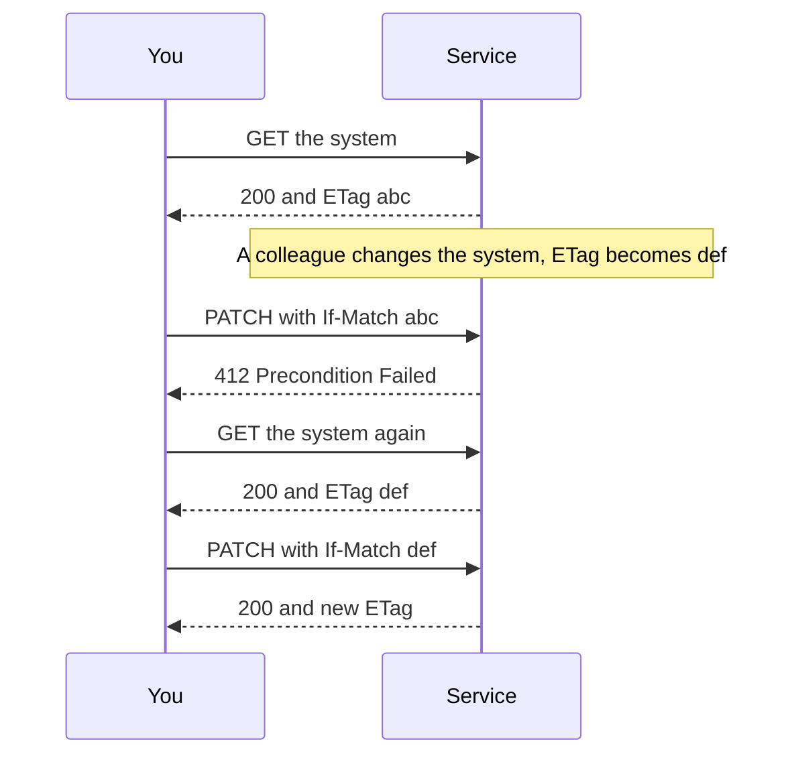

# 7.3 The Redfish protocol: HTTP methods, headers, status codes and query parameters

| | |
|---|---|
| Level | Beginner to Intermediate |
| Priority tier | 1 |
| Lab venue | Laptop |
| Part | Part 7: Redfish and BMC |
| Status | Drafted (`protocol_lab.py`: 36 checks pass against mock; **untested** on live BMC) |

## Why this matters for AI infrastructure

Any script that restarts a node or changes a setting is only as safe as its handling of errors. The Redfish protocol is plain HTTP, but it has specific rules that tell you whether a change happened, is still running, or was refused. Knowing these rules is the difference between a script that quietly does nothing and one you can trust on 1,000 machines.

## Prerequisites and outcomes

You need chapters 7.1 and 7.2. After this chapter you can:

- choose the right HTTP method for reading, changing, creating, deleting and running an action
- read the status code and error body and decide what to do next
- use ETags so two people cannot overwrite each other's change
- use `$select`, `$top`, `$skip`, `$expand` and `only` to get less or more data
- run a lab that checks all of these rules

## 1. The methods

Redfish uses ordinary HTTP methods. From the spec's table:

| Method | Meaning in Redfish | Notes |
|---|---|---|
| `GET` | read a resource | must have no side effects, and be repeatable |
| `HEAD` | read only the headers | no body. Handy to check that a link works. Query parameters are not allowed on it |
| `POST` | create something, run an **action**, or (for eventing) subscribe | not repeatable: sending it twice may do it twice |
| `PATCH` | change some properties of a resource | only the properties you send change. Should be repeatable |
| `PUT` | replace a whole resource | optional for services |
| `DELETE` | remove a resource | |
| `OPTIONS` | get headers and support CORS checks | optional |

`GET`, `POST`, `PATCH` and `DELETE` are the ones you will use daily. If a service does not support a method on a resource it must answer **405 Method Not Allowed** (or 501) and the answer lists what is allowed in an `Allow` header.

### One idea to remember: `PATCH` is for properties, `POST` is for actions

A property is a value you can set (an `AssetTag`). An action is something the system **does** (restart). To restart you do not `PATCH PowerState`. You `POST` to the action address given in the resource's `Actions` section. The spec says the address looks like `<ResourceUri>/Actions/<QualifiedActionName>` and that the `target` field in `Actions` holds it. Chapter 7.5 covers actions fully.

## 2. Headers that matter

### Request headers (what you send)

| Header | Why |
|---|---|
| `Accept: application/json` | ask for JSON. The service must support it |
| `Content-Type: application/json` | tell the service your body is JSON (needed for `POST`, `PATCH`, `PUT`) |
| `Authorization: Basic ...` | log in on each request (HTTPS only, see 7.4) |
| `X-Auth-Token: ...` | log in with a session token you got earlier |
| `If-Match: <etag>` | only do this change if the resource is still as I saw it |
| `If-None-Match: <etag>` | only send the resource if it has changed |
| `OData-MaxVersion: 4.0` | the highest OData version you understand |

### Response headers (what you get back)

| Header | What it tells you |
|---|---|
| `ETag` | a label for this version of the resource |
| `Location` | the address of something just created (a session, a task) |
| `X-Auth-Token` | the token for the new session |
| `Allow` | the methods that this address accepts |
| `Retry-After` | how long to wait before checking a task again |
| `OData-Version: 4.0` | the OData version of the answer |
| `Link` | a pointer to the schema that describes the resource (`rel=describedby`) |

## 3. ETags: changing things without stepping on others

An **ETag** is a short label the service attaches to a version of a resource. When the resource changes, the label changes. The spec says the algorithm is the service's choice (a hash, a counter, a timestamp), and clients must treat it as an **opaque** value and send it back unchanged.

Problem it solves: you read a setting, think for a minute, then write a change. Meanwhile a colleague changed the same resource. Without a check, you overwrite their work.

Solution: send the ETag you saw in `If-Match`.



The spec's rules:

- A client "should" send `If-Match` on `PUT` and `PATCH` (it is "highly recommended").
- A service that supports ETags **may** answer **428 Precondition Required** if the header is missing.
- If the label does not match, the answer is **412 Precondition Failed**.
- With `If-None-Match` on a `GET`, an unchanged resource gives **304 Not Modified**, saving bandwidth.
- A resource that changes constantly (a clock or a sensor) makes ETags useless for `If-Match`, because the label keeps changing. The spec suggests services round such values when computing the ETag.

Here is the real output from my mock:

```text
GET .../Systems/System_0           -> 200   ETag: W/"fbd530fd09c0"
PATCH {"AssetTag":"RACK12-U7"}  If-Match: W/"fbd530fd09c0"  -> 200   ETag: W/"abd2bca5dab7"
PATCH {"AssetTag":"X"}          If-Match: W/"fbd530fd09c0"  -> 412 Precondition Failed
```

The first `PATCH` worked and changed the label. The second used the old label and was refused. `W/` marks a "weak" ETag, one of the two kinds the spec allows.

## 4. Status codes: what the number means

Status codes group by first digit: 2xx worked, 3xx redirect or unchanged, 4xx your request is wrong, 5xx the service has a problem. The spec says for 4xx and 5xx the service should add an extended error body that explains more.

| Code | Name | What to do |
|---|---|---|
| **200** | OK | success, the body has the answer |
| **201** | Created | something new was made. Read the `Location` header (for example a session) |
| **202** | Accepted | the work is **not done yet**. The `Location` header points to a task. Poll it (chapter 7.5) |
| **204** | No Content | success, nothing to show (for example a deleted session) |
| **304** | Not Modified | your cached copy is still good |
| **400** | Bad Request | something in your request is wrong. Read the error details |
| **401** | Unauthorized | no login, or wrong login |
| **403** | Forbidden | the service knows who you are, but you may not do this |
| **404** | Not Found | no such resource |
| **405** | Method Not Allowed | wrong method for this address. See the `Allow` header |
| **406** | Not Acceptable | it cannot answer in a format you accept |
| **409** | Conflict | the change clashes with the current state |
| **410** | Gone | it was removed on purpose |
| **412** | Precondition Failed | your `If-Match` did not match |
| **428** | Precondition Required | you must send `If-Match` |
| **413** | Payload Too Large | your request body (or a part of it) is bigger than the service accepts |
| **415** | Unsupported Media Type | the `Content-Type` of your body is not supported |
| **431** | Request Header Fields Too Large | headers are too big |
| **500** | Internal Server Error | the service hit an unexpected problem. The body should still carry an error |
| **501** | Not Implemented | an unsupported `$` query option, or a method the service does not do |
| **503** | Service Unavailable | temporarily overloaded or in maintenance. A BMC that just rebooted may answer this while it finishes starting. Wait and retry |
| **507** | Insufficient Storage | the expanded answer is too big to return |

The spec's table covers all of these (the first part of the table in the book text ends at 412 and continues with 413 and the later codes; 428, 501 and 507 are also explained in the ETag, query and `$expand` clauses). The service may return other codes too.

Two easy mix-ups:

- **401 versus 403:** 401 means "who are you?" and 403 means "I know who you are, and no." My lab shows a wrong password giving 401, and a read-only user trying to change something giving 403.
- **200 versus 202 after an action:** 200 means done. 202 means started. A script that treats both as "done" will carry on while the work is still running.

## 5. Error bodies

A 4xx or 5xx answer should carry a JSON error. The spec says look at `@Message.ExtendedInfo` **first**, and fall back to `code` and `message` only if it is missing:

```json
{
  "error": {
    "code": "Base.1.17.GeneralError",
    "message": "A general error has occurred. See ExtendedInfo for more information.",
    "@Message.ExtendedInfo": [
      {
        "MessageId": "Base.1.17.PropertyNotWritable",
        "Message": "The property SerialNumber is a read only property and cannot be assigned a value.",
        "RelatedProperties": ["#/SerialNumber"],
        "Resolution": "Remove the property from the request body and resubmit."
      }
    ]
  }
}
```

Each message has a `MessageId` (from a standard registry), a human sentence, the related property and often a `Resolution` hint. A request may produce several messages at once.

The spec also says error messages on failed login must not leak private information. Real services answer a wrong user name and a wrong password the same way.

### Partial success

If you `PATCH` three properties and only one can be changed, the spec says the service returns **200** with the new resource and `@Message.ExtendedInfo` listing the ones it could not change. If **all** are read-only, unknown or unsupported, it returns **400**. My mock does both. Practical rule: after a `PATCH`, check for `@Message.ExtendedInfo` even on a 200.

## 6. Query parameters: less, more, or paged

Query options go after `?` and join with `&`. Only `GET` allows them. The spec says services **should** support `$top`, `$skip` and `only`, and **may** support `$expand`, `$filter` and `$select`. A service that supports any of them must say so in `ProtocolFeaturesSupported` in the service root. The spec also gives the order the service applies them: filter, skip, top, then paging, expand, excerpt, select.

| Option | Applies to | What it does |
|---|---|---|
| `$select=A,B,Status/State` | any resource | return only those properties. `@odata.id` and `@odata.type` always come back. A named object comes back whole. `A/B` returns only B inside A |
| `$top=N` | collections | return at most N members |
| `$skip=N` | collections | skip the first N members |
| `only` | collections | if the collection has exactly one member, return that member itself, not the collection |
| `$expand=.($levels=1)` | any | put linked resources inline, so one request replaces many |
| `$expand=~`, `*` | any | expand only the `Links` section, or everything |
| `$filter=...` | collections | keep members that match a test, such as `SystemType eq 'Physical'` |
| `excerpt` | any | return only a small standard subset |

Behaviour rules worth knowing:

- Unknown query names that do **not** start with `$` are ignored. Unsupported ones that **do** start with `$` must get **501**.
- A bad value (like `$top=abc`) or a collection-only option on a single resource gives **400**.
- `only` must not be combined with other options.
- `$expand` can make answers huge. If it cannot fit, the service answers **507**.
- Paging gives no promise that members stay the same between pages, so you can miss or repeat an item if the collection changes while you read it. For a fleet, prefer one page where you can.

Why this matters at scale. To list the firmware of one server you may need 30 requests (one per component). With `$expand` you can often get them in one. Over 1,000 BMCs that saves tens of thousands of calls, if the BMC supports it. Always test, because the spec says support is optional.

## 7. The lab

Run it:

```bash
cd code/part07
python3 protocol_lab.py
```

It starts its own mock service on a free port, then runs 36 checks. Each check name ends with the spec clause it tests. Part of the output:

```text
PASS  service root readable without login [7.2.3]
PASS  collection without login gives 401 [13.3.2]
PASS  conditional GET with current ETag gives 304 [7.2.1]
PASS  $select keeps @odata.id/@odata.type and asked properties [7.3.3]
PASS  $top=2 returns 2 members, count stays 4, nextLink present [7.2.2]
PASS  unsupported $filter gives 501 [7.3.1]
PASS  PATCH with the OLD ETag gives 412 [8.3]
PASS  partial success: 200 plus ExtendedInfo for the rejected properties [7.6]
PASS  read-only role gets 403, not 401 [8.3]
PASS  PATCH on a resource that does not allow it gives 405 + Allow header [8.3]
PASS  service that insists on If-Match answers 428 when it is missing [6.5]
...
36 passed, 0 failed
```

**What the lab found in my own mock.** The first run had 3 failures, all real mistakes in the mock:

1. A bad value like `$top=abc` produced an error answer **and then crashed the handler**, because my error helper returned nothing and the code carried on. The lab surfaced it as a stack trace. Fix: make the check report that it already answered.
2. `?only` was ignored, because Python's query parser drops parameters with no value unless told not to.
3. `$select=Status/State` returned nothing for `Status`, because the first version only understood top-level names.

This is a useful reminder for your own tools: test the error paths, not just the happy path.

## 8. A safe update recipe

When you change something on many machines, follow this order:

1. Log in (session), and plan to log out at the end.
2. `GET` the resource and keep the `ETag`.
3. Check that the current value is what you expect (do not blindly overwrite).
4. `PATCH` with `If-Match`.
5. Look at the status code **and** at `@Message.ExtendedInfo`.
6. `GET` again and confirm the value really changed.
7. If you got 202, poll the task until it ends (7.5).
8. Log the machine, the old value, the new value and the result.

Steps 3 and 6 matter more than they look. Some settings only take effect after a restart (chapter 7.7 and 7.10), so a 200 on a `PATCH` may mean "saved for next boot".

## 9. Exercises

1. Run `protocol_lab.py` and read the 36 lines. Which three would you explain to a new colleague first?
2. With `curl -i`, `GET` a system, then `PATCH` it with the ETag, and again with the old ETag. Save both outputs.
3. Write down which status code you expect for each: wrong password, read-only user changing a value, a typo in a URL, `PATCH` on a read-only property, `GET` with `?$filter=...` on this mock.
4. Use `$select` and `$top` to get only the `Id` of the first two systems. What request do you write?
5. Break the mock on purpose (return 200 with an error body). Which of your lab checks would still pass? What does that tell you about checking only the status code?
6. Add a new check to `protocol_lab.py` for `PUT` returning 405 with an `Allow` header.

## 10. Interview angles

- "Explain `PATCH` versus `POST` in Redfish." Property change versus action.
- "How do you avoid overwriting a colleague's change?" ETag with `If-Match`; 412 means re-read.
- "What does 202 mean and what must the client do?" The work is queued. Follow the task in `Location`.
- "Why check the response body after a 200?" Partial success lists what failed.
- "How would you cut the number of requests for a firmware inventory?" `$expand` and `$select`, if the service supports them (check `ProtocolFeaturesSupported`).

## 11. Checkpoint questions (20)

1. Which HTTP method runs an action?
2. Which HTTP method changes some properties?
3. What must a service return for an unsupported method? What header goes with it?
4. What is an ETag?
5. What do `If-Match` and `If-None-Match` do?
6. What status code means your `If-Match` was out of date?
7. What status code means the service wants `If-Match` and you did not send it?
8. What is the difference between 401 and 403?
9. What is the difference between 200 and 202 after a request that starts work?
10. Where do you look first in an error body?
11. What does a `PATCH` return when only some properties could be changed?
12. When does a `PATCH` return 400 for property problems?
13. What do `$top` and `$skip` do and what do they apply to?
14. What does `only` do?
15. What status does an unsupported `$` option get?
16. Where does a service say which query options it supports?
17. What does `$expand=.($levels=1)` do?
18. What is a risk of `$expand`?
19. Why can paging miss items?
20. Why check the body even when the status is 200?

## 12. Sources and review notes

- **Redfish Specification DSP0266 v1.21.0:** HTTP methods and redirects (6.2, 6.3), media types and ETags (6.4, 6.5), protocol version (6.6), request headers and the GET/query/PATCH/PUT/POST/DELETE clauses (7.1 to 7.11), response headers, status codes and error responses (8.1, 8.3, 8.6). I read each clause in the book text. 
- **Run here:** `protocol_lab.py` (36 checks) and `curl` calls against `redfish_mock.py`. All on a laptop with the Python standard library.
- **Not verified:** how any real BMC behaves. Vendors differ on which query options they support, on ETag use and on error messages. Test on one BMC of each model before you roll out.
- **Not covered here:** actions and tasks (7.5), authentication and sessions in depth (7.4), the schema and OData metadata (7.6).
