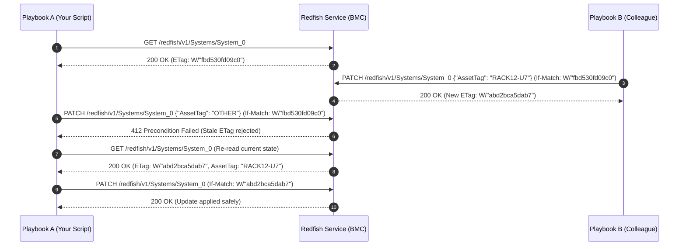
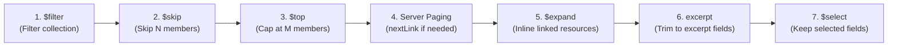

# 7.3 The Redfish protocol: HTTP methods, headers, status codes and query parameters

| | |
|---|---|
| Level | Beginner to Intermediate |
| Priority tier | 1 |
| Lab venue | Laptop (`code/part07/protocol_lab.py` and `redfish_mock.py`) |
| Part | Part 7: Redfish and BMC |
| Status | Drafted (`code/part07/protocol_lab.py`: 36/36 checks pass against `redfish_mock.py`; **untested** / **not verified** against a live physical BMC in this session) |

## Why this matters for AI infrastructure

An automation script that powers down GPU nodes, changes BIOS settings, or rotates BMC certificates across a 1,024-GPU cluster can do real damage. Its safety depends on how well you understand the **Redfish wire protocol**. Redfish runs over ordinary HTTP/1.1 and HTTP/2, so the requests look familiar. The meaning of each reply is less obvious, and the DMTF Redfish Specification (DSP0266 v1.21.0, Sections 6, 7, and 8) spells it out.

The status codes carry more meaning than success or failure. A `200 OK` means a change is complete. A `202 Accepted` means a background job has started and is not finished. A `200 OK` can also carry `@Message.ExtendedInfo` warnings, which tell you only part of your change landed. A `400 Bad Request` means nothing was applied, while a `412 Precondition Failed` means someone else changed the resource first, and a `401 Unauthorized` means your credentials were not accepted.

Consider a script that checks only `if response.status_code < 300:`. On a quiet day it looks fine. It will silently skip read-only BIOS properties that failed during a partial `PATCH`. It can reboot a server while a firmware flash (`202 Accepted`) is only 5% complete. It can also overwrite a colleague's BMC edit made at the same time.

The rules in this chapter, and the 36 automated checks in `code/part07/protocol_lab.py` that test them, give you a solid base for fleet automation. Learn each rule first, then watch the lab prove it. Treat every status code as a promise to verify, not as a success flag.

---

## Prerequisites and outcomes

You need Chapters 7.1 and 7.2 first. When you finish this chapter, you will be able to do the following:

- Pick the right HTTP method (`GET`, `HEAD`, `POST`, `PATCH`, `PUT`, `DELETE`, `OPTIONS`) to read data, change properties, patch arrays, create resources, and run actions. DSP0266 §6.2 and §7.2–7.12 define each one.
- Build compliant request headers such as `Accept`, `Content-Type`, `X-Auth-Token`, `If-Match`, `If-None-Match`, and `OData-Version`, and read the response headers `ETag`, `Location`, `Allow`, `Retry-After`, `WWW-Authenticate`, and `Link`.
- Stop lost updates when several administrators or scripts touch the same resource. You will use `ETag` and `If-Match`, and handle `412 Precondition Failed` and `428 Precondition Required`. The rules sit in DSP0266 §6.5.
- Handle every Redfish status code from `200` to `507`, parse `@Message.ExtendedInfo` error arrays, and catch partial-success `PATCH` responses. The relevant clauses are DSP0266 §7.6, §8.3, and §8.6.
- Use the OData query parameters (`$select`, `$expand`, `$filter`, `$top`, `$skip`, `only`, and `excerpt`) in the order the specification requires. Done well, this cuts fleet polling traffic by an order of magnitude, as DSP0266 §7.3 explains.
- Run `code/part07/protocol_lab.py` on your own machine and confirm you see `36 passed, 0 failed`.

---

## 1. HTTP methods and data modification semantics

Every management action you send to a BMC travels as one of a small set of HTTP methods. Pick the wrong one and the BMC refuses the request, or worse, does something you never meant to trigger. Redfish maps all management operations onto seven standard HTTP methods (DSP0266 §6.2 Table 3 and §7.2–7.11). A service must implement `GET`, `HEAD`, `POST`, `PATCH`, and `DELETE`. `PUT` and `OPTIONS` are optional.

| HTTP Method | Redfish Semantic (DSP0266 §6.2) | Idempotent? | Safe (No Side Effects)? | Required for Services? |
|---|---|---|---|---|
| **`GET`** | Retrieve a single resource or resource collection representation | **Yes** | **Yes** | **Yes** |
| **`HEAD`** | Retrieve response headers only (no body) to verify hyperlink validity or `ETag` | **Yes** | **Yes** | **Yes** |
| **`POST`** | 1. Create a new member in a collection (`Session`, `Account`, `Subscription`); 2. Invoke a resource **Action** (`#ComputerSystem.Reset`) | **No** | **No** | **Yes** |
| **`PATCH`** | Partially update one or more writable properties on an existing resource | **Should be** | **No** | **Yes** |
| **`PUT`** | Completely replace an existing resource representation | **Should be** | **No** | No (Optional) |
| **`DELETE`** | Remove a resource (e.g., log out a session, delete an account or subscription) | **Should be** | **No** | **Yes** |
| **`OPTIONS`** | Retrieve allowed headers/methods and handle CORS pre-flight checks | **Yes** | **Yes** | No (Optional) |

Read the last two columns first. "Idempotent" means that sending the same request twice leaves the resource in the same state as sending it once. "Safe" means the call changes nothing on the BMC at all. A `GET` is both, while a `POST` is neither, which is why the table matters before you script anything.

Three protocol rules govern how methods behave on a compliant BMC. The first covers methods that a URI does not support. Suppose you send a `PATCH` to a read-only resource, such as `/redfish/v1/Chassis/Chassis_0`, where no properties are writable. Or you send a `PUT` to a service that does not implement `PUT`. The BMC answers with `405 Method Not Allowed`, or with `501 Not Implemented` for unknown verbs. It also returns an **`Allow`** header that lists the methods the URI does accept, for example `Allow: GET, HEAD`.

The second rule covers `HEAD`. The method exists to check whether a URI is reachable and to read its headers, such as `ETag`, `Link`, and `Allow`, without downloading the JSON body. Because `HEAD` has that narrow job, DSP0266 §7.4 says services shall reject `HEAD` requests that carry query parameters. Try `HEAD /redfish/v1/Systems/System_0?$select=Name`, and the BMC should answer `400 Bad Request`.

The third rule covers redirects. A BMC may answer with `301 Moved Permanently`, `302 Found`, `307 Temporary Redirect`, or `308 Permanent Redirect`, and point you to the new address in a `Location` header. It might do this when a URI lacks a trailing slash or when a subtree has an alias. DSP0266 §6.3 requires every Redfish client to handle redirects properly. Make sure your client follows them, and treat a `405` with its `Allow` header as the BMC telling you what it accepts.

### 1.1 `PATCH` (properties) versus `POST` (actions and creation)

The most common mistake people make when they first learn Redfish is mixing up `PATCH` and `POST`. The two look alike in code, but they do different jobs. Use `PATCH` to change state properties. To change a server's `AssetTag` or `HostName`, to set a one-time boot override in `BootSourceOverrideTarget`, or to stage BIOS attributes under `/Bios/Settings`, send a `PATCH` with only the JSON properties you want to change. Any property you leave out of the body stays untouched.

Use `POST` for two different jobs. The first is creating a member in a collection, such as a new subscription under `/redfish/v1/EventService/Subscriptions`. DSP0266 §7.9 says you may `POST` to the collection URI (`/Subscriptions`) or to its `Members` property URI (`/Subscriptions/Members`). Services that support member creation must accept both. The second job is running an operation, such as a reset, a firmware flash, or clearing an event log. Those operations do something rather than set a value.

For operations, you never `PATCH` `"PowerState": "Off"` to shut a server down. You `POST` a JSON parameter object to the action's `target` URI, which sits in the resource's `Actions` block. For example, `POST /redfish/v1/Systems/System_0/Actions/ComputerSystem.Reset` with `{"ResetType": "GracefulRestart"}` asks for a graceful restart. Because `POST` is **not idempotent**, sending that reset twice may reboot the server twice. Use `POST` when you want an operation to happen, and `PATCH` when you want a value to change.

### 1.2 `PATCH` on array properties and `@Redfish.OperationApplyTime` (DSP0266 §7.7 & §7.12)

Some properties are lists. Say a writable property is a JSON array, such as the NTP server list in `NTPServers` or the boot order in `BootOrder`. You may want to change one entry, or remove one, and leave the rest alone. DSP0266 §7.7 defines how `PATCH` handles this, and it works by position. An empty object `{}` at a position leaves the element at that index unchanged. A `null` at a position removes that element, and the elements after it shift left. A new value at a position replaces the element there, or appends it when the position lies beyond the end of the array.

Here is a worked example. The array holds `["10.0.0.1", "10.0.0.2", "10.0.0.3"]`, and you send `PATCH {"NTPServers": [{}, null, "10.0.0.9"]}`. The first position keeps `"10.0.0.1"`. The second position removes `"10.0.0.2"`. The third position replaces `"10.0.0.3"` with `"10.0.0.9"`. The array ends up as `["10.0.0.1", "10.0.0.9"]`.

Some changes need a reboot or a maintenance window before they take effect. DSP0266 §7.12 lets you include `"@Redfish.OperationApplyTime"` in the request body. You may use it only when the service advertises it through `@Redfish.OperationApplyTimeSupport`. The spec defines four standard values:

- `"Immediate"`: apply right now.
- `"OnReset"`: stage the operation and apply it the next time the system resets.
- `"AtMaintenanceWindowStart"`: apply automatically when the configured `@Redfish.MaintenanceWindow` begins.
- `"InMaintenanceWindowOnReset"`: apply when a reset occurs inside the configured maintenance window.

Check `@Redfish.OperationApplyTimeSupport` on the resource before you rely on any of these values.

---

## 2. Request and response headers

Headers tell the BMC what format you want, who you are, and which version of a resource you are editing. Get one wrong and the BMC answers with an error you did not expect. DSP0266 Sections 7.1 and 8.1 define the headers that handle content negotiation, authentication, caching, concurrency, and schema discovery.

### 2.1 Essential request headers (sent by your client)

Your client sends these headers on every call. The table lists what each one does and what the BMC expects in return.

| Request Header | Example Value | Client & Service Requirement (DSP0266 §7.1) |
|---|---|---|
| `Accept` | `application/json` | Requests JSON representation. If omitted, the service **shall** still return `application/json` (§7.2.1). If the client asks for a format the BMC cannot produce, the BMC returns `406 Not Acceptable`. |
| `Content-Type` | `application/json;charset=utf-8` | Declares request body format on `POST`, `PATCH`, and `PUT` (or `multipart/form-data` on firmware pushes). Unsupported types return `415 Unsupported Media Type`. |
| `X-Auth-Token` | `3f8a91c2...` | Presents an active session token obtained from `POST /redfish/v1/SessionService/Sessions`. |
| `Authorization` | `Basic YWRtaW46...` | Presents HTTP Basic credentials (base64 `user:password`) or `Bearer` OAuth 2.0 token over HTTPS. |
| `If-Match` | `W/"fbd530fd09c0"` or `"*"` | Conditional header for `PATCH`/`PUT`/`DELETE`: execute the modification **only** if the resource's current `ETag` matches. |
| `If-None-Match` | `W/"fbd530fd09c0"` | Conditional header for `GET`: return `200 OK` only if the `ETag` has changed; otherwise return `304 Not Modified` with an empty body. |
| `OData-Version` / `OData-MaxVersion` | `4.0` | Declares OData v4.0 conformance. |

Two of these are conditional headers. If-Match and If-None-Match ask the BMC to compare the `ETag` before it acts, so a stale copy of the resource never silently wins. Keep them in mind for the concurrency section ahead.

### 2.2 Essential response headers (returned by the BMC)

The BMC sends its own headers back, and your script should read them just as carefully. A `Location` header on a `202 Accepted`, for example, gives you the Task Monitor URI to poll. The table below covers the headers you will meet most often.

| Response Header | Example Value | Meaning & Client Action (DSP0266 §8.1–8.2) |
|---|---|---|
| `ETag` | `W/"fbd530fd09c0"` | Opaque version identifier for the returned resource representation (mirrors `@odata.etag` in the body). |
| `Location` | `/redfish/v1/TaskService/Tasks/Task_1` | On `201 Created`, points to the newly created resource. On `202 Accepted`, points to the **Task Monitor URI** to poll. |
| `X-Auth-Token` | `3f8a91c2...` | Returned on `201 Created` from `/redfish/v1/SessionService/Sessions`; must be unpredictable/indistinguishable from random. |
| `WWW-Authenticate` | `Basic realm="Redfish"` | Returned on `401 Unauthorized` when `HTTPBasicAuth` is enabled in `AccountService`. |
| `Allow` | `GET, HEAD, PATCH` | Returned on `405 Method Not Allowed` (and `OPTIONS`), listing the valid HTTP verbs for that URI. |
| `Retry-After` | `5` (seconds) or HTTP-date | Returned on `202 Accepted` (task polling interval) or `503 Service Unavailable` (back-off interval). |
| `OData-Version` | `4.0` | Required on all Redfish responses (`OData-Version: 4.0`). |
| `Link` | `</redfish/v1/JsonSchemas/ComputerSystem.v1_17_0.json>; rel=describedby` | Points directly to the schema file that describes the returned resource (§8.2). |

Of these, the ETag and Location headers will do most of the work in the sections ahead.

---

## 3. Optimistic concurrency control with `ETag` and `If-Match`

Two automation playbooks start at the same time against `gpu014`. Playbook A reads `/redfish/v1/Systems/DGX` so it can update `AssetTag`. Playbook B updates `HostName` or boot properties on that same resource. Without concurrency control, whichever `PATCH` lands second can overwrite the first, or conflict with it.

DSP0266 §6.5 solves this "lost update" problem with HTTP entity tags, called `ETag`s. An `ETag` is a version label that the BMC attaches to a resource. Each `GET` returns an `ETag` header and a matching `@odata.etag` property. A value looks like `"fbd530fd09c0"` (a strong ETag) or `W/"fbd530fd09c0"` (a weak ETag). The BMC decides how to build the value, whether by hash, counter, or timestamp. Your client should treat the string as opaque and never try to parse it.

When you send a `PATCH` or a `PUT`, DSP0266 §6.5 says clients should include `If-Match` with the exact `ETag` you read earlier. The spec calls this "highly recommended." The sequence below shows how the check plays out when two playbooks collide.



Follow the diagram from the top. Playbook B's change gives the resource a new `ETag`, so Playbook A's old `If-Match` no longer matches. Playbook A re-reads the resource, sees the new `AssetTag`, and retries with the fresh tag. Nothing was overwritten.

The ETag rules show up in four cases (DSP0266 §6.5, §7.2.1, §8.3), and each one needs its own response:

1. `412 Precondition Failed`. Your `If-Match` no longer matches, because someone changed the resource after your `GET`. Read the resource again, check the new state, and retry with the new `ETag`.

2. `428 Precondition Required`. Some resources, often `AccountService/Accounts/<id>` or `Bios/Settings` on strict BMCs, insist on `If-Match` for every `PATCH`. Leave the header out and the BMC answers `428 Precondition Required`.

3. `304 Not Modified` on a conditional `GET`. If you poll a resource and send `If-None-Match` with your last `ETag`, the BMC answers `304 Not Modified` with no body when nothing has changed. Across a large fleet, that saves network bandwidth and the CPU time spent parsing JSON.

4. Clock churn. A `Manager` resource can include a `DateTime` clock that ticks every second. If the BMC hashes the whole payload, the `ETag` changes every second too. Then almost every `If-Match` `PATCH` on `Manager` fails with `412`. DSP0266 §6.5 therefore advises BMC makers to leave out or round rapidly ticking properties when they compute an `ETag`.

When a `PATCH` returns `412`, treat it as a signal to re-read, not as a failure to ignore.

---

## 4. Complete guide to Redfish HTTP status codes and error bodies

The status code tells you the outcome in one number. The JSON body tells you why. You need both to know whether a change happened and what to do next. Table 4 summarizes every status code that DSP0266 §8.3 defines, in its Table 15. It also adds the special codes from §6.5 and §7.3.

| Status Code | HTTP Name | Redfish Meaning & Client Action (DSP0266 §8.3) |
|---|---|---|
| **`200`** | `OK` | Synchronous success; the response body contains the requested or updated resource JSON. **Always check for `@Message.ExtendedInfo` in case of partial `PATCH` success.** |
| **`201`** | `Created` | A new resource was created (`POST` to `Sessions`, `Accounts`, `Subscriptions`). Read the `Location` header for its URI. |
| **`202`** | `Accepted` | **Asynchronous operation started but NOT yet finished** (e.g., `SimpleUpdate` firmware flash). Read the `Location` header for the Task Monitor URI and `Retry-After` for the polling interval (Chapter 7.5). |
| **`204`** | `No Content` | Operation succeeded and intentionally returned no body (e.g., `DELETE` on a session or subscription, or an Action with no return payload). |
| **`301` / `302` / `307` / `308`** | `Moved` / `Redirect` | Follow the `Location` header to the target URI (§6.3). |
| **`304`** | `Not Modified` | Resource has not changed since the `ETag` supplied in `If-None-Match` (§7.2.1). |
| **`400`** | `Bad Request` | Malformed JSON, invalid query value (`$top=abc`), collection-only query on a single resource, empty `PATCH {}` (`NoOperation`), or **all** properties in a `PATCH` were read-only/unknown (§7.6). |
| **`401`** | `Unauthorized` | Authentication is missing, expired, or invalid (wrong password or expired `X-Auth-Token`). Authenticate or renew session. |
| **`403`** | `Forbidden` | **Authenticated**, but your account's role (`ReadOnly` or `Operator`) lacks the privilege required for this operation (`InsufficientPrivilege`). Re-authenticating with the same user will not help. |
| **`404`** | `Not Found` | The requested URI does not exist on this BMC. |
| **`405`** | `Method Not Allowed` | The URI exists, but does not support this HTTP verb (e.g., `PATCH` on a non-updatable resource or `GET` on an Action target). Inspect the `Allow` header. |
| **`406`** | `Not Acceptable` | The BMC cannot produce a representation matching your `Accept` header. |
| **`409`** | `Conflict` | Request conflicts with the current state of the resource (e.g., creating a duplicate account `UserName` or resetting a system that is already off when requesting `GracefulShutdown`). |
| **`410`** | `Gone` | Resource existed previously (such as a completed and purged Task) and was intentionally removed. |
| **`411`** | `Length Required` | Request lacked a required `Content-Length` header. |
| **`412`** | `Precondition Failed` | The `ETag` in your `If-Match` header does not match the current resource version (§6.5). Re-`GET` and retry. |
| **`413`** | `Payload Too Large` | Request body (or multipart upload part) exceeds the BMC's maximum size limit. |
| **`415`** | `Unsupported Media Type` | `Content-Type` header is missing or not supported by the endpoint. |
| **`428`** | `Precondition Required` | Endpoint requires an `If-Match` header on modification requests and you omitted it (§6.5). |
| **`431`** | `Request Header Fields Too Large` | Request headers exceed the BMC's buffer limit. |
| **`500`** | `Internal Server Error` | Unexpected fault inside the BMC firmware; inspect `@Message.ExtendedInfo` in the error body. |
| **`501`** | `Not Implemented` | The BMC does not implement a standard `$` query parameter (such as `?$filter=...`) or HTTP method (§7.3.1). |
| **`503`** | `Service Unavailable` | BMC is temporarily overloaded, rebooting after `mc reset cold`, or out of session slots. Honor `Retry-After` and back off. |
| **`507`** | `Insufficient Storage` | The response payload generated by a deep `?$expand` query exceeds the BMC's memory buffer (§7.3.2). Retry without `$expand` or with smaller `$levels`. |

Two codes deserve extra care. A `200` can hide a partial failure, and a `202` means the work is still running. Section 4.2 covers the first case, and Chapter 7.5 covers the second.

### 4.1 Parsing extended error bodies (`@Message.ExtendedInfo`, DSP0266 §8.6)

When a call fails with a `4xx` or `5xx` code, the BMC has to explain why. DSP0266 §8.6 requires it to return a structured `error` object. Read `error["@Message.ExtendedInfo"]` first. Fall back to the top-level `error.code` and `error.message` only when `@Message.ExtendedInfo` is missing. A typical body looks like this:

```json
{
  "error": {
    "code": "Base.1.17.GeneralError",
    "message": "A general error has occurred. See ExtendedInfo for more information.",
    "@Message.ExtendedInfo": [
      {
        "MessageId": "Base.1.17.PropertyNotWritable",
        "Message": "The property SerialNumber is a read only property and cannot be assigned a value.",
        "MessageArgs": ["SerialNumber"],
        "Severity": "Warning",
        "MessageSeverity": "Warning",
        "RelatedProperties": ["#/SerialNumber"],
        "Resolution": "Remove the property from the request body and resubmit the request if the operation failed."
      }
    ]
  }
}
```

Each entry in the `@Message.ExtendedInfo` array carries four fields that matter to your code:

- `MessageId`: a stable identifier in the form `<RegistryPrefix>.<Major>.<Minor>.<MessageKey>`. It comes from the DMTF Base registry or a vendor registry, which Chapter 7.6 covers. Your code can match it, for example with `msg["MessageId"].endswith(".PropertyNotWritable")`.
- `Message` and `MessageArgs`: the human-readable explanation, and the values that fill its blanks.
- `RelatedProperties`: JSON Pointer strings such as `"#/SerialNumber"`, which point at the request property that caused the error.
- `Resolution`: remediation advice from the message registry.

### 4.2 The `PATCH` partial-success rule (DSP0266 §7.6)

One rule in DSP0266 §7.6 trips up many scripts. Suppose a single `PATCH` carries three properties. `AssetTag` is writable, `SerialNumber` is read-only, and `Bogus` is not a property at all. The body looks like this: `{"AssetTag": "A2", "SerialNumber": "X", "Bogus": 1}`. What the BMC does depends on how many of those properties succeed.

If at least one property succeeds, the BMC applies the valid change. Here, `AssetTag` becomes `A2`. The BMC returns `200 OK` with the updated resource, and it adds an `@Message.ExtendedInfo` array inside that body. The array lists `PropertyNotWritable` for `SerialNumber` and `PropertyUnknown` for `Bogus`.

If every property is read-only, unknown, or invalid, or the body is `{}`, nothing changes. The BMC returns `400 Bad Request` with an `error` body that uses `PropertyNotWritable` or `NoOperation`.

Never assume that a `200 OK` on a `PATCH` means every property you sent was accepted. A check such as `if "@Message.ExtendedInfo" in resp_json:` belongs on every `200 OK` response in your Python and Ansible scripts. Read the body of each `200 OK` to a `PATCH` before you mark the change as done.

---

## 5. OData query parameters: fetching less, more, or filtered data

Polling every sensor on every node wastes time and bandwidth when you need only a few values. OData query parameters let you ask the BMC for just the part you want. You add them after `?` on a `GET` URI, and you join several with `&` (DSP0266 §7.3). When one request carries several parameters, DSP0266 §7.3.1 requires the BMC to apply them in a fixed seven-step order.



The order is not a style choice. Filtering comes first, so it decides which members are left to skip and count. `$select` comes last, so it can only trim what the earlier steps produced. A worked example makes this concrete.

Take a sensor collection with 10 sensors: 6 temperature sensors and 4 fans. You send this request:

`GET /redfish/v1/Chassis/1/Sensors?$filter=ReadingType eq 'Temperature'&$skip=2&$top=3&$expand=.($levels=1)&$select=Members/Reading`

The `$filter` runs first and keeps the 6 temperature sensors. The collection's count becomes 6. The `$skip=2` step drops the first 2 of those, and `$top=3` keeps the next 3. One sensor is left over for the next page, reached through `Members@odata.nextLink`. The `$expand` step inlines only those 3 sensor objects. Finally, `$select` trims each object down to `Reading`, plus the mandatory `@odata.id` and `@odata.type`.

### 5.1 Query parameter reference (DSP0266 §7.3.1–7.3.8)

Table 5.1 lists every parameter. Pay attention to the Service Support column. Parameters marked **May** support are optional, so a BMC is free to skip them. Check what your BMC supports before you build on any of them.

| Query Parameter | Target Scope | Service Support | Specification Behavior & Syntax |
|---|---|---|---|
| **`$top=N`** | Collections only | **Should** support | Returns at most `N` members in `Members`. Does **not** alter `Members@odata.count`. If `N` is less than the remaining count, `Members@odata.nextLink` is included (§7.2.2). |
| **`$skip=N`** | Collections only | **Should** support | Skips the first `N` members of the collection before populating `Members`. |
| **`only`** | Collections only | **Should** support | If the collection contains **exactly `1` member**, returns that single member resource directly instead of the collection wrapper. If the collection has `0` or `>= 2` members, returns the collection normally. **Shall not** be combined with any other query parameter (`400 Bad Request`). |
| **`$select=P1,P2/Sub`** | Any resource | **May** support | Returns only the requested properties (nested properties use `/`, e.g., `Status/State`), **plus** mandatory `@odata.id`, `@odata.type`, `@odata.context`, and `@odata.etag` (§7.3.3). |
| **`$expand=<type>($levels=N)`** | Any resource | **May** support | Inlines linked `@odata.id` resources directly into the response so `1` HTTP `GET` replaces dozens: `.` expands subordinate links outside `Links`, `~` expands only references inside `Links`, and `*` expands both subordinate and `Links` references. |
| **`$filter=<expr>`** | Collections only | **May** support | Filters collection members using comparison operators (`eq`, `ne`, `gt`, `ge`, `lt`, `le`), logical operators (`and`, `or`, `not`), and parentheses `()`, evaluated in precedence order `()` $\rightarrow$ `not` $\rightarrow$ relational $\rightarrow$ `and` $\rightarrow$ `or` (§7.3.4). Updates `Members@odata.count` to the filtered count. |
| **`excerpt`** | Any resource | **May** support | Returns only properties marked as `excerpt` in the schema definition. |

The Target Scope column tells you where each parameter applies. Collection-only parameters such as `$top` and `$skip` have no effect on a single resource, and sending them there is an error, as the next subsection shows.

### 5.2 Error handling rules for query parameters (DSP0266 §7.3.1)

When your client uses query parameters against different BMC models, read `ProtocolFeaturesSupported` in `/redfish/v1/` first. Then expect four kinds of response.

An unsupported `$` parameter gets `501 Not Implemented`. If a client sends `$filter`, `$expand`, or `$select` to a BMC that does not implement it, the BMC **shall** return **`501 Not Implemented`**.

A query parameter that does not start with `$` is silently ignored, unless it is `only` or `excerpt`. For example, `?cachebust=123` does nothing and the `GET` proceeds as normal.

A malformed value or the wrong target gets `400 Bad Request`. `$top=abc` is not an integer. Sending `$top=1` or `$skip=1` to a single resource, such as `/redfish/v1/Systems/System_0?$top=1`, targets the wrong kind of resource. Combining `only` with another parameter, as in `?only&$top=1`, is also refused with `400 Bad Request`.

A response that is too large for the BMC gets `507 Insufficient Storage`. If `?$expand=*($levels=3)` produces a JSON tree bigger than the BMC's response buffer, the BMC returns `507 Insufficient Storage`.

Read `ProtocolFeaturesSupported` once per BMC model, and let your client handle a missing parameter gracefully.

---

## 6. Lab: Running the 36-check protocol compliance suite (`code/part07/protocol_lab.py`)

Reading a rule is easy. Remembering it under pressure is harder. This lab checks the rules from Sections 1 through 5 one at a time, against a running HTTP service on your laptop. Run `code/part07/protocol_lab.py`. It starts an in-memory instance of `redfish_mock.py` (`dgx` profile) on an ephemeral port. Then it runs 36 self-checking protocol assertions, and each line names the exact DSP0266 clause it tests.

```bash
$ python3 code/part07/protocol_lab.py
PASS  GET /redfish needs no login and returns the v1 pointer [6.6]
PASS  service root readable without login [7.2.3]
PASS  root advertises ProtocolFeaturesSupported [7.3.1]
PASS  collection without login gives 401 [13.3.2]
PASS  error body has @Message.ExtendedInfo [8.6]
PASS  wrong password gives 401, not 403 [8.3]
PASS  GET resource returns 200 + ETag header [6.5]
PASS  response has OData-Version 4.0 [8.1]
PASS  conditional GET with current ETag gives 304 [7.2.1]
PASS  $select keeps @odata.id/@odata.type and asked properties [7.3.3]
PASS  $top=2 returns 2 members, count stays 4, nextLink present [7.2.2]
PASS  last page has one member and no nextLink
PASS  only returns the single member itself [7.3.1]
PASS  only on a 2-member collection returns the collection
PASS  unsupported $filter gives 501 [7.3.1]
PASS  invalid $top value gives 400 [7.3.1]
PASS  collection-only option on single resource gives 400 [7.3.1]
PASS  only combined with another option gives 400 [7.3.1]
PASS  $expand with $levels=1 inlines members [7.3.2]
PASS  HEAD returns headers and no body [7.4]
PASS  HEAD with a query parameter is rejected with 400 [7.4]
PASS  missing resource gives 404 [8.3]
PASS  PATCH with correct If-Match gives 200 and the new resource [7.6]
PASS  ETag changed after the update [6.5]
PASS  PATCH with the OLD ETag gives 412 [8.3]
PASS  partial success: 200 plus ExtendedInfo for the rejected properties [7.6]
PASS  all properties read-only gives 400 with details [7.6]
PASS  empty PATCH gives 400 NoOperation
PASS  read-only role gets 403, not 401 [8.3]
PASS  PATCH on a resource that does not allow it gives 405 + Allow header [8.3]
PASS  unsupported method gives 405 [6.2]
PASS  service that insists on If-Match answers 428 when it is missing [6.5]
PASS  session create gives 201 + X-Auth-Token + Location [8.1]
PASS  token works without Basic auth
PASS  DELETE the session gives 204
PASS  deleted token no longer works

36 passed, 0 failed
```

A clean run ends with `36 passed, 0 failed`. If a line fails, the clause number in brackets tells you which rule broke, so start with that section of this chapter.

### 6.1 Three real protocol bugs caught while building the lab

The lab was not a formality. Writing `protocol_lab.py` against `redfish_mock.py` immediately exposed three bugs in our first implementation. Each one is the kind of edge case that bites custom BMC agents and client libraries in production.

The first bug was an error handler that fell through. When `$top` held a non-integer, our first query helper sent a `400 Bad Request` and then returned `None`. The caller read `None` as "no query error" and carried on to write a second `200 OK` on the same socket.

The second bug was a dropped query key. Python's `urllib.parse.parse_qsl(query)` discards keys that have no `=` sign, such as `?only` or `?excerpt`. Unless you pass `keep_blank_values=True`, those parameters vanish before your code sees them.

The third bug was a broken nested `$select`. A naive filter checks only the top-level keys, so it drops `"Status"` when the caller asks for `"Status/State"`. A compliant version splits on `/`, keeps the requested sub-key inside the nested object, and still keeps `@odata.id`, `@odata.type`, and `@odata.etag`.

---

## 7. Production checklist for safe fleet-wide `PATCH` operations

A tool that changes BMC or host settings across dozens or hundreds of servers needs the same care on its last server as on its first. When you write one, such as `code/part07/rf_bios.py` or `rf_harden.py`, follow the eight steps below in order.

Steps 1 and 2 come first. Open a session with `POST /redfish/v1/SessionService/Sessions`, and keep the `X-Auth-Token` and `Location` that come back. Wrap the work in a `try ... finally` block so that the session URI is deleted (`204 No Content`) when you finish, even if something fails. Then `GET` the target resource and save both its current property values and its `ETag`, taken from the header or from `@odata.etag`.

Steps 3 and 4 come next. Compare before you write. If the current values already match your desired state, skip the `PATCH` and report `unchanged`. Otherwise, send the `PATCH` with `If-Match` set to the saved tag, and include only the properties you intend to modify. If the service answers `412 Precondition Failed`, re-`GET` the resource, then abort or retry according to your conflict policy. If it answers `428 Precondition Required`, make sure `If-Match` is populated.

Steps 5 and 6 deal with the response. Read it with care, even when it is a `200 OK`. The body may carry `@Message.ExtendedInfo` entries that name properties the BMC rejected as `PropertyNotWritable`, `PropertyUnknown`, or `PropertyValueNotInList`. If the change returns `202 Accepted`, poll the `Location` Task Monitor URI and honor `Retry-After` between checks. Keep polling until `TaskState` reaches `Completed` with `TaskStatus: "OK"`. Chapter 7.5 covers task polling in detail.

Steps 7 and 8 confirm the state and keep a record. Re-`GET` the resource. Either the active value changed right away, or `@Redfish.Settings` and `/Bios/Settings` hold the staged change for the next system reset. Write an auditable log entry with the node name, BMC IP, resource URI, old value, new value, HTTP status, and new `ETag`. Make that log the last thing each run writes, so every change leaves a trace you can audit.

---

## Exercises

Work through these with the lab open in another window. Each one turns a rule from this chapter into something you can see on your own screen.

1. Trace all 36 protocol assertions. Run `python3 code/part07/protocol_lab.py`, then read lines 50–135 of `code/part07/protocol_lab.py`. Sort the 36 checks into five groups: unauthenticated discovery, conditional `GET` and `ETag` concurrency, query parameters, partial versus failed `PATCH`, and session lifecycle.
2. Reproduce a `412 Precondition Failed` collision with `curl`. Start `python3 code/part07/redfish_mock.py --profile dgx --port 18441`. Run `curl -i -u admin:adminpass http://127.0.0.1:18441/redfish/v1/Systems/System_0` and note the initial `ETag`. Then send two `curl -i -X PATCH` commands that both use that same initial `If-Match` header. The first should return `200 OK` with a new `ETag`, and the second should return `412 Precondition Failed`.
3. Compare partial success with total failure. Against `/redfish/v1/Systems/System_0`, send `PATCH {"AssetTag": "NODE-01", "SerialNumber": "FAKE"}` and then `PATCH {"SerialNumber": "FAKE"}`. Explain why the first returns `200 OK` and the second returns `400 Bad Request`. Read the `@Message.ExtendedInfo` array in both responses.
4. Cut sensor polling from 5 HTTP requests to 1. Against `/redfish/v1/Chassis/Chassis_0/Sensors` on the mock server, build one `GET` URL with `$expand=.($levels=1)` and `$select=Members`. It should fetch all `4` sensor readings inline in a single request. How many HTTP round-trips does this save across a 256-node cluster polled every 30 seconds?
5. Trace a query through the 7-step pipeline. Suppose a collection has `20` Drives: `8` SSD drives with `Status.Health == "OK"`, `2` SSD drives with `Status.Health == "Warning"`, and `10` HDD drives. Walk each stage for `GET /Drives?$filter=MediaType eq 'SSD'&$skip=3&$top=4&$select=Id,Status/Health`. What is `Members@odata.count`, how many items are in `Members`, and is `Members@odata.nextLink` present?
6. Add a 37th check to `protocol_lab.py`. Look at how line 116 of `protocol_lab.py` tests a `PUT` that returns `405 Method Not Allowed`. Check whether that `405` response also includes the `Allow` header (`"Allow" in h`). Then test the status code for a `GET` with an unknown non-`$` query parameter, `?foo=bar`. DSP0266 §7.3.1 says such a parameter must be ignored and return `200 OK`, so confirm the BMC does exactly that.

---

## Checkpoint questions (20)

<details>
<summary>1. Which HTTP method is used to invoke a Redfish Action (such as resetting a server), and why is PATCH never used for Actions?</summary>

Use **`POST`**. You send it to the Action's `target` URI, which is `<ResourceUri>/Actions/<QualifiedActionName>`. `PATCH` is for changing data properties. An Action is an operation that can do more than change one property, and it is **not idempotent**, so `PATCH` is the wrong tool.
</details>

<details>
<summary>2. Which HTTP method modifies a subset of writable properties on an existing Redfish resource while leaving unmentioned properties unchanged?</summary>

**`PATCH`**, as DSP0266 §7.6 defines. Only the properties in the request body change. Anything you leave out stays as it was.
</details>

<details>
<summary>3. What HTTP status code and response header must a Redfish service return when a client sends an HTTP method that the target URI does not support?</summary>

The service returns **`405 Method Not Allowed`**, or **`501 Not Implemented`** for verbs it does not recognize. It also sends an **`Allow`** header that lists the methods the URI supports, for example `Allow: GET, HEAD`.
</details>

<details>
<summary>4. How does the HEAD method behave in Redfish, and what happens if you include query parameters on a HEAD request (DSP0266 §7.4)?</summary>

`HEAD` returns the same headers a `GET` would, but with no response body. Clients use it to check that a link works or to read an `ETag` cheaply. DSP0266 §7.4 says services shall reject `HEAD` requests that carry query parameters, and should answer **`400 Bad Request`**.
</details>

<details>
<summary>5. What is an ETag in Redfish, and why must clients treat its value as opaque (DSP0266 §6.5)?</summary>

An `ETag` is a version identifier. It appears in the ETag header and in `@odata.etag`, and it changes whenever the resource changes. Each vendor picks its own method, whether hash, counter, or timestamp, and its own strong or weak prefix. Your code must treat the value as an opaque string and send it back unchanged.
</details>

<details>
<summary>6. How do If-Match and If-None-Match use ETags on PATCH versus GET requests?</summary>

- **`If-Match` on `PATCH`/`PUT`/`DELETE`:** The BMC applies the change only if the resource's current `ETag` still matches the value you read earlier. That prevents lost updates.
- **`If-None-Match` on `GET`:** The BMC returns the full resource with `200 OK` only if its `ETag` differs from your cached one. If nothing changed, it returns **`304 Not Modified`** with no body.
</details>

<details>
<summary>7. What is the difference between HTTP 412 Precondition Failed and HTTP 428 Precondition Required?</summary>

- **`412 Precondition Failed`:** You sent an `If-Match` header, but its `ETag` no longer matches the resource, because another client changed it after your last `GET`.
- **`428 Precondition Required`:** The BMC insists on an `If-Match` header for changes to that resource, and your request left it out.
</details>

<details>
<summary>8. What is the exact difference between HTTP 401 Unauthorized and HTTP 403 Forbidden in Redfish?</summary>

- **`401 Unauthorized`:** The BMC does not know who you are. Your credentials or `X-Auth-Token` are missing, wrong, or expired.
- **`403 Forbidden`:** The BMC authenticated you, but your role, such as ReadOnly or Operator, lacks the privilege for this operation.
</details>

<details>
<summary>9. What is the difference between HTTP 200 OK, 201 Created, 202 Accepted, and 204 No Content after a write or action request?</summary>

- **`200 OK`:** The operation finished synchronously, and the response body holds the resulting resource or action response.
- **`201 Created`:** A new resource was created synchronously, and its URI is in the Location header.
- **`202 Accepted`:** The operation was accepted for asynchronous background work and is **not finished yet**. Poll the Task Monitor URI in the Location header.
- **`204 No Content`:** The operation finished synchronously and intentionally returned an empty body.
</details>

<details>
<summary>10. Where should a client look first inside a 4xx or 5xx Redfish JSON error response (DSP0266 §8.6)?</summary>

Look first at **`error["@Message.ExtendedInfo"]`**. It holds an array of message objects with `MessageId`, `Message`, `RelatedProperties`, and `Resolution`. Use the top-level `error["code"]` and `error["message"]` only when `@Message.ExtendedInfo` is missing.
</details>

<details>
<summary>11. What HTTP status code and payload does a BMC return when you PATCH three properties on a resource, one succeeds, and two are read-only (DSP0266 §7.6)?</summary>

The BMC returns **`200 OK`** with the updated resource, which reflects the one property that changed. The body also includes an **`@Message.ExtendedInfo`** array that explains why the other two were rejected, each as `PropertyNotWritable`.
</details>

<details>
<summary>12. Under what two conditions does a PATCH request on an updatable resource return HTTP 400 Bad Request instead of 200 OK?</summary>

First, every property in the request is read-only, unknown, invalid, or only an `@odata.*` annotation. Second, the body is an empty JSON object, `{}`, which returns `Base.x.y.NoOperation`.
</details>

<details>
<summary>13. How do you leave an element unchanged versus delete an element when sending a PATCH to an array property (DSP0266 §7.7)?</summary>

Put an empty object **`{}`** at an index to leave that element unchanged. Put **`null`** at an index to delete that element.
</details>

<details>
<summary>14. In what exact 7-step order does a Redfish service evaluate query parameters on a GET request (DSP0266 §7.3.1)?</summary>

**1. `$filter`, 2. `$skip`, 3. `$top`, 4. server-side pagination (nextLink), 5. `$expand`, 6. `excerpt`, 7. `$select`.**
</details>

<details>
<summary>15. How does the `only` query parameter work on a collection, and what happens if you combine `?only` with `$top=1`?</summary>

`only` returns the single member itself when the collection holds exactly one member. With `0` members or `>= 2` members, you get the collection back as usual. You cannot combine `only` with any other parameter. `?only&$top=1` returns **`400 Bad Request`**, as DSP0266 §7.3.1 requires.
</details>

<details>
<summary>16. What HTTP status code must a BMC return when a client sends a standard `$` query parameter (like `$filter`) that the BMC does not support, versus an unknown parameter that does not start with `$`?</summary>

An unsupported `$` parameter gets **`501 Not Implemented`**. An unknown parameter that does not start with `$` is silently **ignored**, and the `GET` continues normally.
</details>

<details>
<summary>17. Where does a BMC advertise which OData query parameters (`$expand`, `$filter`, `$select`, `only`, `excerpt`) it supports?</summary>

In the **`ProtocolFeaturesSupported`** object, which sits in the Service Root at **`/redfish/v1/`**.
</details>

<details>
<summary>18. What do the three `$expand` specifiers `.`, `~`, and `*` mean, and what status code is returned if an expanded response is too large for the BMC's memory?</summary>

- **`.`**: expands subordinate hyperlinks that sit outside the `Links` property.
- **`~`**: expands only the hyperlinks inside the `Links` property.
- **`*`**: expands all hyperlinks, both subordinate ones and those in `Links`.

If the resulting JSON is too big for the BMC's buffer, the BMC returns **`507 Insufficient Storage`**.
</details>

<details>
<summary>19. Which properties are always preserved in a GET response even when they are not listed in `$select=...` (DSP0266 §7.3.3)?</summary>

**`@odata.id`** and **`@odata.type`** always come back, even when `$select` does not ask for them. `@odata.context` and `@odata.etag` come back too, when the resource supports them.
</details>

<details>
<summary>20. What are the four standard values of `@Redfish.OperationApplyTime` when staging a modification or action (DSP0266 §7.12)?</summary>

The four standard values are **`"Immediate"`**, **`"OnReset"`**, **`"AtMaintenanceWindowStart"`**, and **`"InMaintenanceWindowOnReset"`**.
</details>

---

## Sources and review notes

1. **DMTF Redfish Specification (DSP0266 v1.21.0):**
   - **Section 6 (Protocol details):** §6.2 Table 3 (HTTP methods `GET`, `HEAD`, `POST`, `PATCH`, `PUT`, `DELETE`, `OPTIONS` and `405` / `501` behavior), §6.3 (HTTP redirects), §6.4 (JSON media types), §6.5 (ETags, `If-Match`, `If-None-Match`, `412 Precondition Failed`, `428 Precondition Required`, `304 Not Modified`, and clock-property ETag churn), and §6.6 (`/redfish` protocol version endpoint).
   - **Section 7 (Service requests):** §7.1 Table 6 & 7 (request headers), §7.2 (`GET` requests, `304`, collection paging), §7.3 (`ProtocolFeaturesSupported`, 7-step query evaluation order, `$top`, `$skip`, `only`, `excerpt`, `$expand` `.`/`~`/`*` and `$levels`, `$select`, `$filter` operators and precedence, `501` vs `400` vs `507` error codes), §7.4 (`HEAD` requests and rejection of query parameters with `400`), §7.5–7.7 (`PATCH` partial updates, partial success returning `200 OK` + `@Message.ExtendedInfo` vs total failure returning `400`, and positional array patching with `{}` and `null`), §7.8 (`PUT`), §7.9 (`POST` create on collection or `/Members`), §7.10 (`DELETE`), §7.11 (`POST` actions), §7.12 (`@Redfish.OperationApplyTime`), and §7.13 (`DeepPATCH`/`DeepPOST`).
   - **Section 8 (Service responses):** §8.1 Table 13 (response headers `ETag`, `Location`, `X-Auth-Token`, `WWW-Authenticate`, `Allow`, `Retry-After`, `OData-Version`), §8.2 (`Link` header `rel=describedby`), §8.3 Table 15 (status codes `200`–`507`), and §8.6 (extended error responses and `@Message.ExtendedInfo`).
2. **Verification and Unverified Claims:** All 36 protocol assertions in `code/part07/protocol_lab.py` (`36 passed, 0 failed`) were executed locally against `code/part07/redfish_mock.py`. No live physical BMC was contacted during this session; real BMC implementations vary in which optional query parameters (`$expand`, `$filter`, `$select`) and preconditions (`428`) they enforce, so always inspect `ProtocolFeaturesSupported` on `/redfish/v1/` first.
