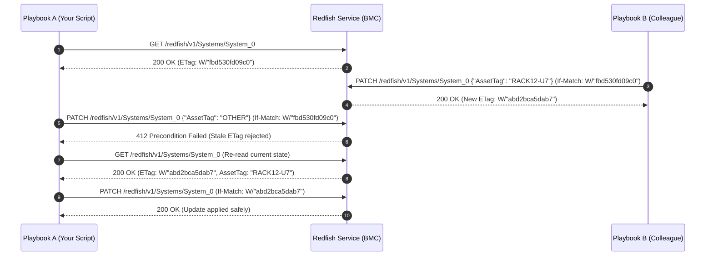
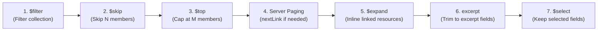

# 7.3 The Redfish protocol: HTTP methods, headers, status codes and query parameters

| | |
|---|---|
| Level | Beginner to Intermediate |
| Priority tier | 1 |
| Lab venue | Laptop (`code/part07/protocol_lab.py` and `redfish_mock.py`) |
| Part | Part 7: Redfish and BMC |
| Status | Drafted (`code/part07/protocol_lab.py`: 36/36 checks pass against `redfish_mock.py`; **untested** / **not verified** against a live physical BMC in this session) |

## Why this matters for AI infrastructure

An automation script that powers down GPU nodes, modifies BIOS attributes, or rotates BMC certificates across a 1,024-GPU cluster is only as safe as its understanding of the **Redfish wire protocol**. While Redfish runs over standard HTTP/1.1 and HTTP/2, the DMTF Redfish Specification (**DSP0266 v1.21.0**, Sections 6, 7, and 8) defines exact behavioral contracts that distinguish a completed change (`200 OK`) from an asynchronous background job (`202 Accepted`), a partial property update (`200 OK` carrying `@Message.ExtendedInfo` warnings) from a total rejection (`400 Bad Request`), and a stale concurrent edit (`412 Precondition Failed`) from a missing authentication token (`401 Unauthorized`).

A naive script that checks only `if response.status_code < 300:` will silently ignore read-only BIOS properties that failed to apply during a partial `PATCH`, will proceed to reboot a server while a firmware flash task (`202 Accepted`) is only 5% complete, and will overwrite a colleague's concurrent BMC edits. Mastering the protocol rules in this chapter—and testing them against the 36 automated checks in `code/part07/protocol_lab.py`—gives you the foundation to write production-grade fleet automation.

## Prerequisites and outcomes

You need Chapters 7.1 and 7.2. After completing this chapter, you will be able to:

- Select the exact HTTP method (`GET`, `HEAD`, `POST`, `PATCH`, `PUT`, `DELETE`, `OPTIONS`) for reading, modifying properties, patching arrays, creating resources, and invoking actions (DSP0266 §6.2, §7.2–7.12).
- Construct compliant request headers (`Accept`, `Content-Type`, `X-Auth-Token`, `If-Match`, `If-None-Match`, `OData-Version`) and parse response headers (`ETag`, `Location`, `Allow`, `Retry-After`, `WWW-Authenticate`, `Link`).
- Prevent lost updates across concurrent administrators or scripts using `ETag` and `If-Match` (`412 Precondition Failed` and `428 Precondition Required`, DSP0266 §6.5).
- Handle every Redfish HTTP status code (`200`–`507`), parse `@Message.ExtendedInfo` error arrays, and detect partial-success `PATCH` responses (DSP0266 §7.6, §8.3, §8.6).
- Use OData query parameters (`$select`, `$expand`, `$filter`, `$top`, `$skip`, `only`, `excerpt`) in their specification-mandated evaluation order to cut fleet polling traffic by an order of magnitude (DSP0266 §7.3).
- Run `code/part07/protocol_lab.py` (`36 passed, 0 failed`) to verify every protocol edge case locally.

---

## 1. HTTP methods and data modification semantics

Redfish maps all management operations onto seven standard HTTP methods (DSP0266 §6.2 Table 3 and §7.2–7.11). A service is **required** to implement `GET`, `HEAD`, `POST`, `PATCH`, and `DELETE`, while `PUT` and `OPTIONS` are optional:

| HTTP Method | Redfish Semantic (DSP0266 §6.2) | Idempotent? | Safe (No Side Effects)? | Required for Services? |
|---|---|---|---|---|
| **`GET`** | Retrieve a single resource or resource collection representation | **Yes** | **Yes** | **Yes** |
| **`HEAD`** | Retrieve response headers only (no body) to verify hyperlink validity or `ETag` | **Yes** | **Yes** | **Yes** |
| **`POST`** | 1. Create a new member in a collection (`Session`, `Account`, `Subscription`); 2. Invoke a resource **Action** (`#ComputerSystem.Reset`) | **No** | **No** | **Yes** |
| **`PATCH`** | Partially update one or more writable properties on an existing resource | **Should be** | **No** | **Yes** |
| **`PUT`** | Completely replace an existing resource representation | **Should be** | **No** | No (Optional) |
| **`DELETE`** | Remove a resource (e.g., log out a session, delete an account or subscription) | **Should be** | **No** | **Yes** |
| **`OPTIONS`** | Retrieve allowed headers/methods and handle CORS pre-flight checks | **Yes** | **Yes** | No (Optional) |

Three protocol rules govern how methods behave on a compliant BMC:

1. **Unsupported methods return `405 Method Not Allowed` with an `Allow` header:** If a client sends `PATCH` to a read-only resource (such as `/redfish/v1/Chassis/Chassis_0` when no properties on that chassis are writable) or sends `PUT` to a service that does not implement `PUT`, the BMC shall return HTTP **`405 Method Not Allowed`** (or `501 Not Implemented` for unknown verbs) and include an **`Allow`** response header listing the permitted methods (for example, `Allow: GET, HEAD`).
2. **`HEAD` requests forbid query parameters (DSP0266 §7.4):** The `HEAD` method exists solely to check whether a URI is reachable and inspect its headers (`ETag`, `Link`, `Allow`) without transferring the JSON body. Under DSP0266 §7.4, services **shall reject `HEAD` requests that contain query parameters** (such as `HEAD /redfish/v1/Systems/System_0?$select=Name`) and should return **`400 Bad Request`**.
3. **HTTP redirects (DSP0266 §6.3):** A BMC may return `301 Moved Permanently`, `302 Found`, `307 Temporary Redirect`, or `308 Permanent Redirect` with a `Location` header (for example, when redirecting a URI without a trailing slash or aliasing a subtree). All Redfish clients **shall** handle HTTP redirects properly.

### 1.1 `PATCH` (properties) versus `POST` (actions and creation)

The most common conceptual error when learning Redfish is confusing `PATCH` and `POST`:
- **Use `PATCH` to edit state properties:** To change a server's `AssetTag`, `HostName`, one-time `Boot` override (`BootSourceOverrideTarget`), or staged BIOS attributes (`/Bios/Settings`), send a `PATCH` request containing only the JSON properties you want to change. Any property omitted from your `PATCH` body remains untouched.
- **Use `POST` to create collection members or trigger Actions:**
  - When creating a new member in a collection (such as `/redfish/v1/EventService/Subscriptions`), DSP0266 §7.9 states that you may `POST` either to the collection URI (`/Subscriptions`) or to its `Members` property URI (`/Subscriptions/Members`); services supporting member creation shall accept both.
  - When triggering an operation that **does** something rather than setting a property—such as resetting a server, flashing firmware, or clearing an event log—you **never** `PATCH` `"PowerState": "Off"`. Instead, you `POST` a JSON parameter object to the action's `target` URI inside the resource's `Actions` block (`POST /redfish/v1/Systems/System_0/Actions/ComputerSystem.Reset` with `{"ResetType": "GracefulRestart"}`). Because `POST` is **not idempotent**, sending a reset `POST` twice may reboot the server twice.

### 1.2 `PATCH` on array properties and `@Redfish.OperationApplyTime` (DSP0266 §7.7 & §7.12)

What if a writable property on a resource is a JSON **array** (for example, a list of NTP servers `NTPServers` or boot order targets `BootOrder`) and you want to update or delete specific array elements via `PATCH`? DSP0266 §7.7 defines positional array-patching semantics:
- **Empty object `{}` in an array position:** Leaves the existing element at that index **unchanged**.
- **`null` in an array position:** **Removes (deletes)** the element at that index, shifting subsequent elements left.
- **A new value in an array position:** Replaces the element at that index (or appends to the array if beyond the current length).
  For example, if an array currently holds `["10.0.0.1", "10.0.0.2", "10.0.0.3"]`, sending `PATCH {"NTPServers": [{}, null, "10.0.0.9"]}` keeps `"10.0.0.1"`, removes `"10.0.0.2"`, and replaces `"10.0.0.3"` with `"10.0.0.9"`, resulting in `["10.0.0.1", "10.0.0.9"]`.

Furthermore, when invoking a `PATCH`, `POST`, or `DELETE` operation that requires a reboot or maintenance window, DSP0266 §7.12 allows clients to include **`"@Redfish.OperationApplyTime"`** in the request body (when advertised by `@Redfish.OperationApplyTimeSupport`), with standard values:
- `"Immediate"`: Apply right now.
- `"OnReset"`: Stage the operation and apply it the next time the system resets.
- `"AtMaintenanceWindowStart"`: Apply automatically when the configured `@Redfish.MaintenanceWindow` begins.
- `"InMaintenanceWindowOnReset"`: Apply when a reset occurs inside the configured maintenance window.

---

## 2. Request and response headers

DSP0266 Sections 7.1 and 8.1 specify the HTTP headers that govern content negotiation, authentication, caching, concurrency, and schema discovery.

### 2.1 Essential request headers (sent by your client)

| Request Header | Example Value | Client & Service Requirement (DSP0266 §7.1) |
|---|---|---|
| `Accept` | `application/json` | Requests JSON representation. If omitted, the service **shall** still return `application/json` (§7.2.1). If the client asks for a format the BMC cannot produce, the BMC returns `406 Not Acceptable`. |
| `Content-Type` | `application/json;charset=utf-8` | Declares request body format on `POST`, `PATCH`, and `PUT` (or `multipart/form-data` on firmware pushes). Unsupported types return `415 Unsupported Media Type`. |
| `X-Auth-Token` | `3f8a91c2...` | Presents an active session token obtained from `POST /redfish/v1/SessionService/Sessions`. |
| `Authorization` | `Basic YWRtaW46...` | Presents HTTP Basic credentials (base64 `user:password`) or `Bearer` OAuth 2.0 token over HTTPS. |
| `If-Match` | `W/"fbd530fd09c0"` or `"*"` | Conditional header for `PATCH`/`PUT`/`DELETE`: execute the modification **only** if the resource's current `ETag` matches. |
| `If-None-Match` | `W/"fbd530fd09c0"` | Conditional header for `GET`: return `200 OK` only if the `ETag` has changed; otherwise return `304 Not Modified` with an empty body. |
| `OData-Version` / `OData-MaxVersion` | `4.0` | Declares OData v4.0 conformance. |

### 2.2 Essential response headers (returned by the BMC)

| Response Header | Example Value | Meaning & Client Action (DSP0266 §8.1–8.2) |
|---|---|---|
| `ETag` | `W/"fbd530fd09c0"` | Opaque version identifier for the returned resource representation (mirrors `@odata.etag` in the body). |
| `Location` | `/redfish/v1/TaskService/Tasks/Task_1` | On `201 Created`, points to the newly created resource. On `202 Accepted`, points to the **Task Monitor URI** to poll. |
| `X-Auth-Token` | `3f8a91c2...` | Returned on `201 Created` from `/redfish/v1/SessionService/Sessions`; must be unpredictable/indistinguishable from random. |
| `WWW-Authenticate` | `Basic realm="Redfish"` | Returned on `401 Unauthorized` when `HTTPBasicAuth` is enabled in `AccountService`. |
| `Allow` | `GET, HEAD, PATCH` | Returned on `405 Method Not Allowed` (and `OPTIONS`), listing the valid HTTP verbs for that URI. |
| `Retry-After` | `5` (seconds) or HTTP-date | Returned on `202 Accepted` (task polling interval) or `503 Service Unavailable` (back-off interval). |
| `OData-Version` | `4.0` | Required on all Redfish responses (`OData-Version: 4.0`). |
| `Link` | `</redfish/v1/JsonSchemas/ComputerSystem.v1_17_0.json>; rel=describedby` | Points directly to the schema file that describes the returned resource (§8.2). |

---

## 3. Optimistic concurrency control with `ETag` and `If-Match`

Imagine two automation playbooks running at the same time against `gpu014`: Playbook A reads `/redfish/v1/Systems/DGX` to update `AssetTag`, while Playbook B updates `HostName` or boot properties on the same resource. Without concurrency control, whichever `PATCH` lands second can overwrite or conflict with the first.

DSP0266 §6.5 solves the "lost update" problem using HTTP **Entity Tags (`ETag`)**:
- Whenever you `GET` a resource, the BMC returns an `ETag` header (and `@odata.etag` property), such as `"fbd530fd09c0"` (strong ETag) or `W/"fbd530fd09c0"` (weak ETag). The generation algorithm (hash, counter, or timestamp) is internal to the BMC; clients **shall treat the ETag string as completely opaque**.
- When you send a `PATCH` or `PUT`, DSP0266 §6.5 states that clients **should** ("highly recommended") include `If-Match: <etag>` with the exact `ETag` string read from the prior `GET`.



Memorize the four status codes and edge cases associated with ETags (DSP0266 §6.5, §7.2.1, §8.3):
1. **`412 Precondition Failed`:** Your `If-Match` header did not match the resource's current `ETag` because someone else modified the resource after your `GET`. Re-fetch the resource via `GET`, inspect the new state, and retry with the new `ETag`.
2. **`428 Precondition Required`:** Some resources (often `AccountService/Accounts/<id>` or `Bios/Settings` on strict BMCs) **require** `If-Match` on every `PATCH`. If you omit `If-Match`, the BMC returns `428 Precondition Required`.
3. **`304 Not Modified` on conditional `GET`:** If you poll a resource repeatedly and pass `If-None-Match: <last_etag>`, the BMC returns `304 Not Modified` with no body whenever nothing has changed, saving network bandwidth and JSON parsing CPU across large fleets.
4. **Why rapidly ticking properties (`DateTime`) require care (§6.5):** As DSP0266 §6.5 notes, if a `Manager` resource includes a `DateTime` clock property that increments every second and the BMC naively hashes the entire payload to compute its `ETag`, the `ETag` will change every second—causing almost every `If-Match` `PATCH` on `Manager` to fail with `412`. The specification therefore advises BMC implementers to exclude or round rapidly ticking properties when computing ETags.

---

## 4. Complete guide to Redfish HTTP status codes and error bodies

When a request succeeds or fails, the HTTP status code gives the high-level outcome, while the JSON response body gives the exact machine-readable reason. Table 4 summarizes every status code defined in DSP0266 §8.3 (Table 15) plus the specialized codes in §6.5 and §7.3:

| Status Code | HTTP Name | Redfish Meaning & Client Action (DSP0266 §8.3) |
|---|---|---|
| **`200`** | `OK` | Synchronous success; the response body contains the requested or updated resource JSON. **Always check for `@Message.ExtendedInfo` in case of partial `PATCH` success.** |
| **`201`** | `Created` | A new resource was created (`POST` to `Sessions`, `Accounts`, `Subscriptions`). Read the `Location` header for its URI. |
| **`202`** | `Accepted` | **Asynchronous operation started but NOT yet finished** (e.g., `SimpleUpdate` firmware flash). Read the `Location` header for the Task Monitor URI and `Retry-After` for the polling interval (Chapter 7.5). |
| **`204`** | `No Content` | Operation succeeded and intentionally returned no body (e.g., `DELETE` on a session or subscription, or an Action with no return payload). |
| **`301` / `302` / `307` / `308`** | `Moved` / `Redirect` | Follow the `Location` header to the target URI (§6.3). |
| **`304`** | `Not Modified` | Resource has not changed since the `ETag` supplied in `If-None-Match` (§7.2.1). |
| **`400`** | `Bad Request` | Malformed JSON, invalid query value (`$top=abc`), collection-only query on a single resource, empty `PATCH {}` (`NoOperation`), or **all** properties in a `PATCH` were read-only/unknown (§7.6). |
| **`401`** | `Unauthorized` | Authentication is missing, expired, or invalid (wrong password or expired `X-Auth-Token`). Authenticate or renew session. |
| **`403`** | `Forbidden` | **Authenticated**, but your account's role (`ReadOnly` or `Operator`) lacks the privilege required for this operation (`InsufficientPrivilege`). Re-authenticating with the same user will not help. |
| **`404`** | `Not Found` | The requested URI does not exist on this BMC. |
| **`405`** | `Method Not Allowed` | The URI exists, but does not support this HTTP verb (e.g., `PATCH` on a non-updatable resource or `GET` on an Action target). Inspect the `Allow` header. |
| **`406`** | `Not Acceptable` | The BMC cannot produce a representation matching your `Accept` header. |
| **`409`** | `Conflict` | Request conflicts with the current state of the resource (e.g., creating a duplicate account `UserName` or resetting a system that is already off when requesting `GracefulShutdown`). |
| **`410`** | `Gone` | Resource existed previously (such as a completed and purged Task) and was intentionally removed. |
| **`411`** | `Length Required` | Request lacked a required `Content-Length` header. |
| **`412`** | `Precondition Failed` | The `ETag` in your `If-Match` header does not match the current resource version (§6.5). Re-`GET` and retry. |
| **`413`** | `Payload Too Large` | Request body (or multipart upload part) exceeds the BMC's maximum size limit. |
| **`415`** | `Unsupported Media Type` | `Content-Type` header is missing or not supported by the endpoint. |
| **`428`** | `Precondition Required` | Endpoint requires an `If-Match` header on modification requests and you omitted it (§6.5). |
| **`431`** | `Request Header Fields Too Large` | Request headers exceed the BMC's buffer limit. |
| **`500`** | `Internal Server Error` | Unexpected fault inside the BMC firmware; inspect `@Message.ExtendedInfo` in the error body. |
| **`501`** | `Not Implemented` | The BMC does not implement a standard `$` query parameter (such as `?$filter=...`) or HTTP method (§7.3.1). |
| **`503`** | `Service Unavailable` | BMC is temporarily overloaded, rebooting after `mc reset cold`, or out of session slots. Honor `Retry-After` and back off. |
| **`507`** | `Insufficient Storage` | The response payload generated by a deep `?$expand` query exceeds the BMC's memory buffer (§7.3.2). Retry without `$expand` or with smaller `$levels`. |

### 4.1 Parsing extended error bodies (`@Message.ExtendedInfo`, DSP0266 §8.6)

Whenever a BMC returns a `4xx` or `5xx` status code, DSP0266 §8.6 requires it to return a structured JSON **`error`** object. Clients must inspect `error["@Message.ExtendedInfo"]` first (falling back to top-level `error.code` and `error.message` only if `@Message.ExtendedInfo` is absent):

```json
{
  "error": {
    "code": "Base.1.17.GeneralError",
    "message": "A general error has occurred. See ExtendedInfo for more information.",
    "@Message.ExtendedInfo": [
      {
        "MessageId": "Base.1.17.PropertyNotWritable",
        "Message": "The property SerialNumber is a read only property and cannot be assigned a value.",
        "MessageArgs": ["SerialNumber"],
        "Severity": "Warning",
        "MessageSeverity": "Warning",
        "RelatedProperties": ["#/SerialNumber"],
        "Resolution": "Remove the property from the request body and resubmit the request if the operation failed."
      }
    ]
  }
}
```

Every entry in `@Message.ExtendedInfo` carries:
- **`MessageId`:** A deterministic `<RegistryPrefix>.<Major>.<Minor>.<MessageKey>` identifier (from the DMTF `Base` registry or a vendor registry, Chapter 7.6) that your code can match programmatically (`msg["MessageId"].endswith(".PropertyNotWritable")`).
- **`Message` and `MessageArgs`:** The human-readable explanation and the substituted arguments.
- **`RelatedProperties`:** JSON Pointer strings (`"#/SerialNumber"`) pinpointing which request property triggered the error.
- **`Resolution`:** Actionable remediation advice from the message registry.

### 4.2 The `PATCH` partial-success rule (DSP0266 §7.6)

One of the most important rules in DSP0266 §7.6 governs what happens when a client sends a `PATCH` containing **multiple** properties—say, `{"AssetTag": "A2", "SerialNumber": "X", "Bogus": 1}`—where `"AssetTag"` is writable, `"SerialNumber"` is read-only, and `"Bogus"` is an unknown property:

1. **If at least ONE property in the `PATCH` succeeds:** The BMC applies the valid property change (`"AssetTag": "A2"`), returns HTTP **`200 OK`** with the updated resource representation, and attaches an **`@Message.ExtendedInfo`** array inside the `200 OK` body listing `PropertyNotWritable` for `SerialNumber` and `PropertyUnknown` for `Bogus`.
2. **If ALL properties in the `PATCH` are read-only, unknown, or invalid (or the body is `{}`):** Nothing was updated, so the BMC returns HTTP **`400 Bad Request`** with an `error` body (`PropertyNotWritable` / `NoOperation`).

**Operational rule:** In your Python and Ansible scripts, never assume `status == 200` on a `PATCH` means every property in your payload was accepted. Always check `if "@Message.ExtendedInfo" in resp_json:` on a `200 OK` response.

---

## 5. OData query parameters: fetching less, more, or filtered data

Query parameters are appended to a `GET` URI after `?` and joined with `&` (DSP0266 §7.3). When a client supplies multiple query parameters in a single `GET` request, DSP0266 §7.3.1 mandates that the BMC evaluate them in a **strict 7-step pipeline order**:



Why does this evaluation order matter? Suppose a sensor collection has `10` sensors (`6` temperatures and `4` fans) and you request:
`GET /redfish/v1/Chassis/1/Sensors?$filter=ReadingType eq 'Temperature'&$skip=2&$top=3&$expand=.($levels=1)&$select=Members/Reading`
Because `$filter` runs **first** (keeping the `6` temperature sensors and setting `Members@odata.count` to `6`), `$skip=2` skips the first `2` temperature sensors, `$top=3` takes the next `3` temperature sensors (leaving `1` on the next page via `Members@odata.nextLink`), `$expand` inlines only those `3` sensor objects, and `$select` trims each inlined object down to `Reading` (plus mandatory `@odata.id` and `@odata.type`).

### 5.1 Query parameter reference (DSP0266 §7.3.1–7.3.8)

| Query Parameter | Target Scope | Service Support | Specification Behavior & Syntax |
|---|---|---|---|
| **`$top=N`** | Collections only | **Should** support | Returns at most `N` members in `Members`. Does **not** alter `Members@odata.count`. If `N` is less than the remaining count, `Members@odata.nextLink` is included (§7.2.2). |
| **`$skip=N`** | Collections only | **Should** support | Skips the first `N` members of the collection before populating `Members`. |
| **`only`** | Collections only | **Should** support | If the collection contains **exactly `1` member**, returns that single member resource directly instead of the collection wrapper. If the collection has `0` or `>= 2` members, returns the collection normally. **Shall not** be combined with any other query parameter (`400 Bad Request`). |
| **`$select=P1,P2/Sub`** | Any resource | **May** support | Returns only the requested properties (nested properties use `/`, e.g., `Status/State`), **plus** mandatory `@odata.id`, `@odata.type`, `@odata.context`, and `@odata.etag` (§7.3.3). |
| **`$expand=<type>($levels=N)`** | Any resource | **May** support | Inlines linked `@odata.id` resources directly into the response so `1` HTTP `GET` replaces dozens: `.` expands subordinate links outside `Links`, `~` expands only references inside `Links`, and `*` expands both subordinate and `Links` references. |
| **`$filter=<expr>`** | Collections only | **May** support | Filters collection members using comparison operators (`eq`, `ne`, `gt`, `ge`, `lt`, `le`), logical operators (`and`, `or`, `not`), and parentheses `()`, evaluated in precedence order `()` $\rightarrow$ `not` $\rightarrow$ relational $\rightarrow$ `and` $\rightarrow$ `or` (§7.3.4). Updates `Members@odata.count` to the filtered count. |
| **`excerpt`** | Any resource | **May** support | Returns only properties marked as `excerpt` in the schema definition. |

### 5.2 Error handling rules for query parameters (DSP0266 §7.3.1)

When writing a client that uses query parameters across different BMC models, check `ProtocolFeaturesSupported` in `/redfish/v1/` first and handle these four error codes:
1. **Unsupported `$` parameter $\rightarrow$ `501 Not Implemented`:** If a client sends `$filter`, `$expand`, or `$select` to a BMC that does not implement that parameter, the BMC **shall** return **`501 Not Implemented`**.
2. **Unrecognized non-`$` parameter $\rightarrow$ Ignored:** Query parameters that do **not** start with `$` (and are not `only` or `excerpt`, e.g., `?cachebust=123`) are silently ignored by the BMC.
3. **Malformed value or wrong target $\rightarrow$ `400 Bad Request`:** Sending `$top=abc` (non-integer), sending `$top=1` or `$skip=1` to a single non-collection resource (`/redfish/v1/Systems/System_0?$top=1`), or combining `only` with another parameter (`?only&$top=1`) returns **`400 Bad Request`**.
4. **Expanded payload exceeds BMC buffer $\rightarrow$ `507 Insufficient Storage`:** If `?$expand=*($levels=3)` produces a JSON tree larger than the BMC's response memory buffer, the BMC returns **`507 Insufficient Storage`**.

---

## 6. Lab: Running the 36-check protocol compliance suite (`code/part07/protocol_lab.py`)

To see every rule from Sections 1 through 5 tested against a live HTTP service, run `code/part07/protocol_lab.py`. It starts an in-memory instance of `redfish_mock.py` (`dgx` profile) on an ephemeral port and executes **36 self-checking protocol assertions**, each annotated with the exact DSP0266 clause number it verifies:

```bash
$ python3 code/part07/protocol_lab.py
PASS  GET /redfish needs no login and returns the v1 pointer [6.6]
PASS  service root readable without login [7.2.3]
PASS  root advertises ProtocolFeaturesSupported [7.3.1]
PASS  collection without login gives 401 [13.3.2]
PASS  error body has @Message.ExtendedInfo [8.6]
PASS  wrong password gives 401, not 403 [8.3]
PASS  GET resource returns 200 + ETag header [6.5]
PASS  response has OData-Version 4.0 [8.1]
PASS  conditional GET with current ETag gives 304 [7.2.1]
PASS  $select keeps @odata.id/@odata.type and asked properties [7.3.3]
PASS  $top=2 returns 2 members, count stays 4, nextLink present [7.2.2]
PASS  last page has one member and no nextLink
PASS  only returns the single member itself [7.3.1]
PASS  only on a 2-member collection returns the collection
PASS  unsupported $filter gives 501 [7.3.1]
PASS  invalid $top value gives 400 [7.3.1]
PASS  collection-only option on single resource gives 400 [7.3.1]
PASS  only combined with another option gives 400 [7.3.1]
PASS  $expand with $levels=1 inlines members [7.3.2]
PASS  HEAD returns headers and no body [7.4]
PASS  HEAD with a query parameter is rejected with 400 [7.4]
PASS  missing resource gives 404 [8.3]
PASS  PATCH with correct If-Match gives 200 and the new resource [7.6]
PASS  ETag changed after the update [6.5]
PASS  PATCH with the OLD ETag gives 412 [8.3]
PASS  partial success: 200 plus ExtendedInfo for the rejected properties [7.6]
PASS  all properties read-only gives 400 with details [7.6]
PASS  empty PATCH gives 400 NoOperation
PASS  read-only role gets 403, not 401 [8.3]
PASS  PATCH on a resource that does not allow it gives 405 + Allow header [8.3]
PASS  unsupported method gives 405 [6.2]
PASS  service that insists on If-Match answers 428 when it is missing [6.5]
PASS  session create gives 201 + X-Auth-Token + Location [8.1]
PASS  token works without Basic auth
PASS  DELETE the session gives 204
PASS  deleted token no longer works

36 passed, 0 failed
```

### 6.1 Three real protocol bugs caught while building the lab

Writing `protocol_lab.py` against `redfish_mock.py` immediately caught three subtle bugs in our own initial implementation—the exact kinds of edge cases that bite custom BMC agents and client libraries in production:
1. **Error handler fall-through on `$top=abc`:** When `$top` contained a non-integer, our initial query helper sent a `400 Bad Request` response and returned `None`, which the caller mistook for "no query error" and proceeded to write a second `200 OK` HTTP response on the same socket.
2. **Dropping parameterless `?only`:** Python's `urllib.parse.parse_qsl(query)` drops query keys that have no `=` sign (such as `?only` or `?excerpt`) unless you pass `keep_blank_values=True`.
3. **Nested `$select=Status/State` projection:** A naive `$select` filter that checks only top-level dictionary keys drops `"Status"` entirely when the caller requests `"Status/State"`. Compliant `$select` handling splits on `/` and projects the requested sub-key inside the nested object while preserving `@odata.id`, `@odata.type`, and `@odata.etag`.

---

## 7. Production checklist for safe fleet-wide `PATCH` operations

Whenever you write a tool (such as `code/part07/rf_bios.py` or `rf_harden.py`) that modifies BMC or host settings across dozens or hundreds of servers, follow this eight-step protocol sequence:

1. **Authenticate with a session (`POST /redfish/v1/SessionService/Sessions`):** Capture `X-Auth-Token` and `Location`, and register a `try ... finally` block to `DELETE` the session URI (`204 No Content`) when finished.
2. **`GET` the target resource and save its `ETag`:** Read both the current property values and the `ETag` response header (or `@odata.etag`).
3. **Check idempotency before writing:** Compare the current values against your desired state. If they already match, skip the `PATCH` and report `unchanged`.
4. **Send `PATCH` with `If-Match: <etag>`:** Include only the properties you intend to modify. If the service returns `412 Precondition Failed`, re-`GET` the resource and abort or retry according to your conflict policy; if it returns `428 Precondition Required`, ensure `If-Match` is populated.
5. **Inspect `@Message.ExtendedInfo` even on `200 OK`:** Check whether any property in your `PATCH` was rejected as `PropertyNotWritable`, `PropertyUnknown`, or `PropertyValueNotInList` inside a partial-success `200 OK` response.
6. **Handle `202 Accepted` asynchronous tasks:** If the modification returns `202 Accepted`, poll the `Location` Task Monitor URI (honoring `Retry-After`) until `TaskState` reaches `Completed` with `TaskStatus: "OK"` (Chapter 7.5).
7. **Re-`GET` to verify active vs pending state:** Confirm either that the active resource updated immediately or that `@Redfish.Settings` / `/Bios/Settings` staged the change for the next system reset.
8. **Log an auditable record:** Record the node name, BMC IP, resource URI, old value, new value, HTTP status, and new `ETag`.

---

## Exercises

1. **Tracing all 36 protocol assertions (`code/part07/protocol_lab.py`):** Run `python3 code/part07/protocol_lab.py` and inspect `code/part07/protocol_lab.py` lines 50–135. Group the 36 checks into five categories: Unauthenticated discovery, Conditional `GET` & `ETag` concurrency, Query parameters, Partial vs failed `PATCH`, and Session lifecycle.
2. **Reproducing a `412 Precondition Failed` collision with `curl`:** Start `python3 code/part07/redfish_mock.py --profile dgx --port 18441`. Run `curl -i -u admin:adminpass http://127.0.0.1:18441/redfish/v1/Systems/System_0` to record the initial `ETag`. Then run two `curl -i -X PATCH` commands using that **same** initial `If-Match` header: verify that the first returns `200 OK` with a new `ETag` and the second returns `412 Precondition Failed`.
3. **Testing `PATCH` partial success vs total failure:** Against `/redfish/v1/Systems/System_0`, send (a) `PATCH {"AssetTag": "NODE-01", "SerialNumber": "FAKE"}` and (b) `PATCH {"SerialNumber": "FAKE"}`. Explain why (a) returns `200 OK` while (b) returns `400 Bad Request`, and inspect the `@Message.ExtendedInfo` array in both responses.
4. **Reducing sensor polling from 5 HTTP requests to 1 with `$expand` and `$select`:** Against `/redfish/v1/Chassis/Chassis_0/Sensors` on the mock server, construct a single `GET` URL using `$expand=.($levels=1)` and `$select=Members` that fetches all `4` sensor readings inline in one HTTP request. How many HTTP round-trips does this save across a 256-node cluster polled every 30 seconds?
5. **Evaluating query pipeline order (`$filter` $\rightarrow$ `$skip` $\rightarrow$ `$top` $\rightarrow$ `$expand` $\rightarrow$ `$select`):** Suppose a collection has `20` Drives (`8` `SSD` drives with `Status.Health == "OK"`, `2` `SSD` drives with `Status.Health == "Warning"`, and `10` `HDD` drives). Trace each stage of the 7-step query pipeline for `GET /Drives?$filter=MediaType eq 'SSD'&$skip=3&$top=4&$select=Id,Status/Health`: what is `Members@odata.count`, how many items are in `Members`, and is `Members@odata.nextLink` present?
6. **Adding a 37th check to `protocol_lab.py`:** Inspect how `protocol_lab.py` line 116 tests `PUT` returning `405 Method Not Allowed`. Verify whether the `405` response also includes the `Allow` header (`"Allow" in h`) and test what status code is returned when sending `GET` with an unknown non-`$` query parameter (`?foo=bar`, which DSP0266 §7.3.1 says must be ignored and return `200 OK`).

---

## Checkpoint questions (20)

<details>
<summary>1. Which HTTP method is used to invoke a Redfish Action (such as resetting a server), and why is PATCH never used for Actions?</summary>

**`POST`** is used to invoke an Action by posting to the action's `target` URI (`<ResourceUri>/Actions/<QualifiedActionName>`). `PATCH` is reserved for modifying resource data properties; an Action is a procedural operation that may have side effects beyond changing a single property and is **not idempotent**.
</details>

<details>
<summary>2. Which HTTP method modifies a subset of writable properties on an existing Redfish resource while leaving unmentioned properties unchanged?</summary>

**`PATCH`** (DSP0266 §7.6). Only the properties included in the `PATCH` JSON request body are modified.
</details>

<details>
<summary>3. What HTTP status code and response header must a Redfish service return when a client sends an HTTP method that the target URI does not support?</summary>

HTTP **`405 Method Not Allowed`** (or `501 Not Implemented` for unrecognized verbs), accompanied by an **`Allow`** response header listing the HTTP methods supported by that URI (for example, `Allow: GET, HEAD`).
</details>

<details>
<summary>4. How does the HEAD method behave in Redfish, and what happens if you include query parameters on a HEAD request (DSP0266 §7.4)?</summary>

`HEAD` is an idempotent check that returns the exact response headers of a `GET` request with **no response body**, allowing clients to verify hyperlink validity or check `ETag` values cheaply. Under DSP0266 §7.4, services **shall reject `HEAD` requests containing query parameters** and should return **`400 Bad Request`**.
</details>

<details>
<summary>5. What is an ETag in Redfish, and why must clients treat its value as opaque (DSP0266 §6.5)?</summary>

An `ETag` (Entity Tag) is a version identifier attached to a resource representation in the `ETag` header and `@odata.etag` property that changes whenever the resource changes. Because each BMC vendor chooses its own internal algorithm (hash, counter, or timestamp) and strong (`"..."`) or weak (`W/"..."`) prefix, clients must treat it as an opaque string and echo it back unchanged.
</details>

<details>
<summary>6. How do If-Match and If-None-Match use ETags on PATCH versus GET requests?</summary>

- **`If-Match` on `PATCH`/`PUT`/`DELETE`:** Instructs the BMC to apply the modification **only if** the resource's current `ETag` still matches the value read earlier (preventing lost updates).
- **`If-None-Match` on `GET`:** Instructs the BMC to return the full resource (`200 OK`) **only if** its `ETag` differs from the client's cached `ETag`; if unchanged, the BMC returns **`304 Not Modified`** with no body.
</details>

<details>
<summary>7. What is the difference between HTTP 412 Precondition Failed and HTTP 428 Precondition Required?</summary>

- **`412 Precondition Failed`:** You supplied an `If-Match` header, but its `ETag` value no longer matches the resource on the BMC (another client modified the resource since your last `GET`).
- **`428 Precondition Required`:** The BMC requires an `If-Match` header on modification requests to that resource, and your request omitted `If-Match` entirely.
</details>

<details>
<summary>8. What is the exact difference between HTTP 401 Unauthorized and HTTP 403 Forbidden in Redfish?</summary>

- **`401 Unauthorized`:** The BMC does **not know who you are** (credentials or `X-Auth-Token` are missing, wrong, or expired).
- **`403 Forbidden`:** The BMC **authenticated you successfully**, but your account's assigned role (such as `ReadOnly` or `Operator`) lacks the privilege required to perform the requested operation.
</details>

<details>
<summary>9. What is the difference between HTTP 200 OK, 201 Created, 202 Accepted, and 204 No Content after a write or action request?</summary>

- **`200 OK`:** Operation completed synchronously; the response body holds the resulting resource or action response.
- **`201 Created`:** A new resource was synchronously created; its URI is in the `Location` header.
- **`202 Accepted`:** Operation was accepted for **asynchronous background execution** and is **not finished yet**; poll the Task Monitor URI in the `Location` header.
- **`204 No Content`:** Operation completed synchronously and intentionally returned an empty body.
</details>

<details>
<summary>10. Where should a client look first inside a 4xx or 5xx Redfish JSON error response (DSP0266 §8.6)?</summary>

Look first in **`error["@Message.ExtendedInfo"]`**, which contains an array of structured message objects (`MessageId`, `Message`, `RelatedProperties`, `Resolution`). Fall back to top-level `error["code"]` and `error["message"]` only if `@Message.ExtendedInfo` is absent.
</details>

<details>
<summary>11. What HTTP status code and payload does a BMC return when you PATCH three properties on a resource, one succeeds, and two are read-only (DSP0266 §7.6)?</summary>

It returns HTTP **`200 OK`** with the updated resource JSON reflecting the one successful property change, **plus an `@Message.ExtendedInfo` array** inside the `200 OK` body detailing why the other two properties were rejected (`PropertyNotWritable`).
</details>

<details>
<summary>12. Under what two conditions does a PATCH request on an updatable resource return HTTP 400 Bad Request instead of 200 OK?</summary>

1. When **all** properties in the `PATCH` request are read-only, unknown, invalid, or only `@odata.*` annotations.
2. When the `PATCH` body is an empty JSON object `{}` (returning `Base.x.y.NoOperation`).
</details>

<details>
<summary>13. How do you leave an element unchanged versus delete an element when sending a PATCH to an array property (DSP0266 §7.7)?</summary>

Place an empty object **`{}`** at an array index to leave the existing element at that position unchanged, and place **`null`** at an array index to delete that element from the array.
</details>

<details>
<summary>14. In what exact 7-step order does a Redfish service evaluate query parameters on a GET request (DSP0266 §7.3.1)?</summary>

**1. `$filter` $\rightarrow$ 2. `$skip` $\rightarrow$ 3. `$top` $\rightarrow$ 4. Server-side pagination (`nextLink`) $\rightarrow$ 5. `$expand` $\rightarrow$ 6. `excerpt` $\rightarrow$ 7. `$select`**.
</details>

<details>
<summary>15. How does the `only` query parameter work on a collection, and what happens if you combine `?only` with `$top=1`?</summary>

If the target collection contains **exactly `1` member**, `?only` returns that single member resource directly instead of the collection wrapper (if the collection has `0` or `>= 2` members, it returns the collection). Combining `only` with any other query parameter is forbidden by DSP0266 §7.3.1 and returns **`400 Bad Request`**.
</details>

<details>
<summary>16. What HTTP status code must a BMC return when a client sends a standard `$` query parameter (like `$filter`) that the BMC does not support, versus an unknown parameter that does not start with `$`?</summary>

An unsupported `$` query parameter **shall** return **`501 Not Implemented`**, whereas an unrecognized query parameter that does **not** start with `$` is silently **ignored** and the `GET` proceeds normally.
</details>

<details>
<summary>17. Where does a BMC advertise which OData query parameters (`$expand`, `$filter`, `$select`, `only`, `excerpt`) it supports?</summary>

Inside the **`ProtocolFeaturesSupported`** object of the Service Root resource at **`/redfish/v1/`**.
</details>

<details>
<summary>18. What do the three `$expand` specifiers `.`, `~`, and `*` mean, and what status code is returned if an expanded response is too large for the BMC's memory?</summary>

- **`.`**: Expands subordinate hyperlinks outside the `Links` property.
- **`~`**: Expands only hyperlinks inside the `Links` property.
- **`*`**: Expands all hyperlinks (both subordinate and `Links`).
If the resulting JSON payload exceeds the BMC's buffer capacity, the BMC returns **`507 Insufficient Storage`**.
</details>

<details>
<summary>19. Which properties are always preserved in a GET response even when they are not listed in `$select=...` (DSP0266 §7.3.3)?</summary>

**`@odata.id`** and **`@odata.type`** (plus `@odata.context` and `@odata.etag` if supported by the resource) are always included in the response regardless of what properties were requested in `$select`.
</details>

<details>
<summary>20. What are the four standard values of `@Redfish.OperationApplyTime` when staging a modification or action (DSP0266 §7.12)?</summary>

**`"Immediate"`**, **`"OnReset"`**, **`"AtMaintenanceWindowStart"`**, and **`"InMaintenanceWindowOnReset"`**.
</details>

---

## Sources and review notes

1. **DMTF Redfish Specification (DSP0266 v1.21.0):**
   - **Section 6 (Protocol details):** §6.2 Table 3 (HTTP methods `GET`, `HEAD`, `POST`, `PATCH`, `PUT`, `DELETE`, `OPTIONS` and `405` / `501` behavior), §6.3 (HTTP redirects), §6.4 (JSON media types), §6.5 (ETags, `If-Match`, `If-None-Match`, `412 Precondition Failed`, `428 Precondition Required`, `304 Not Modified`, and clock-property ETag churn), and §6.6 (`/redfish` protocol version endpoint).
   - **Section 7 (Service requests):** §7.1 Table 6 & 7 (request headers), §7.2 (`GET` requests, `304`, collection paging), §7.3 (`ProtocolFeaturesSupported`, 7-step query evaluation order, `$top`, `$skip`, `only`, `excerpt`, `$expand` `.`/`~`/`*` and `$levels`, `$select`, `$filter` operators and precedence, `501` vs `400` vs `507` error codes), §7.4 (`HEAD` requests and rejection of query parameters with `400`), §7.5–7.7 (`PATCH` partial updates, partial success returning `200 OK` + `@Message.ExtendedInfo` vs total failure returning `400`, and positional array patching with `{}` and `null`), §7.8 (`PUT`), §7.9 (`POST` create on collection or `/Members`), §7.10 (`DELETE`), §7.11 (`POST` actions), §7.12 (`@Redfish.OperationApplyTime`), and §7.13 (`DeepPATCH`/`DeepPOST`).
   - **Section 8 (Service responses):** §8.1 Table 13 (response headers `ETag`, `Location`, `X-Auth-Token`, `WWW-Authenticate`, `Allow`, `Retry-After`, `OData-Version`), §8.2 (`Link` header `rel=describedby`), §8.3 Table 15 (status codes `200`–`507`), and §8.6 (extended error responses and `@Message.ExtendedInfo`).
2. **Verification and Unverified Claims:** All 36 protocol assertions in `code/part07/protocol_lab.py` (`36 passed, 0 failed`) were executed locally against `code/part07/redfish_mock.py`. No live physical BMC was contacted during this session; real BMC implementations vary in which optional query parameters (`$expand`, `$filter`, `$select`) and preconditions (`428`) they enforce, so always inspect `ProtocolFeaturesSupported` on `/redfish/v1/` first.
