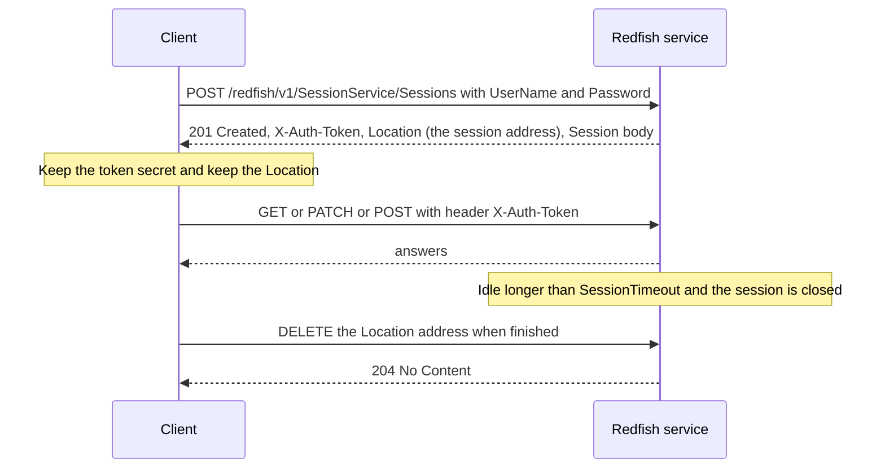

# 7.4 Redfish authentication, sessions and security

| | |
|---|---|
| Level | Beginner to Intermediate |
| Priority tier | 1 |
| Lab venue | Laptop |
| Part | Part 7: Redfish and BMC |
| Status | Drafted (`auth_lab.py`: 44 checks pass against mock; **untested** on live BMC) |

## Why this matters for AI infrastructure

A BMC can turn off a server, rewrite its firmware and change its settings. Whoever holds its password controls the machine below the operating system, where your normal security tools cannot see. A fleet of 1,000 BMCs with one shared factory password is one leaked password away from disaster. This chapter shows how Redfish handles who you are and what you may do, and how to set it up so automation is safe.

## Prerequisites and outcomes

You need 7.1 to 7.3. After this chapter you can:

- explain why Redfish needs HTTPS, and why `curl -k` is a lab shortcut only
- choose between Basic authentication and a session, and use a session properly
- explain roles and privileges, and create a least-privilege account for automation
- explain lockout, session timeout and forced password change
- run a lab that checks all of this

## 1. Start with the basics: encryption first

Redfish carries passwords and commands over the network, so it must be encrypted. The spec says services shall support **TLS 1.2 or later**, and shall only offer cipher suites marked "Recommended" by the IANA TLS registry. All requests that use HTTP Basic authentication must use HTTPS. Operations with sensitive data (for example a firmware update that includes a user name and password for a download server) "should use HTTPS only".

**Certificates.** A BMC ships with a **self-signed** certificate. Your computer has no reason to trust it, so tools complain. The lazy answer is `curl -k` (skip checking). That removes the protection that stops someone on the network from pretending to be the BMC. Use `-k` only for a lab. For production the spec says services shall support **replacing the default certificate**, and certificates must be X.509 v3.

How to replace it: the Redfish schema guide describes a standard action, `CertificateService.ReplaceCertificate`, which takes the new certificate text, its type (`PEM`) and a link to the certificate being replaced:

```json
{
  "CertificateUri": { "@odata.id": "/redfish/v1/Managers/BMC/NetworkProtocol/HTTPS/Certificates/1" },
  "CertificateString": "-----BEGIN CERTIFICATE-----\n...\n-----END CERTIFICATE-----",
  "CertificateType": "PEM"
}
```

It is sent with `POST` to the action address on the `CertificateService` (the guide shows `.../Actions/CertificateService.ReplaceCertificate`). There is also `GenerateCSR`, which asks the BMC to make a signing request so the private key never leaves the BMC. **I did not run either one.** Paths such as `/Managers/BMC/...` come from the guide's example and differ per platform, so discover them from the service root.

:::note Correction to my notes
The NVIDIA-DevOps volume 10 notes show a plain `POST` of `CertificateString` to `.../NetworkProtocol/HTTPS/Certificates`. The schema guide's documented way to replace a certificate is the `ReplaceCertificate` action above. A plain POST to the collection may work on some BMCs, but I could not confirm that, so prefer the action and test on one machine first.
:::

## 2. Two ways to log in

The spec says a service must support **both**, and a client using Basic must not be forced to create a session.

| | HTTP Basic | Redfish session |
|---|---|---|
| How | send user and password with **every** request | log in once, then send a token with every request |
| Header | `Authorization: Basic <base64 of user:password>` | `X-Auth-Token: <token>` |
| Password exposure | on every request | once, at login |
| Good for | a single quick command | scripts and tools |
| Can be turned off | yes, with `HTTPBasicAuth` in `AccountService` (`Enabled`, `Disabled` or `Unadvertised`) | no |

Base64 is not encryption. Anyone who sees a Basic header can read the password, which is why Basic is only allowed over HTTPS. If multi-factor authentication is enabled, the spec says services must refuse Basic for accounts that did not opt out, so sessions become the only way.

The spec says clients **should** use sessions "for improved performance and security".

### The session steps



Facts from the spec:

- To find the Sessions address, read it from the service root (`Links` / `Sessions`) or from `SessionService`. Both must be the same.
- The `POST` to create a session must be HTTPS-only. It needs no auth header. If a service has both HTTP and HTTPS, the HTTP login should redirect to HTTPS.
- The answer **must** contain the `X-Auth-Token` header, the `Location` header and the full Session body. The body's `Password` is `null`: services must never send passwords back.
- The **session id** (last part of `Location`) is not the **token**. The id names the Session resource, so an administrator can list or end it. The token is the secret that only the logging-in client holds.
- Sessions do **not** expire at a fixed time. They **time out when idle**: while you keep sending requests within the timeout, the token stays valid. (A service can also have an absolute timeout through `AbsoluteSessionTimeout` in the schema guide.)
- Logging out is a `DELETE` of the Session address. An administrator can end other users' sessions the same way.
- Services must not use HTTP cookies to authenticate requests.

**Always log out.** BMCs are small computers with limited memory, and the spec leaves the number of open sessions to the implementation. A script that logs in 5,000 times and never logs out may get locked out of the BMC. In your code use a `try/finally` so the logout always runs.

## 3. Who may do what: roles and privileges

After the service knows **who** you are, it decides **what** you may do. The spec's model has three pieces:

1. A **privilege** is a permission. Examples: `Login`, `ConfigureComponents`, `ConfigureUsers`.
2. A **role** is a named set of privileges.
3. Each **user account** has exactly one role (`RoleId`).

The spec requires three standard roles:

| Role | Privileges |
|---|---|
| `Administrator` | Login, ConfigureManager, ConfigureUsers, ConfigureComponents, ConfigureSelf |
| `Operator` | Login, ConfigureComponents, ConfigureSelf |
| `ReadOnly` | Login, ConfigureSelf |

Plain meaning:

- **ConfigureManager**: change settings of the BMC itself (network, protocols, certificates).
- **ConfigureUsers**: create, delete and change accounts.
- **ConfigureComponents**: change settings of the computer and its parts, and run actions such as reset.
- **ConfigureSelf**: change your own account (for example your password).
- **Login**: read.

Services may add optional roles (the spec lists `SystemAdministrator`, `SystemOperator`, `StorageAdministrator` and `StorageBackupOperator`), OEM roles and custom roles. Standard roles cannot be modified.

Each type of operation requires certain privileges, and a service should publish this as a **Privilege Registry**. Examples from the spec: `GET` on a Manager needs `Login`, `PATCH` needs `ConfigureManager`. Some properties have different rules from their parent. The `Password` property in an account needs `ConfigureSelf` **or** `ConfigureUsers`, while other fields need `ConfigureUsers`. That is how you can change your own password but not someone else's.

### 3.1 Privilege Registry overrides, logical AND/OR, and Restricted Roles (DSP0266 §13.4.2–13.4.3)

How does a BMC express fine-grained authorization rules inside its **Privilege Registry** (DSP0266 §13.4.3)? Every resource type (`Entity`) has a base `OperationMap` listing the required privileges for `GET`, `HEAD`, `PATCH`, `POST`, `PUT`, and `DELETE`:
- **Logical `OR` vs Logical `AND` (§13.4.3.8):** Separate objects inside the operation's array represent **logical `OR`** (`[{"Privilege": ["ConfigureUsers"]}, {"Privilege": ["ConfigureSelf"]}]` means *either* `ConfigureUsers` *or* `ConfigureSelf`), whereas multiple privilege names inside the same `"Privilege"` array represent **logical `AND`** (`[{"Privilege": ["ConfigureComponents", "OEMSysAdminPriv"]}]` requires *both* privileges).
- **Three override levels and their precedence (§13.4.3.4 Table 43):** When a specific property, URI instance, or parent-child context needs a different privilege than the base `Entity`, the Privilege Registry defines three override types evaluated in strict precedence order:
  1. **`PropertyOverrides` (highest precedence):** Overrides the privilege for a specific property name (for example, allowing `ConfigureSelf` or `ConfigureUsers` to `PATCH` the `Password` property on `ManagerAccount`, while all other properties on `ManagerAccount` require `ConfigureUsers`).
  2. **`ResourceURIOverrides`:** Overrides privileges for specific URI instances (such as `/redfish/v1/Systems/VM6`).
  3. **`SubordinateOverrides` (lowest precedence):** Changes the required privilege based on where a resource sits in the tree. Classic example from DSP0266 §13.4.3.6: an `EthernetInterface` under `ComputerSystem` requires `ConfigureComponents` to `PATCH` (so an `Operator` can configure a host NIC), whereas an `EthernetInterface` subordinate to `Manager` requires `ConfigureManager` (so only an `Administrator` can reconfigure the BMC's own OOB management NIC).
- **Restricted roles and privileges (§13.4.2.2):** To prevent privilege escalation (for example, keeping a general `Administrator` from modifying a dedicated security officer role), a service can mark a role `Restricted: true` (providing an `AlternateRoleId` for normal use) and list `RestrictedPrivileges` / `RestrictedOemPrivileges` in `AccountService`. Services **shall not** allow users to create, delete, or modify accounts assigned to a restricted role (except toggling `Enabled`), nor assign restricted privileges to custom roles.

### 3.2 Client Certificate Authentication (mTLS) and OAuth 2.0 JWTs (DSP0266 §13.3.5 & §13.4.4)

Beyond passwords and sessions, DSP0266 specifies two enterprise authentication and authorization mechanisms for zero-trust fleets:
1. **Mutual TLS (mTLS) Client Certificate Authentication (§13.3.5):** When enabled under `AccountService.MultiFactorAuth.ClientCertificate`, the BMC requests a client X.509 certificate during the TLS handshake, verifies it against the trusted `CertificateCollection`, and checks revocation via configured **OCSP (Online Certificate Status Protocol)** servers. The boolean `RespondToUnauthenticatedClients` controls failure behavior: if `true` (or unsupported), the TLS handshake completes so the BMC can still serve unauthenticated resources (`/redfish/v1/`) or structured `401` JSON errors; if `false`, the BMC aborts the TLS handshake immediately on an invalid client certificate.
2. **Delegated Authorization with OAuth 2.0 Bearer JWTs (§13.4.4):** A Redfish service acting as an OAuth 2.0 resource server (configured via `AccountService.OAuth2`) accepts RFC 7519 **JSON Web Tokens (JWTs)** in `Authorization: Bearer <jwt>`. Per Tables 44 and 45 of DSP0266:
   - The JOSE Header **shall** specify `alg` (the signature algorithm, such as `"RS256"`) and services **shall not** accept `alg: "none"`.
   - The JWT payload **shall** include `iss` (issuer), `sub` (subject), `aud` (audience matching the service), and `scope` (plus optional `exp`, `nbf`, `iat`, `jti`).
   - The `scope` claim is a space-delimited list mapping directly to Redfish roles (`Redfish.Role.<RoleId>`, e.g., `"Redfish.Role.Operator"`) or individual privileges (`Redfish.Privilege.<PrivilegeId>`).

**Least privilege for automation.** Do not share the `admin` account. Create accounts by purpose:

| Account | Role | Used by |
|---|---|---|
| `prom_scraper` | `ReadOnly` | monitoring that reads sensors |
| `fleet_ops` | `Operator` | restarts and power actions |
| `fw_update` | `Administrator` (the standard roles are broad, so check whether your BMC offers a narrower custom role) | firmware jobs only |
| a personal account | as needed | each person, so logs show who did what |

The lab proves this works: a `ReadOnly` user can read but gets **403** on a change, an `Operator` can change a system but gets **403** when creating accounts.

## 4. Protections against guessing and stale passwords

The Account Service schema in the Resource Guide has settings for these:

| Setting | Meaning |
|---|---|
| `AccountLockoutThreshold` | failed logins before the account locks |
| `AccountLockoutDuration` | seconds the account stays locked (0 means never lock) |
| `AccountLockoutCounterResetAfter`, `AccountLockoutCounterResetEnabled` | when the failure count is cleared |
| `AuthFailureLoggingThreshold` | failures before the service writes a log entry |
| `MinPasswordLength` | shortest allowed password |
| `HTTPBasicAuth` | is Basic allowed |
| `RequireChangePasswordAction` | passwords can only be changed with the `ChangePassword` action, not by `PATCH` |
| `PasswordExpirationDays` (in the account resource) | password lifetime |

Rules from the spec that matter in practice:

- **Error messages must not leak.** An unknown user and a wrong password must look the same, and a locked account should look like a wrong password. The lab checks this.
- **Passwords are write-only.** Any response property that is a password "shall be null".
- **Atomic password change.** If `RequireChangePasswordAction` is true, the service rejects `PATCH` of `Password` and you must use the `ChangePassword` action, which asks for `SessionAccountPassword` (your current password, or the administrator's password when changing someone else's). This protects against a stolen session token being used to lock you out by changing your password.
- **Password change required.** An account with `PasswordChangeRequired: true` (a factory-default password, or a reset by an administrator) can log in, but the login answer includes a `PasswordChangeRequired` message, and everything else gets **403** until the password is changed. Allowed: read your own account, change your password (by `PATCH` or `ChangePassword`), and delete your own sessions. Once changed, the flag becomes false.
- **Changing an account may close its sessions**, so the user must log in again.
- Services should store passwords with a one-way hash.
- **Time-based One-Time Password (TOTP) Multi-Factor Authentication (DSP0266 §13.5.5):** When RFC 6238 TOTP MFA is enabled and an account does not yet have a TOTP secret key configured, a session login without `Token` succeeds with `@Message.ExtendedInfo` containing `GenerateSecretKeyRequired`. Exactly like `PasswordChangeRequired`, that bootstrap session is restricted (returning `403 Forbidden` with `GenerateSecretKeyRequired` on normal resources) until the user invokes `POST .../Actions/ManagerAccount.GenerateSecretKey` (and optionally `VerifyTimeBasedOneTimePassword`), closes the session, and logs in again with `"Token": "<6-digit-otp>"` in the session `POST` body.

Why this matters for you: a new DGX or BMC often arrives with a default password that must be changed. Your provisioning script has to handle the "login works but nothing else does" state, otherwise it fails in confusing ways.

## 5. The lab

```bash
cd code/part07
python3 auth_lab.py
```

The mock service runs inside the script and the script moves a fake clock forward, so a five-minute timeout and a 30-second lockout test in milliseconds. It runs 44 checks. A selection of the output:

```text
PASS  login returns 201 with X-Auth-Token, Location and a Session body [13.3.4.2]
PASS  session body never shows the password (it is null) [13.2]
PASS  idle longer than SessionTimeout: session is gone, 401 [13.3.4.3]
PASS  unknown user and wrong password give the same 401 and message [13.3.2.3]
PASS  after 3 bad attempts the account is locked: even the right password gets 401
PASS  after AccountLockoutDuration the account works again
PASS  Operator cannot create accounts (needs ConfigureUsers): 403
PASS  ReadOnly cannot change components: 403
PASS  a user cannot promote themselves: 403
PASS  account with PasswordChangeRequired can log in and is told so (ExtendedInfo) [13.5.4]
PASS  ...but everything else is 403 PasswordChangeRequired [13.5.4]
PASS  PATCH own Password clears the flag [13.5.4]
PASS  ChangePassword with a wrong SessionAccountPassword is refused: 401 [13.5.3]
PASS  an admin password reset closes that user's open sessions [13.5.2]
PASS  administrator can disable HTTP Basic [13.3.3]
...
44 passed, 0 failed
```

Read the file `auth_lab.py` after running it. It doubles as a clear list of what a good Redfish login system does. If you ever build tooling for BMC accounts, these checks are a useful acceptance list.

A mistake I made while writing the lab, worth noticing: one check failed because my test sent a stale session token together with a Basic header. The service looked at the token first, found it expired, and answered 401 without trying Basic. That is real behaviour to remember: **a bad token is not rescued by a good password header.** Remove stale tokens when you re-login.

## 6. Safe handling in your own scripts

1. **Use HTTPS and verify the certificate.** Install your own CA on the BMCs (section 1) and point tools at it (`curl --cacert ca.pem`). Use `-k` or `verify=False` only in a lab.
2. **Keep passwords off the command line.** The SCL book warns the same about `ipmitool -P`. For `curl` use `--netrc-file` or a `--config` file with mode 600. In Python read from your secret store.
3. **Use sessions.** Log in once per machine, log out in a `finally`.
4. **Treat the token like a password.** Do not print it in logs.
5. **Use one account per purpose,** and a personal account for people.
6. **Check for `PasswordChangeRequired`** on first contact with new hardware.
7. **Audit regularly** (chapter 7.1 has a credential audit tool; BCM's `credentialsoverview` does this too).
8. **Rate-limit your scripts.** Many failed logins can lock an account and block the real owner. Stop on the first 401, do not retry hundreds of times.

## Exercises

1. **Verifying non-leaking login errors (`code/part07/auth_lab.py`):** Run `python3 code/part07/auth_lab.py` and inspect lines 56–70 of `code/part07/auth_lab.py`. Verify that an unknown username (`nosuchuser`), a wrong password on a valid user (`admin`), and a valid password on a locked account (`viewer` after `3` failed attempts) all return the exact same HTTP `401 Unauthorized` status and generic error message (`DSP0266` §13.3.2.3).
2. **Designing least-privilege service accounts:** Using the required roles table (`Administrator`, `Operator`, `ReadOnly`) and the Privilege Registry override rules (`ConfigureManager` vs `ConfigureComponents` vs `ConfigureUsers`), state which role you would assign to: (a) a Prometheus `dcgm`/`redfish` telemetry scraper (`prom_scraper`), (b) a Slurm fencing/reboot script (`fleet_ops`), and (c) a BMC certificate rotation playbook.
3. **Testing `Operator` restrictions on `AccountService`:** Add a 45th check to `code/part07/auth_lab.py` verifying that an `Operator` account attempting `PATCH /redfish/v1/AccountService {"HTTPBasicAuth": "Disabled"}` receives `403 Forbidden` because modifying `AccountService` requires `ConfigureManager` / `ConfigureUsers`.
4. **Writing a context-managed Redfish session helper:** Write a Python `@contextlib.contextmanager` function `redfish_session(base_url, username, password)` that posts to `/redfish/v1/SessionService/Sessions`, yields `(token, session_uri)`, and guarantees `DELETE` on `session_uri` inside a `finally:` block even if an exception occurs during the caller's work.
5. **Automating first-boot `PasswordChangeRequired` rotation:** Trace lines 114–128 of `code/part07/auth_lab.py` for the `factory` account (`PasswordChangeRequired: true`). Explain why `GET /redfish/v1/Systems/System_0` returns `403 Forbidden` right after login, which three operations are permitted during that restricted session (`DSP0266` §13.5.4), and how `ChangePassword` (`SessionAccountPassword`) prevents session-hijacking lockouts when `RequireChangePasswordAction: true`.
6. **Generating a lab PKI and CSR workflow (`code/part07/tls_setup.py`):** Run `python3 code/part07/tls_setup.py /tmp/lab_pki` and inspect the generated X.509 v3 extensions (`subjectAltName=IP:127.0.0.1,DNS:localhost`, `basicConstraints=CA:FALSE`, `extendedKeyUsage=serverAuth`). Explain why `CertificateService.GenerateCSR` followed by `CertificateService.ReplaceCertificate` is safer than generating private keys on a central workstation.

## 8. Interview angles

- "Basic or session?" Session, because the password is sent once, tokens can be ended, and Basic can be switched off or needs MFA exceptions.
- "How do you give monitoring access to BMCs?" A `ReadOnly` account per purpose, over HTTPS with a trusted certificate.
- "What happens if a script logs in thousands of times without logging out?" It can exhaust the BMC's session limit. Always `DELETE` the session.
- "How would you roll out password changes to a fleet?" Through the BMC manager (BCM's `bmcsettings`) or a Redfish `PATCH` or `ChangePassword`, with a check that all machines have the same credential fingerprint afterward.
- "Why does the login error for a locked account look like a wrong password?" So attackers cannot learn which users exist or are locked.

## Checkpoint questions (20)

<details>
<summary>1. What minimum TLS version and cipher suite category does the Redfish Specification require (DSP0266 §13.1)?</summary>

Redfish services **shall** support **TLS 1.2 or later** (following RFC 7525 recommendations; TLS 1.1 is deprecated) and **shall** only offer cipher suites marked **"Recommended"** in the IANA TLS Cipher Suites registry (such as `AES-GCM` suites).
</details>

<details>
<summary>2. Why is using `curl -k` (or `verify=False` in Python) unsafe in production, and what X.509 standard must BMC certificates follow?</summary>

`curl -k` disables TLS server certificate verification, allowing an attacker on the network path to perform a man-in-the-middle (MitM) attack and intercept BMC credentials or inject power/firmware commands. Under DSP0266 §13.1.3, BMC certificates **shall** conform to **X.509 v3** (RFC 5280) and services shall support replacing the default self-signed certificate.
</details>

<details>
<summary>3. What are the two standard actions on `CertificateService` for replacing a BMC certificate without exposing the private key on the network?</summary>

1. **`CertificateService.GenerateCSR`:** Instructs the BMC to generate a keypair internally (so the private key never leaves the BMC) and return a Certificate Signing Request (CSR) for your CA to sign.
2. **`CertificateService.ReplaceCertificate`:** Replaces the existing certificate at `CertificateUri` with the CA-signed PEM `CertificateString` (`CertificateType: "PEM"`).
</details>

<details>
<summary>4. Compare HTTP Basic authentication and Redfish session authentication across headers, password exposure, and MFA compatibility.</summary>

- **HTTP Basic (`Authorization: Basic <base64>`):** Sends the base64-encoded `username:password` on **every request** (HTTPS required); can be disabled via `AccountService.HTTPBasicAuth` and **shall be rejected** when multi-factor authentication (MFA) is required for the account (DSP0266 §13.3.3).
- **Redfish Session (`X-Auth-Token: <token>`):** Sends `UserName` and `Password` **once** to `POST /redfish/v1/SessionService/Sessions`, receives a random `X-Auth-Token` for subsequent requests, supports MFA (`Token` property), and can be explicitly terminated via `DELETE`.
</details>

<details>
<summary>5. Why is Base64 encoding in an HTTP Basic header not a form of encryption, and in what order must a BMC process authentication headers relative to ETag headers (DSP0266 §13.3.2.2)?</summary>

Base64 is a reversible text encoding that anyone can decode instantly without a key, which is why Basic auth is forbidden over plain HTTP. Under DSP0266 §13.3.2.2, services **shall** process authentication headers **before** any other headers that affect the response (such as `If-Match` or `If-None-Match`) and **shall not** use HTTP cookies for authentication.
</details>

<details>
<summary>6. What three items must a BMC return when `POST /redfish/v1/SessionService/Sessions` succeeds (`201 Created`)?</summary>

1. The **`X-Auth-Token`** response header containing the secret session token.
2. The **`Location`** response header containing the URI of the newly created `Session` resource (e.g., `/redfish/v1/SessionService/Sessions/1`).
3. A **JSON response body** containing the full representation of the new `Session` resource (with `"Password": null`).
</details>

<details>
<summary>7. What is the difference between the Session ID (`Id` in the `Location` URI) and the Session Authentication Token (`X-Auth-Token`)?</summary>

The **Session ID** (`"1"`) is the public resource identifier used by the user or an administrator to inspect or terminate (`DELETE`) the session in `/redfish/v1/SessionService/Sessions/<id>`. The **`X-Auth-Token`** is the cryptographic bearer secret returned only once in the login response header and known only to the client that created the session.
</details>

<details>
<summary>8. Do Redfish sessions expire at a fixed wall-clock timestamp or via an idle timeout (DSP0266 §13.3.4.3)?</summary>

Redfish sessions use a **sliding idle timeout** (`SessionTimeout` in `SessionService`): as long as the client sends authenticated requests more frequently than `SessionTimeout`, the timer resets and the token remains valid (unless the BMC also enforces an optional `AbsoluteSessionTimeout`).
</details>

<details>
<summary>9. How do you log out of a Redfish session, and what happens to open Server-Sent Event (SSE) streams or firmware transfers started by that session (DSP0266 §13.3.4.4)?</summary>

Send an HTTP **`DELETE`** request to the session's `Location` URI (`/redfish/v1/SessionService/Sessions/<id>`), which returns `204 No Content`. Per DSP0266 §13.3.4.4, terminating a session **shall not** abort independent connections originally established by that session, such as active SSE streams or ongoing `UpdateService` image transfers.
</details>

<details>
<summary>10. Why must automation scripts always close their Redfish sessions in a `finally` block?</summary>

Embedded BMCs have a finite session table limit. If a script runs every minute and leaks open sessions without calling `DELETE`, it will exhaust all available session slots on the BMC (`503 Service Unavailable` or login refusal) until `SessionTimeout` expires.
</details>

<details>
<summary>11. What is the difference between a Privilege and a Role in Redfish, and how many roles can a `ManagerAccount` have?</summary>

A **Privilege** is an atomic permission (`Login`, `ConfigureManager`, `ConfigureUsers`, `ConfigureComponents`, `ConfigureSelf`), whereas a **Role** is a named collection of privileges (`AssignedPrivileges` and `OemPrivileges`). Each `ManagerAccount` is assigned **exactly one** role via its `RoleId` property (DSP0266 §13.4.2).
</details>

<details>
<summary>12. Name the three required standard roles in Redfish (DSP0266 Table 41) and the exact privileges assigned to each.</summary>

1. **`Administrator`:** `Login`, `ConfigureManager`, `ConfigureUsers`, `ConfigureComponents`, `ConfigureSelf`.
2. **`Operator`:** `Login`, `ConfigureComponents`, `ConfigureSelf`.
3. **`ReadOnly`:** `Login`, `ConfigureSelf`.
</details>

<details>
<summary>13. What is the difference between `ConfigureManager`, `ConfigureComponents`, `ConfigureUsers`, and `ConfigureSelf`?</summary>

- **`ConfigureManager`:** Modify the BMC itself (network settings, protocols, certificates, subscriptions).
- **`ConfigureComponents`:** Modify or reset managed computer systems, chassis, BIOS, and storage components.
- **`ConfigureUsers`:** Create, modify, unlock, or delete any user account in `AccountService`.
- **`ConfigureSelf`:** Read your own account and change your own password.
</details>

<details>
<summary>14. In the Privilege Registry (`DSP0266` §13.4.3.4), what are the three override types and their precedence order, and how do they explain why a user can change their own password or why an Operator can edit a host NIC but not the BMC NIC?</summary>

The precedence order is **`PropertyOverrides` $\rightarrow$ `ResourceURIOverrides` $\rightarrow$ `SubordinateOverrides`**.
- A **`PropertyOverride`** on `ManagerAccount` grants `PATCH` on the `Password` property to `ConfigureUsers` **or** `ConfigureSelf`, allowing any user to change their own password without having `ConfigureUsers`.
- A **`SubordinateOverride`** on `EthernetInterface` requires `ConfigureManager` when the NIC is under `Manager` (the BMC's OOB port) vs `ConfigureComponents` when under `ComputerSystem` (the host's NIC).
</details>

<details>
<summary>15. How do `AccountLockoutThreshold`, `AccountLockoutDuration`, and early administrator unlock work in `AccountService`?</summary>

After `AccountLockoutThreshold` consecutive failed logins, the BMC sets `Locked: true` on the `ManagerAccount` and rejects all logins (even with the correct password) for `AccountLockoutDuration` seconds. An administrator with `ConfigureUsers` can unlock the account early by sending `PATCH {"Locked": false}` to the account URI.
</details>

<details>
<summary>16. Why must a failed login for a nonexistent user, a wrong password, and a locked account all return the exact same HTTP 401 message (DSP0266 §13.3.2.3)?</summary>

To prevent username enumeration and lockout-state reconnaissance: if the BMC returned different error messages, an attacker could probe which usernames exist and which accounts are currently locked.
</details>

<details>
<summary>17. How does `PasswordChangeRequired: true` behave upon login, and which specific operations are permitted before the password is changed (DSP0266 §13.5.4)?</summary>

Session login succeeds (`201 Created`) and includes a `PasswordChangeRequired` message in `@Message.ExtendedInfo`. However, all other authenticated requests return **`403 Forbidden`** (`PasswordChangeRequired`) except:
1. `GET` on the user's own `ManagerAccount` resource.
2. `PATCH` on `Password` (if `RequireChangePasswordAction` is `false`) or `POST` to `ManagerAccount.ChangePassword` on the user's own account (which clears `PasswordChangeRequired` to `false`).
3. `DELETE` on the user's own `Session` resource (plus `GET` on unauthenticated root resources).
</details>

<details>
<summary>18. What is `RequireChangePasswordAction` in `AccountService` (DSP0266 §13.5.3), and what security attack does `ManagerAccount.ChangePassword` prevent?</summary>

When `RequireChangePasswordAction` is `true`, the BMC rejects `PATCH` requests to `Password` and requires callers to invoke the `ManagerAccount.ChangePassword` action, which requires both `NewPassword` and **`SessionAccountPassword`** (the caller's current password, or the admin's password when resetting another user). This prevents an attacker who steals an active `X-Auth-Token` from changing the victim's password without knowing the current password.
</details>

<details>
<summary>19. Why are `Password` properties always `null` in `GET` responses (DSP0266 §13.2), and what happens to a user's open sessions when an administrator resets their password (§13.5.2)?</summary>

DSP0266 §13.2 requires all sensitive properties such as `Password` to be returned as `null` in responses so password hashes or cleartext secrets can never be read back. When an account's properties/password are changed (§13.5.2), the BMC closes open sessions for that account so old tokens are immediately invalidated.
</details>

<details>
<summary>20. How does Redfish OAuth 2.0 JWT authorization represent roles and privileges in the token's `scope` claim, and which `alg` header value is strictly forbidden (DSP0266 §13.4.4)?</summary>

The JWT `scope` claim contains space-delimited strings formatted as **`Redfish.Role.<RoleId>`** (e.g., `Redfish.Role.Operator`) or **`Redfish.Privilege.<PrivilegeId>`**. In the JWT JOSE header, services **shall not** accept **`alg: "none"`** (unsigned tokens).
</details>

## Sources and review notes

- **Redfish Specification DSP0266 v1.21.0:** TLS and certificates (13.1), sensitive data (13.2), authentication: Basic, sessions, lifetime, logout, client certificates (13.3), authorization: privilege model, standard roles, restricted roles, operation-to-privilege map, OAuth 2.0 (13.4), and account service: password management, atomic change, forced change, TOTP (13.5). I read all of 13.1 to 13.5. I did not use OAuth 2.0 or TOTP details beyond mentioning that they exist.
- **Redfish Resource and Schema Guide DSP2046 (2024.4):** `AccountService` settings (lockout, `HTTPBasicAuth`, `MinPasswordLength`, `RequireChangePasswordAction`), `ManagerAccount` (`PasswordChangeRequired`, `Locked`, `ChangePassword`), `SessionService`, `CertificateService` (`ReplaceCertificate`, `GenerateCSR`).
- **Supercomputers for Linux SysAdmins**, chapter 10: advice to keep passwords off the command line and to separate the management network.
- **BCM 11 Administrator Manual**, section 3.7: central BMC credentials and `credentialsoverview`.
- **NVIDIA-DevOps notes (volume 10 chapter 1):** the `prom_scraper` read-only account idea and the certificate and protocol hardening commands. See the correction in section 1. The protocol-disabling commands are covered in chapter 7.15.
- **Run here:** `auth_lab.py` (44 checks). The mock simulates time, so no real timeout was waited on.
- **Not verified:** any real BMC's behaviour for lockout, session limits, password rules or certificate replacement. DGX-specific account handling is covered in chapter 7.13 and is also unverified.
