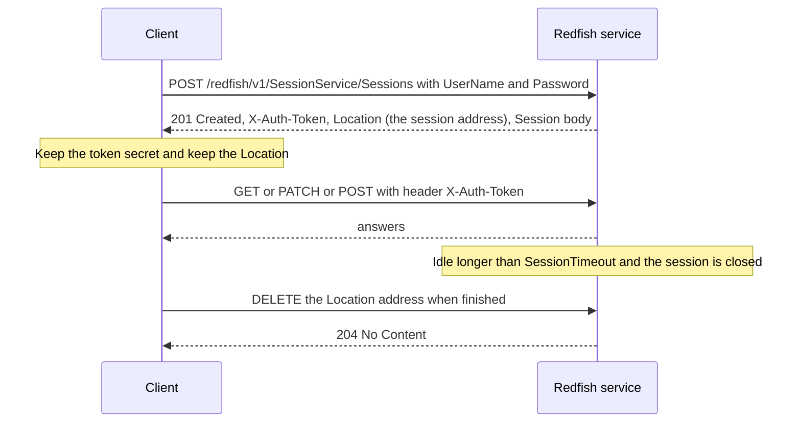

# 7.4 Redfish authentication, sessions and security

| | |
|---|---|
| Level | Beginner to Intermediate |
| Priority tier | 1 |
| Lab venue | Laptop |
| Part | Part 7: Redfish and BMC |
| Status | Drafted (`auth_lab.py`: 44 checks pass against mock; **untested** on live BMC) |

## Why this matters for AI infrastructure

Picture a node that will not boot after a firmware update. The only way in is through its BMC. A BMC can turn a server off, rewrite its firmware and change its settings. Whoever holds the BMC password controls the machine below the operating system, where your normal security tools cannot see. Now picture a fleet of 1,000 BMCs that all share one factory password. One leaked password puts the whole fleet at risk. This chapter shows how Redfish decides who you are and what you may do. It also shows how to set that up so your automation stays safe.

## Prerequisites and outcomes

Start with 7.1 to 7.3, because this chapter builds on them. When you finish, you should be able to:

- explain why Redfish needs HTTPS, and why `curl -k` is a lab shortcut only.
- choose between Basic authentication and a session, and use a session properly.
- explain roles and privileges, and create a least-privilege account for automation.
- explain lockout, session timeout and forced password change.
- run a lab that checks all of this.

## 1. Start with the basics: encryption first

Every Redfish request can carry a password and a command across the network. Anyone who can watch that traffic could read them, so the traffic must be encrypted before anything else. The spec says services shall support **TLS 1.2 or later**. They shall also offer only cipher suites marked "Recommended" by the IANA TLS registry. Any request that uses HTTP Basic authentication must use HTTPS. Operations with sensitive data, such as a firmware update that includes a user name and password for a download server, "should use HTTPS only".

**Certificates.** A BMC ships with a self-signed certificate. Your computer has no reason to trust it, so your tools will complain. The quick fix is `curl -k`, which skips the check. That also removes the protection that stops someone on the network from pretending to be the BMC. Use `-k` only in a lab. For production, the spec says services shall support replacing the default certificate, and certificates must be X.509 v3.

Replacing the certificate is a standard action. The Redfish schema guide describes `CertificateService.ReplaceCertificate`. It takes three values: the new certificate text, its type (`PEM`), and a link to the certificate being replaced.

```json
{
  "CertificateUri": { "@odata.id": "/redfish/v1/Managers/BMC/NetworkProtocol/HTTPS/Certificates/1" },
  "CertificateString": "-----BEGIN CERTIFICATE-----\n...\n-----END CERTIFICATE-----",
  "CertificateType": "PEM"
}
```

You send this body with a POST to the action address on the `CertificateService`. The guide shows that address as `.../Actions/CertificateService.ReplaceCertificate`. There is also `GenerateCSR`. It asks the BMC to make a signing request, so the private key never leaves the BMC. **I did not run either one.** Paths such as `/Managers/BMC/...` come from the guide's example and differ per platform, so discover them from the service root.

:::note Correction to my notes
The NVIDIA-DevOps volume 10 notes show a plain `POST` of `CertificateString` to `.../NetworkProtocol/HTTPS/Certificates`. The schema guide's documented way to replace a certificate is the `ReplaceCertificate` action above. A plain POST to the collection may work on some BMCs, but I could not confirm that, so prefer the action and test on one machine first.
:::

## 2. Two ways to log in

Every script you write for a BMC has to answer one question first: how should it prove who it is? Redfish gives you two options, and the spec says a service must support both. A client that uses Basic must never be forced to create a session.

| | HTTP Basic | Redfish session |
|---|---|---|
| How | send user and password with **every** request | log in once, then send a token with every request |
| Header | `Authorization: Basic <base64 of user:password>` | `X-Auth-Token: <token>` |
| Password exposure | on every request | once, at login |
| Good for | a single quick command | scripts and tools |
| Can be turned off | yes, with `HTTPBasicAuth` in `AccountService` (`Enabled`, `Disabled` or `Unadvertised`) | no |

Read the table by asking two questions: how often does the password travel, and can an administrator switch the method off? Base64 is not encryption. Anyone who sees a Basic header can read the password, which is why Basic is only allowed over HTTPS. If multi-factor authentication is enabled, the spec says services must refuse Basic for accounts that did not opt out. In that case, sessions become the only way in.

The spec says clients **should** use sessions "for improved performance and security". The diagram below shows the whole life of a session, from login to logout.

### The session steps



Notice that the password travels once, at login, and the token travels with every request after that. To find the Sessions address, read it from the service root (`Links` / `Sessions`) or from `SessionService`. Both must be the same. The `POST` that creates a session must use HTTPS, and it needs no auth header. If a service runs both HTTP and HTTPS, the HTTP login should redirect you to HTTPS.

The answer **must** contain the `X-Auth-Token` header, the `Location` header and the full Session body. The body's `Password` is `null`, because services must never send passwords back. The session id is the last part of `Location`, and it is not the token. The id names the Session resource, so an administrator can list or end it. The token is the secret that only the client which logged in holds.

Sessions do not expire at a fixed time. They time out when they go idle. While you keep sending requests inside the timeout, the token stays valid. A service can also set an absolute timeout through `AbsoluteSessionTimeout` in the schema guide. To log out, send a `DELETE` to the Session address. An administrator can end other users' sessions the same way. Services must not use HTTP cookies to authenticate requests.

**Always log out.** A BMC is a small computer with limited memory, and the spec leaves the number of open sessions up to each implementation. Picture a script that logs in 5,000 times and never logs out. It may lock itself out of the BMC. In your code, put the logout in a `try/finally` so it always runs.

## 3. Who may do what: roles and privileges

Knowing who you are is only half the job. Once the service has checked your login, it still has to decide what you may change. The spec handles this with three pieces. A **privilege** is a single permission, such as `Login`, `ConfigureComponents` or `ConfigureUsers`. A role is a named set of privileges. Each user account has exactly one role, stored in `RoleId`.

The spec requires three standard roles. Read the table row by row, and notice that each role contains everything the role below it has, plus more.

| Role | Privileges |
|---|---|
| `Administrator` | Login, ConfigureManager, ConfigureUsers, ConfigureComponents, ConfigureSelf |
| `Operator` | Login, ConfigureComponents, ConfigureSelf |
| `ReadOnly` | Login, ConfigureSelf |

The privilege names mean the following. `ConfigureManager` changes settings of the BMC itself, such as the network, protocols and certificates. `ConfigureUsers` creates, deletes and changes accounts. `ConfigureComponents` changes the computer and its parts, and runs actions such as a reset. `ConfigureSelf` changes your own account, for example your password. `Login` lets you read.

Services may add optional roles, OEM roles and custom roles. The spec lists `SystemAdministrator`, `SystemOperator`, `StorageAdministrator` and `StorageBackupOperator` as optional examples. Standard roles cannot be modified.

Each type of operation needs certain privileges, and a service should publish those rules as a **Privilege Registry**. For example, `GET` on a Manager needs `Login`, and `PATCH` needs `ConfigureManager`. Some properties follow different rules from their parent. The `Password` property in an account needs `ConfigureSelf` or `ConfigureUsers`, while other fields need `ConfigureUsers`. That is how you can change your own password but not someone else's.

### 3.1 Privilege Registry overrides, logical AND/OR, and Restricted Roles (DSP0266 §13.4.2–13.4.3)

A single role table is not always precise enough. The Privilege Registry (DSP0266 §13.4.3) can express finer rules. Each resource type, called an `Entity`, has a base `OperationMap`. That map lists the privileges needed for `GET`, `HEAD`, `PATCH`, `POST`, `PUT` and `DELETE`.

The map also has its own logic. Separate objects inside an operation's array mean logical OR. For example, `[{"Privilege": ["ConfigureUsers"]}, {"Privilege": ["ConfigureSelf"]}]` means either `ConfigureUsers` or `ConfigureSelf` is enough. Several names inside the same `"Privilege"` array mean logical AND. So `[{"Privilege": ["ConfigureComponents", "OEMSysAdminPriv"]}]` requires both privileges. The spec covers this in §13.4.3.8.

Sometimes a property, a single URI or a resource's place in the tree needs a different privilege from the base `Entity`. The registry handles that with three override types, and they apply in a strict order (§13.4.3.4, Table 43). `PropertyOverrides` comes first. It can set a privilege for one property. For example, it can let `ConfigureSelf` or `ConfigureUsers` change the `Password` on `ManagerAccount`, while every other property on `ManagerAccount` still needs `ConfigureUsers`.

`ResourceURIOverrides` comes next. It targets specific URI instances, such as `/redfish/v1/Systems/VM6`. `SubordinateOverrides` has the lowest precedence. It changes the required privilege based on where a resource sits in the tree. DSP0266 §13.4.3.6 gives a classic case. An `EthernetInterface` under `ComputerSystem` needs `ConfigureComponents` to `PATCH`, so an `Operator` can configure a host NIC. An `EthernetInterface` under `Manager` needs `ConfigureManager`, so only an `Administrator` can reconfigure the BMC's own out-of-band management NIC.

Restricted roles guard against privilege escalation. Suppose you want to stop a general `Administrator` from changing a dedicated security officer role. The service can mark that role `Restricted: true` and name an `AlternateRoleId` for normal use. It can also list `RestrictedPrivileges` and `RestrictedOemPrivileges` in `AccountService`. Services shall not let users create, delete or modify accounts assigned to a restricted role, except to toggle `Enabled`. They also must not assign restricted privileges to custom roles (§13.4.2.2). When you design a role for a new team, check the override rules first, because one role can behave differently on a host and on the BMC.

### 3.2 Client Certificate Authentication (mTLS) and OAuth 2.0 JWTs (DSP0266 §13.3.5 & §13.4.4)

Passwords and sessions are not the only options. DSP0266 also describes two mechanisms for enterprise and zero-trust fleets. The first is mutual TLS, or mTLS, which uses client certificates (§13.3.5). When it is enabled under `AccountService.MultiFactorAuth.ClientCertificate`, the BMC asks for a client X.509 certificate during the TLS handshake. It checks that certificate against the trusted `CertificateCollection`. Then it checks revocation through the configured OCSP (Online Certificate Status Protocol) servers.

The boolean `RespondToUnauthenticatedClients` controls what happens on failure. If it is `true`, or unsupported, the TLS handshake completes. The BMC can then still serve unauthenticated resources such as `/redfish/v1/`, or return structured `401` JSON errors. If it is `false`, the BMC aborts the TLS handshake at once when a client certificate is invalid.

The second mechanism is delegated authorization with OAuth 2.0 bearer JWTs (§13.4.4). A Redfish service can act as an OAuth 2.0 resource server, configured through `AccountService.OAuth2`. It then accepts RFC 7519 JSON Web Tokens (JWTs) sent as `Authorization: Bearer <jwt>`. DSP0266 sets rules for these tokens in Tables 44 and 45. The JOSE header must name the signature algorithm in `alg`, such as `"RS256"`, and services shall not accept `alg: "none"`. The payload shall include `iss`, the issuer, `sub`, the subject, `aud`, the audience that matches the service, and `scope`. It may also carry `exp`, `nbf`, `iat` and `jti`. The `scope` claim is a space-delimited list. Each entry maps to a Redfish role, such as `Redfish.Role.<RoleId>`, or to one privilege, such as `Redfish.Privilege.<PrivilegeId>`. The example form is `"Redfish.Role.Operator"`.

**Least privilege for automation.** Do not share the `admin` account. Create accounts by purpose, as the table below shows.

| Account | Role | Used by |
|---|---|---|
| `prom_scraper` | `ReadOnly` | monitoring that reads sensors |
| `fleet_ops` | `Operator` | restarts and power actions |
| `fw_update` | `Administrator` (the standard roles are broad, so check whether your BMC offers a narrower custom role) | firmware jobs only |
| a personal account | as needed | each person, so logs show who did what |

The lab in section 5 checks this rule. A `ReadOnly` user can read, but a change returns 403. An `Operator` can change a system, but creating an account returns 403.

## 4. Protections against guessing and stale passwords

Left alone, a BMC would let anyone keep guessing passwords. The Account Service has settings that slow down guessing and retire old credentials. The Account Service schema in the Resource Guide lists these settings. The table below shows the ones that matter most for your scripts.

| Setting | Meaning |
|---|---|
| `AccountLockoutThreshold` | failed logins before the account locks |
| `AccountLockoutDuration` | seconds the account stays locked (0 means never lock) |
| `AccountLockoutCounterResetAfter`, `AccountLockoutCounterResetEnabled` | when the failure count is cleared |
| `AuthFailureLoggingThreshold` | failures before the service writes a log entry |
| `MinPasswordLength` | shortest allowed password |
| `HTTPBasicAuth` | is Basic allowed |
| `RequireChangePasswordAction` | passwords can only be changed with the `ChangePassword` action, not by `PATCH` |
| `PasswordExpirationDays` (in the account resource) | password lifetime |

The spec's rules explain how these settings behave in practice. Error messages must not leak information. An unknown user and a wrong password must look the same, and a locked account should look like a wrong password. The lab checks this. Passwords are write-only, too. Any response property that holds a password "shall be null".

Atomic password change is the next rule. If `RequireChangePasswordAction` is true, the service rejects a `PATCH` of `Password`. You must use the `ChangePassword` action instead. That action asks for `SessionAccountPassword`, which is your current password, or the administrator's password when you change someone else's. This protects you from a stolen session token being used to lock you out by changing your password.

Password change required works differently. An account with `PasswordChangeRequired: true` can log in, for example with a factory-default password or after an administrator's reset. But the login answer includes a `PasswordChangeRequired` message, and every other request gets **403** until the password changes. While the flag is set, the account may read itself, change its own password by `PATCH` or `ChangePassword`, and delete its own sessions. Once the password changes, the flag becomes false. Changing an account can also close its sessions, so the user must log in again. Services should store passwords with a one-way hash.

Time-based One-Time Password (TOTP) multi-factor authentication (DSP0266 §13.5.5) follows the same pattern. When RFC 6238 TOTP MFA is enabled and an account has no TOTP secret key yet, a session login without `Token` succeeds. The answer carries `@Message.ExtendedInfo` with `GenerateSecretKeyRequired`. That bootstrap session is restricted, just like the password case. Normal resources return `403 Forbidden` with `GenerateSecretKeyRequired` until the user calls `POST .../Actions/ManagerAccount.GenerateSecretKey`. The user may also call `VerifyTimeBasedOneTimePassword`. Then the user closes the session and logs in again, with `"Token": "<6-digit-otp>"` in the session `POST` body.

A new DGX or BMC often arrives with a default password that must be changed. Your provisioning script has to handle the state where login works but nothing else does. Without that handling, the script fails in confusing ways.

## 5. The lab

Reading about these rules is one thing. Watching a service enforce them is another, and the lab does exactly that. Run it from the chapter's code folder.

```bash
cd code/part07
python3 auth_lab.py
```

The script starts a mock service and moves a fake clock forward. That way, a five-minute timeout and a 30-second lockout are tested in milliseconds. The lab runs 44 checks. Here is a selection of the output:

```text
PASS  login returns 201 with X-Auth-Token, Location and a Session body [13.3.4.2]
PASS  session body never shows the password (it is null) [13.2]
PASS  idle longer than SessionTimeout: session is gone, 401 [13.3.4.3]
PASS  unknown user and wrong password give the same 401 and message [13.3.2.3]
PASS  after 3 bad attempts the account is locked: even the right password gets 401
PASS  after AccountLockoutDuration the account works again
PASS  Operator cannot create accounts (needs ConfigureUsers): 403
PASS  ReadOnly cannot change components: 403
PASS  a user cannot promote themselves: 403
PASS  account with PasswordChangeRequired can log in and is told so (ExtendedInfo) [13.5.4]
PASS  ...but everything else is 403 PasswordChangeRequired [13.5.4]
PASS  PATCH own Password clears the flag [13.5.4]
PASS  ChangePassword with a wrong SessionAccountPassword is refused: 401 [13.5.3]
PASS  an admin password reset closes that user's open sessions [13.5.2]
PASS  administrator can disable HTTP Basic [13.3.3]
...
44 passed, 0 failed
```

Read the file `auth_lab.py` after you run it. It doubles as a clear list of what a good Redfish login system does. If you ever build tooling for BMC accounts, these checks make a useful acceptance list.

I made a mistake while writing the lab, and it is worth noticing. One check failed because my test sent a stale session token together with a Basic header. The service looked at the token first, found it expired, and answered 401 without trying Basic. That is real behaviour to remember: **a bad token is not rescued by a good password header.** Remove stale tokens when you log in again.

## 6. Safe handling in your own scripts

Most of the protections above depend on how your own scripts behave. Keep these eight habits in every script that talks to a BMC.

1. **Use HTTPS and verify the certificate.** Install your own CA on the BMCs, as section 1 describes, and point tools at it with `curl --cacert ca.pem`. Use `-k` or `verify=False` only in a lab.
2. **Keep passwords off the command line.** *Supercomputers for Linux SysAdmins* warns about the same risk with `ipmitool -P`. For `curl`, use `--netrc-file` or a `--config` file with mode 600. In Python, read the password from your secret store.
3. **Use sessions.** Log in once per machine, and log out in a `finally` block.
4. **Treat the token like a password.** Never print it in logs.
5. **Use one account per purpose.** Give each person a personal account, so logs show who did what.
6. **Check for `PasswordChangeRequired`** the first time you contact new hardware.
7. **Audit regularly.** Chapter 7.1 has a credential audit tool, and BCM's `credentialsoverview` does the same job.
8. **Rate-limit your scripts.** Many failed logins can lock an account and block the real owner. Stop on the first 401, and do not retry hundreds of times.

### 6.1 Anatomy of a session-table exhaustion outage

Suppose a monitoring team writes a naive health scraper for a large GPU cluster. Every thirty seconds, a cron job opens a new Redfish session on each BMC. It reads the chassis sensors, prints the temperatures, and exits the Python process without calling `DELETE` on the session URI.

Each embedded BMC has a small, fixed table of active sessions in RAM. The Redfish specification leaves the maximum number of simultaneous open sessions up to the firmware implementation. While a session stays idle, the BMC must keep it until `SessionTimeout` expires. Take the default timeout of thirty minutes. If the scraper logs in twice a minute without logging out, the arithmetic is simple: two logins a minute for thirty minutes is sixty sessions. One script therefore consumes sixty session slots per BMC.

The table fills long before the thirty-minute idle timer reclaims the first orphaned token. From that point, every new login is rejected. That includes logins from your provisioning engine, your Slurm power-fencing scripts and your human operators. The node is still running and its hardware is healthy. Yet the out-of-band control plane has locked you out.

Preventing this takes three habits in every client you write. First, wrap every session login in a `try/finally` block, so the `DELETE` runs even when an exception interrupts the script. Second, reuse one long-lived session across several reads to the same BMC, instead of logging in once per metric. Third, give your scraper its own dedicated `ReadOnly` account. An administrator can then inspect `/redfish/v1/SessionService/Sessions`, see which `UserName` owns the orphaned sessions, and end them one at a time with `DELETE`. Active maintenance sessions keep running.

### 6.2 How the Privilege Registry governs multi-team operations

In a mature AI data center, three teams touch the server fleet every day. The observability team scrapes temperatures, fan speeds and power consumption. The compute operations team drains and reboots wedged nodes when training jobs hang. The platform security and hardware engineering team rotates X.509 certificates, updates firmware and manages user accounts.

If all three share the factory `admin` account, one bug in a metrics scraper, or one leaked environment variable in a CI runner, gives full control over every BMC in the building. The Privilege Registry lets you separate these duties.

When the observability scraper uses a `ReadOnly` account, its role carries only `Login` and `ConfigureSelf`. The registry maps `GET` and `HEAD` across `ComputerSystem`, `Chassis`, `Sensor` and `Manager` to the `Login` privilege. Suppose someone changes the scraper to send a `POST` to `ComputerSystem.Reset`, or a `PATCH` to `Bios/Settings`. The BMC checks the `OperationMap` for those endpoints, sees that `ConfigureComponents` is required, and rejects the request with HTTP 403 Forbidden.

The compute operations team gets an `Operator` account. That role adds `ConfigureComponents` on top of `Login` and `ConfigureSelf`. An operator can reboot a hung GPU node, set a one-time PXE boot override, or adjust a chassis power cap. But if an operator tries to create a backdoor user account under `/redfish/v1/AccountService/Accounts`, or to disable TLS certificate checks under `/redfish/v1/Managers/BMC/NetworkProtocol`, the registry blocks the call. Account changes need `ConfigureUsers`. BMC network changes need `ConfigureManager` through the `SubordinateOverrides` rule. Only the `Administrator` role holds those privileges.

Give each team the lowest role that covers its work, and keep `admin` out of automation.

### 6.3 Designing zero-touch factory password rotation on Day 0

A pallet of new GPU servers has just arrived on the data-center floor. Each BMC ships with either a well-known factory default password or a unique per-chassis password printed on the physical pull-tab. On hardened platforms, the factory account also sets `PasswordChangeRequired` to `true`.

If your Day-0 discovery pipeline assumes that a successful 201 Created from `/redfish/v1/SessionService/Sessions` means the node is ready for inventory and firmware checks, it fails on the very next step. As soon as the script sends `GET /redfish/v1/Systems`, the BMC returns 403 Forbidden with the `PasswordChangeRequired` message from the Base Message Registry.

A resilient Day-0 workflow handles this state explicitly, right after the first session is up:

1. Read the 201 Created login body for `@Message.ExtendedInfo`. If any entry contains `PasswordChangeRequired`, take the bootstrap rotation branch before running any hardware discovery.
2. Check whether `RequireChangePasswordAction` is `true` in `AccountService`, either by following the account link or by querying `/redfish/v1/AccountService`.
3. If it is `true`, call the `ManagerAccount.ChangePassword` action with both `NewPassword` and `SessionAccountPassword` set to the factory password. If it is not, send a `PATCH` with the new password to the user's own `ManagerAccount` URI.
4. Read the `ManagerAccount` back to confirm that `PasswordChangeRequired` is now `false`. Then verify that `GET /redfish/v1/Systems` returns 200 OK.
5. Once the bootstrap account uses your vault-managed secret, create the dedicated `ReadOnly` and `Operator` service accounts. Then disable `HTTPBasicAuth` on `AccountService`, so all later automation uses session tokens only.

Build this state machine into your onboarding script before the first discovery call.

### 6.4 External directory integration and certificate lifecycle

Local `ManagerAccount` resources work well for small clusters and for emergency break-glass access. Human administrators should not, however, hold local accounts scattered across hundreds of BMCs. When an engineer leaves the team, access should be revoked in one central directory. It should not take a fleet-wide `DELETE` loop across every rack.

Redfish supports central directory integration through `ExternalAccountProvider` resources under `AccountService`. Those resources support LDAP, Active Directory, TACACS+ and OAuth 2.0. An administrator configures the directory server addresses, the TLS trust certificates, and `RemoteRoleMapping` rules. Those rules map enterprise directory groups straight to Redfish roles such as `Administrator`, `Operator` and `ReadOnly`. You then keep only one vault-escrowed local `Administrator` account on each BMC. That account is for out-of-band break-glass recovery, for the case where the corporate directory or the management network is unreachable during a facility outage.

Decide which directory groups map to which roles before you roll out the first BMC.

## Exercises

Work through these in order. Each one asks you to read, run or write something, so try it yourself before you check the answers.

1. Run `python3 code/part07/auth_lab.py`, then read lines 56–70 of `code/part07/auth_lab.py`. Check that an unknown username (`nosuchuser`), a wrong password for a valid user (`admin`), and a correct password on a locked account (`viewer` after `3` failed attempts) all return the same HTTP `401 Unauthorized` status and the same generic message (`DSP0266` §13.3.2.3). Ask yourself, or your team, why the three cases must look identical.
2. Use the table of required roles (`Administrator`, `Operator`, `ReadOnly`) and the Privilege Registry override rules (`ConfigureManager`, `ConfigureComponents`, `ConfigureUsers`) to decide which role each of these needs. The three cases are: (a) a Prometheus `dcgm`/`redfish` telemetry scraper (`prom_scraper`), (b) a Slurm fencing or reboot script (`fleet_ops`), and (c) a BMC certificate rotation playbook. Explain each choice in one sentence, so you can defend it to your team.
3. Add a 45th check to `code/part07/auth_lab.py`. It should confirm that an `Operator` who sends `PATCH /redfish/v1/AccountService {"HTTPBasicAuth": "Disabled"}` gets `403 Forbidden`. Changing `AccountService` needs `ConfigureManager` or `ConfigureUsers`, and an `Operator` has neither.
4. Write a Python context manager called `redfish_session`, decorated with `@contextlib.contextmanager`. It takes `base_url`, `username` and `password`, posts to `/redfish/v1/SessionService/Sessions`, and yields `(token, session_uri)`. It must send `DELETE` to `session_uri` in a `finally:` block, so the logout runs even if the caller's work raises an exception.
5. Trace lines 114–128 of `code/part07/auth_lab.py`, where the `factory` account has `PasswordChangeRequired: true`. Explain three things. First, why `GET /redfish/v1/Systems/System_0` returns `403 Forbidden` right after login. Second, which three operations DSP0266 §13.5.4 allows during that restricted session. Third, how `ChangePassword` with `SessionAccountPassword` prevents a session-hijacking lockout when `RequireChangePasswordAction: true`.
6. Run `python3 code/part07/tls_setup.py /tmp/lab_pki` and inspect the X.509 v3 extensions it generates: `subjectAltName=IP:127.0.0.1,DNS:localhost`, `basicConstraints=CA:FALSE`, and `extendedKeyUsage=serverAuth`. Then explain to a colleague why `CertificateService.GenerateCSR` followed by `CertificateService.ReplaceCertificate` is safer than generating private keys on a central workstation.

## 8. Interview angles

- "Basic or session?" Choose a session. The password is sent once, tokens can be ended, and Basic can be switched off or needs MFA exceptions.
- "How do you give monitoring access to BMCs?" Create a `ReadOnly` account for each purpose, and reach the BMC over HTTPS with a trusted certificate.
- "What happens if a script logs in thousands of times without logging out?" It can exhaust the BMC's session limit. Always send a `DELETE` for the session.
- "How would you roll out password changes to a fleet?" Use the BMC manager, such as BCM's `bmcsettings`, or a Redfish `PATCH` or `ChangePassword`. Then check that every machine has the same credential fingerprint afterward.
- "Why does the login error for a locked account look like a wrong password?" So that attackers cannot learn which users exist or which accounts are locked.

## Checkpoint questions (20)

<details>
<summary>1. What minimum TLS version and cipher suite category does the Redfish Specification require (DSP0266 §13.1)?</summary>

Redfish services **shall** support **TLS 1.2 or later**. The spec follows the RFC 7525 advice, and TLS 1.1 is deprecated. Services shall only offer cipher suites marked **"Recommended"** in the IANA TLS Cipher Suites registry, such as `AES-GCM` suites.
</details>

<details>
<summary>2. Why is using `curl -k` (or `verify=False` in Python) unsafe in production, and what X.509 standard must BMC certificates follow?</summary>

`curl -k` turns off server certificate checking. An attacker on the network path can then run a man-in-the-middle (MitM) attack. That lets them read BMC credentials or inject power and firmware commands. Under DSP0266 §13.1.3, BMC certificates **shall** follow X.509 v3 (RFC 5280), and services must support replacing the default self-signed certificate.
</details>

<details>
<summary>3. What are the two standard actions on `CertificateService` for replacing a BMC certificate without exposing the private key on the network?</summary>

`CertificateService.GenerateCSR` has the BMC create its keypair internally, so the private key never leaves the BMC. It returns a Certificate Signing Request (CSR) for your CA to sign. `CertificateService.ReplaceCertificate` then swaps the existing certificate at `CertificateUri` for your CA-signed PEM `CertificateString`, with `CertificateType: "PEM"`.
</details>

<details>
<summary>4. Compare HTTP Basic authentication and Redfish session authentication across headers, password exposure, and MFA compatibility.</summary>

Basic sends the base64-encoded `username:password` with every request, and only over HTTPS. You can disable it with `AccountService.HTTPBasicAuth`. The BMC **shall** reject Basic when MFA is required for the account (DSP0266 §13.3.3). A session sends `UserName` and `Password` once, to `POST /redfish/v1/SessionService/Sessions`. The BMC answers with a random `X-Auth-Token` for later requests. Sessions support MFA through the `Token` property, and you can end one with `DELETE`.
</details>

<details>
<summary>5. Why is Base64 encoding in an HTTP Basic header not a form of encryption, and in what order must a BMC process authentication headers relative to ETag headers (DSP0266 §13.3.2.2)?</summary>

Base64 is a reversible text encoding. Anyone can decode it at once, without a key, which is why Basic is forbidden over plain HTTP. Under DSP0266 §13.3.2.2, services **shall** process authentication headers before any other header that changes the response, such as `If-Match` or `If-None-Match`. They **shall not** use HTTP cookies for authentication.
</details>

<details>
<summary>6. What three items must a BMC return when `POST /redfish/v1/SessionService/Sessions` succeeds (`201 Created`)?</summary>

The BMC returns three things. First, the `X-Auth-Token` response header, which holds the secret token. Second, the `Location` header, which holds the URI of the new Session, such as `/redfish/v1/SessionService/Sessions/1`. Third, a JSON body with the full Session resource, where `"Password": null`.
</details>

<details>
<summary>7. What is the difference between the Session ID (`Id` in the `Location` URI) and the Session Authentication Token (`X-Auth-Token`)?</summary>

The Session ID, the `"1"` in the example, is the public identifier. Users and administrators use it to inspect or end (`DELETE`) the session at `/redfish/v1/SessionService/Sessions/<id>`. The `X-Auth-Token` is the cryptographic bearer secret. It comes back only once, in the login response, and only the client that created the session knows it.
</details>

<details>
<summary>8. Do Redfish sessions expire at a fixed wall-clock timestamp or via an idle timeout (DSP0266 §13.3.4.3)?</summary>

Redfish sessions use a sliding idle timeout, set by `SessionTimeout` in `SessionService`. Each authenticated request that arrives inside the timeout restarts the timer, so the token stays valid. The BMC can also enforce an optional `AbsoluteSessionTimeout`.
</details>

<details>
<summary>9. How do you log out of a Redfish session, and what happens to open Server-Sent Event (SSE) streams or firmware transfers started by that session (DSP0266 §13.3.4.4)?</summary>

Send an HTTP `DELETE` to the session's `Location` URI, `/redfish/v1/SessionService/Sessions/<id>`. The reply is `204 No Content`. Per DSP0266 §13.3.4.4, ending a session **shall not** abort connections that the session opened on its own. Those include active SSE streams and ongoing `UpdateService` image transfers.
</details>

<details>
<summary>10. Why must automation scripts always close their Redfish sessions in a `finally` block?</summary>

Embedded BMCs have a finite session table. A script that runs every minute and leaks sessions without calling `DELETE` will eventually use every slot. Then the BMC refuses new logins, or answers with `503 Service Unavailable`, until `SessionTimeout` expires.
</details>

<details>
<summary>11. What is the difference between a Privilege and a Role in Redfish, and how many roles can a `ManagerAccount` have?</summary>

A **Privilege** is one atomic permission: `Login`, `ConfigureManager`, `ConfigureUsers`, `ConfigureComponents` or `ConfigureSelf`. A **Role** is a named collection of privileges, held in `AssignedPrivileges` and `OemPrivileges`. Each `ManagerAccount` has **exactly one** role, set by its `RoleId` property (DSP0266 §13.4.2).
</details>

<details>
<summary>12. Name the three required standard roles in Redfish (DSP0266 Table 41) and the exact privileges assigned to each.</summary>

`Administrator` has `Login`, `ConfigureManager`, `ConfigureUsers`, `ConfigureComponents` and `ConfigureSelf`. `Operator` has `Login`, `ConfigureComponents` and `ConfigureSelf`. `ReadOnly` has `Login` and `ConfigureSelf`. These are the three required roles in DSP0266 Table 41.
</details>

<details>
<summary>13. What is the difference between `ConfigureManager`, `ConfigureComponents`, `ConfigureUsers`, and `ConfigureSelf`?</summary>

`ConfigureManager` changes the BMC itself, such as network settings, protocols, certificates and subscriptions. `ConfigureComponents` changes or resets managed computer systems, chassis, BIOS and storage components. `ConfigureUsers` creates, modifies, unlocks or deletes any account in `AccountService`. `ConfigureSelf` lets you read your own account and change your own password.
</details>

<details>
<summary>14. In the Privilege Registry (`DSP0266` §13.4.3.4), what are the three override types and their precedence order, and how do they explain why a user can change their own password or why an Operator can edit a host NIC but not the BMC NIC?</summary>

The precedence order is **`PropertyOverrides` → `ResourceURIOverrides` → `SubordinateOverrides`**. A `PropertyOverride` on `ManagerAccount` lets `ConfigureUsers` or `ConfigureSelf` PATCH the `Password` property. That is how any user can change their own password without holding `ConfigureUsers`. A `SubordinateOverride` on `EthernetInterface` needs `ConfigureManager` when the NIC sits under `Manager`, which is the BMC's OOB port. Under `ComputerSystem`, the same NIC needs `ConfigureComponents`. That is why an Operator can edit a host NIC but not the BMC NIC.
</details>

<details>
<summary>15. How do `AccountLockoutThreshold`, `AccountLockoutDuration`, and early administrator unlock work in `AccountService`?</summary>

After `AccountLockoutThreshold` consecutive failed logins, the BMC sets `Locked: true` on the `ManagerAccount`. It then rejects every login for `AccountLockoutDuration` seconds, even with the correct password. An administrator with `ConfigureUsers` can unlock the account early by sending `PATCH {"Locked": false}` to the account URI.
</details>

<details>
<summary>16. Why must a failed login for a nonexistent user, a wrong password, and a locked account all return the exact same HTTP 401 message (DSP0266 §13.3.2.3)?</summary>

If the BMC returned different messages, an attacker could learn which usernames exist and which accounts are locked. That is username enumeration and lockout-state reconnaissance. So all three cases return the same HTTP 401 message.
</details>

<details>
<summary>17. How does `PasswordChangeRequired: true` behave upon login, and which specific operations are permitted before the password is changed (DSP0266 §13.5.4)?</summary>

Login succeeds with `201 Created`, and `@Message.ExtendedInfo` includes a `PasswordChangeRequired` message. Every other authenticated request returns **`403 Forbidden`** with `PasswordChangeRequired`, except three things. You may `GET` your own `ManagerAccount`. You may change your password, either by `PATCH` on `Password` when `RequireChangePasswordAction` is `false`, or by `POST` to `ManagerAccount.ChangePassword` on your own account, which clears the flag to `false`. You may also `DELETE` your own Session, and `GET` the unauthenticated root resources.
</details>

<details>
<summary>18. What is `RequireChangePasswordAction` in `AccountService` (DSP0266 §13.5.3), and what security attack does `ManagerAccount.ChangePassword` prevent?</summary>

When `RequireChangePasswordAction` is `true`, the BMC rejects `PATCH` requests to `Password`. Callers must invoke the `ManagerAccount.ChangePassword` action instead, which needs both `NewPassword` and **`SessionAccountPassword`**. That is your current password, or the admin's password when resetting someone else's. An attacker who steals an active `X-Auth-Token` still cannot change the victim's password, because they do not know the current one.
</details>

<details>
<summary>19. Why are `Password` properties always `null` in `GET` responses (DSP0266 §13.2), and what happens to a user's open sessions when an administrator resets their password (§13.5.2)?</summary>

DSP0266 §13.2 requires sensitive properties such as `Password` to come back as `null` in responses. That way, no password hash or cleartext secret can be read back. When an account's properties or password change (§13.5.2), the BMC closes that account's open sessions, so old tokens stop working at once.
</details>

<details>
<summary>20. How does Redfish OAuth 2.0 JWT authorization represent roles and privileges in the token's `scope` claim, and which `alg` header value is strictly forbidden (DSP0266 §13.4.4)?</summary>

The JWT `scope` claim is a space-delimited list. Each entry is either `Redfish.Role.<RoleId>`, such as `Redfish.Role.Operator`, or `Redfish.Privilege.<PrivilegeId>`. The JOSE header must never use `alg: "none"`, because services **shall not** accept unsigned tokens (DSP0266 §13.4.4).
</details>

## Sources and review notes

- **Redfish Specification DSP0266 v1.21.0:** TLS and certificates (13.1), sensitive data (13.2), authentication: Basic, sessions, lifetime, logout, client certificates (13.3), authorization: privilege model, standard roles, restricted roles, operation-to-privilege map, OAuth 2.0 (13.4), and account service: password management, atomic change, forced change, TOTP (13.5). I read all of 13.1 to 13.5. I did not use OAuth 2.0 or TOTP details beyond mentioning that they exist.
- **Redfish Resource and Schema Guide DSP2046 (2024.4):** `AccountService` settings (lockout, `HTTPBasicAuth`, `MinPasswordLength`, `RequireChangePasswordAction`), `ManagerAccount` (`PasswordChangeRequired`, `Locked`, `ChangePassword`), `SessionService`, `CertificateService` (`ReplaceCertificate`, `GenerateCSR`).
- **Supercomputers for Linux SysAdmins**, chapter 10: advice to keep passwords off the command line and to separate the management network.
- **BCM 11 Administrator Manual**, section 3.7: central BMC credentials and `credentialsoverview`.
- **NVIDIA-DevOps notes (volume 10 chapter 1):** the `prom_scraper` read-only account idea and the certificate and protocol hardening commands. See the correction in section 1. The protocol-disabling commands are covered in chapter 7.15.
- **Run here:** `auth_lab.py` (44 checks). The mock simulates time, so no real timeout was waited on.
- **Not verified:** any real BMC's behaviour for lockout, session limits, password rules or certificate replacement. DGX-specific account handling is covered in chapter 7.13 and is also unverified.
