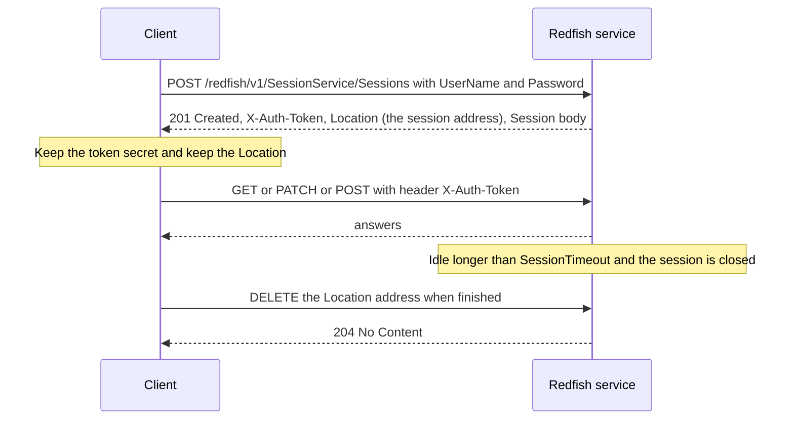

# 7.4 Redfish authentication, sessions and security

| | |
|---|---|
| Level | Beginner to Intermediate |
| Priority tier | 1 |
| Lab venue | Laptop |
| Part | Part 7: Redfish and BMC |
| Status | Drafted. `code/part07/auth_lab.py` ran 44 checks against the teaching mock and **all passed** (the one first-run failure was a mistake in my test, not in the mock). The mock uses plain HTTP and invented accounts, and its privilege map is a small version of the spec's idea. Real BMCs add vendor rules (session limits, password policies, extra roles). The certificate commands in this chapter are untested here; chapter 7.15 tests the full `GenerateCSR` and `ReplaceCertificate` flow against the mock over real TLS. No real BMC was available |

## Why this matters for AI infrastructure

A BMC can turn off a server, rewrite its firmware and change its settings. Whoever holds its password controls the machine below the operating system, where your normal security tools cannot see. A fleet of 1,000 BMCs with one shared factory password is one leaked password away from disaster. This chapter shows how Redfish handles who you are and what you may do, and how to set it up so automation is safe.

## Prerequisites and outcomes

You need 7.1 to 7.3. After this chapter you can:

- explain why Redfish needs HTTPS, and why `curl -k` is a lab shortcut only
- choose between Basic authentication and a session, and use a session properly
- explain roles and privileges, and create a least-privilege account for automation
- explain lockout, session timeout and forced password change
- run a lab that checks all of this

## 1. Start with the basics: encryption first

Redfish carries passwords and commands over the network, so it must be encrypted. The spec says services shall support **TLS 1.2 or later**, and shall only offer cipher suites marked "Recommended" by the IANA TLS registry. All requests that use HTTP Basic authentication must use HTTPS. Operations with sensitive data (for example a firmware update that includes a user name and password for a download server) "should use HTTPS only".

**Certificates.** A BMC ships with a **self-signed** certificate. Your computer has no reason to trust it, so tools complain. The lazy answer is `curl -k` (skip checking). That removes the protection that stops someone on the network from pretending to be the BMC. Use `-k` only for a lab. For production the spec says services shall support **replacing the default certificate**, and certificates must be X.509 v3.

How to replace it: the Redfish schema guide describes a standard action, `CertificateService.ReplaceCertificate`, which takes the new certificate text, its type (`PEM`) and a link to the certificate being replaced:

```json
{
  "CertificateUri": { "@odata.id": "/redfish/v1/Managers/BMC/NetworkProtocol/HTTPS/Certificates/1" },
  "CertificateString": "-----BEGIN CERTIFICATE-----\n...\n-----END CERTIFICATE-----",
  "CertificateType": "PEM"
}
```

It is sent with `POST` to the action address on the `CertificateService` (the guide shows `.../Actions/CertificateService.ReplaceCertificate`). There is also `GenerateCSR`, which asks the BMC to make a signing request so the private key never leaves the BMC. **I did not run either one.** Paths such as `/Managers/BMC/...` come from the guide's example and differ per platform, so discover them from the service root.

:::note Correction to my notes
The NVIDIA-DevOps volume 10 notes show a plain `POST` of `CertificateString` to `.../NetworkProtocol/HTTPS/Certificates`. The schema guide's documented way to replace a certificate is the `ReplaceCertificate` action above. A plain POST to the collection may work on some BMCs, but I could not confirm that, so prefer the action and test on one machine first.
:::

## 2. Two ways to log in

The spec says a service must support **both**, and a client using Basic must not be forced to create a session.

| | HTTP Basic | Redfish session |
|---|---|---|
| How | send user and password with **every** request | log in once, then send a token with every request |
| Header | `Authorization: Basic <base64 of user:password>` | `X-Auth-Token: <token>` |
| Password exposure | on every request | once, at login |
| Good for | a single quick command | scripts and tools |
| Can be turned off | yes, with `HTTPBasicAuth` in `AccountService` (`Enabled`, `Disabled` or `Unadvertised`) | no |

Base64 is not encryption. Anyone who sees a Basic header can read the password, which is why Basic is only allowed over HTTPS. If multi-factor authentication is enabled, the spec says services must refuse Basic for accounts that did not opt out, so sessions become the only way.

The spec says clients **should** use sessions "for improved performance and security".

### The session steps



Facts from the spec:

- To find the Sessions address, read it from the service root (`Links` / `Sessions`) or from `SessionService`. Both must be the same.
- The `POST` to create a session must be HTTPS-only. It needs no auth header. If a service has both HTTP and HTTPS, the HTTP login should redirect to HTTPS.
- The answer **must** contain the `X-Auth-Token` header, the `Location` header and the full Session body. The body's `Password` is `null`: services must never send passwords back.
- The **session id** (last part of `Location`) is not the **token**. The id names the Session resource, so an administrator can list or end it. The token is the secret that only the logging-in client holds.
- Sessions do **not** expire at a fixed time. They **time out when idle**: while you keep sending requests within the timeout, the token stays valid. (A service can also have an absolute timeout through `AbsoluteSessionTimeout` in the schema guide.)
- Logging out is a `DELETE` of the Session address. An administrator can end other users' sessions the same way.
- Services must not use HTTP cookies to authenticate requests.

**Always log out.** BMCs are small computers with limited memory, and the spec leaves the number of open sessions to the implementation. A script that logs in 5,000 times and never logs out may get locked out of the BMC. In your code use a `try/finally` so the logout always runs.

## 3. Who may do what: roles and privileges

After the service knows **who** you are, it decides **what** you may do. The spec's model has three pieces:

1. A **privilege** is a permission. Examples: `Login`, `ConfigureComponents`, `ConfigureUsers`.
2. A **role** is a named set of privileges.
3. Each **user account** has exactly one role (`RoleId`).

The spec requires three standard roles:

| Role | Privileges |
|---|---|
| `Administrator` | Login, ConfigureManager, ConfigureUsers, ConfigureComponents, ConfigureSelf |
| `Operator` | Login, ConfigureComponents, ConfigureSelf |
| `ReadOnly` | Login, ConfigureSelf |

Plain meaning:

- **ConfigureManager**: change settings of the BMC itself (network, protocols, certificates).
- **ConfigureUsers**: create, delete and change accounts.
- **ConfigureComponents**: change settings of the computer and its parts, and run actions such as reset.
- **ConfigureSelf**: change your own account (for example your password).
- **Login**: read.

Services may add optional roles (the spec lists `SystemAdministrator`, `SystemOperator`, `StorageAdministrator` and `StorageBackupOperator`), OEM roles and custom roles. Standard roles cannot be modified.

Each type of operation requires certain privileges, and a service should publish this as a **Privilege Registry**. Examples from the spec: `GET` on a Manager needs `Login`, `PATCH` needs `ConfigureManager`. Some properties have different rules from their parent. The `Password` property in an account needs `ConfigureSelf` **or** `ConfigureUsers`, while other fields need `ConfigureUsers`. That is how you can change your own password but not someone else's.

**Least privilege for automation.** Do not share the `admin` account. Create accounts by purpose:

| Account | Role | Used by |
|---|---|---|
| `prom_scraper` | `ReadOnly` | monitoring that reads sensors |
| `fleet_ops` | `Operator` | restarts and power actions |
| `fw_update` | `Administrator` (the standard roles are broad, so check whether your BMC offers a narrower custom role) | firmware jobs only |
| a personal account | as needed | each person, so logs show who did what |

The lab proves this works: a `ReadOnly` user can read but gets **403** on a change, an `Operator` can change a system but gets **403** when creating accounts.

## 4. Protections against guessing and stale passwords

The Account Service schema in the Resource Guide has settings for these:

| Setting | Meaning |
|---|---|
| `AccountLockoutThreshold` | failed logins before the account locks |
| `AccountLockoutDuration` | seconds the account stays locked (0 means never lock) |
| `AccountLockoutCounterResetAfter`, `AccountLockoutCounterResetEnabled` | when the failure count is cleared |
| `AuthFailureLoggingThreshold` | failures before the service writes a log entry |
| `MinPasswordLength` | shortest allowed password |
| `HTTPBasicAuth` | is Basic allowed |
| `RequireChangePasswordAction` | passwords can only be changed with the `ChangePassword` action, not by `PATCH` |
| `PasswordExpirationDays` (in the account resource) | password lifetime |

Rules from the spec that matter in practice:

- **Error messages must not leak.** An unknown user and a wrong password must look the same, and a locked account should look like a wrong password. The lab checks this.
- **Passwords are write-only.** Any response property that is a password "shall be null".
- **Atomic password change.** If `RequireChangePasswordAction` is true, the service rejects `PATCH` of `Password` and you must use the `ChangePassword` action, which asks for `SessionAccountPassword` (your current password, or the administrator's password when changing someone else's). This protects against a stolen session token being used to lock you out by changing your password.
- **Password change required.** An account with `PasswordChangeRequired: true` (a factory-default password, or a reset by an administrator) can log in, but the login answer includes a `PasswordChangeRequired` message, and everything else gets **403** until the password is changed. Allowed: read your own account, change your password (by `PATCH` or `ChangePassword`), and delete your own sessions. Once changed, the flag becomes false.
- **Changing an account may close its sessions**, so the user must log in again.
- Services should store passwords with a one-way hash.

Why this matters for you: a new DGX or BMC often arrives with a default password that must be changed. Your provisioning script has to handle the "login works but nothing else does" state, otherwise it fails in confusing ways.

## 5. The lab

```bash
cd code/part07
python3 auth_lab.py
```

The mock service runs inside the script and the script moves a fake clock forward, so a five-minute timeout and a 30-second lockout test in milliseconds. It runs 44 checks. A selection of the output:

```text
PASS  login returns 201 with X-Auth-Token, Location and a Session body [13.3.4.2]
PASS  session body never shows the password (it is null) [13.2]
PASS  idle longer than SessionTimeout: session is gone, 401 [13.3.4.3]
PASS  unknown user and wrong password give the same 401 and message [13.3.2.3]
PASS  after 3 bad attempts the account is locked: even the right password gets 401
PASS  after AccountLockoutDuration the account works again
PASS  Operator cannot create accounts (needs ConfigureUsers): 403
PASS  ReadOnly cannot change components: 403
PASS  a user cannot promote themselves: 403
PASS  account with PasswordChangeRequired can log in and is told so (ExtendedInfo) [13.5.4]
PASS  ...but everything else is 403 PasswordChangeRequired [13.5.4]
PASS  PATCH own Password clears the flag [13.5.4]
PASS  ChangePassword with a wrong SessionAccountPassword is refused: 401 [13.5.3]
PASS  an admin password reset closes that user's open sessions [13.5.2]
PASS  administrator can disable HTTP Basic [13.3.3]
...
44 passed, 0 failed
```

Read the file `auth_lab.py` after running it. It doubles as a clear list of what a good Redfish login system does. If you ever build tooling for BMC accounts, these checks are a useful acceptance list.

A mistake I made while writing the lab, worth noticing: one check failed because my test sent a stale session token together with a Basic header. The service looked at the token first, found it expired, and answered 401 without trying Basic. That is real behaviour to remember: **a bad token is not rescued by a good password header.** Remove stale tokens when you re-login.

## 6. Safe handling in your own scripts

1. **Use HTTPS and verify the certificate.** Install your own CA on the BMCs (section 1) and point tools at it (`curl --cacert ca.pem`). Use `-k` or `verify=False` only in a lab.
2. **Keep passwords off the command line.** The SCL book warns the same about `ipmitool -P`. For `curl` use `--netrc-file` or a `--config` file with mode 600. In Python read from your secret store.
3. **Use sessions.** Log in once per machine, log out in a `finally`.
4. **Treat the token like a password.** Do not print it in logs.
5. **Use one account per purpose,** and a personal account for people.
6. **Check for `PasswordChangeRequired`** on first contact with new hardware.
7. **Audit regularly** (chapter 7.1 has a credential audit tool; BCM's `credentialsoverview` does this too).
8. **Rate-limit your scripts.** Many failed logins can lock an account and block the real owner. Stop on the first 401, do not retry hundreds of times.

## 7. Exercises

1. Run `python3 auth_lab.py`. Find the check that proves a locked account looks the same as a wrong password.
2. Read the roles table. Which role would you give to a Prometheus scraper? To a script that restarts nodes? Why not `Administrator` for both?
3. Add a check to `auth_lab.py`: an `Operator` cannot change `HTTPBasicAuth`. Does it pass?
4. Write a Python function `with_session(base, user, password)` that logs in, yields a token, and always logs out (a context manager). Test it against the mock.
5. Explain in your own words why a `PasswordChangeRequired` account gets 403 on `GET /redfish/v1/Systems` but can still read its own account.
6. Make a list of every place an `admin` password could leak in your automation (shell history, process list, logs, chat). Fix one.

## 8. Interview angles

- "Basic or session?" Session, because the password is sent once, tokens can be ended, and Basic can be switched off or needs MFA exceptions.
- "How do you give monitoring access to BMCs?" A `ReadOnly` account per purpose, over HTTPS with a trusted certificate.
- "What happens if a script logs in thousands of times without logging out?" It can exhaust the BMC's session limit. Always `DELETE` the session.
- "How would you roll out password changes to a fleet?" Through the BMC manager (BCM's `bmcsettings`) or a Redfish `PATCH` or `ChangePassword`, with a check that all machines have the same credential fingerprint afterward.
- "Why does the login error for a locked account look like a wrong password?" So attackers cannot learn which users exist or are locked.

## 9. Checkpoint questions (20)

1. What TLS version does the spec require at minimum?
2. Why is `curl -k` unsafe in production?
3. How does Redfish say to replace a service certificate?
4. What is the difference between Basic and session authentication?
5. Why is Base64 in a Basic header not secure by itself?
6. What three things come back when you create a session?
7. What is the difference between the session id and the token?
8. How do sessions end: fixed lifetime or idle timeout?
9. How do you log out?
10. Why must a script always log out?
11. What is a privilege and what is a role?
12. Which three roles must a service support?
13. What does `ConfigureUsers` allow? And `ConfigureSelf`?
14. Why can a user change their own password but not someone else's?
15. What does account lockout do and how can an administrator undo it early?
16. Why should a locked account and a wrong password look the same?
17. What does `PasswordChangeRequired` do?
18. What is the `ChangePassword` action for?
19. Why are password properties `null` in responses?
20. Name four rules for handling credentials in scripts.

## 10. Sources and review notes

- **Redfish Specification DSP0266 v1.21.0:** TLS and certificates (13.1), sensitive data (13.2), authentication: Basic, sessions, lifetime, logout, client certificates (13.3), authorization: privilege model, standard roles, restricted roles, operation-to-privilege map, OAuth 2.0 (13.4), and account service: password management, atomic change, forced change, TOTP (13.5). I read all of 13.1 to 13.5. I did not use OAuth 2.0 or TOTP details beyond mentioning that they exist.
- **Redfish Resource and Schema Guide DSP2046 (2024.4):** `AccountService` settings (lockout, `HTTPBasicAuth`, `MinPasswordLength`, `RequireChangePasswordAction`), `ManagerAccount` (`PasswordChangeRequired`, `Locked`, `ChangePassword`), `SessionService`, `CertificateService` (`ReplaceCertificate`, `GenerateCSR`).
- **Supercomputers for Linux SysAdmins**, chapter 10: advice to keep passwords off the command line and to separate the management network.
- **BCM 11 Administrator Manual**, section 3.7: central BMC credentials and `credentialsoverview`.
- **NVIDIA-DevOps notes (volume 10 chapter 1):** the `prom_scraper` read-only account idea and the certificate and protocol hardening commands. See the correction in section 1. The protocol-disabling commands are covered in chapter 7.15.
- **Run here:** `auth_lab.py` (44 checks). The mock simulates time, so no real timeout was waited on.
- **Not verified:** any real BMC's behaviour for lockout, session limits, password rules or certificate replacement. DGX-specific account handling is covered in chapter 7.13 and is also unverified.
