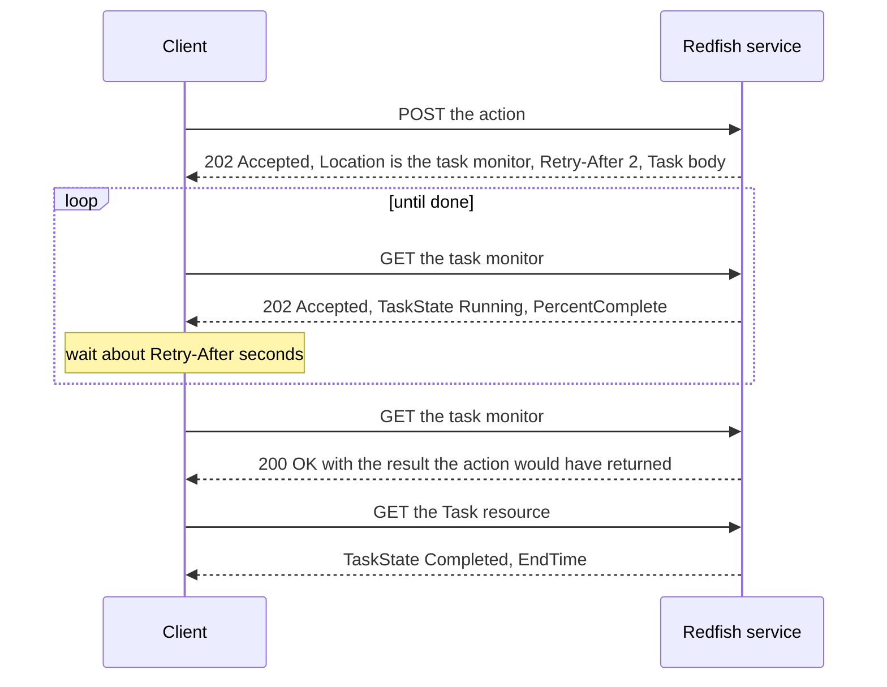

# 7.5 Redfish actions, tasks, events and subscriptions

| | |
|---|---|
| Level | Intermediate |
| Priority tier | 1 |
| Lab venue | Laptop |
| Part | Part 7: Redfish and BMC |
| Status | Drafted (`actions_lab.py`: 34 checks pass against mock; **untested** on live BMC) |

## Why this matters for AI infrastructure

Reading data is the easy half. The risky half is **doing things**: restarting a node, updating firmware, cutting power. Those operations take time, can fail halfway, and can be refused. A cluster tool must know how to ask, how to wait, and how to learn the result. The same tool also wants to hear about trouble (a fan failed, a power supply dropped) without asking every machine every second. Redfish has a clear answer for each: **actions**, **tasks** and **events**.

## Prerequisites and outcomes

You need 7.1 to 7.4. After this chapter you can:

- find an action on a resource and call it correctly
- explain each `ResetType` and pick the right one
- handle `200`, `202` and `204` answers from an action
- poll a task monitor, show progress and cancel
- subscribe to events and read the event body
- compare push events, server-sent events and polling

## 1. Actions: things you ask a resource to do

Some operations do not fit "read" or "set a value". Restarting a server is not a value you can store. Redfish calls these **actions**. An action is a `POST` to a special address. The spec says the address looks like `<ResourceUri>/Actions/<QualifiedActionName>`, and each resource tells you its actions in its `Actions` section:

```json
"Actions": {
  "#ComputerSystem.Reset": {
    "target": "/redfish/v1/Systems/System_0/Actions/ComputerSystem.Reset",
    "ResetType@Redfish.AllowableValues": ["On", "ForceOff", "GracefulShutdown", "GracefulRestart", "ForceRestart", "Nmi"]
  }
}
```

- `#ComputerSystem.Reset` is the action's name.
- `target` is where to send the `POST`. **Read it from the resource. Do not build it by hand.**
- `ResetType@Redfish.AllowableValues` lists the values **this** system accepts right now. The spec says this list should contain only values that are both supported and currently valid.

You call it with a JSON body of parameters:

```bash
curl -s -u user:pass -X POST -H "Content-Type: application/json" \
  -d '{"ResetType": "GracefulRestart"}' \
  https://<bmc>/redfish/v1/Systems/<id>/Actions/ComputerSystem.Reset
```

Rules from the spec:

- If a required parameter is missing, the answer is **400**. An unknown parameter value also gets **400** (my mock does this for `ResetType`).
- If the action needs no parameters, the service must accept an empty `{}`.
- A `POST` action is not necessarily safe to repeat. Sending it twice may restart twice.
- If an action would change nothing (for example `On` when the system is already on) the service should answer **200** with the `NoOperation` message. My mock shows this.
- If the service refuses (wrong privilege, bad state) you get 4xx/5xx and an error body.

:::tip PATCH versus the action
I tried `PATCH {"PowerState": "Off"}` on the mock and it answered 400, because `PowerState` is read-only. You can only **read** the power state. To change it you run the `Reset` action. Never look for a writable `PowerState`.
:::

### What each `ResetType` means

From the Redfish Resource Guide (2024.4), in plain words:

| Value | Meaning |
|---|---|
| `On` | turn the system on |
| `ForceOn` | turn on immediately |
| `GracefulShutdown` | ask the OS to shut down cleanly, then power off |
| `GracefulRestart` | ask the OS to shut down cleanly, then start again |
| `ForceOff` | turn off immediately, with no clean shutdown |
| `ForceRestart` | shut down immediately and non-gracefully, then start again |
| `PowerCycle` | behaves like removing power and then restoring it |
| `FullPowerCycle` | behaves like removing the utility power lines and restoring them |
| `PushPowerButton` | act as if someone pressed the physical power button |
| `Nmi` | send a diagnostic interrupt (non-maskable interrupt) that normally halts the system for diagnostics |
| `Pause`, `Resume`, `Suspend` | mostly for virtual machines |

How to choose:

1. **Always try the graceful ones first** (`GracefulRestart`, `GracefulShutdown`). They let the OS flush disks and stop services.
2. **Use `ForceRestart` or `ForceOff` only when the OS is frozen.** They can corrupt files and kill running jobs without warning.
3. **`PowerCycle` and `FullPowerCycle`** are stronger. Use them when a restart does not clear a hardware fault.
4. **`Nmi`** is for debugging a hang. Whether the machine then writes a crash dump depends on how the operating system is set up.

:::note Correction to my notes
The NVIDIA-DevOps notes (volume 10, chapter 1) describe `ForceRestart` as "equivalent to pulling the power plug and plugging it back in". By the Resource Guide's wording that is closer to `PowerCycle`. `ForceRestart` is a non-graceful restart. The notes also say `Nmi` "triggers an OS kernel crash dump". The guide says it generates a diagnostic interrupt, which usually halts the system. Producing a dump is up to the OS. I also did not run any of this on a real DGX.
:::

Before you restart a node in a cluster, drain it in the scheduler (chapter 6.14) so no job loses work.

### Other action features to know

- **`@Redfish.ActionInfo`** points to a separate resource describing the parameters (names, types, allowed values) when the list is too large for the inline form.
- **`@Redfish.OperationApplyTime`** (spec 7.12) lets a request say **when** to apply the operation. Values include `Immediate`, `OnReset`, `AtMaintenanceWindowStart` and `InMaintenanceWindowOnReset`, and the resource says which it supports through `@Redfish.OperationApplyTimeSupport`. For example you can delete a storage volume "on the next reset". Services must run pending operations in the order received. I did not build this in the mock.
- **Complete Action response status table (DSP0266 §7.11 Table 10):** Depending on whether an action finishes immediately, spawns a background job, or creates a new resource, DSP0266 §7.11 defines four valid `2xx` responses to an Action `POST`:
  1. **`200 OK`:** The action completed synchronously and returned either a schema-defined action response body or a standard status message object (`Base.1.17.Success`, or `Base.1.17.NoOperation` if the requested state was already active, such as `ResetType: "On"` on a powered-on node).
  2. **`201 Created`:** The action synchronously created a new resource; the `Location` header points to the new resource URI and the body conforms to the action's response schema.
  3. **`202 Accepted`:** The action requires asynchronous background processing; the `Location` header points to a **Task Monitor URI** (`/redfish/v1/TaskService/TaskMonitors/<id>`), accompanied by an optional `Retry-After` header and a `Task` representation in the body.
  4. **`204 No Content`:** The action completed synchronously and defines no response body.

## 2. Long jobs: 202 and the task monitor

Some operations take longer than a client wants to wait: a firmware update can take many minutes. The service then answers **202 Accepted** instead of 200. That means "I took your request, but I am not finished."



The facts, from the spec:

- The **task monitor** is an address the service makes up and you must treat as opaque. It usually looks like `/redfish/v1/TaskService/TaskMonitors/<id>`.
- As long as the job is running, a `GET` of the monitor returns **202**. When it ends, the monitor returns the status and body the original request would have returned, as if it had run immediately.
- The `Location` header gives the monitor. An optional `Retry-After` gives how long to wait. A `GET` on the monitor must return right away without blocking.
- The **Task** resource (under `TaskService`) holds the details: `TaskState`, `TaskStatus`, start and end time, `PercentComplete`, and messages. It can also include a **`Payload`** object recording the original `HttpHeaders`, `HttpOperation`, `JsonBody` (with sensitive fields sanitized), and `TargetUri`—unless the `Task` sets `HidePayload: true` for security (DSP2046 `Task`).
- **Task privilege enforcement (DSP0266 §13.6):** Regardless of which user started an asynchronous task, services **shall** enforce the Privilege Registry requirements on all `GET` and `DELETE` operations against the `Task` and `TaskMonitor` resources.
- To **cancel**, send `DELETE` to the monitor or the Task. If the service allows it, the `Allow` header on the monitor includes `DELETE`. Afterwards the monitor returns 410 or 404.
- A task that has finished and was cleaned up may return 410 or 404 if you wait too long. So read results soon.
- The spec also says `GET`, `PUT` and `PATCH` should always be synchronous, but your client **must** be ready for either answer to any method.

`TaskState` values from the Resource Guide: `New`, `Starting`, `Pending`, `Running`, `Suspended`, `Interrupted`, `Stopping`, `Cancelling`, `Cancelled`, `Completed`, `Exception`, `Service` (and `Killed`, deprecated). `TaskStatus` says the result: `OK`, `Warning` or `Critical`.

A good polling loop:

```text
start = now
response = POST action
if response.status == 200 or 204: done
if response.status == 202:
    monitor = response.headers["Location"]
    loop:
        wait Retry-After (default 2 seconds)
        r = GET monitor
        if r.status == 202: show PercentComplete, continue
        if 200/201/204: success, read body
        if 4xx/5xx: failure, read error body
        if now - start > limit: give up, report "unknown", do NOT assume success
```

The last line matters. A timeout is not a success and it is not a failure. It is "unknown", and a person or a second check must decide.

### In my lab

Turning on the mock's "slow BMC" mode makes the restart action return 202. The lab then moves a fake clock forward:

```text
PASS  slow action: 202 Accepted with a Location task monitor [12.2]
PASS  polling the monitor while running returns 202 [12.2]
PASS  halfway: PercentComplete is about 50
PASS  when done the monitor returns the original operation's result: 200 + Success [12.2]
PASS  the Task resource now says Completed with EndTime
PASS  cancelling a finished task is refused: 409
PASS  cancelling a running task: 204 [12.2]
PASS  monitor of a cancelled task answers 410 Gone [12.2]
```

## 3. Events: hear about trouble without asking

Polling 1,000 BMCs every few seconds is wasteful and slow. Redfish has an **event service**: the BMC tells you when something happens.

### Push events with a subscription

1. Run a small web server that can receive `POST` requests. This is the **destination**.
2. `POST` a subscription to the event service. The body names your destination and what you want to hear.
3. When something matches, the BMC `POST`s an **Event** to your destination.

```json
POST /redfish/v1/EventService/Subscriptions
{
  "Destination": "https://monitor.example/events",
  "Protocol": "Redfish",
  "EventFormatType": "Event",
  "Context": "gpu-rack-7",
  "RegistryPrefixes": ["ResourceEvent"]
}
```

The answer is **201 Created**, with a `Location` header for the new subscription and an `EventDestination` body. If the request has conflicting or unsupported values the answer is **400**. To stop, `DELETE` the subscription. After that the subscription address answers 404.

Properties you can use to choose events (spec 12.1.5):

| Property | Meaning |
|---|---|
| `RegistryPrefixes` | only messages from these message registries (like `Base`, `ResourceEvent`, `Alert`) |
| `MessageIds` | only these messages, written without version numbers (`Resource.ResourceCreated`) |
| `ExcludeMessageIds`, `ExcludeRegistryPrefixes` | never these |
| `ResourceTypes` | only events about these resource types |
| `OriginResources` and `SubordinateResources` | only events about these resources, and optionally everything below them |
| `Context` | text you choose, sent back with each event so you know which subscription it came from |
| `DeliveryRetryPolicy` | what the service does when delivery keeps failing |

Delivery retry policies (Resource Guide): `RetryForever`, `RetryForeverWithBackoff`, `SuspendRetries`, `TerminateAfterRetries`. The event service also has `DeliveryRetryAttempts` and `DeliveryRetryIntervalSeconds`. My lab checks that a subscription to a dead address is **terminated** after three failed deliveries.

An event body, from the lab:

```json
{
  "@odata.type": "#Event.v1_6_0.Event",
  "Id": "3",
  "Name": "Event Array",
  "Context": "gpu-rack-7",
  "Events": [
    {
      "MemberId": "1",
      "EventId": "3",
      "EventTimestamp": "2026-10-24T09:12:44Z",
      "Severity": "OK",
      "Message": "PowerState changed from On to Off",
      "MessageId": "ResourceEvent.1.0.ResourceStatusChanged",
      "OriginOfCondition": { "@odata.id": "/redfish/v1/Systems/System_0" }
    }
  ]
}
```

- `MessageId` follows the pattern `<Registry>.<major>.<minor>.<Name>`. Standard registries define what each means, its severity and a suggested action.
- `OriginOfCondition` points to the resource the event is about. Go and `GET` it to see the current state.
- Several messages with the same `EventGroupId` come from the same cause. For example, a cable pulled may produce a LAN message, a resource-changed message and a state message.

**Rules to remember** (spec 12.1.2):

- **No history.** You get events only after subscribing. The service does not keep old ones.
- **Subscriptions survive restarts** of the service.
- A pushed payload is at most 1 MiB (metric reports excluded).
- A service must not push events to anyone who has not subscribed.
- The spec marks the older `EventType`-based style (life cycle, alert, status change) as deprecated, in favour of registry prefixes and resource types.

### Server-sent events (SSE)

Instead of running a receiver, the client can open a long `GET` to the address in `ServerSentEventUri` in the event service. The connection stays open and the service sends events down it. Facts:

- The response is `200` with `Content-Type: text/event-stream`.
- Each event has an `id:` line and a `data:` line with the Event JSON, with a blank line between events.
- Opening the stream creates a subscription resource, and closing it removes the resource. The lab checks both.
- A client that loses the connection can send `Last-Event-ID` to resume.
- You can filter the stream with `$filter`, for example `MessageId eq 'ResourceEvent.ResourceStatusChanged'`. The event service lists the filter properties it supports in `SSEFilterPropertiesSupported`.

Choosing:

| Method | Good | Watch out for |
|---|---|---|
| **Push subscription** | scales to many BMCs, your receiver is one place | the BMC must reach your receiver, firewalls, retries, you must keep the receiver up |
| **SSE** | simple, works through one outbound connection from you | one open connection per BMC, you must reconnect |
| **Polling** | simplest and most robust | slow, heavy at scale, you can miss short events |

In real fleets people mix them: events for fast alerts and a slow poll as a safety net. Remember, there is no history, so any events lost during an outage are gone, and a periodic poll catches the state.

## 4. How BCM uses this

The BCM Administrator Manual (appendix N) shows BCM subscribing to BMC events:

- `redfishsubscriptions` (in `cmsh` device mode) lists devices with their hostname, subscription id, whether it is initialized and subscribed, IP, kind (`GB300` for compute trays and `GB200SW` for NVLink switches in the example), port 443 and whether SSL is on.
- `redfishevent -m test1` sends a test message so you can confirm delivery. The book's example output shows a warning event such as `[warning] a07-p01-dgx-02-c05: test1`. Running it several times triggers test events from different devices.
- `redfishpost`, `redfishpatch` and `redfishdelete` let an administrator run the same `POST`, `PATCH` and `DELETE` operations described here, across many devices, filtered by node, category or rack.
- `power on|off|reset` in `cmsh` uses the Redfish API on Redfish BMCs. The book says these commands assume AC power to the BMC is on. It uses the term "AC power cycle" for resetting the BMC itself.

I have not run these commands (no BCM cluster). Part 8 covers BCM.

## 5. The lab

```bash
cd code/part07
python3 actions_lab.py
```

It starts a mock service and a small event receiver, then runs 34 checks in groups:

1. discovering the action from the resource, bad parameters, read-only `PATCH`, privileges, the NoOperation answer
2. the 202 and task-monitor flow with a simulated clock, progress, cancel
3. subscriptions: create, receive, filter, unsubscribe, delivery failure
4. server-sent events with a filter

A real error I found while writing it: the SSE check failed in my first run because my test asked for `ForceOff` when the system was already off, so there was no state change and no event. The lesson is a real one. **Events fire on change, not on commands.** A restart that changes nothing sends nothing.

## Exercises

1. **Auditing the 34 action, task, and event assertions (`code/part07/actions_lab.py`):** Run `python3 code/part07/actions_lab.py` and inspect the four test sections in `code/part07/actions_lab.py` (synchronous `Reset` and `NoOperation`, `202 Accepted` task monitor lifecycle and cancellation, push `Subscriptions` and `TerminateAfterRetries`, and `SSE` streaming with `$filter`). Identify the five checks most critical for an automated node-reboot runbook.
2. **Triggering `GracefulShutdown` and `NoOperation` with `curl`:** Start `python3 code/part07/redfish_mock.py --profile dgx --port 18441`, discover the `#ComputerSystem.Reset` `target` URI on `System_0`, and `POST {"ResetType": "GracefulShutdown"}`. Verify that `PowerState` transitions to `"Off"`, then send `POST {"ResetType": "ForceOff"}` a second time and verify that the mock returns `200 OK` with `Base.1.17.NoOperation`.
3. **Writing a resilient `wait_for_task()` poller:** Implement a Python function `wait_for_task(client, monitor_uri, timeout_sec=300)` that polls a `202 Accepted` task monitor URI, respects the `Retry-After` response header (defaulting to `2` seconds), logs `PercentComplete`, returns the final `200`/`201`/`204` payload on completion, raises an error on `4xx`/`5xx`, and returns an explicit `"UNKNOWN_TIMEOUT"` state if `timeout_sec` expires.
4. **Handling an ambiguous `504 Gateway Timeout` on a node reset:** Suppose your automation sends `POST .../Actions/ComputerSystem.Reset {"ResetType": "GracefulRestart"}` through an OOB proxy and receives `504 Gateway Timeout`. Explain why blindly retrying `ForceRestart` immediately is dangerous, and list the two Redfish resources (`PowerState`/`LastResetTime` on `ComputerSystem` and `/LogServices/SEL/Entries`) you should inspect first.
5. **Architecting a 500-BMC hybrid event + polling pipeline:** Design an event collection architecture for `500` DGX BMCs using push subscriptions (`Protocol: "Redfish"`, `EventFormatType: "Event"`, `Context` per rack, `DeliveryRetryPolicy: "RetryForeverWithBackoff"`, `SendHeartbeat: true`) behind a load-balanced receiver, paired with a low-frequency (`5`-minute) conditional `GET` (`If-None-Match`) reconciliation poll.
6. **Testing `SubmitTestEvent` and `OriginOfCondition` verification:** Explain why an event receiver should treat an incoming push event as a notification hint—using `OriginOfCondition["@odata.id"]` to `GET` the authoritative resource state over TLS—and how `EventService.SubmitTestEvent` (`redfishevent -m test1` in BCM `cmsh`) verifies end-to-end firewall and receiver routing before an actual hardware fault occurs.

## 7. Interview angles

- "Redfish returned 202. What now?" Follow the `Location` task monitor with `Retry-After`, report progress, handle the final result, set a time limit, and treat a timeout as unknown.
- "How do you restart 100 nodes safely?" Drain first, use the graceful `ResetType`, restart in small batches, wait for each to return, and stop on the first failure.
- "Push events or polling?" Both: events for speed, polling as a safety net, because events have no history.
- "What is the difference between `ForceRestart` and `PowerCycle`?" Non-graceful restart versus removing and restoring power. Use the weakest option that works.

## Checkpoint questions (20)

<details>
<summary>1. What is a Redfish Action, and why does it use `POST` to a `target` URI instead of `PATCH` on a property?</summary>

An Action is a procedural operation (such as resetting a server, flashing firmware, or clearing a log) that cannot be modeled cleanly as setting a static property value. Clients invoke an action by sending an HTTP **`POST`** request to the URI advertised in `Actions.#<ResourceType>.<ActionName>.target` (DSP0266 §7.11, §9.6.14).
</details>

<details>
<summary>2. Why must clients read the action `target` URI from the resource payload rather than constructing `<ResourceUri>/Actions/...` by string concatenation?</summary>

While the specification recommends `<ResourceUri>/Actions/<QualifiedActionName>`, DSP0266 §9.6.14 states that the `target` property inside `Actions` is the normative URL to invoke the action, ensuring compatibility across all BMC implementations and proxy gateways.
</details>

<details>
<summary>3. What does `ResetType@Redfish.AllowableValues` tell a client, and how does it differ from the full `ResetType` enumeration in the schema?</summary>

The schema lists every possible `ResetType` defined by the DMTF (`On`, `ForceOff`, `GracefulShutdown`, `GracefulRestart`, `ForceRestart`, `PowerCycle`, `FullPowerCycle`, `Nmi`, `PushPowerButton`, etc.), whereas `ResetType@Redfish.AllowableValues` lists **only the values supported and currently valid on this specific system instance** (DSP0266 §9.9.2).
</details>

<details>
<summary>4. What HTTP status code does a BMC return when a required action parameter is missing or its value is not in `@Redfish.AllowableValues`?</summary>

HTTP **`400 Bad Request`** with an `@Message.ExtendedInfo` error entry (`ActionParameterMissing` or `PropertyValueNotInList`).
</details>

<details>
<summary>5. Why does `PATCH {"PowerState": "Off"}` on a `ComputerSystem` resource fail with `400 Bad Request`?</summary>

`PowerState` is defined in the `ComputerSystem` schema with `"readonly": true`—it reports the current power rail state and cannot be modified via `PATCH`. Changing power state requires `POST` to the `#ComputerSystem.Reset` action.
</details>

<details>
<summary>6. What is the operational difference between `GracefulRestart`, `ForceRestart`, `PowerCycle`, and `FullPowerCycle`?</summary>

- **`GracefulRestart`:** Signals the host OS (via ACPI) to flush filesystems, stop services cleanly, and reboot.
- **`ForceRestart`:** Immediately resets the host without OS cooperation (use only when the OS is hung).
- **`PowerCycle`:** Drops main DC power rails to the host components and restores them.
- **`FullPowerCycle`:** Simulates removing and restoring AC utility power lines (resetting standby rails/auxiliary controllers as well).
</details>

<details>
<summary>7. What does `ResetType: "Nmi"` do, and what determines whether it produces a Linux kernel crash dump?</summary>

`Nmi` injects a hardware **Non-Maskable Interrupt** (diagnostic interrupt) into the host CPUs, which normally halts the system. Whether Linux captures a `vmcore` crash dump depends on the host OS having `kdump` and `sysctl kernel.panic_on_unrecovered_nmi=1` configured.
</details>

<details>
<summary>8. What does HTTP `200 OK` containing a `Base.x.y.NoOperation` message mean when returned by an Action (DSP0266 §7.11)?</summary>

It means the requested action was valid but **had no effect because the system was already in the requested state** (for example, sending `{"ResetType": "On"}` to a server whose `PowerState` is already `"On"`).
</details>

<details>
<summary>9. What does HTTP `202 Accepted` mean, and which two response headers should the client read from a `202 Accepted` response?</summary>

`202 Accepted` means the BMC validated and accepted the request for **asynchronous background execution**, and the work is **not finished yet**. The client must read the **`Location`** header (the Task Monitor URI to poll) and the **`Retry-After`** header (how many seconds to wait between polls).
</details>

<details>
<summary>10. What does `GET` on a Task Monitor URI return while the background job is still running, versus once the job finishes (DSP0266 §12.2)?</summary>

- **While running:** Returns **`202 Accepted`** (with the in-progress `Task` JSON showing `TaskState: "Running"` and `PercentComplete`).
- **Once finished:** Returns the **exact final HTTP status code (`200`, `201`, `204`, or `4xx`/`5xx`) and response body that the original request would have returned** if it had executed synchronously.
</details>

<details>
<summary>11. How does a client cancel a running asynchronous task, and what status code does its Task Monitor URI return after cancellation?</summary>

Send an HTTP **`DELETE`** request to the Task Monitor URI (when `Allow` includes `DELETE`) or the `Task` resource URI, which returns `204 No Content` (or `409 Conflict` if the task already finished). Subsequent `GET` requests to the cancelled task monitor return **`410 Gone`** (or `404 Not Found`).
</details>

<details>
<summary>12. If a script's polling timer expires while a Task Monitor is still returning `202 Accepted`, how should the script classify the outcome?</summary>

It must classify the state as **`UNKNOWN` (timed out)**—never assume the operation succeeded and never assume it failed cleanly without inspecting the target resource and task status.
</details>

<details>
<summary>13. What are the meanings of `TaskState` values `Running`, `Completed`, `Exception`, and `Cancelled`, and what property gives the final health outcome?</summary>

- **`Running`:** The asynchronous operation is actively executing.
- **`Completed`:** The operation finished normally.
- **`Exception`:** The operation halted due to an error.
- **`Cancelled`:** The operation was aborted by a `DELETE` request.
The **`TaskStatus`** property (`"OK"`, `"Warning"`, `"Critical"`) reports the severity/health of the completed or failed task.
</details>

<details>
<summary>14. How do you subscribe to Redfish push events, and what status code and headers are returned (DSP0266 §12.1.2)?</summary>

Send `POST /redfish/v1/EventService/Subscriptions` with a JSON body specifying at least `"Destination"` (your HTTPS webhook receiver URL), `"Protocol": "Redfish"`, and optional filters (`RegistryPrefixes`, `ResourceTypes`, `Context`). The BMC returns **`201 Created`** with a `Location` header pointing to the new `EventDestination` subscription resource.
</details>

<details>
<summary>15. What is the purpose of the `Context` property in an `EventDestination` subscription?</summary>

`Context` is a client-supplied string (such as `"gpu-rack-7"` or a correlation token) that the BMC echoes back unchanged in every pushed `Event` payload created for that subscription, allowing a central webhook receiver to identify which subscription or rack rule generated the event.
</details>

<details>
<summary>16. Does subscribing to `/redfish/v1/EventService/Subscriptions` replay historical hardware events that occurred before the subscription was created (DSP0266 §12.1.2)?</summary>

**No.** Redfish eventing is strictly a live notification stream with **no historical replay** (historical records live in `/LogServices/SEL/Entries`). Furthermore, pushed event payloads are capped at `1 MiB` (excluding metric reports), and subscriptions persist across BMC reboots.
</details>

<details>
<summary>17. What are the four `DeliveryRetryPolicy` options on an `EventDestination`, and what does `TerminateAfterRetries` do?</summary>

The four policies are **`RetryForever`**, **`RetryForeverWithBackoff`**, **`SuspendRetries`**, and **`TerminateAfterRetries`**. Under `TerminateAfterRetries`, once the BMC fails `DeliveryRetryAttempts` consecutive times to deliver an event to `Destination`, it automatically deletes/terminates the subscription (`GET` on the subscription returns `404`).
</details>

<details>
<summary>18. What is `OriginOfCondition` inside an `Event` record, and what is `EventGroupId`?</summary>

- **`OriginOfCondition`:** An `{"@odata.id": "..."}` link pointing to the specific Redfish resource (`Systems/System_0`, `Sensors/Fan_1`) that triggered the event.
- **`EventGroupId`:** An integer shared across multiple separate event records that were all caused by the same underlying physical incident (such as a single pulled cable triggering link-down, redundancy-lost, and status-changed events).
</details>

<details>
<summary>19. How do Server-Sent Events (SSE, DSP0266 §12.5) differ from push subscriptions in connection direction, `Content-Type`, and subscription lifecycle?</summary>

With **SSE**, the client opens a single long-lived outbound **`GET`** request to `ServerSentEventUri` (`/redfish/v1/EventService/SSE`), avoiding the need to expose an inbound webhook server through firewalls. The BMC responds with `200 OK` and **`Content-Type: text/event-stream`**, streaming `id:` and `data:` lines. Opening the SSE stream automatically creates a subscription in `Subscriptions`, and closing the TCP stream automatically removes that subscription.
</details>

<details>
<summary>20. Why do production AI fleets combine Redfish push events (or SSE) with periodic low-frequency polling?</summary>

Push events provide sub-second notification when a power supply fails or a GPU overheats, but because events have **no history** and can be dropped during an OOB network partition or receiver restart, a periodic background poll (or `SendHeartbeat` check) guarantees eventual consistency.
</details>

## Sources and review notes

- **Redfish Specification DSP0266 v1.21.0:** `POST` (action) rules and status table (7.11), operation apply time (7.12), eventing, subscription properties and event formats (12.1), asynchronous operations and task monitors (12.2), server-sent events (12.5). I read these clauses.
- **Redfish Resource and Schema Guide DSP2046 (2024.4):** `ComputerSystem` `ResetType` and `PowerState` definitions, `Task` and `TaskState`, `EventDestination` (`DeliveryRetryPolicy`, `SubscriptionType`), `EventService`.
- **BCM 11 Administrator Manual**, appendix N: `redfishsubscriptions`, `redfishevent`, `redfishpost`, `redfishpatch`, `redfishdelete`, and Redfish-based power control.
- **NVIDIA-DevOps notes (volume 10 chapter 1):** the Reset example and `ResetType` list. See the correction in section 1.
- **Run here:** `actions_lab.py` (34 checks).
- **Not verified:** real BMC behaviour (timing, which `ResetType` values exist, event content, event registries). The mock sends one simplified event type. The `@Redfish.OperationApplyTime` and `@Redfish.ActionInfo` features were read in the spec but not built or tested.
