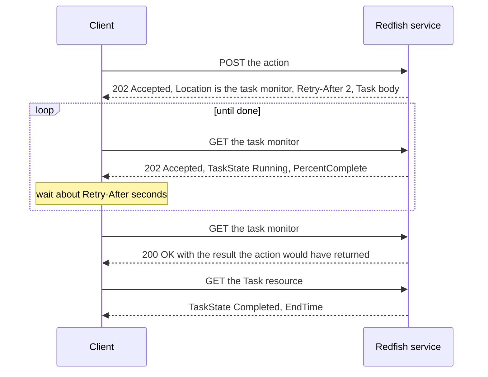

# 7.5 Redfish actions, tasks, events and subscriptions

| | |
|---|---|
| Level | Intermediate |
| Priority tier | 1 |
| Lab venue | Laptop |
| Part | Part 7: Redfish and BMC |
| Status | Drafted (`actions_lab.py`: 34 checks pass against mock; **untested** on live BMC) |

## Why this matters for AI infrastructure

A GPU node stops answering in the middle of a training run. Reading its state is the easy part. The hard part is doing something about it: restarting the node, updating its firmware, or cutting its power. Those operations take time, can fail halfway through, and can be refused outright. A cluster tool therefore needs three things. It needs a way to ask for an operation, a way to wait for it, and a way to hear about trouble without asking every machine every second. When you are on call, you want all three working before the next page arrives.

A fan can fail, or a power supply can drop out, and the tool should learn about it as it happens. Redfish has a concept for each job: **actions** for asking, **tasks** for waiting, and **events** for hearing about trouble.

## Prerequisites and outcomes

This chapter builds on 7.1 to 7.4, so read those first. When you finish, you should be able to:

- find an action on a resource and call it correctly
- explain each `ResetType` and pick the right one
- handle `200`, `202` and `204` answers from an action
- poll a task monitor, show progress and cancel
- subscribe to events and read the event body
- compare push events, server-sent events and polling

## 1. Actions: things you ask a resource to do

Some jobs do not fit into "read a value" or "set a value". Restarting a server is not a setting you can store. Redfish calls these jobs **actions**. An action is sent as a `POST` to a special address. The spec says that address looks like `<ResourceUri>/Actions/<QualifiedActionName>`, and each resource lists its own actions in an `Actions` section.

```json
"Actions": {
  "#ComputerSystem.Reset": {
    "target": "/redfish/v1/Systems/System_0/Actions/ComputerSystem.Reset",
    "ResetType@Redfish.AllowableValues": ["On", "ForceOff", "GracefulShutdown", "GracefulRestart", "ForceRestart", "Nmi"]
  }
}
```

Read the entry as three pieces. `#ComputerSystem.Reset` is the action's name. The `target` is where the `POST` goes, and **Read it from the resource. Do not build it by hand.** The `ResetType@Redfish.AllowableValues` list shows the values this system accepts right now. The spec says that list should contain only values that are both supported and currently valid.

You call the action with a JSON body of parameters:

```bash
curl -s -u user:pass -X POST -H "Content-Type: application/json" \
  -d '{"ResetType": "GracefulRestart"}' \
  https://<bmc>/redfish/v1/Systems/<id>/Actions/ComputerSystem.Reset
```

The spec sets a few rules you have to respect. If a required parameter is missing, the answer is **400**. An unknown parameter value also gets **400**. My mock does this for `ResetType`. If the action needs no parameters, the service must accept an empty `{}`. A `POST` action is not always safe to repeat, because sending it twice may restart the machine twice. If an action would change nothing, such as `On` on a system that is already on, the service should answer **200** with the `NoOperation` message. My mock shows this too. If the service refuses the request, for example because of the wrong privilege or a bad state, you get a 4xx or 5xx answer with an error body.

:::tip PATCH versus the action
I tried `PATCH {"PowerState": "Off"}` on the mock and it answered 400, because `PowerState` is read-only. You can only **read** the power state. To change it you run the `Reset` action. Never look for a writable `PowerState`.
:::

### What each `ResetType` means

Pick the `ResetType` before you send the request, because each value does something different to the host. The table below gives the meanings in plain words, taken from the Redfish Resource Guide (2024.4).

| Value | Meaning |
|---|---|
| `On` | turn the system on |
| `ForceOn` | turn on immediately |
| `GracefulShutdown` | ask the OS to shut down cleanly, then power off |
| `GracefulRestart` | ask the OS to shut down cleanly, then start again |
| `ForceOff` | turn off immediately, with no clean shutdown |
| `ForceRestart` | shut down immediately and non-gracefully, then start again |
| `PowerCycle` | behaves like removing power and then restoring it |
| `FullPowerCycle` | behaves like removing the utility power lines and restoring them |
| `PushPowerButton` | act as if someone pressed the physical power button |
| `Nmi` | send a diagnostic interrupt, non-maskable interrupt, that normally halts the system for diagnostics |
| `Pause`, `Resume`, `Suspend` | mostly for virtual machines |

Use the table as a menu, and follow these four habits when you choose.

1. Start with the graceful options, `GracefulRestart` or `GracefulShutdown`. They let the OS flush disks and stop services.
2. Use `ForceRestart` or `ForceOff` only when the OS is frozen. They can corrupt files and kill running jobs without warning.
3. `PowerCycle` and `FullPowerCycle` are stronger. Reach for them when a restart does not clear a hardware fault.
4. `Nmi` is for debugging a hang. Whether the machine then writes a crash dump depends on how the operating system is set up.

:::note Correction to my notes
The NVIDIA-DevOps notes (volume 10, chapter 1) describe `ForceRestart` as "equivalent to pulling the power plug and plugging it back in". By the Resource Guide's wording that is closer to `PowerCycle`. `ForceRestart` is a non-graceful restart. The notes also say `Nmi` "triggers an OS kernel crash dump". The guide says it generates a diagnostic interrupt, which usually halts the system. Producing a dump is up to the OS. I also did not run any of this on a real DGX.
:::

Before you restart a node in a cluster, drain it in the scheduler (chapter 6.14) so no job loses work.

### Other action features to know

Two features are useful once the basic call works. `@Redfish.ActionInfo` points to a separate resource that describes the parameters, with their names, types and allowed values. You use it when the list is too large to fit inline.

`@Redfish.OperationApplyTime` lets a request say when the operation should take effect. Its values include `Immediate`, `OnReset`, `AtMaintenanceWindowStart` and `InMaintenanceWindowOnReset`. The resource says which of these it supports through `@Redfish.OperationApplyTimeSupport`. For example, you can delete a storage volume on the next reset. Services must run pending operations in the order they were received. The spec covers this in section 7.12, and I did not build it in the mock.

The spec's status table for action responses (DSP0266 §7.11 Table 10) defines four valid `2xx` answers to an Action `POST`. Which one you get depends on whether the action finishes at once, starts a background job, or creates a new resource.

1. `200 OK` means the action completed synchronously. The body is either a schema-defined action response or a standard status message. That message is `Base.1.17.Success`, or `Base.1.17.NoOperation` when the requested state was already active. For example, `ResetType: "On"` on a powered-on node gives `NoOperation`.
2. `201 Created` means the action created a new resource synchronously. The `Location` header points to the new resource URI, and the body follows the action's response schema.
3. `202 Accepted` means the action needs background processing. The `Location` header points to a Task Monitor URI, such as `/redfish/v1/TaskService/TaskMonitors/<id>`. An optional `Retry-After` header and a `Task` representation in the body come with it.
4. `204 No Content` means the action completed synchronously and has no response body.

A client should be ready for all four answers, because the action decides which one comes back.

## 2. Long jobs: 202 and the task monitor

Some operations take longer than a client is willing to wait. A firmware update can run for many minutes. So the service answers **202 Accepted** instead of 200. That means: I took your request, but I am not finished. The diagram below shows the conversation that follows.



Read the diagram from top to bottom. The client posts the action, then checks the monitor until the job is done, then reads the `Task` resource for the final state.

The task monitor is an address the service makes up, and you must treat it as opaque. You do not parse it or build it yourself. It usually looks like `/redfish/v1/TaskService/TaskMonitors/<id>`. While the job runs, a `GET` on the monitor returns 202. When the job ends, the monitor returns the status and body the original request would have returned, as if it had run immediately.

The `Location` header of the 202 answer gives you the monitor's address. An optional `Retry-After` header tells you how long to wait between checks. A `GET` on the monitor must return right away, without blocking.

The `Task` resource sits under `TaskService` and holds the details: `TaskState`, `TaskStatus`, start and end time, `PercentComplete`, and messages. It can also carry a `Payload` object. That object records the original `HttpHeaders`, `HttpOperation`, `JsonBody` and `TargetUri`. The JSON body has its sensitive fields sanitized. The payload is left out when the `Task` sets `HidePayload: true` for security (DSP2046 `Task`).

The spec's rule on task privileges (DSP0266 §13.6) applies no matter who started the task. Services shall enforce the Privilege Registry requirements on all `GET` and `DELETE` operations against the `Task` and `TaskMonitor` resources.

To cancel, send a `DELETE` to the monitor or to the `Task`. If the service allows it, the `Allow` header on the monitor includes `DELETE`. Afterwards the monitor returns 410 or 404. A task that has finished and been cleaned up may also return 410 or 404 if you wait too long, so read the results soon. The spec also says `GET`, `PUT` and `PATCH` should always be synchronous. Even so, your client must be ready for either answer to any method.

The Resource Guide lists these `TaskState` values: `New`, `Starting`, `Pending`, `Running`, `Suspended`, `Interrupted`, `Stopping`, `Cancelling`, `Cancelled`, `Completed`, `Exception` and `Service`. It also lists `Killed`, which is deprecated. `TaskStatus` tells you the result, and it is `OK`, `Warning` or `Critical`.

The loop below puts these rules together. It posts the action, and it only starts waiting when the answer is 202.

```text
start = now
response = POST action
if response.status == 200 or 204: done
if response.status == 202:
    monitor = response.headers["Location"]
    loop:
        wait Retry-After (default 2 seconds)
        r = GET monitor
        if r.status == 202: show PercentComplete, continue
        if 200/201/204: success, read body
        if 4xx/5xx: failure, read error body
        if now - start > limit: give up, report "unknown", do NOT assume success
```

The last line matters most. A timeout is neither a success nor a failure. It is "unknown", and a person or a second check has to decide what happened.

### In my lab

Turning on the mock's "slow BMC" mode makes the restart action return 202. The lab then moves a fake clock forward:

```text
PASS  slow action: 202 Accepted with a Location task monitor [12.2]
PASS  polling the monitor while running returns 202 [12.2]
PASS  halfway: PercentComplete is about 50
PASS  when done the monitor returns the original operation's result: 200 + Success [12.2]
PASS  the Task resource now says Completed with EndTime
PASS  cancelling a finished task is refused: 409
PASS  cancelling a running task: 204 [12.2]
PASS  monitor of a cancelled task answers 410 Gone [12.2]
```

All eight checks shown above pass against the mock. A real BMC may time these steps differently, so treat the mock as a model of the flow and not as proof of real behaviour.

## 3. Events: hear about trouble without asking

Polling 1,000 BMCs every few seconds is wasteful and slow. Most of those requests find nothing new. Redfish has an event service for this job. The BMC tells you when something happens, so you do not have to ask.

### Push events with a subscription

A push subscription takes three steps. First, run a small web server that can receive `POST` requests. This server is the **destination**. Second, `POST` a subscription to the event service. The body names your destination and what you want to hear. Third, when something matches, the BMC `POST`s an Event to your destination.

```json
POST /redfish/v1/EventService/Subscriptions
{
  "Destination": "https://monitor.example/events",
  "Protocol": "Redfish",
  "EventFormatType": "Event",
  "Context": "gpu-rack-7",
  "RegistryPrefixes": ["ResourceEvent"]
}
```

A successful subscription returns 201 Created, with a `Location` header for the new subscription and an `EventDestination` body. Conflicting or unsupported values get 400 back. To stop the events, send a `DELETE` to the subscription. After that, its address answers 404.

The spec section 12.1.5 lists the properties you can use to choose which events reach you. You will use most of them when you write a real filter.

| Property | Meaning |
|---|---|
| `RegistryPrefixes` | only messages from these message registries (like `Base`, `ResourceEvent`, `Alert`) |
| `MessageIds` | only these messages, written without version numbers (`Resource.ResourceCreated`) |
| `ExcludeMessageIds`, `ExcludeRegistryPrefixes` | never these |
| `ResourceTypes` | only events about these resource types |
| `OriginResources` and `SubordinateResources` | only events about these resources, and optionally everything below them |
| `Context` | text you choose, sent back with each event so you know which subscription it came from |
| `DeliveryRetryPolicy` | what the service does when delivery keeps failing |

`Context` is the one to remember. The BMC sends it back with every event, so you can tell which subscription produced the event. The retry policies come from the Resource Guide: `RetryForever`, `RetryForeverWithBackoff`, `SuspendRetries` and `TerminateAfterRetries`. The event service also has `DeliveryRetryAttempts` and `DeliveryRetryIntervalSeconds`. My lab checks that a subscription to a dead address is terminated after three failed deliveries.

An event body, from the lab, looks like this:

```json
{
  "@odata.type": "#Event.v1_6_0.Event",
  "Id": "3",
  "Name": "Event Array",
  "Context": "gpu-rack-7",
  "Events": [
    {
      "MemberId": "1",
      "EventId": "3",
      "EventTimestamp": "2026-10-24T09:12:44Z",
      "Severity": "OK",
      "Message": "PowerState changed from On to Off",
      "MessageId": "ResourceEvent.1.0.ResourceStatusChanged",
      "OriginOfCondition": { "@odata.id": "/redfish/v1/Systems/System_0" }
    }
  ]
}
```

The `MessageId` follows the pattern `<Registry>.<major>.<minor>.<Name>`. Standard registries define what each message means, along with its severity and a suggested action. `OriginOfCondition` points to the resource the event is about, so you can `GET` it to see the current state. Several messages with the same `EventGroupId` come from the same cause. For example, a pulled cable may produce a LAN message, a resource-changed message and a state message.

The spec section 12.1.2 sets a few rules you should keep in mind. There is no history. You receive events only after you subscribe, and the service does not keep old ones. Subscriptions do survive restarts of the service. A pushed payload is at most 1 MiB, and metric reports are excluded from that limit. A service must not push events to anyone who has not subscribed. The spec also marks the older `EventType` style as deprecated. That style covers life cycle, alert and status change events, and the spec now prefers registry prefixes and resource types.

### Server-sent events (SSE)

Instead of running a receiver, the client can open a long `GET` to the address in `ServerSentEventUri` in the event service. The connection stays open, and the service sends events down it. The response is `200` with `Content-Type: text/event-stream`. Each event has an `id:` line and a `data:` line with the Event JSON, and a blank line separates one event from the next. Opening the stream creates a subscription resource, and closing it removes the resource. My lab checks both.

A client that loses the connection can send `Last-Event-ID` to resume. You can also filter the stream with `$filter`, for example `MessageId eq 'ResourceEvent.ResourceStatusChanged'`. The event service lists the filter properties it supports in `SSEFilterPropertiesSupported`.

Each method has a different cost, so compare them before you pick one.

| Method | Good | Watch out for |
|---|---|---|
| **Push subscription** | scales to many BMCs, your receiver is one place | the BMC must reach your receiver, firewalls, retries, you must keep the receiver up |
| **SSE** | simple, works through one outbound connection from you | one open connection per BMC, you must reconnect |
| **Polling** | simplest and most robust | slow, heavy at scale, you can miss short events |

In real fleets, people mix the methods: events for fast alerts, and a slow poll as a safety net. Keep in mind that there is no history. Any event lost during an outage is gone, but a periodic poll still catches the state.

## 4. How BCM uses this

The BCM Administrator Manual (appendix N) shows BCM subscribing to BMC events, and it lists the commands that do the work:

- `redfishsubscriptions` (in `cmsh` device mode) lists each device with its hostname, subscription id, whether it is initialized and subscribed, IP, kind (`GB300` for compute trays and `GB200SW` for NVLink switches in the example), port 443 and whether SSL is on.
- `redfishevent -m test1` sends a test message so you can confirm delivery. The manual's example output shows a warning event such as `[warning] a07-p01-dgx-02-c05: test1`. Running it several times triggers test events from different devices.
- `redfishpost`, `redfishpatch` and `redfishdelete` let an administrator run the same `POST`, `PATCH` and `DELETE` operations described here, across many devices, filtered by node, category or rack.
- `power on|off|reset` in `cmsh` uses the Redfish API on Redfish BMCs. The book says these commands assume AC power to the BMC is on. It uses the term "AC power cycle" for resetting the BMC itself.

Run `redfishevent` once to confirm delivery before you depend on events. I have not run any of these commands myself, because I have no BCM cluster. Part 8 covers BCM.

## 5. The lab

The lab starts a mock service and a small event receiver. Then it runs 34 checks, in four groups:

```bash
cd code/part07
python3 actions_lab.py
```

1. The first group covers discovering the action from the resource, bad parameters, a read-only `PATCH`, privileges, and the NoOperation answer.
2. The second group covers the 202 and task-monitor flow with a simulated clock, plus progress and cancel.
3. The third group covers subscriptions: create, receive, filter, unsubscribe, and delivery failure.
4. The fourth group covers server-sent events with a filter.

A mistake I made while writing the lab taught me something real. The SSE check failed on my first run. My test asked for `ForceOff` when the system was already off, so nothing changed and no event fired. **Events fire on change, not on commands.** A restart that changes nothing sends nothing.

### 5.1 Designing idempotent node power-control workflows

Picture a multi-node training job that stalls. Your recovery controller decides to fence off a wedged compute node and reboot it. The tempting shortcut is a blind `POST` with `ForceRestart`, and that is a dangerous habit. Power actions interact directly with physical voltage regulators, NVMe write caches and in-flight firmware updates. A production power controller therefore treats every reset as a multi-step state change, not a fire-and-forget command.

First, the controller reads the `ComputerSystem` resource to inspect `PowerState`, `Status` and `Actions.#ComputerSystem.Reset`. Reading the resource first tells you two critical facts. You learn whether the node is already powered off, and which `ResetType@Redfish.AllowableValues` the BMC accepts in its current state. On many BMCs, sending `GracefulRestart` or `ForceRestart` while `PowerState` is `Off` returns `409 Conflict`. A stopped machine must be started with `On`, not restarted.

Second, prefer the graceful path first. The exception is a node that is completely unresponsive to kernel signals and is holding up a synchronous job barrier. Issue `GracefulRestart`, or `GracefulShutdown` when you take a node down for maintenance. Then start a bounded polling loop on `PowerState` and `LastResetTime`. A healthy host OS can process the ACPI signal. It then flushes dirty filesystem pages, unmounts network storage cleanly and reboots, and it skips a long filesystem journal recovery at startup. Escalate to `ForceRestart` or `ForceOff` only when the graceful timer expires and `LastResetTime` has not advanced.

Third, be careful with network timeouts between your orchestrator and the BMC. Say your `POST` to `ComputerSystem.Reset` fails with a socket timeout, or with a `504 Gateway Timeout` from a management proxy. Do not send a second `ForceRestart` straight away. The first request may have reached the BMC, and the node may already be halfway through UEFI POST. A second hard reset then interrupts memory training or corrupts a boot loader read. Re-read `PowerState`, `LastResetTime` and the BMC System Event Log before you decide to retry.

### 5.2 Engineering a resilient asynchronous task poller

Long BMC jobs, such as flashing a system BIOS, staging an HGX GPU-tray firmware bundle, or collecting a diagnostic support archive, almost always answer `202 Accepted`. The polling loop in Section 2 looks simple on paper. Three real-world edge cases separate a fragile lab script from a fleet-grade task poller.

The first edge case is a session that expires during a long task. Suppose a GPU-tray firmware update runs for twenty to thirty minutes. The BMC's `SessionTimeout` may be only five or ten minutes. If your poller sleeps for sixty seconds between polls, or fails to renew its token on a `401 Unauthorized`, it crashes partway through. The BMC keeps flashing the hardware in the background, though. As implemented in `redfish_crawl.Client`, your HTTP wrapper should re-authenticate once on a `401` and then resume polling the exact same Task Monitor URI.

The second edge case is a BMC whose web server restarts now and then, or answers `503 Service Unavailable`. The BMC may be busy writing to SPI flash or talking to satellite controllers over internal buses. Its embedded web server can then become briefly overloaded, returning `503` or dropping one TCP connection. Never treat a single `503` or socket timeout on a `GET` to the Task Monitor URI as a failed task. Honor the `Retry-After` header, apply a short backoff, and keep polling. Stop only when the task reaches a terminal state (`Completed`, `Exception`, `Cancelled`) or your overall wall-clock deadline expires.

The third edge case is telling transport success apart from operational success. A finished task gives the Task Monitor `200 OK` (or `201 Created` / `204 No Content`), and the `Task` resource moves to `TaskState: "Completed"`. That sounds like the change happened, but it may not have. As we will see in Chapter 7.10, a firmware update can finish with HTTP `200 OK` even when it was skipped, because the image version was already installed. Another update may only have staged the image and be waiting for an AC power cycle (`AwaitToActivate`), and it also finishes with `200 OK`. Your poller must check `TaskStatus` (`OK`, `Warning`, `Critical`) and read every entry in the task's `Messages` array. Only then should it declare that the requested change took effect.

### 5.3 Scaling event-driven monitoring across a thousand BMCs

Scaling from one test rack to a thousand-node AI factory breaks the simple polling approach. Say you poll forty sensors and seventy-five log entries on every BMC every five seconds. Your monitoring cluster then generates tens of thousands of HTTPS requests per second. Those requests hit slow embedded ARM processors over a `1 GbE` out-of-band network. Slow the interval to five minutes to protect the BMCs, and you may take up to five minutes to notice that a rack PDU circuit tripped or a cooling fan failed.

Redfish resolves this tension by combining push event subscriptions, which detect faults in less than a second, with low-frequency reconciliation polling as a safety net.

In production, you run a redundant pair of HTTPS webhook receivers on your management network. Then you register an `EventDestination` subscription on each BMC with `POST /redfish/v1/EventService/Subscriptions`. Set the `Context` string to name the rack and node role. Filter on the registries you care about: `ResourceEvent`, `Alert`, `TaskEvent` and `Environmental`. Choose a `DeliveryRetryPolicy` such as `RetryForeverWithBackoff`. That way a brief receiver restart does not make the BMC delete the subscription, which `TerminateAfterRetries` would do. Where the BMC supports it, enable `SendHeartbeat` and set `HeartbeatIntervalMinutes`, so the BMC sends a periodic heartbeat even when no hardware faults occur.

Why keep a background poll when push events and heartbeats are active? Because Redfish event streams have no historical buffer. If a top-of-rack switch on the out-of-band network reboots, or a firewall rule blocks webhook delivery for ten minutes, any hardware events emitted in that window are lost from the push stream. A push payload also tells you only that one property changed, at one point in time. So treat the event's `OriginOfCondition` link as a wake-up signal. Your receiver should then `GET` the current state of that resource and its parent `LogService` over a verified TLS session.

Combine instant push notifications with a calm five-minute conditional `GET` sweep, using `If-None-Match`. The push path gives you fast incident response, and the sweep gives you what the chapter calls mathematical certainty that no state change was missed.

## Exercises

1. Run `python3 code/part07/actions_lab.py`, then read the four test sections in `code/part07/actions_lab.py`. They cover synchronous `Reset` and `NoOperation`, the `202 Accepted` task monitor lifecycle with cancellation, push `Subscriptions` with `TerminateAfterRetries`, and `SSE` streaming with `$filter`. Among the 34 checks, pick the five you would trust most in an automated node-reboot runbook, and say why.
2. Start the mock with `python3 code/part07/redfish_mock.py --profile dgx --port 18441`. Find the `#ComputerSystem.Reset` `target` URI on `System_0`, then `POST {"ResetType": "GracefulShutdown"}`. Check that `PowerState` changes to `"Off"`. Send `POST {"ResetType": "ForceOff"}` a second time, and confirm that the mock returns `200 OK` with `Base.1.17.NoOperation`.
3. Write a Python function `wait_for_task(client, monitor_uri, timeout_sec=300)`. It polls a `202 Accepted` task monitor URI and respects the `Retry-After` response header, defaulting to `2` seconds. It logs `PercentComplete` as it goes. When the task finishes, it returns the final `200`/`201`/`204` payload. It raises an error on `4xx`/`5xx`. If `timeout_sec` runs out, it returns an explicit `"UNKNOWN_TIMEOUT"` state.
4. Suppose your automation sends `POST .../Actions/ComputerSystem.Reset {"ResetType": "GracefulRestart"}` through an OOB proxy and gets back `504 Gateway Timeout`. Explain why retrying `ForceRestart` straight away is dangerous. Then name the two Redfish resources you should inspect first: `PowerState` and `LastResetTime` on `ComputerSystem`, and `/LogServices/SEL/Entries`.
5. Design an event pipeline for `500` DGX BMCs. Use push subscriptions with `Protocol: "Redfish"`, `EventFormatType: "Event"`, a `Context` for each rack, `DeliveryRetryPolicy: "RetryForeverWithBackoff"` and `SendHeartbeat: true`. Put the receivers behind a load balancer. Pair them with a low-frequency (`5`-minute) conditional `GET` (`If-None-Match`) reconciliation poll.
6. Explain why an event receiver should treat a push event as a hint, not as the truth. Use `OriginOfCondition["@odata.id"]` to `GET` the authoritative state over TLS. Then explain how `EventService.SubmitTestEvent` (`redfishevent -m test1` in BCM `cmsh`) checks the firewall and receiver routing before a real hardware fault happens.

## 7. Interview angles

- "Redfish returned 202. What now?" Follow the `Location` task monitor, wait `Retry-After` between checks, report progress, and handle the final result. Set a time limit, and if it passes, treat the outcome as unknown.
- "How do you restart 100 nodes safely?" Drain the nodes first. Use the graceful `ResetType`, restart in small batches, and wait for each batch to come back. Stop on the first failure.
- "Push events or polling?" Both. Events give you speed, and polling is the safety net, because events keep no history.
- "What is the difference between `ForceRestart` and `PowerCycle`?" `ForceRestart` is a non-graceful restart. `PowerCycle` removes power and then restores it. Use the weakest option that works.

## Checkpoint questions (20)

<details>
<summary>1. What is a Redfish Action, and why does it use `POST` to a `target` URI instead of `PATCH` on a property?</summary>

An action is a procedure, such as resetting a server, flashing firmware or clearing a log. You cannot model that cleanly as setting a static property value. So a client sends an HTTP **`POST`** to the URI advertised in `Actions.#<ResourceType>.<ActionName>.target` (DSP0266 §7.11, §9.6.14).
</details>

<details>
<summary>2. Why must clients read the action `target` URI from the resource payload rather than constructing `<ResourceUri>/Actions/...` by string concatenation?</summary>

The spec recommends the `<ResourceUri>/Actions/<QualifiedActionName>` pattern. DSP0266 §9.6.14 goes further and says the `target` property inside `Actions` is the normative URL for the action. Reading it from the payload keeps your client compatible with every BMC implementation and proxy gateway.
</details>

<details>
<summary>3. What does `ResetType@Redfish.AllowableValues` tell a client, and how does it differ from the full `ResetType` enumeration in the schema?</summary>

The schema lists every `ResetType` the DMTF defines, such as `On`, `ForceOff`, `GracefulShutdown`, `GracefulRestart`, `ForceRestart`, `PowerCycle`, `FullPowerCycle`, `Nmi` and `PushPowerButton`. `ResetType@Redfish.AllowableValues` is shorter. It lists only the values this specific system supports and currently accepts (DSP0266 §9.9.2).
</details>

<details>
<summary>4. What HTTP status code does a BMC return when a required action parameter is missing or its value is not in `@Redfish.AllowableValues`?</summary>

The BMC returns HTTP **`400 Bad Request`**. The body has an `@Message.ExtendedInfo` error entry, either `ActionParameterMissing` or `PropertyValueNotInList`.
</details>

<details>
<summary>5. Why does `PATCH {"PowerState": "Off"}` on a `ComputerSystem` resource fail with `400 Bad Request`?</summary>

`PowerState` is marked `"readonly": true` in the `ComputerSystem` schema. It reports the current power rail state, so `PATCH` cannot change it. You change power state with a `POST` to the `#ComputerSystem.Reset` action.
</details>

<details>
<summary>6. What is the operational difference between `GracefulRestart`, `ForceRestart`, `PowerCycle`, and `FullPowerCycle`?</summary>

- **`GracefulRestart`:** Tells the host OS, through ACPI, to flush filesystems, stop services cleanly and reboot.
- **`ForceRestart`:** Resets the host right away, with no OS cooperation. Use it only when the OS is hung.
- **`PowerCycle`:** Drops the main DC power rails to the host components, then restores them.
- **`FullPowerCycle`:** Simulates removing and restoring the AC utility power lines. This also resets the standby rails and auxiliary controllers.
</details>

<details>
<summary>7. What does `ResetType: "Nmi"` do, and what determines whether it produces a Linux kernel crash dump?</summary>

`Nmi` sends a hardware **Non-Maskable Interrupt** into the host CPUs. It is a diagnostic interrupt, and it normally halts the system. Whether Linux writes a `vmcore` crash dump depends on the host having `kdump` and `sysctl kernel.panic_on_unrecovered_nmi=1` configured.
</details>

<details>
<summary>8. What does HTTP `200 OK` containing a `Base.x.y.NoOperation` message mean when returned by an Action (DSP0266 §7.11)?</summary>

The action was valid, but it had no effect, because the system was already in the requested state. For example, sending `{"ResetType": "On"}` to a server whose `PowerState` is already `"On"` returns this message.
</details>

<details>
<summary>9. What does HTTP `202 Accepted` mean, and which two response headers should the client read from a `202 Accepted` response?</summary>

`202 Accepted` means the BMC accepted the request and will run it in the background. The work is **not finished yet**. The client reads two headers. `Location` gives the Task Monitor URI to poll. `Retry-After` says how many seconds to wait between polls.
</details>

<details>
<summary>10. What does `GET` on a Task Monitor URI return while the background job is still running, versus once the job finishes (DSP0266 §12.2)?</summary>

- **While running:** Returns **`202 Accepted`**, with the in-progress `Task` JSON showing `TaskState: "Running"` and `PercentComplete`.
- **Once finished:** Returns the **exact final status code** (`200`, `201`, `204`, or `4xx`/`5xx`) and the body the original request would have returned if it had run synchronously.
</details>

<details>
<summary>11. How does a client cancel a running asynchronous task, and what status code does its Task Monitor URI return after cancellation?</summary>

Send a `DELETE` to the Task Monitor URI, if `Allow` includes `DELETE`, or to the `Task` resource URI. A successful cancel returns `204 No Content`. If the task already finished, you get `409 Conflict` instead. After that, a `GET` on the cancelled monitor returns **`410 Gone`**, or `404 Not Found`.
</details>

<details>
<summary>12. If a script's polling timer expires while a Task Monitor is still returning `202 Accepted`, how should the script classify the outcome?</summary>

It should classify the state as **`UNKNOWN` (timed out)**. It must never assume the operation succeeded. It must also never assume it failed cleanly until it has checked the target resource and task status.
</details>

<details>
<summary>13. What are the meanings of `TaskState` values `Running`, `Completed`, `Exception`, and `Cancelled`, and what property gives the final health outcome?</summary>

- **`Running`:** The asynchronous operation is actively executing.
- **`Completed`:** The operation finished normally.
- **`Exception`:** The operation stopped because of an error.
- **`Cancelled`:** A `DELETE` request aborted the operation.

The **`TaskStatus`** property (`"OK"`, `"Warning"`, `"Critical"`) gives the severity or health of the finished or failed task.
</details>

<details>
<summary>14. How do you subscribe to Redfish push events, and what status code and headers are returned (DSP0266 §12.1.2)?</summary>

Send `POST /redfish/v1/EventService/Subscriptions` with a JSON body. It must include `"Destination"`, which is your HTTPS webhook receiver URL, and `"Protocol": "Redfish"`. You can add filters such as `RegistryPrefixes`, `ResourceTypes` and `Context`. The BMC answers **`201 Created`** with a `Location` header that points to the new `EventDestination` subscription.
</details>

<details>
<summary>15. What is the purpose of the `Context` property in an `EventDestination` subscription?</summary>

`Context` is a string you choose, such as `"gpu-rack-7"` or a correlation token. The BMC echoes it back unchanged in every pushed `Event` for that subscription. Your central receiver can then tell which subscription or rack rule produced the event.
</details>

<details>
<summary>16. Does subscribing to `/redfish/v1/EventService/Subscriptions` replay historical hardware events that occurred before the subscription was created (DSP0266 §12.1.2)?</summary>

**No.** Redfish eventing is a live notification stream with **no historical replay**. Old records live in `/LogServices/SEL/Entries`. Pushed payloads are capped at `1 MiB`, not counting metric reports. Subscriptions persist across BMC reboots.
</details>

<details>
<summary>17. What are the four `DeliveryRetryPolicy` options on an `EventDestination`, and what does `TerminateAfterRetries` do?</summary>

The four policies are **`RetryForever`**, **`RetryForeverWithBackoff`**, **`SuspendRetries`** and **`TerminateAfterRetries`**. With `TerminateAfterRetries`, the BMC deletes the subscription on its own once it has failed `DeliveryRetryAttempts` times in a row to deliver to `Destination`. After that, a `GET` on the subscription returns `404`.
</details>

<details>
<summary>18. What is `OriginOfCondition` inside an `Event` record, and what is `EventGroupId`?</summary>

- **`OriginOfCondition`:** An `{"@odata.id": "..."}` link to the specific resource that triggered the event, such as `Systems/System_0` or `Sensors/Fan_1`.
- **`EventGroupId`:** An integer shared by separate event records that came from the same physical incident. For example, one pulled cable can trigger link-down, redundancy-lost and status-changed events.
</details>

<details>
<summary>19. How do Server-Sent Events (SSE, DSP0266 §12.5) differ from push subscriptions in connection direction, `Content-Type`, and subscription lifecycle?</summary>

With **SSE**, the client opens one long-lived outbound **`GET`** to `ServerSentEventUri`, which is `/redfish/v1/EventService/SSE`. You do not need an inbound webhook server that is reachable through your firewalls. The BMC answers `200 OK` with **`Content-Type: text/event-stream`** and streams `id:` and `data:` lines. Opening the stream creates a subscription in `Subscriptions`. Closing the TCP stream removes that subscription automatically.
</details>

<details>
<summary>20. Why do production AI fleets combine Redfish push events (or SSE) with periodic low-frequency polling?</summary>

Push events give sub-second notice when a power supply fails or a GPU overheats. But events keep **no history**, and they can be dropped during an out-of-band network partition or a receiver restart. A periodic background poll, or a `SendHeartbeat` check, guarantees eventual consistency.
</details>

## Sources and review notes

- **Redfish Specification DSP0266 v1.21.0:** `POST` (action) rules and status table (7.11), operation apply time (7.12), eventing, subscription properties and event formats (12.1), asynchronous operations and task monitors (12.2), server-sent events (12.5). I read these clauses.
- **Redfish Resource and Schema Guide DSP2046 (2024.4):** `ComputerSystem` `ResetType` and `PowerState` definitions, `Task` and `TaskState`, `EventDestination` (`DeliveryRetryPolicy`, `SubscriptionType`), `EventService`.
- **BCM 11 Administrator Manual**, appendix N: `redfishsubscriptions`, `redfishevent`, `redfishpost`, `redfishpatch`, `redfishdelete`, and Redfish-based power control.
- **NVIDIA-DevOps notes (volume 10 chapter 1):** the Reset example and `ResetType` list. See the correction in section 1.
- **Run here:** `actions_lab.py` (34 checks).
- **Not verified:** real BMC behaviour (timing, which `ResetType` values exist, event content, event registries). The mock sends one simplified event type. The `@Redfish.OperationApplyTime` and `@Redfish.ActionInfo` features were read in the spec but not built or tested.
