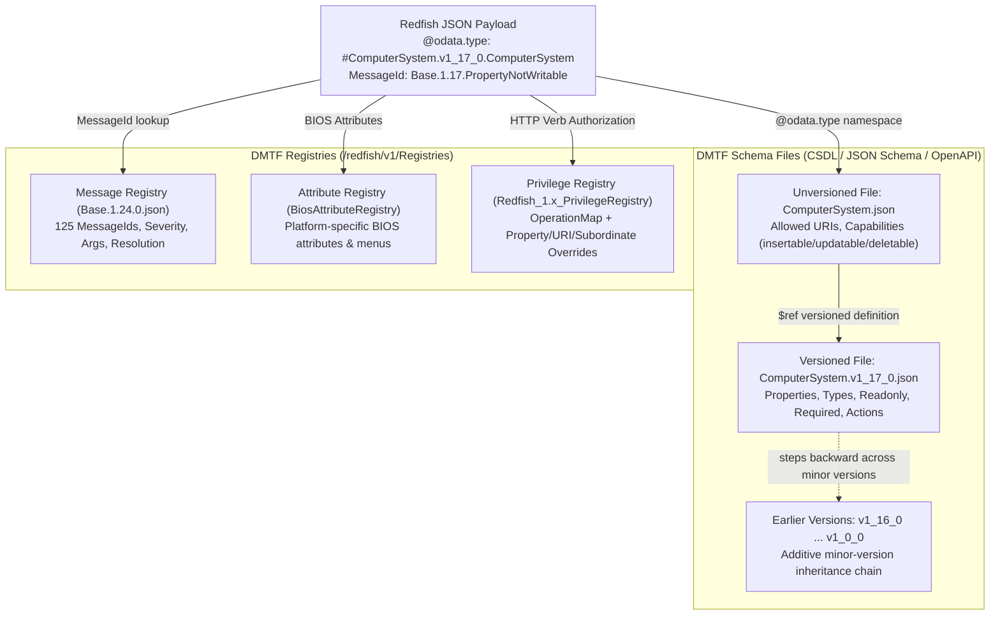

# 7.6 The Redfish schema: reading CSDL, JSON Schema and the Resource Guide

| | |
|---|---|
| Level | Intermediate |
| Priority tier | 1 |
| Lab venue | Laptop |
| Part | Part 7: Redfish and BMC |
| Status | Drafted (`schema_lab.py`: 11 checks pass; **untested** on live BMC) |

## Why this matters for AI infrastructure

Picture a BMC that returns a property you did not expect, or a script that stops working after a firmware update. Both problems have the same cure: the published contract. Every Redfish answer follows that contract. If you can read it, you never need a vendor manual to ask what a property means, whether you can write it, or whether it is new or old. You can also test any tool or BMC against the contract, which catches mistakes before they reach production.

Think about the on-call moment when a dashboard shows a sensor reading that the team has never seen before. Without the schema, the team argues about what the number means. With the schema, the team opens one file, reads the long description, and knows whether the value is a fact the BMC must report or a hint the vendor added. This chapter shows you how to do that reading yourself.

## Prerequisites and outcomes

You need chapters 7.2 and 7.3 before you start. The chapter starts with the three file formats that carry the schema, then shows how to turn an `@odata.type` string into a file name. It moves on to versioning, to the Resource Guide's property tables, and to the annotations that appear in answers. After that it covers message registries, which give errors and events their text, and OEM extensions, which are the vendor's own additions. The lab at the end checks a mock service against DMTF's official files, so you can see the contract catch real mistakes.

## 1. One model, three file formats

Suppose you open the DMTF files for the first time and find three formats that seem to hold the same data. That is by design. Redfish describes its data model in the schema, and the spec publishes that same model in three formats. Each format suits a different kind of tool, so you should know all three.

| Format | What it is | Who uses it |
|---|---|---|
| CSDL (OData Common Schema Definition Language) | XML | OData tools, the `$metadata` document |
| JSON Schema | JSON | validators and programmers (the easiest to use in Python or Go) |
| OpenAPI YAML | YAML | API tools and code generators (supported from Redfish protocol 1.6.0) |

The three formats say the same thing in different languages. The spec calls itself "schema-language agnostic." That phrase means the data model does not depend on any one file format. It also says the protocol and the data model are versioned separately, so a service can change its protocol version without changing every schema, and the other way round.

There is also a human-readable guide, the Redfish Resource and Schema Guide (DSP2046). It lists every standard resource with its properties, actions and an example. If you read only one document about the data model, read that one. The Data Model Specification (DSP0268) is the formal text behind it. A useful habit is to start with the guide to get oriented, and then open the formal text when you need the exact wording of a rule.

DMTF publishes all of these together. DMTF is the Distributed Management Task Force, the standards body behind Redfish. The GitHub repository `DMTF/Redfish-Publications` holds the folders `csdl`, `json-schema`, `openapi`, `registries`, `profiles`, `dictionaries` and `mockups`. The lab uses that repository, and the rest of this chapter refers to its folders by name.



Read the diagram from the payload at the top. The payload points at a schema through its type, at a message through its ID, and at a privilege rule through the HTTP verb it used. Each arrow answers one question you will ask while debugging.

Choosing a format is mostly a question of who will read the file. A person reading a property list wants the Guide, a validator wants JSON Schema, and a code generator wants OpenAPI or CSDL. Pick the format that matches the reader, and you will spend less time converting between them.

If you are writing a script by hand, start with the Resource and Schema Guide. Reach for the JSON Schema files when you need to validate a payload automatically. Reach for CSDL only when an OData tool asks for it.

## 2. From `@odata.type` to the schema file

Picture a script that gets back a JSON answer and needs to know what the object is before it reads any field. A BMC answer says what kind of thing it is. You can see it in the `@odata.type` field, such as `#ComputerSystem.v1_17_0.ComputerSystem`. Read that string in three parts, and it tells you which schema file to open. The table below shows what each part means.

| Part | Meaning |
|---|---|
| `ComputerSystem` | the resource type (the namespace) |
| `v1_17_0` | the version: major 1, minor 17, errata 0 |
| `ComputerSystem` | the type name inside that version |

The first part is the family, the second part is the exact release, and the third part is the name of the object inside that release. Most of the time the first and third parts match, so the string reads like a sentence that repeats itself. The version is the part that changes when the vendor updates the firmware.

The files follow simple naming rules from the spec. The table shows the names for each format.

| Format | Versioned file | Unversioned file |
|---|---|---|
| JSON Schema | `ComputerSystem.v1_17_0.json` | `ComputerSystem.json` |
| CSDL | one file per major version: `ComputerSystem_v1.xml`, holding every minor version as a separate namespace such as `ComputerSystem.v1_17_0` | the namespace `ComputerSystem` inside that file |

Why keep both a versioned and an unversioned file? The spec's answer is that references from other resources use the unversioned definition, so nothing depends on one particular version. The unversioned file has no property details. It holds the list of versions, the allowed URIs (such as `/redfish/v1/Systems/{ComputerSystemId}`) and the capabilities, meaning whether you can create, update or delete. The versioned file holds the real properties and actions for that version. Think of the unversioned file as the front door of a building, and the versioned file as the floor plan for the year the building was renovated.

You can see this split in the schema helper in the chapter's code folder:

```text
$ python3 schema_tools.py explain Chassis.v1_23_0
Chassis v1_23_0: The Chassis schema represents the physical components of a system. ...
URIs: /redfish/v1/Chassis/{ChassisId}
capabilities: insertable=False updatable=True deletable=True
```

Read the capabilities line with care. `insertable=False` means you cannot `POST` to create a chassis. `deletable=True` is a property of the schema, not a promise from your BMC. A service may implement a subset of what the schema allows. So a capability tells you what the standard permits, and the BMC's own answers tell you what it actually does.

## 3. Versioning: what a client must do

A script that works on one BMC can break on another after a firmware update, even when both speak Redfish. Versioning explains why, and it tells you what your client should do about it. Every version has three numbers. The major number marks a break in compatibility, and that is rare. The minor number means new things were added and nothing was removed. The errata number marks a fix to an earlier version, such as a corrected description.

The rules below matter most when you write a client.

1. Newer minor versions only add things. A client written for 1.4 can therefore still read a 1.17 answer.
2. A payload must follow the version it claims. A `v1_0_0` payload cannot carry a property added in v1_5_0. The lab proves this with the official schema.
3. Ignore what you do not know. The spec says clients "should not fail reading the resource due to unrecognized annotations." Enumeration values can also be added later, so do not crash on an unknown value.
4. Step backwards to find a definition. For a structured property, the spec says to step the version back, through 1.4.0, 1.3.0, 1.2.0 and so on, until you find where the property is defined.
5. Deprecated is not removed. A deprecated property is marked with the version in which it was deprecated and with the preferred replacement. Services may still implement it, and new code should move on. Removal can only happen in the next major version.

A story helps here. Picture a fleet team that upgrades its BMCs, and a script that has worked for a long time begins to fail on only a few machines. The newer firmware added a property, and the script's parser treated every unknown field as an error. Rule 1 and rule 3 would have prevented the outage, because a client that ignores what it does not know keeps working through the upgrade.

Rule 4 sounds abstract until you meet it in a real property. Suppose a payload has a structured property that your client does not recognize in the current version. You look in the versioned file for that version, and it is not there. The spec tells you to step back to the previous minor version, and then the one before that, until you find the file that defines it. Each step back is a fact about history, and it tells you when the property was first introduced.

You will meet a real example soon. Older BMCs report power and heat through `Chassis/<id>/Power` and `Chassis/<id>/Thermal`. Newer ones use PowerSubsystem, ThermalSubsystem and Sensors instead. The schema lists the old URIs as deprecated, under `Redfish.DeprecatedUris`. Chapter 7.8 handles both generations.

Build your client to skip what it does not recognize, and to check the deprecation markers before it relies on an old URI. A client that does this keeps working through firmware upgrades, and it also tells you early when a fleet is still using URIs that will eventually disappear.

## 4. Reading the Resource Guide

When a property name confuses you, the Resource Guide is the place to check it. Picture a colleague who asks what `PowerState` can hold, and whether a script is allowed to change it. Every resource in DSP2046 follows the same layout, so once you know the pattern you can read any entry. Each entry has six parts, in this order:

1. its name, current version and description
2. release history (which DMTF bundle added each version)
3. the URIs where it can appear
4. a property table
5. its actions
6. an example JSON payload

The property table answers most of your questions, so learn its columns first. The table below explains each one.

| Column | How to read it |
|---|---|
| Property | the exact, case-sensitive name. `(v1.13+)` means added in that version. `(deprecated v1.13)` means obsolete since then |
| Type | `string`, `number`, `boolean`, `object`, `array`. `(enum)` marks an enumeration, `(URI)` a link. Units are usually in the name (`SpeedRPM`) |
| Attributes | `read-only` or `read-write`, `required`, and `(null)` if the value can be null |
| Notes | the meaning |

A script can produce the same information with the explain command. Here is a shortened result for `Sensor`.

```text
property                           type           access     notes
Accuracy                           number,null    read-only  deprecated v1_8_0
AverageReading                     number,null    read-only  added v1_4_0
Id                                 Id             read-only  required
Manufacturer                       string,null    read-only  added v1_9_0
PeakReading                        number,null    read-only
...
```

Read the output row by row, and keep the question of each column in mind as you go. The `access` column tells you whether a client can write the property at all. The `notes` column tells you which version the property belongs to, so you know whether an older BMC can be expected to have it. A property marked `required` must appear in every instance, so your parser can rely on it. Everything else is optional, and your code should cope when it is missing.

You can also ask for one property in full.

```text
$ python3 schema_tools.py explain ComputerSystem.v1_17_0 --prop PowerState
{ "anyOf": [ {"$ref": "#/definitions/PowerState"}, {"type": "null"} ],
  "description": "The current power state of the system.",
  "longDescription": "This property shall contain the power state of the system.",
  "readonly": true }
```

The `readonly: true` line explains why `PATCH PowerState` failed in chapter 7.5. The long description holds the formal rule. When it says "shall", a conforming service must do what it describes. The short description is for people who skim, and the long description is the one a test should be written against.

### The annotations on schema elements

Section 9.13 of the spec defines the markers below, which appear on properties and types. You will see them whenever you read a schema. Each marker answers a question that a client would otherwise have to guess at.

| Annotation | Meaning |
|---|---|
| Description / Long description | text for people, and the normative rule |
| Permissions | read-only, read-write. A service may make a writable property read-only. A write-only property such as `Password` shall be `null` in responses |
| Required | the service must support it |
| Required on create | the client must send it when creating |
| Units of measure | the unit, written in UCUM style (`Cel`, `W`, `Mbit/s`) |
| Resource URI patterns | the allowed addresses, e.g. `/redfish/v1/Chassis/{ChassisId}`. The text in braces must equal the resource's `Id` |
| Resource capabilities | can it be inserted, updated, deleted |
| Additional properties | whether extra properties are allowed. Mostly not |
| Expanded resource | the service always expands this link in responses |
| Deprecated | since which version, and what to use instead |

## 5. Payload annotations you will see in answers

Picture a BMC answer that includes a field called `ResetType@Redfish.AllowableValues` and you do not know whether to trust it. Answers carry more than the data itself. They can also hold annotations, written as `Property@Namespace.Term`. The spec limits these to the `odata`, `Redfish` and `Message` namespaces. A namespace here is a labelled group of names, so you can tell which document defined a marker. You have already met some of them, and the table below lists the ones you will see most.

| Annotation | Where | Meaning |
|---|---|---|
| `@odata.id`, `@odata.type`, `@odata.etag` | any resource | address, type, version label |
| `Members@odata.count`, `Members@odata.nextLink` | collections | total and next page |
| `ResetType@Redfish.AllowableValues` | actions | the values this action accepts now |
| `@Redfish.AllowablePattern`, `@Redfish.AllowableNumbers` | writable properties | a regular expression or numeric ranges that the value must follow. Example from the spec: `"AssetTag@Redfish.AllowablePattern": "^[\\w:-]{0,31}$"` |
| `@Message.ExtendedInfo` | answers and errors | extra messages (chapter 7.3) |
| `@Redfish.Settings` | settings-capable resources | where to write pending changes (BIOS, chapter 7.7 and 7.9) |
| `@Redfish.OperationApplyTime` | requests | when to apply (chapter 7.5) |

A client may ignore any annotation it does not understand, but it must not fail because of one. Think of an annotation as a sticky note on a box. The box still holds the same data, and the note only tells you how to treat it. Ignoring a note you do not understand is safe, but throwing the whole box away because of the note is not. The `@odata.etag` value deserves a special mention. It is a version label for one resource, and a client can use it to ask whether the resource changed since the last read, so it avoids downloading the same data again.

## 6. Message registries: how errors and events get their text

Picture a PATCH that fails on a busy afternoon, and the only thing on the screen is a short code. When a BMC rejects a request, the reply carries a MessageId, not a finished sentence. A MessageId is a short, stable code, and the BMC does not write the sentence for you. The ID points into a message registry, which is a JSON file listing all the messages of one group. The ID has the format `<RegistryPrefix>.<major>.<minor>.<MessageName>`. For example, `Base.1.17.PropertyNotWritable` names the message for a read-only property.

Each registry entry holds the message text with placeholders (`%1`, `%2`), the severity, the number and meaning of the arguments, and a suggested resolution. A placeholder is a slot that the BMC fills with the name or value that caused the problem. Here is a real entry from the official Base registry.

```json
"PropertyNotWritable": {
  "Message": "The property '%1' is a read-only property and cannot be assigned a value.",
  "Severity": "Warning",
  "NumberOfArgs": 1,
  "Resolution": "Remove the property from the request body and resubmit the request if the operation failed."
}
```

Read the entry as a short recipe. The `Message` is the sentence a person sees, with `%1` replaced by the property name from the request. The `Severity` says how serious the event is. The `NumberOfArgs` tells your parser how many slots to expect. The `Resolution` is the advice you can paste into a ticket. Your code can use all four fields without understanding any English.

The spec lists three kinds of registries. The table below shows what each one holds, and the kind you will use most is the message registry.

| Registry | What it holds |
|---|---|
| Message | the text behind a `MessageId`, used in errors and events. The most common kind |
| Attribute | meaning, type and allowed values for BIOS-type settings, which differ per platform (so no fixed schema can exist). Chapter 7.7 and 7.9 |
| Privilege | which privileges are needed for which operation on which resource (chapter 7.4) |

The DMTF repository's `registries` folder holds the standard message registries, including Base, ResourceEvent, Update, Power and Environmental. The latest Base registry, version 1.24.0, holds 125 messages. A BMC also publishes the registries it uses at `/redfish/v1/Registries`, so a client can fetch the exact text for its own firmware. That matters when the vendor has tuned a sentence or added a message that the public file does not have yet.

Two practical points matter here. The same MessageId can appear in logs, events and errors, so one lookup table serves all three. Vendors add OEM registries for their own messages, but they must not change the standard ones. That rule means a standard MessageId always means the same thing, no matter which vendor's BMC returned it.

Keep your tool's logic on the MessageId, and use the registry text only when a person needs to read it. A string match on the English sentence breaks the moment a vendor changes a word. A match on the ID keeps working.

Here is how that looks in an alert pipeline. A monitoring job receives an error from a BMC. It reads the MessageId, looks up the Severity in the registry, and decides whether to page a person or to open a low-priority ticket. The English text is then copied into the ticket for the human, but the decision itself never depends on that text.

## 7. OEM extensions

Sometimes the standard has no property for what your hardware reports. Picture a GPU baseboard that exposes a health counter the standard never defined. Vendors handle this by adding their own properties and actions under `Oem`, which looks like this:

```json
"Oem": { "Contoso": { "Ping": "..." } }
```

Section 9.4 of the spec sets four rules for this. Vendor data goes under `Oem`, grouped by vendor name, and a client may ignore it. Vendors may define new resource types and actions, but these must follow the same schema and protocol rules. OEM action names look like `#Contoso.Ping` and bind to the `OemActions` part of the resource. OEM query parameters look like `OEM-<Vendor>-<Name>`.

OEM data is the one place where the standard stops helping you. A script that reads a standard property works on any conforming BMC, but a script that reads an OEM property works only on the vendor that defined it. Keep that trade-off in mind before you reach for an OEM field.

A script that depends on OEM data works on one vendor only. NVIDIA's DGX and HGX systems expose their GPU and NVSwitch data partly through standard resources and partly through NVIDIA OEM extensions. Chapter 7.13 covers what the NVIDIA notes say about this. That claim comes from those notes and still needs checking against NVIDIA's own documents.

Use OEM data only when no standard property exists, and keep any vendor-specific code in one place. That way, one vendor's change does not break the rest of your tool. A single module that wraps the OEM calls is easy to replace when the next firmware arrives.

## 8. The lab: use the schema to test a service

Picture a team that is about to trust a new schema tool on production BMCs. Before anyone does that, the tool has to prove that it can tell good data from bad. The lab does that with DMTF's own files and a few lines of setup. You need the DMTF repository and two Python packages. These steps were run against the mock and DMTF's files, not against a live BMC.

```bash
git clone --depth 1 https://github.com/DMTF/Redfish-Publications.git
export REDFISH_PUBLICATIONS=$PWD/Redfish-Publications
python3 -m venv v && v/bin/pip install jsonschema referencing
cd code/part07
../../v/bin/python schema_lab.py
```

The path to `python` depends on where you put the virtual environment. The lab runs 11 checks, and each one shows up as a line of output.

```text
PASS  validator accepts all 271 resources of DMTF's public-rackmount1 example
PASS  an unknown property is rejected
PASS  a value outside the enumeration is rejected
PASS  the wrong JSON type is rejected
PASS  a missing required property (Id) is rejected
PASS  null is allowed where the schema says nullable (AssetTag)
PASS  annotations (Prop@Namespace.Term) and Oem extensions are allowed
PASS  a v1_0_0 payload cannot carry properties added later (versioning rule, 9.14)
PASS  the same data is valid under the version it really is (v1_29_0)
PASS  all 167 resources of our mock validate against the official schemas
PASS  every MessageId our mock returned (14 different ones) exists in the official Base registry
```

The first five lines are tests of the validator itself. They show that it rejects a bad property, a bad value, a bad type and a missing field. The next lines test the rules of versioning and annotations. The last two lines test the mock. Reading the list in that order tells you what each part of the lab is protecting.

### What it found in the mock

The validator found real mistakes in the mock service. The mock was written for chapters 7.2 to 7.5, and when it was first checked, 7 of its 30 resources were invalid, and two message IDs did not exist. These were ordinary mistakes, the kind a person writes by hand when working from memory of the spec. The list below shows what the validator flagged:

1. The service root had a property `TaskService`. The real property is `Tasks`, which links to the task service.
2. `AccountService` used an old version number but also a property (`HTTPBasicAuth`) that was added later.
3. `ManagerAccount` was missing the required `AccountTypes`.
4. A fan sensor had `ReadingType: "Fan"`. The allowed value is `Rotational`.
5. Two error message IDs, `ActionParameterValueNotInList` and `QueryParameterUnsupported`, are not in the Base registry. They were replaced with registry messages, `PropertyValueNotInList` and `QueryNotSupported`.

After the fixes, all 30 resources validated. The mock has since grown to 167 resources, covering GPUs, NICs, drives, firmware, certificates and logs, and all of them still validate. These are the kinds of errors a hand-written tool or careless BMC firmware makes. A person reading JSON by eye would miss most of them, which is the whole reason to let a validator do the reading.

### Validating a real service

The crawl command does the full job. It logs in, walks the whole service and validates every resource it finds. Think of it as a building inspector who visits every room, not just the lobby.

```bash
python3 schema_tools.py crawl https://<bmc-address> <user> <password>
```

The crawl ran against DMTF's example trees, served by the mock in its read-only mode with `redfish_mock.py --mockup <folder>`. The table shows the results.

| DMTF example | Resources | Valid by official schema |
|---|---|---|
| `public-rackmount1` | 270 | 270 |
| `public-liquid-cooled-server` | 241 | 241 |
| `public-cooling-unit` | 67 | 67 |
| `public-pdu` | 198 | 198 |
| `public-power-shelf` | 101 | 99 |

Even DMTF's own power-shelf example has two failing resources. One `Status` condition uses a property name, `MessageSeverity`, that the schema does not list. That is a useful lesson. **The schema is the authority, and published examples can have errors too.** When a check fails, first ask whether your tool is wrong, then ask whether the schema is wrong, and only then ask whether the example is wrong.

Run the crawl against a real BMC only with permission, and expect real findings. Many BMCs have small deviations from the standard. Decide with your vendor which ones matter, because some deviations are harmless and some break a script.

### Using the example trees

The `mockups` folder is a free library of realistic Redfish trees. It covers rack servers, liquid-cooled servers, PDUs, power shelves, cooling units, storage, CXL, telemetry and more. CXL is an interconnect standard for memory and accelerators. You can serve any of them with the mock and practise your scripts against it, without touching a live machine.

```bash
python3 redfish_mock.py --mockup $REDFISH_PUBLICATIONS/mockups/public-liquid-cooled-server --port 8443
python3 redfish_crawl.py http://127.0.0.1:8443 admin adminpass
```

In mockup mode, the data is read-only. The login accounts are the same fake ones as before. The next chapters use these trees, so it is worth getting comfortable with them now.

### 8.1 How CSDL, JSON Schema, and OpenAPI fit together in practice

Why does DMTF publish the exact same Redfish data model in three separate file formats? And when will you meet each one in your daily work as an infrastructure engineer? Picture a team that has three tools to build. One is an enterprise client generator, one is a Python checker, and one is an API documentation portal. Each tool wants a different format.

The primary source of truth inside DMTF's own specification process is OData CSDL (Common Schema Definition Language), written in XML (`*_v1.xml`). When a client queries `/redfish/v1/$metadata` on a BMC, the BMC returns a CSDL XML document. That document lists the exact schemas and entity types the firmware build implements. CSDL is expressive. It captures OData navigation properties, action bindings and capability annotations cleanly. That is why enterprise OData client generators and DMTF's `Redfish-Service-Validator` read CSDL directly.

Most infrastructure engineers writing Python, Go or Rust tools, however, do not want to parse XML namespaces and XPath expressions just to check a JSON response body. So DMTF compiles every CSDL schema into JSON Schema (`*.json`). In JSON Schema, each version of a resource, such as `ComputerSystem.v1_17_0.json`, is a self-contained JSON document. It uses the standard `properties`, `required`, `type`, `enum` and `$ref` keywords. With fifty lines of Python using `jsonschema` and `referencing`, as in `code/part07/schema_tools.py`, you can validate any live BMC response or mock payload against the official standard in milliseconds. That is the format this chapter's tools use most.

The third format, OpenAPI v3.0 YAML (`openapi.yaml`), serves API gateways, documentation portals such as Swagger UI and Redoc, and REST client stub generators such as `openapi-generator`. JSON Schema checks one resource payload at a time, based on its `@odata.type`. OpenAPI maps the URL path templates, such as `/redfish/v1/Systems/{ComputerSystemId}`, and the HTTP verbs (`GET`, `PATCH`, `POST`, `DELETE`) across the whole service tree. All three formats come from the same DMTF model, so you can pick the one that fits your tool. Read the Resource and Schema Guide (DSP2046) when you design a script by hand. Use JSON Schema in your automated CI test suites. Point OData or OpenAPI generators at `csdl/` or `openapi/` when you scaffold a typed SDK.

### 8.2 Stepping through `$ref` resolution and `allOf` version chains

When you open an official Redfish JSON Schema file inside `$REDFISH_PUBLICATIONS/json-schema/` for the first time, its structure can look surprising, especially if you are used to flat JSON Schemas. The best way to understand it is to trace how `code/part07/schema_tools.py` resolves a type such as `#ComputerSystem.v1_17_0.ComputerSystem`.

Every Redfish resource has an unversioned file, such as `ComputerSystem.json`, and a family of versioned files, from `ComputerSystem.v1_0_0.json` through `ComputerSystem.v1_23_1.json`. Suppose another resource, `Chassis`, links to a `ComputerSystem` inside `Links.ComputerSystems`. The `Chassis` schema does not point to a specific version such as `v1_17_0`. If it did, upgrading `ComputerSystem` to `v1_18_0` would mean updating `Chassis` and every other schema that links to it. Instead, cross-resource `$ref` pointers always reference the unversioned schema, `http://redfish.dmtf.org/schemas/v1/ComputerSystem.json#/definitions/ComputerSystem`. That schema uses an `anyOf` array, which accepts any published version of `ComputerSystem`. It also accepts an id-ref object, `{"@odata.id": "..."}`, for a link that is not expanded inline.

Now take a concrete payload that declares `"@odata.type": "#ComputerSystem.v1_17_0.ComputerSystem"`. Your validator must check it against the versioned file `ComputerSystem.v1_17_0.json`, not against the unversioned wrapper. Inside that versioned file, the schema sets `"additionalProperties": false`. The one exception is pattern properties that match OData, Redfish and Message annotations such as `@odata.*` and `@Redfish.*`. Everything else must be a property listed for version 1.17.0 or earlier. In other words, the version in the type string is a promise, and the validator holds the payload to it.

This is why Check 8 in `code/part07/schema_lab.py` is such a strong test of BMC firmware quality. A check like this is cheap to run and hard to fake, because the vendor cannot simply skip the version string without also breaking the schema. Imagine a BMC vendor who takes an old `v1_0_0` payload template and adds newer properties such as `BootProgress` or `LastResetTime`. If the vendor does not change the `@odata.type` string from `v1_0_0` to the minor version that introduced those properties, the official JSON Schema validator flags an `additionalProperties` violation right away. The reverse case is caught too. If a BMC claims `v1_20_0` but leaves out a required property, or spells a sensor's `ReadingType` as `"Fan"` instead of `"Rotational"`, the enum and required checks catch it at once.

### 8.3 Using Message and Attribute Registries to build self-diagnosing tools

Picture an older IPMI script that broke after a firmware update because the error text changed by one word. Legacy IPMI scripts usually handled errors by matching fragile substrings in `ipmitool` stderr output. They then hoped that text would not change across firmware releases. Redfish replaces those ad-hoc strings with Message Registries and Attribute Registries. Error handling and BIOS configuration both become simple, reliable table lookups.

When a Redfish operation returns a `4xx` or `5xx` error, or a `200 OK` with partial-update warnings, or an asynchronous `Task` with progress notes, each entry in `@Message.ExtendedInfo` or `Task.Messages` carries a machine-readable `MessageId`. Examples are `Base.1.17.PropertyNotWritable` and `Update.1.0.AwaitToActivate`. The first three dot-separated tokens, such as `Base.1.17`, tell your tool which registry file to open. The fourth token, such as `PropertyNotWritable`, is the exact key inside that file's `"Messages"` object.

Once you load the DMTF registries from `$REDFISH_PUBLICATIONS/registries/`, or download the BMC's own `/redfish/v1/Registries` collection, your automation can do a lot. It can read the `Severity` (`OK`, `Warning` or `Critical`), fill the `MessageArgs` into the `Message` template, and copy the official `Resolution` text straight into your incident ticket or Slack alert. Better still, your code can branch on the stable `MessageKey`, for example `if msg_id.endswith(".AwaitToActivate"):`. That beats matching English sentences with regular expressions.

The same idea applies to Attribute Registries for BIOS and boot configuration, which chapter 7.14 uses. A dual-socket Intel Xeon server, an AMD EPYC server and an NVIDIA Grace ARM server each have their own UEFI setup options. No fixed `Bios` schema could list every possible BIOS attribute. So the `Bios` resource carries a free-form `Attributes` dictionary and an `AttributeRegistry` pointer, such as `"BiosAttributeRegistry.v1_0_0"`. Your tool fetches that Attribute Registry from the BMC. It then learns the exact data type, allowed enum values, read-only status and menu hierarchy of every BIOS setting on that motherboard. All of this happens before it sends a single `PATCH` request. A tool that skips this step is guessing at the values it writes.

### 8.4 Building a schema-first CI pipeline for infrastructure code

Testing your Python, Ansible or Go automation before a maintenance window is one of the hardest problems in bare-metal AI infrastructure. You rarely have a spare eight-GPU DGX node sitting idle. Without one, you cannot easily see what your script does when a PSU reports a predictive failure, or when a BIOS `PATCH` is rejected. A PSU is a power supply unit, and a predictive failure is the BMC's warning that one is likely to fail soon.

You can get most of that testing back by combining three pieces: `code/part07/redfish_mock.py`, `code/part07/schema_tools.py` and the official DMTF `mockups/` library. Together they form a two-way contract test that runs in seconds on every Git pull request. Two-way means the test checks your client against the standard, and it also checks your mock against the standard. The second half matters just as much. A mock that drifts from the standard teaches your scripts the wrong lessons, and then the scripts fail on the real hardware in ways the mock never showed.

1. Test your client scripts against official DMTF mockup trees. Serve `public-rackmount1`, `public-liquid-cooled-server`, `public-pdu` and `public-power-shelf` through `redfish_mock.py --mockup` in CI. These trees come straight from the DMTF standard and use varied collection member IDs, such as `437XR1138R2`, `1U` and `Rack1`. A script that hard-codes `/redfish/v1/Systems/1`, or that fails on a missing optional property, will fail in CI at once.
2. Test your stateful mock server against the official DMTF JSON Schemas. Whenever you add a simulated resource or error path to `redfish_mock.py`, such as firmware flashing, certificate rotation or log clearing, run `schema_lab.py`. It checks every resource and `MessageId` the mock emits against `$REDFISH_PUBLICATIONS/json-schema` and `registries/`. That keeps your mock from drifting into an invented dialect that passes in CI and fails on real hardware.

## Exercises

1. Start with the command line, because it is the quickest way to see a schema. Run `python3 code/part07/schema_tools.py explain Chassis.v1_23_0`. Find three read-only properties in the output. Then find three read-write properties. Finally, find the one required property, `Id`. The capabilities line should read `insertable=False updatable=True deletable=True`. Why does `insertable=False` matter when you write a script?
2. Look at one property in detail. Run `python3 code/part07/schema_tools.py explain ComputerSystem.v1_17_0 --prop Boot`. Then run it again with `--prop PowerState`. Read the JSON Schema definitions for `BootSourceOverrideTarget` and `PowerState`. Why does `PowerState` have `"readonly": true`?
3. Now test the validator with a payload you break on purpose. Run `python3 code/part07/schema_lab.py` and confirm it prints `11 passed, 0 failed`. Copy `Systems/437XR1138R2/index.json` from the `public-rackmount1` mockup to `/tmp/bad_sys.json`. Change `"PowerState"` to `"Maybe"`. Then run `python3 code/part07/schema_tools.py check /tmp/bad_sys.json`. Read the exact validation error it reports.
4. Look up a MessageId in the registry. Open the latest `Base.1.*.json` file in `$REDFISH_PUBLICATIONS/registries/`. Find the entry for `PropertyValueNotInList`. Write down its `Message` template. Include the `%1` and `%2` placeholders. Then note its `NumberOfArgs`, its `Severity` and its `Resolution`.
5. Crawl a DMTF mockup tree. In one terminal, start `python3 code/part07/redfish_mock.py --mockup $REDFISH_PUBLICATIONS/mockups/public-liquid-cooled-server --port 8443`. In a second terminal, run `python3 code/part07/schema_tools.py crawl http://127.0.0.1:8443 admin adminpass`. Confirm that all `241` resources validate cleanly against the official DMTF JSON Schemas.
6. Write a small helper. Using `schema_tools.load()`, write a 15-line Python function. It takes a versioned `@odata.type` string, such as `"#ComputerSystem.v1_17_0.ComputerSystem"`. It returns the sorted list of top-level property names whose `"readonly"` value is `False`.

## 10. Interview angles

These questions come up when an interviewer wants to know how you would handle a BMC that does not behave like the manual. Each answer is short, and each one points back to the reasoning above.

- "How do you know what a Redfish property means?" Start with the Resource Guide, then read the JSON Schema long description for the property, found through its `@odata.type`.
- "A new BMC firmware adds fields. Does your tool break?" It should not. Ignore unknown properties and unknown enumeration values.
- "How do you check that a BMC follows the standard?" Validate its payloads against the official JSON Schemas. You can also check interoperability profiles, which DMTF publishes in the `profiles` folder.
- "What is a message registry, and why does it exist?" It is a shared table of message IDs, text, severity and resolution. Errors and events become machine-readable and easy to translate.
- "When do you use Oem data?" Only when no standard property exists. Wrap it so one vendor's change does not break the rest of your tool.

## Checkpoint questions (20)

<details>
<summary>1. Name the three machine-readable formats in which the DMTF publishes the Redfish schema (DSP0266 §11.1).</summary>

1. **CSDL (OData Common Schema Definition Language)** in XML (`*_v1.xml`), used by OData tools and exposed at `/redfish/v1/$metadata`.
2. **JSON Schema** (`*.json`), used for programmatic payload validation in Python, Go, and CI pipelines.
3. **OpenAPI YAML** (`openapi.yaml`), used by REST code generators and API exploration tools (supported from Redfish protocol v1.6.0+).
</details>

<details>
<summary>2. Which schema format is easiest to load in Python to validate BMC JSON responses, and which two Python libraries does `code/part07/schema_tools.py` use?</summary>

If you want to validate BMC JSON responses in Python, use **JSON Schema**, found in `json-schema/` in `DMTF/Redfish-Publications`. `code/part07/schema_tools.py` loads it with two libraries: **`jsonschema`** (through its `Draft4Validator`) and **`referencing`**.
</details>

<details>
<summary>3. What do the three segments of `#Chassis.v1_23_0.Chassis` in `@odata.type` represent?</summary>

1. **`Chassis` (first segment):** the schema namespace.
2. **`v1_23_0` (middle segment):** the schema version, with Major = 1, Minor = 23 and Errata = 0.
3. **`Chassis` (final segment):** the entity or type name defined inside that schema namespace.
</details>

<details>
<summary>4. How are the JSON Schema and CSDL files named for versioned versus unversioned definitions (DSP0266 §11.4)?</summary>

- **JSON Schema:** one **unversioned** file (`Chassis.json`) and one **versioned** file for each minor or errata release (`Chassis.v1_23_0.json`).
- **CSDL XML:** one file per **major** version (`Chassis_v1.xml`). That file holds the unversioned `Chassis` namespace and every minor version namespace, from `Chassis.v1_0_0` to `Chassis.v1_23_0`.
</details>

<details>
<summary>5. What information lives in the unversioned JSON Schema file (`Chassis.json`) versus the versioned file (`Chassis.v1_23_0.json`)?</summary>

The unversioned file (`Chassis.json`) defines no properties. It lists every published version reference (`anyOf`), the canonical **URI patterns** such as `/redfish/v1/Chassis/{ChassisId}`, and the resource-level **capabilities** (`insertable`, `updatable`, `deletable`). The versioned file (`Chassis.v1_23_0.json`) holds the actual properties, types, `readonly` flags, `required` arrays and `Actions` for that version.
</details>

<details>
<summary>6. In Redfish schema versioning (`vMajor_Minor_Errata`), what is the difference between a Major, Minor, and Errata increment (DSP0266 §9.14)?</summary>

- **Major (`v1` → `v2`):** introduces breaking changes that are not backward compatible, or removes deprecated properties. This is extremely rare.
- **Minor (`v1_16_0` → `v1_17_0`):** strictly additive and backward compatible. It adds new optional properties, actions or enumeration values, and removes or breaks nothing.
- **Errata (`v1_17_0` → `v1_17_1`):** clarifies descriptions or documentation, or fixes typos without breaking anything in an existing minor version.
</details>

<details>
<summary>7. Is a BMC allowed to include a property introduced in `v1_5_0` inside a payload that declares `@odata.type: "#ComputerSystem.v1_0_0.ComputerSystem"`?</summary>

**No.** If you try it, you break the rule in DSP0266 §9.14, and the official JSON Schemas enforce it with `additionalProperties: false`, as Check 8 of `schema_lab.py` shows. A resource payload must match the schema version it declares in `@odata.type`. It cannot carry properties from later minor versions unless it updates `@odata.type` to that newer version.
</details>

<details>
<summary>8. How must a Redfish client behave when it encounters an unrecognized property, annotation, or enumeration value in a response?</summary>

Your client must **ignore unrecognized properties and annotations without failing**. It must also handle unknown enumeration strings gracefully, so a minor firmware upgrade never breaks your automation scripts.
</details>

<details>
<summary>9. In the Redfish Resource and Schema Guide (DSP2046), what do `read-only`, `read-write`, `required`, and `(null)` mean in a property table?</summary>

- **`read-only`:** the BMC reports the property, and you cannot change it through a client. A `PATCH` returns `400` with `PropertyNotWritable`.
- **`read-write`:** the schema defines the property as modifiable. A specific BMC may still treat some writable properties as read-only.
- **`required`:** every conforming resource instance must include the property, such as `@odata.id`, `@odata.type`, `Id` or `Name`.
- **`(null)`:** the property is nullable (`"type": [..., "null"]`), so it can be `null` when the BMC cannot get a value.
</details>

<details>
<summary>10. What do `(v1.13+)` and `(deprecated v1.8)` next to a property name in the Resource Guide tell you?</summary>

- **`(v1.13+)`:** when you see this marker, the property was added in minor version `1.13.0` of that schema. It is absent from `1.0.0` through `1.12.x`.
- **`(deprecated v1.8)`:** the property was marked deprecated in version `1.8.0`, in favor of a newer property or subsystem. BMCs may still return it for backward compatibility. It can only be removed in a future major version (`v2`).
</details>

<details>
<summary>11. Give a real example of a deprecated Redfish URI tree on `Chassis` and name the newer resources that replaced it.</summary>

`/redfish/v1/Chassis/{ChassisId}/Power` and `/redfish/v1/Chassis/{ChassisId}/Thermal` are deprecated (`Redfish.DeprecatedUris`). They were replaced by PowerSubsystem, ThermalSubsystem, Sensors and EnvironmentMetrics.
</details>

<details>
<summary>12. What do `@Redfish.AllowablePattern` and `@Redfish.AllowableNumbers` specify on a writable property?</summary>

- **`@Redfish.AllowablePattern`:** a regular expression string, such as `"^[\\w:-]{0,31}$"`, that a valid string value must match.
- **`@Redfish.AllowableNumbers`:** an array of `"<min>:<max>:<step>"` range strings that limit valid numbers or ISO 8601 durations.
</details>

<details>
<summary>13. What is a Redfish `MessageId`, and what are its four dot-separated components (DSP0266 §9.12)?</summary>

A `MessageId` is a machine-readable identifier that points into a Message Registry. Its format is **`<RegistryPrefix>.<Major>.<Minor>.<MessageKey>`**, for example `Base.1.17.PropertyNotWritable` or `ResourceEvent.1.0.ResourceStatusChanged`.
</details>

<details>
<summary>14. What fields are stored inside each message definition of a Redfish Message Registry file?</summary>

- **`Description`:** the context in which the message is emitted.
- **`Message`:** a human-readable template with `%1`, `%2` positional placeholders.
- **`Severity` / `MessageSeverity`:** `OK`, `Warning` or `Critical`.
- **`NumberOfArgs` and `ParamTypes`:** the expected argument count and types.
- **`Resolution`:** recommended remediation steps for the operator or client.
</details>

<details>
<summary>15. Name the three types of registries defined by the Redfish specification and what each holds.</summary>

1. **Message Registry:** holds structured error, event and log message templates (`Base`, `ResourceEvent`, `TaskEvent`, `Update`).
2. **Attribute Registry:** holds platform-specific BIOS and boot attribute definitions, along with their types, default values and dependencies (`BiosAttributeRegistry`).
3. **Privilege Registry:** maps each resource type (`Entity`) and HTTP verb (`OperationMap`) to the required Redfish privileges, along with any overrides.
</details>

<details>
<summary>16. How do vendors add proprietary properties, actions, and query parameters without violating the standard Redfish schemas (DSP0266 §9.8)?</summary>

When you need a vendor property, put it inside the **`Oem`** object, under a vendor identifier such as `"Oem": {"Nvidia": {...}}`. OEM actions go under `Actions.Oem.#<OEMSchema>.<Action>`. OEM query parameters use the prefix **`OEM-<Vendor>-<Name>`**.
</details>

<details>
<summary>17. What is the difference between the Redfish Data Model Specification (DSP0268) and the Redfish Resource and Schema Guide (DSP2046)?</summary>

**DSP0268** is the normative specification text, generated from the schema long descriptions. **DSP2046 (Resource and Schema Guide)** is the practical reference. It organizes every standard resource with release history, URI patterns, property tables, action tables and sample JSON payloads.
</details>

<details>
<summary>18. How does `code/part07/schema_tools.py crawl` validate a live or mock Redfish service?</summary>

You point it at a service. It logs in and walks every reachable resource from `/redfish/v1/`, following `@odata.id` links. For each payload, it finds the exact versioned JSON Schema file that matches the payload's `@odata.type` in `$REDFISH_PUBLICATIONS/json-schema`. It then runs `jsonschema.Draft4Validator` and reports any invalid properties, types, enums or missing required fields.
</details>

<details>
<summary>19. Name three real schema bugs that `schema_lab.py` caught in the initial version of `redfish_mock.py`.</summary>

1. Naming the `ServiceRoot` link to the task service `TaskService`, instead of the schema-defined **`Tasks`**.
2. Omitting the required **`AccountTypes`** property on `ManagerAccount`.
3. Setting a fan sensor's `ReadingType` to `"Fan"` instead of the schema enum value **`"Rotational"`**. The same check also caught invented Base `MessageId` keys, which should have been `PropertyValueNotInList` and `QueryNotSupported`.
</details>

<details>
<summary>20. Why is the `mockups/` directory in `DMTF/Redfish-Publications` valuable when building AI infrastructure automation?</summary>

It provides dozens of official Redfish trees, several with hundreds of resources. Examples include `public-rackmount1`, `public-liquid-cooled-server`, `public-pdu`, `public-power-shelf` and `public-cooling-unit`, along with blade enclosures, SmartNICs and CXL. You can serve them locally with `redfish_mock.py --mockup` and test crawlers, inventory tools and monitoring exporters before you touch production hardware.
</details>

## Sources and review notes

- **Redfish Specification DSP0266 v1.21.0:** goals and design (5.1 to 5.4), data model, resources, OEM, types, naming and annotations (9.1 to 9.13), registries (9.12), versioning (9.14), schema definition languages and file naming (11.1 to 11.4), OData metadata and service document (8.4). I read these clauses.
- **Redfish Resource and Schema Guide DSP2046 (2024.4):** how to read the guide (section 2), common properties and objects (sections 3 and 4), and the Reference Guide property tables.
- **The `redfish-schema` book** in the study corpus is titled "Redfish Data Model Specification". By its chapter list it has the same structure as the Resource Guide (overview, common properties, common objects, collections, then one section per resource type). I looked at its chapter list and used the Resource Guide and the official JSON files for facts. I did not read it page by page.
- **Only mentioned, not taught:** OpenAPI and the Interoperability Profile format. I read their clauses only at heading level, so a later pass should cover profiles properly.
- **Official files used in the lab:** `json-schema`, `registries` and `mockups` from DMTF/Redfish-Publications at commit `fa6d23d9`.
- **Run here:** `schema_lab.py` (11 checks), `schema_tools.py` (explain, check, crawl), and crawls of five DMTF example trees through the read-only mock.
- **Not verified:** how any real BMC performs under validation. The statement about NVIDIA OEM extensions comes from the user's notes and is unchecked.
