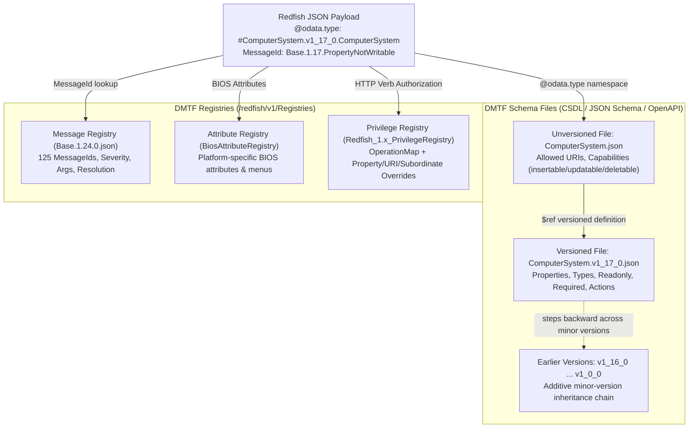

# 7.6 The Redfish schema: reading CSDL, JSON Schema and the Resource Guide

| | |
|---|---|
| Level | Intermediate |
| Priority tier | 1 |
| Lab venue | Laptop |
| Part | Part 7: Redfish and BMC |
| Status | Drafted (`schema_lab.py`: 11 checks pass; **untested** on live BMC) |

## Why this matters for AI infrastructure

Every Redfish answer follows a published contract. If you can read the contract you never need a vendor manual to ask "what does this property mean, can I write it, is it new or old?" You can also test any tool or BMC against the contract, which catches mistakes before they reach production. This chapter shows how.

## Prerequisites and outcomes

You need chapters 7.2 and 7.3. After this chapter you can:

- explain the three schema formats and which one to use
- read an `@odata.type` and find its schema file
- explain Redfish versioning and why clients must tolerate new properties
- read a property table in the Resource Guide
- explain message registries and message IDs
- validate any Redfish payload against the official schema
- read DMTF's example trees as a free reference

## 1. One model, three file formats

Redfish describes its data model in the **schema**. The spec says the same model is published in three formats:

| Format | What it is | Who uses it |
|---|---|---|
| **CSDL** (OData Common Schema Definition Language) | XML | OData tools, the `$metadata` document |
| **JSON Schema** | JSON | validators and programmers (the easiest to use in Python or Go) |
| **OpenAPI YAML** | YAML | API tools and code generators (supported from Redfish protocol 1.6.0) |

They say the same thing in different languages. The spec calls itself "schema-language agnostic" and says the protocol and the data model are versioned separately.

There is also a human-readable guide: the **Redfish Resource and Schema Guide (DSP2046)**. It lists every standard resource with its properties, actions and an example. If you only read one document about the data model, read that one. The **Data Model Specification (DSP0268)** is the formal text behind it.

All of these are published together by DMTF, and the GitHub repository `DMTF/Redfish-Publications` holds the folders `csdl`, `json-schema`, `openapi`, `registries`, `profiles`, `dictionaries` and `mockups`. I used it for the lab.



## 2. From `@odata.type` to the schema file

Every answer has an `@odata.type` such as `#ComputerSystem.v1_17_0.ComputerSystem`. Read it in three parts:

| Part | Meaning |
|---|---|
| `ComputerSystem` | the resource type (the namespace) |
| `v1_17_0` | the version: major 1, minor 17, errata 0 |
| `ComputerSystem` | the type name inside that version |

The files are named by simple rules from the spec:

| Format | Versioned file | Unversioned file |
|---|---|---|
| JSON Schema | `ComputerSystem.v1_17_0.json` | `ComputerSystem.json` |
| CSDL | one file per **major** version: `ComputerSystem_v1.xml`, holding every minor version as a separate namespace such as `ComputerSystem.v1_17_0` | the namespace `ComputerSystem` inside that file |

**Why versioned and unversioned?** The spec explains: references from other resources use the **unversioned** definition so nothing depends on a version. The unversioned one has no property details, only the list of versions, the allowed URIs (such as `/redfish/v1/Systems/{ComputerSystemId}`) and the capabilities (can you create, update, delete). The **versioned** one holds the actual properties and actions of that version.

You can see this in the tool I wrote:

```text
$ python3 schema_tools.py explain Chassis.v1_23_0
Chassis v1_23_0: The Chassis schema represents the physical components of a system. ...
URIs: /redfish/v1/Chassis/{ChassisId}
capabilities: insertable=False updatable=True deletable=True
```

`insertable=False` means you cannot `POST` to create a chassis. `deletable=True` is a property of the schema. A service "may implement a subset" of what the schema allows.

## 3. Versioning: what a client must do

The version has three numbers:

- **Major**: a break in compatibility. Rare.
- **Minor**: new things were added, nothing was removed. For example, a new property means a new minor version.
- **Errata**: a fix to the earlier version, such as a corrected description.

Rules that matter to you:

1. **Newer minor versions only add.** So a client built for 1.4 can still read a 1.17 answer.
2. **A payload must follow the version it claims.** A `v1_0_0` payload cannot carry a property added in v1_5_0. My lab proves this with the official schema.
3. **Ignore what you do not know.** The spec says clients "should not fail reading the resource due to unrecognized annotations", and enumeration values can be added later, so do not crash on an unknown value.
4. **Step backwards to find a definition.** For a structured property the spec says to step the version back (1.4.0, 1.3.0, 1.2.0 ...) until you find where it is defined.
5. **Deprecated is not removed.** A deprecated property is marked with the version it was deprecated in and the preferred replacement. The spec says services may still implement it and new code should move on. Removal can only happen in the next major version.

A real example you will meet: older BMCs report power and heat through `Chassis/<id>/Power` and `Chassis/<id>/Thermal`. Newer ones use `PowerSubsystem`, `ThermalSubsystem` and `Sensors`. The old URIs are listed as deprecated in the schema (`Redfish.DeprecatedUris`). Chapter 7.8 handles both.

## 4. Reading the Resource Guide

Each resource in DSP2046 has the same layout:

1. its name, current version and description
2. release history (which DMTF bundle added each version)
3. the **URIs** where it can appear
4. a **property table**
5. its **actions**
6. an example JSON payload

The property table columns:

| Column | How to read it |
|---|---|
| Property | the exact, case-sensitive name. `(v1.13+)` means added in that version. `(deprecated v1.13)` means obsolete since then |
| Type | `string`, `number`, `boolean`, `object`, `array`. `(enum)` marks an enumeration, `(URI)` a link. Units are usually in the name (`SpeedRPM`) |
| Attributes | `read-only` or `read-write`, `required`, and `(null)` if the value can be null |
| Notes | the meaning |

The quick way to do the same from a script is the explain command. A shortened result for `Sensor`:

```text
property                           type           access     notes
Accuracy                           number,null    read-only  deprecated v1_8_0
AverageReading                     number,null    read-only  added v1_4_0
Id                                 Id             read-only  required
Manufacturer                       string,null    read-only  added v1_9_0
PeakReading                        number,null    read-only
...
```

and one property in full:

```text
$ python3 schema_tools.py explain ComputerSystem.v1_17_0 --prop PowerState
{ "anyOf": [ {"$ref": "#/definitions/PowerState"}, {"type": "null"} ],
  "description": "The current power state of the system.",
  "longDescription": "This property shall contain the power state of the system.",
  "readonly": true }
```

`readonly: true` explains why `PATCH PowerState` failed in chapter 7.5. The **long description** is the formal rule: when it says "shall", a conforming service must do it.

### The annotations on schema elements

The spec (9.13) defines these markers on properties and types. You will meet them when you read schemas:

| Annotation | Meaning |
|---|---|
| Description / Long description | text for people, and the normative rule |
| Permissions | read-only, read-write. A service may make a writable property read-only. A write-only property such as `Password` shall be `null` in responses |
| Required | the service must support it |
| Required on create | the client must send it when creating |
| Units of measure | the unit, written in UCUM style (`Cel`, `W`, `Mbit/s`) |
| Resource URI patterns | the allowed addresses, e.g. `/redfish/v1/Chassis/{ChassisId}`. The text in braces must equal the resource's `Id` |
| Resource capabilities | can it be inserted, updated, deleted |
| Additional properties | whether extra properties are allowed. Mostly not |
| Expanded resource | the service always expands this link in responses |
| Deprecated | since which version, and what to use instead |

## 5. Payload annotations you will see in answers

Beyond the schema, answers can carry annotations in the form `Property@Namespace.Term`. The spec limits them to the `odata`, `Redfish` and `Message` namespaces. The ones you already met:

| Annotation | Where | Meaning |
|---|---|---|
| `@odata.id`, `@odata.type`, `@odata.etag` | any resource | address, type, version label |
| `Members@odata.count`, `Members@odata.nextLink` | collections | total and next page |
| `ResetType@Redfish.AllowableValues` | actions | the values this action accepts now |
| `@Redfish.AllowablePattern`, `@Redfish.AllowableNumbers` | writable properties | a regular expression or numeric ranges that the value must follow. Example from the spec: `"AssetTag@Redfish.AllowablePattern": "^[\\w:-]{0,31}$"` |
| `@Message.ExtendedInfo` | answers and errors | extra messages (chapter 7.3) |
| `@Redfish.Settings` | settings-capable resources | where to write pending changes (BIOS, chapter 7.7 and 7.9) |
| `@Redfish.OperationApplyTime` | requests | when to apply (chapter 7.5) |

A client may ignore any annotation it does not understand, but must not fail because of one.

## 6. Message registries: how errors and events get their text

Error and event messages are not free text. Each has a **MessageId** that points into a **message registry**, a JSON file listing all messages of one group. The ID format is `<RegistryPrefix>.<major>.<minor>.<MessageName>`, for example `Base.1.17.PropertyNotWritable`.

A registry entry gives the message text with placeholders (`%1`, `%2`), the severity, the number and meaning of the arguments, and a suggested **resolution**. Real entry from the official Base registry:

```json
"PropertyNotWritable": {
  "Message": "The property '%1' is a read-only property and cannot be assigned a value.",
  "Severity": "Warning",
  "NumberOfArgs": 1,
  "Resolution": "Remove the property from the request body and resubmit the request if the operation failed."
}
```

The spec lists these kinds of registries:

| Registry | What it holds |
|---|---|
| **Message** | the text behind a `MessageId`, used in errors and events. The most common kind |
| **Attribute** | meaning, type and allowed values for BIOS-type settings, which differ per platform (so no fixed schema can exist). Chapter 7.7 and 7.9 |
| **Privilege** | which privileges are needed for which operation on which resource (chapter 7.4) |

The DMTF repository's `registries` folder holds the standard message registries (Base, ResourceEvent, Update, Power, Environmental and others). Using the latest `Base` registry I counted 125 messages in version 1.24.0. A BMC also publishes the registries it uses at `/redfish/v1/Registries`, so a client can fetch the exact text for its firmware. Note two practical points:

- The same MessageId can appear in logs, events and errors, so one lookup table serves all three.
- Vendors add OEM registries for their own messages. They must not change the standard ones.

## 7. OEM extensions

Not everything fits the standard. Vendors add their own properties and actions under `Oem`:

```json
"Oem": { "Contoso": { "Ping": "..." } }
```

Rules from the spec (9.4):

- Vendor data goes under `Oem`, grouped by vendor name. A client may ignore it.
- Vendors may define new resource types and actions, but these must follow the same schema and protocol rules.
- OEM action names look like `#Contoso.Ping`, bound to the `OemActions` part of the resource.
- OEM query parameters look like `OEM-<Vendor>-<Name>`.

Use OEM data only when no standard property exists. Scripts that depend on it only work on one vendor. NVIDIA's DGX and HGX systems expose their GPU and NVSwitch data partly through standard resources and partly through NVIDIA OEM extensions. I describe what the notes say about this in chapter 7.13. I have not checked it against NVIDIA documents.

## 8. The lab: use the schema to test a service

You need the DMTF repository and two Python packages:

```bash
git clone --depth 1 https://github.com/DMTF/Redfish-Publications.git
export REDFISH_PUBLICATIONS=$PWD/Redfish-Publications
python3 -m venv v && v/bin/pip install jsonschema referencing
cd code/part07
../../v/bin/python schema_lab.py
```

(The path to `python` depends on where you put the virtual environment.) The lab runs 11 checks:

```text
PASS  validator accepts all 271 resources of DMTF's public-rackmount1 example
PASS  an unknown property is rejected
PASS  a value outside the enumeration is rejected
PASS  the wrong JSON type is rejected
PASS  a missing required property (Id) is rejected
PASS  null is allowed where the schema says nullable (AssetTag)
PASS  annotations (Prop@Namespace.Term) and Oem extensions are allowed
PASS  a v1_0_0 payload cannot carry properties added later (versioning rule, 9.14)
PASS  the same data is valid under the version it really is (v1_29_0)
PASS  all 167 resources of our mock validate against the official schemas
PASS  every MessageId our mock returned (14 different ones) exists in the official Base registry
```

### What it found in my own mock

When I first ran the validator over the mock I wrote for chapters 7.2 to 7.5, **7 of its 30 resources were invalid** and two message IDs did not exist. All of these were my mistakes:

1. The service root had a property `TaskService`. The real property is **`Tasks`** (it links to the task service).
2. `AccountService` used an old version number but a property (`HTTPBasicAuth`) that was added later.
3. `ManagerAccount` was missing the required `AccountTypes`.
4. A fan sensor had `ReadingType: "Fan"`. The allowed value is **`Rotational`**.
5. Two error message IDs I had made up (`ActionParameterValueNotInList`, `QueryParameterUnsupported`) are not in the Base registry. I switched to registry messages (`PropertyValueNotInList`, `QueryNotSupported`).

After the fixes all 30 resources validated, and the mock has since grown to 167 resources (GPUs, NICs, drives, firmware, certificates, logs) that all still validate. Those are the kind of errors a hand-written tool or a lazy BMC firmware makes, and a person reading JSON by eye would miss most of them.

### Validating a real service

The crawl command logs in, walks the whole service and validates every resource:

```bash
python3 schema_tools.py crawl https://<bmc-address> <user> <password>
```

I ran it on DMTF's example trees served by my mock's read-only mode (`redfish_mock.py --mockup <folder>`). Results:

| DMTF example | Resources | Valid by official schema |
|---|---|---|
| `public-rackmount1` | 270 | 270 |
| `public-liquid-cooled-server` | 241 | 241 |
| `public-cooling-unit` | 67 | 67 |
| `public-pdu` | 198 | 198 |
| `public-power-shelf` | 101 | 99 |

Even in DMTF's own power-shelf example, two resources fail: one `Status` condition uses a property name, `MessageSeverity`, that the schema does not list. That is useful to know. **The schema is the authority, and published examples can have errors too.**

Run the crawl against a real BMC only with permission, and expect real findings. Many BMCs have small deviations. Decide with your vendor which ones matter.

### Using the example trees

The `mockups` folder is a free library of realistic Redfish trees: rack servers, liquid-cooled servers, PDUs, power shelves, cooling units, storage, CXL, telemetry and more. You can serve any of them with the mock and practise scripts against it:

```bash
python3 redfish_mock.py --mockup $REDFISH_PUBLICATIONS/mockups/public-liquid-cooled-server --port 8443
python3 redfish_crawl.py http://127.0.0.1:8443 admin adminpass
```

In the mockup mode the data is read-only. The login accounts are the same fake ones as before. I use these trees in the next chapters.

## Exercises

1. **Inspecting a schema from the command line (`code/part07/schema_tools.py`):** Run `python3 code/part07/schema_tools.py explain Chassis.v1_23_0`. Identify three read-only properties, three read-write properties, one required property (`Id`), and the resource capabilities (`insertable=False updatable=True deletable=True`).
2. **Drilling into a nested property definition (`--prop`):** Run `python3 code/part07/schema_tools.py explain ComputerSystem.v1_17_0 --prop Boot` (and `--prop PowerState`). Inspect the JSON Schema definition for `BootSourceOverrideTarget` and `PowerState`, noting why `PowerState` has `"readonly": true`.
3. **Validating mutated payloads (`schema_tools.py check` & `schema_lab.py`):** Run `python3 code/part07/schema_lab.py` (`11 passed, 0 failed`). Then copy `Systems/437XR1138R2/index.json` from the `public-rackmount1` mockup to `/tmp/bad_sys.json`, change `"PowerState"` to `"Maybe"`, and run `python3 code/part07/schema_tools.py check /tmp/bad_sys.json` to inspect the exact schema validation error.
4. **Looking up a `MessageId` in the Base Message Registry:** Open the latest `Base.1.*.json` file in `$REDFISH_PUBLICATIONS/registries/` and inspect the entry for `PropertyValueNotInList`. Record its `Message` template string (`%1`, `%2`), `NumberOfArgs`, `Severity`, and `Resolution`.
5. **Crawling and validating a DMTF mockup tree:** Start `python3 code/part07/redfish_mock.py --mockup $REDFISH_PUBLICATIONS/mockups/public-liquid-cooled-server --port 8443` and run `python3 code/part07/schema_tools.py crawl http://127.0.0.1:8443 admin adminpass`. Confirm that all `241` resources validate cleanly against the official DMTF JSON Schemas.
6. **Extracting writable properties programmatically:** Write a 15-line Python function using `schema_tools.load()` that takes a versioned `@odata.type` string (such as `"#ComputerSystem.v1_17_0.ComputerSystem"`) and returns the sorted list of top-level property names where `"readonly"` is `False`.

## 10. Interview angles

- "How do you know what a Redfish property means?" The Resource Guide and the JSON Schema long description, found by `@odata.type`.
- "A new BMC firmware adds fields. Does your tool break?" It should not: ignore unknown properties and enumeration values.
- "How do you check a BMC follows the standard?" Validate payloads against the official JSON Schemas, and the interoperability profiles (DMTF publishes a profile format in the `profiles` folder).
- "What is a message registry and why does it exist?" A shared table of message IDs, text, severity and resolution, so errors and events are machine-readable and translatable.
- "When do you use Oem data?" Only when no standard property exists, and wrapped so one vendor's change does not break the rest.

## Checkpoint questions (20)

<details>
<summary>1. Name the three machine-readable formats in which the DMTF publishes the Redfish schema (DSP0266 §11.1).</summary>

1. **CSDL (OData Common Schema Definition Language)** in XML (`*_v1.xml`), used by OData tools and exposed at `/redfish/v1/$metadata`.
2. **JSON Schema** (`*.json`), used for programmatic payload validation in Python, Go, and CI pipelines.
3. **OpenAPI YAML** (`openapi.yaml`), used by REST code generators and API exploration tools (supported from Redfish protocol v1.6.0+).
</details>

<details>
<summary>2. Which schema format is easiest to load in Python to validate BMC JSON responses, and which two Python libraries does `code/part07/schema_tools.py` use?</summary>

**JSON Schema** (`json-schema/` in `DMTF/Redfish-Publications`), loaded in `code/part07/schema_tools.py` using the **`jsonschema`** (`Draft4Validator`) and **`referencing`** libraries.
</details>

<details>
<summary>3. What do the three segments of `#Chassis.v1_23_0.Chassis` in `@odata.type` represent?</summary>

1. **`Chassis` (first segment):** The schema namespace.
2. **`v1_23_0` (middle segment):** The schema version (`Major = 1`, `Minor = 23`, `Errata = 0`).
3. **`Chassis` (final segment):** The entity/type name defined inside that schema namespace.
</details>

<details>
<summary>4. How are the JSON Schema and CSDL files named for versioned versus unversioned definitions (DSP0266 §11.4)?</summary>

- **JSON Schema:** Has one **unversioned** file (`Chassis.json`) and one **versioned** file per minor/errata release (`Chassis.v1_23_0.json`).
- **CSDL XML:** Has one file per **major** version (`Chassis_v1.xml`) containing both the unversioned `Chassis` namespace and every minor version namespace (`Chassis.v1_0_0` .. `Chassis.v1_23_0`).
</details>

<details>
<summary>5. What information lives in the unversioned JSON Schema file (`Chassis.json`) versus the versioned file (`Chassis.v1_23_0.json`)?</summary>

The **unversioned** file (`Chassis.json`) holds no property definitions; instead, it lists all published version references (`anyOf`), the canonical **URI patterns** (`/redfish/v1/Chassis/{ChassisId}`), and the resource-level **capabilities** (`insertable`, `updatable`, `deletable`). The **versioned** file (`Chassis.v1_23_0.json`) defines the actual properties, types, `readonly` flags, `required` arrays, and `Actions` for that specific version.
</details>

<details>
<summary>6. In Redfish schema versioning (`vMajor_Minor_Errata`), what is the difference between a Major, Minor, and Errata increment (DSP0266 §9.14)?</summary>

- **Major (`v1` $\rightarrow$ `v2`):** Introduces backward-incompatible breaking changes or removes deprecated properties (extremely rare).
- **Minor (`v1_16_0` $\rightarrow$ `v1_17_0`):** Strictly additive and backward-compatible—adds new optional properties, actions, or enumeration values without removing or breaking existing properties.
- **Errata (`v1_17_0` $\rightarrow$ `v1_17_1`):** Clarifies descriptions, documentation, or non-breaking typographical fixes in an existing minor version.
</details>

<details>
<summary>7. Is a BMC allowed to include a property introduced in `v1_5_0` inside a payload that declares `@odata.type: "#ComputerSystem.v1_0_0.ComputerSystem"`?</summary>

**No.** Under DSP0266 §9.14 (and enforced by `additionalProperties: false` in the official JSON Schemas, Check 8 of `schema_lab.py`), a resource payload must strictly conform to the schema version it declares in `@odata.type` and cannot carry properties added in later minor versions unless it updates `@odata.type` to that newer version.
</details>

<details>
<summary>8. How must a Redfish client behave when it encounters an unrecognized property, annotation, or enumeration value in a response?</summary>

It must **ignore unrecognized properties and annotations without failing** and handle unknown enumeration strings gracefully, so that minor BMC firmware upgrades never break existing automation scripts.
</details>

<details>
<summary>9. In the Redfish Resource and Schema Guide (DSP2046), what do `read-only`, `read-write`, `required`, and `(null)` mean in a property table?</summary>

- **`read-only`:** The property is reported by the BMC and cannot be modified by a client (`PATCH` returns `400`/`PropertyNotWritable`).
- **`read-write`:** The property is defined as modifiable in the schema (though a specific BMC implementation may still treat some writable properties as read-only).
- **`required`:** Every conforming resource instance must include this property (such as `@odata.id`, `@odata.type`, `Id`, `Name`).
- **`(null)`:** The property is nullable (`"type": [..., "null"]`) and may be `null` when the BMC cannot obtain a value.
</details>

<details>
<summary>10. What do `(v1.13+)` and `(deprecated v1.8)` next to a property name in the Resource Guide tell you?</summary>

- **`(v1.13+)`:** The property was introduced in minor version `1.13.0` of that schema (and is absent in `1.0.0` through `1.12.x`).
- **`(deprecated v1.8)`:** The property was marked deprecated in version `1.8.0` in favor of a newer property or subsystem; BMCs may still return it for backward compatibility, and it can only be removed in a future major version (`v2`).
</details>

<details>
<summary>11. Give a real example of a deprecated Redfish URI tree on `Chassis` and name the newer resources that replaced it.</summary>

`/redfish/v1/Chassis/{ChassisId}/Power` and `/redfish/v1/Chassis/{ChassisId}/Thermal` are deprecated (`Redfish.DeprecatedUris`) and replaced by **`PowerSubsystem`**, **`ThermalSubsystem`**, **`Sensors`**, and **`EnvironmentMetrics`**.
</details>

<details>
<summary>12. What do `@Redfish.AllowablePattern` and `@Redfish.AllowableNumbers` specify on a writable property?</summary>

- **`@Redfish.AllowablePattern`:** A regular expression string (`"^[\\w:-]{0,31}$"`) constraining valid string values.
- **`@Redfish.AllowableNumbers`:** An array of `"<min>:<max>:<step>"` range strings constraining valid numbers or ISO 8601 durations.
</details>

<details>
<summary>13. What is a Redfish `MessageId`, and what are its four dot-separated components (DSP0266 §9.12)?</summary>

A `MessageId` is a machine-readable identifier pointing into a Message Registry, formatted as **`<RegistryPrefix>.<Major>.<Minor>.<MessageKey>`** (for example, `Base.1.17.PropertyNotWritable` or `ResourceEvent.1.0.ResourceStatusChanged`).
</details>

<details>
<summary>14. What fields are stored inside each message definition of a Redfish Message Registry file?</summary>

- **`Description`:** Context of when the message is emitted.
- **`Message`:** Human-readable template string with `%1`, `%2` positional placeholders.
- **`Severity` / `MessageSeverity`:** `OK`, `Warning`, or `Critical`.
- **`NumberOfArgs` and `ParamTypes`:** Expected argument count and types.
- **`Resolution`:** Recommended remediation steps for the operator or client.
</details>

<details>
<summary>15. Name the three types of registries defined by the Redfish specification and what each holds.</summary>

1. **Message Registry:** Holds structured error, event, and log message templates (`Base`, `ResourceEvent`, `TaskEvent`, `Update`).
2. **Attribute Registry:** Holds platform-specific BIOS/boot attribute definitions, types, default values, and dependencies (`BiosAttributeRegistry`).
3. **Privilege Registry:** Maps each resource type (`Entity`) and HTTP verb (`OperationMap`) to the required Redfish privileges and overrides.
</details>

<details>
<summary>16. How do vendors add proprietary properties, actions, and query parameters without violating the standard Redfish schemas (DSP0266 §9.8)?</summary>

Vendor properties and links go inside the **`Oem`** object under a vendor identifier (`"Oem": {"Nvidia": {...}}`), OEM actions go under `Actions.Oem.#<OEMSchema>.<Action>`, and OEM query parameters use the prefix **`OEM-<Vendor>-<Name>`**.
</details>

<details>
<summary>17. What is the difference between the Redfish Data Model Specification (DSP0268) and the Redfish Resource and Schema Guide (DSP2046)?</summary>

**DSP0268** is the normative specification text generated from the schema long descriptions, whereas **DSP2046 (Resource and Schema Guide)** organizes every standard resource into a practical reference manual with release history, URI patterns, property tables, action tables, and sample JSON payloads.
</details>

<details>
<summary>18. How does `code/part07/schema_tools.py crawl` validate a live or mock Redfish service?</summary>

It logs into the service, walks every reachable resource from `/redfish/v1/` by following `@odata.id` links, looks up the exact versioned JSON Schema file matching each payload's `@odata.type` in `$REDFISH_PUBLICATIONS/json-schema`, and runs `jsonschema.Draft4Validator` to report any invalid properties, types, enums, or missing required fields.
</details>

<details>
<summary>19. Name three real schema bugs that `schema_lab.py` caught in the initial version of `redfish_mock.py`.</summary>

1. Naming the `ServiceRoot` link to the task service `TaskService` instead of the schema-defined **`Tasks`**.
2. Omitting the required **`AccountTypes`** property on `ManagerAccount`.
3. Setting a fan sensor's `ReadingType` to `"Fan"` instead of the schema enum value **`"Rotational"`** (plus inventing non-existent Base `MessageId` keys instead of `PropertyValueNotInList` and `QueryNotSupported`).
</details>

<details>
<summary>20. Why is the `mockups/` directory in `DMTF/Redfish-Publications` valuable when building AI infrastructure automation?</summary>

It provides dozens of official, multi-hundred-resource Redfish trees (`public-rackmount1`, `public-liquid-cooled-server`, `public-pdu`, `public-power-shelf`, `public-cooling-unit`, blade enclosures, SmartNICs, CXL) that you can serve locally with `redfish_mock.py --mockup` to test crawlers, inventory tools, and monitoring exporters before touching production hardware.
</details>

## Sources and review notes

- **Redfish Specification DSP0266 v1.21.0:** goals and design (5.1 to 5.4), data model, resources, OEM, types, naming and annotations (9.1 to 9.13), registries (9.12), versioning (9.14), schema definition languages and file naming (11.1 to 11.4), OData metadata and service document (8.4). I read these clauses.
- **Redfish Resource and Schema Guide DSP2046 (2024.4):** how to read the guide (section 2), common properties and objects (sections 3 and 4), and the Reference Guide property tables.
- **The `redfish-schema` book** in the study corpus is titled "Redfish Data Model Specification". By its chapter list it has the same structure as the Resource Guide (overview, common properties, common objects, collections, then one section per resource type). I looked at its chapter list and used the Resource Guide and the official JSON files for facts. I did not read it page by page.
- **Only mentioned, not taught:** OpenAPI and the Interoperability Profile format. I read their clauses only at heading level, so a later pass should cover profiles properly.
- **Official files used in the lab:** `json-schema`, `registries` and `mockups` from DMTF/Redfish-Publications at commit `fa6d23d9`.
- **Run here:** `schema_lab.py` (11 checks), `schema_tools.py` (explain, check, crawl), and crawls of five DMTF example trees through the read-only mock.
- **Not verified:** how any real BMC performs under validation. The statement about NVIDIA OEM extensions comes from the user's notes and is unchecked.
