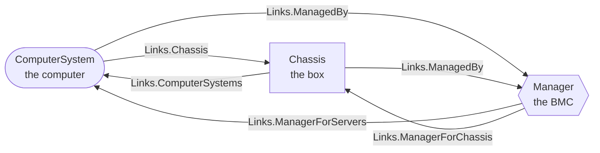
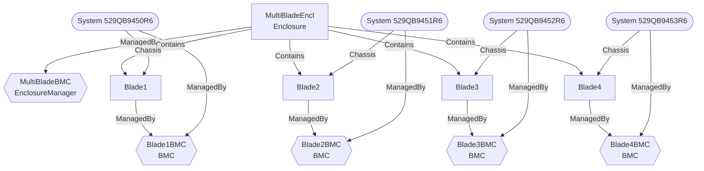

# 7.7 Systems, Chassis and Managers: the core resource model

| | |
|---|---|
| Level | Beginner to Intermediate |
| Priority tier | 1 |
| Lab venue | Laptop |
| Part | Part 7: Redfish and BMC |
| Status | Drafted (`rf_model.py`, `rf_inventory.py`, and `model_inventory_lab.py` 3/3 self-checks pass against mock and DMTF trees; **untested** / **not verified** on live BMC) |

## Why this matters for AI infrastructure

Almost everything you do with Redfish starts in one of three places: the **Systems** collection (the computer), the **Chassis** collection (the physical box) and the **Managers** collection (the BMC). A GPU server is more than one computer: a host, a GPU baseboard, maybe DPUs. If you understand how these three families connect, you can find a GPU's temperature, a power supply's status or a BMC's firmware version on any server, even one you have never seen.

## Prerequisites and outcomes

You need chapters 7.2 to 7.6. After this chapter you can:

- explain what a `ComputerSystem`, a `Chassis` and a `Manager` each stand for
- name the main things stored under each
- follow `Links` between them and check that they agree
- explain how blades, DPUs and GPU baseboards fit
- run a tool that prints an inventory from any service

## 1. Three questions, three families

Ask three different questions about a server:

| Question | Family | Think of it as |
|---|---|---|
| "What does the **software** see?" | `Systems` (`ComputerSystem`) | the computer: CPUs, memory, BIOS, boot, power state |
| "What is the **physical thing**?" | `Chassis` | the metal box: fans, power supplies, sensors, location |
| "Who is **managing** it?" | `Managers` (`Manager`) | the BMC: its network, users, logs, firmware |

The Redfish schema guide describes the chassis as "the sheet-metal confined spaces and logical zones such as racks, enclosures, chassis and all other containers". It adds that subsystems such as sensors, which work outside of the system's data plane, are linked through the chassis. So a temperature sensor belongs to the chassis because the BMC reads it directly, even when the host operating system is off.



Every relationship is normally written from **both sides**. That helps clients who start at either end: from a system you find its box, from a box you find its systems.

## 2. ComputerSystem: the computer

The schema calls it "a computer or system instance and the software-visible resources" of it. A `ComputerSystem` answer has:

**Identity.** `Model`, `Manufacturer`, `SerialNumber`, `PartNumber`, `SKU`, `UUID` (opaque, per RFC 4122), `HostName` (as reported by the OS), `AssetTag` (user set). `SystemType` says what kind: `Physical`, `Virtual`, `PhysicallyPartitioned`, `VirtuallyPartitioned`, `Composed`, `DPU`, and `OS` (deprecated since v1.21).

**State.** `PowerState` (`On`, `Off`, `PoweringOn`, `PoweringOff`, `Paused`) and `Status` with `State`, `Health` (`OK`, `Warning`, `Critical`) and `HealthRollup`. `HealthRollup` is the worst health of the resource and everything below it. When a chassis fan is bad the system health may show `Warning` even if the CPU is fine. `LastResetTime` tells you when it last restarted, and `BootProgress` gives the last boot state.

**Summaries.** `ProcessorSummary` and `MemorySummary` give a quick count and total (for example `TotalSystemMemoryGiB`). The schema says these cover only the processors that run system code, not offload processors. For detail follow the links below.

**Links to sub-collections**, each holding its own resources:

| Property | What it links to |
|---|---|
| `Processors` | CPUs and also GPUs, FPGAs and accelerators (`ProcessorType` is `CPU`, `GPU`, `FPGA`, `DSP`, `Accelerator`, `Core`, `Thread`, `Partition` or `OEM`) |
| `Memory`, `MemoryDomains` | DIMMs and memory regions |
| `Storage` | drives and storage controllers |
| `EthernetInterfaces`, `NetworkInterfaces` | the host's network interfaces |
| `Bios` | BIOS settings (chapter 7.9) |
| `SecureBoot` | Secure Boot state and keys (chapter 7.15) |
| `LogServices` | the system's logs (chapter 7.11) |
| `OperatingSystem` | information about the running OS |
| `TrustedModules` | TPM-type devices |

**Boot control.** `Boot` holds the one-time or continuous boot override: `BootSourceOverrideEnabled` (`Disabled`, `Once`, `Continuous`), `BootSourceOverrideTarget` (`None`, `Pxe`, `Hdd`, `Cd`, `Usb`, `BiosSetup`, `Diags`, `UefiShell`, `UefiTarget`, `UefiHttp`, `RemoteDrive`, `UefiBootNext`, `Recovery` and a few more; `UefiHttp` is the HTTP network boot from chapter 6.22) and `BootSourceOverrideMode` (`Legacy` or `UEFI`). This is how provisioning tools say "boot from the network once". Chapter 7.14 uses it.

**Other:** `PowerRestorePolicy` (what to do when power returns: `AlwaysOn`, `AlwaysOff`, `LastState`), `LocationIndicatorActive` (blink the identification light), `IndicatorLED` (deprecated).

**Actions:** `ComputerSystem.Reset` (chapter 7.5), `SetDefaultBootOrder`, and (in the schema version I read) `Decommission`, `AddResourceBlock` and `RemoveResourceBlock`. I did not use the last three.

### Systems that are not the main host

A single physical server may expose **more than one** `ComputerSystem`:

- A **DPU** (data processing unit, such as a SmartNIC) is its own small computer with `SystemType: DPU`. DMTF's SmartNIC example has a host system and a second system `Card1-SoC` of type DPU, managed by the same BMC.
- A **GPU baseboard** may appear as its own system. My mock follows the user's notes: a host system plus a second system for the GPU board, which holds the GPUs under `Processors`.
- A **blade** enclosure holds several blade servers. DMTF's example shows four systems with four blade BMCs, plus one enclosure manager.

So never assume one system per BMC. Loop over the whole collection.

## 3. Chassis: the physical box

The schema describes `Chassis` as the physical components of a system. What matters most:

**Identity and type.** `ChassisType` has these values: `Rack`, `Blade`, `Enclosure`, `StandAlone`, `RackMount`, `Card`, `Cartridge`, `Row`, `Pod`, `Expansion`, `Sidecar`, `Zone`, `Sled`, `Shelf`, `Drawer`, `Module`, `Component`, `IPBasedDrive`, `RackGroup`, `StorageEnclosure`, `ImmersionTank`, `HeatExchanger`, `PowerStrip`, `Other`. A server is usually `RackMount`. Cooling and power gear shows up here too, so a PDU, a power shelf and a coolant distribution unit are all `Chassis` resources.

**Place in the world.** `Location` (slot, rack, position), `AssetTag`, `Replaceable`, `HotPluggable`, `PhysicalSecurity` (intrusion state).

**Environment.** This is where most health and monitoring data lives:

| Property | What it links to |
|---|---|
| `Sensors` | all sensors: temperature, power, voltage, fan speed (chapter 7.8) |
| `ThermalSubsystem` | fans, heaters and a thermal summary |
| `PowerSubsystem` | power supplies, batteries, input and output power |
| `EnvironmentMetrics` | total power and energy, temperature summary |
| `Controls` | adjustable settings such as a power cap |
| `Assembly` | the replaceable parts with part numbers |
| `Drives`, `NetworkAdapters`, `PCIeDevices` | hardware inside this box |
| `Power`, `Thermal` | the older, deprecated ways to expose the same data |

**Containment.** A chassis can contain others. `Links.Contains` and `Links.ContainedBy` express this. An enclosure `Contains` blades, a server `Contains` a card.

## 4. Manager: the BMC itself

A `Manager` resource describes the managing controller. `ManagerType` says what it is:

| Value | Meaning |
|---|---|
| `BMC` | a controller managing one or more computer systems. This is a server's BMC |
| `EnclosureManager` | manages a chassis or group of systems (a blade enclosure) |
| `RackManager` | manages part or all of a rack |
| `ManagementController` | the generic value when none of the others fit |
| `AuxiliaryController` | manages one subsystem or device group |
| `Service` | a software service that provides management |

Under a manager you find the BMC's own world:

| Property | What it links to |
|---|---|
| `FirmwareVersion` | the BMC firmware version string |
| `EthernetInterfaces` | the BMC's network ports and addresses (IPs, DHCP, VLAN) |
| `NetworkProtocol` | which services the BMC runs: `HTTP`, `HTTPS`, `SSH`, `IPMI`, `SNMP`, `SSDP`, `NTP`, `Telnet`, `KVMIP`, `VirtualMedia`, `FTP`, `SFTP`, `RDP`, `RFB`, `Proxy` (chapter 7.15 turns off what you do not need) |
| `LogServices` | the BMC's event logs (chapter 7.11) |
| `HostInterfaces` | the private channel between BMC and host OS |
| `SerialInterfaces`, `CommandShell`, `GraphicalConsole`, `VirtualMedia` | console and media access (chapter 7.1) |
| `DateTime`, `DateTimeLocalOffset`, `TimeZoneName` | the BMC's clock. A wrong clock makes logs hard to match |
| `LastResetTime` | when the BMC last restarted |
| `Redundancy` | how it pairs with other managers |

**Actions:** `Manager.Reset` restarts the BMC (the schema says that if the manager provides the Redfish service it must send the answer before resetting to avoid client timeouts). `Manager.ResetToDefaults` takes `ResetAll`, `PreserveNetworkAndUsers` or `PreserveNetwork`, so a factory reset can keep the network and accounts. `ForceFailover` and `ModifyRedundancySet` apply to redundant managers.

`Manager.Reset` is the Redfish way to do what `ipmitool mc reset cold` does in the NVIDIA firmware notes (chapter 7.1).

The manager's `Links` list `ManagerForServers`, `ManagerForChassis` and `ManagerInChassis` (the box the BMC is physically in).

## 5. Seeing it: the model tool

`code/part07/rf_model.py` finds the three families from the service root, prints them and their links, and checks that the links agree. I ran it on DMTF's example of a blade enclosure. This is a clean redraw of what it found:



Five managers, five chassis, four systems. One enclosure manager looks after the box; each blade has its own BMC. This is why "one server equals one BMC" is a habit to unlearn.

### The link check

For each link A to B the tool looks for the matching B to A link. Results on the examples:

| Service | Result |
|---|---|
| my DGX-style mock (after I fixed it) | 0 findings |
| DMTF rack server | 0 findings |
| DMTF blade enclosure | 0 findings |
| DMTF PDU | 1 one-way link: the chassis says it is managed by the BMC but the manager does not list the chassis |
| DMTF power shelf | the same kind of one-way link |
| DMTF cooling unit | the same kind of one-way link |
| DMTF SmartNIC card | 1 dangling link: the host chassis `Contains` a `Card2` that is not in the collection |

My own mock failed the check at first with two one-way links, which I fixed. That is a good result for the lab: the checker catches the kind of slip that happens when someone builds a Redfish service by hand. The findings in DMTF's examples are not necessarily errors. The first three are the one-way ManagedBy kind that the spec does not forbid, and the dangling link may simply stand for an empty slot. **Treat each finding as a question, not a verdict.**

## 6. The inventory tool

`code/part07/rf_inventory.py` prints one line per computer system. It discovers everything from the root and skips what is missing. Output for my GPU-style mock:

```text
system=System_0  type=Physical  model=GPU-8  serial=SN0001  power=On  health=OK  cpus=2  mem_gib=2048  bmc=BMC_0  bmc_fw=1.0.0
system=HGX_Baseboard_0  type=Physical  power=On  health=OK  gpus=8  bmc=BMC_0  bmc_fw=1.0.0
```

and for DMTF's SmartNIC example (two systems, one BMC):

```text
system=437XR1138R2  type=Physical  model=3500  ... power=On  health=OK  bios=P79 v1.45 (12/06/2017)  cpus=2  gpus=0  mem_gib=96  bmc=BMC  bmc_fw=1.45.455b66-rev4
system=Card1-SoC  type=DPU  model=9900  ...  power=On  health=OK  cpus=1  gpus=0  mem_gib=8  bmc=BMC  bmc_fw=1.45.455b66-rev4
```

Add `--csv` to get a spreadsheet-friendly table. This is the seed of a fleet inventory (chapter 7.14): run it on every BMC and keep the result. Two things to know: `health` here uses `HealthRollup`, which includes everything under the system, and many fields are optional so some columns may be empty on a real BMC.

## 7. Present, absent and temporarily unavailable

The spec has rules (9.11) for empty slots and sleeping devices that help you read trees correctly:

- A resource can stay in the tree to show a **capability**, such as an empty DIMM socket or drive bay. Its `Status.State` is **`Absent`**. Required properties with no known value are `null`.
- If a new part is later put in that slot, the same resource now describes a **different physical thing**. Do not keep old read-only data such as the serial number.
- A device that is **temporarily unreachable** (for example a network card in low power) should show `Status.State` **`StandbyOffline`** and keep its URI.

So when you count DIMMs or drives, do not count resources, count those whose `State` is not `Absent`.

## 8. Steps for finding a value

Example: "What is the temperature of GPU 3 on a server I have never seen?"

1. `GET /redfish/v1/` and read the `Systems` link.
2. `GET` that collection and read every `Members` link. Open each system.
3. Look at `Processors` in each system and filter by `ProcessorType` equals `GPU`.
4. Open the GPU you want. Follow its `EnvironmentMetrics` link if present (the user's notes show this link for NVIDIA GPUs, chapter 7.13) or find the matching sensor under the chassis.
5. If neither exists, search the chassis `Sensors` by `PhysicalContext` (for example `GPU`).

Because the layout differs between makers, a robust tool tries a standard route first and falls back to a second one. Section 8 of chapter 7.8 returns to this.

## 9. DGX and HGX: what the notes say

The user's notes describe a DGX H100 like this. They are given as the notes state them, and I have not checked them against NVIDIA's documents:

- The DGX H100 and H200 use a system named `DGX`, a manager named `BMC` and a chassis named `DGX`.
- A second system, `HGX_Baseboard_0`, represents the GPU baseboard. GPU data is under `/redfish/v1/Systems/HGX_Baseboard_0/Processors/GPU_SXM_<id>/EnvironmentMetrics`.
- The notes call out a dual-tray design: a host motherboard tray and a GPU tray, with satellite controllers that report to the main BMC (chapter 7.1).
- The BCM manual's Redfish appendix shows a different naming: chassis such as `BMC_0`, `CBC_0`, `Chassis_0` on GB300 nodes. So names differ between DGX generations. This is the reason the discovery rule in chapter 7.2 exists.

My mock's `dgx` profile copies the shape (a host system, a baseboard system with eight GPU processors and per-GPU metrics, one chassis, one BMC) but the names inside are invented.

## Exercises

1. **Mapping and verifying bidirectional links (`code/part07/rf_model.py` & `model_inventory_lab.py`):** Run `python3 code/part07/model_inventory_lab.py` (`3/3` checks pass). Then start `redfish_mock.py` (`--profile dgx`) and run `python3 code/part07/rf_model.py http://127.0.0.1:18441 admin adminpass --mermaid` to print the complete `System` $\leftrightarrow$ `Chassis` $\leftrightarrow$ `Manager` relationship graph.
2. **Exporting a multi-system CSV inventory (`code/part07/rf_inventory.py`):** Serve the DMTF multi-blade enclosure mockup (`$REDFISH_PUBLICATIONS/mockups/public-bladed-system`) using `redfish_mock.py --mockup` and run `rf_inventory.py --csv`. Explain why the enclosure exposes `4` `ComputerSystem` instances (`Blade1`..`Blade4`) alongside `5` `Manager` instances (`4` blade BMCs + `1` `MultiBladeBMC` of `ManagerType: "EnclosureManager"`).
3. **Inspecting a SmartNIC / BlueField DPU as a second `ComputerSystem`:** Serve the DMTF SmartNIC mockup (`$REDFISH_PUBLICATIONS/mockups/public-smartnic`) and inspect `/redfish/v1/Systems/Card1-SoC`. Record its `SystemType` (`"DPU"`), its CPU and memory counts (`1` CPU, `8 GiB` RAM), and which `Manager` (`Links.ManagedBy`) controls both the host system (`437XR1138R2`) and the DPU.
4. **Discovering GPUs dynamically across all `ComputerSystem` members:** Write a 12-line Python function `find_all_gpus(client)` that starts at `/redfish/v1/`, iterates through every member of `Systems`, traverses each system's `Processors` collection, and returns every processor resource where `ProcessorType == "GPU"` without hard-coding `"HGX_Baseboard_0"`.
5. **Catching a broken `Links` back-reference (`rf_model.check`):** Inspect Check 3 of `code/part07/model_inventory_lab.py`, where removing `ManagerForChassis` from `BMC_0` triggers `ONE-WAY /redfish/v1/Chassis/Chassis_0 --ManagedBy--> /redfish/v1/Managers/BMC_0`. Test what `rf_model.check()` outputs if you instead point `Links.Chassis` at a non-existent URI `"/redfish/v1/Chassis/Ghost"` (`DANGLING`).
6. **Counting populated DIMMs while excluding `Status.State == "Absent"` (DSP0266 §9.11):** Write a Python snippet that reads `/redfish/v1/Systems/System_0/Memory` and counts both total DIMM slots (`Members@odata.count`) and populated DIMMs (`Status.State != "Absent"`), summing `CapacityMiB` only across populated slots.

## 11. Interview angles

- "What is the difference between a System, a Chassis and a Manager?" The computer, the box, the BMC. Say where sensors live (chassis) and where BIOS lives (system).
- "A GPU server has two Systems. Why?" A GPU baseboard or DPU can be its own system. Loop through the collection and filter by type.
- "How do you map a GPU to its temperature?" Follow links: system, processors, GPU, its metrics or the chassis sensors. Use discovery.
- "What does HealthRollup mean?" The worst health among the resource and everything beneath it. It is a summary, so open the children to find the cause.

## Checkpoint questions (20)

<details>
<summary>1. What does the `Systems` (`ComputerSystem`) resource family represent in Redfish?</summary>

It represents the **logical, software-visible computer**—its CPUs, GPUs/accelerators (`Processors`), system RAM (`Memory`), `Bios`, `SecureBoot`, `Boot` order/override settings, `Storage`, host `EthernetInterfaces`, and `PowerState` (DSP2046 `ComputerSystem`).
</details>

<details>
<summary>2. What does the `Chassis` resource family represent in Redfish?</summary>

It represents the **physical sheet-metal enclosure, tray, rack, or container** (`RackMount`, `Blade`, `Enclosure`, `Sled`, `Sidecar`, `ImmersionTank`, `PowerStrip`) and houses out-of-band physical telemetry (`Sensors`, `ThermalSubsystem`, `PowerSubsystem`, `EnvironmentMetrics`) and physical slots (`PCIeDevices`, `NetworkAdapters`, `Drives`).
</details>

<details>
<summary>3. What does the `Managers` (`Manager`) resource family represent in Redfish?</summary>

It represents the **management controller itself** (such as a server's `BMC`, an `EnclosureManager`, a `RackManager`, or an `AuxiliaryController`), holding the controller's `FirmwareVersion`, OOB `EthernetInterfaces`, enabled `NetworkProtocol` services, `SerialInterfaces`, `VirtualMedia`, and `LogServices` (`SEL`).
</details>

<details>
<summary>4. Why do temperature, fan, and power sensors belong under `Chassis` rather than under `ComputerSystem`?</summary>

Because physical thermistors, fan tachometers, and PSU power monitors are wired directly to the BMC/chassis management buses (`I2C`/`SMBus`/`PMBus`) and operate outside the host OS data plane—remaining readable even when the logical `ComputerSystem` is powered off.
</details>

<details>
<summary>5. What is `Status.HealthRollup` on a `ComputerSystem` or `Chassis`, and how should an operator act when `Health` is `OK` but `HealthRollup` is `Warning`?</summary>

`HealthRollup` aggregates the **worst-case health state** across the resource itself and all of its subordinate resources (`Processors`, `Memory`, `Storage`, `Sensors`). When `Health` is `OK` but `HealthRollup` is `Warning`, the top-level system is running, but at least one child component (such as a degraded DIMM or fan) has a warning—walk the subordinate collections to isolate the faulted component.
</details>

<details>
<summary>6. What does `SystemType: "DPU"` mean on a `ComputerSystem` resource?</summary>

It indicates that the `ComputerSystem` represents a **Data Processing Unit (DPU) or SmartNIC** (such as an NVIDIA BlueField-3 card), which has its own ARM cores, memory, OS, and boot lifecycle modeled as a separate `ComputerSystem` alongside the host server's `Physical` system.
</details>

<details>
<summary>7. Give three architectural reasons why a single BMC endpoint might expose more than one `ComputerSystem` in `/redfish/v1/Systems`.</summary>

1. **Dual-tray GPU servers (DGX / HGX):** One `ComputerSystem` (`DGX` / `System_0`) for the host CPU tray and a second `ComputerSystem` (`HGX_Baseboard_0`) for the 8-GPU + NVSwitch baseboard.
2. **DPUs / SmartNICs:** One `ComputerSystem` (`SystemType: "Physical"`) for the x86 host and additional `ComputerSystem` instances (`SystemType: "DPU"`) for each installed DPU.
3. **Multi-node / blade enclosures:** An enclosure manager exposing one `ComputerSystem` per installed server blade (`Blade1`..`Blade4`).
</details>

<details>
<summary>8. Name six subordinate collections or resources directly linked from a `ComputerSystem` resource.</summary>

**`Processors`**, **`Memory`**, **`Storage`**, **`Bios`**, **`SecureBoot`**, and **`EthernetInterfaces`** (plus `LogServices`, `NetworkInterfaces`, `TrustedModules`, `OperatingSystem`, and `VirtualMedia`).
</details>

<details>
<summary>9. Which resource collection under `ComputerSystem` holds GPUs and FPGAs, and which property distinguishes them from host CPUs?</summary>

The **`Processors`** collection (`/redfish/v1/Systems/<id>/Processors`), where each member's **`ProcessorType`** property identifies whether it is a `"CPU"`, `"GPU"`, `"FPGA"`, `"DSP"`, `"Accelerator"`, or `"OEM"`.
</details>

<details>
<summary>10. Which three properties inside `ComputerSystem.Boot` control a one-time PXE or UEFI HTTP network boot?</summary>

1. **`BootSourceOverrideEnabled`:** `"Disabled"`, `"Once"` (resets after one boot), or `"Continuous"`.
2. **`BootSourceOverrideTarget`:** `"Pxe"`, `"UefiHttp"`, `"Hdd"`, `"Cd"`, `"BiosSetup"`, `"UefiTarget"`, `"None"`, etc.
3. **`BootSourceOverrideMode`:** `"UEFI"` or `"Legacy"`.
</details>

<details>
<summary>11. Name six `ChassisType` enumeration values used in AI data centers (DSP2046 `Chassis`).</summary>

**`RackMount`** (standard 1U–8U server), **`Blade`**, **`Enclosure`**, **`Sled`**, **`Rack`**, **`ImmersionTank`**, **`HeatExchanger`** (CDU/rear-door), **`Shelf`** (power shelf), and **`PowerStrip`** (rack PDU).
</details>

<details>
<summary>12. Which four modern `Chassis` properties expose thermal, power, and sensor data, and which two older `Chassis` properties did they deprecate?</summary>

The modern properties are **`Sensors`**, **`ThermalSubsystem`**, **`PowerSubsystem`**, and **`EnvironmentMetrics`**, which replaced the deprecated **`Power`** and **`Thermal`** resources.
</details>

<details>
<summary>13. How does Redfish represent physical nesting when a rack enclosure contains four server blades or a host chassis contains a GPU expansion tray?</summary>

Through bidirectional links inside `Chassis.Links`: the outer enclosure lists the child chassis in **`Links.Contains`**, and each child chassis points back to its parent enclosure in **`Links.ContainedBy`**.
</details>

<details>
<summary>14. What are the six standard `ManagerType` values on a `Manager` resource?</summary>

**`BMC`**, **`EnclosureManager`**, **`RackManager`**, **`ManagementController`**, **`AuxiliaryController`**, and **`Service`**.
</details>

<details>
<summary>15. What does `/redfish/v1/Managers/<id>/NetworkProtocol` contain, and why is it central to BMC security hardening?</summary>

It lists every network management protocol supported by the BMC (`HTTPS`, `HTTP`, `SSH`, `IPMI`, `SNMP`, `SSDP`, `Telnet`, `KVMIP`, `VirtualMedia`, `NTP`), whether each protocol is enabled (`ProtocolEnabled`), and its port—allowing administrators to `PATCH` legacy protocols (`IPMI`, `Telnet`, `HTTP`, `SSDP`) to `false` (Chapter 7.15).
</details>

<details>
<summary>16. What is the Redfish equivalent of `ipmitool mc reset cold`, and what rule must the BMC follow when responding to it?</summary>

The **`#Manager.Reset`** action (`/redfish/v1/Managers/<id>/Actions/Manager.Reset` with `ResetType: "GracefulRestart"` or `"ForceRestart"`). The schema notes that when the resetting `Manager` hosts the Redfish web service itself, it must send the HTTP `200 OK` response **before** rebooting its network stack so the client does not fail with a connection timeout.
</details>

<details>
<summary>17. What are the three `ResetType` values supported by `#Manager.ResetToDefaults`, and why is `PreserveNetworkAndUsers` useful in remote data centers?</summary>

**`ResetAll`**, **`PreserveNetworkAndUsers`**, and **`PreserveNetwork`**. Using `PreserveNetworkAndUsers` resets corrupt BMC configuration settings back to factory defaults while keeping the BMC's OOB IP address and administrator credentials intact so you do not lose remote access.
</details>

<details>
<summary>18. Under DSP0266 §9.11, how does Redfish represent an empty DIMM socket or empty drive bay, and how must inventory scripts count installed hardware?</summary>

An empty slot is represented by a resource whose **`Status.State` is `"Absent"`** (with unknown properties set to `null`). Inventory scripts must filter for `Status.State != "Absent"` (e.g., `"Enabled"` or `"StandbyOffline"`) rather than using raw `Members@odata.count`.
</details>

<details>
<summary>19. Which four pairs of reciprocal `Links` does `code/part07/rf_model.py` verify across `Systems`, `Chassis`, and `Managers`?</summary>

1. `ComputerSystem.Links.Chassis` $\leftrightarrow$ `Chassis.Links.ComputerSystems`
2. `ComputerSystem.Links.ManagedBy` $\leftrightarrow$ `Manager.Links.ManagerForServers`
3. `Chassis.Links.ManagedBy` $\leftrightarrow$ `Manager.Links.ManagerForChassis`
4. `Chassis.Links.Contains` $\leftrightarrow$ `Chassis.Links.ContainedBy`
</details>

<details>
<summary>20. On an NVIDIA DGX H100/H200 vs a GB300 system in BCM, how do the `Systems` and `Chassis` member names illustrate the need for dynamic link discovery?</summary>

On a DGX H100/H200, the host and GPU baseboard appear as `Systems/DGX` and `Systems/HGX_Baseboard_0` with `Chassis/DGX` and `Managers/BMC`, whereas BCM's GB300 examples show chassis such as `BMC_0`, `CBC_0`, and `Chassis_0`. Walking from `/redfish/v1/` and inspecting `SystemType`, `ProcessorType`, and `Links` works across every generation without hard-coded names.
</details>

## Sources and review notes

- **Redfish Resource and Schema Guide DSP2046 (2024.4), and the official JSON Schemas** (`ComputerSystem` v1.23.1, `Chassis` v1.26.0, `Manager` v1.20.0 and later, `Processor` v1.20.1, `ManagerNetworkProtocol` v1.10.1, `Resource`): property descriptions, enumerations (`SystemType`, `ChassisType`, `ManagerType`, `ProcessorType`, `State`, `Health`, `ResetType`) and the Manager actions.
- **Redfish Specification DSP0266 v1.21.0:** absent and transiently unavailable resources (9.11), resource tree stability and discovery (12.3, 12.4).
- **DMTF example trees** from `github.com/DMTF/Redfish-Publications` (commit `fa6d23d9`): rack server, blade enclosure, SmartNIC, PDU, power shelf, cooling unit, liquid-cooled server.
- **BCM 11 Administrator Manual**, appendix N: device naming on GB300 hardware.
- **NVIDIA-DevOps notes (volume 05 chapter 3, volume 10 chapter 1):** DGX system, chassis and manager names, `HGX_Baseboard_0`, the dual-tray description. Not verified.
- **Run here:** `rf_model.py` (8 services), `rf_inventory.py` (4 services), `schema_lab.py` (still 11 passes as the mock grew to 110 resources).
- **Not verified:** how a real DGX, HGX or GB200 tree looks, which of the optional links the BMC fills in, and whether its `Contains` links are complete. Part 9 and chapter 7.13 revisit this.
