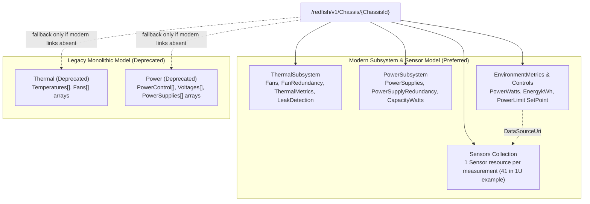

# 7.8 Power, thermal, sensors and environment

| | |
|---|---|
| Level | Intermediate |
| Priority tier | 1 |
| Lab venue | Laptop |
| Part | Part 7: Redfish and BMC |
| Status | Drafted (`sensors_lab.py`: 13 checks pass against mock and DMTF trees; **untested** on live BMC) |

## Why this matters for AI infrastructure

Picture a training job that has slowed by a third since yesterday. Nothing crashed, and the operating system logs nothing unusual. The cause may be one fan that stopped, or one GPU that got too hot. The BMC watches the hardware from outside the operating system, so its sensors are the first place to look. Power is the other limit. Every rack has a fixed budget (chapter 6.30), and the BMC can report, and sometimes limit, how much each server draws.

## Prerequisites and outcomes

Work through 7.2 and 7.7 first. Chapter 6.30 helps too. It explains the rack budget this chapter keeps returning to. When you finish, you should be able to do these things on any Redfish service:

- Find temperature, fan, voltage and power readings.
- Tell the modern design (`Sensors`, subsystems) from the old one (`Thermal`, `Power`).
- Read thresholds, and decide what to alert on.
- Keep `Status`, `Health` and thresholds apart as three separate ideas.
- Read power supply and cooling data, understand power-cap controls, and export readings in Prometheus format.

## 1. Two designs for the same information

Suppose you log in to an older server's BMC and find a `Thermal` page where you expected `Sensors`. That is not a mistake. Redfish changed how it shows heat and power, and both designs exist in real equipment, so you must be able to read both. The table below shows how they differ.

| | Old design (deprecated) | Modern design |
|---|---|---|
| Where | `Chassis/<id>/Thermal` and `Chassis/<id>/Power` | `Chassis/<id>/Sensors`, `ThermalSubsystem`, `PowerSubsystem`, `EnvironmentMetrics` |
| Shape | one big resource with **arrays** (`Temperatures[]`, `Fans[]`, `Voltages[]`, `PowerControl[]`, `PowerSupplies[]`) | **one resource per item** (a Sensor, a Fan, a PowerSupply) |
| Linking | items are array entries, found by position | each item has its own address and links |
| Status | the resource marks itself deprecated | current |

The old design packs everything into arrays inside one resource, so you find an item by its position in the list. The modern design gives every item its own address, which is easier to follow and to check. DMTF's rack-server example even carries a hint inside the chassis: `"Thermal@Redfish.Deprecated": "Please migrate to use /redfish/v1/Chassis/1U/ThermalSubsystem"`. The schema marks the old way as deprecated, but the spec says services may still implement it, so older BMC firmware keeps it.

The lab shows the gap in the same example tree. Through the modern `Sensors` collection the tool found **41** readings. When I removed that link to force the old route, it found 9, from `Thermal` and `Power`. The modern way exposes more, with more detail, so read the modern design first and fall back to the old one only when you must.



Your first step on any chassis is to check for the modern links. Only use the old resources when those links are missing.

## 2. Sensors: one resource per measurement

A GPU alarm fires at 3 a.m. The alert says "hot", but a number alone does not tell you much. You need to know what was measured, in which unit, and where on the machine. A `Sensor` answers all three questions in one resource. The table below lists the properties you will use most.

| Property | Meaning |
|---|---|
| `Reading` | the current value |
| `ReadingType` | what is measured. Values include `Temperature`, `Humidity`, `Power`, `EnergykWh`, `Voltage`, `Current`, `Frequency`, `Pressure`, `LiquidLevel`, `Rotational`, `AirFlow`, `LiquidFlow`, `Percent`, `Heat` and more |
| `ReadingUnits` | the unit in UCUM style: `Cel`, `W`, `V`, `A`, `RPM`, `%`, `Hz` |
| `PhysicalContext` | where it applies: for example `CPU`, `GPU`, `Intake`, `Exhaust`, `PowerSupply`, `Fan` |
| `PhysicalSubContext` | a finer position inside that context |
| `ReadingRangeMin`, `ReadingRangeMax` | the range the sensor can measure |
| `Thresholds` | the limits (below) |
| `PeakReading` and similar | highest value seen |
| `SpeedRPM` | fan speed, for fan sensors |
| `Status` | `State` and `Health` |

Because the unit and the context travel with the value, one program can read every sensor. It does not need a separate list for each vendor. You find sensors under `Chassis/<id>/Sensors`. Some BMCs also place sensors under other resources. In a fleet tool, treat the chassis list as the main route, and the metric links of components as an extra source.

### Thresholds

A sensor's `Thresholds` object can hold these limits. Each one has a `Reading` and an `Activation` direction: `Increasing`, `Decreasing`, `Either` or `Disabled`.

`UpperCaution`, `UpperCritical`, `UpperFatal`, `LowerCaution`, `LowerCritical`, `LowerFatal`, and user-set variants (`UpperCautionUser` and so on). Each threshold can also carry `DwellTime`, which is how long the value must break the limit before it counts. It can also carry hysteresis, which is how far the value must fall back before the alarm clears.

Think of caution, critical and fatal as three steps up. **Caution** means the value is above normal. **Critical** means it is above normal and not yet fatal. **Fatal** is the level the equipment treats as dangerous. The BMC then sets `Status.Health` to `Warning` or `Critical`, and it may act on its own, for example by raising fan speed or shutting down.

### Status is not the same as a reading

A monitoring tool has to keep three separate ideas apart. The table below shows each one.

| Idea | Where | Meaning |
|---|---|---|
| **Reading** | `Reading` | the number |
| **Threshold** | `Thresholds` | the limits for that number |
| **Health** | `Status.Health` | the BMC's own judgment: `OK`, `Warning`, `Critical` |

`Status.State` adds whether the sensor is `Enabled`, `Disabled`, `Absent` (nothing there) and so on. Do not mix these up. A sensor can be `Disabled` and have no reading, and that is normal.

**Why your tool should check the value itself.** The BMC's health flag depends on firmware logic that you do not control. In my lab I set a GPU temperature above its critical threshold while leaving `Health: OK`. The tool still flagged it. A monitoring tool that trusts only the health flag misses sensors whose firmware forgot to update it, so use both.

## 3. Thermal: fans, heat and cooling

Fans are the part of the chassis that fails most visibly. A fan that slows down leaves hot air in the box, and the GPUs next to it pay for that. Under the modern `ThermalSubsystem`, the resources below describe the cooling hardware. The table lists what each link holds.

| Link | Contents |
|---|---|
| `Fans` | one `Fan` per fan: `SpeedPercent`, `Location`, `PhysicalContext`, `Replaceable`, `HotPluggable`. The actual RPM is on a linked sensor |
| `FanRedundancy` | groups of fans and how many must work (for example N plus M) |
| `ThermalMetrics` | a summary: `TemperatureSummaryCelsius` (intake, exhaust and so on) and a list of readings |
| `Heaters` | heating elements, if any |
| `LeakDetection`, `Pumps`, `Filters`, `CoolantConnectorRedundancy` | for liquid-cooled equipment |

Fan redundancy tells you how serious a failed fan is. Take DMTF's example, where each fan group has `MinNeededInGroup: 1` out of two fans. If one fan fails, one fan is still left, so the group still meets its minimum. The failure becomes a repair ticket, not an emergency. Losing both fans would be a different story.

Liquid cooling adds more resources to the same model. `CoolingUnit` is a CDU, a coolant distribution unit. The others are `CoolantConnector`, `Pump`, `Reservoir`, `Filter`, `LeakDetection` and `LeakDetector`. The BCM manual says BCM uses Redfish for leak detection on NVL8 hardware. Chapter 6.30 explains why liquid cooling matters. I ran my reader on DMTF's cooling-unit example, which has a separate chassis for the CDU. It found 18 readings and flagged none.

Once you can read the fans and their redundancy, the next question is what they are cooling against. That is the power side of the chassis.

## 4. Power: supplies, draw and limits

A power supply can fail long before the server goes dark. It often warns first, and that warning is the signal you want. Under `PowerSubsystem`, the table below lists the links that hold power data.

| Link or property | Meaning |
|---|---|
| `CapacityWatts` | total power the chassis can draw |
| `Allocation` | requested and allocated watts |
| `PowerSupplies` | one `PowerSupply` per unit |
| `PowerSupplyRedundancy` | for example `Failover`, which supplies are active, how many are needed |
| `Batteries` | battery units |

Each `PowerSupply` reports its `PowerCapacityWatts` and `LineInputStatus`, which tells you whether the input power is present and normal. It also reports `PowerSupplyType` (AC or DC), efficiency ratings by load, input ranges and firmware version. A link to its `Metrics` (`PowerSupplyMetrics`) gives input and output watts, voltage, current and temperature. In DMTF's example, `Status.Conditions` holds a message that reads: *"Power supply 'PSU 1' has a predicted failure condition."* The health is `Warning`. This is the early signal to alert on, before a supply actually fails.

`EnvironmentMetrics` is a handy summary that you can find on a chassis, and on many components such as each GPU. It gives `PowerWatts`, `EnergykWh`, `TemperatureCelsius`, `FanSpeedsPercent`, `HumidityPercent` and `PowerLimitWatts`. Each entry has a `DataSourceUri` that points to the sensor it came from. Follow that link when you need the detail behind a summary number.

### Power capping with controls

A `Control` resource is a setting you can change. For power, DMTF's example looks like this:

```json
{
  "Id": "PowerLimit",
  "Name": "System Power Limit",
  "PhysicalContext": "Chassis",
  "ControlType": "Power",
  "ControlMode": "Automatic",
  "SetPoint": 500,
  "SetPointUnits": "W",
  "AllowableMax": 1000,
  "AllowableMin": 150,
  "Sensor": { "Reading": 374, "DataSourceUri": "/redfish/v1/Chassis/1U/Sensors/TotalPower" }
}
```

Read the block as a short story. The server is drawing 374 W, and the cap is set to 500 W. The BMC allows any cap between 150 W and 1000 W, so 500 W is inside the range. To change the cap, you `PATCH` the control's `SetPoint`, and you use the usual ETag care from chapter 7.3. The NVIDIA notes say power capping on DGX H100 and H200 is done through Redfish. I could not check how.

:::warning Capping changes performance
A power cap makes the hardware slow itself down to stay under the limit. On GPU servers, that directly lowers training speed. Change a cap only when you have a reason. Record who changed it and why, and compare the job speed before and after. A cap set below the normal draw of a busy server looks like a slow cluster from the user's side.
:::

### The old design's power data

For completeness, the old `Power` resource has `PowerControl[]`, `Voltages[]` and `PowerSupplies[]` arrays. Each `PowerControl` entry holds `PowerConsumedWatts`, `PowerCapacityWatts`, a `PowerLimit`, and `PowerMetrics` with the minimum, maximum and average over an interval. My tool reads these when the modern route is missing.

When you set a cap, decide first whether the job can afford the slowdown. The tool can show you the draw, but only you know the job's deadline.

## 5. The tool: read both, flag by value

Reading the data by hand works for one server. It does not work for a rack of forty. `code/part07/rf_sensors.py` reads every chassis for you. For each chassis, it tries the `Sensors` collection first. If that is missing, it falls back to the old `Thermal` and `Power` resources. It then turns everything into rows and applies three checks:

- `Health` is not `OK`.
- The reading is at or above `UpperCritical` or `UpperFatal`, or above `UpperCaution`.
- The sensor is `Enabled` but has no reading (`null`).

`Disabled` and `Absent` sensors are skipped, because a missing reading on those is normal. With `--prom`, the tool prints Prometheus text format. Here is a run on my mock after I set one GPU temperature to 92 C. Its critical limit is 88, so 92 is four degrees over it.

```text
chassis Chassis_0: 4 readings via Sensors
   Sensors  Temp GPU0   Temperature   92.0 Cel   AT/ABOVE CRITICAL limit 88.0
```

The same tool on DMTF's rack-server example gives this result:

```text
chassis 1U: 41 readings via Sensors
   Sensors  CPU #1 Temperature   ?   44 Cel   health=Warning; above caution limit 42
41 readings, 1 flagged
```

The power-shelf example is the next case. The tool flagged `Power Shelf Load Percent` at 93 % against a caution limit of 90. Across the DMTF examples, the counts were: PDU 115 readings and nothing flagged, cooling unit 18 and nothing flagged, power shelf 35 and 1 flagged, rack server 41 and 1 flagged.

The lab (`sensors_lab.py`) has 13 checks. They test that normal values are not flagged. They test critical and caution limits by value, a null reading, and `Critical` health. They also check that `Disabled` sensors are skipped, that the Prometheus text parses with the official `prometheus_client` parser, and that the tool falls back to the old route on DMTF's data.

### Prometheus export

`--prom` produces lines like the ones below. Each sensor becomes one reading line and one health line.

```text
redfish_sensor_reading{chassis="1U",sensor="Ambient Temperature",kind="?",units="Cel"} 22.5
redfish_sensor_ok{chassis="1U",sensor="Ambient Temperature",kind="?",units="Cel"} 1
```

The `kind="?"` appears because that sensor in DMTF's example has no `ReadingType`, which is optional. Chapter 17's monitoring part builds on this idea. On a real fleet you would run an exporter service rather than a script. Keep the number of unique label values small, because fan and sensor names differ between machines. Test the cardinality before you roll it out.

## 6. Telemetry service: reports instead of polling

Suppose you poll every sensor every 10 seconds from 1,000 BMCs. That is a lot of requests, and the BMCs have to answer every one of them. The **TelemetryService** solves this by letting the BMC collect the metrics itself and hand you a bundle. The table lists the resources involved.

| Resource | Meaning |
|---|---|
| `MetricDefinitions` | what can be measured |
| `MetricReportDefinitions` | a recipe: which properties to collect, how often (`Schedule`), what to do with the report (for example send it as an event) |
| `MetricReports` | the produced reports. A `MetricReport` has `MetricValues`, a `ReportSequence` and a `Timestamp` |
| `Triggers` | rules such as "when this reaches a threshold, take this action" |

The service states the shortest allowed collection time in `MinCollectionInterval`. Metric reports can travel through the event service from chapter 7.5, and the spec has a separate event format for metric reports. The NVIDIA notes show one DGX report address, `TelemetryService/MetricReports/NvidiaNMMetrics_0`. I could not confirm that name. It is likely specific to one NVIDIA platform and firmware version, so check it on your own hardware before you rely on it.

Use the built-in reports when the BMC offers them. Fall back to polling single sensors only when it does not.

## 7. How this fits with GPU tools

Two different tools watch the same server, and they see different things. The BMC sees the box. The GPU driver sees the chip. A slow job often needs both views before you know the cause. The table below shows where each one looks and where it is blind.

| Source | Sees | Does not see |
|---|---|---|
| **BMC / Redfish** | inlet and exhaust air, fans, power supplies, board temperatures, total power, sometimes GPU temperature and power | GPU clocks, throttle reasons, ECC details (unless the vendor adds them) |
| **GPU driver (`nvidia-smi`, DCGM)** | GPU clocks, throttle reasons, utilization, memory errors, NVLink counters | fans, power supply health, anything when the OS is down |

Here is how the two views combine. If a job is slow, the driver tells you the GPU is throttling for thermal or power reasons. That is the what. Redfish tells you the why, such as a failed fan, a hot inlet, or a power supply that dropped. The NVIDIA notes work through one such investigation, which they call "ghost throttling". I carry that scenario into chapter 7.14.

Use both sources on every slow-job investigation. The driver narrows the problem to one GPU, and Redfish shows what is happening around it.

## 8. Finding data on an unknown machine

Layouts differ from vendor to vendor, so you cannot always go straight to the answer. You need a fallback order that works even on a server you have never seen. Suppose the question is "what is the GPU temperature?" The steps below run in order, and you stop at the first one that gives you an answer.

1. From each `ComputerSystem`, look at `Processors` for `ProcessorType` equal to `GPU`. Follow the GPU's `EnvironmentMetrics` link if it exists. The notes show `GPU_SXM_<id>/EnvironmentMetrics` on the HGX baseboard.
2. If that fails, search the chassis `Sensors` for `ReadingType: Temperature` and a `PhysicalContext` of `GPU`.
3. If that fails, try the old `Thermal` resource. Look for temperatures whose `PhysicalContext` or `RelatedItem` points to the GPU.
4. If none of these exist, say so. Do not invent a value. "No data" is a finding, and you should report it.

### 8.1 Correlating out-of-band BMC sensors with in-band DCGM throttling

In an AI training cluster, thermal and power problems rarely crash a node outright. They slow it down instead. Modern GPUs and CPUs protect their silicon with aggressive clock-throttling loops in hardware. When a cooling fan loses a bearing, a cold-plate quick-disconnect coupling is partially seated, or a hot-aisle containment curtain tears open, the affected GPU drops its graphics clock from peak boost to a safe thermal floor. Every rank in your distributed training job then waits at each `AllReduce` barrier for that one throttled GPU.

To find these slowdowns quickly, you must combine two views. The **in-band GPU driver telemetry** comes from inside the server. The **out-of-band BMC sensor telemetry** comes from the management controller. Neither one tells the whole story on its own.

- **What the GPU driver (`nvidia-smi` / DCGM) knows:** The driver knows the instantaneous SM clock frequency, the GPU die and HBM memory temperatures, the exact board power draw in watts, and the hardware slowdown bitmask (`clocks_event_reasons.hw_thermal_slowdown` or `hw_power_brake_slowdown`). It has no view of the sheet metal around the chip. If GPU 3 runs fifteen degrees hotter than GPUs 0 through 2 on the same baseboard, `nvidia-smi` cannot say why. The room's cold-aisle supply air may have warmed up, chassis fan 4 may have stalled, or a liquid-cooling pump may have lost pressure.
- **What the BMC (`Sensors`, `ThermalSubsystem`, `PowerSubsystem`) knows:** The BMC reads the room intake air temperature (`PhysicalContext: "Intake"`), the exhaust air temperature (`PhysicalContext: "Exhaust"`), and the fan tachometer speeds (`Rotational` sensors in RPM and `SpeedPercent`). It also reads the PSU input voltages and output wattages, plus the liquid-cooling manifold sensors (`LiquidInlet`, `LiquidOutlet`, `LiquidFlow`, `Pressure`, and `LeakDetector`).

When a straggler detector flags a slow node, your diagnostic script should query both planes at once. Take the case where DCGM reports `hw_thermal_slowdown` on one GPU. The BMC's `Intake` sensor reads normal, and every fan spins at full RPM. The fault is then local to that GPU's heatsink or its TIM (thermal interface material) paste. If the BMC shows `Intake` air above the ASHRAE limit, the problem lies in facility airflow or aisle containment instead. If DCGM reports `hw_power_brake_slowdown`, the next stop is `PowerSubsystem/PowerSupplies` on the BMC. It shows at once whether a PSU lost AC input (`LineInputStatus`), or asserted a predictive failure condition, which triggers the hardware power brake to protect the remaining supplies.

### 8.2 Operating liquid-cooled racks through Redfish (`CoolingUnit` and `LeakDetection`)

Rack power is climbing. Air-cooled designs run at `30–40 kW` per rack, while liquid-cooled `100–130+ kW` NVL72 racks are now common. As the heat load grows, the BMC's model of the environment has to grow too. It moves from fans and air thermistors to hydraulic loops. The modern Redfish schema (`DSP2046`) models liquid cooling in two linked trees.

1. **Inside the compute or switch chassis (`Chassis/{id}/ThermalSubsystem`):** Each liquid-cooled tray exposes `CoolantConnectors`, which are supply and return valves with temperatures and pressures. It also exposes internal `Pumps`, `Filters`, and `LeakDetection`. Under `LeakDetection`, the `LeakDetectors` collection holds individual moisture, rope or optical sensors (`DetectorType: "Moisture"` or `"FloatSwitch"`). Their `Status.Health` changes to `Critical` and emits a high-priority Redfish event the moment coolant appears inside the tray.
2. **At the rack or row Coolant Distribution Unit (`CoolingUnit` / CDU):** The CDU is modeled as a Redfish appliance. It reports the primary loop (facility chilled water) and the secondary loop (rack dielectric or PG25 water-glycol). The metrics include supply and return temperatures, differential pressure ($\Delta P$), volumetric flow rate (`L/min`), reservoir liquid level (`LiquidLevel`), and redundant pump status.

This hydraulic telemetry needs the same care as the air-cooled sensors. Check both the value and the health, the way `rf_sensors.py` does. Do not wait for a `Fatal` over-temperature shutdown to find out that a CDU filter is clogging. If you scrape the secondary loop flow rate (`LiquidFlow`) and the pump differential pressure (`Pressure`) into Prometheus, you can alert when flow drops toward `LowerCaution`. That can happen days before GPU junction temperatures cross `UpperCaution`.

### 8.3 Designing a safe cluster-wide power-capping controller

Every data center has a hard electrical ceiling at the rack PDU, the busway and the transformer. Chapter 6.30 covers that budget. Now imagine a chiller plant losing one compressor on a hot afternoon. The facility team asks you to cut twenty percent of cluster power draw within two minutes, and they do not want multi-day training jobs killed. Redfish's `Control` resource gives you the out-of-band tool for that. It lives at `/redfish/v1/Chassis/{id}/Controls/PowerLimit`, or you can read `EnvironmentMetrics.PowerLimitWatts`. The mechanism is simple. The discipline around it is what keeps the cluster safe, and it comes down to four guardrails.

1. **Check `AllowableMin` and `AllowableMax` for each chassis first.** Never push one fixed wattage across a mixed cluster. A dual-socket CPU storage node and an 8-GPU training node have very different ranges. A value outside the range returns HTTP `400 Bad Request`.
2. **Cap whole jobs, not single racks.** Suppose a 64-node training job spans four racks. If you cap only Rack 1 at seventy percent power, its eight nodes throttle their GPU clocks. The other forty-eight nodes sit idle at every collective barrier, burning power while they wait for Rack 1. When you shed load for a multi-node job, apply one uniform cap across the whole allocation, or pause the lowest-priority batch queues first.
3. **Record the baseline before you change anything.** Save each chassis's current `SetPoint` and `ControlMode` in Git before you lower it. Your restoration playbook then returns every server to its exact pre-incident state once cooling recovers.
4. **Confirm the draw with the sensor.** Thirty seconds after you patch `SetPoint`, re-read the linked power sensor (`DataSourceUri`). Check that `Sensor.Reading` in watts dropped below the new cap. Also check that no PSU logged an under-voltage or over-current condition.

### 8.4 Controlling Prometheus cardinality and scrape load at scale

Suppose you deploy an out-of-band Redfish exporter across 1,000 servers, 30 PDUs and twenty CDUs. Two scaling traps can then bring down either your BMCs or your Prometheus time-series database.

The first trap is **BMC CPU saturation from uncached `Sensor` walks**. Take a server with 40 `Sensor` resources. A naive exporter makes 42 sequential HTTP `GET` requests per node every 15 seconds. That keeps the BMC's embedded web server pegged at 100% CPU, and then interactive `cmsh` or Ansible calls start to time out. Avoid this by checking `/redfish/v1/` for `ProtocolFeaturesSupported.ExpandQuery`. If the BMC supports `?$expand=.($levels=1)`, one `GET /redfish/v1/Chassis/{id}/Sensors?$expand=.($levels=1)` returns all 40 sensor readings in a single round-trip. Better still, if the BMC implements `/redfish/v1/TelemetryService/MetricReports`, read the pre-assembled `MetricReport` in one `GET`. You can also subscribe to pushed metric reports over SSE or webhooks.

The second trap is **Prometheus label cardinality explosion**. In `rf_sensors.py --prom`, each sensor emits a metric with the labels `{chassis, sensor, kind, units}`. Those four labels are safe, because every label value comes from a small, fixed hardware set on each node. That gives about 40 to 60 time series per server. Never put dynamic values into label values, such as timestamps, raw reading numbers, session IDs or unnormalized error strings. Keep the measurement as the metric's float value. Add `redfish_sensor_ok` (`1` or `0`) as a companion gauge for simple alerting rules. Scrape out-of-band BMCs at a calm `30`-to-`60`-second interval. Let the in-band `dcgm-exporter` handle the fast GPU telemetry, at `5`-to-`10`-second intervals.

When a sensor crosses a threshold between scrape intervals, use two channels together. Redfish push events (chapter 7.5) or `TelemetryService` `Triggers` deliver an alert within a second of the hardware assertion. The Prometheus history (`redfish_sensor_reading`) lets you plot the 24-hour thermal ramp across every rack in Grafana. That plot shows whether the overheating started with a facility chilled-water change or with a local fan failure.

## Exercises

1. Run the lab first with `python3 code/part07/sensors_lab.py`. You should see `9 passed, 0 failed`, or 13 sub-assertions. Then open `code/part07/sensors_lab.py` and `code/part07/rf_sensors.py`. Find out how a GPU sensor at `92.0 Cel`, which is above `UpperCritical: 88.0`, gets flagged even when `Status.Health` still says `"OK"`.
2. Serve `$REDFISH_PUBLICATIONS/mockups/public-pdu` with `redfish_mock.py --mockup`. Then run `python3 code/part07/rf_sensors.py http://127.0.0.1:8443 admin adminpass --all`. Go through the 115 sensors and list the `ReadingType` values you see: `Voltage`, `Current`, `Power`, `EnergykWh`, `Frequency` and `Temperature`. Then explain why a smart rack PDU exposes a `Chassis` resource at all.
3. In the `public-rackmount1` mockup, open `/redfish/v1/Chassis/1U/Controls/PowerLimit`. Note the current `SetPoint` of `500`, the `AllowableMin` of `150`, the `AllowableMax` of `1000`, and the `Sensor.Reading` of `374`. Write the exact `PATCH` request, including `If-Match`, that lowers `SetPoint` to `450` W. Then state the performance trade-off that this change puts on a training node.
4. Look at `/redfish/v1/Chassis/1U/PowerSubsystem/PowerSupplies` in `public-rackmount1`. Write a Python check that flags any `PowerSupply` where `Status.Health` is not `"OK"`, where `LineInputStatus` is not `"Normal"`, or where `Status.Conditions` is not empty.
5. Extend `code/part07/rf_sensors.py` so it reads `ThermalSubsystem/Fans` and `FanRedundancy`. It should print each fan's `SpeedPercent`, and say whether the fan group has margin above `MinNeededInGroup`.
6. Using `redfish_mock.py` in-process, set a sensor's `Thresholds.UpperCritical.Activation` to `"Disabled"`. Keep its `Reading` above `Thresholds.UpperCritical.Reading`. Then decide how a correct threshold evaluator should treat a disabled threshold, and check that your code does exactly that.

## 10. Interview angles

Interviewers like these questions because each one has a clear first step. Use the answers below to practice saying the first step out loud.

- "Training slowed down on one node. How do you check whether it is physical?" Start with the BMC sensors: inlet temperature, fans and power supplies. Compare them with the other nodes. Then check the GPU driver for throttle reasons.
- "Why check the reading and not just Health?" The health flag is firmware logic. Thresholds and values are data you can verify yourself.
- "Thermal versus ThermalSubsystem?" The first is the old array-based design, and the second is the modern design with one resource per item. A tool must handle both.
- "What is a power cap and what is the risk?" A power cap is a limit on server power. It protects the rack budget, but it also slows the hardware. Change it on purpose, and record the change.
- "How would you monitor 1,000 BMCs without overloading them?" Use telemetry reports or events where the BMC supports them. Poll at a moderate interval, and keep the number of concurrent requests under control.

## Checkpoint questions (20)

<details>
<summary>1. Name the two Redfish designs for exposing thermal and power telemetry on a `Chassis`, and state which one is deprecated.</summary>

The modern design is the current one. It lives at `/redfish/v1/Chassis/{id}/Sensors`, `ThermalSubsystem`, `PowerSubsystem`, `EnvironmentMetrics` and `Controls`, and each sensor, fan or PSU has its own resource. The legacy design is deprecated. It lives at `/redfish/v1/Chassis/{id}/Thermal` and `/redfish/v1/Chassis/{id}/Power`, and packs everything into arrays such as `Temperatures[]`, `Fans[]`, `Voltages[]`, `PowerControl[]` and `PowerSupplies[]`.
</details>

<details>
<summary>2. In DMTF's `public-rackmount1` server example, how many readings does `rf_sensors.py` discover via the modern `Sensors` collection versus the legacy `Thermal`/`Power` fallback?</summary>

Through the modern `Sensors` collection, the tool finds **`41` readings**. Forced onto the legacy `Thermal` and `Power` resources, it finds only **`9` readings**.
</details>

<details>
<summary>3. On a `Sensor` resource, what do `ReadingType`, `ReadingUnits`, and `PhysicalContext` specify?</summary>

- **`ReadingType`** names the physical quantity, such as `Temperature`, `Power`, `EnergykWh`, `Voltage`, `Current`, `Rotational`, `Humidity`, `Pressure`, `LiquidFlow`, `AirFlow` or `Percent`.
- **`ReadingUnits`** gives the unit in UCUM notation, such as `Cel`, `W`, `kW.h`, `V`, `A`, `RPM`, `%` or `L/min`.
- **`PhysicalContext`** says where the sensor sits, such as `CPU`, `GPU`, `Intake`, `Exhaust`, `PowerSupply`, `Memory` or `LiquidInlet`.
</details>

<details>
<summary>4. Name the three upper threshold levels on a `Sensor` in ascending order of severity.</summary>

1. **`UpperCaution`** is above the normal operating range. It is a warning.
2. **`UpperCritical`** is well above normal. It needs action.
3. **`UpperFatal`** is a dangerous hardware limit. It triggers an emergency shutdown or protection.
</details>

<details>
<summary>5. What do `Activation` and `DwellTime` mean inside a sensor threshold object?</summary>

`Activation` sets the direction of travel that triggers the threshold: `Increasing`, `Decreasing`, `Either`, or `Disabled`. `DwellTime` is an ISO 8601 duration. It says how long the reading must keep breaking the limit before the threshold event is asserted. That filters out spikes that last less than a second.
</details>

<details>
<summary>6. What is the difference between a sensor's `Reading`, its `Thresholds`, and its `Status.Health`?</summary>

`Reading` is the raw measurement, such as `92.0`. `Thresholds` are the limits you configured for it, such as `UpperCritical: 88.0`. `Status.Health` (`OK`, `Warning` or `Critical`) is the BMC firmware's own summary judgment.
</details>

<details>
<summary>7. What does `Status.State: "Absent"` or `"Disabled"` mean on a sensor, and how should a monitoring scraper handle it?</summary>

`Absent` means the optional probe or component is not installed. `Disabled` means the sensor is turned off, and its `Reading` is usually `null`. A scraper should skip both kinds, instead of raising an alert on `Reading == null`.
</details>

<details>
<summary>8. Why should your monitoring tool compare `Reading` against `Thresholds` directly in addition to checking `Status.Health`?</summary>

Some BMC firmware builds fail to update `Status.Health` when a sensor crosses a threshold, or they leave it at `OK`. Comparing `Reading` directly against `UpperCritical`, `UpperFatal` and `UpperCaution` catches thermal and power problems even when the firmware's health rollup has a bug.
</details>

<details>
<summary>9. What does `FanRedundancy` inside `ThermalSubsystem` tell an operator when a single fan fails?</summary>

`FanRedundancy` describes the redundancy group. It gives the `RedundancyType`, such as `NPlusM`, the member fans, and `MinNeededInGroup`. From these you can tell right away whether losing one fan leaves the cooling redundant, so you can schedule maintenance. You can also tell whether it breaks the minimum fan count, which means you should drain the node and shut it down at once.
</details>

<details>
<summary>10. Which Redfish resources under `ThermalSubsystem` and `Chassis` model direct-to-chip liquid cooling and CDUs?</summary>

The resources are **`CoolingUnit`** for the CDU, **`CoolantConnector`**, **`Pump`**, **`Reservoir`**, **`Filter`**, and **`LeakDetection` / `LeakDetector`**. BCM uses the leak detection resources on liquid-cooled NVL racks.
</details>

<details>
<summary>11. On a `PowerSupply` resource under `PowerSubsystem`, what do `LineInputStatus` and `Status.Conditions` report?</summary>

`LineInputStatus` tells you whether the AC or DC utility input to that PSU is present and normal. Its values are `Normal`, `LossOfInput` and `OutOfRange`. `Status.Conditions` lists active diagnostic conditions on the PSU. A predictive failure warning is one example, such as `"Power supply 'PSU 1' has a predicted failure condition"`.
</details>

<details>
<summary>12. What is `EnvironmentMetrics`, and what does `DataSourceUri` inside its properties do?</summary>

`EnvironmentMetrics` is attached to a `Chassis`, `Processor` or `Memory`. It gives a summary of the key environmental readings, such as `PowerWatts`, `EnergykWh`, `TemperatureCelsius` and `PowerLimitWatts`. Each metric's **`DataSourceUri`** links to the underlying `Sensor` resource, so you can follow it for the full detail.
</details>

<details>
<summary>13. How do you read and modify a server's power cap using a Redfish `Control` resource?</summary>

First read the `Control` resource with `ControlType: "Power"` under `/redfish/v1/Chassis/{id}/Controls/{controlId}`. Check its `AllowableMin` and `AllowableMax`. Then send a `PATCH` request with `If-Match`. Set **`SetPoint`** in watts, using `SetPointUnits: "W"`, and keep `ControlMode: "Automatic"`.
</details>

<details>
<summary>14. Why is lowering a server's power cap (`SetPoint`) below its peak workload draw dangerous for multi-node distributed training?</summary>

Once the power draw reaches `SetPoint`, the BMC and the hardware throttle the CPU and GPU clocks to stay under the cap. In synchronous multi-node training, with `AllReduce`, throttling even one node makes every other node in the job wait at each collective barrier.
</details>

<details>
<summary>15. How does `TelemetryService` reduce monitoring overhead across a 1,000-node cluster compared to polling individual `Sensor` URIs?</summary>

Polling every sensor means 40 or more HTTP `GET` requests per node, per poll cycle. With `TelemetryService`, the BMC collects the readings itself, following a `MetricReportDefinition`. It then sends one compact **`MetricReport`**, either when you `GET` it or pushed through the `EventService`.
</details>

<details>
<summary>16. What are the four core sub-collections under `/redfish/v1/TelemetryService`?</summary>

1. **`MetricDefinitions`** lists the properties and units the BMC can measure.
2. **`MetricReportDefinitions`** holds the schedules and the lists of metrics to bundle into a report.
3. **`MetricReports`** holds the time-stamped metric bundles the BMC produced, with their `MetricValues`.
4. **`Triggers`** holds the threshold rules that fire an alert or an action when a metric crosses a boundary.
</details>

<details>
<summary>17. What hardware health signals can the BMC see that `nvidia-smi` / DCGM cannot, and vice versa?</summary>

The BMC sees chassis inlet and exhaust temperatures, fan RPMs and redundancy, PSU input voltage and wattage, and liquid leak detectors. It also sees board sensors when the host OS is down. The GPU driver, through `nvidia-smi` or DCGM, sees per-SM clock frequencies, the exact clock-throttle reason bitmasks (`hw_slowdown` and `sw_thermal_slowdown`), HBM ECC error counters, and NVLink symbol and replay counters.
</details>

<details>
<summary>18. What is the 4-step discovery fallback order for reading a GPU's temperature on an unfamiliar server via Redfish?</summary>

1. Walk from `Systems` to `Processors` where `ProcessorType == "GPU"`, then to `EnvironmentMetrics` and its `TemperatureCelsius` $\rightarrow$ value.
2. Search `Chassis/{id}/Sensors` for `ReadingType == "Temperature"` and `PhysicalContext == "GPU"`.
3. Fall back to the deprecated `Chassis/{id}/Thermal` `Temperatures[]` entries that match `PhysicalContext == "GPU"`.
4. If none exist, report `"no GPU temperature sensor exposed"` plainly, rather than guessing.
</details>

<details>
<summary>19. Why must a monitoring tool report an explicit warning when an `Enabled` sensor returns `Reading: null`?</summary>

A `null` reading is normal on a `Disabled` or `Absent` sensor, and also on a host-powered domain when `PowerState == "Off"`. But a `null` reading on an `Enabled` sensor of a running server means something is broken. It usually points to a failed `I2C`/`SMBus` sensor read, or a hung satellite controller.
</details>

<details>
<summary>20. When exporting Redfish sensor readings to Prometheus (`rf_sensors.py --prom`), why must you watch label cardinality across heterogeneous server vendors?</summary>

Prometheus creates a separate time series for every unique mix of metric name and label values, such as `{chassis=..., sensor=..., kind=..., units=...}`. Keep high-cardinality or fast-changing strings, such as timestamps or raw serial numbers, out of the labels. Otherwise the series count grows with the node count.
</details>

## Sources and review notes

- **Redfish Resource and Schema Guide DSP2046 (2024.4)** and the official JSON Schemas (`Sensor` v1.10 and later, `PowerSubsystem`, `PowerSupply`, `ThermalSubsystem`, `ThermalMetrics`, `EnvironmentMetrics`, `Control`, `Fan`, `Thermal`, `Power`, `TelemetryService`, `MetricReport`, `MetricReportDefinition`, `Triggers`): property meanings and enumerations.
- **DMTF example trees** (`public-rackmount1`, `public-pdu`, `public-power-shelf`, `public-cooling-unit`, `public-liquid-cooled-server`) at commit `fa6d23d9`: all numbers in the lab.
- **BCM 11 Administrator Manual**, appendix N: sensor and health monitoring and leak detection for NVL8 hardware.
- **NVIDIA-DevOps notes** (volume 10 chapter 1, section 3.3 and scenario 1): the GPU endpoints, the telemetry report name and the throttling investigation. Unchecked.
- **Chapter 6.30** for rack power and cooling arithmetic. The user's notes volume 20 chapter 9 (power supply issues and brownout scenarios) is routed to chapters 6.14, 10.21, 10.22, 12.18, 12.24 and 17.7 and is not used here.
- **Run here:** `rf_sensors.py` on six services and `sensors_lab.py` (13 checks).
- **Not verified:** real BMC sensor names, which sensors exist on DGX, HGX or GB200, the exact power-capping method on NVIDIA systems, and the NVIDIA telemetry report. DMTF's example data is illustrative.
