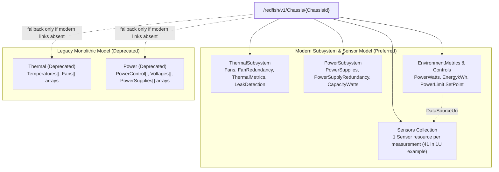

# 7.8 Power, thermal, sensors and environment

| | |
|---|---|
| Level | Intermediate |
| Priority tier | 1 |
| Lab venue | Laptop |
| Part | Part 7: Redfish and BMC |
| Status | Drafted (`sensors_lab.py`: 13 checks pass against mock and DMTF trees; **untested** on live BMC) |

## Why this matters for AI infrastructure

A training job can slow down by a third because one fan failed or one GPU got too hot, and the operating system may not say a word. The BMC watches the hardware from outside, so its sensors are the first place to look. Power is the other limit: every rack has a fixed budget (chapter 6.30) and the BMC can report, and sometimes limit, how much each server draws.

## Prerequisites and outcomes

You need 7.2 and 7.7, and chapter 6.30 helps. After this chapter you can:

- find temperature, fan, voltage and power readings on any Redfish service
- tell the modern design (`Sensors`, subsystems) from the old design (`Thermal`, `Power`)
- read thresholds and decide what to alert on
- explain `Status`, `Health` and thresholds as separate things
- read power supply and cooling data, and understand power-cap controls
- export readings in Prometheus format

## 1. Two designs for the same information

Redfish changed how it shows heat and power. Both exist in real equipment, so you must read both.

| | Old design (deprecated) | Modern design |
|---|---|---|
| Where | `Chassis/<id>/Thermal` and `Chassis/<id>/Power` | `Chassis/<id>/Sensors`, `ThermalSubsystem`, `PowerSubsystem`, `EnvironmentMetrics` |
| Shape | one big resource with **arrays** (`Temperatures[]`, `Fans[]`, `Voltages[]`, `PowerControl[]`, `PowerSupplies[]`) | **one resource per item** (a Sensor, a Fan, a PowerSupply) |
| Linking | items are array entries, found by position | each item has its own address and links |
| Status | the resource marks itself deprecated | current |

DMTF's rack-server example even carries a hint inside the chassis: `"Thermal@Redfish.Deprecated": "Please migrate to use /redfish/v1/Chassis/1U/ThermalSubsystem"`. The schema marks the old way as deprecated, but the spec says services may still implement it, so older BMC firmware keeps it.

The lab shows the difference in the same example tree: through the modern `Sensors` collection the tool found **41** readings. When I removed that link to force the old route it found **9**, from `Thermal` and `Power`. The modern way exposes more, with more detail.



## 2. Sensors: one resource per measurement

A `Sensor` is a single reading with its meaning attached. The most useful properties (from the schema):

| Property | Meaning |
|---|---|
| `Reading` | the current value |
| `ReadingType` | what is measured. Values include `Temperature`, `Humidity`, `Power`, `EnergykWh`, `Voltage`, `Current`, `Frequency`, `Pressure`, `LiquidLevel`, `Rotational`, `AirFlow`, `LiquidFlow`, `Percent`, `Heat` and more |
| `ReadingUnits` | the unit in UCUM style: `Cel`, `W`, `V`, `A`, `RPM`, `%`, `Hz` |
| `PhysicalContext` | where it applies: for example `CPU`, `GPU`, `Intake`, `Exhaust`, `PowerSupply`, `Fan` |
| `PhysicalSubContext` | a finer position inside that context |
| `ReadingRangeMin`, `ReadingRangeMax` | the range the sensor can measure |
| `Thresholds` | the limits (below) |
| `PeakReading` and similar | highest value seen |
| `SpeedRPM` | fan speed, for fan sensors |
| `Status` | `State` and `Health` |

Because the unit and context are in the data, one program can handle every sensor without a per-vendor list. You find sensors under `Chassis/<id>/Sensors`. Some BMCs also place sensors under other resources, so in a fleet tool treat the chassis list as the main route and the metric links of components (below) as extra.

### Thresholds

A sensor's `Thresholds` object can hold these limits, each with a `Reading` and an `Activation` direction (`Increasing`, `Decreasing`, `Either` or `Disabled`):

`UpperCaution`, `UpperCritical`, `UpperFatal`, `LowerCaution`, `LowerCritical`, `LowerFatal`, and user-set variants (`UpperCautionUser` and so on). Each threshold can also carry `DwellTime` (how long the value must break the limit before it counts) and hysteresis (how far back it must come to clear).

Caution, critical and fatal are three steps up: **caution** means "above normal", **critical** means "above normal but not yet fatal" and **fatal** means the level the equipment treats as dangerous. The BMC then sets `Status.Health` to `Warning` or `Critical`, and may take action itself such as raising fan speed or shutting down.

### Status is not the same as a reading

Three separate ideas:

| Idea | Where | Meaning |
|---|---|---|
| **Reading** | `Reading` | the number |
| **Threshold** | `Thresholds` | the limits for that number |
| **Health** | `Status.Health` | the BMC's own judgment: `OK`, `Warning`, `Critical` |

`Status.State` adds whether the sensor is `Enabled`, `Disabled`, `Absent` (nothing there) and so on. Do not mix them up: a sensor can be `Disabled` and have no reading, which is normal.

**Why your tool should check the value itself.** The BMC's health flag depends on firmware logic that you do not control. In my lab I set a GPU temperature above its critical threshold while leaving `Health: OK`, and the tool still flagged it. A monitoring tool that trusts only the health flag misses sensors whose firmware forgot to update it. Use both.

## 3. Thermal: fans, heat and cooling

Under the modern `ThermalSubsystem` (from the schema):

| Link | Contents |
|---|---|
| `Fans` | one `Fan` per fan: `SpeedPercent`, `Location`, `PhysicalContext`, `Replaceable`, `HotPluggable`. The actual RPM is on a linked sensor |
| `FanRedundancy` | groups of fans and how many must work (for example N plus M) |
| `ThermalMetrics` | a summary: `TemperatureSummaryCelsius` (intake, exhaust and so on) and a list of readings |
| `Heaters` | heating elements, if any |
| `LeakDetection`, `Pumps`, `Filters`, `CoolantConnectorRedundancy` | for liquid-cooled equipment |

**Fan redundancy** is worth reading. DMTF's example says each fan group has `MinNeededInGroup: 1` out of two. It tells you whether one failed fan is an emergency or just a repair ticket.

For liquid cooling the standard has more resources: `CoolingUnit` (a CDU, coolant distribution unit), `CoolantConnector`, `Pump`, `Reservoir`, `Filter`, `LeakDetection` and `LeakDetector`. The BCM manual says BCM uses Redfish for leak detection on NVL8 hardware. Chapter 6.30 explains why liquid cooling matters. I ran my reader on DMTF's cooling-unit example, which has a separate chassis for the CDU: 18 readings, nothing flagged.

## 4. Power: supplies, draw and limits

Under `PowerSubsystem`:

| Link or property | Meaning |
|---|---|
| `CapacityWatts` | total power the chassis can draw |
| `Allocation` | requested and allocated watts |
| `PowerSupplies` | one `PowerSupply` per unit |
| `PowerSupplyRedundancy` | for example `Failover`, which supplies are active, how many are needed |
| `Batteries` | battery units |

A `PowerSupply` has `PowerCapacityWatts`, `LineInputStatus` (is the input power present and normal), `PowerSupplyType` (AC or DC), efficiency ratings by load, input ranges, firmware version and a link to its `Metrics` (`PowerSupplyMetrics`: input and output watts, voltage, current, temperature). It also has `Status`, and in DMTF's example `Status.Conditions` holds a real-looking message: *"Power supply 'PSU 1' has a predicted failure condition."* with `Health: Warning`. This is the kind of early warning to alert on, before a supply actually fails.

`EnvironmentMetrics` is a handy summary on a chassis (and on many components, such as each GPU): `PowerWatts`, `EnergykWh`, `TemperatureCelsius`, `FanSpeedsPercent`, `HumidityPercent`, and `PowerLimitWatts`. Each entry has a `DataSourceUri` that points at the sensor it came from, so you can follow it for detail.

### Power capping with controls

A `Control` resource is a setting you can change. For power it looks like this, from DMTF's example:

```json
{
  "Id": "PowerLimit",
  "Name": "System Power Limit",
  "PhysicalContext": "Chassis",
  "ControlType": "Power",
  "ControlMode": "Automatic",
  "SetPoint": 500,
  "SetPointUnits": "W",
  "AllowableMax": 1000,
  "AllowableMin": 150,
  "Sensor": { "Reading": 374, "DataSourceUri": "/redfish/v1/Chassis/1U/Sensors/TotalPower" }
}
```

The server is drawing 374 W, the cap is 500 W, and it may be set between 150 and 1000 W. To change it you `PATCH` the control's `SetPoint` (with the usual ETag care from chapter 7.3). The NVIDIA notes say power capping on DGX H100 and H200 is done through Redfish. I could not check how.

:::warning Capping changes performance
A power cap makes the hardware slow itself down to stay under the limit. On GPU servers that directly lowers training speed. Change a cap only with a reason, record who changed it and why, and compare the job speed before and after. A cap that is lower than the normal draw of a busy server looks, from the user's side, like a slow cluster.
:::

### The old design's power data

For completeness: `Power` has `PowerControl[]` (with `PowerConsumedWatts`, `PowerCapacityWatts` and `PowerMetrics` with min, max and average over an interval, and a `PowerLimit`), `Voltages[]` and `PowerSupplies[]`. My tool reads these when the modern route is missing.

## 5. The tool: read both, flag by value

`code/part07/rf_sensors.py` reads every chassis. For each one it tries the `Sensors` collection first and falls back to the old `Thermal` and `Power`. It normalises everything into rows and applies checks:

- `Health` is not `OK`
- the reading is at or above `UpperCritical` or `UpperFatal`, or above `UpperCaution`
- the sensor is `Enabled` but has no reading (`null`)

`Disabled` and `Absent` sensors are skipped. With `--prom` it prints Prometheus text format. Example run on my mock after I set one GPU temperature to 92 C (its critical limit is 88):

```text
chassis Chassis_0: 4 readings via Sensors
   Sensors  Temp GPU0   Temperature   92.0 Cel   AT/ABOVE CRITICAL limit 88.0
```

and on DMTF's rack-server example:

```text
chassis 1U: 41 readings via Sensors
   Sensors  CPU #1 Temperature   ?   44 Cel   health=Warning; above caution limit 42
41 readings, 1 flagged
```

In the power-shelf example the tool flagged `Power Shelf Load Percent` at 93 % against a caution limit of 90. Across the DMTF examples the counts were: PDU 115 readings and nothing flagged, cooling unit 18 and nothing flagged, power shelf 35 and 1 flagged, rack server 41 and 1 flagged.

The lab (`sensors_lab.py`) has 13 checks. They test: normal values are not flagged, critical and caution by value, null reading, `Critical` health, `Disabled` sensors skipped, the Prometheus text (parsed with the official `prometheus_client` parser), and the fallback to the old route on DMTF's data.

### Prometheus export

`--prom` produces lines like:

```text
redfish_sensor_reading{chassis="1U",sensor="Ambient Temperature",kind="?",units="Cel"} 22.5
redfish_sensor_ok{chassis="1U",sensor="Ambient Temperature",kind="?",units="Cel"} 1
```

The `kind="?"` appears because that sensor in DMTF's example has no `ReadingType`, which is optional. Chapter 17's monitoring part builds on this idea. For a real fleet you would run an exporter service, not a script, and keep the number of unique label values small (fan and sensor names differ between machines, so test the cardinality).

## 6. Telemetry service: reports instead of polling

Reading every sensor every 10 seconds from 1,000 BMCs is heavy. The **TelemetryService** lets the BMC collect metrics itself and hand you a bundle:

| Resource | Meaning |
|---|---|
| `MetricDefinitions` | what can be measured |
| `MetricReportDefinitions` | a recipe: which properties to collect, how often (`Schedule`), what to do with the report (for example send it as an event) |
| `MetricReports` | the produced reports. A `MetricReport` has `MetricValues`, a `ReportSequence` and a `Timestamp` |
| `Triggers` | rules such as "when this reaches a threshold, take this action" |

The service says the shortest allowed collection time in `MinCollectionInterval`. Metric reports can be sent through the event service from chapter 7.5 (the spec has a separate metric-report event format). The NVIDIA notes show one DGX report address, `TelemetryService/MetricReports/NvidiaNMMetrics_0`. I could not confirm that name and it is likely specific to one NVIDIA platform and firmware version.

## 7. How this fits with GPU tools

The BMC and the GPU driver see different things:

| Source | Sees | Does not see |
|---|---|---|
| **BMC / Redfish** | inlet and exhaust air, fans, power supplies, board temperatures, total power, sometimes GPU temperature and power | GPU clocks, throttle reasons, ECC details (unless the vendor adds them) |
| **GPU driver (`nvidia-smi`, DCGM)** | GPU clocks, throttle reasons, utilization, memory errors, NVLink counters | fans, power supply health, anything when the OS is down |

Use both. If a job is slow, the driver tells you the GPU is throttling for thermal or power reasons. Redfish tells you why: a failed fan, a hot inlet, a power supply that dropped. The NVIDIA notes work through one such investigation ("ghost throttling") in a scenario that I carry into chapter 7.14.

## 8. Finding data on an unknown machine

Because layouts differ, use a fallback order. For "the GPU temperature" on a server you have not seen:

1. From each `ComputerSystem` look at `Processors` for `ProcessorType` equal to `GPU`. Follow the GPU's `EnvironmentMetrics` link if present (the notes show `GPU_SXM_<id>/EnvironmentMetrics` on the HGX baseboard).
2. Otherwise search the chassis `Sensors` for `ReadingType: Temperature` and a `PhysicalContext` of `GPU`.
3. Otherwise try the old `Thermal` resource and look for temperatures whose `PhysicalContext` or `RelatedItem` points to the GPU.
4. If none exist, say so. Do not invent a value. "No data" is a finding to report.

## Exercises

1. **Verifying value-based vs health-based sensor alerts (`code/part07/sensors_lab.py`):** Run `python3 code/part07/sensors_lab.py` (`9 passed, 0 failed` or `13` sub-assertions). Inspect `code/part07/sensors_lab.py` and `code/part07/rf_sensors.py` to see how a GPU sensor at `92.0 Cel` (above `UpperCritical: 88.0`) is flagged even when `Status.Health` is still `"OK"`.
2. **Reading rack PDU telemetry via Redfish (`public-pdu`):** Serve `$REDFISH_PUBLICATIONS/mockups/public-pdu` with `redfish_mock.py --mockup` and run `python3 code/part07/rf_sensors.py http://127.0.0.1:8443 admin adminpass --all`. List the `ReadingType` values returned across the `115` sensors (`Voltage`, `Current`, `Power`, `EnergykWh`, `Frequency`, `Temperature`) and explain why a smart rack PDU exposes a `Chassis` resource.
3. **Inspecting and staging a chassis Power Limit (`Control`):** In the `public-rackmount1` mockup (`/redfish/v1/Chassis/1U/Controls/PowerLimit`), inspect `SetPoint` (`500`), `AllowableMin` (`150`), `AllowableMax` (`1000`), and `Sensor.Reading` (`374`). Write the exact `PATCH` request (including `If-Match`) to lower `SetPoint` to `450` W and state the performance trade-off on a training node.
4. **Alerting on PSU predictive failure (`Status.Conditions`):** Inspect `/redfish/v1/Chassis/1U/PowerSubsystem/PowerSupplies` in `public-rackmount1` and write a Python check that flags any `PowerSupply` where `Status.Health != "OK"`, `LineInputStatus != "Normal"`, or `Status.Conditions` is non-empty.
5. **Extending `rf_sensors.py` to report `FanRedundancy` and `SpeedPercent`:** Extend `code/part07/rf_sensors.py` to read `ThermalSubsystem/Fans` and `FanRedundancy`, printing each fan's `SpeedPercent` and whether the fan group has margin above `MinNeededInGroup`.
6. **Handling `Activation: "Disabled"` on sensor thresholds:** Using `redfish_mock.py` in-process, set a sensor's `Thresholds.UpperCritical.Activation` to `"Disabled"` while setting `Reading` above `Thresholds.UpperCritical.Reading`. Verify how a compliant threshold evaluator should treat a disabled threshold.

## 10. Interview angles

- "Training slowed down on one node. How do you check whether it is physical?" Look at BMC sensors (inlet temperature, fans, power supplies) and compare with the other nodes; then the GPU driver for throttle reasons.
- "Why check the reading and not just Health?" The health flag is firmware logic; thresholds and values are data you can verify.
- "Thermal versus ThermalSubsystem?" The old array-based design against the modern one-resource-per-item design. A tool must handle both.
- "What is a power cap and what is the risk?" A limit on server power. It protects the rack budget but slows the hardware; change it deliberately and record it.
- "How would you monitor 1,000 BMCs without overloading them?" Telemetry reports or events where supported, a moderate poll interval, and controlled concurrency.

## Checkpoint questions (20)

<details>
<summary>1. Name the two Redfish designs for exposing thermal and power telemetry on a `Chassis`, and state which one is deprecated.</summary>

1. **Modern design (current):** `/redfish/v1/Chassis/{id}/Sensors`, `ThermalSubsystem`, `PowerSubsystem`, `EnvironmentMetrics`, and `Controls` (one addressable resource per sensor, fan, or PSU).
2. **Legacy design (deprecated):** `/redfish/v1/Chassis/{id}/Thermal` and `/redfish/v1/Chassis/{id}/Power` (monolithic resources containing `Temperatures[]`, `Fans[]`, `Voltages[]`, `PowerControl[]`, and `PowerSupplies[]` arrays).
</details>

<details>
<summary>2. In DMTF's `public-rackmount1` server example, how many readings does `rf_sensors.py` discover via the modern `Sensors` collection versus the legacy `Thermal`/`Power` fallback?</summary>

It finds **`41` readings** through the modern `Sensors` collection versus only **`9` readings** when forced onto the legacy `Thermal` and `Power` resources.
</details>

<details>
<summary>3. On a `Sensor` resource, what do `ReadingType`, `ReadingUnits`, and `PhysicalContext` specify?</summary>

- **`ReadingType`:** The physical quantity measured (`Temperature`, `Power`, `EnergykWh`, `Voltage`, `Current`, `Rotational`, `Humidity`, `Pressure`, `LiquidFlow`, `AirFlow`, `Percent`).
- **`ReadingUnits`:** The unit of measurement in UCUM notation (`Cel`, `W`, `kW.h`, `V`, `A`, `RPM`, `%`, `L/min`).
- **`PhysicalContext`:** The subsystem or location where the sensor sits (`CPU`, `GPU`, `Intake`, `Exhaust`, `PowerSupply`, `Memory`, `LiquidInlet`).
</details>

<details>
<summary>4. Name the three upper threshold levels on a `Sensor` in ascending order of severity.</summary>

1. **`UpperCaution`** (above normal operating range; warning).
2. **`UpperCritical`** (significantly above normal; action required).
3. **`UpperFatal`** (dangerous hardware limit; triggers emergency shutdown/protection).
</details>

<details>
<summary>5. What do `Activation` and `DwellTime` mean inside a sensor threshold object?</summary>

- **`Activation`:** The direction of travel (`Increasing`, `Decreasing`, `Either`, or `Disabled`) that triggers the threshold.
- **`DwellTime`:** An ISO 8601 duration specifying how long the reading must continuously violate the threshold before the threshold event is asserted (filtering out sub-second spikes).
</details>

<details>
<summary>6. What is the difference between a sensor's `Reading`, its `Thresholds`, and its `Status.Health`?</summary>

`Reading` is the raw numerical measurement (`92.0`); `Thresholds` are the configured numeric boundaries (`UpperCritical: 88.0`); and `Status.Health` (`OK`, `Warning`, `Critical`) is the BMC firmware's own summary judgment.
</details>

<details>
<summary>7. What does `Status.State: "Absent"` or `"Disabled"` mean on a sensor, and how should a monitoring scraper handle it?</summary>

`Absent` means the optional hardware probe or component is not installed, and `Disabled` means the sensor is turned off (`Reading` is typically `null`). Scrapers should skip `Absent` and `Disabled` sensors rather than alerting on `Reading == null`.
</details>

<details>
<summary>8. Why should your monitoring tool compare `Reading` against `Thresholds` directly in addition to checking `Status.Health`?</summary>

Some BMC firmware builds fail to update `Status.Health` when a sensor crosses a threshold (or leave `Health` at `OK`). Comparing `Reading` directly against `UpperCritical`/`UpperFatal`/`UpperCaution` catches thermal and power excursions even when BMC health rollup logic has a bug.
</details>

<details>
<summary>9. What does `FanRedundancy` inside `ThermalSubsystem` tell an operator when a single fan fails?</summary>

It specifies the redundancy group (`RedundancyType`, such as `NPlusM`), the member fans, and `MinNeededInGroup`—telling you immediately whether losing one fan leaves cooling redundant (schedule maintenance) or breaches the minimum required fan count (drain and shut down immediately).
</details>

<details>
<summary>10. Which Redfish resources under `ThermalSubsystem` and `Chassis` model direct-to-chip liquid cooling and CDUs?</summary>

**`CoolingUnit`** (CDU), **`CoolantConnector`**, **`Pump`**, **`Reservoir`**, **`Filter`**, and **`LeakDetection` / `LeakDetector`** (used by BCM on liquid-cooled NVL racks).
</details>

<details>
<summary>11. On a `PowerSupply` resource under `PowerSubsystem`, what do `LineInputStatus` and `Status.Conditions` report?</summary>

- **`LineInputStatus`:** Whether AC/DC utility input power to that PSU is present and normal (`Normal`, `LossOfInput`, `OutOfRange`).
- **`Status.Conditions`:** Active diagnostic conditions on the PSU, such as a predictive failure warning (`"Power supply 'PSU 1' has a predicted failure condition"`).
</details>

<details>
<summary>12. What is `EnvironmentMetrics`, and what does `DataSourceUri` inside its properties do?</summary>

`EnvironmentMetrics` (attached to a `Chassis`, `Processor`, or `Memory`) provides a convenient roll-up of key environmental readings (`PowerWatts`, `EnergykWh`, `TemperatureCelsius`, `PowerLimitWatts`), where each metric's **`DataSourceUri`** links directly to the underlying `Sensor` resource.
</details>

<details>
<summary>13. How do you read and modify a server's power cap using a Redfish `Control` resource?</summary>

Inspect the `Control` resource (`ControlType: "Power"`) under `/redfish/v1/Chassis/{id}/Controls/{controlId}`, check `AllowableMin` and `AllowableMax`, and send a `PATCH` request (with `If-Match`) setting **`SetPoint`** (in `SetPointUnits: "W"`) and `ControlMode: "Automatic"`.
</details>

<details>
<summary>14. Why is lowering a server's power cap (`SetPoint`) below its peak workload draw dangerous for multi-node distributed training?</summary>

When power draw hits `SetPoint`, the BMC/hardware throttles CPU and GPU clock frequencies to stay under the power cap. In synchronous multi-node training (`AllReduce`), throttling even a single node forces all other nodes in the job to wait at every collective barrier.
</details>

<details>
<summary>15. How does `TelemetryService` reduce monitoring overhead across a 1,000-node cluster compared to polling individual `Sensor` URIs?</summary>

Instead of the client making 40+ HTTP `GET` requests per node per poll cycle, the BMC's `TelemetryService` aggregates readings locally according to a `MetricReportDefinition` and delivers a single compact **`MetricReport`** (via `GET` or pushed automatically via `EventService`).
</details>

<details>
<summary>16. What are the four core sub-collections under `/redfish/v1/TelemetryService`?</summary>

1. **`MetricDefinitions`:** Properties and units that the BMC knows how to measure.
2. **`MetricReportDefinitions`:** Schedules and lists of metrics to bundle into a report.
3. **`MetricReports`:** The generated time-stamped metric bundles (`MetricValues`).
4. **`Triggers`:** Threshold rules that fire alerts or actions when a metric crosses a boundary.
</details>

<details>
<summary>17. What hardware health signals can the BMC see that `nvidia-smi` / DCGM cannot, and vice versa?</summary>

- **BMC / Redfish sees:** Chassis inlet/exhaust air temperatures, fan RPMs and redundancy, PSU input voltage/wattage, liquid leak detectors, and board sensors when the host OS is dead.
- **GPU driver (`nvidia-smi` / DCGM) sees:** Per-SM clock frequencies, exact clock-throttle reason bitmasks (`hw_slowdown`, `sw_thermal_slowdown`), HBM ECC error counters, and NVLink symbol/replay counters.
</details>

<details>
<summary>18. What is the 4-step discovery fallback order for reading a GPU's temperature on an unfamiliar server via Redfish?</summary>

1. Traverse `Systems` $\rightarrow$ `Processors` (`ProcessorType == "GPU"`) $\rightarrow$ `EnvironmentMetrics` (`TemperatureCelsius`).
2. Search `Chassis/{id}/Sensors` for `ReadingType == "Temperature"` and `PhysicalContext == "GPU"`.
3. Fall back to deprecated `Chassis/{id}/Thermal` `Temperatures[]` matching `PhysicalContext == "GPU"`.
4. If none exist, explicitly report `"no GPU temperature sensor exposed"` rather than guessing.
</details>

<details>
<summary>19. Why must a monitoring tool report an explicit warning when an `Enabled` sensor returns `Reading: null`?</summary>

While `null` on a `Disabled` or `Absent` sensor is normal (or on a host-powered domain when `PowerState == "Off"`), `Reading: null` on an `Enabled` sensor of a running server indicates a broken `I2C`/`SMBus` sensor read or hung satellite controller.
</details>

<details>
<summary>20. When exporting Redfish sensor readings to Prometheus (`rf_sensors.py --prom`), why must you watch label cardinality across heterogeneous server vendors?</summary>

Prometheus creates a separate time series for every unique combination of metric name and key-value labels (`{chassis=..., sensor=..., kind=..., units=...}`). Avoid putting high-cardinality or rapidly changing strings (such as timestamps or raw serial numbers) into labels unless bounded by the node count.
</details>

## Sources and review notes

- **Redfish Resource and Schema Guide DSP2046 (2024.4)** and the official JSON Schemas (`Sensor` v1.10 and later, `PowerSubsystem`, `PowerSupply`, `ThermalSubsystem`, `ThermalMetrics`, `EnvironmentMetrics`, `Control`, `Fan`, `Thermal`, `Power`, `TelemetryService`, `MetricReport`, `MetricReportDefinition`, `Triggers`): property meanings and enumerations.
- **DMTF example trees** (`public-rackmount1`, `public-pdu`, `public-power-shelf`, `public-cooling-unit`, `public-liquid-cooled-server`) at commit `fa6d23d9`: all numbers in the lab.
- **BCM 11 Administrator Manual**, appendix N: sensor and health monitoring and leak detection for NVL8 hardware.
- **NVIDIA-DevOps notes** (volume 10 chapter 1, section 3.3 and scenario 1): the GPU endpoints, the telemetry report name and the throttling investigation. Unchecked.
- **Chapter 6.30** for rack power and cooling arithmetic. The user's notes volume 20 chapter 9 (power supply issues and brownout scenarios) is routed to chapters 6.14, 10.21, 10.22, 12.18, 12.24 and 17.7 and is not used here.
- **Run here:** `rf_sensors.py` on six services and `sensors_lab.py` (13 checks).
- **Not verified:** real BMC sensor names, which sensors exist on DGX, HGX or GB200, the exact power-capping method on NVIDIA systems, and the NVIDIA telemetry report. DMTF's example data is illustrative.
