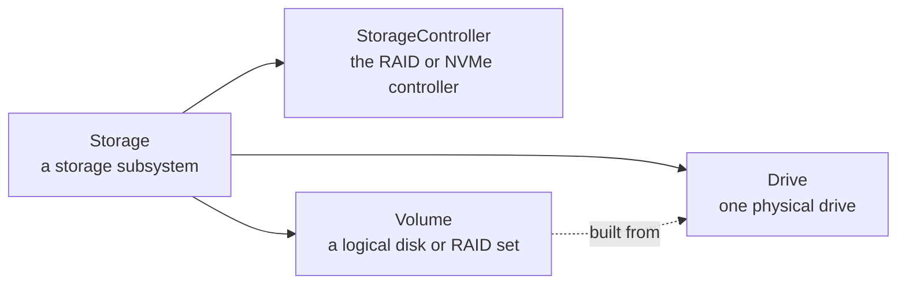

# 7.9 Storage, network adapters and PCIe devices

| | |
|---|---|
| Level | Intermediate |
| Priority tier | 1 |
| Lab venue | Laptop |
| Part | Part 7: Redfish and BMC |
| Status | Drafted. `code/part07/rf_hardware.py` and `hardware_lab.py` were **run**: 15 checks pass. They use my mock (8 GPUs and 8 NICs with invented values) and DMTF's example trees (tower server, SmartNIC, accelerator card, local storage, NVMe-oF box). No real GPU server was queried, and I did not compare Redfish values with `lspci` or `nvidia-smi` on real hardware |

## Why this matters for AI infrastructure

The fastest GPU is wasted if its PCIe link trained down to a quarter of its speed, if its network port negotiated 200 Gbps instead of 400, or if a boot drive is about to die. These problems rarely crash anything. The job just runs slower, or one node drags down a whole training run. A cluster team needs a cheap, automatic way to ask every machine "are all your links at full speed?" The BMC can answer through Redfish, even before the operating system is installed.

## Prerequisites and outcomes

You need chapters 7.2 and 7.7. After this chapter you can:

- find drives, volumes, network ports and PCIe devices on any Redfish service
- read PCIe speed and width, and spot a link that trained down
- read port state and speed, and spot a port running below its maximum
- read drive health signals
- run a tool that checks all of this and a lab that tests it

## 1. Where the hardware lives

Hardware sits under both families from chapter 7.7. The system side shows the **logical** view and the chassis side shows the **physical** one.

| Hardware | Where | Main resource types |
|---|---|---|
| Drives and volumes | `Systems/<id>/Storage` | `Storage`, `Drive`, `Volume`, `StorageController` |
| Old-style storage | `Systems/<id>/SimpleStorage` | `SimpleStorage` (simple, older) |
| Network adapters | `Chassis/<id>/NetworkAdapters` | `NetworkAdapter`, `Port`, `NetworkDeviceFunction` |
| Host network interfaces | `Systems/<id>/EthernetInterfaces` | `EthernetInterface` |
| PCIe devices | `Chassis/<id>/PCIeDevices` | `PCIeDevice`, `PCIeFunction`, `PCIeSlots` (deprecated) |
| GPUs and CPUs | `Systems/<id>/Processors` | `Processor` (chapter 7.7) |
| Memory | `Systems/<id>/Memory` | `Memory` |
| Fabric adapters | `Chassis/<id>/FabricAdapters` | `FabricAdapter` |

Remember chapter 7.2: names, positions and optional parts differ between makers. In DMTF's examples I found storage under `Storage` in some trees and `SimpleStorage` only in others, and PCIe devices in only some of them. A tool must find resources by type and skip what is missing.

## 2. Storage: drives, volumes, controllers



**Drive** (from the schema):

| Property | Meaning |
|---|---|
| `CapacityBytes`, `BlockSizeBytes` | size and the smallest addressable block |
| `MediaType` | `HDD`, `SSD` or `SMR` |
| `Protocol` | how it talks to the controller (`NVMe`, `SATA`, `SAS` and others) |
| `FailurePredicted` | **true** when the drive predicts failure soon |
| `PredictedMediaLifeLeftPercent` | how much of the write/read life is left, as a percentage |
| `CapableSpeedGbs`, `NegotiatedSpeedGbs` | the best link speed it supports, and the one it actually runs at |
| `EncryptionStatus` | encryption state |
| `Revision`, `Model`, `SerialNumber` | identity |
| `Operations` | jobs currently running on it, such as a rebuild |
| `Status` | `State` and `Health` |

**Volume:** `RAIDType`, `CapacityBytes`, `VolumeType`, `Encrypted`, read and write cache policy, `Operations` (a rebuild or check running) and `Status`. **StorageController:** supported RAID types and protocols, firmware version, speed, and its own `PCIeInterface`. The standard also has metrics resources (`DriveMetrics`, `StorageControllerMetrics`) that expose usage counters and NVMe SMART warnings such as `SpareCapacityWornOut` and `MediaInReadOnly`.

For an AI node the boot and scratch NVMe drives matter less than the shared storage, but a dead scratch drive stops a job, and local NVMe is the cache for datasets. Watch `FailurePredicted` and life left.

## 3. Network: adapters, ports and functions

| Resource | What it is |
|---|---|
| `NetworkAdapter` | one physical card (for example a 400G NIC): model, serial number, firmware, `Controllers` (the chips on it), links to `Ports` and `NetworkDeviceFunctions` |
| `Port` | one connector: protocol, state, speed, width |
| `NetworkDeviceFunction` | a logical interface the card exposes: type (Ethernet, InfiniBand and so on), MAC address, SR-IOV virtual functions, which physical port it uses |
| `EthernetInterface` | an interface as the OS or BMC sees it: IP addresses, VLAN, DHCP |

Useful `Port` properties:

| Property | Meaning |
|---|---|
| `LinkState` | the **desired** state: `Enabled` or `Disabled` |
| `LinkStatus` | the **actual** state: `LinkUp`, `LinkDown`, `NoLink`, `Starting`, `Training` |
| `CurrentSpeedGbps` | the speed right now |
| `MaxSpeedGbps` | the maximum speed as currently configured |
| `ActiveWidth`, `Width` | active lanes and total lanes |
| `PortProtocol`, `LinkNetworkTechnology` | `Ethernet`, `InfiniBand`, `FibreChannel`, `GenZ`, `PCIe` |
| `SignalDetected` | is any signal seen on the link |
| `Metrics` | link to port counters (`PortMetrics`) |

Two reading rules: a port that is `Disabled` and `LinkDown` is fine (you turned it off), a port that is `Enabled` and `LinkDown` is a problem. A port at `LinkUp` with `CurrentSpeedGbps` below `MaxSpeedGbps` is working but slow: a bad cable, bad optic or a negotiation problem.

DPUs and SmartNICs are also computers, with their own `ComputerSystem` of type `DPU` (chapter 7.7). BlueField DPUs in DGX systems are an example in the user's notes.

## 4. PCIe: the hidden speed limit

Every GPU, NIC and NVMe drive connects through PCI Express. A PCIe link has a **speed** (the generation: Gen3, Gen4, Gen5) and a **width** (the number of lanes: x1, x4, x8, x16). The bandwidth is roughly the product. A device built for Gen5 x16 that trained down to Gen3 x8 has a fraction of the bandwidth, and nothing says so unless you look. This can happen with a bad cable or riser, dust, a loose card, a BIOS setting, or power problems.

The `PCIeDevice` resource has a `PCIeInterface` block with exactly the numbers you need:

| Property | Meaning |
|---|---|
| `PCIeType` | the PCIe version **in use** now (`Gen1` to `Gen6`) |
| `MaxPCIeType` | the highest version this device supports |
| `LanesInUse` | lanes in use now |
| `MaxLanes` | lanes the device supports |

If `PCIeType` is lower than `MaxPCIeType`, or `LanesInUse` is lower than `MaxLanes`, the link is **degraded**. (This is the same information as the `LnkCap` and `LnkSta` lines of `lspci -vv` on Linux, but available without logging in.) The same block appears on `NetworkAdapter` controllers, `StorageController`, and others. A `PCIeDevice` also has `DeviceType` (`SingleFunction`, `MultiFunction`, `Simulated`, `Retimer`), firmware version, `Slot` information and links to its `PCIeFunctions`.

The user's notes list the same failure ("a PCIe link running at Gen1 instead of Gen5") as a cause of silent slowness in a 512-node cluster, and a related scenario about links that fall back to Gen3 x8. Those notes also recommend forcing the BIOS link speed instead of "Auto", which I cover in chapter 7.14.

## 5. The tool: find the degraded things

`code/part07/rf_hardware.py` walks the `Systems` and `Chassis` trees by following links (skipping logs, sensors and certificates to save time), looks at each resource by `@odata.type`, and applies simple rules:

| Group | Flag when |
|---|---|
| PCIe | `LanesInUse` below `MaxLanes`, or `PCIeType` older than `MaxPCIeType`, or health not OK |
| Ports | enabled but not `LinkUp`; or `CurrentSpeedGbps` below `MaxSpeedGbps`; or `ActiveWidth` below `Width`; or health not OK |
| Drives | `FailurePredicted`; life left under 10 percent; `NegotiatedSpeedGbs` below `CapableSpeedGbs`; health not OK |
| Volumes | health not OK |

It also warns when a resource's own `@odata.id` is different from the address it was fetched from (which can mean a broken tree or a copy-paste error in the service). Results of the real run on my mock, which has 8 GPUs and 8 NICs on Gen5 x16 and two NVMe drives:

```text
walked 60 resources
PCIe interfaces: 16   ports: 8   drives: 2   volumes: 0   storage subsystems: 1

0 flagged
```

On DMTF's tower-server example:

```text
walked 404 resources
PCIe interfaces: 10   ports: 18   drives: 18   volumes: 5   storage subsystems: 9
  PCIe   Chassis/Tower/NetworkAdapters/NIC1#controller    Gen2 x2 (max Gen3 x4)  link width x2 of x4; PCIe Gen2 of Gen3
  PCIe   Chassis/Tower/PCIeDevices/IntegratedNIC          Gen2 x4 (max Gen3 x4)  PCIe Gen2 of Gen3
  PCIe   Chassis/Tower/PCIeDevices/Slot4                  Gen2 x2 (max Gen3 x4)  link width x2 of x4; PCIe Gen2 of Gen3
  PCIe   Chassis/Tower/PCIeDevices/Slot3                  Gen2 x2 (max Gen3 x4)  link width x2 of x4; PCIe Gen2 of Gen3
4 flagged
```

On DMTF's accelerator-card example it flags two controllers at Gen3 of a possible Gen4 and a port at 25 of 50 Gbps. The SmartNIC example shows the same 25 of 50 Gbps port. These DMTF trees are sample data. The values may be deliberately varied to show the schema, so I treat them only as test material for the tool.

On the SmartNIC example the tool also printed its `@odata.id` warning: two ports under `Chassis/Card2/...` say that their `@odata.id` is the `Card1` address. In DMTF's own sample, that looks like a copy-and-paste error. Real BMCs have bugs like this too, and a script that trusts the ID inside the body instead of the address it fetched will confuse the two ports.

### The lab

```bash
cd code/part07
python3 hardware_lab.py
```

It runs 15 checks in the mock and in two DMTF trees. In the mock it creates faults one by one:

```text
PASS  a GPU trained down to Gen3 x8 is flagged for both speed and width
PASS  only that one device is flagged
PASS  an enabled port that is LinkDown is flagged
PASS  a port that is administratively Disabled is not flagged
PASS  a 400G port running at 200G is flagged (cable or optics or negotiation)
PASS  a port with 2 of 4 lanes active is flagged
PASS  a drive predicting failure is flagged
PASS  a drive with 5 percent life left is flagged
PASS  a drive linked at 8 of 32 Gbps is flagged
PASS  a PCIe device with Health Warning is flagged
PASS  DMTF tower example: 4 PCIe devices run below their maximum link
...
15 passed, 0 failed
```

Fleet use: run this on every BMC after racking and after every maintenance. A GPU node with one degraded link should not enter the scheduler until it is fixed. Combine it with the host-side checks in Part 10 (NVLink, `nvidia-smi`, DCGM).

## 6. What Redfish does not tell you

- It does not show **how fast data actually moves**. A link may be at full width and still slow because of congestion or a software setting.
- It shows PCIe speed and width **as the BMC reads them**. Some BMCs cannot see every device (they see what is wired to them or what the vendor mapped). A device missing from the list is not proof it is absent.
- GPU specifics (NVLink counters, ECC counts, clock throttling) usually come from the GPU driver, not the standard schema. Vendors may add them as OEM data (chapter 7.13).
- Drive health from the BMC is only as good as the drive's own reporting.

So use Redfish for the cheap first check and for machines whose OS is not running, then the host tools for depth.

## 7. Exercises

1. Run `hardware_lab.py`. Pick the check you think catches the most expensive real-life fault and explain why.
2. Serve DMTF's `public-localstorage` and run `rf_hardware.py --all`. List the drives with their protocol and capacity.
3. Add a new check to `rf_hardware.py`: flag a `Volume` whose `Operations` array shows a rebuild. Test it by editing the mock tree.
4. A GPU shows `PCIeType: Gen4` and `MaxPCIeType: Gen5`. List three possible causes and the next check for each.
5. A 400G port shows `LinkUp` at 100 Gbps. What do you check on both sides of the link?
6. Why does the tool ignore ports where `LinkState` is `Disabled`?
7. How would you store the result of a fleet run so you can notice a change from last week?

## 8. Interview angles

- "A node is slower than its twins and DCGM looks fine. What do you check?" PCIe link speed and width on each GPU and NIC, port speeds, thermal and power; compare with a healthy node.
- "How do you check hardware health before a node joins the cluster?" A Redfish sweep for degraded links, firmware, health and drive state, then host tests for GPU and network.
- "What is the difference between `LinkState` and `LinkStatus`?" Desired and actual.
- "Why is a degraded PCIe link dangerous even when nothing errors?" It silently reduces bandwidth. Training synchronises on the slowest member.

## 9. Checkpoint questions (20)

1. Where do drives live, and where do network adapters live?
2. What is the difference between `Storage` and `SimpleStorage`?
3. Name four `Drive` properties that signal health.
4. What do `CapableSpeedGbs` and `NegotiatedSpeedGbs` tell you together?
5. What is a `Volume`?
6. What are `NetworkAdapter`, `Port` and `NetworkDeviceFunction`?
7. What is the difference between `LinkState` and `LinkStatus`?
8. What does `CurrentSpeedGbps` below `MaxSpeedGbps` suggest?
9. What do `ActiveWidth` and `Width` mean?
10. What do PCIe speed and width mean, and how are they combined?
11. Which four properties are in `PCIeInterface`?
12. How do you detect a downgraded PCIe link?
13. Give three causes of a PCIe downgrade.
14. Why might a device be missing from the BMC's PCIe list?
15. What does the `@odata.id` mismatch warning mean?
16. Why does the tool skip logs and sensors?
17. Why is a `Disabled` port with `LinkDown` not a problem?
18. Why use Redfish before the OS is installed?
19. What does Redfish not tell you about network speed?
20. When should this check run in a node's life?

## 10. Sources and review notes

- **Redfish Resource and Schema Guide DSP2046 (2024.4) and the official JSON Schemas** (`Drive` v1.22, `Volume` v1.11, `Storage` v1.23, `StorageController` v1.12, `NetworkAdapter` v1.14, `NetworkDeviceFunction` v1.11, `Port` v1.20, `PCIeDevice` v1.23): property descriptions and enumerations including `PCIeTypes` (`Gen1` to `Gen6`) and `LinkStatus`.
- **DMTF example trees** (`public-tower`, `public-acd`, `public-smartnic`, `public-localstorage`, `public-nvmeof-jbof`, `public-rackmount1`) at commit `fa6d23d9`.
- **NVIDIA-DevOps notes:** the PCIe downgrade scenario (volume 10 chapter 1, scenario 1) and the volume 20 chapter on DMA engine failures and PCIe issues (routed to other chapters, whose escalation rule mentions links that stay trained down at Gen3 x8). Those notes' terminal outputs are marked illustrative by their authors.
- **Run here:** `rf_hardware.py` on seven services and `hardware_lab.py` (15 checks).
- **Not verified:** how a real GPU server reports its PCIe devices through Redfish (which devices appear, under which names), whether GPUs expose `PCIeInterface`, or how Redfish values compare to `lspci`. Verify on one real node before building automation on it.
