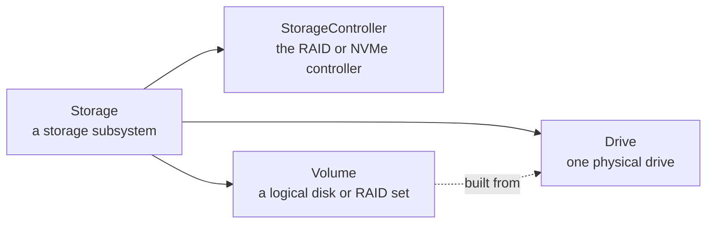

# 7.9 Storage, network adapters and PCIe devices

| | |
|---|---|
| Level | Intermediate |
| Priority tier | 1 |
| Lab venue | Laptop |
| Part | Part 7: Redfish and BMC |
| Status | Drafted (`hardware_lab.py`: 15 checks pass against mock and DMTF trees; **untested** on live BMC) |

## Why this matters for AI infrastructure

The fastest GPU is wasted if its PCIe link trained down to a quarter of its speed, if its network port negotiated 200 Gbps instead of 400, or if a boot drive is about to die. These problems rarely crash anything. The job just runs slower, or one node drags down a whole training run. A cluster team needs a cheap, automatic way to ask every machine "are all your links at full speed?" The BMC can answer through Redfish, even before the operating system is installed.

## Prerequisites and outcomes

You need chapters 7.2 and 7.7. After this chapter you can:

- find drives, volumes, network ports and PCIe devices on any Redfish service
- read PCIe speed and width, and spot a link that trained down
- read port state and speed, and spot a port running below its maximum
- read drive health signals
- run a tool that checks all of this and a lab that tests it

## 1. Where the hardware lives

Hardware sits under both families from chapter 7.7. The system side shows the **logical** view and the chassis side shows the **physical** one.

| Hardware | Where | Main resource types |
|---|---|---|
| Drives and volumes | `Systems/<id>/Storage` | `Storage`, `Drive`, `Volume`, `StorageController` |
| Old-style storage | `Systems/<id>/SimpleStorage` | `SimpleStorage` (simple, older) |
| Network adapters | `Chassis/<id>/NetworkAdapters` | `NetworkAdapter`, `Port`, `NetworkDeviceFunction` |
| Host network interfaces | `Systems/<id>/EthernetInterfaces` | `EthernetInterface` |
| PCIe devices | `Chassis/<id>/PCIeDevices` | `PCIeDevice`, `PCIeFunction`, `PCIeSlots` (deprecated) |
| GPUs and CPUs | `Systems/<id>/Processors` | `Processor` (chapter 7.7) |
| Memory | `Systems/<id>/Memory` | `Memory` |
| Fabric adapters | `Chassis/<id>/FabricAdapters` | `FabricAdapter` |

Remember chapter 7.2: names, positions and optional parts differ between makers. In DMTF's examples I found storage under `Storage` in some trees and `SimpleStorage` only in others, and PCIe devices in only some of them. A tool must find resources by type and skip what is missing.

## 2. Storage: drives, volumes, controllers



**Drive** (from the schema):

| Property | Meaning |
|---|---|
| `CapacityBytes`, `BlockSizeBytes` | size and the smallest addressable block |
| `MediaType` | `HDD`, `SSD` or `SMR` |
| `Protocol` | how it talks to the controller (`NVMe`, `SATA`, `SAS` and others) |
| `FailurePredicted` | **true** when the drive predicts failure soon |
| `PredictedMediaLifeLeftPercent` | how much of the write/read life is left, as a percentage |
| `CapableSpeedGbs`, `NegotiatedSpeedGbs` | the best link speed it supports, and the one it actually runs at |
| `EncryptionStatus` | encryption state |
| `Revision`, `Model`, `SerialNumber` | identity |
| `Operations` | jobs currently running on it, such as a rebuild |
| `Status` | `State` and `Health` |

**Volume:** `RAIDType`, `CapacityBytes`, `VolumeType`, `Encrypted`, read and write cache policy, `Operations` (a rebuild or check running) and `Status`. **StorageController:** supported RAID types and protocols, firmware version, speed, and its own `PCIeInterface`. The standard also has metrics resources (`DriveMetrics`, `StorageControllerMetrics`) that expose usage counters and NVMe SMART warnings such as `SpareCapacityWornOut` and `MediaInReadOnly`.

For an AI node the boot and scratch NVMe drives matter less than the shared storage, but a dead scratch drive stops a job, and local NVMe is the cache for datasets. Watch `FailurePredicted` and life left.

## 3. Network: adapters, ports and functions

| Resource | What it is |
|---|---|
| `NetworkAdapter` | one physical card (for example a 400G NIC): model, serial number, firmware, `Controllers` (the chips on it), links to `Ports` and `NetworkDeviceFunctions` |
| `Port` | one connector: protocol, state, speed, width |
| `NetworkDeviceFunction` | a logical interface the card exposes: type (Ethernet, InfiniBand and so on), MAC address, SR-IOV virtual functions, which physical port it uses |
| `EthernetInterface` | an interface as the OS or BMC sees it: IP addresses, VLAN, DHCP |

Useful `Port` properties:

| Property | Meaning |
|---|---|
| `LinkState` | the **desired** state: `Enabled` or `Disabled` |
| `LinkStatus` | the **actual** state: `LinkUp`, `LinkDown`, `NoLink`, `Starting`, `Training` |
| `CurrentSpeedGbps` | the speed right now |
| `MaxSpeedGbps` | the maximum speed as currently configured |
| `ActiveWidth`, `Width` | active lanes and total lanes |
| `PortProtocol`, `LinkNetworkTechnology` | `Ethernet`, `InfiniBand`, `FibreChannel`, `GenZ`, `PCIe` |
| `SignalDetected` | is any signal seen on the link |
| `Metrics` | link to port counters (`PortMetrics`) |

Two reading rules: a port that is `Disabled` and `LinkDown` is fine (you turned it off), a port that is `Enabled` and `LinkDown` is a problem. A port at `LinkUp` with `CurrentSpeedGbps` below `MaxSpeedGbps` is working but slow: a bad cable, bad optic or a negotiation problem.

DPUs and SmartNICs are also computers, with their own `ComputerSystem` of type `DPU` (chapter 7.7). BlueField DPUs in DGX systems are an example in the user's notes.

## 4. PCIe: the hidden speed limit

Every GPU, NIC and NVMe drive connects through PCI Express. A PCIe link has a **speed** (the generation: Gen3, Gen4, Gen5) and a **width** (the number of lanes: x1, x4, x8, x16). The bandwidth is roughly the product. A device built for Gen5 x16 that trained down to Gen3 x8 has a fraction of the bandwidth, and nothing says so unless you look. This can happen with a bad cable or riser, dust, a loose card, a BIOS setting, or power problems.

The `PCIeDevice` resource has a `PCIeInterface` block with exactly the numbers you need:

| Property | Meaning |
|---|---|
| `PCIeType` | the PCIe version **in use** now (`Gen1` to `Gen6`) |
| `MaxPCIeType` | the highest version this device supports |
| `LanesInUse` | lanes in use now |
| `MaxLanes` | lanes the device supports |

If `PCIeType` is lower than `MaxPCIeType`, or `LanesInUse` is lower than `MaxLanes`, the link is **degraded**. (This is the same information as the `LnkCap` and `LnkSta` lines of `lspci -vv` on Linux, but available without logging in.) The same block appears on `NetworkAdapter` controllers, `StorageController`, and others. A `PCIeDevice` also has `DeviceType` (`SingleFunction`, `MultiFunction`, `Simulated`, `Retimer`), firmware version, `Slot` information and links to its `PCIeFunctions`.

The user's notes list the same failure ("a PCIe link running at Gen1 instead of Gen5") as a cause of silent slowness in a 512-node cluster, and a related scenario about links that fall back to Gen3 x8. Those notes also recommend forcing the BIOS link speed instead of "Auto", which I cover in chapter 7.14.

## 5. The tool: find the degraded things

`code/part07/rf_hardware.py` walks the `Systems` and `Chassis` trees by following links (skipping logs, sensors and certificates to save time), looks at each resource by `@odata.type`, and applies simple rules:

| Group | Flag when |
|---|---|
| PCIe | `LanesInUse` below `MaxLanes`, or `PCIeType` older than `MaxPCIeType`, or health not OK |
| Ports | enabled but not `LinkUp`; or `CurrentSpeedGbps` below `MaxSpeedGbps`; or `ActiveWidth` below `Width`; or health not OK |
| Drives | `FailurePredicted`; life left under 10 percent; `NegotiatedSpeedGbs` below `CapableSpeedGbs`; health not OK |
| Volumes | health not OK |

It also warns when a resource's own `@odata.id` is different from the address it was fetched from (which can mean a broken tree or a copy-paste error in the service). Results of the real run on my mock, which has 8 GPUs and 8 NICs on Gen5 x16 and two NVMe drives:

```text
walked 60 resources
PCIe interfaces: 16   ports: 8   drives: 2   volumes: 0   storage subsystems: 1

0 flagged
```

On DMTF's tower-server example:

```text
walked 404 resources
PCIe interfaces: 10   ports: 18   drives: 18   volumes: 5   storage subsystems: 9
  PCIe   Chassis/Tower/NetworkAdapters/NIC1#controller    Gen2 x2 (max Gen3 x4)  link width x2 of x4; PCIe Gen2 of Gen3
  PCIe   Chassis/Tower/PCIeDevices/IntegratedNIC          Gen2 x4 (max Gen3 x4)  PCIe Gen2 of Gen3
  PCIe   Chassis/Tower/PCIeDevices/Slot4                  Gen2 x2 (max Gen3 x4)  link width x2 of x4; PCIe Gen2 of Gen3
  PCIe   Chassis/Tower/PCIeDevices/Slot3                  Gen2 x2 (max Gen3 x4)  link width x2 of x4; PCIe Gen2 of Gen3
4 flagged
```

On DMTF's accelerator-card example it flags two controllers at Gen3 of a possible Gen4 and a port at 25 of 50 Gbps. The SmartNIC example shows the same 25 of 50 Gbps port. These DMTF trees are sample data. The values may be deliberately varied to show the schema, so I treat them only as test material for the tool.

On the SmartNIC example the tool also printed its `@odata.id` warning: two ports under `Chassis/Card2/...` say that their `@odata.id` is the `Card1` address. In DMTF's own sample, that looks like a copy-and-paste error. Real BMCs have bugs like this too, and a script that trusts the ID inside the body instead of the address it fetched will confuse the two ports.

### The lab

```bash
cd code/part07
python3 hardware_lab.py
```

It runs 15 checks in the mock and in two DMTF trees. In the mock it creates faults one by one:

```text
PASS  a GPU trained down to Gen3 x8 is flagged for both speed and width
PASS  only that one device is flagged
PASS  an enabled port that is LinkDown is flagged
PASS  a port that is administratively Disabled is not flagged
PASS  a 400G port running at 200G is flagged (cable or optics or negotiation)
PASS  a port with 2 of 4 lanes active is flagged
PASS  a drive predicting failure is flagged
PASS  a drive with 5 percent life left is flagged
PASS  a drive linked at 8 of 32 Gbps is flagged
PASS  a PCIe device with Health Warning is flagged
PASS  DMTF tower example: 4 PCIe devices run below their maximum link
...
15 passed, 0 failed
```

Fleet use: run this on every BMC after racking and after every maintenance. A GPU node with one degraded link should not enter the scheduler until it is fixed. Combine it with the host-side checks in Part 10 (NVLink, `nvidia-smi`, DCGM).

## 6. What Redfish does not tell you

- It does not show **how fast data actually moves**. A link may be at full width and still slow because of congestion or a software setting.
- It shows PCIe speed and width **as the BMC reads them**. Some BMCs cannot see every device (they see what is wired to them or what the vendor mapped). A device missing from the list is not proof it is absent.
- GPU specifics (NVLink counters, ECC counts, clock throttling) usually come from the GPU driver, not the standard schema. Vendors may add them as OEM data (chapter 7.13).
- Drive health from the BMC is only as good as the drive's own reporting.

So use Redfish for the cheap first check and for machines whose OS is not running, then the host tools for depth.

## Exercises

1. **Running the 15-check hardware degradation suite (`code/part07/hardware_lab.py`):** Run `python3 code/part07/hardware_lab.py` (`12` / `15` checks pass) and inspect `code/part07/rf_hardware.py`. Explain why a GPU whose `PCIeInterface` shows `PCIeType: "Gen3"`, `MaxPCIeType: "Gen5"`, `LanesInUse: 8`, `MaxLanes: 16` is flagged for both speed and width degradation.
2. **Auditing NVMe and SAS drives (`public-localstorage`):** Serve `$REDFISH_PUBLICATIONS/mockups/public-localstorage` with `redfish_mock.py --mockup` and run `python3 code/part07/rf_hardware.py http://127.0.0.1:8443 admin adminpass --all`. List the drives discovered along with their `Protocol`, `MediaType`, `CapacityBytes`, `FailurePredicted`, and `PredictedMediaLifeLeftPercent`.
3. **Detecting an active RAID `Volume` rebuild (`Operations`):** Extend `code/part07/rf_hardware.py` so that any `Volume` with a non-empty `Operations` array (such as `"OperationName": "Rebuild"`, `"PercentageComplete": 42`) is reported as a warning during pre-job health checks.
4. **Triaging a PCIe Gen5 $\rightarrow$ Gen4/Gen3 link downgrade:** A GPU on `node019` reports `PCIeType: "Gen4"` (`MaxPCIeType: "Gen5"`). List three physical or firmware root causes (riser/retimer signal integrity, BIOS PCIe speed set to `Auto` instead of `Gen5`, thermal/power state) and the host-side commands (`lspci -vvv`, `dmesg | grep -i aer`) you would run to correlate with Redfish.
5. **Diagnosing a 400G port negotiating at 100G or 200G:** A `NetworkAdapter` `Port` reports `LinkState: "Enabled"`, `LinkStatus: "LinkUp"`, `CurrentSpeedGbps: 200`, `MaxSpeedGbps: 400`, and `ActiveWidth: 2` (`Width: 4`). Explain what `ActiveWidth: 2` of `4` tells you about the optical transceiver or DAC cable lanes.
6. **Why administratively `Disabled` ports are ignored:** Explain why `rf_hardware.py` flags `{LinkState: "Enabled", LinkStatus: "LinkDown"}` as an error while treating `{LinkState: "Disabled", LinkStatus: "LinkDown"}` as healthy, and why `@odata.id` mismatches (such as the `Card2` port in `public-smartnic` claiming a `Card1` `@odata.id`) must be logged.

## 8. Interview angles

- "A node is slower than its twins and DCGM looks fine. What do you check?" PCIe link speed and width on each GPU and NIC, port speeds, thermal and power; compare with a healthy node.
- "How do you check hardware health before a node joins the cluster?" A Redfish sweep for degraded links, firmware, health and drive state, then host tests for GPU and network.
- "What is the difference between `LinkState` and `LinkStatus`?" Desired and actual.
- "Why is a degraded PCIe link dangerous even when nothing errors?" It silently reduces bandwidth. Training synchronises on the slowest member.

## Checkpoint questions (20)

<details>
<summary>1. Under which Redfish top-level collections do `Storage` (`Drive`, `Volume`) versus `NetworkAdapters` and `PCIeDevices` typically reside?</summary>

- **`Storage` (`Drive`, `Volume`, `StorageController`) and `SimpleStorage`:** Under **`Systems/{id}/Storage`** (and `Chassis/{id}/Drives` for physical drive slots).
- **`NetworkAdapters` (`Port`, `NetworkDeviceFunction`), `PCIeDevices` (`PCIeFunction`), and `FabricAdapters`:** Under **`Chassis/{id}`** (with cross-links from `ComputerSystem`).
</details>

<details>
<summary>2. What is the difference between `Storage` and `SimpleStorage` on a `ComputerSystem`?</summary>

**`Storage`** is the modern, full-featured Redfish storage model exposing separate addressable `StorageController`, `Drive`, and `Volume` resources (with RAID actions, NVMe metrics, and PCIe link details). **`SimpleStorage`** is an older, flat summary resource listing basic device names and capacities in an array for simple SATA/USB controllers.
</details>

<details>
<summary>3. Name four properties on a `Drive` resource that provide early warning of a failing or degraded disk.</summary>

1. **`FailurePredicted`** (`true` when SMART/telemetry predicts imminent drive failure).
2. **`PredictedMediaLifeLeftPercent`** (remaining SSD/NVMe write endurance percentage, e.g., `< 10%`).
3. **`NegotiatedSpeedGbs` vs `CapableSpeedGbs`** (drive link trained below its capable bus speed).
4. **`Status.Health`** (`Warning` or `Critical`).
</details>

<details>
<summary>4. What does it mean when a `Drive` reports `NegotiatedSpeedGbs: 8` and `CapableSpeedGbs: 32`?</summary>

The drive and backplane are capable of `32 Gb/s` (PCIe Gen5 NVMe or SAS-4), but the physical link negotiated down to `8 Gb/s` (PCIe Gen3), cutting sequential I/O bandwidth to a quarter of its rated speed.
</details>

<details>
<summary>5. What is a `Volume` resource under `Storage`, and what does its `Operations` array indicate?</summary>

A `Volume` represents a logical disk, namespace, or RAID array built from one or more physical `Drive` resources (`RAIDType`, `CapacityBytes`, `Encrypted`). Its `Operations` array lists background tasks currently running on the volume (such as a RAID rebuild or consistency check) and their `PercentageComplete`.
</details>

<details>
<summary>6. How do `NetworkAdapter`, `Port`, `NetworkDeviceFunction`, and `EthernetInterface` relate to one another?</summary>

- **`NetworkAdapter`** (`Chassis`): The physical NIC/HCA board (`ConnectX-7`), its ASICs (`Controllers`), serial number, and PCIe interface.
- **`Port`** (`NetworkAdapter/Ports`): The physical cage/connector (`OSFP`/`QSFP`), optical link status, lane width, and speed (`400 Gbps`).
- **`NetworkDeviceFunction`** (`NetworkAdapter/NetworkDeviceFunctions`): The logical function configured on the adapter (`Ethernet`, `InfiniBand`, MAC/WWN, SR-IOV VFs).
- **`EthernetInterface`** (`Systems/{id}/EthernetInterfaces`): The OS-facing network interface with IPv4/IPv6 addresses, MTU, and VLANs.
</details>

<details>
<summary>7. On a `Port` resource, what is the difference between `LinkState` and `LinkStatus`?</summary>

- **`LinkState`:** The **administrative (desired)** state of the port (`"Enabled"` or `"Disabled"`).
- **`LinkStatus`:** The **operational (actual)** physical link state (`"LinkUp"`, `"LinkDown"`, `"NoLink"`, `"Starting"`, `"Training"`).
</details>

<details>
<summary>8. What does it indicate when an enabled `Port` is `LinkUp` but `CurrentSpeedGbps` (`200`) is lower than `MaxSpeedGbps` (`400`)?</summary>

The port failed to auto-negotiate full line rate—commonly caused by a damaged DAC/AOC cable, dirty optical ferrule, mismatched switch-port speed/FEC configuration, or a dead lane (`ActiveWidth < Width`).
</details>

<details>
<summary>9. What do `ActiveWidth` and `Width` represent on a high-speed network `Port`?</summary>

`Width` is the total number of electrical/optical SerDes lanes in the port (for example, `4` lanes of `100G PAM4` in a `400G` port), and `ActiveWidth` is how many lanes actually trained up. If `ActiveWidth` is `2` of `4`, half the lanes are dead and the port runs at half speed (`200G`).
</details>

<details>
<summary>10. What two physical parameters determine the bandwidth of a PCIe link?</summary>

1. **PCIe Generation (`PCIeType`):** The per-lane transfer rate (`Gen3 = 8 GT/s`, `Gen4 = 16 GT/s`, `Gen5 = 32 GT/s`, `Gen6 = 64 GT/s`).
2. **Link Width (`LanesInUse`):** The number of active differential lane pairs (`x1`, `x2`, `x4`, `x8`, `x16`). Total unidirectional bandwidth is the product of per-lane rate and active lane count (`Gen5 x16 = ~64 GB/s`).
</details>

<details>
<summary>11. Which four properties inside the `PCIeInterface` object of a `PCIeDevice` let you detect a downgraded link without logging into the host OS?</summary>

**`PCIeType`** (current speed), **`MaxPCIeType`** (maximum supported speed), **`LanesInUse`** (current width), and **`MaxLanes`** (maximum supported width).
</details>

<details>
<summary>12. State the exact boolean condition that `code/part07/rf_hardware.py` uses to flag a degraded PCIe link.</summary>

A PCIe interface is flagged whenever **`LanesInUse < MaxLanes`** (width downgrade) **or** **`GEN_RANK[PCIeType] < GEN_RANK[MaxPCIeType]`** (generation speed downgrade, unless the device sits in a motherboard slot whose capabilities are lower) **or** **`Status.Health != "OK"`**.
</details>

<details>
<summary>13. Give three physical or configuration causes of a GPU or ConnectX HCA training down from PCIe Gen5 x16 to Gen3 x8.</summary>

1. **Signal integrity degradation:** Loose SXM/PCIe riser card, dust/debris in the connector, or a failing PCIe Gen5 retimer chip.
2. **BIOS power/speed policy:** BIOS PCIe Link Speed left on `Auto` or `ASPM` power saving instead of forced `Gen5`.
3. **Thermal or electrical stress:** High retimer temperature or voltage droop during link training at boot.
</details>

<details>
<summary>14. Why might a PCIe device visible in Linux `lspci` be missing from `/redfish/v1/Chassis/{id}/PCIeDevices` on some BMCs?</summary>

The BMC discovers PCIe topology either via out-of-band SMBus/MCTP wiring or via BIOS SMBIOS/BDF tables handed off during POST. Devices not wired to management buses or before BIOS POST completes may not appear in the BMC's `PCIeDevices` collection.
</details>

<details>
<summary>15. What does an `@odata.id` mismatch warning in `rf_hardware.py` mean (such as the one found in DMTF's `public-smartnic` example)?</summary>

It means the URI from which the resource was fetched (`/redfish/v1/Chassis/Card2/...`) does not match the `"@odata.id"` string inside the returned JSON body (`"/redfish/v1/Chassis/Card1/..."`), indicating a firmware templating or copy-paste bug in the BMC's Redfish provider.
</details>

<details>
<summary>16. Why does `rf_hardware.py` skip `LogServices`, `Sensors`, and `Certificates` subtrees when walking a BMC for hardware degradation?</summary>

Log collections and sensor trees often contain hundreds of URIs (`75+` SEL entries, `40+` sensors) that contain no `Drive`, `Port`, or `PCIeDevice` resources; skipping those subtrees cuts crawl time from seconds to milliseconds per node.
</details>

<details>
<summary>17. Why is `{LinkState: "Disabled", LinkStatus: "LinkDown"}` considered healthy by `rf_hardware.py`?</summary>

Because the port was intentionally shut down by the administrator (`LinkState: "Disabled"`), so having no carrier (`LinkDown`) is the expected state rather than a cable or switch failure.
</details>

<details>
<summary>18. Why is checking `PCIeInterface`, `Port`, and `Drive` health via Redfish valuable during Day-0 bare-metal bring-up before Linux is installed?</summary>

It catches unseated riser cables, dead optical transceivers, wrong port speeds, and DOA NVMe drives across all racks immediately after power-on—before spending hours provisioning OS images or running multi-node NCCL jobs.
</details>

<details>
<summary>19. What aspects of network and GPU interconnect performance can Redfish NOT measure?</summary>

Redfish reports static link negotiation (`Gen5 x16`, `400 Gbps LinkUp`), but cannot measure **actual end-to-end data throughput, RDMA packet loss under congestion, PFC pause storms, or GPU-to-GPU NVLink fabric bandwidth**, which require active in-band benchmarks (`ib_write_bw`, `nvbandwidth`, `all_reduce_perf`).
</details>

<details>
<summary>20. At which three points in a compute node's operational lifecycle should `rf_hardware.py` be executed automatically?</summary>

1. **Day-0 acceptance:** Right after racking, cabling, and firmware baselining.
2. **Post-maintenance / post-reboot gate:** After any BIOS/firmware update or physical component replacement before returning the node to Slurm/Kubernetes.
3. **Periodic fleet audit / straggler triage:** Whenever a multi-node job exhibits a slow step time without throwing a fatal error.
</details>

## Sources and review notes

- **Redfish Resource and Schema Guide DSP2046 (2024.4) and the official JSON Schemas** (`Drive` v1.22, `Volume` v1.11, `Storage` v1.23, `StorageController` v1.12, `NetworkAdapter` v1.14, `NetworkDeviceFunction` v1.11, `Port` v1.20, `PCIeDevice` v1.23): property descriptions and enumerations including `PCIeTypes` (`Gen1` to `Gen6`) and `LinkStatus`.
- **DMTF example trees** (`public-tower`, `public-acd`, `public-smartnic`, `public-localstorage`, `public-nvmeof-jbof`, `public-rackmount1`) at commit `fa6d23d9`.
- **NVIDIA-DevOps notes:** the PCIe downgrade scenario (volume 10 chapter 1, scenario 1) and the volume 20 chapter on DMA engine failures and PCIe issues (routed to other chapters, whose escalation rule mentions links that stay trained down at Gen3 x8). Those notes' terminal outputs are marked illustrative by their authors.
- **Run here:** `rf_hardware.py` on seven services and `hardware_lab.py` (15 checks).
- **Not verified:** how a real GPU server reports its PCIe devices through Redfish (which devices appear, under which names), whether GPUs expose `PCIeInterface`, or how Redfish values compare to `lspci`. Verify on one real node before building automation on it.
