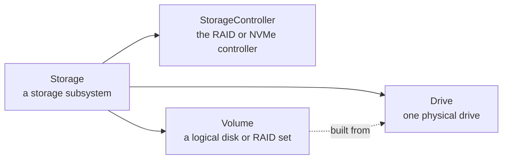

# 7.9 Storage, network adapters and PCIe devices

| | |
|---|---|
| Level | Intermediate |
| Priority tier | 1 |
| Lab venue | Laptop |
| Part | Part 7: Redfish and BMC |
| Status | Drafted (`hardware_lab.py`: 15 checks pass against mock and DMTF trees; **untested** on live BMC) |

## Why this matters for AI infrastructure

Suppose a GPU's PCIe link has trained down to a quarter of its full speed. Nothing crashes, and no alert fires. The job simply runs slower, or one slow node drags a whole training run behind it. Nobody gets paged, because the device is still there and still answers. The same thing happens when a network port negotiates 200 Gbps instead of 400, or when a boot drive is about to die. These problems are quiet, and that is what makes them expensive. They can sit unnoticed for weeks while the team blames the code, the data or the scheduler.

A cluster team therefore needs a cheap, automatic way to ask every machine whether all of its links run at full speed. The BMC can answer that question through Redfish, even before the operating system is installed. The answer arrives as structured fields, which means a script can compare every node against the same expected values and flag the odd one out. This chapter shows where those fields live, how to read them, and how a small tool turns them into a list of problems you can act on.

## Prerequisites and outcomes

Read chapters 7.2 and 7.7 first, because this chapter builds directly on them. Those chapters explain the service tree and the three core families, and this chapter assumes you already know them. The chapter then walks through where drives, volumes, network ports and PCIe devices live on any Redfish service. It shows how to read PCIe speed and width and spot a link that trained down, and how to read port state and speed and spot a port running below its maximum. It also covers the drive health signals that warn before a failure. The last part introduces a tool that checks all of this, and a lab that tests the tool against faults it has been given on purpose.

## 1. Where the hardware lives

When your script asks for a drive or a network card, it first has to know which branch of the tree to search. You will find hardware under both families from chapter 7.7. The system side shows the **logical** view, which is what the operating system and the workload see. The chassis side shows the **physical** one, which is what a technician would hold in their hand. A single NVMe drive, for example, appears on the physical side as a slot in a bay and on the logical side as a disk the OS can mount.

| Hardware | Where | Main resource types |
|---|---|---|
| Drives and volumes | `Systems/<id>/Storage` | `Storage`, `Drive`, `Volume`, `StorageController` |
| Old-style storage | `Systems/<id>/SimpleStorage` | `SimpleStorage` (simple, older) |
| Network adapters | `Chassis/<id>/NetworkAdapters` | `NetworkAdapter`, `Port`, `NetworkDeviceFunction` |
| Host network interfaces | `Systems/<id>/EthernetInterfaces` | `EthernetInterface` |
| PCIe devices | `Chassis/<id>/PCIeDevices` | `PCIeDevice`, `PCIeFunction`, `PCIeSlots` (deprecated) |
| GPUs and CPUs | `Systems/<id>/Processors` | `Processor` (chapter 7.7) |
| Memory | `Systems/<id>/Memory` | `Memory` |
| Fabric adapters | `Chassis/<id>/FabricAdapters` | `FabricAdapter` |

Remember from chapter 7.2 that names, positions and optional parts differ between makers. The DMTF examples show this clearly. Some trees keep storage under `Storage`, others only have `SimpleStorage`, and PCIe devices appear in only some of them. A tool therefore has to find resources by type and skip anything that is missing. If it expects a hard-coded index into a drive list, or a fixed name for a controller, it will work on one vendor and fail silently on the next, which is the worst result a fleet tool can give you.

## 2. Storage: drives, volumes, controllers

Start with the drive, because it is the resource you will check most often. Each property answers one question about the disk, such as how big it is, whether it expects to fail, or how fast its link runs. The diagram shows how the storage resources fit together.



The `Drive` resource has these properties:

| Property | Meaning |
|---|---|
| `CapacityBytes`, `BlockSizeBytes` | size and the smallest addressable block |
| `MediaType` | `HDD`, `SSD` or `SMR` |
| `Protocol` | how it talks to the controller (`NVMe`, `SATA`, `SAS` and others) |
| `FailurePredicted` | **true** when the drive predicts failure soon |
| `PredictedMediaLifeLeftPercent` | how much of the write/read life is left, as a percentage |
| `CapableSpeedGbs`, `NegotiatedSpeedGbs` | the best link speed it supports, and the one it actually runs at |
| `EncryptionStatus` | encryption state |
| `Revision`, `Model`, `SerialNumber` | identity |
| `Operations` | jobs currently running on it, such as a rebuild |
| `Status` | `State` and `Health` |

Read the table as a list of questions. Is this disk the size you expect? Is it about to fail? Is it running at the speed it can? The last two questions matter most, and they map to `FailurePredicted` and the pair `NegotiatedSpeedGbs` and `CapableSpeedGbs`. A drive can be fine on capacity and still be a problem on speed, which is why the table lists the link values next to the failure flag.

A `Volume` is the logical view. It groups drives into a RAID set or a logical disk, so the operating system sees one disk even though several physical drives sit behind it. Its `RAIDType`, `CapacityBytes`, `VolumeType`, `Encrypted` and read and write cache policy tell you what the volume is. Its `Operations` and `Status` show whether a rebuild or check is running. The `StorageController` describes the card that manages the drives. It lists the RAID types and protocols it supports. It also gives its firmware version, its speed and its own `PCIeInterface`. The standard also defines metrics resources, `DriveMetrics` and `StorageControllerMetrics`. They expose usage counters and NVMe SMART warnings such as `SpareCapacityWornOut` and `MediaInReadOnly`. SMART is the self-reporting system built into most drives, and NVMe is the fast protocol that modern SSDs use over PCIe.

For an AI node, the boot and scratch NVMe drives matter less than shared storage, but they still count. A dead scratch drive stops a job, and local NVMe is the cache for datasets. Watch `FailurePredicted` and the remaining life of every drive, because those two signals warn you before a drive gives out. Think of them as the fuel gauge on a car. You do not wait for the engine to cut out before you check it.

## 3. Network: adapters, ports and functions

A network card can look healthy from the outside and still run slowly. Redfish splits the card into several resources, and you need all of them to see the whole picture. Think of a card as a building. The adapter is the building itself, the ports are the doors, the functions are the rooms that different users share, and the Ethernet interface is the address the outside world knows. A door can be locked while the building looks fine, and a door can be open at half width while everything else seems normal. The table shows what each resource is.

| Resource | What it is |
|---|---|
| `NetworkAdapter` | one physical card (for example a 400G NIC): model, serial number, firmware, `Controllers` (the chips on it), links to `Ports` and `NetworkDeviceFunctions` |
| `Port` | one connector: protocol, state, speed, width |
| `NetworkDeviceFunction` | a logical interface the card exposes: type (Ethernet, InfiniBand and so on), MAC address, SR-IOV virtual functions, which physical port it uses |
| `EthernetInterface` | an interface as the OS or BMC sees it: IP addresses, VLAN, DHCP |

SR-IOV (single-root I/O virtualization) lets one physical card present several virtual functions, so that each virtual machine or container can use part of the card directly. You will not need it for every node, but you will see it on hosts that share a NIC.

The `Port` resource carries the fields you will read most often. The table lists them.

| Property | Meaning |
|---|---|
| `LinkState` | the **desired** state: `Enabled` or `Disabled` |
| `LinkStatus` | the **actual** state: `LinkUp`, `LinkDown`, `NoLink`, `Starting`, `Training` |
| `CurrentSpeedGbps` | the speed right now |
| `MaxSpeedGbps` | the maximum speed as currently configured |
| `ActiveWidth`, `Width` | active lanes and total lanes |
| `PortProtocol`, `LinkNetworkTechnology` | `Ethernet`, `InfiniBand`, `FibreChannel`, `GenZ`, `PCIe` |
| `SignalDetected` | is any signal seen on the link |
| `Metrics` | link to port counters (`PortMetrics`) |

Read `LinkState` and `LinkStatus` together. The first is what someone asked the port to do, and the second is what the link is actually doing. A port that is `Disabled` and `LinkDown` is fine, because someone turned it off on purpose. A port that is `Enabled` and `LinkDown` is a real problem, because somebody wants the link up and it is not up. A port that shows `LinkUp` while `CurrentSpeedGbps` sits below `MaxSpeedGbps` still works, but it is slow. The usual causes are a bad cable, a bad optic or a negotiation problem, and each one has a different fix.

DPUs and SmartNICs are also computers. They have their own `ComputerSystem` of type `DPU`, which chapter 7.7 covers. BlueField DPUs in DGX systems are one example from the notes this chapter draws on. When you audit a network card that is also a DPU, check both the card's own `ComputerSystem` and its ports, because the two can disagree about whether the card is healthy.

## 4. PCIe: the hidden speed limit

Every GPU, NIC and NVMe drive connects through PCI Express, and that link sets how much data can reach the device. Think of it as the road between the device and the CPU. A fast car on a narrow road still moves slowly. Suppose a device built for Gen5 x16 has trained down to Gen3 x8. It now has a fraction of its bandwidth, and nothing says so unless you look. A PCIe link has a speed, which is the generation (Gen3, Gen4, Gen5), and a width, which is the number of lanes (x1, x4, x8, x16). A lane is one pair of wires that carries data in each direction. Bandwidth is roughly the product of the two, so a faster generation and more lanes both raise the ceiling.

Here is the arithmetic. Gen5 gives 32 GT/s on each of 16 lanes, which is about 64 GB/s. GT/s means giga-transfers per second, the number of signal changes each lane makes in one second. Gen3 gives 8 GT/s on each of 8 lanes, which is about 8 GB/s. The degraded link keeps only about one-eighth of the original bandwidth. This can happen with a bad cable or riser, dust, a loose card, a BIOS setting, or power problems. None of those causes produce an error message. The link is simply slower, and the device keeps working.

The `PCIeDevice` resource has a `PCIeInterface` block with exactly the numbers you need. The table lists its fields.

| Property | Meaning |
|---|---|
| `PCIeType` | the PCIe version **in use** now (`Gen1` to `Gen6`) |
| `MaxPCIeType` | the highest version this device supports |
| `LanesInUse` | lanes in use now |
| `MaxLanes` | lanes the device supports |

If `PCIeType` is lower than `MaxPCIeType`, or `LanesInUse` is lower than `MaxLanes`, the link is **degraded**. The gap between the two values is the whole diagnosis. The same information appears in the `LnkCap` and `LnkSta` lines of `lspci -vv` on Linux, where `LnkCap` is what the device can do and `LnkSta` is what it is doing. Redfish gives you the same comparison without logging in. The same block also appears on `NetworkAdapter` controllers, on `StorageController` and on other resources. A `PCIeDevice` carries more: its `DeviceType` (`SingleFunction`, `MultiFunction`, `Simulated` or `Retimer`), its firmware version, its `Slot` information, and links to its `PCIeFunctions`. A retimer is a chip that rebuilds a weak signal along a long link, so seeing one in the list tells you the link has a repeater in it.

The field notes this chapter draws on describe the same failure: a PCIe link running at Gen1 instead of Gen5. In a 512-node cluster, that link caused silent slowness. A related case involves links that fall back to Gen3 x8. The same notes recommend forcing the BIOS link speed instead of leaving it on `Auto`, a setting chapter 7.14 covers. The lesson is simple. Check the link speed and width of every GPU and NIC before you trust a node, because a degraded link gives no error.

## 5. The tool: find the degraded things

Checking each device by hand does not scale. A node has dozens of devices, and a rack has dozens of nodes. A script can walk the Redfish tree, look at each resource and apply a few simple rules. That is the job of `code/part07/rf_hardware.py`. It walks the `Systems` and `Chassis` trees by following links, and it skips logs, sensors and certificates to save time. Those subtrees are large and rarely hold the fields this check needs. It looks at each resource by `@odata.type`, which is the type label every Redfish resource carries, and then applies the rules in the table.

| Group | Flag when |
|---|---|
| PCIe | `LanesInUse` below `MaxLanes`, or `PCIeType` older than `MaxPCIeType`, or health not OK |
| Ports | enabled but not `LinkUp`; or `CurrentSpeedGbps` below `MaxSpeedGbps`; or `ActiveWidth` below `Width`; or health not OK |
| Drives | `FailurePredicted`; life left under 10 percent; `NegotiatedSpeedGbs` below `CapableSpeedGbs`; health not OK |
| Volumes | health not OK |

The rules are simple, so you can check every flag by hand. That is deliberate. A tool whose rules you can read in one table is a tool you can trust in a review. The tool also warns when a resource's own `@odata.id` differs from the address it was fetched from. That can mean a broken tree or a copy-paste error in the service. The mock used for testing has 8 GPUs and 8 NICs, all on Gen5 x16, plus two NVMe drives. Here is the output of a real run against it.

```text
walked 60 resources
PCIe interfaces: 16   ports: 8   drives: 2   volumes: 0   storage subsystems: 1

0 flagged
```

A clean run like this one is the baseline you want on every healthy node. Notice that the count of PCIe interfaces is 16, which is more than the 8 GPUs. The mock also reports the 8 NICs, so each device with a PCIe block is counted once. Read the summary line first, so you know what the tool looked at, and then read the flags.

Next is the DMTF tower-server example. It is a sample tree, not a healthy node, so it shows what the flags look like.

```text
walked 404 resources
PCIe interfaces: 10   ports: 18   drives: 18   volumes: 5   storage subsystems: 9
  PCIe   Chassis/Tower/NetworkAdapters/NIC1#controller    Gen2 x2 (max Gen3 x4)  link width x2 of x4; PCIe Gen2 of Gen3
  PCIe   Chassis/Tower/PCIeDevices/IntegratedNIC          Gen2 x4 (max Gen3 x4)  PCIe Gen2 of Gen3
  PCIe   Chassis/Tower/PCIeDevices/Slot4                  Gen2 x2 (max Gen3 x4)  link width x2 of x4; PCIe Gen2 of Gen3
  PCIe   Chassis/Tower/PCIeDevices/Slot3                  Gen2 x2 (max Gen3 x4)  link width x2 of x4; PCIe Gen2 of Gen3
4 flagged
```

All four flags are PCIe links that run below their maximum. Three of them also have a narrow width, x2 instead of x4. Read each line from left to right. The first column names the group, the second gives the resource path, the third compares the current link with the maximum, and the last column says which rule fired. On the DMTF accelerator-card example, the tool flags two controllers running at Gen3 where Gen4 is possible. It also flags a port running at 25 of 50 Gbps. The SmartNIC example shows the same 25 of 50 Gbps port. Keep in mind that these DMTF trees are sample data. Their values may be chosen on purpose to show the schema, so use them only as test material for the tool and not as a picture of a real fleet.

The SmartNIC example also triggers the `@odata.id` warning. Two ports under `Chassis/Card2/...` report an `@odata.id` that points at the `Card1` address. In DMTF's sample, this looks like a copy-and-paste error. Real BMCs can have bugs like this too. A script that trusts the ID inside the body, instead of the address it fetched, will mix up the two ports. That is why the tool logs the mismatch as a warning and keeps the address it fetched as the key.

### The lab

These lab steps were not run on a live BMC, only against the mock and the DMTF trees. Run the lab from the chapter's code folder.

```bash
cd code/part07
python3 hardware_lab.py
```

The lab runs 15 checks against the mock and against two DMTF trees. For the mock, it creates one fault at a time and confirms that the tool catches each one. This is a fault-injection test: you break something on purpose and check that the tool notices. Each line below is one check. When you see PASS, the tool caught the fault it was built to catch, and when you see a flag in real output, the rule that fired is in the table above.

```text
PASS  a GPU trained down to Gen3 x8 is flagged for both speed and width
PASS  only that one device is flagged
PASS  an enabled port that is LinkDown is flagged
PASS  a port that is administratively Disabled is not flagged
PASS  a 400G port running at 200G is flagged (cable or optics or negotiation)
PASS  a port with 2 of 4 lanes active is flagged
PASS  a drive predicting failure is flagged
PASS  a drive with 5 percent life left is flagged
PASS  a drive linked at 8 of 32 Gbps is flagged
PASS  a PCIe device with Health Warning is flagged
PASS  DMTF tower example: 4 PCIe devices run below their maximum link
...
15 passed, 0 failed
```

Notice the second check, "only that one device is flagged." A tool that flags everything passes the first check and fails this one, so it is a useful guard against a tool that is too eager. Use the lab across the fleet. Run the tool against every BMC after racking and after each maintenance window. A GPU node with one degraded link should stay out of the scheduler until that link is fixed. For depth, pair the tool with the host-side checks in Part 10, such as NVLink, `nvidia-smi` and DCGM. Make a clean run the condition for putting any node back into service.

## 6. What Redfish does not tell you

Suppose a node passes every Redfish check and still runs slowly. Redfish is a cheap first check, not the final word. It has blind spots, and you need to know them before you trust a clean result. A clean run means the BMC sees nothing wrong with the fields it reports. It does not mean the hardware is performing at its best.

Redfish does not show how fast data actually moves. A link can run at full width and still be slow, because of congestion or a software setting. The speed and width it reports are the values the BMC reads, which describe the negotiated link, not the traffic on it. Some BMCs cannot see every device, since they only see what is wired to them or what the vendor mapped. A device missing from the list is therefore not proof that the device is absent. It may simply be a device the BMC cannot see, and that is a question for the host tools.

GPU details such as NVLink counters, ECC counts and clock throttling usually come from the GPU driver, not from the standard schema. ECC means error-correcting code, the memory protection that counts and fixes bit errors. Vendors may add these fields as OEM data, which means extensions the vendor defines outside the standard, and chapter 7.13 covers those. Drive health from the BMC is only as good as the drive's own reporting. If the drive's SMART logic misses a problem, the BMC will miss it too.

So use Redfish for the cheap first check, and for machines whose operating system is not running. Once that check is done, move to the host tools for depth. A simple way to remember the split is this. Redfish tells you what the hardware reports about its links and its health. The host tools tell you how the workload is actually moving data through those links.

### 6.1 Anatomy of a silent PCIe link downgrade in distributed training

Why is `code/part07/rf_hardware.py` one of the most useful tools in this part of the handbook? The answer becomes clear when you follow one degraded PCIe link through a 64-node training cluster with 512 GPUs, step by step.

On an 8-GPU training server, each SXM GPU talks to its paired 400 Gbps ConnectX-7 network adapter over a dedicated PCIe Gen5 x16 link. SXM is the socket form factor NVIDIA uses for its data center GPUs, and it sits on the baseboard rather than in a standard card slot. At Gen5, each lane runs at 32 GT/s, and the link has 16 lanes. That gives a raw one-way bandwidth of 64 GB/s. The link has room to spare above the 50 GB/s line rate of a 400G InfiniBand or RoCEv2 port. RoCEv2 is RDMA over converged Ethernet, which lets one machine write straight into another's memory without going through the CPU. During the backward pass of a large language model, GPUDirect RDMA streams gradient tensors straight out of GPU HBM memory. HBM is the high-bandwidth memory stacked next to the GPU die. The data passes through the PCIe switch or retimer, into the ConnectX-7 HCA, which is the host channel adapter, and out onto the rail-aligned leaf switch at full line rate. Each step has to keep up with the step before it, or the whole path slows to the speed of its weakest link.

Now suppose a technician replaces a fan tray on `node042`. Slight vibration unseats a high-density PCIe riser cable by a fraction of a millimeter. Or a PCIe Gen5 retimer chip overheats during boot link training. The link-training logic, called the LTSSM, does not fail the boot or cause a kernel panic. PCIe is built to be resilient, so it negotiates down to the highest speed and lane width that still give a clean signal lock. If eight of the sixteen differential pairs have high bit-error rates at 32 GT/s, the link silently trains up at PCIe Gen3 x8. That is 8 GT/s across 8 lanes, or about 8 GB/s of one-way bandwidth. A differential pair is the two-wire signal path that carries one lane's data, so eight bad pairs means eight lanes that cannot hold a clean signal at the top speed.

The arithmetic is worth doing once. Gen5 x16 gave 64 GB/s, and Gen3 x8 gives about 8 GB/s. That is about one-eighth of the original bandwidth. Now look at what this looks like when `node042` rejoins the Slurm pool:

- The Linux OS boots cleanly.
- All eight GPUs appear healthy in `nvidia-smi` with `0` ECC errors.
- All eight `400G` InfiniBand ports show `State: Active` and `Rate: 400 Gb/sec` in `ibstat`. That is because the optical link between the NIC and the leaf switch is still `400G`.

Yet when a 64-node training job lands on `node042`, GPU 3 can push gradients to its `400G` NIC at only 8 GB/s, not 50 GB/s. That is 16 percent of the rated rate. Ring and tree `AllReduce` collectives make every GPU wait for the others at each micro-batch step. A collective is a step where all GPUs exchange data together, and none of them can move on until the slowest one finishes its share. So **a single PCIe link running at `Gen3 x8` on one GPU throttles the effective network throughput of all 512 GPUs by more than 80%**. The fault is local to one link, but the cost is spread across the whole job.

Run `rf_hardware.py` against the BMC, and it catches this fault in two seconds, before the node ever enters Slurm. The script compares `PCIeInterface.PCIeType` (`"Gen3"`) against `MaxPCIeType` (`"Gen5"`). It also compares `LanesInUse` (`8`) against `MaxLanes` (`16`). It then flags the exact `PCIeDevice` URI and blocks the node at the acceptance gate. The node never joins the job, and nobody has to find the problem by watching a training run slow down.

### 6.2 Diagnosing optical and copper `Port` speed mismatches

The second silent problem in AI fabrics is a high-speed port that links up, but at a fraction of its rated speed or lane width. You will find these ports under `NetworkAdapter/Ports`. Modern 400 Gbps and 800 Gbps InfiniBand and Ethernet links are built from parallel lanes. Each lane is a SerDes circuit, which converts data to and from a serial signal. A typical link uses 4 lanes of 100 Gbps PAM4 signaling, or 8 lanes of 100 Gbps. PAM4 is a signaling method that packs two bits into each symbol, so each lane carries more data per signal change.

When you inspect a `Port` through Redfish, four properties tell the physical-layer story. Read them in this order, because each step narrows the question for the next one.

1. **`LinkState` and `LinkStatus`:** If `LinkState` is `Enabled` and `LinkStatus` is `LinkDown` or `NoLink`, check `SignalDetected` next. When `SignalDetected` is `false`, no light reaches the receive fibers. Look for an unplugged cable, swapped TX and RX polarity, or a powered-off leaf switch port. TX means transmit and RX means receive, so swapped polarity means the two ends are talking into each other's ears. When `SignalDetected` is `true` but `LinkStatus` stays at `Training` or `LinkDown`, the transceivers see light but cannot lock FEC or auto-negotiation. FEC is forward error correction, the extra bits that let the link recover from small errors. Auto-negotiation is the handshake the two ends use to agree on a speed. That symptom often means a mismatched port protocol, such as InfiniBand against Ethernet mode set in `mlxconfig`, or an incompatible FEC setting on the switch.
2. **`CurrentSpeedGbps` versus `MaxSpeedGbps`:** If a `400G` port shows `LinkUp` with `CurrentSpeedGbps: 200` and `MaxSpeedGbps: 400`, the link negotiated down to half its speed. The link is working, so no alarm fires on link state alone. Only the speed comparison shows the problem.
3. **`ActiveWidth` versus `Width`:** Compare `ActiveWidth` (`2`) with `Width` (`4`), and you can see why `CurrentSpeedGbps` dropped. Two of the four optical lanes, inside the OSFP or QSFP-DD transceiver or the MTP fiber trunk, are dead or dirty. OSFP and QSFP-DD are transceiver form factors, which are the pluggable optical modules, and MTP is a multi-fiber connector. Cleaning the optical connector with a single-click fiber cleaner, or swapping the transceiver, restores all `4` lanes. That brings `CurrentSpeedGbps` back to `400`. Clean the connector first, because it is the cheapest fix and it is the most common cause of dirty lanes.
4. **`PortMetrics` (through the `Metrics` link):** Follow the `Metrics` link on a `Port` to reach the hardware counters. They cover RX and TX bytes, frame errors, symbol errors and optical power per lane, in `RXInputPowerMilliWatts` and `TXOutputPowerMilliWatts`. With these counters you can spot a fading laser diode before the lane drops out completely. A slow decline in optical power is a warning that a single reading would never show you.

### 6.3 Proactive NVMe and boot drive lifecycle management

A local NVMe drive that fails in the middle of a job can crash a training run. Training checkpoints and datasets usually live on high-speed parallel filesystems such as Lustre, WekaFS and GPFS. A parallel filesystem spreads one file across many storage servers so that many clients can read it at once. Each GPU node still relies on local NVMe drives for two jobs, though. One is booting the local OS, unless the node runs diskless. A diskless node boots over the network and keeps no local disk. The other is providing multi-terabyte local NVMe scratch or cache storage, such as `/lscratch` or GDS P2PDMA staging. GDS is GPUDirect Storage, which lets the GPU read from storage without going through the CPU, and P2PDMA is the peer-to-peer DMA path it uses.

When a local NVMe drive fails in the middle of a job, the Linux kernel can do one of two things. It can remount the scratch filesystem read-only, or it can hang I/O worker threads in uninterruptible sleep, the `D` state. A process in the `D` state cannot be stopped even with a kill signal, because it is waiting on hardware that has stopped answering. Either way, the training run crashes. The Redfish `Storage` and `Drive` model gives you four early signals. You find it under `/redfish/v1/Systems/{id}/Storage`, and also under `/redfish/v1/Chassis/{id}/Drives`. Use these signals to replace aging SSDs in a scheduled maintenance window, rather than in the middle of a job.

- **`FailurePredicted: true`** means the drive's internal SMART controller has crossed a pre-fail threshold, such as uncorrectable media errors or depleted spare blocks. Spare blocks are the reserve flash the drive keeps to replace worn-out areas. Drain the node after the current job finishes, and schedule a drive swap.
- **`PredictedMediaLifeLeftPercent`** reports how much of the rated program and erase endurance, or P/E endurance, remains. P/E endurance is the number of write and erase cycles flash can take before it wears out. A new drive shows `100`, and the value counts down toward `0`. On nodes that cache datasets heavily, an alert below `10%` helps prevent a surprise wear-out failure. A heavily written cache drains its life faster than a boot drive, so the two should not share one alert threshold.
- **`NegotiatedSpeedGbs` versus `CapableSpeedGbs`** matters because U.2, U.3 and E3.S NVMe drives, like GPUs and NICs, connect over PCIe lanes. Suppose a drive capable of `32 Gbps`, which is PCIe Gen5, negotiates at `8 Gbps`, which is Gen3, because of a backplane fault. Local checkpoint staging then slows by $4\times$, which is 32 divided by 8. The drive itself is fine, so a drive-only check would pass it. The fault is in the path between the drive and the host.
- **`Volume.Operations`** matters on nodes that mirror their boot drives with a hardware RAID controller, or `StorageController`. Check `Status.Health` and `Operations` on the `Volume`. They show whether the mirror is degraded, or whether a background `"Rebuild"` is running. A rebuild is normal after a swap, but a node should not take a heavy job while its boot mirror is still rebuilding.

Put these four signals into your alerting, and schedule a drive swap before a failure reaches a running job. The signals work best together. A drive with a falling life counter and a link that negotiated slower than capable is a stronger case for a swap than either signal alone.

### 6.4 Integrating `rf_hardware.py` into Day-0 and Day-2 automation

Checks only help when they run every time. Day-0 means the moment the hardware first arrives, and Day-2 means everything after the system is in production. Wire `code/part07/rf_hardware.py` into three gates, so that every node in your cluster gets the same check across its life. A gate is a point in the workflow where a node cannot move forward until it passes.

1. **Pre-OS Day-0 racking gate:** Right after the team that racks and cables the machines plugs in power and network cables, run `rf_hardware.py` against all BMC IPs from the head node. The script works entirely out of band over Redfish. So you get a full punch list of unseated PCIe risers, dark `400G` ports and missing NVMe drives. You get it before you configure DHCP or PXE for the host OS. DHCP and PXE are the services that hand out addresses and boot images, so a node that has not yet reached them is still easy to fix.
2. **Post-maintenance return-to-service gate:** After any board swap or firmware upgrade, do not run `scontrol update NodeName=<node> State=RESUME` or `kubectl uncordon` until `rf_hardware.py` exits `0` and reports `0 flagged`. Those two commands put a node back into the scheduler, so the check has to pass first. A node that comes back from a board swap with a degraded link is the most common way a slow node reaches a job.
3. **Weekly fleet baseline diff:** Once a week, run `rf_hardware.py` across all nodes with `fleet_run.py`. Then compare the counts of `PCIeDevices`, `Ports` and `Drives` with your saved Day-1 JSON inventory. A device that vanishes from the PCIe bus also disappears from the BMC's `PCIeDevices` list, so the count mismatch catches it. A diff is useful because it notices change, even when the new state still looks healthy.

Start with the racking gate, since it runs before any OS work begins. It is the cheapest place to find a problem, because nothing else has been built on top of the node yet.

### 6.5 Correlating Redfish PCIe and NIC inventory with Linux `lspci`, `ethtool`, and `mlx5`

Redfish gives you an agentless, out-of-band view of every `PCIeDevice`, `NetworkAdapter` and `Drive`. Agentless means you do not install anything on the host, so the view works even when the host is down. In production, though, troubleshooting goes fastest when you know which Linux command matches each Redfish property, once the host OS has booted. The table gives that mapping. Read each row as one check, with the Redfish field on the left and the matching host command on the right.

| Subsystem & Check | Out-of-Band Redfish Property (`rf_hardware.py`) | In-Band Linux Command & Equivalent Field |
|---|---|---|
| **PCIe Link Speed & Width** | `PCIeDevice.PCIeInterface`: `PCIeType` vs `MaxPCIeType` (`Gen5`), `LanesInUse` vs `MaxLanes` (`16`) | `sudo lspci -vvv -s <bdf>` → `LnkSta: Speed 32GT/s, Width x16` vs `LnkCap: Speed 32GT/s, Width x16` |
| **PCIe Bus Errors** | `Status.Health` (`Warning`/`Critical`) and BMC `LogServices` AER entries | `dmesg -T \| grep -iE "aer\|pcieport"` and `/sys/bus/pci/devices/<bdf>/aer_dev_*` |
| **Network Port State & Speed** | `Port`: `LinkState` (`Enabled`), `LinkStatus` (`LinkUp`), `CurrentSpeedGbps` vs `MaxSpeedGbps` (`400`) | `ibstat` (`State: Active`, `Physical state: LinkUp`, `Rate: 400`) or `ethtool <iface>` (`Speed: 400000Mb/s`, `Link detected: yes`) |
| **Optical Lane Width & Power** | `Port`: `ActiveWidth` vs `Width` (`4`), `PortMetrics` RX/TX optical power (`mW`) | `mlxlink -d mlx5_0 -m` or `ethtool -m <iface>` (per-lane RX/TX dBm and bias current) |
| **NVMe Drive Health & Speed** | `Drive`: `FailurePredicted`, `PredictedMediaLifeLeftPercent`, `NegotiatedSpeedGbs` vs `CapableSpeedGbs` | `sudo nvme smart-log /dev/nvme0n1` (`critical_warning`, `percentage_used`) and `lspci -vvv` on the NVMe BDF |

Why keep both views? Each one catches failures the other misses. When a PCIe switch or GPU falls completely off the bus during a hard lockup, the host kernel panics, and `lspci` or `mlxlink` become unreachable. The BMC's out-of-band `PCIeDevices` and `Ports` tree is still queryable over Redfish, though. The opposite case happens too. A link can come up at full Gen5 x16 and 400 Gbps at boot, so Redfish reports `OK`. Then intermittent bit errors cause thousands of link-level PCIe replay events or RDMA symbol errors under heavy DMA load. In-band `nvidia-smi nvlink -e`, `mlxlink` and `perfquery` deltas expose that signal-integrity problem before the link ever drops its width. A delta is the change in a counter over time, and a rising error count is a sign the link is struggling even while it still reports full speed. Keep both views on the same runbook page, so the on-call engineer knows which one to reach for first.

### 6.6 Handling OEM topology quirks and `FabricAdapters`

Run `rf_hardware.py` across different server vendors and DMTF mockup trees, such as `public-tower`, `public-smartnic`, `public-nvmeof-jbof` and `public-localstorage`, and the tree changes shape. A mockup is a sample tree that DMTF publishes to show what a service can look like. NVMeoF is NVMe over Fabrics, and JBOF means just a bunch of flash, a shelf of drives with no controller of its own. Every portable Redfish hardware scanner has to handle three structural variations gracefully.

1. **Where `PCIeInterface` sits:** On newer Redfish implementations, `PCIeInterface` lives directly on each `PCIeDevice`, under `/redfish/v1/Chassis/{id}/PCIeDevices/{dev}`. Its fields are `PCIeType`, `MaxPCIeType`, `LanesInUse` and `MaxLanes`. On older implementations, and on integrated network and storage cards, the block sits inside the `Controllers[]` array of a `NetworkAdapter`, or inside a `StorageController`. That is why `rf_hardware.py` checks `@odata.type` across all three resource types. It does not look only in `PCIeDevices`. A scanner that looks in one place will report a clean node that is actually degraded, and that is the worst kind of false result.
2. **Ports under `NetworkAdapter` or under `FabricAdapters`:** Standard Ethernet and InfiniBand NICs show their ports under `Chassis/{id}/NetworkAdapters/{nic}/Ports`. Switches, NVLink fabric boards, CXL enclosures and JBOF storage fabrics often differ. CXL is Compute Express Link, a memory-sharing link that runs on PCIe hardware. They expose ports under `Chassis/{id}/FabricAdapters/{fa}/Ports`, or at the top level under `/redfish/v1/Fabrics/{fabric}/Switches/{sw}/Ports`. The script walks every `@odata.id` link from `Systems` and `Chassis`, and it matches resources by `@odata.type == "Port"`, not by URL path. So it checks link state and speed no matter which parent collection holds the `Port`. Matching by type is more work for the scanner, but it saves you from rewriting the tool each time a vendor moves a port.
3. **Cross-card `@odata.id` aliasing bugs:** The DMTF `public-smartnic` mockup shows the problem. Two ports fetched under `Chassis/Card2/...` returned `"@odata.id": "/redfish/v1/Chassis/Card1/..."` in their JSON bodies. Real BMC firmware sometimes has templating bugs like this when a server holds several identical adapter cards. Key your inventory and fault reports by the actual URI you fetched. Also log a warning when `res.get("@odata.id")` disagrees with the request URI. That way, a firmware copy-paste bug on Card 2 cannot overwrite the status of Card 1 in your database. Think of the URI you fetched as the address on the envelope, and the ID in the body as a label written by the sender. When they disagree, trust the envelope.

Build the scanner to trust the address it fetched, not the ID inside the body. A scanner built this way will still give you correct results the day a vendor ships a buggy firmware, and it will tell you about the bug instead of hiding it.

## Exercises

Work through these six tasks in order. The first one uses the lab you already ran, and the rest build on the same tools and mock trees. Keep the output of each one, because later tasks compare against it.

1. Start with the 15-check suite in `code/part07/hardware_lab.py`. Run `python3 code/part07/hardware_lab.py`, and confirm that `12` / `15` checks pass. Then open `code/part07/rf_hardware.py` and read it. Explain why a GPU with `PCIeType: "Gen3"`, `MaxPCIeType: "Gen5"`, `LanesInUse: 8` and `MaxLanes: 16` is flagged for both speed and width degradation.
2. Audit the NVMe and SAS drives in the `public-localstorage` mockup. Serve `$REDFISH_PUBLICATIONS/mockups/public-localstorage` with `redfish_mock.py --mockup`. Then run `python3 code/part07/rf_hardware.py http://127.0.0.1:8443 admin adminpass --all`. Write down each drive the script finds. For each one, note its `Protocol`, `MediaType`, `CapacityBytes`, `FailurePredicted` and `PredictedMediaLifeLeftPercent`.
3. Extend `code/part07/rf_hardware.py` so that it notices an active RAID rebuild. Any `Volume` whose `Operations` array is not empty should produce a warning during pre-job health checks. Which entry should the new check catch? An entry such as `"OperationName": "Rebuild"` with `"PercentageComplete": 42` is the case to catch.
4. Triage a link that drops from Gen5 to Gen4 or Gen3. A GPU on `node019` reports `PCIeType: "Gen4"` while `MaxPCIeType` is `"Gen5"`. Name three physical or firmware causes, such as riser or retimer signal integrity, BIOS PCIe speed left on `Auto` instead of `Gen5`, or thermal and power state. Then list the host-side commands, `lspci -vvv` and `dmesg | grep -i aer`, that you would run to match what Redfish shows.
5. A 400G port can negotiate at 100G or 200G, so you need to find out why. Here is a `NetworkAdapter` `Port` that reports `LinkState: "Enabled"`, `LinkStatus: "LinkUp"`, `CurrentSpeedGbps: 200`, `MaxSpeedGbps: 400`, `ActiveWidth: 2` and `Width: 4`. Explain what `ActiveWidth: 2` of `4` tells you about the optical transceiver or DAC cable lanes. DAC means direct-attach copper, a cable with the transceivers built in.
6. Explain why `rf_hardware.py` flags `{LinkState: "Enabled", LinkStatus: "LinkDown"}` as an error. Then explain why it treats `{LinkState: "Disabled", LinkStatus: "LinkDown"}` as healthy. Finally, explain why an `@odata.id` mismatch, such as the `Card2` port in `public-smartnic` that claims a `Card1` `@odata.id`, must still be logged.

## 8. Interview angles

Interviewers like these questions because each one has a clear first step. Use the answers below to practice saying the first step out loud, and then add the detail that shows you know the hardware.

- "A node is slower than its twins and DCGM looks fine. What do you check?" Start with the PCIe link speed and width on each GPU and NIC. Then look at port speeds, thermal state and power, and compare everything with a healthy node. Because the slowness is quiet, the comparison with a twin node is the fastest way to find the difference.
- "How do you check hardware health before a node joins the cluster?" Run a Redfish sweep first. It looks for degraded links, firmware problems, health status and drive state. Then run host tests for the GPU and the network, because the sweep alone cannot measure real throughput.
- "What is the difference between `LinkState` and `LinkStatus`?" `LinkState` is what you asked the port to do. `LinkStatus` is what the link is actually doing.
- "Why is a degraded PCIe link dangerous even when nothing errors?" It silently cuts bandwidth, and nothing reports it as a failure. Training synchronises on the slowest member, so one slow link slows the whole job.

## Checkpoint questions (20)

<details>
<summary>1. Under which Redfish top-level collections do `Storage` (`Drive`, `Volume`) versus `NetworkAdapters` and `PCIeDevices` typically reside?</summary>

`Storage`, with its `Drive` and `Volume` resources, sits under **`Systems/{id}/Storage`**. Physical drive slots also show up under `Chassis/{id}/Drives`. If you are looking for a NIC or a PCIe device, go to **`Chassis/{id}`**. There you find `NetworkAdapters`, with their `Port` and `NetworkDeviceFunction` resources, and `PCIeDevices`, with `PCIeFunction`. `FabricAdapters` also sit under `Chassis`.
</details>

<details>
<summary>2. What is the difference between `Storage` and `SimpleStorage` on a `ComputerSystem`?</summary>

`Storage` is the modern, full-featured model. It gives you separate `StorageController`, `Drive` and `Volume` resources, with RAID actions, NVMe metrics and PCIe link details. `SimpleStorage` is the older option. It is a flat summary that lists basic device names and capacities in an array, and it suits simple SATA and USB controllers.
</details>

<details>
<summary>3. Name four properties on a `Drive` resource that provide early warning of a failing or degraded disk.</summary>

1. **`FailurePredicted`** is `true` when SMART or telemetry predicts a failure soon.
2. **`PredictedMediaLifeLeftPercent`** shows the remaining write endurance. A value such as `< 10%` is a warning sign.
3. **`NegotiatedSpeedGbs` versus `CapableSpeedGbs`** shows a link that trained slower than the drive can run.
4. **`Status.Health`** reads `Warning` or `Critical`.
</details>

<details>
<summary>4. What does it mean when a `Drive` reports `NegotiatedSpeedGbs: 8` and `CapableSpeedGbs: 32`?</summary>

The drive and backplane can run at `32 Gb/s`, which is PCIe Gen5 NVMe or SAS-4. The link, however, negotiated down to `8 Gb/s`, which is PCIe Gen3. That cuts sequential I/O bandwidth to a quarter of the rated speed.
</details>

<details>
<summary>5. What is a `Volume` resource under `Storage`, and what does its `Operations` array indicate?</summary>

A `Volume` is a logical disk, namespace or RAID array built from one or more physical `Drive` resources. Its fields include `RAIDType`, `CapacityBytes` and `Encrypted`. The `Operations` array lists the background tasks running on the volume right now, such as a RAID rebuild or consistency check, along with each task's `PercentageComplete`.
</details>

<details>
<summary>6. How do `NetworkAdapter`, `Port`, `NetworkDeviceFunction`, and `EthernetInterface` relate to one another?</summary>

- `NetworkAdapter` lives under `Chassis`. It is the physical NIC or HCA board, such as a ConnectX-7, with its ASICs (listed as `Controllers`), serial number and PCIe interface.
- `Port` sits under `NetworkAdapter/Ports`. It is the physical cage or connector, such as `OSFP` or `QSFP`, and it reports the optical link status, lane width and speed, such as `400 Gbps`.
- `NetworkDeviceFunction` sits under `NetworkAdapter/NetworkDeviceFunctions`. It is the logical function configured on the adapter, such as `Ethernet` or `InfiniBand`, with its MAC or WWN and SR-IOV virtual functions.
- `EthernetInterface` sits under `Systems/{id}/EthernetInterfaces`. It is the interface the OS sees, with its IPv4 and IPv6 addresses, MTU and VLANs.
</details>

<details>
<summary>7. On a `Port` resource, what is the difference between `LinkState` and `LinkStatus`?</summary>

- `LinkState` is the administrative, or desired, state of the port. It is either `Enabled` or `Disabled`.
- `LinkStatus` is the operational, or actual, state of the physical link. It can read `LinkUp`, `LinkDown`, `NoLink`, `Starting` or `Training`.
</details>

<details>
<summary>8. What does it indicate when an enabled `Port` is `LinkUp` but `CurrentSpeedGbps` (`200`) is lower than `MaxSpeedGbps` (`400`)?</summary>

The port could not auto-negotiate its full line rate. The usual causes are a damaged DAC or AOC cable, a dirty optical ferrule, a mismatched speed or FEC setting on the switch port, or a dead lane, which shows up as `ActiveWidth` below `Width`.
</details>

<details>
<summary>9. What do `ActiveWidth` and `Width` represent on a high-speed network `Port`?</summary>

`Width` is the total number of electrical or optical SerDes lanes in the port. A 400G port, for example, has 4 lanes of 100G PAM4. `ActiveWidth` is how many of those lanes actually trained up. If `ActiveWidth` is `2` of `4`, half the lanes are dead, and the port runs at half speed, or `200G`.
</details>

<details>
<summary>10. What two physical parameters determine the bandwidth of a PCIe link?</summary>

Two parameters set the bandwidth. The first is the generation, shown as `PCIeType`, which sets the transfer rate per lane. Gen3 runs at 8 GT/s per lane, Gen4 at 16 GT/s, Gen5 at 32 GT/s and Gen6 at 64 GT/s. The second is the width, `LanesInUse`, which counts the active lane pairs, such as `x1`, `x2`, `x4`, `x8` or `x16`. Multiply the per-lane rate by the lane count. A Gen5 x16 link gives about 64 GB/s.
</details>

<details>
<summary>11. Which four properties inside the `PCIeInterface` object of a `PCIeDevice` let you detect a downgraded link without logging into the host OS?</summary>

`PCIeType` shows the speed the link runs at now. `MaxPCIeType` shows the fastest speed the device supports. `LanesInUse` shows the width the link uses now, and `MaxLanes` shows the most lanes the device supports. A gap between the current value and the maximum means the link is degraded.
</details>

<details>
<summary>12. State the exact boolean condition that `code/part07/rf_hardware.py` uses to flag a degraded PCIe link.</summary>

The script flags a PCIe interface when any of three conditions is true. First, `LanesInUse < MaxLanes` means the width dropped. Second, `GEN_RANK[PCIeType] < GEN_RANK[MaxPCIeType]` means the generation dropped, unless the device sits in a motherboard slot whose capabilities are lower. Third, `Status.Health != "OK"` means the device reports a problem.
</details>

<details>
<summary>13. Give three physical or configuration causes of a GPU or ConnectX HCA training down from PCIe Gen5 x16 to Gen3 x8.</summary>

The first cause is signal integrity: a loose SXM or PCIe riser card, dust or debris in the connector, or a failing PCIe Gen5 retimer chip. The second is BIOS policy. The PCIe link speed was left on `Auto`, or ASPM power saving was on, instead of a forced Gen5. The third is thermal or electrical stress, such as a hot retimer or a voltage droop while the link trains at boot.
</details>

<details>
<summary>14. Why might a PCIe device visible in Linux `lspci` be missing from `/redfish/v1/Chassis/{id}/PCIeDevices` on some BMCs?</summary>

The BMC learns the PCIe layout in one of two ways. It may use out-of-band SMBus or MCTP wiring, or it may read the BIOS SMBIOS and BDF tables that are handed over during POST. A device that is not wired to a management bus, or that is not reported before POST completes, can be missing from the BMC's `PCIeDevices` collection.
</details>

<details>
<summary>15. What does an `@odata.id` mismatch warning in `rf_hardware.py` mean (such as the one found in DMTF's `public-smartnic` example)?</summary>

If you see this warning, the URI the resource was fetched from, such as `/redfish/v1/Chassis/Card2/...`, does not match the `"@odata.id"` string inside the returned JSON body, such as `"/redfish/v1/Chassis/Card1/..."`. That suggests a firmware templating or copy-paste bug in the BMC's Redfish provider.
</details>

<details>
<summary>16. Why does `rf_hardware.py` skip `LogServices`, `Sensors`, and `Certificates` subtrees when walking a BMC for hardware degradation?</summary>

Log collections and sensor trees often hold hundreds of URIs. Some have 75 or more system event log (SEL) entries, and others have 40 or more sensors. None of them contain `Drive`, `Port` or `PCIeDevice` resources. Skipping them cuts the crawl time from seconds to milliseconds per node.
</details>

<details>
<summary>17. Why is `{LinkState: "Disabled", LinkStatus: "LinkDown"}` considered healthy by `rf_hardware.py`?</summary>

An administrator shut the port down on purpose, because `LinkState` is `Disabled`. In that case, having no carrier, or `LinkDown`, is the expected state. It does not point to a cable or switch failure.
</details>

<details>
<summary>18. Why is checking `PCIeInterface`, `Port`, and `Drive` health via Redfish valuable during Day-0 bare-metal bring-up before Linux is installed?</summary>

It catches unseated riser cables, dead optical transceivers, wrong port speeds and dead-on-arrival NVMe drives across all racks right after power-on. You find these problems before you spend hours on OS images or on multi-node NCCL jobs.
</details>

<details>
<summary>19. What aspects of network and GPU interconnect performance can Redfish NOT measure?</summary>

Redfish reports static link negotiation, such as `Gen5 x16` or a `400 Gbps` link that is `LinkUp`. It cannot measure the things that matter most for a job: actual end-to-end data throughput, RDMA packet loss under congestion, PFC pause storms, or GPU-to-GPU NVLink fabric bandwidth. For those you need active in-band benchmarks, such as `ib_write_bw`, `nvbandwidth` and `all_reduce_perf`.
</details>

<details>
<summary>20. At which three points in a compute node's operational lifecycle should `rf_hardware.py` be executed automatically?</summary>

Run the script at three points. The first is Day-0 acceptance, right after racking, cabling and firmware baselining. The second is after maintenance or a reboot, once any BIOS or firmware update or part swap is done and before the node returns to Slurm or Kubernetes. The third is a periodic fleet audit, or straggler triage, whenever a multi-node job shows slow step times without a fatal error.
</details>

## Sources and review notes

- **Redfish Resource and Schema Guide DSP2046 (2024.4) and the official JSON Schemas** (`Drive` v1.22, `Volume` v1.11, `Storage` v1.23, `StorageController` v1.12, `NetworkAdapter` v1.14, `NetworkDeviceFunction` v1.11, `Port` v1.20, `PCIeDevice` v1.23): property descriptions and enumerations including `PCIeTypes` (`Gen1` to `Gen6`) and `LinkStatus`.
- **DMTF example trees** (`public-tower`, `public-acd`, `public-smartnic`, `public-localstorage`, `public-nvmeof-jbof`, `public-rackmount1`) at commit `fa6d23d9`.
- **NVIDIA-DevOps notes:** the PCIe downgrade scenario (volume 10 chapter 1, scenario 1) and the volume 20 chapter on DMA engine failures and PCIe issues (routed to other chapters, whose escalation rule mentions links that stay trained down at Gen3 x8). Those notes' terminal outputs are marked illustrative by their authors.
- **Run here:** `rf_hardware.py` on seven services and `hardware_lab.py` (15 checks).
- **Not verified:** how a real GPU server reports its PCIe devices through Redfish (which devices appear, under which names), whether GPUs expose `PCIeInterface`, or how Redfish values compare to `lspci`. Verify on one real node before building automation on it.
