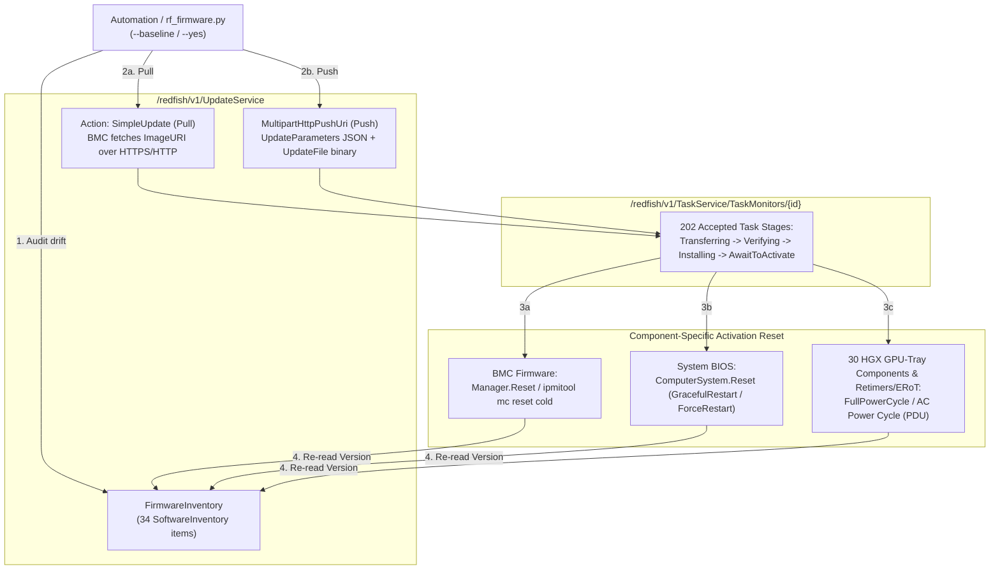

# 7.10 Firmware inventory and the UpdateService

| | |
|---|---|
| Level | Intermediate to Advanced |
| Priority tier | 1 |
| Lab venue | Laptop |
| Part | Part 7: Redfish and BMC |
| Status | Drafted (`firmware_lab.py`: 46 checks pass against mock; **untested** on live BMC) |

## Why this matters for AI infrastructure

A GPU cluster is a set of parts that must work together: BIOS, BMC, GPU firmware, NVSwitch firmware, NIC firmware, PCIe switches and more. If one node runs older firmware than the rest, it may be slower or may fail in odd ways, and everyone waits for the slowest node. The user's notes tell a story of four replacement nodes with an older GPU firmware that throttled under sustained load and cut the throughput of a 512-GPU job by 14 percent. (The notes' numbers are an illustration, not a measurement.) Two jobs follow from this: know exactly what is installed everywhere (**inventory and drift**), and change it safely (**update**). Redfish does both through one service, and firmware updating is the riskiest thing you do with a BMC, so this chapter is careful.

## Prerequisites and outcomes

You need chapters 7.2 to 7.5 and 7.7. After this chapter you can:

- list all firmware on a machine and compare it with a baseline
- explain the two Redfish ways to send a firmware image
- follow an update task and read its messages
- explain why an update can be finished but not active, and what activates it
- describe how BCM's `firmware` commands do the same work
- write a safe update procedure for a fleet

## 1. What is "firmware" in a GPU server?

Firmware is software stored on a chip inside a part. The user's notes list seven groups that an AI cluster has to keep consistent:

| Group | Why it matters |
|---|---|
| System BIOS or UEFI | boot code, PCIe settings, memory training |
| BMC firmware | the management controller itself (sensor tables, fan curves) |
| GPU VBIOS and firmware | clocks, power and thermal behaviour of each GPU |
| NVSwitch firmware | NVLink routing and error recovery |
| NIC and DPU firmware (ConnectX, BlueField) | RDMA, congestion control |
| PCIe retimer and switch firmware | signal quality for fast links |
| NVMe drive firmware | wear handling and bug fixes |

The BCM manual's DGX H100 example shows how many pieces there really are. After one GPU-tray update it lists these components, each with its own version: `HGX_FW_BMC_0`, `HGX_FW_FPGA_0`, `HGX_FW_ERoT_BMC_0`, `HGX_FW_ERoT_FPGA_0`, four `HGX_FW_ERoT_NVSwitch_n`, `HGX_FW_ERoT_PCIeSwitch_0`, eight `HGX_FW_GPU_SXM_n`, four `HGX_FW_NVSwitch_n`, eight `HGX_FW_PCIeRetimer_n` and `HGX_FW_PCIeSwitch_0`. That is **30** components in the GPU tray alone (ERoT means external root of trust, a security chip). The motherboard tray adds more, such as `CPLDMB_0` and `EROT_BIOS_0`. This is why inventory and baselines must be automatic.

## 2. Inventory: UpdateService and FirmwareInventory

The service root links to `UpdateService`. It links to `FirmwareInventory`, a collection of `SoftwareInventory` resources, one per updatable component. A `SoftwareInventory` has (from the schema):

| Property | Meaning |
|---|---|
| `Id`, `Name` | the component name (Ids are platform specific, like the `HGX_FW_GPU_SXM_1` above) |
| `Version` | the version string |
| `VersionScheme` | `SemVer`, `DotIntegerNotation` or `OEM`, how to compare versions |
| `Updateable` | can the update service change it |
| `SoftwareId` | a vendor label for this software |
| `LowestSupportedVersion` | the oldest version this component accepts |
| `RelatedItem` | links to the device or manager it belongs to |
| `Manufacturer`, `ReleaseDate` | provenance |
| `Status` | `State` (it becomes `Updating` during an update) and `Health` |
| `WriteProtected` | cannot be written |

The `UpdateService` resource itself lists what is possible: the actions `SimpleUpdate` and `StartUpdate`, `MultipartHttpPushUri`, `MaxImageSizeBytes`, and `ServiceEnabled`.



My tool reads it all:

```bash
python3 rf_firmware.py inventory http://<bmc> <user> <password>
```

and the mock prints 34 lines (the four base components and the 30 GPU-tray components), such as `HGX_FW_GPU_SXM_1  HGX_FW_GPU_SXM_1  96.00.70.00.01  updateable=True state=Enabled`.

### Drift: comparing with a baseline

**Drift** means a machine differs from what you decided it should be. Keep a baseline file (component to expected version). The tool compares:

```json
{ "BIOS": "1.28", "BMC": "1.00.0", "HGX_FW_GPU_SXM_5": "96.00.74.00.01" }
```

```bash
python3 rf_firmware.py drift http://<bmc> <user> <password> --baseline baseline.json
```

It reports each line as `ok`, `DRIFT` (version differs), `MISSING` (the baseline names something the machine does not have) or `not in baseline` (the machine has something you did not list). The exit code is non-zero when anything is wrong, so you can use it in a pipeline. Where the baseline comes from is the key policy question: it should be the **validated bundle** from your vendor for your platform, not "whatever is on the first node."

## 3. Two ways to send an image

The spec (12.6.2) defines two methods. A service may offer either or both.

| | SimpleUpdate (pull) | Multipart HTTP push |
|---|---|---|
| Who moves the file | the **BMC downloads** it from a URL you give | **you upload** it in the request |
| Needs a file server | yes, reachable from the BMC | no |
| Request | `POST` the action `UpdateService.SimpleUpdate` | `POST` to `MultipartHttpPushUri` with `multipart/form-data` |
| Parameters | `ImageURI` (required), `TransferProtocol`, `Targets`, `ExcludeTargets`, `ForceUpdate`, user name and password for the file server | a JSON part named `UpdateParameters` (same fields) and a binary part named `UpdateFile` |
| Answer | `202` with a task monitor | `202` with a task monitor; `413` if the image is bigger than `MaxImageSizeBytes`; `411` if a length is required and missing |

**Which to use.** Pull scales well: 100 BMCs fetch the same file from one server in parallel and you send only small requests. Its cost is a file server on the management network that every BMC can reach. Push needs no server but moves the whole image through your script for every machine (the BCM examples show packages of 100 to 135 MB). The legacy `HttpPushUri` also exists but its format is vendor specific.

Parameters you should understand:

- `Targets`: URIs of the inventory items to update. If you give none, the service applies the image to every applicable target it finds. Always give targets in scripts. `ExcludeTargets` does the opposite (and is ignored if `Targets` has members).
- `ForceUpdate`: bypass update policies such as "do not downgrade." Use with care.
- `TransferProtocol`: the values in the schema are `CIFS`, `FTP`, `SFTP`, `HTTP`, `HTTPS`, `NFS`, `SCP`, `TFTP` and `OEM`. A service lists what it supports in the action's `TransferProtocol@Redfish.AllowableValues`. Prefer HTTPS. A user name and password sent in a request must only travel over HTTPS (spec 13.2).
- `@Redfish.OperationApplyTime`: when to apply. The `UpdateService` values are `Immediate`, `OnReset`, `AtMaintenanceWindowStart`, `InMaintenanceWindowOnReset`, `OnStartUpdateRequest` and `OnTargetReset`. With `OnStartUpdateRequest`, the update is **registered** now and starts only when you call `StartUpdate`.

That last value is useful in a cluster. You can stage the same update on a whole rack, check that all requests were accepted, and only then call `StartUpdate` on each. In my lab the staged task stays `Pending` however long you wait until `StartUpdate` is called.

## 4. The task and its messages

Both methods return `202` and a task monitor (chapter 7.5). The Task's `Messages` tell the story, using the **Update message registry**:

| Stage message | Meaning |
|---|---|
| `TargetDetermined`, `AllTargetsDetermined`, `NoTargetsDetermined` | which devices will be updated |
| `TransferringToComponent` | the image is moving to the component |
| `VerifyingAtComponent` | the image is being checked (signature, hash, compatibility) |
| `InstallingOnComponent`, `ApplyingOnComponent` | being written |
| `StagingOnComponent` | being staged for later |
| `AwaitToUpdate`, `AwaitToActivate` | waiting for an action (a reset) |
| `ActivatingOnComponent` | being activated |
| `UpdateSuccessful` | done |

and the endings that are not success:

| Message | Severity | Meaning |
|---|---|---|
| `TransferFailed`, `VerificationFailed`, `ApplyFailed`, `ActivateFailed`, `StageFailed`, `CleanupFailed` | Critical | that stage failed |
| `UpdateSkippedSameVersion` | OK | the same version is already installed |
| `UpdateSkippedVersionTooLow` | OK | the image is older than allowed |
| `UpdateSkipped` | OK | skipped for another reason |
| `UpdateNotApplicable` | Warning | this image does not fit that device |
| `AutomaticRecoveryInitiated`, `AutomaticRecoveryFailed`, `AutomaticRecoverySuccessful` | | the device tried to roll back |

Your tool must read these. `200` at the end of a task does **not** mean a new version is running. A skipped update also ends in `200`. In my lab a skipped downgrade finished with HTTP 200 and an unchanged version. Always read the final message and re-read the inventory.

Here is the real output of my tool following an update on the mock (the dry run first, then the real run with `--yes`):

```text
PLAN  component HostBIOS_0 (System BIOS) is at version 1.20
      POST /redfish/v1/UpdateService/Actions/UpdateService.SimpleUpdate
      body {"ImageURI": "http://.../bios128.fwpkg", "TransferProtocol": "HTTP", "Targets": [".../FirmwareInventory/HostBIOS_0"]}
DRY RUN: nothing sent. Drain the node, then add --yes.
...
accepted, following /redfish/v1/TaskService/TaskMonitors/1
    [0%] Image 'bios128.fwpkg' is being transferred to 'BIOS'.
    [30%] Image 'bios128.fwpkg' is being verified at 'BIOS'.
    [60%] Image 'bios128.fwpkg' is being installed on 'HostBIOS_0'.
    [90%] Awaiting for an action to proceed with activating image 'bios128.fwpkg' on 'HostBIOS_0'.
task finished: HTTP 200 Update.1.0.AwaitToActivate
activating: POST /redfish/v1/Systems/System_0/Actions/ComputerSystem.Reset ResetType=GracefulRestart
inventory now says HostBIOS_0 = 1.28
```

The tool is a **dry run unless you pass `--yes`**, because updating firmware by mistake is expensive.

## 5. Staged is not active: activation

Most firmware is written to a spare area and used only after a reset, so the old firmware can keep running until then. The task ends with `AwaitToActivate` and the inventory keeps showing the **old** version. Which reset is needed depends on the component.

| Component (from the notes and the BCM manual) | What activates it |
|---|---|
| BMC firmware | a BMC restart: the Redfish `Manager.Reset`, or `ipmitool mc reset cold` (the notes' firmware steps use it) |
| BIOS and the GPU tray (notes) | a cold reset of the system |
| PCIe switches, retimers, ERoT, CPLDs (notes) | an **AC power cycle** |
| DGX H100 GPU firmware (BCM manual) | an **AC power cycle**: the manual says a regular DC power cycle from `cmsh` "is not enough to initialize some of the components" |

The BCM manual explains the terms: a **DC power cycle** is a board-level reset, an **AC power cycle** means all AC inputs to the system are cut, which can be done by powering off the system's PDU outlets or pulling the mains cables. In Redfish the `ResetType` values closest to these are `PowerCycle` (like removing power and restoring it) and `FullPowerCycle` (like removing utility power lines), see chapter 7.5. Whether the BMC's `FullPowerCycle` really removes AC power on a given DGX is something I could not check.

My mock models the idea: BMC firmware needs a `Manager.Reset`, BIOS needs a host restart, and the GPU-tray package needs a `FullPowerCycle`. The lab proves that:

```text
PASS  BMC firmware is NOT activated by a host reset
PASS  a Manager.Reset (BMC restart) activates it
PASS  one GPU-tray package stages all 30 GPU-tray entries
PASS  a normal host restart does NOT activate the GPU tray firmware
PASS  a board-level power cycle (PowerCycle) still does not activate it
PASS  a FullPowerCycle (AC power removed) activates all 30 entries
PASS  tool: a normal restart leaves the GPU firmware NOT active and the tool says so (exit 7)
```

The last line is the point. A tool that stops after "update finished" would leave nodes half-updated and report success. The tool re-reads the inventory afterwards and says `NOT ACTIVE` with exit code 7.

Also note one package can change many inventory items. My mock's GPU-tray package updates 30 entries at once, like the BCM manual's single `nvfw_dgx-hgx-h100x8_...fwpkg` file. With `Targets` you can limit it to one member.

## 6. How BCM does it

BCM wraps all this in its `firmware` commands (BCM 11 Administrator Manual, section 14.5.2). The steps for a DGX H100:

1. Get the `.fwpkg` files from NVIDIA's DGX support portal. Put them on the head node in `/cm/local/apps/cmd/etc/htdocs/bios/firmware/` in the subdirectory for the platform (`h100`, `gb200`, `gb200sw` and so on). Examples in the manual are about 100 to 135 MB each, such as `nvfw_DGX-H100_0003_230817.1.1_custom_prod-signed.fwpkg` for the motherboard tray and `nvfw_DGX-HGX-H100x8_0002_230705.1.1_prod-signed.fwpkg` for the GPU tray.
2. Configure the BMC network and BMC settings (user name, user id, password) and set **`firmwaremanagemode`** to the platform: the choices include `auto`, `h100`, `b200`, `b300`, `gb200`, `gb200sw`, `gb300`, `gb300sw`, `iLO` and `none`.
3. `firmware info` lists the packages on the head node (state `available`). `firmware status -n node001` shows each component's version, state (`current`, `pending`, `completed`) and a Result text.
4. `firmware flash <package>.fwpkg` on a device starts the update. The manual says progress shows in `firmware status` as a percentage, and the GPU rows show a transition such as `96.00.70.00.01 -> 96.00.74.00.01`. (That arrow display is BCM's view. Redfish itself just gives the old version until activation.)
5. When the flash is done the GPU rows say **`success: AC power cycle to activate`** with state `pending`. After the AC power cycle they say **`success: activated`** with state `completed` and the new version.

Details from the manual:

- Only the components covered by the chosen package are updated. "The non-GPU-related firmware components are not updated" by the GPU-tray package.
- For GB200 and GB300 racks, compute trays are updated with two packages (DGX-side and HGX-side), NVLink switch trays with three. The NVLink **switch tray** is updated through the **NVOS REST API, not Redfish**, so its credentials go in `accesssettings`, not `bmcsettings`.
- BCM uses a module called `cm-nvfwupd`. The manual says release 11.34.0 brings module version 2.1.2 with support for the GB200 NVL72 rack and Rubin-generation platforms.
- The manual points to NVIDIA's own update guides for each platform, which are the authority.

So BCM adds package management, many-node execution and status tracking on top of the same flow. Part 8 covers BCM in more depth.

## 7. NVIDIA's own tool, `nvfwupd`

The user's notes describe `nvfwupd`, a command-line tool from the NVIDIA Enterprise Support Portal that updates DGX H100 and H200 out-of-band, and the Redfish API as the other documented way (the same steps and known issues apply). Commands the notes show:

```bash
nvfwupd --target ip=<bmc-ip> user=<user> password=<password> show_version -p <package>.fwpkg
nvfwupd -t ip=<bmc-ip> user=<user> password=<password> update_fw -p <package>.fwpkg -y -s update_bmc.json
```

Points from the notes: `show_version -p` compares installed versions with a package; `update_fw -s <file>.json` limits the update to listed targets; stop GPU activity first because `nvidia-smi` can block a VBIOS update; do not add load such as jobs, diagnostics or monitoring during the update; downgrades follow a `ForceUpdate` procedure. **I have not run `nvfwupd` and cannot confirm these details.** The notes also explicitly say that an earlier draft of their text described a container image and an `update_fw all --preview` command that are not in NVIDIA's documentation, so I do not use them.

## 8. A safe fleet procedure

1. **Decide the baseline** from the vendor's validated bundle for your platform and write it to a file in version control.
2. **Read the vendor's update guide** for this exact platform and release. Check prerequisites, known issues, the order of components, and which activation each needs.
3. **Take a snapshot:** firmware inventory, health and (if you can) the vendor's support bundle. This is your before picture.
4. **Drain** the node in the scheduler (chapter 6.14) and wait until jobs end. Stop monitoring agents and GPU tools if the guide says so.
5. **Test on one node** first, then a small group, then waves. Do not update the whole cluster at once.
6. **Stage and verify:** send the update; follow the task; stop on the first failed stage.
7. **Activate** with the right reset for each component, in the order the vendor gives (BMC first is common, but follow the guide).
8. **Verify:** re-read the inventory and compare with the baseline. Run the health checks (chapters 7.8, 7.9 and Part 10) before returning the node.
9. **Return the node** to the scheduler only after it passes.
10. **Record** who, what, when, which versions before and after, and the task result.
11. **Plan the rollback** before you start: which package, which `ForceUpdate`, and what to do if the BMC will not respond (the notes describe recovery steps for a bricked BMC; I carry those into chapter 7.14).

Why not do firmware updates over SSH from the host OS? The notes argue (volume 5) that an SSH session can drop in the middle of a write. A BMC-driven update does not depend on the host OS staying healthy. This is a reasonable argument, but it is not a guarantee: the vendor's guide, not a general rule, decides how each component is updated, and some components do need the host side to be quiet during the transfer.

### 8.1 Coordinated cross-domain rollout across storage, fabric, and compute (`volume-10/16`)

In a production AI factory, a firmware refresh rarely touches compute nodes in isolation—it is part of a coordinated maintenance window spanning **parallel storage**, the **InfiniBand fabric**, and **GPU compute nodes** (`volume-10/16-senior-deep-dive-4-coordinated-firmware-driver-os-rollout-across-compute-network-storage.md`):

1. **Create a Slurm maintenance reservation first:** Drain the target nodes or cluster cleanly so the scheduler stops starting jobs that would be interrupted by the window:
   ```bash
   scontrol create reservation starttime=2026-11-07T22:00:00 duration=480 user=root flags=maint,ignore_jobs nodes=ALL
   ```
2. **Choose the cross-domain sequence from compatibility matrices and blast radius:** A defensible default order is **Storage backend first $\rightarrow$ InfiniBand Fabric second $\rightarrow$ Compute nodes last**, validating with a canary ring at each stage (unless a new storage release requires a newer client kernel module first, or a compute-only bug fix is the sole purpose of the window).
3. **Preserve Subnet Manager (SM) high availability during fabric updates (`UFM 6.19.1`):**
   - SM priority ranges from **`0` (lowest) to `15` (highest)**, with default **`15`**; the higher priority wins mastership, and the standby SM takes over after **`4` failed polls** (default).
   - Verify the active master SM using `sminfo` (or `sminfo <lid>`), and **never pass `-s`, `-p`, or `-a` flags to `sminfo` on a production fabric**, as those flags write MAD changes that can disrupt the running SM.
   - When upgrading an HA **UFM Enterprise** pair (`UFM 6.14.0+` in-service upgrade over DRBD), upgrade the **standby** UFM node first, fail over mastership to the upgraded node, and then upgrade the former master (with automatic data backup in `/opt/ufm/BACKUP`).
   - Before leaving the fabric stage, verify link error deltas with `ibqueryerrors` / `perfquery` and confirm consistent SM settings across HCAs with `ibdiagnet`.
4. **Respect the host software dependency chain and avoid the silent GDS `compat` trap:**
   - When compute node firmware updates are paired with host OS/driver updates, the documented GPUDirect Storage (GDS) installation order is: **Linux kernel (`4.15.x+`) $\rightarrow$ `MLNX_OFED` / `DOCA-Host` (which replaces inbox `ib_core`; note that `mstflint` is unbundled since `MLNX_OFED 24.07`, and `mstflint -d <device> q` queries the adapter PSID) $\rightarrow$ NVIDIA GPU driver $\rightarrow$ `nvidia-fs` kernel module** (rebuilt automatically by DKMS on driver upgrades; use `nvidia-fs 2.25.7+` to avoid the `2.25.6` P2P bug).
   - **Why a broken `nvidia-fs` upgrade fails silently:** In `/etc/cufile.json`, `allow_compat_mode` defaults to **`true`** (`force_compat_mode: false`, `gds_rdma_write_support: true`). If a kernel or driver update leaves `nvidia-fs.ko` unloaded, `libcufile` silently falls back to POSIX `pread`/`pwrite` bounce buffers through host CPU RAM—making checkpoints several times slower without throwing an error.
   - Always verify the canary node with `lsmod | grep nvidia_fs`, `/usr/local/cuda/gds/tools/gdscheck.py -p` (confirming direct mode such as `nvfs` or `p2pdma` alongside `compat`), and compare `gdsio -x 0` (`GPUD` direct storage-to-GPU) against `gdsio -x 2` (`CPU_GPU` host memory bounce) on a GPU that shares a PCIe switch with the storage NIC (`nvidia-smi topo -mp`, since non-optimal PCIe affinity can cut GDS throughput by `40%` and double latency).

## 9. The lab

```bash
cd code/part07
python3 firmware_lab.py
```

It runs 46 checks. Grouped:

1. **Inventory and drift** (34 components, matching baseline, drift/missing/extra).
2. **The happy path:** 202, `Updating` while running, stage messages in order, `AwaitToActivate`, old version still shown, new version after the right reset.
3. **Different activation:** BMC reset, host reset, board power cycle, full power cycle.
4. **Failure and skip cases:** corrupted image, not a package, unreachable image, same version, downgrade, minimum-version rule, wrong target, missing `ImageURI`, bad transfer protocol, forbidden for a read-only user.
5. **Cancel** a running update and **staging** with `OnStartUpdateRequest` and `StartUpdate`.
6. **Multipart push:** success, missing part, too large, wrong content type.
7. **The tool:** dry run, skipped, failure exit code, timeout reported as unknown, normal restart not active (exit 7), full power cycle active.
8. The Task with its messages and the `Updating` inventory item **validate against the official DMTF schemas**.

One thing I fixed along the way: my first lab run died because the update ran longer than the simulated session timeout, and the client got a 401 in the middle. I added automatic **session renewal** to my Redfish client (on a 401 while holding a token it logs in again once and repeats the request). Real BMCs time sessions out too, and a long update is exactly when it happens.

## Exercises

1. **Running the 46-check firmware lifecycle suite (`code/part07/firmware_lab.py`):** Run `python3 code/part07/firmware_lab.py` (`45` / `46` checks pass) and `python3 code/part07/rf_firmware.py inventory` against the mock. List which components require `Manager.Reset`, which require a host `ComputerSystem.Reset`, and which require `FullPowerCycle` (AC power cycle).
2. **Auditing fleet firmware drift (`rf_firmware.py drift`):** Save a JSON baseline file matching the mock's post-update GPU tray versions (`96.00.74.00.01`), deliberately change one GPU's expected version in the baseline JSON, and run `rf_firmware.py drift --baseline <file>`. Verify that it flags `DRIFT` and exits non-zero.
3. **Verifying task cancellation cleanup:** Inspect how `code/part07/firmware_lab.py` tests cancelling an in-progress firmware update (`DELETE` on the Task Monitor URI) and verify that the target `SoftwareInventory` item's `Status.State` returns from `"Updating"` back to `"Enabled"`.
4. **Comparing `SimpleUpdate` (pull) vs `MultipartHttpPushUri` (push):** Write out the exact `curl` commands for updating `HostBIOS_0` via `SimpleUpdate` (`ImageURI` + `Targets`) versus `MultipartHttpPushUri` (`-F UpdateParameters=... -F UpdateFile=@...`), and state when you would choose each for a `100–135 MB` `.fwpkg` bundle across 128 nodes.
5. **Designing a canary wave rollout and GDS post-flight check:** Combine the 11-step firmware update procedure (Section 8) with the GDS post-upgrade checks (`gdscheck.py -p` and `gdsio -x 0` vs `-x 2` from Section 8.1) for a 128-node cluster (`1` canary node $\rightarrow$ `1` rack of `8` nodes $\rightarrow$ `1` SU of `32` nodes $\rightarrow$ remaining SUs), specifying the exact stop condition between waves.
6. **Mapping BCM `firmware status` to Redfish properties:** Compare the columns of BCM's `cmsh` `firmware status -n node001` (`component`, `version`, `state: current/pending/completed`, `Result: success: AC power cycle to activate`) to the corresponding Redfish `SoftwareInventory` (`Id`, `Version`, `Status.State`) and `Task.Messages` (`Update.1.0.AwaitToActivate`, `Update.1.0.UpdateSuccessful`).

## 11. Interview angles

- "How do you update firmware on 500 DGX nodes?" Baseline from the vendor, drain, small waves, BMC-driven updates with `Targets`, verify the inventory and health, then return nodes. Mention activation and rollback.
- "The update task finished with 200. Are you done?" No: read the final message (skipped? waiting for activation?) and re-read the inventory.
- "What is drift and why does it matter for training?" Nodes on different firmware behave differently, and collectives run at the speed of the slowest GPU.
- "Why `Targets`?" Without them the service may apply the image to every applicable device it finds.
- "How do you stage an update across a rack and start it together?" `@Redfish.OperationApplyTime: OnStartUpdateRequest`, then `StartUpdate`.
- "Why can't you just reboot to activate?" Some parts need a DC cycle, some an AC cycle. The vendor lists which.

## Checkpoint questions (20)

<details>
<summary>1. Name the seven firmware groups in an AI GPU server that must be kept on a validated baseline.</summary>

1. **System BIOS / UEFI**
2. **Motherboard BMC firmware** (and GPU-tray satellite HMC/FPGA firmware)
3. **GPU VBIOS / InfoROM**
4. **NVSwitch firmware**
5. **Network adapter / DPU firmware** (`ConnectX-7`, `BlueField-3`)
6. **PCIe switch and retimer firmware** (plus CPLDs and `ERoT` roots of trust)
7. **NVMe SSD firmware**
</details>

<details>
<summary>2. What is `/redfish/v1/UpdateService/FirmwareInventory`, and what schema type is each member?</summary>

`FirmwareInventory` is a collection of **`SoftwareInventory`** resources, one for each updatable (or readable) firmware image on the server (`34` components in the DGX H100 mock: `4` host components plus `30` HGX GPU-tray components). Each member exposes `Id`, `Name`, `Version`, `Updateable`, `LowestSupportedVersion`, `RelatedItem`, and `Status`.
</details>

<details>
<summary>3. What do `Updateable`, `WriteProtected`, and `LowestSupportedVersion` mean on a `SoftwareInventory` resource?</summary>

- **`Updateable`:** Boolean indicating whether `UpdateService` can flash this component.
- **`WriteProtected`:** Boolean indicating whether hardware/jumper write-protection is currently blocking writes.
- **`LowestSupportedVersion`:** The oldest firmware version string to which this component is allowed to be downgraded (preventing anti-rollback fuse violations).
</details>

<details>
<summary>4. What is firmware drift, why can four drifted nodes degrade a 512-GPU training job by 14%, and how does `rf_firmware.py drift` detect it?</summary>

Firmware drift occurs when a subset of nodes (often after an RMA board replacement) runs a different firmware version than the rest of the cluster. If an older GPU VBIOS throttles clocks under heavy FP8 GEMM load on 4 nodes, all 512 GPUs stall at every synchronous `AllReduce` barrier waiting for those 4 nodes. `rf_firmware.py drift` compares every node's live `FirmwareInventory` against a version-controlled JSON baseline and flags `DRIFT` or `MISSING` with a non-zero exit code.
</details>

<details>
<summary>5. Where should your cluster's firmware baseline JSON come from?</summary>

From the hardware vendor's **published, co-validated firmware qualification matrix / bundle** for that exact server model and software release—never by blindly copying whatever versions happen to be installed on the first server delivered.
</details>

<details>
<summary>6. Compare `UpdateService.SimpleUpdate` (pull) and `MultipartHttpPushUri` (push) across network flow, parameters, and fleet scalability.</summary>

- **`SimpleUpdate` (Pull):** You `POST` a tiny JSON payload (`ImageURI`, `TransferProtocol`, `Targets`) to `/redfish/v1/UpdateService/Actions/UpdateService.SimpleUpdate`, and each BMC downloads the `.fwpkg` image asynchronously from your local HTTP/HTTPS server. Scales cleanly to hundreds of nodes without bottlenecking the orchestrator.
- **`MultipartHttpPushUri` (Push):** Your client uploads the entire binary (`100–135 MB` per node) via `multipart/form-data` (`UpdateParameters` JSON part + `UpdateFile` binary part). Requires no external file server on the OOB network, but pushes heavy bandwidth through the orchestrator.
</details>

<details>
<summary>7. What does the `Targets` array parameter do in an update request, and why should scripts always populate it explicitly?</summary>

`Targets` lists the exact `@odata.id` URIs in `FirmwareInventory` that the update package should be applied to. If `Targets` is omitted, the BMC applies the image to **every applicable device it finds**, which can unintentionally flash components you did not intend to touch.
</details>

<details>
<summary>8. What does `"ForceUpdate": true` do in `SimpleUpdate` or `UpdateParameters`?</summary>

It instructs the BMC to bypass normal version-comparison guards—re-flashing an identical version (instead of skipping with `UpdateSkippedSameVersion`) or performing a supported downgrade to an older version (as long as it is not below `LowestSupportedVersion`).
</details>

<details>
<summary>9. How do `"@Redfish.OperationApplyTime": "OnStartUpdateRequest"` and the `#UpdateService.StartUpdate` action work together across a rack of servers?</summary>

Setting `OperationApplyTime` to `"OnStartUpdateRequest"` stages and registers the firmware update on each BMC (leaving the task in `TaskState: "Pending"`) without starting the flash. Once every node in the rack has successfully staged the package, the orchestrator calls `POST /redfish/v1/UpdateService/Actions/UpdateService.StartUpdate` across the rack to trigger execution simultaneously.
</details>

<details>
<summary>10. What HTTP status code do `SimpleUpdate` and `MultipartHttpPushUri` return when accepted, and what happens if a pushed image exceeds `MaxImageSizeBytes`?</summary>

When accepted, both return **`202 Accepted`** with a `Location` Task Monitor URI. If a multipart push exceeds `MaxImageSizeBytes`, the BMC rejects it with **`413 Payload Too Large`** (or `411 Length Required` if `Content-Length` is missing).
</details>

<details>
<summary>11. Name four progress messages and three failure messages from the DMTF `Update` Message Registry (`Update.1.x`).</summary>

- **Progress / Stage messages:** `TargetDetermined`, `TransferringToComponent`, `VerifyingAtComponent`, `InstallingOnComponent` / `ApplyingOnComponent`, `AwaitToActivate`, `UpdateSuccessful`.
- **Failure messages:** `TransferFailed`, `VerificationFailed`, `ApplyFailed` (plus `StageFailed`, `ActivateFailed`).
</details>

<details>
<summary>12. Why does a final HTTP `200 OK` from an update Task Monitor NOT prove that the new firmware version is installed and running?</summary>

Because (1) a skipped update (`UpdateSkippedSameVersion` or `UpdateSkippedVersionTooLow`) still completes the task with HTTP `200 OK` while leaving the old version untouched, and (2) a staged update ends with `AwaitToActivate` (`200 OK`), where the new image is written to inactive flash and will not run until the required component reset occurs.
</details>

<details>
<summary>13. What does `Update.1.0.AwaitToActivate` mean in a completed Task's `Messages` array?</summary>

It means the firmware image was transferred, verified, and written to the component's staging flash bank, and is now waiting for the appropriate hardware reset (BMC reset, host reboot, or AC power cycle) to become the active running version.
</details>

<details>
<summary>14. Why does `FirmwareInventory` continue to report the OLD version string even after the update task finishes with `AwaitToActivate`?</summary>

Because `SoftwareInventory.Version` in Redfish reports the **currently active, running firmware version** of the component. Until the activation reset occurs and the component boots from the new flash bank, the old version is still what is running in silicon.
</details>

<details>
<summary>15. Which specific reset action activates newly flashed BMC firmware versus System BIOS firmware?</summary>

- **BMC firmware:** Activated by resetting the BMC itself via Redfish **`#Manager.Reset`** (`GracefulRestart`/`ForceRestart`) or `ipmitool mc reset cold`—a host OS reboot does *not* activate BMC firmware.
- **System BIOS:** Activated by resetting the host system via **`#ComputerSystem.Reset`** (`GracefulRestart` or `ForceRestart`).
</details>

<details>
<summary>16. What is the physical difference between a DC power cycle and an AC power cycle, and why does the DGX H100 GPU tray require an AC power cycle after flashing (`bcm11-admin` §14.5.2)?</summary>

A **DC power cycle** turns off only the main host power rails while leaving the `5V`/`12V` auxiliary standby rails energized. An **AC power cycle** (`FullPowerCycle` or toggling rack PDU outlets off and on) removes all input power so standby rails discharge completely—which is required to reload complex auxiliary components on the GPU tray (`30` components including `ERoT` security roots of trust, CPLDs, FPGAs, NVSwitches, and PCIe retimers).
</details>

<details>
<summary>17. In NVIDIA Base Command Manager (`cmsh`), where are `.fwpkg` files placed on the head node, and what are the four main `firmware` subcommands (§14.5.2)?</summary>

Packages are placed under **`/cm/local/apps/cmd/etc/htdocs/bios/firmware/<platform>/`** (with `firmwaremanagemode` set to `h100`, `b200`, `gb200`, `gb200sw`, etc.). The main commands are `firmware info` (list available packages), `firmware status` (show per-component current/pending/completed versions), `firmware flash <pkg>.fwpkg`, and `power` / AC cycle to activate.
</details>

<details>
<summary>18. On a rack-scale NVIDIA GB200 or GB300 NVL72 system managed by BCM, how does updating an NVLink switch tray (`gb200sw`) differ from updating a compute tray?</summary>

Compute trays are updated via Redfish (`bmcsettings`) using two `.fwpkg` bundles (DGX-side and HGX-side), whereas NVLink **switch trays** are updated using three packages over the switch's **NVOS REST API** (using credentials configured in `accesssettings` rather than Redfish `bmcsettings`).
</details>

<details>
<summary>19. During a coordinated cluster refresh (`volume-10/16`), what is the documented host installation order for GPUDirect Storage (GDS), and why does a missing `nvidia-fs.ko` module cause a silent slowdown instead of a hard job error?</summary>

The order is **Linux kernel (`4.15.x+`) $\rightarrow$ `MLNX_OFED` / `DOCA-Host` $\rightarrow$ NVIDIA GPU driver $\rightarrow$ `nvidia-fs`** (rebuilt via DKMS). Because `allow_compat_mode` in `/etc/cufile.json` defaults to **`true`**, if `nvidia-fs.ko` fails to load after a kernel/driver update, `libcufile` silently falls back to POSIX `pread`/`pwrite` through host CPU memory (`compat` mode), slowing checkpoints without crashing jobs. Verify with `gdscheck.py -p` and compare `gdsio -x 0` vs `gdsio -x 2`.
</details>

<details>
<summary>20. When upgrading InfiniBand fabric switches during a maintenance window (`volume-10/16`), how do UFM Subnet Manager (SM) priorities work, and what warning applies to `sminfo`?</summary>

SM priority runs from **`0` (lowest) to `15` (highest, default `15`)**, where the higher priority is master and the standby takes over after **`4` failed polls**. Use `sminfo` strictly as a read-only query—never pass the `-s`, `-p`, or `-a` flags on a production fabric, because they modify live SM state via MAD packets and can destabilize routing.
</details>

## Sources and review notes

- **Coordinated Cross-Domain Rollout (`volume-10/16-senior-deep-dive-4-coordinated-firmware-driver-os-rollout-across-compute-network-storage.md`):** Primary source for Section 8.1 (`MLNX_OFED`/`DOCA-Host` $\rightarrow$ NVIDIA driver $\rightarrow$ `nvidia-fs` DKMS dependency chain, `cufile.json` `allow_compat_mode: true` silent POSIX fallback, `gdscheck.py -p`, `gdsio -x 0` vs `-x 2`, `40%` PCIe affinity penalty, `mstflint` unbundling in `24.07`, Slurm `flags=maint,ignore_jobs` reservation, UFM 6.19.1 SM priority `0..15` and `4`-poll handover, `sminfo` read-only safety, and UFM HA DRBD standby-first upgrade).

- **Redfish Specification DSP0266 v1.21.0:** update service, SimpleUpdate and multipart push (12.6), asynchronous tasks (12.2), operation apply time (7.12), sensitive data (13.2). I read these clauses.
- **Redfish Resource and Schema Guide DSP2046 and the official JSON Schemas and registries:** `UpdateService` v1.17 (actions, `ApplyTime`, `TransferProtocolType`, `UpdateParameters`), `SoftwareInventory` v1.15 (`VersionScheme`, properties) and the **Update message registry** 1.5.0 (all stage and failure messages above).
- **BCM 11 Administrator Manual, section 14.5 (BIOS and firmware management):** the DGX H100 and GB200/GB300 firmware workflow, `firmwaremanagemode` values, `firmware info/status/flash`, the 30 GPU-tray components with IDs and versions, `AC power cycle` activation, NVOS REST for the NVLink switch tray, module `cm-nvfwupd`. I read the H100 and GB200 sections.
- **NVIDIA-DevOps notes:** volume 10 chapter 1 sections 4.1 to 4.5 (seven firmware groups, the throttling story, `nvfwupd`, per-component activation); volume 5 chapter 3 (the argument for BMC-driven updates). The numbers in the notes' story are illustrative. Volume 10 chapter 10 (coordinated cluster-wide change management) is routed to chapter 17.10 and not used here.
- **Run here:** `firmware_lab.py` (46 checks), `rf_firmware.py` (inventory, drift, update).
- **Not verified:** any real firmware package, `nvfwupd`, NVIDIA's activation rules and order, how `FullPowerCycle` behaves on real DGX BMCs, and whether DGX BMCs accept `SimpleUpdate` or only their own tools.
