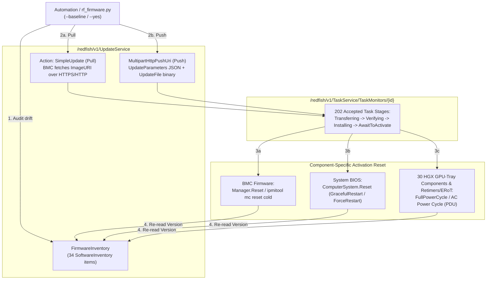

# 7.10 Firmware inventory and the UpdateService

| | |
|---|---|
| Level | Intermediate to Advanced |
| Priority tier | 1 |
| Lab venue | Laptop |
| Part | Part 7: Redfish and BMC |
| Status | Drafted (`firmware_lab.py`: 46 checks pass against mock; **untested** on live BMC) |

## Why this matters for AI infrastructure

A 512-GPU training job slows down, and the cause turns out to be four replacement nodes. Those nodes ran an older GPU firmware. The user's notes tell this story. The firmware throttled under sustained load and cut the job's throughput by 14 percent. Treat those numbers as an illustration, not a measurement.

A GPU cluster is many parts that must work together. Those parts include the BIOS, the BMC, the GPU firmware, the NVSwitch firmware, the NIC firmware, the PCIe switches and more. If one node runs older firmware than the rest, it may be slower, or it may fail in odd ways. Everyone then waits for the slowest node.

That gives you two jobs. The first is to know exactly what is installed on every machine. This is called **inventory and drift**. The second is to change that firmware safely, which is called **update**. Redfish handles both through one service. Firmware updating is the riskiest thing you do with a BMC, so this chapter takes it slowly.

## Prerequisites and outcomes

This chapter builds on chapters 7.2 to 7.5 and 7.7, so read those first. When you finish, you should be able to:

- list all firmware on a machine and compare it with a baseline.
- explain the two Redfish ways to send a firmware image.
- follow an update task and read its messages.
- explain why an update can be finished but not active, and what activates it.
- describe how BCM's `firmware` commands do the same work.
- write a safe update procedure for a fleet.

## 1. What is "firmware" in a GPU server?

Firmware is software that lives on a chip inside a part, such as a GPU or a network card. The user's notes list seven groups that an AI cluster has to keep consistent. The table below shows what each group controls and why you should care.

| Group | Why it matters |
|---|---|
| System BIOS or UEFI | boot code, PCIe settings, memory training |
| BMC firmware | the management controller itself (sensor tables, fan curves) |
| GPU VBIOS and firmware | clocks, power and thermal behaviour of each GPU |
| NVSwitch firmware | NVLink routing and error recovery |
| NIC and DPU firmware (ConnectX, BlueField) | RDMA, congestion control |
| PCIe retimer and switch firmware | signal quality for fast links |
| NVMe drive firmware | wear handling and bug fixes |

The BCM manual's DGX H100 example shows how many pieces there really are. After one GPU-tray update, it lists these components, each with its own version: `HGX_FW_BMC_0`, `HGX_FW_FPGA_0`, `HGX_FW_ERoT_BMC_0`, `HGX_FW_ERoT_FPGA_0`, four `HGX_FW_ERoT_NVSwitch_n`, `HGX_FW_ERoT_PCIeSwitch_0`, eight `HGX_FW_GPU_SXM_n`, four `HGX_FW_NVSwitch_n`, eight `HGX_FW_PCIeRetimer_n` and `HGX_FW_PCIeSwitch_0`. Add up the groups and you get **30** components in the GPU tray alone: 4 + 4 + 1 + 8 + 4 + 8 + 1 = 30. ERoT means external root of trust, which is a security chip. The motherboard tray adds more, such as `CPLDMB_0` and `EROT_BIOS_0`. With this many parts in your cluster, inventory and baselines have to be automatic, so plan to collect every version with a script, not by hand.

## 2. Inventory: UpdateService and FirmwareInventory

Start at the service root. It links to `UpdateService`, and `UpdateService` links to `FirmwareInventory`. That is a collection of `SoftwareInventory` resources, one per updatable component. The schema defines these properties on each `SoftwareInventory`:

| Property | Meaning |
|---|---|
| `Id`, `Name` | the component name (Ids are platform specific, like the `HGX_FW_GPU_SXM_1` above) |
| `Version` | the version string |
| `VersionScheme` | `SemVer`, `DotIntegerNotation` or `OEM`, how to compare versions |
| `Updateable` | can the update service change it |
| `SoftwareId` | a vendor label for this software |
| `LowestSupportedVersion` | the oldest version this component accepts |
| `RelatedItem` | links to the device or manager it belongs to |
| `Manufacturer`, `ReleaseDate` | provenance |
| `Status` | `State` (it becomes `Updating` during an update) and `Health` |
| `WriteProtected` | cannot be written |

Pay the most attention to `Version`, which you compare against your baseline, and to `Status`, which shows `Updating` while an update runs. The `UpdateService` resource itself tells you what the service can do. It lists the actions `SimpleUpdate` and `StartUpdate`, the upload address `MultipartHttpPushUri`, the size limit `MaxImageSizeBytes`, and `ServiceEnabled`.

The diagram below shows the whole flow, from the drift audit to the final check of the inventory.



Notice that the last step returns to the inventory, so the inventory is both where you start and where you finish. My tool reads the whole inventory in one call:

```bash
python3 rf_firmware.py inventory http://<bmc> <user> <password>
```

The mock prints 34 lines: the four base components and the 30 GPU-tray components. One of those lines looks like this: `HGX_FW_GPU_SXM_1  HGX_FW_GPU_SXM_1  96.00.70.00.01  updateable=True state=Enabled`.

### Drift: comparing with a baseline

**Drift** is what you get when a machine no longer matches what you decided it should be. You record that decision in a baseline file, which lists each component with its expected version. The tool compares the live inventory against a file like this:

```json
{ "BIOS": "1.28", "BMC": "1.00.0", "HGX_FW_GPU_SXM_5": "96.00.74.00.01" }
```

```bash
python3 rf_firmware.py drift http://<bmc> <user> <password> --baseline baseline.json
```

Each line of the report gets one of four results. `ok` means the version matches. `DRIFT` means the version differs. `MISSING` means the baseline names something the machine does not have. `not in baseline` means the machine has something you did not list. The exit code is non-zero whenever something is wrong, so a pipeline can stop on it.

The harder question is where the baseline comes from. It should be the **validated bundle** from your vendor for your platform, not "whatever is on the first node." Take it from that bundle and keep the file in version control.

## 3. Two ways to send an image

The Redfish spec defines two methods for sending an image, in clause 12.6.2. A service may offer either method or both. The table compares them.

| | SimpleUpdate (pull) | Multipart HTTP push |
|---|---|---|
| Who moves the file | the **BMC downloads** it from a URL you give | **you upload** it in the request |
| Needs a file server | yes, reachable from the BMC | no |
| Request | `POST` the action `UpdateService.SimpleUpdate` | `POST` to `MultipartHttpPushUri` with `multipart/form-data` |
| Parameters | `ImageURI` (required), `TransferProtocol`, `Targets`, `ExcludeTargets`, `ForceUpdate`, user name and password for the file server | a JSON part named `UpdateParameters` (same fields) and a binary part named `UpdateFile` |
| Answer | `202` with a task monitor | `202` with a task monitor; `413` if the image is bigger than `MaxImageSizeBytes`; `411` if a length is required and missing |

**Which to use.** Pull scales well. 100 BMCs can fetch the same file from one server in parallel, and you only send small requests. The cost is a file server on the management network that every BMC can reach. Push needs no file server, but your script moves the whole image for every machine. The BCM examples show packages of 100 to 135 MB. Multiply 100 machines by 135 MB and your script uploads 13.5 GB. The legacy `HttpPushUri` also exists, but its format is vendor specific.

Several parameters decide what an update touches, so understand each one before you send a request. `Targets` holds the URIs of the inventory items to update. If you give none, the service applies the image to every applicable target it finds. Always give targets in scripts. `ExcludeTargets` works the other way, but it is ignored when `Targets` has members.

`ForceUpdate` tells the service to bypass update policies such as "do not downgrade." Use it with care. `TransferProtocol` names how the BMC fetches the file. The schema lists `CIFS`, `FTP`, `SFTP`, `HTTP`, `HTTPS`, `NFS`, `SCP`, `TFTP` and `OEM`. A service lists what it supports in the action's `TransferProtocol@Redfish.AllowableValues`. Prefer HTTPS, because a user name and password sent in a request must only travel over HTTPS, as clause 13.2 says.

`@Redfish.OperationApplyTime` controls when the update applies. The `UpdateService` values are `Immediate`, `OnReset`, `AtMaintenanceWindowStart`, `InMaintenanceWindowOnReset`, `OnStartUpdateRequest` and `OnTargetReset`. With `OnStartUpdateRequest`, the update is **registered** now and starts only when you call `StartUpdate`.

That last value is useful in a cluster. You can stage the same update on a whole rack, check that every request was accepted, and only then call `StartUpdate` on each node. In my lab, a staged task stays `Pending` for as long as you wait, until `StartUpdate` is called. Always pass `Targets` from your scripts, and use `OnStartUpdateRequest` when you want to stage a whole rack before starting any of it.

## 4. The task and its messages

Both methods answer with `202` and a task monitor, which chapter 7.5 covers. The task's `Messages` tell you how the update went. They come from the **Update message registry**, and the stage messages below follow the image from the first transfer to the wait for activation.

| Stage message | Meaning |
|---|---|
| `TargetDetermined`, `AllTargetsDetermined`, `NoTargetsDetermined` | which devices will be updated |
| `TransferringToComponent` | the image is moving to the component |
| `VerifyingAtComponent` | the image is being checked (signature, hash, compatibility) |
| `InstallingOnComponent`, `ApplyingOnComponent` | being written |
| `StagingOnComponent` | being staged for later |
| `AwaitToUpdate`, `AwaitToActivate` | waiting for an action (a reset) |
| `ActivatingOnComponent` | being activated |
| `UpdateSuccessful` | done |

Some messages end the story without success, and some are not failures at all. The table below lists those endings, including the skips and the warning.

| Message | Severity | Meaning |
|---|---|---|
| `TransferFailed`, `VerificationFailed`, `ApplyFailed`, `ActivateFailed`, `StageFailed`, `CleanupFailed` | Critical | that stage failed |
| `UpdateSkippedSameVersion` | OK | the same version is already installed |
| `UpdateSkippedVersionTooLow` | OK | the image is older than allowed |
| `UpdateSkipped` | OK | skipped for another reason |
| `UpdateNotApplicable` | Warning | this image does not fit that device |
| `AutomaticRecoveryInitiated`, `AutomaticRecoveryFailed`, `AutomaticRecoverySuccessful` | | the device tried to roll back |

Your tool must read these messages. A `200` at the end of a task does **not** mean a new version is running, because a skipped update also ends in `200`. In my lab, a skipped downgrade finished with HTTP 200 and an unchanged version. So read the final message first, then re-read the inventory.

Here is what my tool printed on the mock. It did a dry run first, then a real run with `--yes`:

```text
PLAN  component HostBIOS_0 (System BIOS) is at version 1.20
      POST /redfish/v1/UpdateService/Actions/UpdateService.SimpleUpdate
      body {"ImageURI": "http://.../bios128.fwpkg", "TransferProtocol": "HTTP", "Targets": [".../FirmwareInventory/HostBIOS_0"]}
DRY RUN: nothing sent. Drain the node, then add --yes.
...
accepted, following /redfish/v1/TaskService/TaskMonitors/1
    [0%] Image 'bios128.fwpkg' is being transferred to 'BIOS'.
    [30%] Image 'bios128.fwpkg' is being verified at 'BIOS'.
    [60%] Image 'bios128.fwpkg' is being installed on 'HostBIOS_0'.
    [90%] Awaiting for an action to proceed with activating image 'bios128.fwpkg' on 'HostBIOS_0'.
task finished: HTTP 200 Update.1.0.AwaitToActivate
activating: POST /redfish/v1/Systems/System_0/Actions/ComputerSystem.Reset ResetType=GracefulRestart
inventory now says HostBIOS_0 = 1.28
```

Read that output as a story: the plan, the progress lines, then the activation and the new version. The tool is a **dry run unless you pass `--yes`**, because a firmware update you start by mistake is expensive. Treat a `200` as the start of verification, not the end of the job.

## 5. Staged is not active: activation

A task can report success while the inventory still shows the old version. That is expected when the firmware is written to a spare area and used only after a reset. The old firmware keeps running until then. Your task ends in `AwaitToActivate`, and the inventory keeps showing the **old** version. Which reset you need depends on the component.

| Component (from the notes and the BCM manual) | What activates it |
|---|---|
| BMC firmware | a BMC restart: the Redfish `Manager.Reset`, or `ipmitool mc reset cold` (the notes' firmware steps use it) |
| BIOS and the GPU tray (notes) | a cold reset of the system |
| PCIe switches, retimers, ERoT, CPLDs (notes) | an **AC power cycle** |
| DGX H100 GPU firmware (BCM manual) | an **AC power cycle**: the manual says a regular DC power cycle from `cmsh` "is not enough to initialize some of the components" |

The BCM manual defines the two power-cycle terms. A **DC power cycle** is a board-level reset. An **AC power cycle** cuts every AC input to the system, which you can do by switching off the PDU outlets or by pulling the mains cables. The closest `ResetType` values are `PowerCycle` and `FullPowerCycle`. The first is closest to removing power and restoring it, and the second is closest to removing the utility power lines. Chapter 7.5 covers both. Whether the BMC's `FullPowerCycle` really removes AC power on a given DGX is something I could not check.

My mock models this. BMC firmware needs a `Manager.Reset`, BIOS needs a host restart, and the GPU-tray package needs a `FullPowerCycle`. The lab checks these rules, and its output shows them passing:

```text
PASS  BMC firmware is NOT activated by a host reset
PASS  a Manager.Reset (BMC restart) activates it
PASS  one GPU-tray package stages all 30 GPU-tray entries
PASS  a normal host restart does NOT activate the GPU tray firmware
PASS  a board-level power cycle (PowerCycle) still does not activate it
PASS  a FullPowerCycle (AC power removed) activates all 30 entries
PASS  tool: a normal restart leaves the GPU firmware NOT active and the tool says so (exit 7)
```

The last line matters most. A tool that stops at "update finished" would leave nodes half-updated while reporting success. Instead, my tool re-reads the inventory afterwards, says `NOT ACTIVE`, and exits with code 7.

One package can change many inventory items at once. The mock's GPU-tray package updates 30 entries in a single step, just as the BCM manual's single `nvfw_dgx-hgx-h100x8_...fwpkg` file does. If you want only one member changed, `Targets` lets you limit the update to it. Match each component to its reset before you schedule the window, because a wrong reset leaves the new version inactive.

## 6. How BCM does it

BCM wraps this whole flow in its `firmware` commands. Section 14.5.2 of the BCM 11 Administrator Manual gives the steps for a DGX H100:

1. Put the `.fwpkg` files from NVIDIA's DGX support portal on the head node, in `/cm/local/apps/cmd/etc/htdocs/bios/firmware/`, in the subdirectory for your platform (`h100`, `gb200`, `gb200sw` and so on). The manual's examples run about 100 to 135 MB each, such as `nvfw_DGX-H100_0003_230817.1.1_custom_prod-signed.fwpkg` for the motherboard tray and `nvfw_DGX-HGX-H100x8_0002_230705.1.1_prod-signed.fwpkg` for the GPU tray.
2. Configure the BMC network and the BMC settings (user name, user id and password). Then set **`firmwaremanagemode`** to your platform. The choices include `auto`, `h100`, `b200`, `b300`, `gb200`, `gb200sw`, `gb300`, `gb300sw`, `iLO` and `none`.
3. `firmware info` lists the packages on the head node, with state `available`. `firmware status -n node001` shows each component's version, its state (`current`, `pending`, `completed`) and a Result text.
4. `firmware flash <package>.fwpkg` on a device starts the update. The manual says progress shows in `firmware status` as a percentage. The GPU rows show a transition such as `96.00.70.00.01 -> 96.00.74.00.01`. That arrow display is BCM's view. Redfish itself just gives the old version until activation.
5. When the flash is done, the GPU rows say **`success: AC power cycle to activate`** with state `pending`. After the AC power cycle, they say **`success: activated`** with state `completed` and the new version.

The manual adds details that matter in practice. Only the components in the chosen package get updated. The manual says that "the non-GPU-related firmware components are not updated" by the GPU-tray package. On GB200 and GB300 racks, a compute tray needs two packages, a DGX-side one and an HGX-side one, and an NVLink switch tray needs three. The NVLink **switch tray** is not updated through Redfish. It goes through the **NVOS REST API**, so its credentials belong in `accesssettings`, not `bmcsettings`.

BCM uses a module called `cm-nvfwupd`. The manual says release 11.34.0 brings module version 2.1.2, with support for the GB200 NVL72 rack and Rubin-generation platforms. For each platform, the manual points you to NVIDIA's own update guide, and that guide is the authority.

So BCM adds package management, execution across many nodes and status tracking on top of the same flow. Part 8 goes deeper into BCM. If you run BCM, let it handle the packages and the status tracking, and keep the vendor guide open beside it.

## 7. NVIDIA's own tool, `nvfwupd`

The user's notes describe `nvfwupd`. It is a command-line tool from the NVIDIA Enterprise Support Portal, and it updates DGX H100 and H200 systems out-of-band. The notes also name the Redfish API as the other documented route, and the same steps and known issues apply to it. The notes show these commands:

```bash
nvfwupd --target ip=<bmc-ip> user=<user> password=<password> show_version -p <package>.fwpkg
nvfwupd -t ip=<bmc-ip> user=<user> password=<password> update_fw -p <package>.fwpkg -y -s update_bmc.json
```

The notes make five points, and you should read each one before you run anything. First, `show_version -p` compares installed versions with a package. Second, `update_fw -s <file>.json` limits the update to the targets in that file. Third, stop GPU activity first, because `nvidia-smi` can block a VBIOS update. Fourth, add no extra load, such as jobs, diagnostics or monitoring, while the update runs. Last, downgrades follow a `ForceUpdate` procedure.

**I have not run `nvfwupd`, so I cannot confirm any of these details.** The notes also say that an earlier draft described a container image and an `update_fw all --preview` command. Neither appears in NVIDIA's documentation, so this chapter does not use them. Treat these commands as a starting point to check against NVIDIA's documentation, not as a procedure you can copy.

## 8. A safe fleet procedure

Suppose you must bring a rack of nodes to the same firmware in one maintenance window. The steps below keep a bad update from reaching the whole cluster. Work through them in order:

1. **Decide the baseline.** Take it from the vendor's validated bundle for your platform, and write it to a file in version control.
2. **Read the vendor's update guide** for this exact platform and release. Check the prerequisites, the known issues, the order of components, and which activation each component needs.
3. **Take a snapshot** of the firmware inventory, the health data and, if you can, the vendor's support bundle. This is your before picture.
4. **Drain** the node in the scheduler (chapter 6.14) and wait until its jobs end. If the guide says so, stop the monitoring agents and GPU tools too.
5. **Test on one node** first, then move to a small group, then to waves. Never update the whole cluster at once.
6. **Stage and verify.** Send the update, follow the task, and stop at the first failed stage.
7. **Activate** each component with its own reset, in the order the vendor gives. BMC first is common, but the guide decides.
8. **Verify** by re-reading the inventory and comparing it with the baseline. Run the health checks from chapters 7.8, 7.9 and Part 10 before the node goes back.
9. **Return the node** to the scheduler only after it passes.
10. **Record** who ran the update, what changed, when, the versions before and after, and the task result.
11. **Plan the rollback** before you start. Decide which package you would use, whether `ForceUpdate` applies, and what you will do if the BMC stops responding. The notes describe recovery steps for a bricked BMC, and I carry those into chapter 7.14.

Why not update over SSH from the host OS? The notes in volume 5 argue that an SSH session can drop in the middle of a write. A BMC-driven update does not depend on the host OS staying healthy. The argument is reasonable, but it is not a guarantee. The vendor's guide decides how each component is updated, and some components need the host side to stay quiet during the transfer.

### 8.1 Coordinated cross-domain rollout across storage, fabric, and compute (`volume-10/16`)

In a production AI factory, a firmware refresh rarely touches compute nodes alone. It is part of a coordinated maintenance window that spans **parallel storage**, the **InfiniBand fabric** and **GPU compute nodes**. The source notes for this subsection are in `volume-10/16-senior-deep-dive-4-coordinated-firmware-driver-os-rollout-across-compute-network-storage.md`. The steps run in order:

1. **Create a Slurm maintenance reservation first.** Drain the target nodes or the whole cluster cleanly, so the scheduler stops starting jobs that the window would interrupt:
   ```bash
   scontrol create reservation starttime=2026-11-07T22:00:00 duration=480 user=root flags=maint,ignore_jobs nodes=ALL
   ```
2. **Choose the order from compatibility matrices and blast radius.** A defensible default is **Storage backend first $\rightarrow$ InfiniBand Fabric second $\rightarrow$ Compute nodes last**. Validate with a canary ring at each stage, unless a new storage release needs a newer client kernel module first, or the window exists only for a compute-only bug fix.
3. **Keep Subnet Manager (SM) high availability during fabric updates (`UFM 6.19.1`).**
   - SM priority runs from **`0`, the lowest**, to **`15`, the highest**. The default is **`15`**. The higher priority wins mastership, and the standby SM takes over after **`4` failed polls**, which is also the default.
   - Check the active master SM with `sminfo` or `sminfo <lid>`. **Never pass `-s`, `-p` or `-a` to `sminfo` on a production fabric.** Those flags write MAD changes, and the changes can disrupt the running SM.
   - When you upgrade an HA **UFM Enterprise** pair, use the in-service upgrade over DRBD (`UFM 6.14.0+`). Upgrade the **standby** UFM node first, fail over mastership to the upgraded node, and then upgrade the former master. The upgrade backs up data automatically in `/opt/ufm/BACKUP`.
   - Before you leave the fabric stage, check the link error deltas with `ibqueryerrors` and `perfquery`. Then confirm that the SM settings match across HCAs with `ibdiagnet`.
4. **Respect the host software dependency chain, and avoid the silent GDS `compat` trap.**
   - When you pair compute node firmware updates with host OS or driver updates, the documented GPUDirect Storage (GDS) install order is **Linux kernel (`4.15.x+`) $\rightarrow$ `MLNX_OFED` / `DOCA-Host` $\rightarrow$ NVIDIA GPU driver $\rightarrow$ `nvidia-fs` kernel module**. `DOCA-Host` replaces the inbox `ib_core`. The `mstflint` tool is unbundled from `MLNX_OFED 24.07` onward, so query the adapter PSID with `mstflint -d <device> q`. DKMS rebuilds `nvidia-fs` automatically on driver upgrades. Use `nvidia-fs 2.25.7+` to avoid the `2.25.6` P2P bug.
   - **Why a broken `nvidia-fs` upgrade fails silently.** In `/etc/cufile.json`, `allow_compat_mode` defaults to **`true`**. The same file sets `force_compat_mode: false` and `gds_rdma_write_support: true`. If a kernel or driver update leaves `nvidia-fs.ko` unloaded, `libcufile` silently falls back to POSIX `pread`/`pwrite` bounce buffers through host CPU RAM. Your checkpoints then run several times slower, and no error is thrown.
   - On the canary node, always run `lsmod | grep nvidia_fs` and `/usr/local/cuda/gds/tools/gdscheck.py -p`. The `gdscheck.py` output should show a direct mode such as `nvfs` or `p2pdma` alongside `compat`. Then compare `gdsio -x 0` with `gdsio -x 2`. The first is `GPUD`, direct storage-to-GPU. The second is `CPU_GPU`, a host memory bounce. Run the test on a GPU that shares a PCIe switch with the storage NIC, which `nvidia-smi topo -mp` shows. Non-optimal PCIe affinity can cut GDS throughput by `40%` and double latency.

Run these checks on the canary node before any other node moves, and write the rollback plan before the window opens, not during the incident.

## 9. The lab

Start the lab from the chapter's code folder. The groups below show what the 46 checks cover, so you know what a failure means., and the groups below show what each one covers.

```bash
cd code/part07
python3 firmware_lab.py
```

1. **Inventory and drift** read the 34 components and compare them with the baseline, including drift, missing and extra items.
2. **The happy path** runs an update from start to finish. It checks for a `202`, an `Updating` state while the update runs, and the stage messages in order. It also checks `AwaitToActivate`, the old version and the new version.
3. **Different activation** checks each reset type you will meet: a BMC reset, a host reset, a board power cycle and a full power cycle.
4. **Failure and skip cases** cover a corrupted image, a file that is not a package, an unreachable image and a wrong target. They also cover the same version, a downgrade, the minimum-version rule, a missing `ImageURI` and a bad transfer protocol. A read-only user's request must be refused.
5. **Cancel and staging** stop a running update, and stage one with `OnStartUpdateRequest` and `StartUpdate`.
6. **Multipart push** covers success, a missing part, a file that is too large, and a wrong content type.
7. **The tool** checks a dry run, a skipped update, the failure exit code and a timeout reported as unknown. It also checks the inactive and active cases (exit 7 for the inactive one).
8. Last, the Task with its messages and the `Updating` inventory item **validate against the official DMTF schemas**.

One bug showed up on my first run, and it matters for you because real BMCs behave the same way. The update took longer than the simulated session timeout, so the client got a 401 halfway through. I then added automatic **session renewal** to my Redfish client. When it gets a 401 while holding a token, it logs in again once and repeats the request. Real BMCs time sessions out too, and a long update is exactly when that happens.

## Exercises

1. **Run the 46-check lifecycle suite.** Run `python3 code/part07/firmware_lab.py`, which should show `45` / `46` checks pass. Then run `python3 code/part07/rf_firmware.py inventory` against the mock. List which components need `Manager.Reset`, which need a host `ComputerSystem.Reset`, and which need `FullPowerCycle` (AC power cycle).
2. **Audit fleet drift with `rf_firmware.py drift`.** Save a JSON baseline that matches the mock's post-update GPU tray versions (`96.00.74.00.01`). Then change one GPU's expected version on purpose, and run `rf_firmware.py drift --baseline <file>`. Check that the tool flags `DRIFT` and exits non-zero.
3. **Check that cancelling an update cleans up.** Read how `code/part07/firmware_lab.py` cancels an update in progress, with a `DELETE` on the Task Monitor URI, so you know what the test really checks. Then confirm that the target `SoftwareInventory` item's `Status.State` goes from `"Updating"` back to `"Enabled"`.
4. **Compare pull and push.** Write out the exact `curl` commands for updating `HostBIOS_0` in two ways. One uses `SimpleUpdate` with `ImageURI` and `Targets`. The other posts to `MultipartHttpPushUri` with `-F UpdateParameters=... -F UpdateFile=@...`. Then say which one you would choose for a `100–135 MB` `.fwpkg` bundle across 128 nodes, and why.
5. **Design a canary rollout with a GDS check.** Combine the 11-step procedure in Section 8 with the GDS post-upgrade checks from Section 8.1, which are `gdscheck.py -p` and `gdsio -x 0` against `-x 2`. Apply them to a 128-node cluster that rolls out in this order: `1` canary node $\rightarrow$ `1` rack of `8` nodes $\rightarrow$ `1` SU of `32` nodes $\rightarrow$ remaining SUs. Write down the exact stop condition between each wave.
6. **Map BCM `firmware status` onto Redfish.** Compare the columns of BCM's `cmsh` `firmware status -n node001` output with the Redfish fields that hold the same information. The BCM columns are `component`, `version`, `state: current/pending/completed` and `Result: success: AC power cycle to activate`. Your answer should cover each column. The Redfish side is `SoftwareInventory` (`Id`, `Version`, `Status.State`) and `Task.Messages` (`Update.1.0.AwaitToActivate`, `Update.1.0.UpdateSuccessful`).

## 11. Interview angles

These are the questions that come up most. For each one, lead with the short answer, then add the reason.

- "How do you update firmware on 500 DGX nodes?" Start with a baseline from the vendor. Drain the nodes, then roll out in small waves with BMC-driven updates and `Targets`. Verify the inventory and health before you return the nodes, and mention activation and rollback too.
- "The update task finished with 200. Are you done?" Not yet. Read the final message to see whether the update was skipped or is waiting for activation, then re-read the inventory.
- "What is drift and why does it matter for training?" Drift means a machine no longer matches the version you decided on. Nodes on different firmware behave differently, and collectives run at the speed of the slowest GPU.
- "Why `Targets`?" Without them, the service may apply the image to every applicable device it finds.
- "How do you stage an update across a rack and start it together?" Set `@Redfish.OperationApplyTime: OnStartUpdateRequest`, then call `StartUpdate`.
- "Why can't you just reboot to activate?" Some parts need a DC cycle and some need an AC cycle. The vendor lists which one each part needs.

## Checkpoint questions (20)

<details>
<summary>1. Name the seven firmware groups in an AI GPU server that must be kept on a validated baseline.</summary>

1. **System BIOS / UEFI**
2. **Motherboard BMC firmware**, along with the GPU-tray satellite HMC and FPGA firmware
3. **GPU VBIOS / InfoROM**
4. **NVSwitch firmware**
5. **Network adapter and DPU firmware**, such as `ConnectX-7` and `BlueField-3`
6. **PCIe switch and retimer firmware**, plus CPLDs and `ERoT` roots of trust
7. **NVMe SSD firmware**
</details>

<details>
<summary>2. What is `/redfish/v1/UpdateService/FirmwareInventory`, and what schema type is each member?</summary>

It is a collection. Each member is a **`SoftwareInventory`** resource, one for each updatable or readable firmware image on the server. The DGX H100 mock has `34` components: `4` host components and `30` HGX GPU-tray components. Each member exposes `Id`, `Name`, `Version`, `Updateable`, `LowestSupportedVersion`, `RelatedItem` and `Status`.
</details>

<details>
<summary>3. What do `Updateable`, `WriteProtected`, and `LowestSupportedVersion` mean on a `SoftwareInventory` resource?</summary>

- **`Updateable`** is a yes or no flag. It tells you whether `UpdateService` can flash this component.
- **`WriteProtected`** is also yes or no. It says whether hardware or a jumper is blocking writes right now.
- **`LowestSupportedVersion`** is the oldest version this component may be downgraded to. It guards against anti-rollback fuse violations.
</details>

<details>
<summary>4. What is firmware drift, why can four drifted nodes degrade a 512-GPU training job by 14%, and how does `rf_firmware.py drift` detect it?</summary>

Drift happens when some nodes, often after an RMA board replacement, run a different firmware version than the rest of the cluster. Say an older GPU VBIOS throttles clocks under heavy FP8 GEMM load on 4 nodes. All 512 GPUs then stall at every synchronous `AllReduce` barrier, because they wait for those 4 nodes. `rf_firmware.py drift` compares each node's live `FirmwareInventory` with a version-controlled JSON baseline. It flags `DRIFT` or `MISSING`, and it exits non-zero.
</details>

<details>
<summary>5. Where should your cluster's firmware baseline JSON come from?</summary>

It should come from the hardware vendor's published, co-validated firmware qualification matrix or bundle for that exact server model and software release. Do not copy whatever versions you happen to find on the first server delivered.
</details>

<details>
<summary>6. Compare `UpdateService.SimpleUpdate` (pull) and `MultipartHttpPushUri` (push) across network flow, parameters, and fleet scalability.</summary>

- **`SimpleUpdate` (pull):** You send a small JSON request (`ImageURI`, `TransferProtocol`, `Targets`) to `/redfish/v1/UpdateService/Actions/UpdateService.SimpleUpdate`. Each BMC then downloads the `.fwpkg` image asynchronously from your local HTTP or HTTPS server. It scales cleanly to hundreds of nodes, and the orchestrator is not a bottleneck.
- **`MultipartHttpPushUri` (push):** Your client uploads the whole binary, `100–135 MB` per node, as `multipart/form-data` with an `UpdateParameters` JSON part and an `UpdateFile` binary part. You need no file server on the OOB network, but all that bandwidth goes through the orchestrator.
</details>

<details>
<summary>7. What does the `Targets` array parameter do in an update request, and why should scripts always populate it explicitly?</summary>

`Targets` lists the exact `@odata.id` URIs in `FirmwareInventory` that the package should be applied to. If you leave it out, the BMC applies the image to every applicable device it finds. That can flash components you never meant to touch, so scripts should always fill it in.
</details>

<details>
<summary>8. What does `"ForceUpdate": true` do in `SimpleUpdate` or `UpdateParameters`?</summary>

It tells the BMC to bypass the normal version-comparison guards. The BMC will re-flash an identical version, instead of skipping it with `UpdateSkippedSameVersion`. It can also perform a supported downgrade to an older version, but that downgrade still cannot go below `LowestSupportedVersion`.
</details>

<details>
<summary>9. How do `"@Redfish.OperationApplyTime": "OnStartUpdateRequest"` and the `#UpdateService.StartUpdate` action work together across a rack of servers?</summary>

Setting `OperationApplyTime` to `"OnStartUpdateRequest"` makes each BMC stage and register the update. The task stays in `TaskState: "Pending"`, and nothing is flashed yet. Once every node in the rack has staged the package, the orchestrator calls `POST /redfish/v1/UpdateService/Actions/UpdateService.StartUpdate` across the rack, so execution starts on all of them together.
</details>

<details>
<summary>10. What HTTP status code do `SimpleUpdate` and `MultipartHttpPushUri` return when accepted, and what happens if a pushed image exceeds `MaxImageSizeBytes`?</summary>

Both return **`202 Accepted`** with a `Location` header that points to a Task Monitor URI. If a multipart push is larger than `MaxImageSizeBytes`, the BMC rejects it with **`413 Payload Too Large`**. It returns **`411 Length Required`** instead when `Content-Length` is missing.
</details>

<details>
<summary>11. Name four progress messages and three failure messages from the DMTF `Update` Message Registry (`Update.1.x`).</summary>

The progress messages include `TargetDetermined`, `TransferringToComponent`, `VerifyingAtComponent`, `InstallingOnComponent` or `ApplyingOnComponent`, `AwaitToActivate` and `UpdateSuccessful`. The failure messages are `TransferFailed`, `VerificationFailed` and `ApplyFailed`, plus `StageFailed` and `ActivateFailed`.
</details>

<details>
<summary>12. Why does a final HTTP `200 OK` from an update Task Monitor NOT prove that the new firmware version is installed and running?</summary>

A skipped update, such as `UpdateSkippedSameVersion` or `UpdateSkippedVersionTooLow`, still completes the task with `200 OK`, and the old version stays in place. A staged update also ends with `AwaitToActivate` and `200 OK`. In that case the new image is written to inactive flash, and it does not run until the required reset happens.
</details>

<details>
<summary>13. What does `Update.1.0.AwaitToActivate` mean in a completed Task's `Messages` array?</summary>

It means the image was transferred, verified and written to the component's staging flash bank. The new firmware now waits for the right reset, whether that is a BMC reset, a host reboot or an AC power cycle, before it becomes the running version.
</details>

<details>
<summary>14. Why does `FirmwareInventory` continue to report the OLD version string even after the update task finishes with `AwaitToActivate`?</summary>

In Redfish, `SoftwareInventory.Version` reports the **currently active, running firmware version** of the component. Until the activation reset happens and the component boots from the new flash bank, the old version is still the one running in silicon.
</details>

<details>
<summary>15. Which specific reset action activates newly flashed BMC firmware versus System BIOS firmware?</summary>

- **BMC firmware:** Reset the BMC with Redfish **`#Manager.Reset`** (`GracefulRestart` or `ForceRestart`), or run `ipmitool mc reset cold`. If you only reboot the host OS, BMC firmware stays inactive.
- **System BIOS:** Reset the host with **`#ComputerSystem.Reset`** (`GracefulRestart` or `ForceRestart`).
</details>

<details>
<summary>16. What is the physical difference between a DC power cycle and an AC power cycle, and why does the DGX H100 GPU tray require an AC power cycle after flashing (`bcm11-admin` §14.5.2)?</summary>

A **DC power cycle** turns off only the main host power rails. The `5V` and `12V` auxiliary standby rails stay on. An **AC power cycle**, which is `FullPowerCycle` or switching the rack PDU outlets off and on, removes all input power, so the standby rails discharge completely. The GPU tray needs that full discharge to reload its complex auxiliary parts, which are `30` components including the `ERoT` security roots of trust, CPLDs, FPGAs, NVSwitches and PCIe retimers.
</details>

<details>
<summary>17. In NVIDIA Base Command Manager (`cmsh`), where are `.fwpkg` files placed on the head node, and what are the four main `firmware` subcommands (§14.5.2)?</summary>

Packages go under **`/cm/local/apps/cmd/etc/htdocs/bios/firmware/<platform>/`**, and `firmwaremanagemode` must match the platform, such as `h100`, `b200`, `gb200`, `gb200sw` and so on. The four main commands are `firmware info`, which lists available packages, and `firmware status`, which shows each component's current, pending or completed version. The other two are `firmware flash <pkg>.fwpkg`, and `power` with an AC cycle to activate.
</details>

<details>
<summary>18. On a rack-scale NVIDIA GB200 or GB300 NVL72 system managed by BCM, how does updating an NVLink switch tray (`gb200sw`) differ from updating a compute tray?</summary>

A compute tray is updated through Redfish, using `bmcsettings` and two `.fwpkg` bundles, the DGX-side one and the HGX-side one. An NVLink switch tray takes three packages, and it is updated through the switch's **NVOS REST API**. Its credentials go in `accesssettings`, not in Redfish `bmcsettings`.
</details>

<details>
<summary>19. During a coordinated cluster refresh (`volume-10/16`), what is the documented host installation order for GPUDirect Storage (GDS), and why does a missing `nvidia-fs.ko` module cause a silent slowdown instead of a hard job error?</summary>

The order is Linux kernel (`4.15.x+`), then `MLNX_OFED` or `DOCA-Host`, then the NVIDIA GPU driver, then `nvidia-fs`, which DKMS rebuilds. `allow_compat_mode` in `/etc/cufile.json` defaults to **`true`**. So if `nvidia-fs.ko` fails to load after a kernel or driver update, `libcufile` quietly falls back to POSIX `pread` and `pwrite` through host CPU memory. That is `compat` mode. Checkpoints get slower, but the job does not crash. Verify with `gdscheck.py -p`, and compare `gdsio -x 0` with `gdsio -x 2`.
</details>

<details>
<summary>20. When upgrading InfiniBand fabric switches during a maintenance window (`volume-10/16`), how do UFM Subnet Manager (SM) priorities work, and what warning applies to `sminfo`?</summary>

SM priority runs from `0`, the lowest, to `15`, the highest. The default is `15`. The higher priority becomes master, and the standby takes over after `4` failed polls. Use `sminfo` only as a read-only query. Never pass `-s`, `-p` or `-a` on a production fabric, because those flags change live SM state through MAD packets and can destabilize routing.
</details>

## Sources and review notes

- **Coordinated Cross-Domain Rollout (`volume-10/16-senior-deep-dive-4-coordinated-firmware-driver-os-rollout-across-compute-network-storage.md`):** Primary source for Section 8.1 (`MLNX_OFED`/`DOCA-Host` $\rightarrow$ NVIDIA driver $\rightarrow$ `nvidia-fs` DKMS dependency chain, `cufile.json` `allow_compat_mode: true` silent POSIX fallback, `gdscheck.py -p`, `gdsio -x 0` vs `-x 2`, `40%` PCIe affinity penalty, `mstflint` unbundling in `24.07`, Slurm `flags=maint,ignore_jobs` reservation, UFM 6.19.1 SM priority `0..15` and `4`-poll handover, `sminfo` read-only safety, and UFM HA DRBD standby-first upgrade).

- **Redfish Specification DSP0266 v1.21.0:** update service, SimpleUpdate and multipart push (12.6), asynchronous tasks (12.2), operation apply time (7.12), sensitive data (13.2). I read these clauses.
- **Redfish Resource and Schema Guide DSP2046 and the official JSON Schemas and registries:** `UpdateService` v1.17 (actions, `ApplyTime`, `TransferProtocolType`, `UpdateParameters`), `SoftwareInventory` v1.15 (`VersionScheme`, properties) and the **Update message registry** 1.5.0 (all stage and failure messages above).
- **BCM 11 Administrator Manual, section 14.5 (BIOS and firmware management):** the DGX H100 and GB200/GB300 firmware workflow, `firmwaremanagemode` values, `firmware info/status/flash`, the 30 GPU-tray components with IDs and versions, `AC power cycle` activation, NVOS REST for the NVLink switch tray, module `cm-nvfwupd`. I read the H100 and GB200 sections.
- **NVIDIA-DevOps notes:** volume 10 chapter 1 sections 4.1 to 4.5 (seven firmware groups, the throttling story, `nvfwupd`, per-component activation); volume 5 chapter 3 (the argument for BMC-driven updates). The numbers in the notes' story are illustrative. Volume 10 chapter 10 (coordinated cluster-wide change management) is routed to chapter 17.10 and not used here.
- **Run here:** `firmware_lab.py` (46 checks), `rf_firmware.py` (inventory, drift, update).
- **Not verified:** any real firmware package, `nvfwupd`, NVIDIA's activation rules and order, how `FullPowerCycle` behaves on real DGX BMCs, and whether DGX BMCs accept `SimpleUpdate` or only their own tools.
