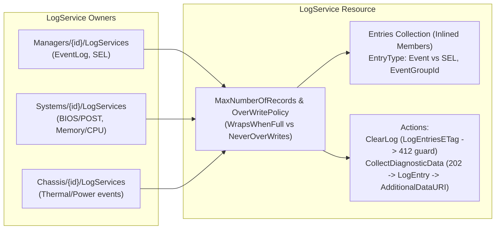

# 7.11 Log services, event logs and diagnostics

| | |
|---|---|
| Level | Intermediate |
| Priority tier | 1 |
| Lab venue | Laptop |
| Part | Part 7: Redfish and BMC |
| Status | Drafted (`logs_lab.py`: 23 checks pass against mock and DMTF trees; **untested** on live BMC) |

## Why this matters for AI infrastructure

A job dies with a CUDA error, and the operating system logs show nothing useful. The cause may still be on the machine, recorded by a hardware event that only the BMC saw. The BMC is the small controller that watches the server's hardware separately from the operating system. It can log a memory error, a power supply drop, a fan failure, an over-temperature trip or a PCIe fault. Its memory survives the crash, and even a power loss on the host.

When you ask a vendor for help, they will want a **diagnostic bundle** collected from the BMC. Reading these logs and collecting that bundle is therefore a core skill for anyone who runs GPU servers.

## Prerequisites and outcomes

Before you start, work through chapters 7.2, 7.3, 7.5 and 7.7. This chapter is about reading what the BMC remembers. When you finish, you can find every log on a Redfish service and read the fields of a log entry. You will know how Redfish event entries differ from IPMI SEL entries. You can also explain overwrite policies, and see why a full log can hide the event you need.

The last part of the chapter is practical. You will learn to spot a BMC clock that makes its logs misleading. You will clear a log safely and collect a diagnostic bundle. Finally, you will combine logs with sensors and GPU tools to find a cause.

## 1. Where logs live

A log service is a resource of type `LogService`, and it lives under the thing it belongs to. The path tells you what kind of events it keeps, so check the owner first:

| Owner | Path pattern | Usually holds |
|---|---|---|
| Manager (BMC) | `Managers/<id>/LogServices/<log>` | BMC events, hardware events, audit of BMC actions |
| System | `Systems/<id>/LogServices/<log>` | events about the computer: boot, memory, processors |
| Chassis | `Chassis/<id>/LogServices/<log>` | events about the box |

Vendors choose the names. You will see `EventLog`, `SEL`, `Log` or `Dump`, but the names differ from one maker to the next, so do not guess them. Find them by following the `LogServices` link. My tool does this in one function:

```bash
python3 rf_logs.py services http://<bmc> <user> <password>
```

On the mock, the output looks like this:

```text
Manager  BMC_0        EventLog   type=Event  entries=0/200 policy=WrapsWhenFull
Manager  BMC_0        SEL        type=SEL    entries=0/200 policy=WrapsWhenFull
System   System_0     EventLog   type=Event  entries=0/200 policy=WrapsWhenFull
```

The schema describes what each log service can tell you. These are the properties that matter most:

| Property | Meaning |
|---|---|
| `Entries` | link to the collection of entries |
| `LogEntryType` | what the entries look like: `Event`, `SEL`, `Multiple`, `OEM`, `CXL` |
| `MaxNumberOfRecords` | the capacity |
| `OverWritePolicy` | what happens when full: `WrapsWhenFull` (old entries are overwritten) or `NeverOverWrites` (new entries are discarded) |
| `LogPurposes` | `Diagnostic`, `Operations`, `Security`, `Telemetry`, `ExternalEntity`, `OEM` |
| `DateTime`, `DateTimeLocalOffset` | the log service's clock |
| `ServiceEnabled`, `Status` | on or off, health |
| `SyslogFilters` | rules for which syslog messages are stored |

The service also offers four actions: `ClearLog`, `CollectDiagnosticData`, `DownloadRawLog` and `PushDiagnosticData`. This chapter uses the first two, and sections 5 and 6 cover them.



Before you read any entries, list the log services on the machine. The names differ between vendors, so you cannot assume them.

## 2. A log entry

A log service is only useful if you can read its entries. Two kinds show up most often, and a single machine can have both.

**Event entries** (`EntryType: Event`) follow the Redfish message design from chapters 7.5 and 7.6. A `MessageId` points into a message registry, which is a lookup table of known messages. This event came from the mock after a power-off:

```json
{
  "EntryType": "Event",
  "Severity": "OK",
  "Created": "2027-01-15T08:00:05Z",
  "Message": "PowerState changed from On to Off",
  "MessageId": "ResourceEvent.1.0.ResourceStatusChanged",
  "MessageArgs": [],
  "Links": { "OriginOfCondition": { "@odata.id": "/redfish/v1/Systems/System_0" } }
}
```

The second kind is the SEL entry (`EntryType: SEL`). SEL stands for System Event Log, the older IPMI log. Its records are compact, and the BMC translates them. The `MessageId` field then holds raw event data. The meaning sits in `SensorType`, `SensorNumber` and `EntryCode` instead. The schema says `EntryCode` is used when the type is `SEL`. In DMTF's example, a SEL record reads *"Temperature threshold exceeded"* with `MessageId: 0x592A28`. You read a code like that with the IPMI documentation.

These are the fields you will use most:

| Field | Meaning |
|---|---|
| `Id` | the entry number in this log |
| `EntryType` | `Event`, `SEL`, `Oem` or `CXL` |
| `Severity` | `OK`, `Warning` or `Critical` |
| `Created` | when the BMC wrote the entry |
| `EventTimestamp` | when the event happened (may differ from `Created`) |
| `Message`, `MessageId`, `MessageArgs` | the text, its registry key and arguments |
| `Links.OriginOfCondition` | the resource the event is about, so you can `GET` it |
| `EventGroupId` | entries with the same value share one cause |
| `SensorType`, `SensorNumber`, `EntryCode` | for SEL entries. `SensorType` values include `Temperature`, `Voltage`, `Fan`, `Memory`, `Processor`, `Power Supply / Converter`, `Drive Slot/Bay`, `Watchdog` and many more |
| `Resolved`, `Resolution`, `ResolutionSteps` | whether the cause is fixed and suggested fixes |
| `AdditionalDataURI`, `AdditionalDataSizeBytes`, `DiagnosticDataType` | attached data, for example a diagnostic bundle |

The `Links.OriginOfCondition` field is the one to remember. It names the resource the event is about, so you can `GET` that resource next.

Reading a log usually means reading its collection of entries. The spec says the `Members` property of a `LogEntryCollection` is expanded by default. So `Entries`, `Entries?$expand=.` and `Entries?$expand=.($levels=1)` all return the same answer. My lab confirms the mock does this, which saves one request per entry. For a long log, page through the entries with `$top`, `$skip` and the `nextLink`.

When you read a log, check `EntryType` first. It tells you which fields the entry carries.

## 3. The tool: read, filter and group

Reading one log at a time is slow, and the fault you need may sit in a log you did not open. The `show` command reads every log service, normalizes the entries, applies your filters and prints the result in time order. Here is a command that keeps Warning entries and anything worse, from a given date, that mention fans:

```bash
python3 rf_logs.py show http://<bmc> <user> <password> --min Warning --since 2026-10-24T00:00:00Z --grep fan
```

On DMTF's rack-server example, the `--min Critical` filter returns these three entries:

```text
2012-03-07T14:44:00Z BMC/Log      Critical Event.TempWayTooHot            System May be Melting
2012-03-07T14:44:00Z 437XR1138R2/Log1  Critical 0x592A28   Temperature threshold exceeded
2012-03-07T14:45:00Z 437XR1138R2/Log1  Critical 0x592E28   Temperature threshold exceeded
3 entries
```

All three are critical temperature events. The first comes from the BMC log, and the other two are from `437XR1138R2/Log1`. The blade enclosure example makes a different point. There, the enclosure manager reports `Fan 2 crossed Lower Fatal Threshold; fans are no longer redundant`.

The lab also shows how to group related entries. The two entries `Fan 3 speed low` and `Fan 3 redundancy lost` carry the same `EventGroupId`. The tool can therefore show them as one problem rather than two.

### Using a log in an investigation

Picture a PyTorch job that dies with a CUDA illegal memory access, while the operating system logs show nothing obvious. The notes for this case are in volume 10, scenario 4. They suggest checking the software side and the BMC side together.

1. On the host, check the GPU memory error counters, for example with `nvidia-smi -q -d ECC`.
2. On the BMC, read the event log entries from around that time. The notes point to `GET /redfish/v1/Managers/BMC/LogServices/EventLog/Entries` and tell you to look for memory parity errors, PCIe AER fatal events and processor machine check exceptions.
3. Identify the component. A fault on a host DIMM means you drain the node and replace the DIMM. A fault on a GPU means you run a targeted GPU test to see whether the fault repeats.

I have not run this on a real DGX, so treat it as a method rather than a tested recipe. The key idea is to put the BMC log and the host logs on one timeline. That only works if both clocks agree, which section 4 covers.

Before you trust a BMC entry in an incident, confirm that its clock matches the host's.

## 4. What the log tells you about itself

A log can mislead you in two ways. It can be full, so the event you need was overwritten or never written. Or its clock can be wrong, so its timestamps do not line up with your host logs. The tool checks both problems.

The overwrite policy decides what happens when a log is full, and each policy fails in its own way:

| Policy | When full | Risk |
|---|---|---|
| `WrapsWhenFull` | the oldest entries are replaced | the first sign of trouble, which is often the most useful, disappears under later noise |
| `NeverOverWrites` | **new** entries are discarded | the log silently stops recording just when something bad is happening |

Neither policy is safe on its own, so check which one your BMC uses. The lab shows both behaviours. With a limit of 5 entries, `WrapsWhenFull` kept the newest five, and the ids kept counting up. With `NeverOverWrites`, a new Critical entry was dropped. The tool warns when a `NeverOverWrites` log is 80 percent full or more. It also warns when a wrapping log is 95 percent full. Whichever policy your BMC uses, forward the important entries to a central place, as chapter 7.5 on events describes, so they are not lost.

The clock is the second risk. Every log entry carries the BMC's time. If the BMC never had NTP configured, its clock may be hours or years off, and its entries will not match your host logs. The tool compares each service's `DateTime` with the clock of the computer running the tool. It warns when the two differ by more than five minutes.

In the DMTF examples, this warning fires on every service, because the sample dates run from 2012 to 2016. That is the right behaviour for stale data. It is also a reminder to check the BMC's NTP setting, which lives in `NetworkProtocol` (chapter 7.15).

When you bring a new node in, check its NTP setting before you trust any of its timestamps.

## 5. Clearing a log

Clearing a log is permanent, so treat `ClearLog` the way you would treat deleting evidence. Use these guards before you run it.

- Collect first. Take a diagnostic bundle, which the next section explains, or at least copy the entries.
- Use the ETag guard. The action takes a parameter called `LogEntriesETag`. If you send the ETag of the entries collection you read, the service refuses with 412 whenever the log has changed since then. That keeps you from wiping entries you never saw. The lab proves it: a stale ETag gives 412, and the current one gives 204.
- Check privileges too. A read-only user gets 403 when they try to clear the log.

The tool's clear command is a dry run unless you add `--yes`.

Before you run `ClearLog`, collect the bundle and send the ETag you read.

## 6. Diagnostic bundles: `CollectDiagnosticData`

When a vendor's support team asks for help, they usually want a bundle. A bundle is one file with logs and state from the BMC. Redfish defines the action `LogService.CollectDiagnosticData` for this job. Its parameter `DiagnosticDataType` can be `Manager`, `PreOS`, `OS`, `OEM` or `Device`. You can also have the BMC send the data to a `TargetURI`, with a user name and password. Or you can keep it on the BMC.

The spec and schema describe the process in three steps:

1. `POST` the action. The answer is `202` with a task monitor, because collecting takes time.
2. When the task ends, its `Location` header is the new `LogEntry`. That entry's `AdditionalDataURI` tells you where to download the data.
3. `GET` the `AdditionalDataURI`, and compare the number of bytes with `AdditionalDataSizeBytes`.

The `collect` command in `rf_logs.py` runs all three steps and checks the size for you:

```bash
python3 rf_logs.py collect http://<bmc> <user> <password> --out bundle.bin
```

On the mock, the tool prints `saved 150 bytes to bundle.bin (log entry 3, Manager)`. The mock's bundle is only a few lines of text. If the size field is wrong on purpose, the tool stops with exit code 7 and the message `size mismatch`.

A real bundle can be many megabytes. Give the request time, and do not assume success if the download is cut off.

The NVIDIA notes also mention `nvsm dump health` on DGX systems. They describe it as a command that "packages all system logs, configuration files and hardware states" for NVIDIA support. It runs on the host operating system, so it is a different route from the BMC bundle. For an RMA you usually need both. I did not run either one.

Collect the BMC bundle and confirm its size before you start any repair that could erase state.

## 7. The lab

Run the lab from the chapter's code directory. It checks the mock, the tool and the schemas together.

```bash
cd code/part07
python3 logs_lab.py
```

It runs 23 checks:

```text
PASS  3 log services are found by following links: manager EventLog, manager SEL, system EventLog
PASS  a power state change is written to the manager event log (2 entries, members inline)
PASS  each entry has EntryType Event, a MessageId, Severity, Created and the origin resource
PASS  $top=1 pages the log and gives a nextLink
PASS  log service, collection, an Event entry and an SEL entry validate against the official schemas
PASS  filtering at Critical finds the SEL entry, with its sensor type and entry code
PASS  entries with the same EventGroupId can be grouped (same cause)
PASS  WrapsWhenFull keeps the newest 5 entries and drops the oldest (ids keep counting up)
PASS  NeverOverWrites discards new entries when full
PASS  the tool warns about a full NeverOverWrites log
PASS  the tool warns when the BMC clock differs from ours by 2000 s
PASS  ClearLog with a stale LogEntriesETag is refused (412): the log changed since you looked
PASS  a ReadOnly user cannot clear a log (403)
PASS  CollectDiagnosticData is a long action: 202 with a task monitor
PASS  when the task ends, its Location header is the new LogEntry, which has the download address (schema rule)
PASS  the tool detects a size mismatch between the entry and the downloaded data (exit 7)
...
23 passed, 0 failed
```

The schema check caught a real bug while I built this. I had put `OriginOfCondition` at the top of the log entry. The official `LogEntry` schema places it under `Links`. My first version of the mock and the tool both got it wrong, and the validator is what told me.

If any check fails, fix the tool or the mock before you trust either one against a real BMC.

## 8. Logs in a fleet

A single BMC's log is easy to read. A fleet of them needs a plan. Start by centralising. Each BMC keeps only a small log, so subscribe to events (chapter 7.5), or poll each BMC and ship its entries to a log system. Tag every entry with the BMC name and the original timestamp, so you can line them up later.

Fix the clock on every BMC with NTP before the machine goes into service. Then alert on Critical entries and on the log-health warnings from section 4. Collect bundles before any repair that might reset the BMC or erase state. Tie logs to jobs as well, because the scheduler knows which job ran on a node when an event happened. Finally, keep sample logs from healthy nodes. Normal chatter is what makes the unusual entry stand out.

Before a node goes into service, its BMC clock and its alerts should both be working.

### 8.1 Reconstructing a cross-layer hardware crash timeline

At 03:00, a multi-node training job crashes. The application log shows a cryptic `NCCL WARN Call to connect returned Connection refused` or `CUDA error: an illegal memory access was encountered`.

The biggest mistake here is to read only the application log, or to reboot the node to clear the state. A hardware crash leaves footprints in three separate layers. There is the application and scheduler layer, the host Linux kernel layer, and the out-of-band BMC hardware log layer. The BMC is out-of-band because it works apart from the host operating system. Put all three layers on one UTC timeline, and you have the fastest way to isolate the root cause.

Here is how an experienced engineer lines the three logs up during a real post-mortem.

1. Anchor the incident window from the scheduler and application logs, where `T = 0`. Check `sacct -j <jobid> --format=JobID,NodeList,Start,End,State,ExitCode` and the job's `stderr` log. Find the exact UTC second when the rank process died or timed out. Also find which rank and hostname emitted the first error. That first error matters more than the 511 ranks that failed a second later, when their peer disappeared.
2. Next, inspect the BMC `LogServices`, `EventLog` and `SEL`, from `T - 5 minutes` to `T + 5 minutes`. Run `rf_logs.py show --since <T-5m>` and examine every entry the BMC recorded on that node. Why trust the BMC over host `dmesg`? Serious hardware events, such as a CPU Machine Check Exception (MCE), a multi-bit DDR5 memory parity error, a PCIe root-port fatal surprise-down reset, or a `12V`/`54V` power rail droop, often freeze the host kernel first. The kernel then never gets the error through `rsyslog` or `systemd-journald` to disk or to network syslog. The BMC's out-of-band microcontroller runs on independent standby power. It captures the fault over `I2C`, `PECI` or `SMBus`, and writes it to non-volatile flash in `LogServices`.
3. Correlate `EventGroupId` with `Links.OriginOfCondition`. One physical fault often produces a burst of three to five entries within the same second. A failing PSU, for example, might emit a voltage-sensor threshold crossing, a PSU status change and a chassis power-redundancy lost message. Group the entries that share an `EventGroupId`. Then follow `Links.OriginOfCondition["@odata.id"]` straight to the faulted resource, such as `/redfish/v1/Systems/System_0/Memory/DIMM_A1` or `/redfish/v1/Chassis/DGX/PowerSubsystem/PowerSupplies/PSU_2`. That way you skip the secondary symptoms and find the exact Field Replaceable Unit (FRU) to replace.

Start every crash review from the scheduler's timestamp, because it sets the window for every other log.

### 8.2 Why BMC clock drift ruins root-cause analysis (and how to prevent it)

The timeline above rests on one requirement. The timestamps in the BMC's `LogEntry.Created` field must agree with the UTC clock on your Linux compute nodes and your Slurm controller.

A newly unboxed server often has NTP disabled in `/redfish/v1/Managers/{id}/NetworkProtocol`. So does a BMC that was reset to factory defaults during troubleshooting. A server that sat in a warehouse with no AC power is worse. Its coin-cell RTC battery drains, and the BMC clock may then read `1970-01-01` or `2018-01-01`. It may also show local factory time, eight hours off from UTC.

Now suppose a GPU job crashes on that node at `14:22:05 UTC` on October 28. The BMC's `SEL` records the fatal PCIe error, but with a timestamp from three years ago. An engineer who filters with `--since 2026-10-28T14:00:00Z` misses the hardware fault completely. That engineer then concludes the BMC log was clean.

That is why `code/part07/rf_logs.py` runs an automatic clock-skew check on every `LogService` it touches. Before it filters by timestamp, the tool reads `DateTime` and `DateTimeLocalOffset` from the `LogService` or its parent `Manager`. It parses the value as an ISO 8601 timestamp, and compares the result with the management host's own NTP-synchronized UTC clock. If the difference exceeds five minutes, which is `300` seconds, `rf_logs.py` prints a prominent `CLOCK SKEW` warning.

In production, you prevent drift at two layers.

- At day-0 provisioning, `rf_harden.py` sets `NTP.ProtocolEnabled: true` and fills `NTP.NTPServers` under `/redfish/v1/Managers/{id}/NetworkProtocol`. Point those servers at your internal management network, such as the BCM head node alias `10.141.255.254` or your out-of-band switch's NTP relay.
- For continuous audit, add the `LogService.DateTime` skew check to your daily `fleet_run.py` health sweep. Then a BMC whose NTP client stalls gets flagged before an incident happens.

Set NTP on every BMC at provisioning, and keep the skew check in your daily sweep.

### 8.3 Managing log capacity: `WrapsWhenFull` vs `NeverOverWrites` at scale

A BMC has far less room than a Linux host. A host might have terabytes of NVMe storage for `/var/log/journal`. A BMC keeps its `SEL` and `EventLog` in a small partition of SPI NOR flash or eMMC memory. So `MaxNumberOfRecords` on a BMC log is typically a few hundred or a few thousand entries.

What the BMC does when `Entries` reaches `MaxNumberOfRecords` depends on `OverWritePolicy`. Both policies create hazards that your automation has to manage.

1. The `NeverOverWrites` hazard is silent blindness. Once the log hits 100 percent capacity, at `200/200` or `1024/1024` records, the BMC stops recording new hardware faults. Suppose routine messages, such as login and logout audit events or minor temperature caution crossings, fill the log during the first six months. A fatal DIMM ECC error or PSU failure in month seven is then silently dropped. If a BMC uses `NeverOverWrites`, your monitoring must alert at 80 percent capacity. `rf_logs.py` does this automatically. You should also archive the existing entries to central storage, and clear the log with `ClearLog`, guarded by `LogEntriesETag`.
2. The `WrapsWhenFull` hazard is root-cause erasure. The log works as a ring buffer, overwriting the oldest entries as new ones arrive. That guarantees recent events are recorded. The trouble comes from noise. A cascading fault, such as an intermittent optical transceiver or a fan sensor that flaps every few seconds, can produce hundreds of repeat entries in an hour. Those entries can overwrite the original fatal assertion that started the incident.

The architectural fix for both hazards is **continuous log streaming and archival**. Either subscribe to Redfish push events (chapter 7.5), or run a periodic incremental collector. The collector tracks the highest `LogEntry.Id` seen per BMC and ships new entries to Loki, Elasticsearch or syslog. You then keep an unlimited, searchable history of every BMC hardware event across the cluster, and the local flash buffers stay clean.

Decide how entries will leave each BMC before you rely on it, because the flash buffer is small.

### 8.4 End-to-end RMA evidence collection workflow (`CollectDiagnosticData` + `nvsm`)

Suppose a GPU server fails, and you open a Return Merchandise Authorization (RMA) ticket with NVIDIA or your server vendor. Support engineers will ask for diagnostic evidence before they dispatch a replacement SXM GPU, HGX baseboard or motherboard. If you clear the BMC log or re-image the node before capturing that evidence, the RMA can slip by days.

Follow four non-destructive steps in strict order, before any reset or repair.

1. Capture the readable BMC event logs. Run `rf_logs.py show`, and save the raw JSON from `/Managers/{id}/LogServices/SEL/Entries` and `EventLog/Entries`. Your team then has an immediate text summary of the fault timestamps, `MessageId` codes and `OriginOfCondition` links.
2. Trigger the out-of-band BMC diagnostic bundle with `LogService.CollectDiagnosticData`. Run `python3 code/part07/rf_logs.py collect https://<bmc> <user> <password> --out <node>-bmc-bundle.bin`. Checks 14 and 15 of `logs_lab.py` verify this step. The command posts a body with `DiagnosticDataType` set to `Manager` or `OEM`. It polls the `202 Accepted` task monitor until the task finishes, then follows the `LogEntry` `Location` header and downloads the binary archive from `AdditionalDataURI`. Last, it checks that the downloaded byte count matches `AdditionalDataSizeBytes`, and exits with `exit 7` on a mismatch.
3. Capture the in-band host bundle, if SSH to the host OS still works. Run `sudo nvsm dump health` on DGX systems, or `sudo nvidia-bug-report.sh`. Either one captures the in-band kernel ring buffer, PCIe AER registers, NVLink error counters and DCGM state.
4. Clear the BMC log last, and only after the repair. Clear the `SEL` and `EventLog` only when the physical repair is finished and both bundles are archived in your ticket system. Pass the ETag of the `Entries` collection in `LogEntriesETag`, so a new post-repair fault is never wiped by mistake. A stale ETag gets `412 Precondition Failed`.

Do not run `ClearLog` until both bundles are safely in your ticket.

### 8.5 Mapping legacy IPMI SEL sensor types to modern Redfish `Event` registries

If your fleet mixes newer OpenBMC and DGX platforms with older enterprise OEM servers, your collector will see `EntryType: "Event"` and `EntryType: "SEL"` records side by side. A single alerting schema prevents blind spots in your monitoring pipeline. The table maps each fault domain from its legacy SEL form to its modern Event form.

| Hardware Fault Domain | Legacy `EntryType: "SEL"` (`SensorType` & `EntryCode`) | Modern `EntryType: "Event"` (`MessageId` & `OriginOfCondition`) |
|---|---|---|
| **Host Memory (DDR5 ECC)** | `SensorType: "Memory"`, `EntryCode: "Uncorrectable ECC"` | `MessageId` in `Base`/`Memory`/`Platform` registry, `OriginOfCondition` $\rightarrow$ `/Systems/{id}/Memory/DIMM_A1` |
| **Processor Fault (MCE / IERR)** | `SensorType: "Processor"`, `EntryCode: "IERR"` or `"Thermal Trip"` | `OriginOfCondition` $\rightarrow$ `/Systems/{id}/Processors/CPU_0`, `Severity: "Critical"` |
| **Cooling & Fans** | `SensorType: "Fan"` or `"Temperature"`, `EntryCode: "Lower Critical - going low"` | `MessageId` in `Environmental` / `SensorEvent`, `OriginOfCondition` $\rightarrow$ `/Chassis/{id}/Sensors/Fan_1` |
| **Power Supply Drop** | `SensorType: "Power Supply / Converter"`, `EntryCode: "Power Supply input lost"` | `OriginOfCondition` $\rightarrow$ `/Chassis/{id}/PowerSubsystem/PowerSupplies/PSU_1` |
| **OS Watchdog Timeout** | `SensorType: "Watchdog 2"`, `EntryCode: "Hard Reset"` or `"Timer expired"` | `ResourceEvent` / `Platform` watchdog message on `/Systems/{id}` |

The same fault shows up with different keys in each format. Match on the fault domain rather than on the raw code.

Normalizing every entry in `code/part07/rf_logs.py` into one common tuple, `(timestamp, owner_service, severity, code_or_message_id, message, origin_uri, group_id)`, gives your alerts one format to work with. Your rules can then trigger on any Critical hardware fault across the data center. It does not matter whether the BMC speaks legacy SEL hex codes or modern Redfish message registries.

Normalize both formats in your collector before you write any alert rule.

## Exercises

1. Start with the lab. Run `python3 code/part07/logs_lab.py`, and confirm that `22` / `23` checks pass. Then start `redfish_mock.py` with `--profile dgx`, trigger three power-state transitions on `System_0`, and run `python3 code/part07/rf_logs.py show http://127.0.0.1:18441 admin adminpass`. Inspect the `Event` entries it generates.
2. Work through a fan failure in an enclosure. Serve `$REDFISH_PUBLICATIONS/mockups/public-bladed-system` with `redfish_mock.py --mockup`, then run `rf_logs.py show --min Warning`. Find which `Manager` (`MultiBladeBMC`) logged `Fan 2 crossed Lower Fatal Threshold; fans are no longer redundant`. Then explain why that event sits on the enclosure manager and not on an individual blade BMC.
3. Compare the two capacity policies. Look at checks 8 to 10 of `code/part07/logs_lab.py`, where `MaxNumberOfRecords` is set to `5`. Explain why `rf_logs.py` alerts at `>= 80%` on a `NeverOverWrites` log, but at `>= 95%` on a `WrapsWhenFull` log.
4. Write a pre-RMA checklist. List the exact commands you would run before you unbolt a faulted DGX node for RMA. Combine three steps: in-band `sudo nvsm dump health` if the host OS is reachable, out-of-band `rf_logs.py collect --out bundle.bin` (`LogService.CollectDiagnosticData`), and `rf_logs.py show`. All of them must come before anyone runs `ClearLog`.
5. Find out why two clocks disagree. Suppose a PCIe fatal error appears in host `dmesg -T` at `14:02:10 UTC`, while the matching BMC `LogEntry.Created` says `16:02:10`, or `1970-01-01`. Give three causes: missing BMC NTP configuration in `NetworkProtocol`, a `DateTimeLocalOffset` timezone mismatch, or a dead CMOS/RTC coin-cell battery after AC power loss. Then explain how `rf_logs.py` detects drift greater than `300 s`.
6. Test the ETag protection. Call `POST .../LogServices/EventLog/Actions/LogService.ClearLog` with an outdated `"LogEntriesETag"` value, against `redfish_mock.py`. Confirm that the BMC rejects the clear with HTTP `412 Precondition Failed`. The point is that new, unread entries are never wiped by accident.

## 10. Interview angles

- "A GPU job crashed with no OS errors. Where do you look?" Start with the BMC event log and the SEL around the crash time. Then check the GPU error counters on the host and the sensors for heat and power. Put all of them on one timeline.
- "What is the SEL?" It is the IPMI System Event Log, a compact legacy log. Redfish exposes it as `EntryType: SEL`.
- "Why can a full log be dangerous?" A `NeverOverWrites` log drops new events. A wrapping log loses the old ones.
- "How do you gather evidence before a repair?" Collect a diagnostic bundle through `CollectDiagnosticData`, and the host-side bundle too. Do this before you clear anything.
- "How do you tell if two log entries are the same incident?" Compare `EventGroupId` and `OriginOfCondition`.

## Checkpoint questions (20)

<details>
<summary>1. Under which three Redfish resource families can a `LogServices` collection appear?</summary>

It can appear under **`Managers/{id}/LogServices`** for BMC hardware, audit and SEL logs. It can also appear under **`Systems/{id}/LogServices`** for host boot, CPU, memory and BIOS logs. Finally, it can appear under **`Chassis/{id}/LogServices`** for physical enclosure, thermal and power logs.
</details>

<details>
<summary>2. What are the two most common `EntryType` (and `LogEntryType`) values in Redfish logs, and how do they differ?</summary>

- **`Event`:** These are modern structured entries. Their `MessageId` points into a standard or OEM Message Registry, such as `ResourceEvent.1.0.ResourceStatusChanged`, and `Links.OriginOfCondition` names the affected resource.
- **`SEL`:** These are legacy IPMI System Event Log records that the BMC translates. They use `SensorType`, `SensorNumber`, `EntryCode` and a raw hex `MessageId`, such as `0x592A28`.
</details>

<details>
<summary>3. What are the three standard `Severity` values on a `LogEntry` resource?</summary>

They are **`OK`** for an informational or normal state change, **`Warning`** for a degraded or caution condition, and **`Critical`** for a fatal fault or threshold breach that needs immediate attention.
</details>

<details>
<summary>4. What does `MessageId` represent on an `EntryType: "Event"` log entry versus an `EntryType: "SEL"` log entry?</summary>

On an `Event` entry, `MessageId` is a lookup key into a Redfish Message Registry, in the form `<RegistryPrefix>.<Major>.<Minor>.<MessageKey>`. On a `SEL` entry, it holds the raw hexadecimal IPMI event data, such as `0x592A28`.
</details>

<details>
<summary>5. Where is `OriginOfCondition` located inside a `LogEntry` resource (as verified by `schema_lab.py`), and what is it used for?</summary>

It sits inside **`Links.OriginOfCondition`**, as in `{"Links": {"OriginOfCondition": {"@odata.id": "/redfish/v1/Systems/System_0"}}}`. The `schema_lab.py` check verifies that location. Operators and scripts use it to `GET` the exact hardware resource that produced the entry.
</details>

<details>
<summary>6. What is `EventGroupId` on a `LogEntry`?</summary>

It is an integer shared by the entries that came from the same root cause. For example, `"Fan 3 speed low"` and `"Fan 3 redundancy lost"` can both carry `EventGroupId: 7`.
</details>

<details>
<summary>7. On an `EntryType: "SEL"` record, what information do `SensorType`, `SensorNumber`, and `EntryCode` provide?</summary>

`SensorType` names the hardware category, such as `Temperature`, `Voltage`, `Fan`, `Memory`, `Processor`, `Power Supply / Converter`, `Drive Slot/Bay` or `Watchdog`. `SensorNumber` gives the numeric IPMI sensor ID. `EntryCode` gives the IPMI assertion or transition code, such as `Assert`, `Deassert` or `Upper Non-recoverable going high`.
</details>

<details>
<summary>8. Why does `GET` on `/redfish/v1/Managers/{id}/LogServices/{log}/Entries` return the full `LogEntry` objects inside `Members` instead of just `{"@odata.id": "..."}` links (DSP0266 §9.13.11)?</summary>

The `LogEntryCollection` schema marks `Members` as an expanded resource. The BMC therefore fills in `Members` inline by default, which matches `$expand=.($levels=1)`. A client can read a page of 75 log entries in one HTTP request, instead of making 76 requests.
</details>

<details>
<summary>9. What happens when a `LogService` with `OverWritePolicy: "NeverOverWrites"` reaches `MaxNumberOfRecords`?</summary>

The BMC silently discards every new entry until someone clears the log with `ClearLog`. Critical faults that happen after the log fills are lost.
</details>

<details>
<summary>10. What is the operational risk of `OverWritePolicy: "WrapsWhenFull"` during a cascading hardware failure?</summary>

`WrapsWhenFull` overwrites the oldest entries in a circular buffer. If one fault triggers hundreds of secondary messages, the first entry of the incident can be overwritten before an engineer reads the log.
</details>

<details>
<summary>11. Why should a log-reading tool always compare `LogService.DateTime` against the management host's NTP-synchronized clock?</summary>

If NTP is off on the BMC (`Managers/{id}/NetworkProtocol`), `LogEntry.Created` can drift by minutes, hours or even years. The BMC's hardware events then cannot be matched with `dmesg` or Slurm job times.
</details>

<details>
<summary>12. What does the optional `LogEntriesETag` parameter on `#LogService.ClearLog` protect against?</summary>

You pass the ETag of the `Entries` collection you archived. If new entries arrived between your read and your `ClearLog` call, the BMC returns **`412 Precondition Failed`**. That protects unread events from being deleted.
</details>

<details>
<summary>13. Why should `ClearLog` never be run before collecting a diagnostic bundle and exporting the existing entries?</summary>

`ClearLog` permanently erases the non-volatile fault history in `SEL` and `EventLog`. Vendor support often needs that history to approve an RMA or to diagnose intermittent ECC, PCIe or PSU faults. So collect the bundle and export the entries first.
</details>

<details>
<summary>14. What does `POST .../LogServices/{id}/Actions/LogService.CollectDiagnosticData` return initially?</summary>

It returns **`202 Accepted`** with a `Location` header that points to a task monitor. Collecting a support bundle takes seconds or minutes, so the BMC answers before the work is done.
</details>

<details>
<summary>15. Once the `CollectDiagnosticData` task completes (`200 OK` or `201 Created`), how do you locate the URL to download the binary diagnostic bundle?</summary>

Per the `LogService` schema, the completed task monitor's `Location` header, or the returned resource, points to a new **`LogEntry`**. That entry's **`AdditionalDataURI`** property is the download address for the raw archive.
</details>

<details>
<summary>16. How does `code/part07/rf_logs.py collect` verify that a downloaded diagnostic bundle was not truncated in transit?</summary>

The tool compares the number of bytes it downloads from `AdditionalDataURI` with the **`AdditionalDataSizeBytes`** value on the `LogEntry`. If the sizes differ, it exits with status `7`.
</details>

<details>
<summary>17. Name the five standard `DiagnosticDataType` values supported by `LogService.CollectDiagnosticData`.</summary>

They are **`Manager`** for BMC internal logs and state, **`PreOS`** for UEFI, BIOS and POST logs, **`OS`** for host operating system crash and diagnostic data, **`Device`** for a specific adapter or controller dump, and **`OEM`** for a vendor support archive.
</details>

<details>
<summary>18. On an NVIDIA DGX node, how does `sudo nvsm dump health` complement `LogService.CollectDiagnosticData`?</summary>

`LogService.CollectDiagnosticData` gathers **out-of-band BMC, chassis and FPGA telemetry**, and it still works when the host OS refuses to boot. `sudo nvsm dump health` runs **in-band, inside the host Linux OS**. It packages kernel logs, `nvidia-smi` and DCGM state, InfiniBand counters and driver configs. NVIDIA Enterprise Support usually asks for both when a hardware fault is complex.
</details>

<details>
<summary>19. Why should every production AI cluster ship BMC logs centrally (via Redfish `EventService` or periodic scraping) instead of relying on local BMC storage?</summary>

Local BMC flash holds only a few hundred to a few thousand records. That space can wrap, fill up under `NeverOverWrites`, or become unreachable if the BMC itself fails. Shipping logs centrally keeps the history safe in every one of those cases.
</details>

<details>
<summary>20. Walk through how you combine host GPU counters, BMC `LogServices`, and BMC `Sensors` when a PyTorch job crashes with an unexplained memory error (`volume-10/01` Scenario 4).</summary>

1. Check the in-band GPU HBM ECC counters with `nvidia-smi -q -d ECC`. See whether a GPU hit an uncorrectable double-bit ECC error.
2. Next, query the out-of-band BMC `LogServices`, `EventLog/Entries` and `SEL/Entries`, around the crash time. Look for host DIMM parity or ECC errors, PCIe AER fatal events, or CPU Machine Check Exceptions (MCEs).
3. Then check BMC `Sensors` with `rf_sensors.py` for thermal or PSU voltage transients at that moment. The result tells you whether to RMA a host DIMM, reset or drain a GPU, or repair the cooling.
</details>

## Sources and review notes

- **Redfish Resource and Schema Guide DSP2046 and the official JSON Schemas:** `LogService` v1.9 and later (properties, `OverWritePolicy`, `LogEntryTypes`, `LogPurpose`, the actions, `LogDiagnosticDataTypes`) and `LogEntry` v1.22 (`EntryType`, `SensorType`, `Links`, attachments). I read the property descriptions and the action definitions, including the rule that the finished task's `Location` is the `LogEntry`.
- **Redfish Specification DSP0266 v1.21.0:** expanded resource annotation (`LogEntryCollection` members, 9.13.11 and `$expand`, 7.3.2), tasks and monitors (12.2).
- **DMTF example trees** at commit `fa6d23d9` (rack server, blade enclosure, local storage).
- **NVIDIA-DevOps notes:** volume 10 chapter 1, scenario 4 (memory errors and the BMC event log path) and section 8 (`nvsm dump health`). Volume 20's chapters on GPU driver crashes, Xid errors and DMA/PCIe problems (examples marked illustrative by their authors) are routed to other chapters and not used here.
- **Systems Performance (Gregg), Appendix A (USE method for Linux):** used only for the general idea of checking error counters as a standard step.
- **Run here:** `rf_logs.py` on the mock and on three DMTF trees, `logs_lab.py` (23 checks).
- **Not verified:** the content and paths of real BMC logs, how long real bundles take, bundle contents, and the behaviour of real DGX `EventLog` and SEL. The `ipmitool sel` command is a well-known way to read the SEL but I did not run it.
