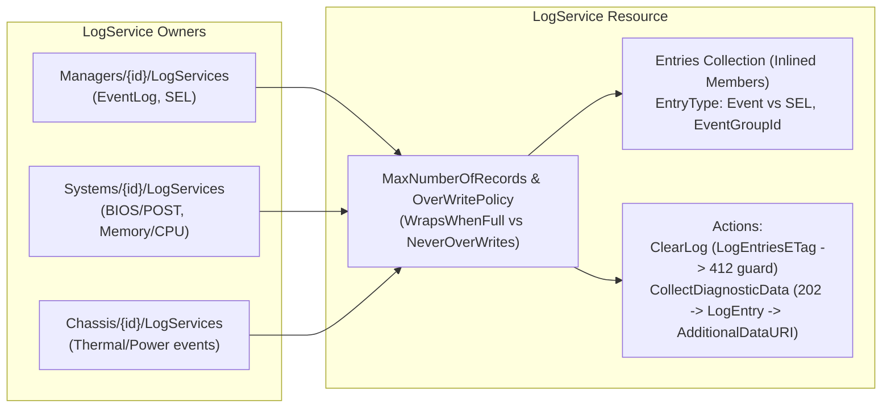

# 7.11 Log services, event logs and diagnostics

| | |
|---|---|
| Level | Intermediate |
| Priority tier | 1 |
| Lab venue | Laptop |
| Part | Part 7: Redfish and BMC |
| Status | Drafted (`logs_lab.py`: 23 checks pass against mock and DMTF trees; **untested** on live BMC) |

## Why this matters for AI infrastructure

When a job dies with a CUDA error and the operating system logs show nothing, the cause may be a hardware event that only the BMC saw: a memory error, a power supply drop, a fan failure, an over-temperature trip, a PCIe fault. The BMC keeps its own memory of the machine, and that memory survives the crash and even a power loss of the host. When you ask a vendor for help, they will want a **diagnostic bundle** collected from the BMC. Reading and collecting these logs is a core skill.

## Prerequisites and outcomes

You need chapters 7.2, 7.3, 7.5 and 7.7. After this chapter you can:

- find every log on a Redfish service
- read a log entry and explain its fields
- tell Redfish event entries from IPMI SEL entries
- explain overwrite policies and why a full log can hide the event you need
- spot a BMC clock that makes logs misleading
- clear a log safely and collect a diagnostic bundle
- use logs together with sensors and GPU tools to find a cause

## 1. Where logs live

Logs are kept by **log services**. A log service is a resource of type `LogService`, found under the thing it belongs to:

| Owner | Path pattern | Usually holds |
|---|---|---|
| Manager (BMC) | `Managers/<id>/LogServices/<log>` | BMC events, hardware events, audit of BMC actions |
| System | `Systems/<id>/LogServices/<log>` | events about the computer: boot, memory, processors |
| Chassis | `Chassis/<id>/LogServices/<log>` | events about the box |

Names such as `EventLog`, `SEL`, `Log` or `Dump` are choices of the maker. Always discover them by following the `LogServices` link. In my tool a single function does this:

```bash
python3 rf_logs.py services http://<bmc> <user> <password>
```

On my mock it prints:

```text
Manager  BMC_0        EventLog   type=Event  entries=0/200 policy=WrapsWhenFull
Manager  BMC_0        SEL        type=SEL    entries=0/200 policy=WrapsWhenFull
System   System_0     EventLog   type=Event  entries=0/200 policy=WrapsWhenFull
```

A `LogService` has these useful properties (from the schema):

| Property | Meaning |
|---|---|
| `Entries` | link to the collection of entries |
| `LogEntryType` | what the entries look like: `Event`, `SEL`, `Multiple`, `OEM`, `CXL` |
| `MaxNumberOfRecords` | the capacity |
| `OverWritePolicy` | what happens when full: `WrapsWhenFull` (old entries are overwritten) or `NeverOverWrites` (new entries are discarded) |
| `LogPurposes` | `Diagnostic`, `Operations`, `Security`, `Telemetry`, `ExternalEntity`, `OEM` |
| `DateTime`, `DateTimeLocalOffset` | the log service's clock |
| `ServiceEnabled`, `Status` | on or off, health |
| `SyslogFilters` | rules for which syslog messages are stored |

Its actions: `ClearLog`, `CollectDiagnosticData`, `DownloadRawLog` and `PushDiagnosticData`.



## 2. A log entry

Two kinds are common.

**Event entries** (`EntryType: Event`) follow the Redfish message design from chapter 7.5 and 7.6: a `MessageId` points into a message registry. From my mock after a power-off:

```json
{
  "EntryType": "Event",
  "Severity": "OK",
  "Created": "2027-01-15T08:00:05Z",
  "Message": "PowerState changed from On to Off",
  "MessageId": "ResourceEvent.1.0.ResourceStatusChanged",
  "MessageArgs": [],
  "Links": { "OriginOfCondition": { "@odata.id": "/redfish/v1/Systems/System_0" } }
}
```

**SEL entries** (`EntryType: SEL`) are the old IPMI **System Event Log**: compact records that the BMC translates. The `MessageId` field then holds raw event data, and `SensorType`, `SensorNumber` and `EntryCode` carry the meaning (the schema says `EntryCode` is used if the type is `SEL`). A SEL record in DMTF's example reads *"Temperature threshold exceeded"* with `MessageId: 0x592A28`, a code that you read with the IPMI documentation.

Fields you will use:

| Field | Meaning |
|---|---|
| `Id` | the entry number in this log |
| `EntryType` | `Event`, `SEL`, `Oem` or `CXL` |
| `Severity` | `OK`, `Warning` or `Critical` |
| `Created` | when the BMC wrote the entry |
| `EventTimestamp` | when the event happened (may differ from `Created`) |
| `Message`, `MessageId`, `MessageArgs` | the text, its registry key and arguments |
| `Links.OriginOfCondition` | the resource the event is about, so you can `GET` it |
| `EventGroupId` | entries with the same value share one cause |
| `SensorType`, `SensorNumber`, `EntryCode` | for SEL entries. `SensorType` values include `Temperature`, `Voltage`, `Fan`, `Memory`, `Processor`, `Power Supply / Converter`, `Drive Slot/Bay`, `Watchdog` and many more |
| `Resolved`, `Resolution`, `ResolutionSteps` | whether the cause is fixed and suggested fixes |
| `AdditionalDataURI`, `AdditionalDataSizeBytes`, `DiagnosticDataType` | attached data, for example a diagnostic bundle |

**Collections of log entries come with their members inline.** The spec says the `Members` property of a `LogEntryCollection` is expanded by default (so `Entries`, `Entries?$expand=.` and `Entries?$expand=.($levels=1)` give the same answer). My lab confirms the mock does this. That saves one request per entry. For long logs use paging (`$top`, `$skip`, the `nextLink`).

## 3. The tool: read, filter and group

```bash
python3 rf_logs.py show http://<bmc> <user> <password> --min Warning --since 2026-10-24T00:00:00Z --grep fan
```

It reads every log service, normalises the entries, applies your filters and prints them in time order. Results on DMTF's rack-server example with `--min Critical`:

```text
2012-03-07T14:44:00Z BMC/Log      Critical Event.TempWayTooHot            System May be Melting
2012-03-07T14:44:00Z 437XR1138R2/Log1  Critical 0x592A28   Temperature threshold exceeded
2012-03-07T14:45:00Z 437XR1138R2/Log1  Critical 0x592E28   Temperature threshold exceeded
3 entries
```

and on the blade enclosure example: `Fan 2 crossed Lower Fatal Threshold; fans are no longer redundant` (from the enclosure manager).

The lab shows that related entries can be grouped. Two entries "Fan 3 speed low" and "Fan 3 redundancy lost" carry the same `EventGroupId`, so one problem does not look like two.

### Using a log in an investigation

Take the "mystery crash" from the user's notes (volume 10, scenario 4): a PyTorch job dies with a CUDA illegal memory access, and the OS logs show nothing obvious. The notes' answer is to cross-check the software side with the BMC side:

1. On the host, check GPU memory error counters (for example `nvidia-smi -q -d ECC`).
2. On the BMC, read the event log entries around that time. The notes name `GET /redfish/v1/Managers/BMC/LogServices/EventLog/Entries` and look for memory parity errors, PCIe AER fatal events and processor machine check exceptions.
3. Find the component. A fault on a host DIMM means drain the node and replace the DIMM. A fault on a GPU means run a targeted GPU test to see whether it repeats.

I have not run this on a real DGX. The point is the method: **put the BMC log and the host logs on one timeline**. That only works if both clocks are right (see section 5).

## 4. What the log tells you about itself

A log can mislead if it is full or if its clock is wrong. The tool checks both.

**Overwrite policy.**

| Policy | When full | Risk |
|---|---|---|
| `WrapsWhenFull` | the oldest entries are replaced | the first sign of trouble, which is often the most useful, disappears under later noise |
| `NeverOverWrites` | **new** entries are discarded | the log silently stops recording just when something bad is happening |

My lab shows both. With a 5-entry limit, `WrapsWhenFull` kept the newest five entries (ids kept counting) and with `NeverOverWrites` a new Critical entry was dropped. The tool warns when a `NeverOverWrites` log is 80 percent full or more, and when a wrapping log is 95 percent full. Whichever policy your BMC uses, **forward** important entries to a central place (events, chapter 7.5) so they are not lost.

**Clock.** Log entries carry the BMC's time. If the BMC never had NTP configured, its clock may be hours or years off, and entries will not match your host logs. The tool compares each service's `DateTime` with the clock of the computer running the tool and warns if they differ by more than five minutes. In the DMTF examples this warning fires on every service because the sample dates are from 2012 to 2016. That is the correct behaviour for stale data, and a reminder to check the BMC's NTP setting (`NetworkProtocol`, chapter 7.15) when you bring a node in.

## 5. Clearing a log

`ClearLog` empties the log. Treat it like deleting evidence.

- **Collect first.** Take a diagnostic bundle (next section) or at least copy the entries.
- **Use the ETag guard.** The action has a parameter `LogEntriesETag`. If you send the ETag of the entries collection that you read, the service refuses with `412` when the log changed since, so you do not wipe entries you never saw. My lab proves it: a stale ETag gives 412, the current one gives 204.
- **Check privileges.** A read-only user gets 403.
- The tool's `clear` command is a **dry run unless `--yes`** is given.

## 6. Diagnostic bundles: `CollectDiagnosticData`

A vendor's support team usually wants a bundle: a file with logs and state from the BMC. Redfish defines the action `LogService.CollectDiagnosticData`. Its parameter `DiagnosticDataType` can be `Manager`, `PreOS`, `OS`, `OEM` or `Device`. It can also send the data to a `TargetURI` with a user name and password, or keep it in the BMC.

How it works (spec and schema):

1. `POST` the action. The answer is `202` with a task monitor, because collecting takes time.
2. When the task ends, **its `Location` header is the new `LogEntry`**, and that entry's `AdditionalDataURI` is where you download the data.
3. `GET` the `AdditionalDataURI`. Compare the number of bytes with `AdditionalDataSizeBytes`.

`rf_logs.py collect` does all of that and checks the size:

```bash
python3 rf_logs.py collect http://<bmc> <user> <password> --out bundle.bin
```

On my mock the tool printed `saved 150 bytes to bundle.bin (log entry 3, Manager)`. (The mock's bundle is only a few lines of text.) A deliberately corrupted size field makes the tool stop with exit code 7 and the message `size mismatch`. A real bundle can be many megabytes, so give the request time and do not assume success if the download is cut off.

On NVIDIA DGX the user's notes mention `nvsm dump health`, which "packages all system logs, configuration files and hardware states" for NVIDIA support. That runs on the host operating system and is a different route from the BMC bundle. For an RMA you usually need both. I did not run either.

## 7. The lab

```bash
cd code/part07
python3 logs_lab.py
```

It runs 23 checks:

```text
PASS  3 log services are found by following links: manager EventLog, manager SEL, system EventLog
PASS  a power state change is written to the manager event log (2 entries, members inline)
PASS  each entry has EntryType Event, a MessageId, Severity, Created and the origin resource
PASS  $top=1 pages the log and gives a nextLink
PASS  log service, collection, an Event entry and an SEL entry validate against the official schemas
PASS  filtering at Critical finds the SEL entry, with its sensor type and entry code
PASS  entries with the same EventGroupId can be grouped (same cause)
PASS  WrapsWhenFull keeps the newest 5 entries and drops the oldest (ids keep counting up)
PASS  NeverOverWrites discards new entries when full
PASS  the tool warns about a full NeverOverWrites log
PASS  the tool warns when the BMC clock differs from ours by 2000 s
PASS  ClearLog with a stale LogEntriesETag is refused (412): the log changed since you looked
PASS  a ReadOnly user cannot clear a log (403)
PASS  CollectDiagnosticData is a long action: 202 with a task monitor
PASS  when the task ends, its Location header is the new LogEntry, which has the download address (schema rule)
PASS  the tool detects a size mismatch between the entry and the downloaded data (exit 7)
...
23 passed, 0 failed
```

One real bug the schema check caught while I built this: I had put `OriginOfCondition` at the top of the log entry. The official `LogEntry` schema has it under `Links`. My first version of the mock and the tool both got it wrong, and the validator told me.

## 8. Logs in a fleet

- **Centralise.** Do not rely on each BMC's small log. Subscribe to events (chapter 7.5), or poll and ship entries to a log system, with the BMC name and the original timestamp.
- **Fix clocks** on every BMC with NTP before the machine goes into service.
- **Alert on Critical entries** and on the log-health warnings above.
- **Collect bundles** before any repair that might reset the BMC or erase state.
- **Tie logs to jobs.** The scheduler knows which job ran on a node when an event happened.
- **Keep sample logs** from healthy nodes. Knowing what normal chatter looks like makes the unusual entry stand out.

### 8.1 Reconstructing a cross-layer hardware crash timeline

When a multi-node training job crashes at 03:00 with a cryptic `NCCL WARN Call to connect returned Connection refused` or `CUDA error: an illegal memory access was encountered`, the biggest mistake an operator can make is looking only at the application log or rebooting the node to "clear the state." A hardware crash leaves footprints across three separate layers—the application/scheduler layer, the host Linux kernel layer, and the out-of-band BMC hardware log layer. Putting those three layers onto a single UTC timeline is the fastest way to isolate the root cause.

Walk through how an experienced infrastructure engineer correlates those three logs during a real post-mortem:

1. **Anchor the incident window from the scheduler and application logs (`T = 0`):** Check `sacct -j <jobid> --format=JobID,NodeList,Start,End,State,ExitCode` and the job's `stderr` log to find the exact UTC second when the rank process died or timed out, and which rank/hostname emitted the first error (rather than the 511 ranks that failed a second later when their peer disappeared).
2. **Inspect theBMC `LogServices` (`EventLog` and `SEL`) across `T - 5 minutes` to `T + 5 minutes`:** Using `rf_logs.py show --since <T-5m>`, examine every entry recorded by the BMC on that node. Why check the BMC log before trusting host `dmesg`? Because when a server suffers a catastrophic hardware event—such as a CPU Machine Check Exception (MCE), a multi-bit DDR5 memory parity error, a PCIe root-port fatal surprise-down reset, or a `12V`/`54V` power rail droop—the host Linux kernel often freezes before `rsyslog` or `systemd-journald` can flush the error to disk or network syslog. The BMC's out-of-band microcontroller, running on independent standby power, captures that fault over `I2C`/`PECI`/`SMBus` and writes it to non-volatile flash in `LogServices`.
3. **Correlate `EventGroupId` and `Links.OriginOfCondition`:** A single physical fault frequently generates a burst of three to five log entries within the same second. For example, a failing PSU might emit a voltage-sensor threshold crossing, a PSU status change, and a chassis power-redundancy lost message. By grouping entries that share the same `EventGroupId` and following `Links.OriginOfCondition["@odata.id"]` directly to the faulted resource (`/redfish/v1/Systems/System_0/Memory/DIMM_A1` or `/redfish/v1/Chassis/DGX/PowerSubsystem/PowerSupplies/PSU_2`), you avoid chasing secondary symptoms and immediately identify the exact Field Replaceable Unit (FRU) to replace.

### 8.2 Why BMC clock drift ruins root-cause analysis (and how to prevent it)

The timeline reconstruction above has one critical prerequisite: **the timestamps in the BMC's `LogEntry.Created` field must agree with the UTC clock of your Linux compute nodes and Slurm controller**.

On a newly unboxed server—or on a server whose BMC was reset to factory defaults during troubleshooting—NTP is frequently disabled in `/redfish/v1/Managers/{id}/NetworkProtocol`. Even worse, if the server spent months in a warehouse with no AC power and its coin-cell RTC battery drained, its BMC clock may read `1970-01-01` or `2018-01-01`, or may be set to local factory time eight hours off from UTC. When a GPU job crashes on that node at `14:22:05 UTC` on October 28, the BMC's `SEL` records the fatal PCIe error with a timestamp from three years ago. An engineer filtering the log with `--since 2026-10-28T14:00:00Z` will miss the hardware fault completely and conclude that the BMC log was clean.

That is why `code/part07/rf_logs.py` performs an automatic clock-skew check on every `LogService` it touches. Before filtering entries by timestamp, it reads `DateTime` (and `DateTimeLocalOffset`) on the `LogService` or parent `Manager`, parses it as an ISO 8601 timestamp, and compares it against the management host's own NTP-synchronized UTC clock. If the absolute difference exceeds five minutes (`300` seconds), `rf_logs.py` prints a prominent `CLOCK SKEW` warning.

In production, you prevent BMC clock drift at two layers:
- **Day-0 provisioning (`rf_harden.py`):** Enable `NTP.ProtocolEnabled: true` and populate `NTP.NTPServers` under `/redfish/v1/Managers/{id}/NetworkProtocol` pointing to your internal management network NTP servers (such as the BCM head node alias `10.141.255.254` or your OOB switch NTP relay).
- **Continuous audit:** Include the `LogService.DateTime` skew check in your daily `fleet_run.py` health sweep so any BMC whose NTP client stalls is flagged before an incident occurs.

### 8.3 Managing log capacity: `WrapsWhenFull` vs `NeverOverWrites` at scale

Unlike a Linux host with terabytes of NVMe storage for `/var/log/journal`, a BMC stores its `SEL` and `EventLog` in a small partition of SPI NOR flash or eMMC memory. As a result, `MaxNumberOfRecords` on a BMC `LogService` is typically bounded to a few hundred or a few thousand entries.

How the BMC behaves when `Entries` reaches `MaxNumberOfRecords` is governed by `OverWritePolicy`, and both policies carry operational hazards that your automation must manage:

1. **The `NeverOverWrites` hazard (silent blindness):** When `OverWritePolicy` is `NeverOverWrites`, the moment the log reaches `100%` capacity (`200/200` or `1024/1024` records), the BMC **stops recording new hardware faults**. If chattery informational messages (such as periodic login/logout audit events or minor temperature caution crossings) fill the log over the first six months of cluster operation, a fatal DIMM ECC error or PSU failure in month seven is silently dropped on the floor. Whenever a BMC uses `NeverOverWrites`, your monitoring must alert at `80%` capacity (`rf_logs.py` does this automatically), archive the existing entries to central storage, and clear the log using `ClearLog` guarded by `LogEntriesETag`.
2. **The `WrapsWhenFull` hazard (root-cause erasure):** When `OverWritePolicy` is `WrapsWhenFull`, the log acts as a ring buffer, overwriting the oldest entries as new ones arrive. While this guarantees that recent events are recorded, a cascading hardware fault—such as an intermittent optical transceiver or fan sensor that flaps every few seconds—can generate hundreds of repetitive entries in an hour and overwrite the original fatal assertion that started the incident.

The architectural solution to both hazards is **continuous log streaming and archival**. By subscribing to Redfish push events (Chapter 7.5) or running a periodic incremental collector that tracks the highest seen `LogEntry.Id` per BMC and ships new entries to Loki, Elasticsearch, or syslog, you keep an unlimited, searchable history of every BMC hardware event across the entire cluster while keeping local BMC flash buffers clean.

### 8.4 End-to-end RMA evidence collection workflow (`CollectDiagnosticData` + `nvsm`)

When a hardware component fails on a GPU server and you open a Return Merchandise Authorization (RMA) ticket with NVIDIA or your server OEM, support engineers will ask for diagnostic evidence before dispatching a replacement SXM GPU, HGX baseboard, or motherboard. Clearing the BMC log or re-imaging the node before capturing that evidence can delay an RMA by days.

A disciplined RMA evidence runbook executes four non-destructive steps in strict sequence before any reset or repair:

1. **Capture the human-readable BMC event logs:** Run `rf_logs.py show` (and save the raw JSON of `/Managers/{id}/LogServices/SEL/Entries` and `EventLog/Entries`) so your own team has an immediate text summary of the fault timestamps, `MessageId` codes, and `OriginOfCondition` links.
2. **Trigger the out-of-band BMC diagnostic bundle (`LogService.CollectDiagnosticData`):** Run `python3 code/part07/rf_logs.py collect https://<bmc> <user> <password> --out <node>-bmc-bundle.bin`. As verified in Check 14 and 15 of `logs_lab.py`, this posts `{"DiagnosticDataType": "Manager"}` (or `"OEM"`), polls the `202 Accepted` task monitor until completion, follows the resulting `LogEntry` `Location` header, downloads the binary archive from `AdditionalDataURI`, and verifies that the downloaded byte count matches `AdditionalDataSizeBytes` (`exit 7` on mismatch).
3. **Capture the in-band host diagnostic bundle (if the host OS is still reachable):** If SSH to the host OS still works, run `sudo nvsm dump health` (on DGX systems) or `sudo nvidia-bug-report.sh` to capture the in-band kernel ring buffer, PCIe AER registers, NVLink error counters, and DCGM state.
4. **Clear the BMC log safely after repair (`ClearLog` with `LogEntriesETag`):** Only after the physical repair is complete and both diagnostic bundles are archived in your ticket system should you clear the BMC's `SEL`/`EventLog`—passing the `ETag` of the `Entries` collection in `LogEntriesETag` so any new post-repair fault is never wiped by mistake (`412 Precondition Failed`).

### 8.5 Mapping legacy IPMI SEL sensor types to modern Redfish `Event` registries

When you operate a mixed fleet containing both newer OpenBMC/DGX platforms and older enterprise OEM servers, your log collector will encounter both `EntryType: "Event"` and `EntryType: "SEL"` records side by side. Understanding how to normalize both formats into a single alerting schema prevents blind spots in your monitoring pipeline:

| Hardware Fault Domain | Legacy `EntryType: "SEL"` (`SensorType` & `EntryCode`) | Modern `EntryType: "Event"` (`MessageId` & `OriginOfCondition`) |
|---|---|---|
| **Host Memory (DDR5 ECC)** | `SensorType: "Memory"`, `EntryCode: "Uncorrectable ECC"` | `MessageId` in `Base`/`Memory`/`Platform` registry, `OriginOfCondition` $\rightarrow$ `/Systems/{id}/Memory/DIMM_A1` |
| **Processor Fault (MCE / IERR)** | `SensorType: "Processor"`, `EntryCode: "IERR"` or `"Thermal Trip"` | `OriginOfCondition` $\rightarrow$ `/Systems/{id}/Processors/CPU_0`, `Severity: "Critical"` |
| **Cooling & Fans** | `SensorType: "Fan"` or `"Temperature"`, `EntryCode: "Lower Critical - going low"` | `MessageId` in `Environmental` / `SensorEvent`, `OriginOfCondition` $\rightarrow$ `/Chassis/{id}/Sensors/Fan_1` |
| **Power Supply Drop** | `SensorType: "Power Supply / Converter"`, `EntryCode: "Power Supply input lost"` | `OriginOfCondition` $\rightarrow$ `/Chassis/{id}/PowerSubsystem/PowerSupplies/PSU_1` |
| **OS Watchdog Timeout** | `SensorType: "Watchdog 2"`, `EntryCode: "Hard Reset"` or `"Timer expired"` | `ResourceEvent` / `Platform` watchdog message on `/Systems/{id}` |

By normalizing every log entry in `code/part07/rf_logs.py` into a common tuple—`(timestamp, owner_service, severity, code_or_message_id, message, origin_uri, group_id)`—your downstream alerting rules can trigger on any `Critical` hardware fault across the entire data center regardless of whether the underlying BMC speaks legacy SEL hex codes or modern Redfish Message Registries.

## Exercises

1. **Discovering log services and inline entries (`code/part07/logs_lab.py` & `rf_logs.py`):** Run `python3 code/part07/logs_lab.py` (`22` / `23` checks pass). Then start `redfish_mock.py` (`--profile dgx`), trigger three power-state transitions on `System_0`, and run `python3 code/part07/rf_logs.py show http://127.0.0.1:18441 admin adminpass` to inspect the generated `Event` entries.
2. **Triaging an enclosure fan failure across multiple `LogServices` (`public-bladed-system`):** Serve `$REDFISH_PUBLICATIONS/mockups/public-bladed-system` with `redfish_mock.py --mockup` and run `rf_logs.py show --min Warning`. Identify which `Manager` (`MultiBladeBMC`) logged `Fan 2 crossed Lower Fatal Threshold; fans are no longer redundant` and why that event sits on the enclosure manager rather than an individual blade BMC.
3. **Testing `WrapsWhenFull` vs `NeverOverWrites` capacity warnings:** Inspect checks 8–10 of `code/part07/logs_lab.py`, where `MaxNumberOfRecords` is set to `5`. Explain why `rf_logs.py` alerts at `>= 80%` capacity on a `NeverOverWrites` log and `>= 95%` capacity on a `WrapsWhenFull` log.
4. **Writing a pre-RMA evidence collection checklist:** Write the exact sequence of commands to run before unbolting a faulted DGX node for RMA, combining in-band `sudo nvsm dump health` (if the host OS is reachable), out-of-band `rf_logs.py collect --out bundle.bin` (`LogService.CollectDiagnosticData`), and `rf_logs.py show`—before anyone runs `ClearLog`.
5. **Diagnosing BMC vs host clock skew (`DateTime`):** Suppose a PCIe fatal error appears in host `dmesg -T` at `14:02:10 UTC`, while the corresponding BMC `LogEntry.Created` timestamp says `16:02:10` (or `1970-01-01`). Give three causes (missing BMC NTP configuration in `NetworkProtocol`, `DateTimeLocalOffset` timezone mismatch, or dead CMOS/RTC coin-cell battery after AC power loss) and how `rf_logs.py` detects clock drift `> 300 s`.
6. **Protecting logs from race-condition deletion (`LogEntriesETag`):** Test calling `POST .../LogServices/EventLog/Actions/LogService.ClearLog` with an outdated `"LogEntriesETag"` string against `redfish_mock.py` and verify that the BMC rejects the clear with HTTP `412 Precondition Failed` so new unread entries are never wiped accidentally.

## 10. Interview angles

- "A GPU job crashed with no OS errors. Where do you look?" BMC event log and SEL around the crash time, GPU error counters on the host, sensors for heat and power, put on one timeline.
- "What is the SEL?" The IPMI System Event Log, a compact legacy log that Redfish exposes as `EntryType: SEL`.
- "Why can a full log be dangerous?" `NeverOverWrites` drops new events, and wrapping loses old ones.
- "How do you gather evidence before a repair?" A diagnostic bundle through `CollectDiagnosticData`, plus the host-side bundle, before clearing anything.
- "How do you tell if two log entries are the same incident?" `EventGroupId` and `OriginOfCondition`.

## Checkpoint questions (20)

<details>
<summary>1. Under which three Redfish resource families can a `LogServices` collection appear?</summary>

Under **`Managers/{id}/LogServices`** (BMC hardware/audit/SEL logs), **`Systems/{id}/LogServices`** (host boot, CPU, memory, and BIOS logs), and **`Chassis/{id}/LogServices`** (physical enclosure, thermal, and power logs).
</details>

<details>
<summary>2. What are the two most common `EntryType` (and `LogEntryType`) values in Redfish logs, and how do they differ?</summary>

- **`Event`:** Modern Redfish structured entries where `MessageId` points into a standard or OEM Message Registry (`ResourceEvent.1.0.ResourceStatusChanged`) and `Links.OriginOfCondition` links to the affected resource.
- **`SEL`:** Legacy IPMI System Event Log records translated by the BMC, using `SensorType`, `SensorNumber`, `EntryCode`, and raw hex `MessageId` (`0x592A28`).
</details>

<details>
<summary>3. What are the three standard `Severity` values on a `LogEntry` resource?</summary>

**`OK`** (informational/normal state change), **`Warning`** (degraded or caution condition), and **`Critical`** (fatal fault or threshold breach requiring immediate attention).
</details>

<details>
<summary>4. What does `MessageId` represent on an `EntryType: "Event"` log entry versus an `EntryType: "SEL"` log entry?</summary>

On an `Event` entry, `MessageId` is a `<RegistryPrefix>.<Major>.<Minor>.<MessageKey>` lookup key into a Redfish Message Registry. On a `SEL` entry, `MessageId` holds the raw hexadecimal IPMI event data bytes (`0x592A28`).
</details>

<details>
<summary>5. Where is `OriginOfCondition` located inside a `LogEntry` resource (as verified by `schema_lab.py`), and what is it used for?</summary>

Inside **`Links.OriginOfCondition`** (`{"Links": {"OriginOfCondition": {"@odata.id": "/redfish/v1/Systems/System_0"}}}`). It lets an operator or automation script immediately `GET` the exact hardware resource that generated the log entry.
</details>

<details>
<summary>6. What is `EventGroupId` on a `LogEntry`?</summary>

An integer identifier shared across multiple log entries that were triggered by the same underlying root cause (for example, `"Fan 3 speed low"` and `"Fan 3 redundancy lost"` sharing `EventGroupId: 7`).
</details>

<details>
<summary>7. On an `EntryType: "SEL"` record, what information do `SensorType`, `SensorNumber`, and `EntryCode` provide?</summary>

`SensorType` names the hardware category (`Temperature`, `Voltage`, `Fan`, `Memory`, `Processor`, `Power Supply / Converter`, `Drive Slot/Bay`, `Watchdog`), `SensorNumber` gives the numeric IPMI sensor ID, and `EntryCode` gives the IPMI assertion/transition code (`Assert`, `Deassert`, `Upper Non-recoverable going high`).
</details>

<details>
<summary>8. Why does `GET` on `/redfish/v1/Managers/{id}/LogServices/{log}/Entries` return the full `LogEntry` objects inside `Members` instead of just `{"@odata.id": "..."}` links (DSP0266 §9.13.11)?</summary>

The `LogEntryCollection` schema marks `Members` with the **Expanded resource** annotation, meaning the BMC expands `Members` inline by default (`$expand=.($levels=1)` behavior) so clients can read a page of 75 log entries in a single HTTP request instead of 76 requests.
</details>

<details>
<summary>9. What happens when a `LogService` with `OverWritePolicy: "NeverOverWrites"` reaches `MaxNumberOfRecords`?</summary>

The BMC **silently discards all new log entries** until an administrator clears the log (`ClearLog`), meaning critical hardware faults occurring after the log fills up are completely lost.
</details>

<details>
<summary>10. What is the operational risk of `OverWritePolicy: "WrapsWhenFull"` during a cascading hardware failure?</summary>

`WrapsWhenFull` overwrites the oldest entries in a circular buffer. If a primary hardware fault triggers hundreds of secondary symptom messages, the initial root-cause entry at the start of the incident can be overwritten before an engineer reads the log.
</details>

<details>
<summary>11. Why should a log-reading tool always compare `LogService.DateTime` against the management host's NTP-synchronized clock?</summary>

If NTP is not enabled on the BMC (`Managers/{id}/NetworkProtocol`), `LogEntry.Created` timestamps can drift by minutes, hours, or years—making it impossible to correlate BMC hardware events with Linux `dmesg` or Slurm job timestamps.
</details>

<details>
<summary>12. What does the optional `LogEntriesETag` parameter on `#LogService.ClearLog` protect against?</summary>

Passing the `ETag` of the `Entries` collection you just archived in `LogEntriesETag` ensures the BMC returns **`412 Precondition Failed`** if new log entries arrived between your read and your `ClearLog` call, preventing accidental deletion of unread events.
</details>

<details>
<summary>13. Why should `ClearLog` never be run before collecting a diagnostic bundle and exporting the existing entries?</summary>

Because `ClearLog` permanently erases the non-volatile hardware fault history (`SEL` and `EventLog`) that vendor support engineers require to approve an RMA or diagnose intermittent ECC/PCIe/PSU faults.
</details>

<details>
<summary>14. What does `POST .../LogServices/{id}/Actions/LogService.CollectDiagnosticData` return initially?</summary>

Because assembling a support bundle takes seconds or minutes, it returns HTTP **`202 Accepted`** with a `Location` header pointing to a **Task Monitor URI**.
</details>

<details>
<summary>15. Once the `CollectDiagnosticData` task completes (`200 OK` or `201 Created`), how do you locate the URL to download the binary diagnostic bundle?</summary>

Per the `LogService` schema, the completed task monitor response's `Location` header (or returned resource) points to a newly created **`LogEntry`** resource, and that `LogEntry`'s **`AdditionalDataURI`** property holds the download URI for the raw archive.
</details>

<details>
<summary>16. How does `code/part07/rf_logs.py collect` verify that a downloaded diagnostic bundle was not truncated in transit?</summary>

It compares the exact byte length of the data downloaded from `AdditionalDataURI` against the **`AdditionalDataSizeBytes`** integer recorded on the `LogEntry` resource (exiting with status `7` on a size mismatch).
</details>

<details>
<summary>17. Name the five standard `DiagnosticDataType` values supported by `LogService.CollectDiagnosticData`.</summary>

**`Manager`** (BMC internal logs and state), **`PreOS`** (UEFI/BIOS/POST logs), **`OS`** (host operating system crash/diagnostic data), **`Device`** (specific adapter/controller dump), and **`OEM`** (vendor-specific support archive).
</details>

<details>
<summary>18. On an NVIDIA DGX node, how does `sudo nvsm dump health` complement `LogService.CollectDiagnosticData`?</summary>

`LogService.CollectDiagnosticData` collects **out-of-band BMC/chassis/FPGA telemetry** (and works even when the host OS refuses to boot), whereas `sudo nvsm dump health` runs **in-band inside the host Linux OS** to package kernel logs, `nvidia-smi`/DCGM state, InfiniBand counters, and driver configs. NVIDIA Enterprise Support typically requests both when diagnosing complex hardware faults.
</details>

<details>
<summary>19. Why should every production AI cluster ship BMC logs centrally (via Redfish `EventService` or periodic scraping) instead of relying on local BMC storage?</summary>

Local BMC flash buffers are small (often a few hundred to a few thousand records) and can wrap, fill up under `NeverOverWrites`, or become unreachable if the BMC itself suffers a hardware failure.
</details>

<details>
<summary>20. Walk through how you combine host GPU counters, BMC `LogServices`, and BMC `Sensors` when a PyTorch job crashes with an unexplained memory error (`volume-10/01` Scenario 4).</summary>

1. Check in-band GPU HBM ECC counters (`nvidia-smi -q -d ECC`) to see if a GPU suffered an uncorrectable double-bit ECC error.
2. Query out-of-band BMC `LogServices` (`EventLog/Entries` and `SEL/Entries`) around the job crash timestamp for host `DIMM` parity/ECC errors, PCIe AER fatal events, or CPU Machine Check Exceptions (MCEs).
3. Check BMC `Sensors` (`rf_sensors.py`) for thermal or PSU voltage transients at that timestamp, isolating whether to RMA a host DIMM, reset/drain a GPU, or repair cooling.
</details>

## Sources and review notes

- **Redfish Resource and Schema Guide DSP2046 and the official JSON Schemas:** `LogService` v1.9 and later (properties, `OverWritePolicy`, `LogEntryTypes`, `LogPurpose`, the actions, `LogDiagnosticDataTypes`) and `LogEntry` v1.22 (`EntryType`, `SensorType`, `Links`, attachments). I read the property descriptions and the action definitions, including the rule that the finished task's `Location` is the `LogEntry`.
- **Redfish Specification DSP0266 v1.21.0:** expanded resource annotation (`LogEntryCollection` members, 9.13.11 and `$expand`, 7.3.2), tasks and monitors (12.2).
- **DMTF example trees** at commit `fa6d23d9` (rack server, blade enclosure, local storage).
- **NVIDIA-DevOps notes:** volume 10 chapter 1, scenario 4 (memory errors and the BMC event log path) and section 8 (`nvsm dump health`). Volume 20's chapters on GPU driver crashes, Xid errors and DMA/PCIe problems (examples marked illustrative by their authors) are routed to other chapters and not used here.
- **Systems Performance (Gregg), Appendix A (USE method for Linux):** used only for the general idea of checking error counters as a standard step.
- **Run here:** `rf_logs.py` on the mock and on three DMTF trees, `logs_lab.py` (23 checks).
- **Not verified:** the content and paths of real BMC logs, how long real bundles take, bundle contents, and the behaviour of real DGX `EventLog` and SEL. The `ipmitool sel` command is a well-known way to read the SEL but I did not run it.
