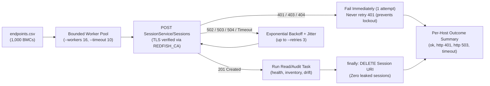

# 7.12 Automating Redfish with Python, Ansible and Go

| | |
|---|---|
| Level | Intermediate |
| Priority tier | 1 |
| Lab venue | Laptop |
| Part | Part 7: Redfish and BMC |
| Status | Drafted (`fleet_lab.py`: 14 checks pass over HTTPS mock; **untested** on live BMC) |

## Why this matters for AI infrastructure

Clicking through a web page works for one server. With 1,000 servers you need code, and code that talks to BMCs has to be careful. A bad retry loop can lock accounts. An unbounded loop can overload the management switches. A script that dies on the first failed host leaves half a fleet changed and the other half untouched. This chapter shows the same few operations in three languages, then the rules that keep any of them safe at scale.

## Prerequisites and outcomes

Before you start, read chapters 7.2 to 7.5. You also need basic Python (Part 3), Ansible (Part 4) and some Go. When you finish this chapter, you will be able to:

- set up HTTPS with a lab certificate authority and verify certificates in your clients
- write a safe Redfish call in Python, Ansible and Go
- choose between the `uri` module and the Redfish modules in Ansible
- run a task on many BMCs with timeouts, retries, backoff and failure isolation
- test your automation against broken BMCs

## 1. First, TLS: stop using `-k`

Suppose a script turns off certificate checks so that it can reach a BMC. It will now talk to anything that answers at that address, including an impostor. Real BMCs use HTTPS, and the mock does too now. `redfish_mock.py --tls CERT KEY` serves TLS 1.2 or newer, as the spec requires. The script `tls_setup.py` creates a throw-away certificate authority (CA) and a server certificate for `127.0.0.1`:

```bash
python3 tls_setup.py /tmp/pki
python3 redfish_mock.py --port 8443 --tls /tmp/pki/server.pem /tmp/pki/server.key
```

I checked three behaviours with `curl`:

```text
curl --cacert /tmp/pki/ca.pem https://127.0.0.1:8443/redfish/v1/   -> 200
curl https://127.0.0.1:8443/redfish/v1/                            -> exit 60 (certificate not trusted)
curl -k https://127.0.0.1:8443/redfish/v1/                         -> 200 (no checking at all)
```

The second line is the safe default. The client refuses a certificate that no known authority signed. The third line works, but it would accept a fake BMC just as happily, because nothing is checked at all.

My Python tools follow the same rule. They verify the certificate against the system store by default. Set `REDFISH_CA=/tmp/pki/ca.pem` to add your own CA. Only `REDFISH_INSECURE=1` turns verification off, and then the tool prints a warning on every run.

For a real fleet, put one internal CA on all BMCs (chapter 7.4 and 7.15) and trust that CA in your automation. Do not hand-disable the checks.

## 2. Python

### 2.1 The client I used in all labs

A quick script usually skips the parts that matter when a BMC misbehaves. The client in `redfish_crawl.py` does not skip them. It logs in with a session and always logs out. It sets a timeout on every request. If the session times out, which shows up as a 401 while you hold a token, it renews the session once and repeats the request. It raises `LoginError` with the status code, so callers can tell a wrong password (401) from a busy BMC (503). It also verifies TLS unless you explicitly say otherwise.

### 2.2 The DMTF `redfish` library

DMTF publishes a Python library. You install it with `pip install redfish`, and I tested version 3.4.2. The basic use is short:

```python
import redfish
c = redfish.redfish_client(base_url="https://<bmc>", username="admin", password="...",
                           default_prefix="/redfish/v1")
c.login(auth="session")
r = c.get("/redfish/v1/Systems/System_0")
print(r.status, r.dict["PowerState"])
c.post("/redfish/v1/Systems/System_0/Actions/ComputerSystem.Reset", body={"ResetType": "ForceOff"})
c.logout()
```

I ran this against the mock with `SSL_CERT_FILE=/tmp/pki/ca.pem`. It printed `200 On`, `200` and then `Off`. The library handles sessions and gives you `.dict`. It does not decide retries, concurrency or discovery for you.

### 2.3 Rules for a Python Redfish script

Keep these rules in mind when you write your own script. Each one prevents a specific failure.

1. **Discover, do not hard-code** (chapter 7.2). Use `rf_inventory.py` as a pattern.
2. **Put a timeout on everything.** A BMC that hangs must not freeze your whole run.
3. **Use sessions, and log out in `finally`.**
4. **Check the status and the body** (chapter 7.3), including `@Message.ExtendedInfo` on a 200.
5. **Handle 202 with a task loop** (chapter 7.5). Give it a time limit, and when the limit runs out, report "unknown", not "success".
6. **Keep secrets out of code and logs** (chapter 7.4).
7. **Be idempotent.** Read the current state first, change only what is needed, and verify afterwards.
8. **Dry run by default** for anything that changes state. My `rf_firmware.py update` and `rf_logs.py clear` both work this way.

## 3. Ansible

Ansible is a good fit when you want to run the same step on many hosts, in batches, and see exactly what changed. You have two ways to talk to Redfish from it.

### 3.1 The `uri` module (generic HTTP)

The notes you started from use `uri` to log in, take a token and call an action. The pattern below is the one I tested. A `block` and an `always` section make sure the logout runs even when something fails (`code/part07/ansible/uri_session.yml`):

```yaml
- name: Redfish session with the uri module, always logged out
  block:
    - name: Log in
      ansible.builtin.uri:
        url: "{{ bmc }}/redfish/v1/SessionService/Sessions"
        method: POST
        body_format: json
        body: { UserName: admin, Password: adminpass }
        ca_path: "{{ ca }}"
        status_code: 201
      register: login
      no_log: true
    - name: Read the system
      ansible.builtin.uri:
        url: "{{ bmc }}/redfish/v1/Systems/System_0"
        headers: { X-Auth-Token: "{{ login.x_auth_token }}" }
        ca_path: "{{ ca }}"
      register: sysinfo
  always:
    - name: Log out
      ansible.builtin.uri:
        url: "{{ login.location }}"
        method: DELETE
        headers: { X-Auth-Token: "{{ login.x_auth_token }}" }
        ca_path: "{{ ca }}"
        status_code: 204
```

Running it taught me five things:

- The module turns response headers into variables with underscores, so you get `login.x_auth_token` and `login.location`. The notes' use of `session_login.x_auth_token` is right.
- `login.location` is already the full URL, such as `https://host:port/redfish/v1/SessionService/Sessions/1`. My first logout task put the base URL in front of it and failed with a name resolution error. Use it as it is.
- `no_log: true` keeps the password and the token out of the Ansible output.
- The notes' example used `validate_certs: false`. Use `ca_path`, or the system store, instead.
- `status_code: 201` and `204` make the task fail on any other answer. Without them, only connection errors fail the task.

### 3.2 The `community.general` Redfish modules

The `community.general` collection hides the URI walking behind three modules. `redfish_info` reads, `redfish_command` acts, and `redfish_config` changes settings. I installed `community.general` 13.5.0 and ran `ansible/inventory_and_restart.yml`. The table shows what each task returned on the mock.

| Task | Module and command | Result on the mock |
|---|---|---|
| firmware inventory | `redfish_info`, category `Update`, command `GetFirmwareInventory` | 34 entries with names, versions, `Updateable` |
| system inventory | `redfish_info`, category `Systems`, `GetSystemInventory` | model, serial, memory, processors |
| health | `redfish_info`, `GetHealthReport` | per-chassis health |
| restart | `redfish_command`, category `Systems`, command `PowerGracefulRestart`, `resource_id: System_0` | `changed`, "Action was successful" |

The module help lists more commands. Besides the ones above, you will find `GetFanInventory`, `GetPsuInventory`, `GetBiosAttributes`, `GetBootOrder` and others. `redfish_command` also covers power, with `PowerOn`, `PowerForceOff` and `PowerReboot`. It covers boot override with `SetOneTimeBoot` and `EnableContinuousBootOverride`, and firmware with `SimpleUpdate` and `MultipartHTTPPushUpdate`. I tested only the commands in the table.

A few facts matter when you use these modules:

- To pass credentials, set `baseuri` (host and port, with no scheme), `username`, `password`, and either `ca_path` or `validate_certs`.
- The modules build the address as `https://<baseuri>`, so they work only with HTTPS. That is why I added TLS to the mock.
- On the mock, `GetFanInventory` returned no entries, because the mock has no fan resources. Modules ask for specific resources and return what they find. They do not know your BMC's quirks.
- The results come back as facts, so a playbook can compare them with a baseline.

**Which to use.** Pick the Redfish modules for the common jobs they cover. They handle sessions and parsing, and they report `changed` correctly. Reach for `uri` when no module covers what you need, or when you want exact control over the request, for example `@Redfish.OperationApplyTime`. In both cases, keep the BMC credentials in Ansible Vault or your secret manager, use `no_log`, and keep one task per change so the output tells the story.

### 3.3 Scale in Ansible

Ansible runs tasks on many hosts at once, and the `forks` setting controls how many. It can also work in batches with `serial`. Those two settings decide how hard your playbook hits the BMCs at the same moment. For BMCs:

- Keep `forks` modest so the management switches are not flooded. Your Part 4 chapters cover these settings.
- Use `serial` for risky actions such as firmware updates: a small first batch, then bigger ones.
- Use `max_fail_percentage` or `any_errors_fatal` so one bad batch stops the run.
- Do **not** retry login failures in a loop. Repeated bad logins can lock the account (chapter 7.4).

Set the batch sizes before the first run, not after a failure shows up.

## 4. Go

Go suits long-running tools and operators. The usual Redfish client for it is the `gofish` library (`github.com/stmcginnis/gofish`). With version 0.27.0, I ran this short program against the mock (`code/part07/go_gofish`):

```go
cfg := gofish.ClientConfig{Endpoint: os.Args[1], Username: "admin", Password: "adminpass", Insecure: true}
c, err := gofish.Connect(cfg)
defer c.Logout()
systems, _ := c.GetService().Systems()
for _, s := range systems { fmt.Println(s.ID, s.PowerState, s.Status.Health) }
if _, err := systems[0].Reset(schemas.GracefulRestartResetType); err == nil { fmt.Println("reset sent") }
```

The output was `System_0 Off OK`, `HGX_Baseboard_0 On OK` and `reset sent`. Three things in the program are worth a closer look:

- `Insecure: true` in the demo is there for the lab certificate. A real program uses a configured `HTTPClient` with your CA, as section 1 showed.
- `Reset` returns two values in this version, a task monitor and an error, so check both.
- The library walks the links for you through `Systems()`, which fits the discovery rule. API names change between versions, so pin the version you use.

## 5. Running on a fleet: the runner and its lab

Think of the runner as a conveyor belt. You feed it a CSV of BMCs, and each one goes through the same steps: log in, do the read-only task, log out, and report one outcome. The diagram shows where the retries and the shortcuts sit, so read it before you run the tool on your own list.



`code/part07/fleet_run.py` runs a read-only task on many BMCs at once. Each row in the table below answers one way a fleet run can go wrong:

| Rule | Why |
|---|---|
| bounded worker pool (`--workers`) | 1,000 BMCs must not all be hit at once |
| timeout per request | a hanging BMC must not freeze the run |
| retry only what can recover: timeouts, connection errors, 502, 503, 504 | those may succeed later |
| **never retry 401, 403, 404** | a wrong password retried five times can lock the account |
| exponential backoff with jitter | avoid hitting a recovering BMC all at the same moment |
| one failure never stops the run | every host ends in exactly one outcome |
| log out in `finally` | do not leak sessions |
| summary by failure kind, non-zero exit code | pipelines can react |

The lab script, `fleet_lab.py`, tests all of these rules. It starts 15 mock BMCs on the spot, and each one behaves differently:

| Host | Behaviour | Outcome the lab checks |
|---|---|---|
| 8 healthy | normal | success, first try |
| slow | 0.6 s per request | success within the 1 s timeout |
| flaky | 503 twice, then fine | success on the third try |
| down503 | 503 always | fails after 1 plus 3 retries, kind `http 503` |
| badpw | wrong password | fails after **1** attempt, kind `http 401` |
| hang | never answers | cut off, kind `timeout` |
| closed | nothing listening | kind `connection refused` |
| generic | different resource names | success with no code change |

The run ended with 15 hosts, 11 successes and 4 failures. The failures were grouped as `http 503`, `http 401`, `timeout` and `connection refused`. A second check shows 8 workers finishing 8 slow hosts in about 1 second, against 8 seconds for one worker. A third check confirms that no sessions were left open on the healthy hosts.

To run it on your own list, use this command:

```bash
python3 fleet_run.py endpoints.csv --workers 16 --timeout 10 --retries 3 --task health
```

The runner only **reads**. A runner that changes things needs more: batches, a stop-on-failure rule, verification, and a human approval step. Chapter 7.14 builds on this runner. Do not reuse it for changes until those four safeguards are in place.

## 6. A choice table

No single tool is right for every Redfish job. Each one does some things well and others badly. The table helps you pick one for the task in front of you.

| Tool | Best for | Weak at |
|---|---|---|
| `curl` | one quick look, learning, a shell snippet | loops, errors, JSON handling |
| Python | custom logic, validation, fleets, reports | needs care for sessions and retries |
| `redfish` library | simple scripts with sessions handled | no fleet logic |
| Ansible `uri` | exact requests inside playbooks | verbose, manual session handling |
| Ansible Redfish modules | common read and power tasks, change reporting | limited to what the modules cover |
| Go and gofish | services, operators, high concurrency | more code for small jobs |
| BCM `redfish*` commands | cluster-wide actions in a BCM cluster (chapter 7.2) | tied to BCM |

Notice that `curl` is the best tool for a single look and the weakest one for a fleet. Pick the tool for the size of the job, not the one you know best.

### 6.1 Designing a production-grade fleet concurrency and retry engine

Why can't you manage a thousand BMCs with a simple `for` loop in Bash, or by starting a thousand `asyncio` tasks at once in Python? The answer is that out-of-band management networks and embedded BMCs have physical limits. Those limits look nothing like the limits of a cloud web service.

Start with the BMC itself. The host CPUs in a server might have over a hundred cores and two terabytes of DDR5 RAM. The BMC, however, is a small embedded ARM System-on-Chip, the ASPEED AST2600, with a modest clock speed and little memory. Every new TLS connection, and every post to `/redfish/v1/SessionService/Sessions`, makes the BMC do real work. It performs an RSA or ECDSA TLS handshake, hashes the password against its account database, allocates a session slot and serializes JSON responses. Suppose three monitoring and automation scripts hit the same BMC at once, with no coordination. Response times can jump from fifty milliseconds to several seconds, and the BMC starts returning `503 Service Unavailable`.

The second limit is the network. The compute fabric runs at `400 Gbps` or `800 Gbps` per port. The out-of-band management network, built from SN2201 switches, typically runs at `1 Gbps` per BMC port. All of those ports share an uplink to the management plane. Now picture an unbounded firmware push, or a diagnostic bundle download, started on 500 nodes at once. It saturates the uplinks, and TCP retransmissions and timeouts spread across the whole rack row.

`code/part07/fleet_run.py` handles both limits with four patterns, and every fleet tool should copy them. The lab script `code/part07/fleet_lab.py` verifies them.

1. **Bounded worker pool (`ThreadPoolExecutor(max_workers=workers)`).** Cap the active workers with `--workers 16` or `32`. That caps the TLS handshakes and HTTP transfers on the OOB network at once, whether `endpoints.csv` lists twenty nodes or two thousand.
2. **Strict per-request socket timeouts (`timeout=10`).** Suppose a BMC's firmware wedges, or a rack loses standby power. A TCP connection with no timeout can hang for minutes while the kernel retries. An explicit socket timeout on every `urlopen` or `requests` call makes a dead BMC fail fast. The worker thread then moves on to the next node in the queue.
3. **Error-class-aware retry policy (`502`/`503`/`504`/timeout vs `401`/`403`/`404`).** Not all failures deserve the same response. A `503 Service Unavailable` or a short socket timeout often means the BMC is finishing a reboot or is busy for a moment. Retrying three times with **exponential backoff and random jitter** usually recovers, as the `flaky` host in `fleet_lab.py` shows by succeeding on its third attempt. An HTTP `401 Unauthorized`, `403 Forbidden` or `404 Not Found` is different. It is a fixed configuration error, and a retry will not change it. Count the cost. One first attempt plus three retries makes 4 failed logins. That trips `AccountLockoutThreshold` at 3 failures, and it locks the service account out across the entire cluster! This is why `fleet_run.py` aborts on the very first `401`, `403` or `404`.
4. **Guaranteed session teardown and structured outcomes.** Every worker logs out inside a `finally:` block, so `fleet_lab.py` finds 0 leaked sessions across the healthy hosts. Each worker also returns a result tuple, `(host, ok, status_kind, detail)`. The main process builds a deterministic summary table from those tuples, and it exits non-zero if any node failed.

### 6.2 Comparing Python, Ansible, and Go for bare-metal lifecycle automation

Redfish is standard HTTPS and JSON, so your team does not have to pick one language. In a mature AI infrastructure team, Python, Ansible and Go each own the part of the lifecycle where they work best.

- **Python** (`redfish_crawl.py`, `rf_inventory.py`, `rf_hardware.py`, `rf_firmware.py`, `node_lifecycle.py`) fits discovery, schema validation, multi-step state machines and diagnostic CLI tools. Say you need to walk an unknown server's resource graph, cross-check `PCIeInterface` speeds against `MaxPCIeType`, or validate BIOS attributes against an `AttributeRegistry`. You can also run self-checking CI suites against `redfish_mock.py`. Python's dictionary handling and its libraries (`jsonschema`, `requests`, `prometheus_client`) let you write that logic in about a hundred readable lines.
- **Ansible** (`ansible.builtin.uri` and `community.general.redfish_*`) fits configuration that you enforce across an inventory in staged maintenance waves. Say you already keep your cluster inventory in Ansible. You want to rotate an NTP setting, set a one-time PXE boot override, or reboot a rack in rolling batches. For the batches, `serial: [1, 8, "25%"]` with `max_fail_percentage: 0` does the job. Credentials come from Ansible Vault with `no_log: true`. A thirty-line playbook then gives your operations team a dry run (`--check`), change reporting (`ok` vs `changed`) and audit logging, with no custom worker-pool code. Keep the two lessons from section 3 in mind. Use `community.general.redfish_info`, `redfish_command` and `redfish_config` for standard tasks. Drop down to `ansible.builtin.uri` with `block:` and `always:` cleanup when you need custom headers such as `If-Match`, or actions the modules do not cover. And never prepend `{{ bmc }}` to `{{ login.location }}`, because `uri` already expands `Location` to a full URL.
- **Go** (`github.com/stmcginnis/gofish`) is the natural choice for long-running cluster daemons, Kubernetes operators and high-throughput Prometheus exporters. Operators for Metal3, Ironic and CAPI providers are examples. Go compiles to a single static binary with strongly typed structs, such as `gofish.ClientConfig`, `schemas.ComputerSystem` and `schemas.GracefulRestartResetType`. Its lightweight goroutines let a service keep persistent connection pools and SSE streams across thousands of BMCs with little memory.

### 6.3 Chaos engineering your BMC automation before touching production

Before you run a new Python script, Ansible playbook or Go binary against a rack of production DGX servers, ask yourself one question. How do I know what this code will do when a BMC misbehaves?

A test against one happy-path mock server only proves that your JSON field names are spelled right. It says nothing about failure isolation. That is why `code/part07/fleet_lab.py` starts fifteen separate HTTPS mock servers at once and injects six failure modes:

- **Slow hosts** (`slow`, `0.6 s` per request) check that the pool runs requests in parallel. Eight slow hosts with `--workers 8` finish in about `~1 s` of wall time, without tripping the `1.0 s` socket timeout.
- **Transient overload** (`flaky`, `503` twice, then `200 OK`) proves that the retry loop recovers from short congestion on the BMC web server.
- **Persistent outage** (`down503`, `503` on every request) proves that the loop stops after `--retries 3` and files the host under `http 503`, without hanging.
- **Credential drift** (`badpw`, wrong password) proves that `401 Unauthorized` is attempted exactly once (`st.bad_logins == 1`). A drifted password on one node never triggers an account lockout.
- **Hung socket** (`hang`, accepts the connection and never answers) proves that per-request timeouts cut off wedged BMCs cleanly, as `timeout`.
- **Dead port and different schema** (`closed`, nothing listening; `generic`, `/redfish/v1/Systems/1`) prove that `connection refused` is caught cleanly. They also prove that link discovery works across different vendor URI layouts in one sweep.

Running `python3 code/part07/fleet_lab.py` in CI takes less than five seconds on a laptop. It gives you mathematical confidence that a single broken BMC in Rack 12 will never stall a cluster-wide operation or lock out your administrative credentials. Run it before any new script touches real hardware.

### 6.4 Secret management and credential injection for BMC fleets

Whichever language drives your Redfish automation, one security rule is non-negotiable. **BMC passwords and session tokens must never sit in plaintext CSV files, Git repositories, command-line arguments, or CI build logs.**

In `code/part07/fleet_lab.py` and `code/part07/ansible/uri_session.yml`, the lab uses synthetic passwords (`adminpass`, `operpass`, `viewpass`) against localhost mock servers. When you move those scripts into a production AI data center, wire credential retrieval into your enterprise secret store. Use one of three patterns.

1. **Short-lived runtime injection from Vault or KMS.** In Python (`fleet_run.py`) and Go (`gofish`), read BMC credentials at startup. Take them from HashiCorp Vault, AWS, GCP or Azure Secrets Manager. You can also use an encrypted file mounted in RAM (`tmpfs`) under `/run/secrets/`, with `0400` permissions. Do not pass `--password` on the command line. There, `ps aux` and `/proc/<pid>/cmdline` show it to every user on the bastion host.
2. **Ansible Vault and `no_log: true`.** Encrypt group and host variable files, such as `group_vars/bmcs/vault.yml`, with `ansible-vault`. Or fetch secrets at run time with the `community.hashi_vault` lookup plugin. Always set `no_log: true` on the login task for `/redfish/v1/SessionService/Sessions`, and on any task that passes `Password` or `X-Auth-Token` in its body or headers. Without it, Ansible echoes the task arguments into stdout and central job logs whenever a task fails or runs with `-v`.
3. **Per-rack or per-node unique BMC passwords.** If an attacker or a rogue insider gets the password of one test server, that password should not unlock all one thousand BMCs in the facility. Modern secret-management pipelines generate a unique random password per BMC, or per failure domain. They store it in Vault, indexed by chassis serial number and BMC MAC address, and sync it to BCM's `bmcsettings` or Redfish `AccountService` automatically. Salted fingerprint audits (`cred_audit.py` and BCM `credentialsoverview`) then confirm that every node matches its Vault entry.

Combine these four habits and your Redfish automation holds up: verified TLS from an internal CA, vault-injected credentials with `no_log: true`, bounded worker pools with error-aware retries, and fault-injection tests through `fleet_lab.py`. Your automation then meets the same engineering standard as your production Kubernetes and Slurm control planes. Whether a single rack is in planned maintenance or a thousand-node AI factory runs nightly hardware audits, these habits keep the out-of-band control plane fast, predictable and safe.

## Exercises

Work through these in order, and try each one on the mock before you change anything real.

1. Show why a `401 Unauthorized` must never be retried. Run `python3 code/part07/fleet_lab.py` first, and you should see `14 passed, 0 failed`. Then add `401` to the retryable status tuple in `code/part07/fleet_run.py` and run the lab again. Explain why retrying `badpw` four times trips `AccountLockoutThreshold` (3 failures) and locks out legitimate administrators.
2. Write a multi-host Ansible playbook for BIOS versions. Start from `code/part07/ansible/inventory_and_restart.yml`. Add a task that uses `community.general.redfish_info` with `category: Systems` and `command: GetSystemInventory`. Collect `BiosVersion` from three mock BMCs, and assert that all three match an expected string.
3. Test the `block` and `always` cleanup when a playbook fails midway. In `code/part07/ansible/uri_session.yml`, point the `Read the system` task at `/redfish/v1/Systems/DoesNotExist`, so it fails with `404`. Confirm that the `always:` block still sends the `DELETE` to `{{ login.location }}`, and that the BMC has `0` open sessions afterwards.
4. Enumerate GPUs in Go with `gofish`. Extend `code/part07/go_gofish/main.go` so it loops over `s.Processors()` for each `ComputerSystem`. Print the `ID`, `Model` and `ProcessorType` of every processor where `ProcessorType == schemas.GPUProcessorType`.
5. Add a drift check to the runner. Add a `--task firmware-drift` option to `code/part07/fleet_run.py`. It should call `rf_firmware.drift(client, baseline)` on all healthy BMCs in parallel, then summarize drifted and compliant nodes.
6. Check X.509 CA trust, and confirm that a self-signed certificate is rejected. Run `python3 code/part07/tls_setup.py /tmp/pki`, then start `redfish_mock.py --tls /tmp/pki/selfsigned.pem /tmp/pki/selfsigned.key`. Check that `redfish_crawl.py` with `REDFISH_CA=/tmp/pki/ca.pem` rejects the self-signed certificate with `SSLCertVerificationError`.

## 8. Interview angles

- "How do you automate BMC changes safely?" Use sessions and verified TLS. Keep each step idempotent, work in small batches, verify after every change, and never retry a 401 blindly.
- "Why not retry on a 401?" It will not fix itself, and it can lock the account for everyone.
- "Ansible module or `uri`?" Use the module for covered jobs, since it parses output and reports changes. Use `uri` when you need exact control.
- "How do you test automation without hardware?" Use a mock with fault injection: slow, flaky, down, wrong password, hang. Then validate against the official schemas (chapter 7.6).
- "How do you keep a hung BMC from stopping a fleet run?" Set a timeout on every request, use a bounded pool, and isolate failures per host.

## Checkpoint questions (20)

<details>
<summary>1. Why is `curl -k` (or `REDFISH_INSECURE=1`) unsafe in production, and what should automation use instead?</summary>

Turning off certificate checks lets anyone on the network path impersonate a BMC. That person could steal credentials or send hardware commands. Production automation should install certificates signed by an internal CA on every BMC, then pass `--cacert ca.pem`, `REDFISH_CA=/path/to/ca.pem` or `ca_path`.
</details>

<details>
<summary>2. What minimum TLS protocol version does DSP0266 §13.1 mandate for Redfish services?</summary>

**TLS 1.2 or later**, with the IANA "Recommended" cipher suites.
</details>

<details>
<summary>3. What does the official DMTF `redfish` Python library (`pip install redfish`) handle automatically, and what must your application still implement?</summary>

The `redfish` library takes care of session login (`c.login(auth="session")`), token headers, JSON parsing (`.dict`) and `c.logout()`. Your application still has to do four things itself: **dynamic link discovery**, **bounded fleet concurrency**, **selective retry and backoff**, and **202 task polling**.
</details>

<details>
<summary>4. Why must every Python script or Ansible playbook wrap Redfish session usage in a `try ... finally` or `block ... always` structure?</summary>

The cleanup has to run even when a request fails or an assertion breaks. Putting the `DELETE` on the session `Location` URI in `finally` or `always` means no session is left behind. Leaked sessions could fill the BMC's session table.
</details>

<details>
<summary>5. When using Ansible's `ansible.builtin.uri` module to create a Redfish session (`register: login`), what variable names hold the session token and the session URI?</summary>

The `uri` module turns response headers into lowercase variables with underscores. `login.x_auth_token` holds the `X-Auth-Token` header, and `login.location` holds the `Location` header.
</details>

<details>
<summary>6. What subtle bug occurs in Ansible `uri` playbooks if you write `url: "{{ bmc }}{{ login.location }}"` in the logout task?</summary>

The `uri` module already turns the `Location` header into a complete absolute URL, such as `https://host:port/redfish/v1/SessionService/Sessions/1`. Put `{{ bmc }}` in front of it and you get a malformed address, `https://host:porthttps://host:port/...`. Pass `url: "{{ login.location }}"` directly.
</details>

<details>
<summary>7. Why is `no_log: true` mandatory on the Ansible task that posts `UserName` and `Password` to `/redfish/v1/SessionService/Sessions`?</summary>

Without it, Ansible prints the request body, including `Password`, and the response headers, including `x_auth_token`, in plain text. That text ends up in stdout, CI logs and AWX or Tower job histories.
</details>

<details>
<summary>8. Name the three Redfish modules in the `community.general` Ansible collection and the role of each.</summary>

1. **`community.general.redfish_info`** runs read-only inventory and telemetry queries, such as `GetSystemInventory`, `GetFirmwareInventory`, `GetHealthReport` and `GetBiosAttributes`.
2. **`community.general.redfish_command`** runs state-changing actions, such as `PowerGracefulRestart`, `PowerForceOff`, `SetOneTimeBoot` and `SimpleUpdate`.
3. **`community.general.redfish_config`** changes configuration properties, such as `SetBiosAttributes` and network or account settings.
</details>

<details>
<summary>9. Why do the `community.general.redfish_*` modules require HTTPS on the target BMC, and how do you format the `baseuri` parameter?</summary>

The modules build the target URL themselves as `https://<baseuri>/redfish/v1/...`. So `baseuri` must be written as **`host:port` with no `http://` or `https://` scheme**, and the endpoint has to speak TLS.
</details>

<details>
<summary>10. When should you prefer `ansible.builtin.uri` over `community.general.redfish_*`?</summary>

Use the `community.general.redfish_*` modules for standard inventory, BIOS and power tasks. Their built-in idempotency and `changed` reporting save you boilerplate. Use `ansible.builtin.uri` when you need exact control over custom URI paths, `@Redfish.OperationApplyTime`, `If-Match` ETag headers, or OEM actions the collection does not cover.
</details>

<details>
<summary>11. Which three Ansible play keywords protect OOB management switches and the cluster when running playbooks across hundreds of BMCs?</summary>

1. **`forks`** caps the number of concurrent SSH or HTTP workers, so the OOB switches are not overwhelmed.
2. **`serial`** runs the play in staged, rolling batches, such as `serial: [1, 8, "25%"]`.
3. **`max_fail_percentage` or `any_errors_fatal`** stops the whole rollout right away when a canary or the current batch goes over the failure threshold.
</details>

<details>
<summary>12. In the Go `gofish` library (`github.com/stmcginnis/gofish`), what does `Insecure: true` in `gofish.ClientConfig` do, and how should production Go code configure TLS instead?</summary>

`Insecure: true` skips TLS certificate verification, which is only for lab testing. Production Go services should leave `Insecure` at `false`. They should pass a custom `HTTPClient` whose `tls.Config.RootCAs` loads the cluster's internal BMC CA bundle.
</details>

<details>
<summary>13. In `code/part07/fleet_run.py`, which HTTP status codes and errors are retried, and which status codes must NEVER be retried?</summary>

- **Retried (transient):** socket timeouts, connection errors, and HTTP **`502 Bad Gateway`**, **`503 Service Unavailable`** and **`504 Gateway Timeout`**.
- **Never retried (permanent or auth):** HTTP **`401 Unauthorized`**, **`403 Forbidden`**, **`404 Not Found`** and **`400 Bad Request`**. Retrying a `401` will not succeed with the same credentials, and it will trip `AccountLockoutThreshold`.
</details>

<details>
<summary>14. Why does `fleet_run.py` use exponential backoff with random jitter between retries?</summary>

Suppose 200 BMCs reboot at the same moment after a firmware update, and all of them return `503 Service Unavailable`. Fixed-interval retries would make all 200 workers hit the BMCs in synchronized waves. Exponential backoff, `0.15 * 2^attempt`, plus random jitter spreads the retries out as the BMCs come back online.
</details>

<details>
<summary>15. Why must a fleet runner isolate failures per host rather than letting an unhandled exception on one BMC abort the worker pool?</summary>

In a 1,000-node cluster, one or two nodes are almost always powered down for maintenance or waiting for an RMA. If each host's exception is caught and recorded as a structured outcome, such as `ok`, `http 401`, `http 503`, `timeout` or `connection refused`, the other 998 nodes still finish. The operator then gets a complete status report.
</details>

<details>
<summary>16. How does `code/part07/fleet_lab.py` verify that `fleet_run.py` leaked zero sessions across the 15 test BMCs?</summary>

After `fleet_run.py` finishes, `fleet_lab.py` checks the in-memory `st.sessions` dictionary on every mock BMC server, using `sum(len(st.sessions) for _, st in servers) == 0`. If the sum is zero, every session the run created was deleted before exit.
</details>

<details>
<summary>17. How does `redfish_crawl.Client` handle a session token that expires mid-run during a multi-minute operation?</summary>

If a request returns `401 Unauthorized` while `self.token` is set, and the request is not a login attempt, `Client.req()` clears the expired token. It then calls `self.login()` **once**, which increments `self.relogins += 1`, and replays the request once with the fresh token.
</details>

<details>
<summary>18. What fault-injection modes does `redfish_mock.py` support to test fleet automation resiliency on a laptop?</summary>

It supports five modes. Artificial per-request latency is `slow_ms`. Transient `503` failures for the first $N$ requests use `fail_first_n`. Permanent `503` overload is `always_503`. An infinite socket hang is `hang`. Asynchronous `202` reset tasks are `async_reset`.
</details>

<details>
<summary>19. How much speedup did 8 worker threads achieve over 1 worker thread when querying 8 slow (`0.6 s`) BMCs in `fleet_lab.py`?</summary>

With 8 workers (`--workers 8`), all 8 slow BMCs finished in about **`~0.6–1.0` second**, running in parallel. With one worker they took about **`~4.8+` seconds** one after another.
</details>

<details>
<summary>20. Why is `fleet_run.py` restricted to read-only tasks, and what four additional safeguards are required for a fleet runner that mutates state?</summary>

Read-only tasks, such as `health`, `inventory` and `drift`, can safely run at high concurrency across the whole cluster at once. A runner that changes state needs four more safeguards. It needs canary and wave batching, going from `1` node to `1` rack to `1` SU. It needs a circuit breaker that stops on failure between waves. It needs an idempotency check before each change and a verification after it. And it needs an explicit `--yes` from a human.
</details>

## Sources and review notes

- **Redfish Specification DSP0266 v1.21.0:** TLS 1.2 or later and certificate replacement (13.1), HTTP Basic and sessions (13.3), tasks and status codes (7.3, 8.3, 12.2).
- **Tools run here:** `redfish` 3.4.2 (PyPI), `ansible-core` 2.21.5, `community.general` 13.5.0 (modules `redfish_info`, `redfish_command`, `redfish_config`; I read their documentation text in the installed collection), `gofish` v0.27.0, Go 1.23.2, OpenSSL for the lab CA.
- **NVIDIA-DevOps notes (volume 10 chapter 1, sections 3.5 and 3.6):** the Python and Ansible examples. Changes I made: sessions closed, certificates verified instead of disabled, and a corrected note about the `Location` value.
- **Background:** your Part 3 and Part 4 chapters on Python resilience and Ansible; the Ansible book's chapters on `serial`, handlers and speed; the notes' Python masterclass sections on resilient API clients (retries and circuit breakers). I used these as background and did not copy from them.
- **Run here:** `fleet_lab.py` (14 checks); all earlier labs re-run after the TLS and client changes (all pass).
- **Not verified:** any behaviour on a real BMC (rate limits, session limits, response times), the module list on versions other than the ones above, and `MultipartHTTPPushUpdate` and `SimpleUpdate` modules against the mock (I did not run them).
