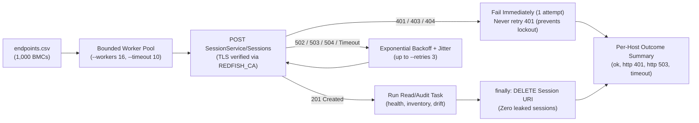

# 7.12 Automating Redfish with Python, Ansible and Go

| | |
|---|---|
| Level | Intermediate |
| Priority tier | 1 |
| Lab venue | Laptop |
| Part | Part 7: Redfish and BMC |
| Status | Drafted (`fleet_lab.py`: 14 checks pass over HTTPS mock; **untested** on live BMC) |

## Why this matters for AI infrastructure

With one server you can click in a web page. With 1,000 you need code, and code that touches BMCs must be careful: a bad retry loop can lock accounts, an unbounded loop can overload management switches, and a script that dies on the first failed host leaves half a fleet changed. This chapter shows the same few operations in three languages, then the rules that make any of them safe at scale.

## Prerequisites and outcomes

You need chapters 7.2 to 7.5 and basic Python (Part 3), Ansible (Part 4) and some Go. After this chapter you can:

- set up HTTPS with a lab certificate authority and verify certificates in your clients
- write a safe Redfish call in Python, Ansible and Go
- choose between the `uri` module and the Redfish modules in Ansible
- run a task on many BMCs with timeouts, retries, backoff and failure isolation
- test your automation against broken BMCs

## 1. First, TLS: stop using `-k`

Real BMCs use HTTPS. The mock now does too (`redfish_mock.py --tls CERT KEY`, TLS 1.2 or newer, as the spec requires). `tls_setup.py` makes a throw-away certificate authority (CA) and a server certificate for `127.0.0.1`:

```bash
python3 tls_setup.py /tmp/pki
python3 redfish_mock.py --port 8443 --tls /tmp/pki/server.pem /tmp/pki/server.key
```

I checked three behaviours with `curl`:

```text
curl --cacert /tmp/pki/ca.pem https://127.0.0.1:8443/redfish/v1/   -> 200
curl https://127.0.0.1:8443/redfish/v1/                            -> exit 60 (certificate not trusted)
curl -k https://127.0.0.1:8443/redfish/v1/                         -> 200 (no checking at all)
```

The second line is the safe default: the client does not trust a certificate that no known authority signed. The third works but would accept a fake BMC. My Python tools follow the same rule:

- by default the certificate is **verified** against the system store;
- `REDFISH_CA=/tmp/pki/ca.pem` adds your own CA;
- only `REDFISH_INSECURE=1` turns verification off, and then the tool prints a warning on every run.

For real fleets the point is to put one internal CA on all BMCs (chapter 7.4 and 7.15) and trust that CA in your automation, not to hand-disable checks.

## 2. Python

### 2.1 The client I used in all labs

`redfish_crawl.py` has a small standard-library client. Things it does that a quick script does not:

- logs in with a **session** and always logs out;
- sets a **timeout** on every request;
- **renews** the session once if it times out (a 401 while holding a token) and repeats the request;
- raises `LoginError` with the status code, so callers can tell a wrong password (401) from a busy BMC (503);
- verifies TLS unless you explicitly say otherwise.

### 2.2 The DMTF `redfish` library

DMTF publishes a Python library (`pip install redfish`, version 3.4.2 when I tested). The basic use:

```python
import redfish
c = redfish.redfish_client(base_url="https://<bmc>", username="admin", password="...",
                           default_prefix="/redfish/v1")
c.login(auth="session")
r = c.get("/redfish/v1/Systems/System_0")
print(r.status, r.dict["PowerState"])
c.post("/redfish/v1/Systems/System_0/Actions/ComputerSystem.Reset", body={"ResetType": "ForceOff"})
c.logout()
```

I ran this against the mock with `SSL_CERT_FILE=/tmp/pki/ca.pem` and it printed `200 On`, `200` and then `Off`. It handles sessions and gives you `.dict`. It does not decide retries, concurrency or discovery for you.

### 2.3 Rules for a Python Redfish script

1. **Discover**, do not hard-code (chapter 7.2). Use `rf_inventory.py` as a pattern.
2. **Timeouts everywhere.** A BMC that hangs must not freeze your whole run.
3. **Sessions, and logout in `finally`.**
4. **Check status and body** (chapter 7.3), including `@Message.ExtendedInfo` on a 200.
5. **Handle 202** with a task loop (chapter 7.5) and a time limit that ends in "unknown", not "success".
6. **Keep secrets out of code and logs** (chapter 7.4).
7. **Be idempotent:** read the current state first, change only if needed, verify afterwards.
8. **Dry run by default** for anything that changes state (my `rf_firmware.py update` and `rf_logs.py clear` do this).

## 3. Ansible

Ansible is good for "do this on all hosts, in batches, and show me what changed". There are two ways to talk to Redfish.

### 3.1 The `uri` module (generic HTTP)

This is what the user's notes show: log in, take the token, call an action. The pattern I tested, with a `block` and `always` so the logout runs even if something fails (`code/part07/ansible/uri_session.yml`):

```yaml
- name: Redfish session with the uri module, always logged out
  block:
    - name: Log in
      ansible.builtin.uri:
        url: "{{ bmc }}/redfish/v1/SessionService/Sessions"
        method: POST
        body_format: json
        body: { UserName: admin, Password: adminpass }
        ca_path: "{{ ca }}"
        status_code: 201
      register: login
      no_log: true
    - name: Read the system
      ansible.builtin.uri:
        url: "{{ bmc }}/redfish/v1/Systems/System_0"
        headers: { X-Auth-Token: "{{ login.x_auth_token }}" }
        ca_path: "{{ ca }}"
      register: sysinfo
  always:
    - name: Log out
      ansible.builtin.uri:
        url: "{{ login.location }}"
        method: DELETE
        headers: { X-Auth-Token: "{{ login.x_auth_token }}" }
        ca_path: "{{ ca }}"
        status_code: 204
```

What I learned by running it:

- The module turns response headers into variables with underscores: `login.x_auth_token` and `login.location`. The notes' use of `session_login.x_auth_token` is right.
- **`login.location` is already the full URL** (`https://host:port/redfish/v1/SessionService/Sessions/1`). My first logout task glued the base URL in front of it and failed with a name resolution error. Use it as is.
- `no_log: true` keeps the password and token out of the Ansible output.
- The notes' example used `validate_certs: false`. Use `ca_path` (or the system store) instead.
- `status_code: 201` and `204` make the task fail on any other answer. Without it only connection errors fail.

### 3.2 The `community.general` Redfish modules

The collection has three modules: `redfish_info` (read), `redfish_command` (act) and `redfish_config` (change settings). They hide the URI walking. I installed `community.general` 13.5.0 and ran (`ansible/inventory_and_restart.yml`):

| Task | Module and command | Result on the mock |
|---|---|---|
| firmware inventory | `redfish_info`, category `Update`, command `GetFirmwareInventory` | 34 entries with names, versions, `Updateable` |
| system inventory | `redfish_info`, category `Systems`, `GetSystemInventory` | model, serial, memory, processors |
| health | `redfish_info`, `GetHealthReport` | per-chassis health |
| restart | `redfish_command`, category `Systems`, command `PowerGracefulRestart`, `resource_id: System_0` | `changed`, "Action was successful" |

Other commands in the module help include `GetFanInventory`, `GetPsuInventory`, `GetBiosAttributes`, `GetBootOrder` and others, plus `redfish_command` commands for power (`PowerOn`, `PowerForceOff`, `PowerReboot`), boot override (`SetOneTimeBoot`, `EnableContinuousBootOverride`) and firmware (`SimpleUpdate`, `MultipartHTTPPushUpdate`). I tested only the ones in the table.

Facts worth knowing:

- Passing the credentials: `baseuri` (host and port, **no scheme**), `username`, `password`, and `ca_path` or `validate_certs`.
- The modules build the address as `https://<baseuri>`, so they work only with HTTPS. That is why I added TLS to the mock.
- On the mock `GetFanInventory` returned no entries, because my mock has no fan resources. Modules ask for specific resources and return what they find; they do not know your BMC's quirks.
- The module's results are reported as facts, so a playbook can compare them with a baseline.

**Which to use.** Use the Redfish modules for the common jobs they cover, because they handle sessions and parsing and report `changed` correctly. Use `uri` when no module covers what you need, or when you want exact control over the request (for example `@Redfish.OperationApplyTime`). In both cases: put BMC credentials in Ansible Vault or your secret manager, use `no_log`, and keep one task per change so the output tells the story.

### 3.3 Scale in Ansible

Ansible runs tasks on hosts in parallel (the `forks` setting) and can run in batches with `serial`. For BMCs:

- keep forks modest so management switches are not flooded (your Part 4 chapters cover these settings);
- use `serial` for risky actions such as firmware updates: a small first batch, then bigger;
- use `max_fail_percentage` or `any_errors_fatal` so one bad batch stops the run;
- do **not** retry login failures in a loop (account lockout, chapter 7.4).

## 4. Go

Go suits long-running tools and operators. The `gofish` library (`github.com/stmcginnis/gofish`) is the usual Redfish client. With version 0.27.0 I ran this program against the mock (`code/part07/go_gofish`):

```go
cfg := gofish.ClientConfig{Endpoint: os.Args[1], Username: "admin", Password: "adminpass", Insecure: true}
c, err := gofish.Connect(cfg)
defer c.Logout()
systems, _ := c.GetService().Systems()
for _, s := range systems { fmt.Println(s.ID, s.PowerState, s.Status.Health) }
if _, err := systems[0].Reset(schemas.GracefulRestartResetType); err == nil { fmt.Println("reset sent") }
```

Output: `System_0 Off OK`, `HGX_Baseboard_0 On OK`, `reset sent`. Notes:

- `Insecure: true` in the demo is for the lab certificate. A real program uses a configured `HTTPClient` with your CA, as in section 1.
- `Reset` returns two values in this version (a task monitor and an error), so check both.
- The library walks links for you (`Systems()`), which fits the discovery rule. API names change between versions, so pin the version.

## 5. Running on a fleet: the runner and its lab



`code/part07/fleet_run.py` runs a read-only task on many BMCs. The rules in code:

| Rule | Why |
|---|---|
| bounded worker pool (`--workers`) | 1,000 BMCs must not all be hit at once |
| timeout per request | a hanging BMC must not freeze the run |
| retry only what can recover: timeouts, connection errors, 502, 503, 504 | those may succeed later |
| **never retry 401, 403, 404** | a wrong password retried five times can lock the account |
| exponential backoff with jitter | avoid hitting a recovering BMC all at the same moment |
| one failure never stops the run | every host ends in exactly one outcome |
| log out in `finally` | do not leak sessions |
| summary by failure kind, non-zero exit code | pipelines can react |

`fleet_lab.py` tests all of this against 15 mock BMCs started on the spot:

| Host | Behaviour | Outcome the lab checks |
|---|---|---|
| 8 healthy | normal | success, first try |
| slow | 0.6 s per request | success within the 1 s timeout |
| flaky | 503 twice, then fine | success on the third try |
| down503 | 503 always | fails after 1 plus 3 retries, kind `http 503` |
| badpw | wrong password | fails after **1** attempt, kind `http 401` |
| hang | never answers | cut off, kind `timeout` |
| closed | nothing listening | kind `connection refused` |
| generic | different resource names | success with no code change |

Result: 15 hosts, 11 succeeded, failures grouped as `http 503`, `http 401`, `timeout`, `connection refused`. A second check shows 8 workers finishing 8 slow hosts in about 1 second against 8 seconds for one worker. And a check that no sessions were left open on the healthy hosts.

Run it on your own list:

```bash
python3 fleet_run.py endpoints.csv --workers 16 --timeout 10 --retries 3 --task health
```

This runner only **reads**. A runner that changes things needs more: batches, a stop-on-failure rule, verification, and a human approval step. Chapter 7.14 builds on it.

## 6. A choice table

| Tool | Best for | Weak at |
|---|---|---|
| `curl` | one quick look, learning, a shell snippet | loops, errors, JSON handling |
| Python | custom logic, validation, fleets, reports | needs care for sessions and retries |
| `redfish` library | simple scripts with sessions handled | no fleet logic |
| Ansible `uri` | exact requests inside playbooks | verbose, manual session handling |
| Ansible Redfish modules | common read and power tasks, change reporting | limited to what the modules cover |
| Go and gofish | services, operators, high concurrency | more code for small jobs |
| BCM `redfish*` commands | cluster-wide actions in a BCM cluster (chapter 7.2) | tied to BCM |

### 6.1 Designing a production-grade fleet concurrency and retry engine

Why can't you manage a thousand BMCs by writing a simple `for` loop in Bash or spawning a thousand `asyncio` tasks at once in Python? Because out-of-band management networks and embedded BMCs have physical constraints that look nothing like cloud web services.

First, consider the **BMC hardware constraint**. A server's main host CPUs might have over a hundred cores and two terabytes of DDR5 RAM, but its BMC is a tiny embedded ARM System-on-Chip (`ASPEED AST2600`) with a modest clock speed and a small memory footprint. Every time a client opens a new TLS connection and posts to `/redfish/v1/SessionService/Sessions`, the BMC must perform an RSA or ECDSA TLS handshake, hash the password against its account database, allocate a session slot, and serialize JSON responses. If three different monitoring and automation scripts hit the same BMC concurrently without coordination, response latencies jump from fifty milliseconds to several seconds, and the BMC begins returning `503 Service Unavailable`.

Second, consider the **out-of-band network constraint**. While the compute fabric runs at `400 Gbps` or `800 Gbps` per port, the out-of-band management network (`SN2201` switches) typically runs at `1 Gbps` per BMC port with a shared uplink to the management plane. Launching an unbounded parallel firmware push or diagnostic bundle download across five hundred nodes simultaneously will saturate the OOB switch uplinks and cause TCP retransmissions and timeouts across the entire rack row.

The architecture in `code/part07/fleet_run.py` (and verified by `code/part07/fleet_lab.py`) solves both constraints through four engineering patterns that every fleet tool should copy:

1. **Bounded worker pool (`ThreadPoolExecutor(max_workers=workers)`):** By capping active concurrent workers (`--workers 16` or `32`), you bound the maximum number of simultaneous TLS handshakes and HTTP transfers on the OOB network regardless of whether `endpoints.csv` contains twenty nodes or two thousand nodes.
2. **Strict per-request socket timeouts (`timeout=10`):** When a BMC's firmware wedges or a rack loses standby power, a TCP connection without a timeout can hang for minutes waiting on OS kernel TCP retries. Setting an explicit socket timeout on every `urlopen` or `requests` call ensures a dead BMC fails fast and frees its worker thread for the next node in the queue.
3. **Error-class-aware retry policy (`502`/`503`/`504`/timeout vs `401`/`403`/`404`):** Not all failures are equal. A `503 Service Unavailable` or a transient socket timeout often means the BMC is finishing a reboot or temporarily busy; retrying three times with **exponential backoff and random jitter** recovers cleanly (as shown by the `flaky` host in `fleet_lab.py` succeeding on its third attempt). Conversely, an HTTP `401 Unauthorized` (wrong password), `403 Forbidden` (insufficient role privilege), or `404 Not Found` is a deterministic configuration error. Retrying a `401` three times will never succeed—instead, `1` initial attempt plus `3` retries equals `4` failed logins, which immediately trips `AccountLockoutThreshold` (`3` failures) and locks the service account out across the entire cluster! That is why `fleet_run.py` aborts on the very first `401`, `403`, or `404`.
4. **Guaranteed session teardown and structured outcome bucketing:** Every worker logs out its session inside a `finally:` block (`0` leaked sessions across all healthy hosts in `fleet_lab.py`) and returns a structured result tuple `(host, ok, status_kind, detail)` so the main process prints a deterministic summary table and exits non-zero if any node failed.

### 6.2 Comparing Python, Ansible, and Go for bare-metal lifecycle automation

Because Redfish is standard HTTPS + JSON, your team does not have to lock itself into a single language. In a mature AI infrastructure organization, Python, Ansible, and Go each own the specific part of the lifecycle where they shine:

- **Python (`redfish_crawl.py`, `rf_inventory.py`, `rf_hardware.py`, `rf_firmware.py`, `node_lifecycle.py`):** Python is the ideal language for **discovery, schema validation, complex multi-step state machines, and diagnostic CLI tools**. When you need to walk an unknown server's resource graph, cross-check `PCIeInterface` speeds against `MaxPCIeType`, validate BIOS attributes against an `AttributeRegistry`, or run self-checking CI test suites against `redfish_mock.py`, Python's concise dictionary handling and rich ecosystem (`jsonschema`, `requests`, `prometheus_client`) let you express complex logic in a hundred readable lines.
- **Ansible (`ansible.builtin.uri` and `community.general.redfish_*`):** Ansible shines when **declaratively enforcing configuration state across an inventory in staged maintenance waves**. When you already maintain your cluster inventory in Ansible and want to rotate an NTP setting, set a one-time PXE boot override, or reboot a rack in rolling batches (`serial: [1, 8, "25%"]`, `max_fail_percentage: 0`) with credentials pulled from Ansible Vault (`no_log: true`), a thirty-line playbook gives your operations team built-in dry-run (`--check`), change reporting (`ok` vs `changed`), and audit logging without writing custom worker-pool code. Just remember the two lessons from Section 3: use `community.general.redfish_info` / `redfish_command` / `redfish_config` for standard tasks, drop down to `ansible.builtin.uri` with `block:` / `always:` session cleanup when you need custom headers (`If-Match`) or actions, and never prepend `{{ bmc }}` to `{{ login.location }}` because `uri` already expands `Location` to a full URL.
- **Go (`github.com/stmcginnis/gofish`):** Go is the natural choice when building **long-running cluster daemons, Kubernetes operators (such as Metal3 / Ironic / CAPI providers), and high-throughput Prometheus exporters**. Compiled to a single static binary with strongly typed structs (`gofish.ClientConfig`, `schemas.ComputerSystem`, `schemas.GracefulRestartResetType`) and lightweight goroutines, a Go service can maintain persistent connection pools and SSE streams across thousands of BMCs with minimal memory overhead.

### 6.3 Chaos engineering your BMC automation before touching production

Before you run any new Python script, Ansible playbook, or Go binary against a rack of production DGX servers, ask yourself one question: *how do I know what this code will do when a BMC misbehaves?*

Testing only against a single happy-path mock server proves that your JSON field names are spelled right, but it does not test your failure isolation. That is why `code/part07/fleet_lab.py` spins up fifteen separate HTTPS mock servers simultaneously and injects six distinct real-world failure modes:
- **High latency (`slow`, `0.6 s` per request):** Verifies that your concurrency pool runs requests in parallel (`~1 s` wall time across eight slow hosts with `--workers 8`) without tripping a `1.0 s` socket timeout.
- **Transient overload (`flaky`, returns `503` twice then `200 OK`):** Proves that your retry loop recovers from temporary BMC web-server congestion.
- **Persistent outage (`down503`, returns `503` on every request):** Proves that your retry loop stops after `--retries 3` and categorizes the host under `http 503` without hanging indefinitely.
- **Credential drift (`badpw`, wrong password):** Proves that `401 Unauthorized` is attempted **exactly once** (`st.bad_logins == 1`) so a drifted password on one node never triggers an account lockout.
- **Hung TCP socket (`hang`, accepts connection and never responds):** Proves that per-request socket timeouts cut off wedged BMCs cleanly (`timeout`).
- **Dead management port (`closed`, port closed) and heterogeneous schema (`generic`, `/redfish/v1/Systems/1`):** Proves that `connection refused` is caught cleanly and that dynamic link discovery works across different vendor URI layouts in the same fleet sweep.

Running `python3 code/part07/fleet_lab.py` in CI takes less than five seconds on a laptop and gives you mathematical confidence that a single broken BMC in Rack 12 will never stall a cluster-wide operation or lock out your administrative credentials.

### 6.4 Secret management and credential injection for BMC fleets

Whether you choose Python, Ansible, or Go to drive your Redfish automation, one security rule is non-negotiable: **BMC passwords and session tokens must never sit in plaintext CSV files, Git repositories, command-line arguments, or CI build logs**.

In `code/part07/fleet_lab.py` and `code/part07/ansible/uri_session.yml`, we use synthetic lab passwords (`adminpass`, `operpass`, `viewpass`) against localhost mock servers. When moving those exact scripts into a production AI data center, wire credential retrieval into your enterprise secret store using three patterns:

1. **Short-lived runtime injection from Vault or KMS:** In Python (`fleet_run.py`) and Go (`gofish`), read BMC credentials at startup from HashiCorp Vault, AWS/GCP/Azure Secrets Manager, or an encrypted file mounted into `/run/secrets/` (`0400` permissions) in RAM (`tmpfs`), rather than passing `--password` on the command line (where `ps aux` and `/proc/<pid>/cmdline` expose it to every user on the bastion host).
2. **Ansible Vault and `no_log: true`:** In Ansible playbooks, encrypt group and host variable files (`group_vars/bmcs/vault.yml`) with `ansible-vault`, or fetch secrets dynamically using the `community.hashi_vault` lookup plugin. Always set **`no_log: true`** on both the `/redfish/v1/SessionService/Sessions` login task and any task that passes `Password` or `X-Auth-Token` in its body or headers, because Ansible otherwise echoes task module arguments into stdout and centralized job logs whenever a task fails or runs with `-v`.
3. **Per-rack or per-node unique BMC passwords:** If an attacker or rogue insider compromises the BMC password of one test server, that password should not unlock all one thousand BMCs in the facility. Modern secret-management pipelines generate a unique random password per BMC (or per failure domain), store it indexed by chassis serial number and BMC MAC address in Vault, and sync it to BCM's `bmcsettings` or Redfish `AccountService` automatically—while using salted fingerprint audits (`cred_audit.py` and BCM `credentialsoverview`) to verify that every node matches its expected vault entry.

When you combine verified TLS certificates from an internal CA, vault-injected credentials with `no_log: true`, bounded worker pools with error-aware retry rules, and pre-deployment fault-injection testing via `fleet_lab.py`, your Redfish automation reaches the same engineering standard as your production Kubernetes and Slurm control planes. Whether a single rack is undergoing planned maintenance or a thousand-node AI factory is running nightly hardware audits, those four habits keep your out-of-band control plane fast, predictable, and safe.

## Exercises

1. **Proving why `401 Unauthorized` must never be retried (`code/part07/fleet_lab.py`):** Run `python3 code/part07/fleet_lab.py` (`14 passed, 0 failed`). Temporarily edit `code/part07/fleet_run.py` to include `401` in the retryable status tuple, re-run `fleet_lab.py`, and explain why retrying `badpw` `4` times triggers `AccountLockoutThreshold` (`3` failures) and locks out legitimate administrators.
2. **Writing a multi-host Ansible `redfish_info` playbook:** Using `code/part07/ansible/inventory_and_restart.yml` as a template, write an Ansible task using `community.general.redfish_info` (`category: Systems`, `command: GetSystemInventory`) that collects `BiosVersion` across three mock BMCs and asserts they match an expected string.
3. **Testing `block` / `always` session cleanup on mid-playbook failure (`uri_session.yml`):** In `code/part07/ansible/uri_session.yml`, point the `Read the system` task at a non-existent URI (`/redfish/v1/Systems/DoesNotExist`) so it fails with `404`. Verify that the `always:` block still executes `DELETE` on `{{ login.location }}` and leaves `0` open sessions on the BMC.
4. **Enumerating GPUs in Go with `gofish` (`code/part07/go_gofish/main.go`):** Extend `code/part07/go_gofish/main.go` to iterate over `s.Processors()` for each `ComputerSystem` and print the `ID`, `Model`, and `ProcessorType` of every processor where `ProcessorType == schemas.GPUProcessorType`.
5. **Adding a `firmware-drift` task to `fleet_run.py`:** Add a `--task firmware-drift` option to `code/part07/fleet_run.py` that calls `rf_firmware.drift(client, baseline)` across all healthy BMCs in parallel and summarizes drifted vs compliant nodes.
6. **Verifying X.509 CA trust vs self-signed rejection (`code/part07/tls_setup.py`):** Run `python3 code/part07/tls_setup.py /tmp/pki`, start `redfish_mock.py --tls /tmp/pki/selfsigned.pem /tmp/pki/selfsigned.key`, and verify that `redfish_crawl.py` with `REDFISH_CA=/tmp/pki/ca.pem` rejects the untrusted certificate (`SSLCertVerificationError`).

## 8. Interview angles

- "How do you automate BMC changes safely?" Sessions, TLS verification, idempotent steps, small batches, verification after each change, no blind retries on 401.
- "Why not retry on a 401?" It will not fix itself and it can lock the account for everyone.
- "Ansible module or `uri`?" Module for covered jobs (change reporting, parsing); `uri` for exact control.
- "How do you test automation without hardware?" A mock with fault injection (slow, flaky, down, wrong password, hang), plus validation against the official schemas (chapter 7.6).
- "How do you keep a hung BMC from stopping a fleet run?" Timeouts per request, a bounded pool and per-host failure isolation.

## Checkpoint questions (20)

<details>
<summary>1. Why is `curl -k` (or `REDFISH_INSECURE=1`) unsafe in production, and what should automation use instead?</summary>

Disabling certificate verification allows any man-in-the-middle on the network path to impersonate a BMC and steal credentials or inject hardware commands. Production automation should install certificates signed by an internal CA on every BMC and pass `--cacert ca.pem` / `REDFISH_CA=/path/to/ca.pem` / `ca_path`.
</details>

<details>
<summary>2. What minimum TLS protocol version does DSP0266 §13.1 mandate for Redfish services?</summary>

**TLS 1.2 or later** (with IANA "Recommended" cipher suites).
</details>

<details>
<summary>3. What does the official DMTF `redfish` Python library (`pip install redfish`) handle automatically, and what must your application still implement?</summary>

The `redfish` library handles session login (`c.login(auth="session")`), token headers, JSON parsing (`.dict`), and `c.logout()`. Your application must still implement **dynamic link discovery**, **bounded fleet concurrency**, **selective retry/backoff**, and **202 task polling**.
</details>

<details>
<summary>4. Why must every Python script or Ansible playbook wrap Redfish session usage in a `try ... finally` or `block ... always` structure?</summary>

To guarantee that `DELETE` is called on the session `Location` URI even when an intermediate request raises an exception or fails an assertion, preventing leaked sessions from exhausting the BMC's session table.
</details>

<details>
<summary>5. When using Ansible's `ansible.builtin.uri` module to create a Redfish session (`register: login`), what variable names hold the session token and the session URI?</summary>

`ansible.builtin.uri` normalizes response headers to lowercase with underscores: **`login.x_auth_token`** holds the `X-Auth-Token` header and **`login.location`** holds the `Location` header.
</details>

<details>
<summary>6. What subtle bug occurs in Ansible `uri` playbooks if you write `url: "{{ bmc }}{{ login.location }}"` in the logout task?</summary>

`ansible.builtin.uri` resolves the `Location` response header into a **complete absolute URL** (`https://host:port/redfish/v1/SessionService/Sessions/1`). Prepending `{{ bmc }}` a second time produces a malformed URL (`https://host:porthttps://host:port/...`); always pass `url: "{{ login.location }}"` directly.
</details>

<details>
<summary>7. Why is `no_log: true` mandatory on the Ansible task that posts `UserName` and `Password` to `/redfish/v1/SessionService/Sessions`?</summary>

Without `no_log: true`, Ansible prints the request body (`Password`) and response headers (`x_auth_token`) in cleartext to stdout, CI logs, and AWX/Tower job histories.
</details>

<details>
<summary>8. Name the three Redfish modules in the `community.general` Ansible collection and the role of each.</summary>

1. **`community.general.redfish_info`:** Read-only inventory and telemetry queries (`GetSystemInventory`, `GetFirmwareInventory`, `GetHealthReport`, `GetBiosAttributes`).
2. **`community.general.redfish_command`:** Execute state-changing actions (`PowerGracefulRestart`, `PowerForceOff`, `SetOneTimeBoot`, `SimpleUpdate`).
3. **`community.general.redfish_config`:** Modify configuration properties (`SetBiosAttributes`, network/account settings).
</details>

<details>
<summary>9. Why do the `community.general.redfish_*` modules require HTTPS on the target BMC, and how do you format the `baseuri` parameter?</summary>

The modules construct the target URL internally as `https://<baseuri>/redfish/v1/...`, so `baseuri` must be passed as **`host:port` without an `http://` or `https://` scheme**, and the endpoint must speak TLS.
</details>

<details>
<summary>10. When should you prefer `ansible.builtin.uri` over `community.general.redfish_*`?</summary>

Use `community.general.redfish_*` for standard inventory, BIOS, and power tasks where built-in idempotency and `changed` reporting save boilerplate. Use `ansible.builtin.uri` when you need exact control over custom URI paths, `@Redfish.OperationApplyTime`, `If-Match` ETag headers, or OEM actions not covered by the collection.
</details>

<details>
<summary>11. Which three Ansible play keywords protect OOB management switches and the cluster when running playbooks across hundreds of BMCs?</summary>

1. **`forks`:** Caps the number of concurrent SSH/HTTP worker processes so OOB switches are not overwhelmed.
2. **`serial`:** Executes the play in staged rolling batches (e.g., `serial: [1, 8, "25%"]`).
3. **`max_fail_percentage` / `any_errors_fatal`:** Aborts the entire rollout immediately if the canary or current batch exceeds the failure threshold.
</details>

<details>
<summary>12. In the Go `gofish` library (`github.com/stmcginnis/gofish`), what does `Insecure: true` in `gofish.ClientConfig` do, and how should production Go code configure TLS instead?</summary>

`Insecure: true` skips TLS certificate verification (for lab testing only). Production Go services should leave `Insecure: false` and pass a custom `HTTPClient` whose `tls.Config.RootCAs` loads the cluster's internal BMC CA bundle.
</details>

<details>
<summary>13. In `code/part07/fleet_run.py`, which HTTP status codes and errors are retried, and which status codes must NEVER be retried?</summary>

- **Retryable (transient):** Socket timeouts, connection errors, and HTTP **`502 Bad Gateway`**, **`503 Service Unavailable`**, and **`504 Gateway Timeout`**.
- **Never retry (permanent/auth):** HTTP **`401 Unauthorized`**, **`403 Forbidden`**, **`404 Not Found`**, and **`400 Bad Request`**. Retrying `401` will never succeed with the same credentials and will trip `AccountLockoutThreshold`.
</details>

<details>
<summary>14. Why does `fleet_run.py` use exponential backoff with random jitter between retries?</summary>

If 200 BMCs reboot simultaneously after a BMC firmware update and return `503 Service Unavailable`, fixed-interval retries cause all 200 workers to hammer the BMCs in synchronized waves. Exponential backoff (`0.15 * 2^attempt`) plus random jitter spreads retry traffic smoothly as the BMCs come online.
</details>

<details>
<summary>15. Why must a fleet runner isolate failures per host rather than letting an unhandled exception on one BMC abort the worker pool?</summary>

In any 1,000-node cluster, at least 1 or 2 nodes will be powered down for maintenance or undergoing RMA at any given time. Catching per-host exceptions and recording structured outcomes (`ok`, `http 401`, `http 503`, `timeout`, `connection refused`) ensures the other 998 nodes complete cleanly and the operator gets a complete status report.
</details>

<details>
<summary>16. How does `code/part07/fleet_lab.py` verify that `fleet_run.py` leaked zero sessions across the 15 test BMCs?</summary>

After `fleet_run.py` finishes, `fleet_lab.py` inspects the in-memory `st.sessions` dictionary on every mock BMC server (`sum(len(st.sessions) for _, st in servers) == 0`) to prove every session created during the run was deleted before exit.
</details>

<details>
<summary>17. How does `redfish_crawl.Client` handle a session token that expires mid-run during a multi-minute operation?</summary>

If a request returns `401 Unauthorized` while `self.token` is set (and the request is not itself a login attempt), `Client.req()` clears the expired token, calls `self.login()` **once** (`self.relogins += 1`), and replays the request once with the fresh token.
</details>

<details>
<summary>18. What fault-injection modes does `redfish_mock.py` support to test fleet automation resiliency on a laptop?</summary>

Artificial per-request latency (`slow_ms`), transient `503` failures for the first $N$ requests (`fail_first_n`), permanent `503` overload (`always_503`), infinite socket hang (`hang`), and asynchronous `202` reset tasks (`async_reset`).
</details>

<details>
<summary>19. How much speedup did 8 worker threads achieve over 1 worker thread when querying 8 slow (`0.6 s`) BMCs in `fleet_lab.py`?</summary>

With 8 workers (`--workers 8`), all 8 slow BMCs completed in roughly **`~0.6–1.0` second** in parallel, compared to **`~4.8+` seconds** sequentially with 1 worker.
</details>

<details>
<summary>20. Why is `fleet_run.py` restricted to read-only tasks, and what four additional safeguards are required for a fleet runner that mutates state?</summary>

Read-only tasks (`health`, `inventory`, `drift`) can safely run at high concurrency across the entire cluster at once. A mutating fleet runner must add: (1) **canary/wave batching** (`1` node $\rightarrow$ `1` rack $\rightarrow$ `1` SU), (2) **circuit-breaker stop-on-failure** between waves, (3) **pre-check idempotency and post-check verification**, and (4) **explicit `--yes` human approval**.
</details>

## Sources and review notes

- **Redfish Specification DSP0266 v1.21.0:** TLS 1.2 or later and certificate replacement (13.1), HTTP Basic and sessions (13.3), tasks and status codes (7.3, 8.3, 12.2).
- **Tools run here:** `redfish` 3.4.2 (PyPI), `ansible-core` 2.21.5, `community.general` 13.5.0 (modules `redfish_info`, `redfish_command`, `redfish_config`; I read their documentation text in the installed collection), `gofish` v0.27.0, Go 1.23.2, OpenSSL for the lab CA.
- **NVIDIA-DevOps notes (volume 10 chapter 1, sections 3.5 and 3.6):** the Python and Ansible examples. Changes I made: sessions closed, certificates verified instead of disabled, and a corrected note about the `Location` value.
- **Background:** your Part 3 and Part 4 chapters on Python resilience and Ansible; the Ansible book's chapters on `serial`, handlers and speed; the notes' Python masterclass sections on resilient API clients (retries and circuit breakers). I used these as background and did not copy from them.
- **Run here:** `fleet_lab.py` (14 checks); all earlier labs re-run after the TLS and client changes (all pass).
- **Not verified:** any behaviour on a real BMC (rate limits, session limits, response times), the module list on versions other than the ones above, and `MultipartHTTPPushUpdate` and `SimpleUpdate` modules against the mock (I did not run them).
