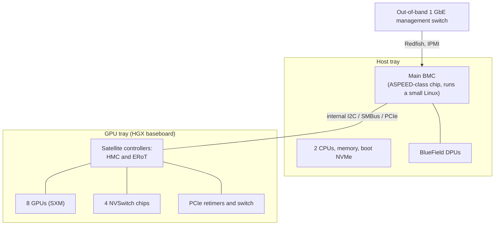

# 7.13 Redfish on NVIDIA DGX and HGX: BMC, GPU baseboard and management

| | |
|---|---|
| Level | Intermediate to Advanced |
| Priority tier | 1 |
| Lab venue | Laptop |
| Part | Part 7: Redfish and BMC |
| Status | Drafted (DMTF validators, Tacklebox, and `dgx_record_lab.py` 3/3 self-checks run against mock; **untested** / **not verified** on live DGX/HGX) |

## Why this matters for AI infrastructure

Chapters 7.2 to 7.12 taught Redfish in general. A GPU cluster is not general: the server has a GPU baseboard with its own controllers, NVLink switch chips, DPUs, a very large power draw and a vendor-specific management stack. In a DGX SuperPOD, NVIDIA's reference designs say how the management network is built and which BMCs exist; in an HGX server built by an OEM, a different company owns the BMC. Knowing **who owns what** decides whom you call and which firmware bundle you may apply.

## Prerequisites and outcomes

You need chapters 7.1 to 7.12. After this chapter you can:

- tell DGX, HGX and rack-scale systems apart in terms of management
- explain the extra controllers on a GPU baseboard
- describe how a SuperPOD management network is built
- use NVSM and BCM's wrapper next to Redfish
- write an acceptance profile and test a service with DMTF's official tools
- record a real service and test your automation against the recording

## 1. Three kinds of NVIDIA GPU systems

| | **DGX** (NVIDIA-built server) | **HGX** (GPU baseboard in an OEM server) | **Rack-scale** (GB200 or GB300 NVL72) |
|---|---|---|---|
| Who builds the server | NVIDIA | Dell, HPE, Supermicro and others | NVIDIA reference rack |
| Whose BMC and BIOS | NVIDIA's | **the OEM's** | NVIDIA's compute trays |
| Firmware bundle | NVIDIA's validated bundle | OEM qualified bundle | NVIDIA's bundle |
| Support | NVIDIA | the OEM for the system, NVIDIA for the GPU parts | NVIDIA |

The user's HGX notes (volume 6) put it clearly: in an HGX server "firmware management is the single most dangerous operational task", because there are dozens of independent firmware ecosystems, and each has an owner: system BIOS and BMC (the OEM, for example Dell iDRAC), network cards (NVIDIA, often repackaged and certified by the OEM), GPU VBIOS, NVSwitch firmware, and the baseboard controllers (the HGX management controller, **HMC**, and the external root of trust, **ERoT**). The same notes' lab table says: enforce change control and make no independent firmware updates on OEM systems, because the OEM qualifies the bundle. The practical rule: **do not apply NVIDIA firmware to an OEM server unless the OEM supports that exact combination**.

### 1.1 Physical anatomy, PCIe topology, and support boundaries on OEM HGX vs DGX (`volume-06/ch1–ch6`)

Understanding the physical and operational boundary between the **top half** (OEM host tray) and the **bottom half** (NVIDIA HGX baseboard) prevents costly purchasing and troubleshooting mistakes (`nvidia-zero-to-hero/volume-06/chapter-01` through `chapter-06`):

1. **Why hyperscalers and enterprise OEMs buy HGX baseboards (`volume-06/ch1`):** Cloud providers (AWS Nitro, Azure Cerberus) and enterprise OEMs (Dell PowerEdge `XE9680`, HPE, Supermicro, Lenovo) buy the raw **NVIDIA HGX baseboard** (8 or 4 SXM GPUs + NVSwitches + VRMs) and integrate it into their own chassis, power/cooling manifolds, host CPU motherboards, and BMC stacks (`iDRAC`, `iLO`, `XClarity`).
2. **SXM FRU modules versus soldered NVSwitch ASICs (`volume-06/ch2`):**
   - **SXM GPUs are bolted Field Replaceable Units (FRUs):** They mate with the HGX PCB via high-density mezzanine connectors and precision torque screws. A single failed GPU can be unbolted and replaced without replacing the whole baseboard.
   - **NVSwitch chips (`4` on an 8-GPU H100 board, providing `900 GB/s` non-blocking mesh) are permanently soldered to the HGX PCB:** If an NVSwitch ASIC fails (causing a GPU to lose NVLink connectivity and fall back to PCIe while still computing normally in `nvidia-smi`), replacing the SXM GPU will fix nothing—the entire bottom-half HGX baseboard must be RMA'd.
   - **4-GPU ("Redstone") vs 8-GPU ("Delta") boards:** 4-GPU baseboards often wire GPUs via direct point-to-point NVLink without NVSwitch chips and cannot be upgraded to 8 GPUs later.
   - **High-voltage DC power delivery (`48–54V` class vs `12V`):** Because $I = P / V$, feeding `5.6+ kW` (`8 x 700 W` GPUs) at `12 V` would require `> 460 A` and massive $I^2 R$ copper losses; stepping the distribution bus up to the `48–54 V` class cuts current roughly $4\times$ before on-board VRMs step down to `~1 V` at the GPU die.
3. **Top-half PCIe and networking differences (`volume-06/ch1, ch4, ch6` & `lab-01, lab-02`):** Even when two servers share the exact same NVIDIA HGX baseboard, the OEM controls the **top half**: whether there is a strict **1:1 ratio of GPUs to `400 Gbps` ConnectX-7 NICs** (`8` compute NICs = `3.2 Tbps` egress) connected through dedicated **PCIe Gen5 switches** for lossless GPUDirect RDMA, or whether a cheaper SKU omits PCIe switches and routes traffic across the host CPU's UPI/Infinity Fabric. NVIDIA's **NVIDIA-Certified Systems** program (`NVQual`) validates thermal, power, and PCIe topology baselines, but architects must always verify the exact PCIe switch and NIC count before procurement.
4. **Hardware RMA escalation boundary (`volume-06/ch3`):** On an OEM HGX server, **the OEM owns the hardware warranty and field dispatch for the entire server** (both top and bottom halves). For example, if a Lenovo or Dell HGX server logs `Xid 79 (GPU has fallen off the bus)`, the root cause could be a loose OEM PCIe riser cable or an HGX retimer/GPU fault. Do not open a hardware dispatch ticket directly with NVIDIA; collect both `nvidia-bug-report.sh` and the OEM's Redfish/diagnostic bundle (`XClarity`/`iDRAC`) and escalate to the **OEM's support team**.

## 2. Inside a GPU server, from the management point of view

The notes (volume 10 chapter 1) describe a DGX H100 as two trays in an 8U chassis:



The main BMC aggregates data from the **satellite controllers** on the GPU tray, so Redfish on the main BMC exposes GPU data. The notes list the sensors and endpoints as follows, and the BCM manual confirms the inventory (the 30 HGX components in chapter 7.10):

| What the notes say | Meaning |
|---|---|
| `/redfish/v1/Systems/DGX` | the host system (name as written in the notes for DGX H100 and H200) |
| `/redfish/v1/Systems/HGX_Baseboard_0` | the GPU baseboard as its own system |
| `/redfish/v1/Systems/HGX_Baseboard_0/Processors/GPU_SXM_<id>/EnvironmentMetrics` | per-GPU power and temperature readings |
| `/redfish/v1/Chassis/DGX/Sensors` | chassis sensors |
| `/redfish/v1/Managers/BMC` | the BMC |
| `/redfish/v1/UpdateService/FirmwareInventory` with `HostBMC_0` etc. | firmware inventory |
| `/redfish/v1/TelemetryService/MetricReports/NvidiaNMMetrics_0` | a telemetry report |

The BCM manual shows that names differ between generations: its GB300 examples list chassis such as `BMC_0`, `CBC_0`, `Chassis_0`, and its firmware lists use `HGX_FW_GPU_SXM_1` (with the number starting at 1) and `HGX_FW_NVSwitch_0` (starting at 0). The notes themselves warn: "Treat names in angle brackets as values you discover." Everything in section 2 is therefore a **starting point to confirm** on your platform, not a fixed API.

### What each controller does

| Part | Role (from the sources) |
|---|---|
| Main BMC | the Redfish and IPMI endpoint on the 1 GbE management network, always on |
| HMC (HGX management controller) | manages the baseboard (GPU, NVSwitch, retimers), reports to the main BMC |
| ERoT (external root of trust) | a security chip that authenticates firmware. The BCM firmware list has `HGX_FW_ERoT_BMC_0`, `ERoT_FPGA_0`, `ERoT_NVSwitch_n`, `ERoT_PCIeSwitch_0` |
| FPGA and CPLD | small logic chips for power sequencing and glue (`HGX_FW_FPGA_0`, `CPLDMB_0`) |
| PCIe retimers and switch | clean the PCIe signal between CPUs, GPUs and NICs (`HGX_FW_PCIeRetimer_n`) |

The BCM manual also shows that these parts are visible as separate firmware items and that **updating them takes an AC power cycle** on a DGX H100 (chapter 7.10).

## 3. Rack-scale: GB200 and GB300

In the DGX GB300 SuperPOD reference architecture each NVL72 rack has compute trays, **nine NVLink switch trays** and **eight power shelves**:

- Each **NVLink switch tray** has two COMe RJ45 ports for **NVOS** (the switch operating system) and **one BMC module with its own RJ45 port** for out-of-band management.
- Each **power shelf** has six 5.5 kW supplies in N redundancy (up to 33 kW), rear RJ45 ports for power brakes and other out-of-band functions, and a BMC port at the front.
- The management network is a **separate out-of-band (OOB) Ethernet fabric** of SN2201 switches that connects "the management ports of all devices including DGX GB300 compute trays, switch trays, and management servers, storage, networking gear, rack PDUs, and all other devices". The document says there is no case where an unprivileged user needs access to those ports, so they are separated by logical network separation. It carries "all IPMI related control traffic" and also the management of the InfiniBand and NVLink fabrics, and is rolled up into a dedicated VXLAN at the spine layer of each scalable unit.

Consequences for tooling:

1. One rack has dozens of BMCs: compute trays, switch trays, power shelves, plus PDUs. Your inventory must list them all.
2. The **NVLink switch tray is not managed with Redfish for firmware**: the BCM manual says its firmware commands use the **NVOS REST API** with separate credentials.
3. BCM subscribes to Redfish **events** from compute trays (kind `GB300`) and switch trays (`GB200SW`), as shown in the `redfishsubscriptions` output (chapter 7.5), and uses Redfish for leak detection on NVL8 hardware.
4. Liquid cooling (chapter 6.30) adds leak sensors and CDU data (chapter 7.8).

## 4. NVSM and BCM next to Redfish

Redfish is the out-of-band view. NVIDIA's **NVSM** (NVIDIA System Management) is the in-band view for DGX: it runs on the host and aggregates BMC data, host telemetry and GPU management data. The user's notes show `nvsm show health` and `nvsm show gpus`, and `nvsm dump health` for support bundles, with illustrative output that I did not reproduce.

The BCM manual (section 10.13) documents BCM's wrapper, the `nvsm` command in `cmsh` device mode:

| Command | What it does |
|---|---|
| `nvsm alerts` | lists the alerts NVSM detects, per node and component (the manual's example shows NVLink-C2C and GPU NVLink link problems) |
| `nvsm health` | runs an NVSM dump on the chosen nodes into a `.tar.xz` file under `/cm/shared/nvsm/<node>/`. "It can take about 15 minutes." `--quick` is faster but uses more memory and CPU |
| `nvsm status`, `nvsm stop` | check or abort a dump in progress |
| `nvsm info [--history]` | list the latest or past dump files (the example shows 417 MiB and 5.9 MiB files) |
| `nvsm versions [--details]` | component versions (BMC, CPLD, driver, DCGM, vBIOS and others) |

Use both views together. The BMC knows about fans, supplies and the state of a host that is down. NVSM and DCGM know about GPU errors, NVLink counters and clocks. In an investigation (chapters 7.8, 7.9, 7.11) you correlate them on one timeline.

## 5. Acceptance profiles: write down what "a good GPU node" must offer

How do you know a new server model offers the Redfish features your tools need? Write it down as a **profile** and test it. DMTF defines a profile format (the Redfish Interoperability Profile) and an official validator.

My profile `profiles/gpu_node_acceptance.json` states the minimum for an 8-GPU server: a `ComputerSystem` with `PowerState`, `Status` and `Processors` and a `Reset` action; `Processor` with `ProcessorType` and `Status`; `PCIeDevice` with a full `PCIeInterface`; `Port` with link state and speeds; `Chassis` with `Sensors`, `ThermalSubsystem` and `PowerSubsystem`; sensors with reading, type, units and physical context; `PowerSupply` with capacity and status; a `Manager` with firmware version and network protocol settings; an `UpdateService` with `FirmwareInventory` and a `SimpleUpdate` action that accepts `HTTPS`; software inventory with `Version` and `Updateable`; log services with `ClearLog`; account policy settings; and the event, task and session services.

Run both DMTF tools with one script:

```bash
pip install redfish_service_validator redfish_interop_validator
export REDFISH_PUBLICATIONS=/path/to/Redfish-Publications
code/part07/run_dmtf_validators.sh https://127.0.0.1:8443 admin adminpass /tmp/pki/ca.pem
```

### What happened on my mock

1. **First run, schema validation** (`rf_service_validator`, which checks every resource against the official schemas): 1,756 passed, **3 warnings**. They were real: drives were exposed under `Storage/<id>/Drives/<n>`, a URI the schema marks as deprecated (the current place is under the chassis), and `EventType` in `SSEFilterPropertiesSupported` is deprecated. I fixed both.
2. **First run, acceptance profile** (`rf_interop_validator`): 258 passed, **6 failed**. The failures included: the host system had no `Processors`, the chassis had no `ThermalSubsystem` and no `PowerSubsystem`, and (as written) every `ComputerSystem` had to have `LogServices` and a `Reset` action, which the GPU baseboard system does not have. The first three were real gaps in my mock, which I fixed. The last two are a **profile limitation**: a profile says "every ComputerSystem" and cannot say "this one but not that one", so I relaxed those two to `Recommended`.
3. **After the fixes:** service validator **1,944 passed, 0 warnings, 0 failures**. Acceptance profile **278 passed, 0 failed, 3 not tested**.
4. **Hardening profile** (`profiles/bmc_hardening.json`, used in chapter 7.15): **11 passed, 6 failed** on the default mock, as intended: HTTP, Telnet, IPMI and SSDP are on, NTP is off and Basic authentication is enabled.

One thing I learned about the tool: comparing a boolean property with `"Comparison": "Equal"` needs JSON booleans (`true`, `false`) in `Values`. With the strings `"True"` or `"true"` even correct values were reported as failures.

What a profile cannot do: it checks that things exist and have allowed values. It does not count devices ("eight GPUs") or check that readings are sensible. Use `rf_hardware.py` and `rf_inventory.py` for counts, and a baseline for firmware (chapter 7.10).

### DMTF's other command-line tools

The `Redfish-Tacklebox` package (installed as `redfish_utilities`) gives ready-made scripts. I ran three against the mock:

```text
rf_sys_inventory.py -r https://127.0.0.1:8443 -u admin -p adminpass     -> chassis, 2 CPUs, 8 GPUs, drives
rf_firmware_inventory.py ...                                            -> all 34 firmware items with versions
rf_sensor_list.py ...                                                   -> sensors, fans and supplies with thresholds
```

It also includes scripts for power reset (`rf_power_reset.py`, with `--system` and `--type` options), logs, accounts, certificates, updates and BIOS settings. They are good for a first look at any BMC. Their options differ from my tools, so read `--help`.

## 6. Record a real service, test offline forever

The safest way to build automation for a DGX you rarely have access to is to **record** its Redfish tree once and replay it. `rf_record.py` crawls a service with `GET` only, saves each resource as `index.json` in a folder (the DMTF mockup layout), and can replace serial numbers, UUIDs, MAC and IP addresses with placeholders (`--redact`):

```bash
python3 rf_record.py https://<bmc> <user> <password> ./dgx_h100_recording --redact
python3 redfish_mock.py --mockup ./dgx_h100_recording --port 8443
```

I tested the round trip on my mock: 153 resources recorded, replayed through `--mockup`, and a crawl of the replay found the same set of resources as the original (154 URIs counted by the crawler, including the live session). In `--mockup` mode the data is read-only, so a recording lets you test inventory, health, drift and parsing code but not actions.

Do this once on a real DGX, on one machine, with permission, and keep the recording in version control. Then every parser you write has real test data, and every new firmware release can be recorded and diffed against the old one.

## 7. A bring-up checklist for a new GPU server model

1. Identify the **owner** of the BMC and the firmware bundle (DGX, OEM HGX, rack-scale).
2. Connect the BMC to the OOB network; change factory credentials (chapter 7.4); set NTP; install your CA certificate (chapter 7.15).
3. **Record** the Redfish tree (`rf_record.py`).
4. Run the service validator and your acceptance profile; keep the reports.
5. Run `rf_inventory.py`, `rf_hardware.py`, `rf_sensors.py` and the firmware drift check.
6. Compare with the vendor's validated firmware bundle and update through the vendor's documented procedure (chapter 7.10).
7. Run the vendor's diagnostics and burn-in (the notes name `dcgmi diag -r 3`, then `-r 4` for extended; `nvbandwidth` for NVLink; `ib_write_bw` for the network) and keep the output as acceptance evidence. I did not run these tools.
8. Only then admit the node to the scheduler (chapter 6.14).

### 7.1 Architectural comparison: DGX H100/B200 vs OEM HGX vs GB200/GB300 NVL72

When an infrastructure architect designs a new AI cluster, one of the first decisions is whether to procure **turnkey NVIDIA DGX systems**, **enterprise OEM servers built around NVIDIA HGX baseboards** (such as Dell PowerEdge `XE9680`, Supermicro `SYS-821GE`, HPE Cray `XD670`, or Lenovo ThinkSystem `SR675`), or **rack-scale liquid-cooled NVL72 systems** (`GB200` / `GB300`). While all three run the exact same CUDA kernels and NCCL collectives, their out-of-band management planes and operational boundaries differ in three fundamental ways (`volume-06/ch4–ch7` and `superpod-gb300-ra`):

1. **Data-path symmetry and PCIe switch topology (`volume-06/ch4, ch6`):** On an 8-GPU node, intra-node GPU-to-GPU communication travels across the HGX baseboard's four NVSwitch ASICs (`900 GB/s` bidirectional per H100 GPU), while inter-node GPU-to-GPU communication travels out through PCIe Gen5 into the `400 Gbps` (`ConnectX-7`) or `800 Gbps` (`ConnectX-8`) network cards. In a reference DGX design, four dual-port or eight single-port compute NICs sit beneath dedicated **PCIe Gen5 switches** paired 1:1 with the SXM GPUs so GPUDirect RDMA packets never cross the host CPU socket or inter-socket UPI/Infinity Fabric links. On an OEM HGX server, the OEM designs the top-half PCIe topology; when evaluating two OEM quotes (`volume-06/labs/lab-01, lab-02`), you must inspect the Redfish `PCIeDevices` and `NetworkAdapters` collections (and `nvidia-smi topo -m` on a test unit) to verify that all eight compute NICs are present and symmetrically attached to the PCIe switch hierarchy.
2. **Rack-level NVLink domains and management endpoints in GB200/GB300 NVL72 (`volume-06/ch7` & `superpod-gb300-ra`):** In an air-cooled 8-GPU DGX or HGX server, the NVLink domain stops at the `8U` chassis boundary (`8` GPUs); scaling beyond `8` GPUs crosses the InfiniBand or RoCEv2 network fabric. In a rack-scale **GB200 or GB300 NVL72**, eighteen `1U` liquid-cooled compute trays (`4` Blackwell GPUs + `2` Grace CPUs per tray) and **nine `1U` NVLink switch trays** are interconnected by a blind-mate copper NVLink backplane cartridge inside the rack, forming a single **72-GPU NVLink domain** that acts as one giant accelerator. Because the NVLink fabric now spans twenty-seven separate physical trays plus **eight `33 kW` power shelves** inside the rack, out-of-band management shifts from "one BMC per server" to **rack-level orchestration**:
   - Every compute tray has its own BMC and BlueField-3 DPU BMC on the `SN2201` OOB switch.
   - Every NVLink switch tray has both a **BMC RJ45 port** (for hardware health and Redfish event subscriptions) and **two COMe RJ45 ports running NVOS** (which hosts the **NMX Manager** / NVOS REST API for NVLink fabric telemetry and switch-tray firmware updates).
   - Every power shelf has its own BMC port reporting per-PSU input/output wattage and busbar voltage (`powershelfoverview` in BCM).
3. **Thermal and power integration with the facility (`volume-06/ch5`):** Whereas air-cooled 8-GPU servers rely on internal chassis fan curves managed by the server's BMC alone, liquid-cooled HGX and NVL72 racks depend on an external Coolant Distribution Unit (CDU) and facility chilled-water loop. Consequently, BCM and Mission Control integrate BMC Redfish leak-detection events (`leakdetection` / `leakinfo`) directly with CDU telemetry (`cduoverview` over MQTT from the Building Management System) so a manifold leak or loss of coolant flow triggers a coordinated workload drain and power-down before hardware damage occurs.

## Exercises

1. **Running the Redfish Interoperability Profile & recording lab (`code/part07/dgx_record_lab.py`):** Run `python3 code/part07/dgx_record_lab.py` (`3/3` checks pass). Then run `code/part07/run_dmtf_validators.sh` against the mock server and inspect the generated HTML report to see why conditional or absent resources appear as `"Not tested"`.
2. **Adding a requirement to `profiles/gpu_node_acceptance.json`:** Open `code/part07/profiles/gpu_node_acceptance.json`, add `"LocationIndicatorActive": {"Requirement": "Recommended"}` under `Chassis.PropertyRequirements`, and re-run `dgx_record_lab.py` and the Interop Validator.
3. **Writing an Interoperability Profile fragment for a BlueField-3 DPU:** Write a JSON profile snippet requiring a `ComputerSystem` resource with `SystemType`, `Processors`, `Memory`, and `Bios` to validate DPU management readiness.
4. **Recording and replaying a live or mockup Redfish tree (`code/part07/rf_record.py`):** Run `rf_record.py` with `--redact` against a running mock server, inspect `Systems/System_0/index.json` to confirm `SerialNumber` and `UUID` are replaced with `"REDACTED"` (and IPv4 strings with `"0.0.0.0"`), and serve the recorded folder with `redfish_mock.py --mockup`.
5. **Counting management endpoints in a GB300 NVL72 rack (`superpod-gb300-ra` & `volume-06/ch7`):** Using Section 3 (`18` compute trays, `9` NVLink switch trays each with `1` BMC port + `2` COMe NVOS ports, `8` power shelves each with `6 x 5.5 kW = 33 kW` PSUs and `1` BMC port, plus rack PDUs and `SN2201` OOB switches), calculate the total number of OOB switch ports and IP addresses needed per rack.
6. **Triaging `Xid 79` vs NVLink fallback on an OEM HGX server (`volume-06/ch2, ch3`):** Contrast the hardware diagnosis and vendor escalation path on a Dell/Lenovo 8-GPU HGX H100 server when: (a) `GPU 2` works in `nvidia-smi` over PCIe but falls back from NVLink to PCIe during NCCL collectives (suspect NVSwitch ASIC on the HGX baseboard vs SXM pin seating), versus (b) `GPU 4` throws `Xid 79 (GPU has fallen off the bus)` (suspect OEM PCIe riser cable/retimer vs SXM module; escalate to OEM support with both `nvidia-bug-report.sh` and OEM Redfish logs).

## 9. Interview angles

- "What is the difference between DGX and HGX for operations?" Who builds it, whose BMC and firmware bundle, who supports it.
- "What controllers sit on a GPU baseboard?" HMC, ERoT, FPGA and CPLD, retimers and switches, reporting to the main BMC.
- "How is the SuperPOD management network built?" A separate OOB Ethernet of SN2201 switches, VXLAN at the spine layer, connecting all BMCs, switch trays, power shelves and PDUs, with no user access.
- "How do you test Redfish compatibility of a new server model?" Schema validation, an interoperability profile of the features you use, and a recorded tree to test your parsers.
- "NVSM or Redfish?" Both: NVSM for host-side GPU health, Redfish for out-of-band hardware state and control.

## Checkpoint questions (20)

<details>
<summary>1. Who designs and supports the BMC and system BIOS on an NVIDIA DGX server versus an OEM HGX server (such as a Dell PowerEdge XE9680 or Lenovo ThinkSystem)?</summary>

On an **NVIDIA DGX** server, NVIDIA designs and supports the entire system—the host motherboard, BMC, BIOS, and HGX GPU tray—under a single validated firmware bundle. On an **OEM HGX** server, the **OEM** (Dell, HPE, Supermicro, Lenovo) designs and owns the host motherboard, chassis, cooling, BIOS, and BMC (`iDRAC`, `iLO`, `XClarity`) and qualifies the integrated firmware bundle.
</details>

<details>
<summary>2. Why is flashing raw NVIDIA GPU/NVSwitch firmware directly onto an OEM HGX server ("Frankenstein flashing") dangerous (`volume-06/ch3`)?</summary>

OEMs tightly couple their chassis fan curves, power-capping logic, and BMC sensor tables (`iDRAC`/`iLO`) to specific co-tested versions of System BIOS, HMC, VBIOS, and NVSwitch firmware. Flashing an uncertified standalone firmware package can break thermal telemetry or power handshakes between the OEM BMC and the HGX baseboard.
</details>

<details>
<summary>3. Name the four auxiliary management/security/signal chips on an HGX GPU baseboard besides the SXM GPUs and NVSwitches.</summary>

1. **HMC (HGX Management Controller):** Satellite BMC/microcontroller that aggregates GPU, NVSwitch, and retimer telemetry and reports to the host BMC.
2. **ERoT (External Root of Trust):** Dedicated hardware security chips (`HGX_FW_ERoT_BMC_0`, `ERoT_FPGA_0`, `ERoT_NVSwitch_n`, `ERoT_PCIeSwitch_0`) that cryptographically verify firmware signatures before boot.
3. **FPGA and CPLD (`HGX_FW_FPGA_0`, `CPLDMB_0`):** Board power-sequencing and glue logic controllers.
4. **PCIe Gen5 Retimers and Switches (`HGX_FW_PCIeRetimer_n`, `HGX_FW_PCIeSwitch_0`):** Signal regeneration and switching chips between the host CPU tray and the GPUs/NICs.
</details>

<details>
<summary>4. What is the physical difference in field replaceability between an SXM GPU module and an NVSwitch chip on an 8-GPU HGX baseboard (`volume-06/ch2`)?</summary>

**SXM GPUs** attach via high-density mezzanine connectors and bolts, making them **Field Replaceable Units (FRUs)** that a technician can swap individually. **NVSwitch chips** (`4` ASICs on an H100 8-GPU board) are **permanently soldered to the HGX PCB**—if an NVSwitch chip fails, the entire HGX baseboard must be replaced.
</details>

<details>
<summary>5. How does the main motherboard BMC expose GPU and NVSwitch sensors over Redfish when those chips sit on a separate HGX tray?</summary>

The GPU tray's **HMC (Satellite Management Controller)** polls the SXM GPUs and NVSwitches locally over `I2C`/`SMBus` and forwards the telemetry over an internal management bus (`I2C`/`MCTP`/`USB-NIC`) to the main motherboard BMC, which publishes them under `/redfish/v1/Systems/HGX_Baseboard_0` and `/redfish/v1/Chassis/DGX/Sensors`.
</details>

<details>
<summary>6. Why must your Redfish scripts discover collection member IDs dynamically even across NVIDIA's own DGX generations?</summary>

Because member names change across generations and firmware releases—for example, DGX H100/H200 uses `Systems/DGX`, `Systems/HGX_Baseboard_0`, and `Chassis/DGX`, whereas BCM's GB300 examples show chassis named `BMC_0`, `CBC_0`, and `Chassis_0`.
</details>

<details>
<summary>7. In the DGX GB300 NVL72 SuperPOD reference architecture, how many NVLink switch trays and power shelves sit in each rack, and what management ports does each have?</summary>

Each NVL72 rack contains **nine NVLink switch trays** (each having two COMe RJ45 ports for **NVOS** plus **one dedicated BMC RJ45 port**) and **eight power shelves** (each holding six `5.5 kW` PSUs for up to `33 kW` in `N` redundancy, with a front BMC RJ45 port and rear RJ45 control ports).
</details>

<details>
<summary>8. How does firmware management for an NVLink switch tray (`gb200sw` / `gb300sw`) in BCM differ from a compute tray?</summary>

Compute trays are flashed over **Redfish** (`bmcsettings`), whereas NVLink switch trays are flashed over the switch's **NVOS REST API** using credentials stored in BCM's `accesssettings`.
</details>

<details>
<summary>9. How is the Out-of-Band (OOB) management network architected in a DGX SuperPOD (`superpod-gb300-ra`)?</summary>

It is a physically separate 1 GbE Ethernet fabric built on **NVIDIA Spectrum `SN2201` switches** connecting every compute tray BMC, NVLink switch tray BMC/NVOS port, power shelf BMC, rack PDU, storage controller, and management server, rolled up into a dedicated VXLAN at the SU spine layer with zero access from unprivileged tenant networks.
</details>

<details>
<summary>10. In BCM's `cmsh` `device` mode (§10.13), what do `nvsm alerts`, `nvsm health`, and `nvsm versions` do?</summary>

- **`nvsm alerts`:** Lists hardware/fabric alerts detected by the in-band NVSM daemon (such as NVLink or C2C link issues).
- **`nvsm health`:** Triggers an `nvsm dump health` archive on target nodes, saving `.tar.xz` bundles under `/cm/shared/nvsm/<node>/` (taking `~15` minutes, or faster with `--quick`).
- **`nvsm versions [--details]`:** Reports installed BMC, CPLD, GPU driver, DCGM, and VBIOS versions across nodes.
</details>

<details>
<summary>11. What does `redfishsubscriptions` in BCM `cmsh` display?</summary>

It lists every managed device along with its hostname, Redfish event subscription ID, initialization/subscription state, BMC IP, hardware kind (`GB300`, `GB200SW`), port (`443`), and SSL status.
</details>

<details>
<summary>12. What is a DMTF Redfish Interoperability Profile (`RedfishInteroperabilityProfile`), and which official tool validates a BMC against it?</summary>

A machine-readable JSON specification (such as `code/part07/profiles/gpu_node_acceptance.json`) declaring which Redfish resources, properties, actions, and values a server must implement to be accepted by your automation, validated using DMTF's **`Redfish-Interop-Validator` (`rf_interop_validator`)**.
</details>

<details>
<summary>13. What does DMTF's `Redfish-Service-Validator` (`rf_service_validator`) check, and what two deprecation warnings did it catch in the early version of `redfish_mock.py`?</summary>

`rf_service_validator` crawls a Redfish service and validates every resource payload against the official DMTF CSDL/JSON schemas. On our early mock, it caught drives placed under the deprecated `Storage/<id>/Drives/<n>` path (instead of `Chassis/<id>/Drives/<n>`) and the deprecated `EventType` property in `SSEFilterPropertiesSupported`.
</details>

<details>
<summary>14. What hardware acceptance checks can a Redfish Interoperability Profile NOT express on its own?</summary>

A profile checks schema presence and allowed values across all instances of a resource type, but cannot easily express **per-instance conditional rules** (e.g., requiring `Reset` on `System_0` but not on `HGX_Baseboard_0`), **exact component counts** ("must have 8 GPUs and 8 400G NICs"), or **live threshold/link-speed degradation**—which is why you pair the profile with `rf_inventory.py` and `rf_hardware.py`.
</details>

<details>
<summary>15. When writing a `"Comparison": "Equal"` check on a boolean property inside a Redfish Interoperability Profile, how must the expected value in `Values` be formatted?</summary>

It must be a native **JSON boolean (`true` or `false`)**, never a quoted string (`"True"` or `"true"`), or `rf_interop_validator` will fail the comparison even when the BMC returns the right boolean.
</details>

<details>
<summary>16. What is DMTF `Redfish-Tacklebox` (`redfish_utilities`), and name three CLI scripts it provides.</summary>

`Redfish-Tacklebox` is DMTF's pre-built command-line utility suite (`pip install redfish_utilities`), including **`rf_sys_inventory.py`**, **`rf_firmware_inventory.py`**, **`rf_sensor_list.py`**, and **`rf_power_reset.py`**.
</details>

<details>
<summary>17. What does `code/part07/rf_record.py --redact` do, and which sensitive fields does it scrub?</summary>

It crawls a live Redfish service using read-only `GET` requests, writes every resource to `<outdir>/<path>/index.json` in DMTF mockup format, and replaces **`SerialNumber`, `UUID`, `MACAddress`, `PermanentMACAddress`, `AssetTag`, `HostName`, `FQDN`, `SKU`** with `"REDACTED"` and IPv4 addresses with `"0.0.0.0"`.
</details>

<details>
<summary>18. Why should you record one node of each GPU server model (`rf_record.py`) and commit the redacted tree to Git?</summary>

It gives your engineering team a permanent, offline replica of that exact vendor/firmware resource tree (`redfish_mock.py --mockup <dir>`) to run in CI tests and allows you to `diff` the resource tree before and after BMC firmware upgrades.
</details>

<details>
<summary>19. What can you test against a `redfish_mock.py --mockup` recording, and what can you NOT test against it?</summary>

You can test **read-only discovery, inventory, sensor scraping, hardware link-degradation checks, log parsing, and firmware drift detection**, because `--mockup` serves static `index.json` files. You cannot test stateful mutations or hardware side effects (power resets, firmware flashing) against a static recording.
</details>

<details>
<summary>20. If an OEM HGX server quote is 15% cheaper than an NVIDIA DGX H100 (`volume-06/ch1`), what top-half architectural details must you verify before buying?</summary>

Verify the **host-to-GPU PCIe topology and network card ratio**: whether the OEM server includes a full **1:1 ratio of `400 Gbps` ConnectX-7 NICs to GPUs** (`8` compute NICs for `3.2 Tbps` egress) connected via dedicated **PCIe Gen5 switches** for GPUDirect RDMA, and whether the OEM chassis airflow/liquid cooling can sustain `8 x 700 W` GPUs without thermal throttling (`NVIDIA-Certified` / `NVQual`).
</details>

## Sources and review notes

- **NVIDIA-DevOps notes:** `nvidia-zero-to-hero/volume-05/chapter-03-dgx-management-plane.md` (DGX management plane, NVSM, firmware-over-SSH risk), `volume-10/01-bare-metal-and-bmc-lifecycle.md` (hardware hierarchy, dual-tray design, satellite controllers, endpoint list, burn-in commands), and all 10 files of `nvidia-zero-to-hero/volume-06/`: `nvidia-zero-to-hero/volume-06/chapter-01-why-hgx-exists.md` (merchant silicon strategy, AWS Nitro/Azure Cerberus, Dell XE9680 1:1 NIC ratio), `nvidia-zero-to-hero/volume-06/chapter-02-inside-an-hgx-platform.md` (bolted SXM FRUs vs soldered NVSwitches, PCIe retimers, `48–54V` power delivery, 4-GPU Redstone vs 8-GPU Delta), `nvidia-zero-to-hero/volume-06/chapter-03-oem-integration-and-support-boundaries.md` (OEM vs NVIDIA firmware and RMA boundary, `NVIDIA-Certified` / `NVQual`, `Xid 79` escalation), `nvidia-zero-to-hero/volume-06/chapter-04-hgx-topology-and-data-paths.md`, `nvidia-zero-to-hero/volume-06/chapter-05-hgx-power-cooling-and-rack-integration.md`, `nvidia-zero-to-hero/volume-06/chapter-06-hgx-networking-storage-and-cluster-integration.md`, `nvidia-zero-to-hero/volume-06/chapter-07-gb200-nvl72-rack-scale-architecture.md`, `nvidia-zero-to-hero/volume-06/labs/lab-01-compare-hgx-server-designs.md`, and `nvidia-zero-to-hero/volume-06/labs/lab-02-review-an-hgx-rack-design.md`. All unchecked against live hardware.
- **BCM 11 Administrator Manual:** appendix N (Redfish management and device naming), section 14.5 (firmware: component lists), section 10.13 (monitoring with `nvsm`).
- **NVIDIA DGX SuperPOD reference architecture for DGX GB300** (study corpus book `superpod-gb300-ra`): NVL72 rack contents, NVLink switch tray BMC and NVOS ports, power shelves, the OOB management network of SN2201 switches. The B200 reference architecture was searched for BMC details but returned none, so it is not used here.
- **DMTF tools and data:** Redfish-Service-Validator 3.1.8, Redfish-Interop-Validator 3.0.4, Redfish-Tacklebox (`redfish_utilities`), the profile schema `RedfishInteroperabilityProfile.v1_10_0` and the mockups in `Redfish-Publications` at commit `fa6d23d9`.
- **Run here:** the two validators and three Tacklebox scripts against the mock over HTTPS with a lab CA; `rf_record.py` round trip.
- **Not verified:** every NVIDIA-specific path, name and behaviour (`DGX`, `HGX_Baseboard_0`, `NvidiaNMMetrics_0`, power capping, OEM extensions), NVSM output, and whether a real DGX passes my profile. The profile is a teaching profile that I wrote. It is not NVIDIA's or DMTF's.
