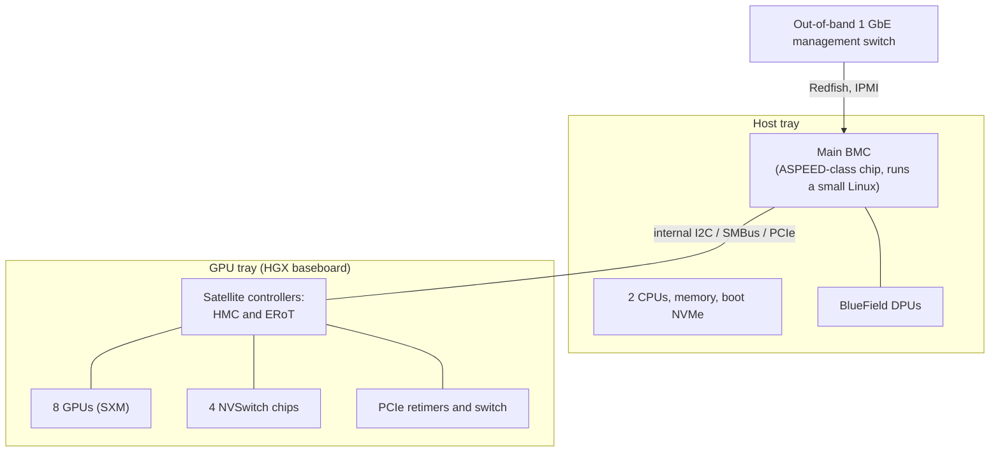

# 7.13 Redfish on NVIDIA DGX and HGX: BMC, GPU baseboard and management

| | |
|---|---|
| Level | Intermediate to Advanced |
| Priority tier | 1 |
| Lab venue | Laptop |
| Part | Part 7: Redfish and BMC |
| Status | Drafted (DMTF validators, Tacklebox, and `dgx_record_lab.py` 3/3 self-checks run against mock; **untested** / **not verified** on live DGX/HGX) |

## Why this matters for AI infrastructure

Suppose a GPU server stops answering on its management network after a firmware update. The vendor asks which firmware bundle you applied, and before you can answer, you need to know who owns the box. Chapters 7.2 to 7.12 taught Redfish in general. A GPU cluster is less general than that. The server carries a GPU baseboard with its own controllers and NVLink switch chips, plus DPUs, a very large power draw and a vendor-specific management stack.

Who builds the machine decides how it is managed. In a DGX SuperPOD, NVIDIA's reference designs say how the management network is built and which BMCs exist. In an HGX server built by an OEM, a different company owns the BMC. Knowing **who owns what** decides whom you call and which firmware bundle you may apply.

## Prerequisites and outcomes

You need chapters 7.1 to 7.12 before you start this one. Once you finish, you should be able to tell DGX, HGX and rack-scale systems apart by how they are managed. You should be able to name the extra controllers on a GPU baseboard and describe how a SuperPOD management network is built.

You should also be able to use NVSM and BCM's wrapper next to Redfish. Finally, you will write an acceptance profile and test a service with DMTF's official tools. You will record a real service too, so your automation can be tested against that recording.

## 1. Three kinds of NVIDIA GPU systems

Before you touch a GPU server, find out which of these three families it belongs to. The family decides who owns the BMC, the BIOS and the firmware bundle, and who answers the support call. Notice the middle column in particular. On an OEM system the BMC and BIOS belong to the OEM, even though the GPUs are NVIDIA's.

| | **DGX** (NVIDIA-built server) | **HGX** (GPU baseboard in an OEM server) | **Rack-scale** (GB200 or GB300 NVL72) |
|---|---|---|---|
| Who builds the server | NVIDIA | Dell, HPE, Supermicro and others | NVIDIA reference rack |
| Whose BMC and BIOS | NVIDIA's | **the OEM's** | NVIDIA's compute trays |
| Firmware bundle | NVIDIA's validated bundle | OEM qualified bundle | NVIDIA's bundle |
| Support | NVIDIA | the OEM for the system, NVIDIA for the GPU parts | NVIDIA |

The user's HGX notes (volume 6) put it bluntly: in an HGX server, "firmware management is the single most dangerous operational task". The reason is that an HGX server has dozens of independent firmware ecosystems, and each one has its own owner. The system BIOS and BMC belong to the OEM, for example Dell iDRAC. Network cards come from NVIDIA but are often repackaged and certified by the OEM. The GPU VBIOS, the NVSwitch firmware and the baseboard controllers complete the list. Those controllers are the HGX management controller, HMC, and the external root of trust, ERoT.

The lab table in the same notes tells you to enforce change control and to make no independent firmware updates on OEM systems, because the OEM qualifies the bundle. The practical rule follows from that: do not apply NVIDIA firmware to an OEM server unless the OEM supports that exact combination.

### 1.1 Physical anatomy, PCIe topology, and support boundaries on OEM HGX vs DGX (`volume-06/ch1–ch6`)

Knowing where the OEM's top half stops and NVIDIA's bottom half starts prevents costly purchasing and troubleshooting mistakes. Four points follow from that boundary. Their sources run from `nvidia-zero-to-hero/volume-06/chapter-01` through `chapter-06`.

The first point is why anyone buys a bare HGX baseboard at all. Cloud providers such as AWS, with Nitro, and Azure, with Cerberus, buy it. So do enterprise OEMs like Dell PowerEdge `XE9680`, HPE, Supermicro and Lenovo. The raw NVIDIA HGX baseboard carries 8 or 4 SXM GPUs, NVSwitches and VRMs. The buyer then builds it into its own chassis, power and cooling manifolds, host CPU motherboard and BMC stack. That BMC stack is `iDRAC`, `iLO` or `XClarity`. The source for this is `volume-06/ch1`.

The second point concerns which parts you can swap in the field. SXM GPUs are bolted Field Replaceable Units, or FRUs. They mate with the HGX board through high-density mezzanine connectors and precision torque screws. A single failed GPU can be unbolted and replaced without touching the rest of the baseboard. NVSwitch chips are different. There are four on an 8-GPU H100 board, providing a 900 GB/s non-blocking mesh, and they are permanently soldered to the HGX PCB. If one fails, the GPU loses its NVLink connectivity and falls back to PCIe. It still computes normally, and `nvidia-smi` still shows it as working. Replacing the SXM GPU fixes nothing in that case. The entire bottom-half HGX baseboard must be RMA'd. The source for this is `volume-06/ch2`.

Two more facts belong to that second point. Four-GPU Redstone boards often wire their GPUs point-to-point over NVLink without NVSwitch chips, and you cannot upgrade them to 8 GPUs later. Power delivery matters too. Current equals power divided by voltage, so $I = P / V$. Feeding 8 GPUs at 700 W each means 5.6 kW or more. At `12V`, that would need more than 460 A, and the copper would lose a large amount of power as $I^2 R$ heat. Stepping the distribution bus up from `12V` to the `48–54V` class cuts the current roughly $4\times$. The on-board VRMs then step the voltage down to about `~1 V` at the GPU die.

The third point is the top half. Two servers can share the exact same NVIDIA HGX baseboard and still differ, because the OEM controls the top half. One design gives a strict 1:1 ratio of GPUs to `400 Gbps` ConnectX-7 NICs, which is 8 compute NICs and `3.2 Tbps` of egress. Those NICs connect through dedicated PCIe Gen5 switches, which keeps GPUDirect RDMA lossless. A cheaper SKU may drop the PCIe switches and route traffic across the host CPU's UPI or Infinity Fabric instead. NVIDIA's NVIDIA-Certified Systems program, `NVQual`, validates thermal, power and PCIe topology baselines. Even so, check the exact PCIe switch and NIC count yourself before you buy. The source for this is `volume-06/ch1, ch4, ch6` and the labs `lab-01` and `lab-02`.

The fourth point is who fixes the server when it breaks. On an OEM HGX server, the OEM owns the hardware warranty and field dispatch for the whole server, both halves. Suppose a Lenovo or Dell HGX server logs `Xid 79 (GPU has fallen off the bus)`. The cause could be a loose OEM PCIe riser cable, or it could be an HGX retimer or GPU fault. Do not open a hardware dispatch ticket directly with NVIDIA. Gather both `nvidia-bug-report.sh` and the OEM's Redfish or diagnostic bundle, such as `XClarity` or `iDRAC`, and send them to the **OEM's support team**. The source for this is `volume-06/ch3`.

## 2. Inside a GPU server, from the management point of view

When a GPU node misbehaves, you need to know which controller to ask. The notes (volume 10 chapter 1) describe a DGX H100 as two trays in an 8U chassis. The diagram below shows how the two trays connect.



The main BMC gathers data from the satellite controllers on the GPU tray. That is why Redfish on the main BMC can show GPU data at all. The BCM manual confirms the inventory (the 30 HGX components in chapter 7.10). The table below lists the endpoints the notes name, and these are the ones you will query first.

| What the notes say | Meaning |
|---|---|
| `/redfish/v1/Systems/DGX` | the host system (name as written in the notes for DGX H100 and H200) |
| `/redfish/v1/Systems/HGX_Baseboard_0` | the GPU baseboard as its own system |
| `/redfish/v1/Systems/HGX_Baseboard_0/Processors/GPU_SXM_<id>/EnvironmentMetrics` | per-GPU power and temperature readings |
| `/redfish/v1/Chassis/DGX/Sensors` | chassis sensors |
| `/redfish/v1/Managers/BMC` | the BMC |
| `/redfish/v1/UpdateService/FirmwareInventory` with `HostBMC_0` etc. | firmware inventory |
| `/redfish/v1/TelemetryService/MetricReports/NvidiaNMMetrics_0` | a telemetry report |

Names change from one generation to the next, so do not hard-code them. The BCM manual's GB300 examples list chassis such as `BMC_0`, `CBC_0` and `Chassis_0`. Its firmware lists use `HGX_FW_GPU_SXM_1`, which starts counting at 1, and `HGX_FW_NVSwitch_0`, which starts at 0. The notes warn you to "Treat names in angle brackets as values you discover." Treat everything in this section as a starting point to confirm on your platform, not as a fixed API.

### What each controller does

Each part on the GPU tray has its own job, and the table below gives the role the sources assign to each one. The BCM manual also shows that these parts appear as separate firmware items. Updating them takes an AC power cycle on a DGX H100 (chapter 7.10), so plan for that downtime before you start.

| Part | Role (from the sources) |
|---|---|
| Main BMC | the Redfish and IPMI endpoint on the 1 GbE management network, always on |
| HMC (HGX management controller) | manages the baseboard (GPU, NVSwitch, retimers), reports to the main BMC |
| ERoT (external root of trust) | a security chip that authenticates firmware. The BCM firmware list has `HGX_FW_ERoT_BMC_0`, `ERoT_FPGA_0`, `ERoT_NVSwitch_n`, `ERoT_PCIeSwitch_0` |
| FPGA and CPLD | small logic chips for power sequencing and glue (`HGX_FW_FPGA_0`, `CPLDMB_0`) |
| PCIe retimers and switch | clean the PCIe signal between CPUs, GPUs and NICs (`HGX_FW_PCIeRetimer_n`) |

## 3. Rack-scale: GB200 and GB300

Picture one rack holding dozens of BMCs. If your inventory misses even one of them, a device goes unmanaged without anyone noticing. In the DGX GB300 SuperPOD reference architecture, each NVL72 rack holds compute trays, nine NVLink switch trays and eight power shelves. Each of those parts has its own management port.

- Each **NVLink switch tray** has two COMe RJ45 ports for NVOS, the switch operating system. It also has one BMC module with its own RJ45 port for out-of-band management.
- Each power shelf holds six 5.5 kW supplies in N redundancy, which gives up to 33 kW. It has rear RJ45 ports for power brakes and other out-of-band functions, and a BMC port at the front.

The management network that ties these together is a separate out-of-band (OOB) Ethernet fabric built from SN2201 switches. It connects "the management ports of all devices including DGX GB300 compute trays, switch trays, and management servers, storage, networking gear, rack PDUs, and all other devices." The document says no unprivileged user ever needs those ports, so the network is kept apart by logical separation. The fabric carries "all IPMI related control traffic", along with the management of the InfiniBand and NVLink fabrics. At the spine layer of each scalable unit, it rolls up into a dedicated VXLAN.

Four consequences follow for your tooling.

1. One rack has dozens of BMCs: compute trays, switch trays, power shelves, plus PDUs. Your inventory must list them all.
2. The NVLink switch tray is not managed with Redfish for firmware. The BCM manual says its firmware commands use the **NVOS REST API** with separate credentials.
3. BCM subscribes to Redfish events from compute trays (kind `GB300`) and switch trays (`GB200SW`), as shown in the `redfishsubscriptions` output (chapter 7.5). It also uses Redfish for leak detection on NVL8 hardware.
4. Liquid cooling adds leak sensors and CDU data alongside the BMC data (chapters 6.30 and 7.8). Build your inventory from the rack's full device list, not from the compute trays you can see.

## 4. NVSM and BCM next to Redfish

When a node fails at 2 a.m., you usually need two views of it. Redfish gives you the out-of-band view, which comes from the BMC and works even when the host is down. NVIDIA's **NVSM** (NVIDIA System Management) gives you the in-band view for DGX. It runs on the host and aggregates BMC data, host telemetry and GPU management data. The user's notes show `nvsm show health` and `nvsm show gpus`, and `nvsm dump health` for support bundles, with illustrative output that I did not reproduce.

BCM documents its own wrapper, the `nvsm` command in `cmsh` device mode (section 10.13). The table lists what each subcommand does. Note the timing on `nvsm health`, because a full dump takes a while.

| Command | What it does |
|---|---|
| `nvsm alerts` | lists the alerts NVSM detects, per node and component (the manual's example shows NVLink-C2C and GPU NVLink link problems) |
| `nvsm health` | runs an NVSM dump on the chosen nodes into a `.tar.xz` file under `/cm/shared/nvsm/<node>/`. "It can take about 15 minutes." `--quick` is faster but uses more memory and CPU |
| `nvsm status`, `nvsm stop` | check or abort a dump in progress |
| `nvsm info [--history]` | list the latest or past dump files (the example shows 417 MiB and 5.9 MiB files) |
| `nvsm versions [--details]` | component versions (BMC, CPLD, driver, DCGM, vBIOS and others) |

Use both views together. The BMC sees fans, power supplies and a host that is down. NVSM and DCGM see GPU errors, NVLink counters and clocks. When you investigate a fault (chapters 7.8, 7.9 and 7.11), line the two up on one timeline so you can see which event came first.

## 5. Acceptance profiles: write down what "a good GPU node" must offer

A new server model arrives, and your tools assume certain Redfish features exist. How do you know they do? Write the requirements down as a **profile**, then test the server against it. DMTF defines a profile format, the Redfish Interoperability Profile, and it ships an official validator for that format.

My profile `profiles/gpu_node_acceptance.json` sets the minimum for an 8-GPU server. It requires a `ComputerSystem` with `PowerState`, `Status` and `Processors`, plus a `Reset` action. A `Processor` needs `ProcessorType` and `Status`. A `PCIeDevice` needs a full `PCIeInterface`, and a `Port` needs link state and speeds. The `Chassis` needs `Sensors`, `ThermalSubsystem` and `PowerSubsystem`. Sensors need reading, type, units and physical context, and a `PowerSupply` needs capacity and status.

The profile also covers a `Manager` with firmware version and network protocol settings. It covers an `UpdateService` with `FirmwareInventory` and a `SimpleUpdate` action that accepts `HTTPS`. Software inventory needs `Version` and `Updateable`, and log services need `ClearLog`. Finally, it checks account policy settings and the event, task and session services.

Install both DMTF validators, point them at the Redfish publications, and run the wrapper script against your service.

```bash
pip install redfish_service_validator redfish_interop_validator
export REDFISH_PUBLICATIONS=/path/to/Redfish-Publications
code/part07/run_dmtf_validators.sh https://127.0.0.1:8443 admin adminpass /tmp/pki/ca.pem
```

### What happened on my mock

1. On the first run, the schema validator (`rf_service_validator`) checked every resource against the official schemas. It passed 1,756 checks and raised **3 warnings**. The warnings were real. Drives sat under `Storage/<id>/Drives/<n>`, a URI the schema marks as deprecated, because the current place is under the chassis. The `EventType` property in `SSEFilterPropertiesSupported` is also deprecated. I fixed both.
2. The first run of the acceptance profile (`rf_interop_validator`) passed 258 checks and failed 6. The failures included a host system with no `Processors`, and a chassis with no `ThermalSubsystem` and no `PowerSubsystem`. As written, every `ComputerSystem` had to have `LogServices` and a `Reset` action. The GPU baseboard system has neither. I fixed the first three, because they were real gaps in my mock. The last two are a **profile limitation**. A profile says "every ComputerSystem" and cannot say "this one but not that one", so I relaxed those two to `Recommended`.
3. After the fixes, the service validator passed 1,944 checks with 0 warnings and 0 failures. The acceptance profile passed 278, failed 0, and left 3 not tested.
4. The hardening profile (`profiles/bmc_hardening.json`, used in chapter 7.15) gave 11 passes and 6 failures on the default mock. That result was intended. HTTP, Telnet, IPMI and SSDP are switched on, NTP is off, and Basic authentication is enabled.

One thing I learned about the tool is worth remembering. Comparing a boolean property with `"Comparison": "Equal"` needs JSON booleans (`true`, `false`) in `Values`. With the strings `"True"` or `"true"`, even correct values were reported as failures.

A profile cannot count devices, so it will not confirm that there are "eight GPUs". It also cannot judge whether readings make sense. For counts, use `rf_hardware.py` and `rf_inventory.py`. For firmware, compare against a baseline (chapter 7.10).

### DMTF's other command-line tools

The `Redfish-Tacklebox` package, installed as `redfish_utilities`, gives you ready-made scripts. I ran three of them against the mock.

```text
rf_sys_inventory.py -r https://127.0.0.1:8443 -u admin -p adminpass     -> chassis, 2 CPUs, 8 GPUs, drives
rf_firmware_inventory.py ...                                            -> all 34 firmware items with versions
rf_sensor_list.py ...                                                   -> sensors, fans and supplies with thresholds
```

The package also includes scripts for power reset (`rf_power_reset.py`, with `--system` and `--type` options), logs, accounts, certificates, updates and BIOS settings. They are good for a first look at any BMC. Their options differ from my tools, so run `--help` on each one before you rely on it.

## 6. Record a real service, test offline forever

Suppose you need automation for a DGX that you rarely get to touch. The safest approach is to **record** its Redfish tree once and replay it from then on. The tool `rf_record.py` crawls a service using `GET` only. It saves each resource as `index.json` in a folder that follows the DMTF mockup layout. With `--redact`, it also replaces serial numbers, UUIDs, MAC and IP addresses with placeholders.

```bash
python3 rf_record.py https://<bmc> <user> <password> ./dgx_h100_recording --redact
python3 redfish_mock.py --mockup ./dgx_h100_recording --port 8443
```

I tested the round trip on my mock. The recording held 153 resources, and I replayed it through `--mockup`. A crawl of the replay found the same set of resources as the original. The crawler counted 154 URIs, including the live session. In `--mockup` mode the data is read-only, so a recording lets you test inventory, health, drift and parsing code, but not actions.

Do this once on a real DGX, on one machine, with permission, and keep the recording in version control. Then every parser you write has real test data. Each new firmware release can be recorded and diffed against the old one.

## 7. A bring-up checklist for a new GPU server model

Work through the steps below in order, because each one depends on the one before it. You cannot skip ahead. Start by knowing who owns the BMC and the firmware bundle. That is the difference between a DGX, an OEM HGX and a rack-scale system.

1. Identify the **owner** of the BMC and the firmware bundle (DGX, OEM HGX, rack-scale).
2. Connect the BMC to the OOB network; change factory credentials (chapter 7.4); set NTP; install your CA certificate (chapter 7.15).
3. **Record** the Redfish tree (`rf_record.py`).
4. Run the service validator and your acceptance profile; keep the reports.
5. Run `rf_inventory.py`, `rf_hardware.py`, `rf_sensors.py` and the firmware drift check.
6. Compare with the vendor's validated firmware bundle and update through the vendor's documented procedure (chapter 7.10).
7. Run the vendor's diagnostics and burn-in (the notes name `dcgmi diag -r 3`, then `-r 4` for extended; `nvbandwidth` for NVLink; `ib_write_bw` for the network) and keep the output as acceptance evidence. I did not run these tools.
8. Only then admit the node to the scheduler (chapter 6.14).

Do not admit a node to the scheduler until every step above has left its evidence behind.

### 7.1 Architectural comparison: DGX H100/B200 vs OEM HGX vs GB200/GB300 NVL72

When an architect designs a new AI cluster, one early decision is whether to buy turnkey NVIDIA DGX systems, enterprise OEM servers built around NVIDIA HGX baseboards, or liquid-cooled NVL72 racks. The OEM examples are Dell PowerEdge `XE9680`, Supermicro `SYS-821GE`, HPE Cray `XD670` and Lenovo ThinkSystem `SR675`. The rack-scale examples are `GB200` and `GB300`. All three run the same CUDA kernels and NCCL collectives. Their out-of-band management planes and operational boundaries still differ in three ways (`volume-06/ch4–ch7` and `superpod-gb300-ra`).

The first difference is the data path and the PCIe switch topology (`volume-06/ch4, ch6`). On an 8-GPU node, GPUs talk to each other across the four NVSwitch ASICs on the HGX baseboard, at `900 GB/s` bidirectional per H100 GPU. Traffic to other nodes leaves through PCIe Gen5 into the `400 Gbps` (`ConnectX-7`) or `800 Gbps` (`ConnectX-8`) network cards. In a reference DGX design, four dual-port or eight single-port compute NICs sit beneath dedicated **PCIe Gen5 switches**. Each switch pairs 1:1 with an SXM GPU. GPUDirect RDMA packets then never cross the host CPU socket or the inter-socket UPI or Infinity Fabric links. On an OEM HGX server, the OEM designs this top-half topology. When you compare two OEM quotes (`volume-06/labs/lab-01, lab-02`), inspect the Redfish `PCIeDevices` and `NetworkAdapters` collections, and run `nvidia-smi topo -m` on a test unit. Check that all eight compute NICs are present and attached symmetrically to the PCIe switch hierarchy.

The second difference appears at rack scale, where the NVLink domain and the management endpoints change (`volume-06/ch7` and `superpod-gb300-ra`). In an air-cooled 8-GPU DGX or HGX server, the NVLink domain stops at the `8U` chassis boundary, at `8` GPUs. Scaling past `8` GPUs means crossing the InfiniBand or RoCEv2 network fabric. A rack-scale GB200 or GB300 NVL72 is built differently. Eighteen `1U` liquid-cooled compute trays, each with `4` Blackwell GPUs and `2` Grace CPUs, and nine `1U` NVLink switch trays are joined by a blind-mate copper NVLink backplane cartridge. Together they form one **72-GPU NVLink domain** that acts as a single giant accelerator. Because that fabric spans twenty-seven separate physical trays, plus eight `33 kW` power shelves, out-of-band management moves from one BMC per server to rack-level orchestration. Each compute tray has its own BMC and a BlueField-3 DPU BMC, both on the `SN2201` OOB switch. Each NVLink switch tray has a BMC RJ45 port for hardware health and Redfish event subscriptions, and two COMe RJ45 ports running NVOS. NVOS hosts the **NMX Manager** and the NVOS REST API for NVLink fabric telemetry and switch-tray firmware updates. Each power shelf has its own BMC port, which reports per-PSU input and output wattage and busbar voltage (`powershelfoverview` in BCM).

The third difference is the facility (`volume-06/ch5`). Air-cooled 8-GPU servers rely on internal chassis fan curves that the server's BMC manages alone. Liquid-cooled HGX and NVL72 racks depend on an external Coolant Distribution Unit (CDU) and a facility chilled-water loop. So BCM and Mission Control connect BMC Redfish leak-detection events (`leakdetection` / `leakinfo`) with CDU telemetry (`cduoverview` over MQTT from the Building Management System). If a manifold leaks or coolant flow is lost, that link triggers a coordinated workload drain and power-down before the hardware is damaged.

For a new procurement, compare the top-half PCIe topology before you compare prices.

## Exercises

You can do most of these exercises against the mock server.

1. Run `python3 code/part07/dgx_record_lab.py` and confirm that it reports `3/3` checks passing. Then run `code/part07/run_dmtf_validators.sh` against the mock server and open the HTML report it generates. Look for the reason that conditional or absent resources show up as `"Not tested"`.
2. Open `code/part07/profiles/gpu_node_acceptance.json` and add `"LocationIndicatorActive": {"Requirement": "Recommended"}` under `Chassis.PropertyRequirements`. Then re-run `dgx_record_lab.py` and the Interop Validator.
3. Write a JSON profile snippet that requires a `ComputerSystem` with `SystemType`, `Processors`, `Memory` and `Bios`. The snippet should show whether a BlueField-3 DPU is ready for management.
4. Run `code/part07/rf_record.py` with `--redact` against a running mock server. Open `Systems/System_0/index.json` and confirm that `SerialNumber` and `UUID` now read `"REDACTED"`, and that IPv4 strings read `"0.0.0.0"`. Then serve the recorded folder with `redfish_mock.py --mockup`.
5. Using section 3 and the sources `superpod-gb300-ra` and `volume-06/ch7`, work out how many OOB switch ports and IP addresses one GB300 NVL72 rack needs. The inputs are `18` compute trays, `9` NVLink switch trays with `1` BMC port and `2` COMe NVOS ports each, and `8` power shelves with `6 x 5.5 kW = 33 kW` PSUs and `1` BMC port each. Add the rack PDUs and the `SN2201` OOB switches to your count.
6. Work out how the diagnosis and the vendor escalation path differ on a Dell or Lenovo 8-GPU HGX H100 server in two cases. In case (a), `GPU 2` works in `nvidia-smi` over PCIe but falls back from NVLink to PCIe during NCCL collectives. Suspect the NVSwitch ASIC on the HGX baseboard or the SXM pin seating. In case (b), `GPU 4` throws `Xid 79 (GPU has fallen off the bus)`. Suspect the OEM PCIe riser cable or retimer, or the SXM module. Escalate case (b) to OEM support with both `nvidia-bug-report.sh` and the OEM Redfish logs. Compare the two paths.

## 9. Interview angles

- "What is the difference between DGX and HGX for operations?" Answer by naming who builds the system, whose BMC and firmware bundle it uses, and who supports it.
- "What controllers sit on a GPU baseboard?" Name the HMC, ERoT, FPGA and CPLD, retimers and switches, and say that they report to the main BMC.
- "How is the SuperPOD management network built?" Describe a separate OOB Ethernet fabric of SN2201 switches. Say that it has a VXLAN at the spine layer and reaches every BMC, switch tray, power shelf and PDU, with no user access.
- "How do you test Redfish compatibility of a new server model?" Mention schema validation, an interoperability profile of the features you use, and a recorded tree to test your parsers.
- "NVSM or Redfish?" Both. NVSM covers host-side GPU health, and Redfish covers out-of-band hardware state and control.

## Checkpoint questions (20)

<details>
<summary>1. Who designs and supports the BMC and system BIOS on an NVIDIA DGX server versus an OEM HGX server (such as a Dell PowerEdge XE9680 or Lenovo ThinkSystem)?</summary>

On a DGX server, NVIDIA designs and supports the whole system. That covers the host motherboard, the BMC, the BIOS and the HGX GPU tray, all under one validated firmware bundle. On an OEM HGX server, the OEM owns those parts. Dell, HPE, Supermicro or Lenovo designs the motherboard, chassis, cooling, BIOS and BMC (`iDRAC`, `iLO`, `XClarity`), and it qualifies the integrated firmware bundle.
</details>

<details>
<summary>2. Why is flashing raw NVIDIA GPU/NVSwitch firmware directly onto an OEM HGX server ("Frankenstein flashing") dangerous (`volume-06/ch3`)?</summary>

OEMs tie their chassis fan curves, power-capping logic and BMC sensor tables (`iDRAC`/`iLO`) to specific versions of System BIOS, HMC, VBIOS and NVSwitch firmware that they have tested together. If you flash an uncertified standalone package, you can break the thermal telemetry or the power handshake between the OEM BMC and the HGX baseboard.
</details>

<details>
<summary>3. Name the four auxiliary management/security/signal chips on an HGX GPU baseboard besides the SXM GPUs and NVSwitches.</summary>

The first is the **HMC** (HGX Management Controller), a satellite BMC that collects GPU, NVSwitch and retimer telemetry and reports it to the host BMC. The second is the **ERoT** (External Root of Trust), with chips such as `HGX_FW_ERoT_BMC_0`, `ERoT_FPGA_0`, `ERoT_NVSwitch_n` and `ERoT_PCIeSwitch_0`. These verify firmware signatures before boot. The third is the FPGA and CPLD (`HGX_FW_FPGA_0`, `CPLDMB_0`), which handle power sequencing and glue logic. The fourth is the PCIe Gen5 retimers and switches (`HGX_FW_PCIeRetimer_n`, `HGX_FW_PCIeSwitch_0`), which regenerate and switch signals between the host CPU tray and the GPUs and NICs.
</details>

<details>
<summary>4. What is the physical difference in field replaceability between an SXM GPU module and an NVSwitch chip on an 8-GPU HGX baseboard (`volume-06/ch2`)?</summary>

SXM GPUs bolt onto the board through high-density mezzanine connectors. That makes them Field Replaceable Units (FRUs), so a technician can swap one at a time. The NVSwitch chips, four of them on an H100 8-GPU board, are soldered permanently to the HGX PCB. If one fails, you must replace the whole HGX baseboard, because swapping a GPU does not fix it.
</details>

<details>
<summary>5. How does the main motherboard BMC expose GPU and NVSwitch sensors over Redfish when those chips sit on a separate HGX tray?</summary>

The HMC, the satellite management controller on the GPU tray, polls the SXM GPUs and NVSwitches over `I2C` and `SMBus`. It forwards that data over an internal management bus, such as `I2C`, `MCTP` or `USB-NIC`, to the main motherboard BMC. The main BMC then publishes the readings under `/redfish/v1/Systems/HGX_Baseboard_0` and `/redfish/v1/Chassis/DGX/Sensors`.
</details>

<details>
<summary>6. Why must your Redfish scripts discover collection member IDs dynamically even across NVIDIA's own DGX generations?</summary>

Member names change between generations and firmware releases. DGX H100 and H200 use `Systems/DGX`, `Systems/HGX_Baseboard_0` and `Chassis/DGX`, while BCM's GB300 examples show chassis named `BMC_0`, `CBC_0` and `Chassis_0`. So let the script discover the IDs at run time.
</details>

<details>
<summary>7. In the DGX GB300 NVL72 SuperPOD reference architecture, how many NVLink switch trays and power shelves sit in each rack, and what management ports does each have?</summary>

Each NVL72 rack holds **nine NVLink switch trays** and **eight power shelves**. Each switch tray has two COMe RJ45 ports for **NVOS** and one dedicated BMC RJ45 port. Each power shelf holds six `5.5 kW` PSUs, which give up to `33 kW` in `N` redundancy. It has a front BMC RJ45 port and rear RJ45 control ports.
</details>

<details>
<summary>8. How does firmware management for an NVLink switch tray (`gb200sw` / `gb300sw`) in BCM differ from a compute tray?</summary>

Compute trays are flashed over **Redfish**, through `bmcsettings`. NVLink switch trays are flashed through the switch's **NVOS REST API**, using credentials stored in BCM's `accesssettings`.
</details>

<details>
<summary>9. How is the Out-of-Band (OOB) management network architected in a DGX SuperPOD (`superpod-gb300-ra`)?</summary>

It is a physically separate 1 GbE Ethernet fabric built on **NVIDIA Spectrum `SN2201`** switches. It connects every compute tray BMC, NVLink switch tray BMC and NVOS port, power shelf BMC, rack PDU, storage controller and management server. The fabric rolls up into a dedicated VXLAN at the SU spine layer, and unprivileged tenant networks have no access to it.
</details>

<details>
<summary>10. In BCM's `cmsh` `device` mode (§10.13), what do `nvsm alerts`, `nvsm health`, and `nvsm versions` do?</summary>

- **`nvsm alerts`** lists hardware and fabric alerts that the in-band NVSM daemon detects, such as NVLink or C2C link issues.
- **`nvsm health`** triggers an `nvsm dump health` archive on the target nodes. It saves `.tar.xz` bundles under `/cm/shared/nvsm/<node>/`, which takes `~15` minutes, or less with `--quick`.
- **`nvsm versions [--details]`** reports the installed BMC, CPLD, GPU driver, DCGM and VBIOS versions across the nodes.
</details>

<details>
<summary>11. What does `redfishsubscriptions` in BCM `cmsh` display?</summary>

It lists every managed device with its hostname, Redfish event subscription ID, initialization and subscription state, BMC IP, hardware kind (`GB300`, `GB200SW`), port (`443`) and SSL status.
</details>

<details>
<summary>12. What is a DMTF Redfish Interoperability Profile (`RedfishInteroperabilityProfile`), and which official tool validates a BMC against it?</summary>

It is a machine-readable JSON file, such as `code/part07/profiles/gpu_node_acceptance.json`. It declares which resources, properties, actions and values a server must implement to pass your automation. DMTF's **`Redfish-Interop-Validator` (`rf_interop_validator`)** checks a BMC against it.
</details>

<details>
<summary>13. What does DMTF's `Redfish-Service-Validator` (`rf_service_validator`) check, and what two deprecation warnings did it catch in the early version of `redfish_mock.py`?</summary>

`rf_service_validator` crawls the service and checks every resource payload against DMTF's official CSDL and JSON schemas. On our early mock it caught two problems. Drives sat under the deprecated `Storage/<id>/Drives/<n>` path instead of `Chassis/<id>/Drives/<n>`. It also flagged the deprecated `EventType` property in `SSEFilterPropertiesSupported`.
</details>

<details>
<summary>14. What hardware acceptance checks can a Redfish Interoperability Profile NOT express on its own?</summary>

A profile checks that schema elements exist and that values are allowed, across every instance of a resource type. It cannot easily express **per-instance conditional rules**, such as requiring `Reset` on `System_0` but not on `HGX_Baseboard_0`. It also cannot count components ("must have 8 GPUs and 8 400G NICs") or catch **live threshold or link-speed degradation**. Pair the profile with `rf_inventory.py` and `rf_hardware.py` for those checks.
</details>

<details>
<summary>15. When writing a `"Comparison": "Equal"` check on a boolean property inside a Redfish Interoperability Profile, how must the expected value in `Values` be formatted?</summary>

It must be a native **JSON boolean, `true` or `false`**. A quoted string such as `"True"` or `"true"` makes `rf_interop_validator` fail the comparison, even when the BMC returns the right boolean.
</details>

<details>
<summary>16. What is DMTF `Redfish-Tacklebox` (`redfish_utilities`), and name three CLI scripts it provides.</summary>

`Redfish-Tacklebox` is DMTF's pre-built command-line suite, installed with `pip install redfish_utilities`. Three of its scripts are **`rf_sys_inventory.py`**, **`rf_firmware_inventory.py`**, **`rf_sensor_list.py`**, and there is also **`rf_power_reset.py`**.
</details>

<details>
<summary>17. What does `code/part07/rf_record.py --redact` do, and which sensitive fields does it scrub?</summary>

It crawls a live Redfish service with read-only `GET` requests and writes each resource to `<outdir>/<path>/index.json` in DMTF mockup format. It replaces **`SerialNumber`, `UUID`, `MACAddress`, `PermanentMACAddress`, `AssetTag`, `HostName`, `FQDN`, `SKU`** with `"REDACTED"`, and it replaces IPv4 addresses with `"0.0.0.0"`.
</details>

<details>
<summary>18. Why should you record one node of each GPU server model (`rf_record.py`) and commit the redacted tree to Git?</summary>

The recording gives your team a permanent, offline copy of that exact vendor and firmware resource tree. You can serve it with `redfish_mock.py --mockup <dir>` in CI tests. You can also `diff` the tree before and after a BMC firmware upgrade.
</details>

<details>
<summary>19. What can you test against a `redfish_mock.py --mockup` recording, and what can you NOT test against it?</summary>

You can test read-only discovery, inventory, sensor scraping, hardware link-degradation checks, log parsing and firmware drift detection. `--mockup` serves static `index.json` files, so those checks work. You cannot test stateful mutations or hardware side effects, such as power resets or firmware flashing, against a static recording.
</details>

<details>
<summary>20. If an OEM HGX server quote is 15% cheaper than an NVIDIA DGX H100 (`volume-06/ch1`), what top-half architectural details must you verify before buying?</summary>

Check the host-to-GPU PCIe topology and the NIC ratio first. Does the OEM server give you a full 1:1 ratio of `400 Gbps` ConnectX-7 NICs to GPUs, meaning 8 compute NICs for `3.2 Tbps` of egress, attached through dedicated PCIe Gen5 switches for GPUDirect RDMA? Then check whether the chassis airflow or liquid cooling can sustain `8 x 700 W` GPUs without thermal throttling. Look for the `NVIDIA-Certified` and `NVQual` validation.
</details>

## Sources and review notes

- **NVIDIA-DevOps notes:** `nvidia-zero-to-hero/volume-05/chapter-03-dgx-management-plane.md` (DGX management plane, NVSM, firmware-over-SSH risk), `volume-10/01-bare-metal-and-bmc-lifecycle.md` (hardware hierarchy, dual-tray design, satellite controllers, endpoint list, burn-in commands), and all 10 files of `nvidia-zero-to-hero/volume-06/`: `nvidia-zero-to-hero/volume-06/chapter-01-why-hgx-exists.md` (merchant silicon strategy, AWS Nitro/Azure Cerberus, Dell XE9680 1:1 NIC ratio), `nvidia-zero-to-hero/volume-06/chapter-02-inside-an-hgx-platform.md` (bolted SXM FRUs vs soldered NVSwitches, PCIe retimers, `48–54V` power delivery, 4-GPU Redstone vs 8-GPU Delta), `nvidia-zero-to-hero/volume-06/chapter-03-oem-integration-and-support-boundaries.md` (OEM vs NVIDIA firmware and RMA boundary, `NVIDIA-Certified` / `NVQual`, `Xid 79` escalation), `nvidia-zero-to-hero/volume-06/chapter-04-hgx-topology-and-data-paths.md`, `nvidia-zero-to-hero/volume-06/chapter-05-hgx-power-cooling-and-rack-integration.md`, `nvidia-zero-to-hero/volume-06/chapter-06-hgx-networking-storage-and-cluster-integration.md`, `nvidia-zero-to-hero/volume-06/chapter-07-gb200-nvl72-rack-scale-architecture.md`, `nvidia-zero-to-hero/volume-06/labs/lab-01-compare-hgx-server-designs.md`, and `nvidia-zero-to-hero/volume-06/labs/lab-02-review-an-hgx-rack-design.md`. All unchecked against live hardware.
- **BCM 11 Administrator Manual:** appendix N (Redfish management and device naming), section 14.5 (firmware: component lists), section 10.13 (monitoring with `nvsm`).
- **NVIDIA DGX SuperPOD reference architecture for DGX GB300** (study corpus book `superpod-gb300-ra`): NVL72 rack contents, NVLink switch tray BMC and NVOS ports, power shelves, the OOB management network of SN2201 switches. The B200 reference architecture was searched for BMC details but returned none, so it is not used here.
- **DMTF tools and data:** Redfish-Service-Validator 3.1.8, Redfish-Interop-Validator 3.0.4, Redfish-Tacklebox (`redfish_utilities`), the profile schema `RedfishInteroperabilityProfile.v1_10_0` and the mockups in `Redfish-Publications` at commit `fa6d23d9`.
- **Run here:** the two validators and three Tacklebox scripts against the mock over HTTPS with a lab CA; `rf_record.py` round trip.
- **Not verified:** every NVIDIA-specific path, name and behaviour (`DGX`, `HGX_Baseboard_0`, `NvidiaNMMetrics_0`, power capping, OEM extensions), NVSM output, and whether a real DGX passes my profile. The profile is a teaching profile that I wrote. It is not NVIDIA's or DMTF's.
