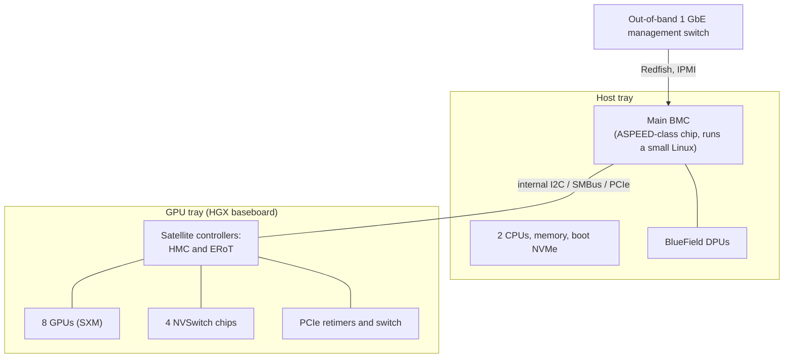

# 7.13 Redfish on NVIDIA DGX and HGX: BMC, GPU baseboard and management

| | |
|---|---|
| Level | Intermediate to Advanced |
| Priority tier | 1 |
| Lab venue | Laptop |
| Part | Part 7: Redfish and BMC |
| Status | Drafted (DMTF validators, Tacklebox, and `dgx_record_lab.py` 3/3 self-checks run against mock; **untested** / **not verified** on live DGX/HGX) |

## Why this matters for AI infrastructure

Suppose a GPU server stops answering on its management network an hour after a firmware update. The vendor support engineer asks which firmware bundle you applied. Before you can answer, you need to know who owns the box, because the owner decides which firmware is safe to apply and whom you call next.

Chapters 7.2 to 7.12 taught Redfish in general. Those chapters mostly assumed a plain server, with one motherboard, one BMC (baseboard management controller, the small computer on the board that watches over the rest) and a handful of fans and power supplies. A GPU cluster is less general than that. A GPU server carries a GPU baseboard with its own controllers and NVLink switch chips. NVLink is NVIDIA's high-speed link between GPUs, and an NVLink switch chip connects several of them together. The same server may also hold DPUs, which are network cards that run a small operating system of their own. It has a very large power draw and a management stack that belongs to the vendor. Each of those additions means another box on your management map, and each box can have a different owner.

Who builds the machine decides how it is managed. In a DGX SuperPOD, which is NVIDIA's reference design for a large cluster, NVIDIA's reference designs say how the management network is built and which BMCs exist. In an HGX server built by an OEM (an original equipment manufacturer, such as Dell, HPE or Supermicro), a different company owns the BMC. Knowing **who owns what** decides whom you call and which firmware bundle you may apply.

## Prerequisites and outcomes

Work through chapters 7.1 to 7.12 first. This chapter assumes you already know what a Redfish service, a resource and a collection are, so it does not repeat that material. It starts with the three kinds of NVIDIA GPU system and what each one means for ownership. It then looks inside a GPU server, describes the rack-scale management network, and shows how NVSM and BCM sit next to Redfish. NVSM is NVIDIA's in-band management tool for DGX, and BCM is NVIDIA Base Command Manager, the cluster management software. The chapter ends with two hands-on pieces. The first is an acceptance profile, a written list of what a good server must offer. The second is a recording of a real service that your tests can replay later.

## 1. Three kinds of NVIDIA GPU systems

Picture a GPU server with a failing fan and an open support ticket. Before you call anyone, you have to know who built the box, because that answer tells you who owns the BMC, the BIOS and the firmware bundle. The BIOS is the basic input and output system, the firmware that starts the machine before the operating system loads. A firmware bundle is the set of firmware versions that were tested together and shipped as one package. There are three families of NVIDIA GPU system, and each one hands ownership to a different party. Find the family first, because it also decides who answers the support call.

Look at the middle column of the table in particular. On an OEM system, the BMC and the BIOS belong to the OEM, even though the GPUs themselves come from NVIDIA. That split is the source of most confusion on these platforms, so keep it in mind as you read the rest of the table.

| | **DGX** (NVIDIA-built server) | **HGX** (GPU baseboard in an OEM server) | **Rack-scale** (GB200 or GB300 NVL72) |
|---|---|---|---|
| Who builds the server | NVIDIA | Dell, HPE, Supermicro and others | NVIDIA reference rack |
| Whose BMC and BIOS | NVIDIA's | **the OEM's** | NVIDIA's compute trays |
| Firmware bundle | NVIDIA's validated bundle | OEM qualified bundle | NVIDIA's bundle |
| Support | NVIDIA | the OEM for the system, NVIDIA for the GPU parts | NVIDIA |

The NVIDIA-DevOps notes on HGX put the risk bluntly: in an HGX server, "firmware management is the single most dangerous operational task." The reason is that an HGX server has dozens of independent firmware ecosystems, and each one has its own owner. Think of a house where the plumber, the electrician and the roofer each hold a key to the front door. Any one of them can change something the others depend on, and none of them can see the whole house. The system BIOS and the BMC belong to the OEM, for example Dell iDRAC. Network cards come from NVIDIA but are often repackaged and certified by the OEM. The GPU VBIOS (the firmware on the GPU card itself), the NVSwitch firmware and the baseboard controllers complete the list. Two of those baseboard controllers are the HGX management controller, HMC, and the external root of trust, ERoT. You will meet both again in section 2.

The same notes also recommend change control, and they advise against independent firmware updates on OEM systems. The reason is that the OEM qualifies the bundle as a whole. A firmware version that works fine on its own can still break the fan curves or the power handshake that the OEM tested with a different version. The practical rule follows from that. Do not apply NVIDIA firmware to an OEM server unless the OEM supports that exact combination.

### 1.1 Physical anatomy, PCIe topology, and support boundaries on OEM HGX vs DGX (`volume-06/ch1–ch6`)

Picture a purchase review. A vendor sends you a quote for an HGX server that is cheaper than the DGX you planned to buy. Before you sign, you need to know where the OEM's part of the machine stops and NVIDIA's part starts. Those boundaries decide who fixes what, and a mistake here costs money in purchasing and again in troubleshooting. Knowing where the OEM's top half stops and NVIDIA's bottom half starts prevents both kinds of mistake. The top half is the host server around the GPUs, and the bottom half is the GPU baseboard itself. Four points follow from that boundary. Their sources run from `nvidia-zero-to-hero/volume-06/chapter-01` through `chapter-06`.

The first point is why anyone buys a bare HGX baseboard at all. Cloud providers such as AWS, with Nitro, and Azure, with Cerberus, buy it. So do enterprise OEMs like Dell PowerEdge `XE9680`, HPE, Supermicro and Lenovo. A bare baseboard is a bit like buying an engine and fitting it into a car body that you design yourself. The raw NVIDIA HGX baseboard carries 8 or 4 SXM GPUs, NVSwitches and VRMs. VRMs (voltage regulator modules) are the small power converters on the board. The buyer then builds the baseboard into its own chassis, its own power and cooling manifolds (the pipes that spread the coolant), its own host CPU motherboard and its own BMC stack. That BMC stack is `iDRAC`, `iLO` or `XClarity`. The source for this is `volume-06/ch1`.

The second point concerns which parts you can swap in the field. A field replaceable unit, or FRU, is a part a technician can swap on site without sending the whole system back. SXM GPUs are bolted FRUs. They mate with the HGX board through high-density mezzanine connectors, which are dense plug-in connectors, and they are held in place with precision torque screws. A single failed GPU can be unbolted and replaced without touching the rest of the baseboard. NVSwitch chips are different. There are four on an 8-GPU H100 board, providing a 900 GB/s non-blocking mesh, and they are permanently soldered to the HGX PCB. A non-blocking mesh means every GPU pair can talk at full speed at the same time. If one NVSwitch fails, the GPUs it serves lose their NVLink connectivity and fall back to PCIe, the slower standard bus. The GPU still computes normally, and `nvidia-smi` still shows it as working. That is the trap. The symptom looks like a GPU problem, but replacing the SXM GPU fixes nothing in that case. The entire bottom-half HGX baseboard must be RMA'd, which means it goes back to the manufacturer under a return authorization. The source for this is `volume-06/ch2`.

Two more facts belong to that second point. Four-GPU Redstone boards often wire their GPUs point-to-point over NVLink without NVSwitch chips, and you cannot upgrade them to 8 GPUs later. Power delivery matters too, and it explains why the board is built the way it is. Current equals power divided by voltage, so $I = P / V$. Feeding 8 GPUs at 700 W each means 5.6 kW or more. At `12V`, that would need more than 460 A, and the copper would lose a large amount of power as $I^2 R$ heat. The heat in the copper grows with the square of the current, which is why engineers avoid high currents. Stepping the distribution bus up from `12V` to the `48–54V` class cuts the current roughly $4\times$. The on-board VRMs then step the voltage down to about `~1 V` at the GPU die, which is the tiny piece of silicon where the computing happens.

The third point is the top half. Two servers can share the exact same NVIDIA HGX baseboard and still differ, because the OEM controls the top half. One design gives a strict 1:1 ratio of GPUs to `400 Gbps` ConnectX-7 NICs, which is 8 compute NICs and `3.2 Tbps` of egress. Egress means traffic leaving the node. Those NICs connect through dedicated PCIe Gen5 switches, which keeps GPUDirect RDMA lossless. GPUDirect RDMA lets a NIC read and write GPU memory directly, and lossless means no packets are dropped under load. A cheaper SKU may drop the PCIe switches and route traffic across the host CPU's UPI or Infinity Fabric instead. UPI and Infinity Fabric are the links between CPU sockets, and traffic that crosses them is slower and less predictable. NVIDIA's NVIDIA-Certified Systems program, `NVQual`, validates thermal, power and PCIe topology baselines. Even so, check the exact PCIe switch and NIC count yourself before you buy. The source for this is `volume-06/ch1, ch4, ch6` and the labs `lab-01` and `lab-02`.

The fourth point is who fixes the server when it breaks. On an OEM HGX server, the OEM owns the hardware warranty and field dispatch for the whole server, both halves. Suppose a Lenovo or Dell HGX server logs `Xid 79 (GPU has fallen off the bus)`. Xid is the family of error codes that the NVIDIA driver writes to the log. The cause could be a loose OEM PCIe riser cable, which is the small board that carries the PCIe link, or it could be an HGX retimer or GPU fault. You cannot tell which from the log line alone. So do not open a hardware dispatch ticket directly with NVIDIA. Gather both `nvidia-bug-report.sh` and the OEM's Redfish or diagnostic bundle, such as `XClarity` or `iDRAC`, and send them to the **OEM's support team**. The source for this is `volume-06/ch3`.

## 2. Inside a GPU server, from the management point of view

When a GPU node misbehaves, the first question is which controller to ask. The NVIDIA-DevOps notes on the bare-metal and BMC lifecycle describe a DGX H100 as two trays in an 8U chassis. An 8U chassis is a box eight rack units tall, and a tray is a sub-assembly that slides into it. One tray holds the host computer, and the other holds the GPU baseboard. The diagram below shows how the two trays connect, and it is worth reading slowly once, because the arrows show who talks to whom.



Notice that the GPU tray has no network path of its own to your management network. The main BMC is the only door, and it sits on the host tray. The satellite controllers on the GPU tray are small chips that watch over the GPUs and the switches, and they report to the main BMC over internal buses such as I2C and SMBus. I2C and SMBus are simple two-wire buses that management chips use to read sensors. Think of the main BMC as a reception desk with a phone line to every room. A caller outside the building reaches the desk, and the desk gets the answer from the room.

That is why Redfish on the main BMC can show GPU data at all. The GPUs never speak Redfish themselves. The BCM manual confirms the inventory, which lists 30 HGX components in chapter 7.10. The table below lists the endpoints the notes name, and these are the ones you will query first.

| What the notes say | Meaning |
|---|---|
| `/redfish/v1/Systems/DGX` | the host system (name as written in the notes for DGX H100 and H200) |
| `/redfish/v1/Systems/HGX_Baseboard_0` | the GPU baseboard as its own system |
| `/redfish/v1/Systems/HGX_Baseboard_0/Processors/GPU_SXM_<id>/EnvironmentMetrics` | per-GPU power and temperature readings |
| `/redfish/v1/Chassis/DGX/Sensors` | chassis sensors |
| `/redfish/v1/Managers/BMC` | the BMC |
| `/redfish/v1/UpdateService/FirmwareInventory` with `HostBMC_0` etc. | firmware inventory |
| `/redfish/v1/TelemetryService/MetricReports/NvidiaNMMetrics_0` | a telemetry report |

Names change from one generation to the next, so do not hard-code them. A hard-coded name works on the day you write it and breaks on the next firmware release. The BCM manual's GB300 examples list chassis such as `BMC_0`, `CBC_0` and `Chassis_0`. Its firmware lists use `HGX_FW_GPU_SXM_1`, which starts counting at 1, and `HGX_FW_NVSwitch_0`, which starts at 0. The notes warn you to "Treat names in angle brackets as values you discover." That means the angle-bracket parts of an endpoint, such as the id part of the per-GPU endpoint in the table, are placeholders for values your script must look up on the live system. Treat everything in this section as a starting point to confirm on your platform, not as a fixed API.

### What each controller does

Each part on the GPU tray has its own job. When you see a firmware item with an unfamiliar name, the table tells you which job it belongs to, so you know whom to ask. The table gives the role the sources assign to each one. The BCM manual also shows that these parts appear as separate firmware items. Each one can be updated on its own, and that is why a firmware list can look long and confusing at first.

Updating them takes an AC power cycle on a DGX H100 (chapter 7.10). An AC power cycle means cutting the mains power to the chassis and restoring it, not just rebooting the host. Plan for that downtime before you start, because the node is unavailable while the cycle runs and it may stay down longer than you expect.

| Part | Role (from the sources) |
|---|---|
| Main BMC | the Redfish and IPMI endpoint on the 1 GbE management network, always on |
| HMC (HGX management controller) | manages the baseboard (GPU, NVSwitch, retimers), reports to the main BMC |
| ERoT (external root of trust) | a security chip that authenticates firmware. The BCM firmware list has `HGX_FW_ERoT_BMC_0`, `ERoT_FPGA_0`, `ERoT_NVSwitch_n`, `ERoT_PCIeSwitch_0` |
| FPGA and CPLD | small logic chips for power sequencing and glue (`HGX_FW_FPGA_0`, `CPLDMB_0`) |
| PCIe retimers and switch | clean the PCIe signal between CPUs, GPUs and NICs (`HGX_FW_PCIeRetimer_n`) |

The ERoT row is the one to read twice. A root of trust is a chip that the rest of the system trusts by default, so it is the first thing that checks a firmware image before the image runs. An external one sits outside the main processor and checks the others from the side. The FPGA and CPLD are the glue between the parts. A CPLD (complex programmable logic device) and an FPGA (field-programmable gate array) are chips whose logic can be shaped to a job, and on this board they handle the order in which the power comes up. The retimers rebuild a weak PCIe signal so it can travel the full distance between a CPU, a GPU and a NIC.

## 3. Rack-scale: GB200 and GB300

Picture one rack holding dozens of BMCs. Each one has its own address, its own login and its own firmware. If your inventory misses even one of them, that device goes unmanaged, and nobody notices until a fan or a power shelf fails without warning. In the DGX GB300 SuperPOD reference architecture, each NVL72 rack holds compute trays, nine NVLink switch trays and eight power shelves. NVL72 means the rack links 72 GPUs into one NVLink domain.

- Each **NVLink switch tray** has two COMe RJ45 ports for NVOS, the switch operating system. COMe is a small computer-on-module connector, and RJ45 is the standard network jack. It also has one BMC module with its own RJ45 port for out-of-band management, which means management traffic that does not share the workload network.
- Each power shelf holds six 5.5 kW supplies in N redundancy, which gives up to 33 kW. N redundancy means that the shelf still runs if one supply fails, so the shelf has enough spare capacity to cover a dead unit. It has rear RJ45 ports for power brakes and other out-of-band functions, and a BMC port at the front.

The management network that ties these together is a separate out-of-band (OOB) Ethernet fabric built from SN2201 switches. Out-of-band means it runs beside the workload network, not through it. It connects "the management ports of all devices including DGX GB300 compute trays, switch trays, and management servers, storage, networking gear, rack PDUs, and all other devices." PDU stands for power distribution unit, the strip that feeds power to the rack. The document says no unprivileged user ever needs those ports, so the network is kept apart by logical separation. Logical separation means the traffic is isolated by configuration, not by a second set of cables. The fabric carries "all IPMI related control traffic", along with the management of the InfiniBand and NVLink fabrics. At the spine layer of each scalable unit, it rolls up into a dedicated VXLAN. A VXLAN is a virtual network tunnel that carries Ethernet frames across a routed network, and the spine is the core layer of switches that everything else connects into.

Four consequences follow for your tooling.

1. One rack has dozens of BMCs: compute trays, switch trays, power shelves, plus PDUs. Your inventory must list them all, or the gaps will show up at the worst time.
2. The NVLink switch tray is not managed with Redfish for firmware. The BCM manual says its firmware commands use the **NVOS REST API** with separate credentials. A REST API is a web interface that accepts plain HTTP requests, and here it is the path that NVOS offers for the switch.
3. BCM subscribes to Redfish events from compute trays (kind `GB300`) and switch trays (`GB200SW`), as shown in the `redfishsubscriptions` output (chapter 7.5). A subscription means BCM asks the BMC to push an event when something changes, instead of polling it. BCM also uses Redfish for leak detection on NVL8 hardware.
4. Liquid cooling adds leak sensors and CDU data alongside the BMC data (chapters 6.30 and 7.8). A CDU (coolant distribution unit) is the box that moves coolant between the facility loop and the rack. Build your inventory from the rack's full device list, not from the compute trays you can see.

## 4. NVSM and BCM next to Redfish

When a node fails at 2 a.m., you usually need two views of it. The first view comes from Redfish. It is the out-of-band view that the BMC provides, and it still works when the host is down, because the BMC runs on its own power and network. The second view comes from NVSM (NVIDIA System Management), which gives you the in-band view for DGX. In-band means the tool runs on the host itself. NVSM aggregates BMC data, host telemetry and GPU management data into one place. A host that is hung can still answer the BMC, but it cannot run NVSM, so the two views cover different failure cases.

The NVIDIA-DevOps notes show `nvsm show health` and `nvsm show gpus`, along with `nvsm dump health` for support bundles. A support bundle is a single archive that you send to the vendor when you open a case. The notes give illustrative output for these commands, but this chapter does not reproduce that output, so read the commands as the shape of the workflow and check the real output on your own system.

BCM documents its own wrapper, the `nvsm` command in `cmsh` device mode (section 10.13). The cmsh tool is the command-line shell for BCM. Wrapping NVSM means BCM runs the NVSM command on the selected nodes for you, so you do not log in to each node. The table lists what each subcommand does. Note the timing on `nvsm health`, because a full dump takes a while, and a quick command can finish before you have looked away from the screen.

| Command | What it does |
|---|---|
| `nvsm alerts` | lists the alerts NVSM detects, per node and component (the manual's example shows NVLink-C2C and GPU NVLink link problems) |
| `nvsm health` | runs an NVSM dump on the chosen nodes into a `.tar.xz` file under `/cm/shared/nvsm/<node>/`. "It can take about 15 minutes." `--quick` is faster but uses more memory and CPU |
| `nvsm status`, `nvsm stop` | check or abort a dump in progress |
| `nvsm info [--history]` | list the latest or past dump files (the example shows 417 MiB and 5.9 MiB files) |
| `nvsm versions [--details]` | component versions (BMC, CPLD, driver, DCGM, vBIOS and others) |

Use both views together, because each one sees what the other misses. The BMC sees fans, power supplies and a host that is down. NVSM and DCGM (the NVIDIA Data Center GPU Manager) see GPU errors, NVLink counters and clocks. When you investigate a fault (chapters 7.8, 7.9 and 7.11), line the two up on one timeline. A timeline lets you see which event came first, and the first event is often the real cause. A fan alarm that appears before a GPU error points one way, while a GPU error that appears first points another.

## 5. Acceptance profiles: write down what "a good GPU node" must offer

A new server model arrives on a pallet, and your tools assume certain Redfish features exist on it. Maybe your power dashboard reads a sensor path, or your inventory script expects a processor type. How do you know those features are there before the first production rollout? You write the requirements down, and then you test the server against them. A written list of requirements like that is called a **profile**. DMTF, the standards body that publishes Redfish, defines a profile format, the Redfish Interoperability Profile, and it ships an official validator for that format. The profile says what must exist, and the validator checks the real service against the profile.

The lab's teaching profile, `profiles/gpu_node_acceptance.json`, sets the minimum for an 8-GPU server. It requires a `ComputerSystem` with `PowerState`, `Status` and `Processors`, plus a `Reset` action. A `Processor` needs `ProcessorType` and `Status`. A `PCIeDevice` needs a full `PCIeInterface`, and a `Port` needs link state and speeds. The `Chassis` needs `Sensors`, `ThermalSubsystem` and `PowerSubsystem`. Sensors need reading, type, units and physical context, and a `PowerSupply` needs capacity and status.

The profile also covers a `Manager` with firmware version and network protocol settings. It covers an `UpdateService` with `FirmwareInventory` and a `SimpleUpdate` action that accepts `HTTPS`. Software inventory needs `Version` and `Updateable`, and log services need `ClearLog`. Finally, it checks account policy settings and the event, task and session services.

Install both DMTF validators, point them at the Redfish publications, and run the wrapper script against your service. The publications are the official schema files, and the validators need them to know what a correct answer looks like.

```bash
pip install redfish_service_validator redfish_interop_validator
export REDFISH_PUBLICATIONS=/path/to/Redfish-Publications
code/part07/run_dmtf_validators.sh https://127.0.0.1:8443 admin adminpass /tmp/pki/ca.pem
```

A profile cannot count devices, so it will not confirm that there are "eight GPUs." It also cannot judge whether readings make sense, such as a fan that reports zero RPM while the chassis is hot. For counts, use `rf_hardware.py` and `rf_inventory.py`. For firmware, compare against a baseline (chapter 7.10). A baseline is a saved snapshot of the versions you trust, and every later check compares against it.

### What happened on my mock

The lab runs these validators against a practice mock, which is a fake Redfish service built from static files. The results below show what a first pass caught and what was changed afterward.

1. On the first run, the schema validator (`rf_service_validator`) checked every resource against the official schemas. It passed 1,756 checks and raised **3 warnings**. The warnings were real. Drives sat under `Storage/<id>/Drives/<n>`, a URI the schema marks as deprecated, because the current place is under the chassis. The `EventType` property in `SSEFilterPropertiesSupported` is also deprecated. Both were fixed in the mock.
2. The first run of the acceptance profile (`rf_interop_validator`) passed 258 checks and failed 6. The failures included a host system with no `Processors`, and a chassis with no `ThermalSubsystem` and no `PowerSubsystem`. As written, every `ComputerSystem` had to have `LogServices` and a `Reset` action. The GPU baseboard system has neither. The first three failures were real gaps in the mock, so the mock was fixed. The last two come from a **profile limitation**. A profile says "every ComputerSystem" and cannot say "this one but not that one". So those two requirements were relaxed to `Recommended`, which means the server should have them, but a missing one does not fail the run.
3. After the fixes, the service validator passed 1,944 checks with 0 warnings and 0 failures. The acceptance profile passed 278, failed 0, and left 3 not tested. Not tested means the validator could not reach a check, usually because the resource is conditional or absent. It does not mean the check passed.
4. The hardening profile (`profiles/bmc_hardening.json`, used in chapter 7.15) gave 11 passes and 6 failures on the default mock. That result was intended. HTTP, Telnet, IPMI and SSDP are switched on, NTP is off, and Basic authentication is enabled. A hardening profile is supposed to fail on an insecure default, so the failures show that the profile is doing its job.

One detail about the tool is worth remembering. Comparing a boolean property with `"Comparison": "Equal"` needs JSON booleans (`true`, `false`) in `Values`. With the strings `"True"` or `"true"`, even correct values were reported as failures.

### DMTF's other command-line tools

The `Redfish-Tacklebox` package, installed as `redfish_utilities`, is a set of ready-made command-line scripts from DMTF. Each script answers one common question, such as "what is in this box?" or "what are the sensors reading?" They are a fast way to get a first look at a BMC you have never used.

The lab runs three of them against the practice mock. Each one prints a summary that you can compare with the real hardware later.

```text
rf_sys_inventory.py -r https://127.0.0.1:8443 -u admin -p adminpass     -> chassis, 2 CPUs, 8 GPUs, drives
rf_firmware_inventory.py ...                                            -> all 34 firmware items with versions
rf_sensor_list.py ...                                                   -> sensors, fans and supplies with thresholds
```

The package also includes scripts for power reset (`rf_power_reset.py`, with `--system` and `--type` options), logs, accounts, certificates, updates and BIOS settings. Their options differ from the lab's own scripts, so run `--help` on each one before you rely on it.

## 6. Record a real service, test offline forever

Suppose you need automation for a DGX that you rarely get to touch. It sits in a locked row, and you may only reach it during a maintenance window. Testing your parser against a live box every time you change a line of code is slow and risky. The safer approach is to **record** its Redfish tree once and replay it from then on. The tree is the full set of resources the service exposes, laid out as a folder structure. Once you have the recording, the box can stay in its rack while your tests run on your laptop.

The tool `rf_record.py` crawls a service using `GET` only. A GET request reads data and changes nothing, so the crawl is safe to run against a production BMC. The crawler follows the links from the service root and saves each resource as `index.json` in a folder that follows the DMTF mockup layout. A mockup is a static copy of a Redfish service. With `--redact`, it also replaces serial numbers, UUIDs, MAC and IP addresses with placeholders, so the recording can be shared or stored in version control without leaking identifiers.

```bash
python3 rf_record.py https://<bmc> <user> <password> ./dgx_h100_recording --redact
python3 redfish_mock.py --mockup ./dgx_h100_recording --port 8443
```

The lab tested the round trip against the practice mock. The recording held 153 resources, and the lab replayed it through `--mockup`. A crawl of the replay found the same set of resources as the original. The crawler counted 154 URIs, including the live session. In `--mockup` mode the data is read-only. A recording lets you test inventory, health, drift and parsing code, but it does not let you test actions, because a static folder cannot react to a request that changes state.

Do this once on a real DGX, on one machine, with permission, and keep the recording in version control. Then every parser you write has real test data instead of guesses about what the BMC returns. Each new firmware release can be recorded and diffed against the old one, so a change in the tree shows up as a line in the diff.

## 7. A bring-up checklist for a new GPU server model

Bring-up is the work you do between the moment a new server model arrives and the moment it runs real jobs. Imagine a delivery of identical nodes that must be in production before a fixed date. Without a checklist, each person on the team sets up the nodes in a different order, and the nodes end up slightly different from each other. A checklist keeps every node the same and leaves evidence that the work was done.

Work through the steps below in order, because each one depends on the one before it. You cannot skip ahead. Start by knowing who owns the BMC and the firmware bundle. That answer is the difference between a DGX, an OEM HGX and a rack-scale system, and it decides which vendor procedure applies in the later steps.

1. Identify the **owner** of the BMC and the firmware bundle (DGX, OEM HGX, rack-scale). The owner decides who you call and which bundle is valid.
2. Connect the BMC to the OOB network, change the factory credentials (chapter 7.4), set NTP so the clock is right, and install your CA certificate (chapter 7.15). A CA certificate lets the BMC prove its identity to your tools.
3. **Record** the Redfish tree (`rf_record.py`). The recording is your offline copy of this exact firmware state.
4. Run the service validator and your acceptance profile, and keep the reports. The reports are the proof that the server matched the written requirements.
5. Run `rf_inventory.py`, `rf_hardware.py`, `rf_sensors.py` and the firmware drift check. Drift means the firmware differs from the baseline you trust.
6. Compare with the vendor's validated firmware bundle and update through the vendor's documented procedure (chapter 7.10). Never mix a firmware version from a different bundle into this one.
7. Run the vendor's diagnostics and burn-in (the notes name `dcgmi diag -r 3`, then `-r 4` for extended; `nvbandwidth` for NVLink; `ib_write_bw` for the network) and keep the output as acceptance evidence. Burn-in means running the hardware hard for a while so that weak parts fail before the node goes into service. The first is NVIDIA's GPU diagnostic tool, the second measures NVLink bandwidth, and the third measures network bandwidth over InfiniBand.
8. Only then admit the node to the scheduler (chapter 6.14). Until this step, the node stays out of the job queue, so a bad node cannot hurt a running training job.

Do not admit a node to the scheduler until every step above has left its evidence behind. Evidence here means a saved file, a report or a log line that a colleague can open later and check. A verbal "it looked fine" does not count.

### 7.1 Architectural comparison: DGX H100/B200 vs OEM HGX vs GB200/GB300 NVL72

When an architect designs a new AI cluster, one early decision is whether to buy turnkey NVIDIA DGX systems, enterprise OEM servers built around NVIDIA HGX baseboards, or liquid-cooled NVL72 racks. Turnkey means the vendor delivers a finished system that you plug in and run. The OEM examples are Dell PowerEdge `XE9680`, Supermicro `SYS-821GE`, HPE Cray `XD670` and Lenovo ThinkSystem `SR675`. The rack-scale examples are `GB200` and `GB300`. All three run the same CUDA kernels and NCCL collectives. CUDA is NVIDIA's programming platform for GPUs, and NCCL is the library that moves data between GPUs during training. The three choices still differ in their management planes, which are the parts that control and observe the hardware. Their operational boundaries also differ, in three ways (`volume-06/ch4–ch7` and `superpod-gb300-ra`).

The first difference is the data path and the PCIe switch topology (`volume-06/ch4, ch6`). A data path is the route that bytes take between components. On an 8-GPU node, GPUs talk to each other across the four NVSwitch ASICs on the HGX baseboard, at `900 GB/s` bidirectional per H100 GPU. Traffic to other nodes leaves through PCIe Gen5 into the `400 Gbps` (`ConnectX-7`) or `800 Gbps` (`ConnectX-8`) network cards. In a reference DGX design, four dual-port or eight single-port compute NICs sit beneath dedicated **PCIe Gen5 switches**. Each switch pairs 1:1 with an SXM GPU. GPUDirect RDMA packets then never cross the host CPU socket or the inter-socket UPI or Infinity Fabric links. Keeping packets off those links matters because it keeps latency low and steady. On an OEM HGX server, the OEM designs this top-half topology, and the topology is where two quotes can differ while the GPUs look identical. When you compare two OEM quotes (`volume-06/labs/lab-01, lab-02`), inspect the Redfish `PCIeDevices` and `NetworkAdapters` collections, and run `nvidia-smi topo -m` on a test unit. That command prints a matrix of how each GPU and NIC connects to the others. Check that all eight compute NICs are present and attached symmetrically to the PCIe switch hierarchy.

The second difference appears at rack scale, where the NVLink domain and the management endpoints change (`volume-06/ch7` and `superpod-gb300-ra`). An NVLink domain is the set of GPUs that share one fast NVLink fabric. In an air-cooled 8-GPU DGX or HGX server, the NVLink domain stops at the `8U` chassis boundary, at `8` GPUs. Scaling past `8` GPUs means crossing the InfiniBand or RoCEv2 network fabric, which is slower than NVLink. A rack-scale GB200 or GB300 NVL72 is built differently Eighteen `1U` liquid-cooled compute trays, each with `4` Blackwell GPUs and `2` Grace CPUs, and nine `1U` NVLink switch trays are joined by a blind-mate copper NVLink backplane cartridge. Blind-mate means the trays slide into the connector without a person reaching in to plug cables. Together they form one **72-GPU NVLink domain** that acts as a single giant accelerator. Because that fabric spans twenty-seven separate physical trays, plus eight `33 kW` power shelves, out-of-band management moves from one BMC per server to rack-level orchestration. Orchestration means one controller coordinates many devices, instead of each device being handled by hand. Each compute tray has its own BMC and a BlueField-3 DPU BMC, both on the `SN2201` OOB switch. Each NVLink switch tray has a BMC RJ45 port for hardware health and Redfish event subscriptions, and two COMe RJ45 ports running NVOS. NVOS hosts the **NMX Manager** and the NVOS REST API for NVLink fabric telemetry and switch-tray firmware updates. Each power shelf has its own BMC port, which reports per-PSU input and output wattage and busbar voltage (`powershelfoverview` in BCM).

The third difference is the facility (`volume-06/ch5`). The facility is the building side of the system, such as the cooling plant and the power feed. Air-cooled 8-GPU servers rely on internal chassis fan curves that the server's BMC manages alone. A fan curve is the table that maps temperature to fan speed. Liquid-cooled HGX and NVL72 racks depend on an external Coolant Distribution Unit (CDU) and a facility chilled-water loop. So BCM and Mission Control connect BMC Redfish leak-detection events (`leakdetection` / `leakinfo`) with CDU telemetry (`cduoverview` over MQTT from the Building Management System). MQTT is a lightweight messaging protocol that many building systems use to publish readings. If a manifold leaks or coolant flow is lost, that link triggers a coordinated workload drain and power-down before the hardware is damaged. A drain moves the running jobs off the affected nodes first, and the power-down follows only after that.

For a new procurement, compare the top-half PCIe topology before you compare prices. A cheaper server with a weaker topology can still cost more in the end, because slower transfers stretch every training run.

## Exercises

The steps in this section were not run on a live DGX or HGX server. Most of them run against the practice mock, so you can try them on your laptop first.

1. Run `python3 code/part07/dgx_record_lab.py` and confirm that it reports `3/3` checks passing. Next, run `code/part07/run_dmtf_validators.sh` against the mock server. Open the HTML report that it generates. Look for the reason that conditional or absent resources show up as `"Not tested"`.
2. Open `code/part07/profiles/gpu_node_acceptance.json`. Add `"LocationIndicatorActive": {"Requirement": "Recommended"}` under `Chassis.PropertyRequirements`. Re-run `dgx_record_lab.py` and the Interop Validator. Notice what changes in the report.
3. Write a JSON profile snippet that requires a `ComputerSystem` with `SystemType`, `Processors`, `Memory` and `Bios`. The snippet should show whether a BlueField-3 DPU is ready for management.
4. Run `code/part07/rf_record.py` with `--redact` against a running mock server. Open `Systems/System_0/index.json`. Confirm that `SerialNumber` and `UUID` now read `"REDACTED"`. Confirm that IPv4 strings read `"0.0.0.0"`. Then serve the recorded folder with `redfish_mock.py --mockup`.
5. Using section 3 and the sources `superpod-gb300-ra` and `volume-06/ch7`, work out how many OOB switch ports and IP addresses one GB300 NVL72 rack needs. Start with `18` compute trays. The rack has `9` NVLink switch trays. Each switch tray has `1` BMC port and `2` COMe NVOS ports. The rack has `8` power shelves. Each shelf's PSUs add up as `6 x 5.5 kW = 33 kW`. Each shelf also has `1` BMC port. Add the rack PDUs and the `SN2201` OOB switches to your count.
6. Compare two diagnosis paths on a Dell or Lenovo 8-GPU HGX H100 server. In the first case, `GPU 2` works in `nvidia-smi` over PCIe but falls back from NVLink to PCIe during NCCL collectives. Suspect the NVSwitch ASIC on the HGX baseboard or the SXM pin seating. In the second case, `GPU 4` throws `Xid 79 (GPU has fallen off the bus)`. Suspect the OEM PCIe riser cable or retimer, or the SXM module. Escalate the second case to OEM support with both `nvidia-bug-report.sh` and the OEM Redfish logs. Compare the two paths.

## 9. Interview angles

Interviewers use these questions to see whether you can reason about ownership and tooling, not just recite names. Each answer below gives the short version you would say out loud.

- "What is the difference between DGX and HGX for operations?" Answer by naming who builds the system, whose BMC and firmware bundle it uses, and who supports it.
- "What controllers sit on a GPU baseboard?" Name the HMC, ERoT, FPGA and CPLD, retimers and switches, and say that they report to the main BMC.
- "How is the SuperPOD management network built?" Describe a separate OOB Ethernet fabric of SN2201 switches. Say that it has a VXLAN at the spine layer and reaches every BMC, switch tray, power shelf and PDU, with no user access.
- "How do you test Redfish compatibility of a new server model?" Mention schema validation, an interoperability profile of the features you use, and a recorded tree to test your parsers.
- "NVSM or Redfish?" Both. NVSM covers host-side GPU health, and Redfish covers out-of-band hardware state and control.

## Checkpoint questions (20)

<details>
<summary>1. Who designs and supports the BMC and system BIOS on an NVIDIA DGX server versus an OEM HGX server (such as a Dell PowerEdge XE9680 or Lenovo ThinkSystem)?</summary>

On a DGX server, NVIDIA designs and supports the whole system. That covers the host motherboard, the BMC, the BIOS and the HGX GPU tray, all under one validated firmware bundle. On an OEM HGX server, the OEM owns those parts. Dell, HPE, Supermicro or Lenovo designs the motherboard, chassis, cooling, BIOS and BMC (`iDRAC`, `iLO`, `XClarity`), and it qualifies the integrated firmware bundle.
</details>

<details>
<summary>2. Why is flashing raw NVIDIA GPU/NVSwitch firmware directly onto an OEM HGX server ("Frankenstein flashing") dangerous (`volume-06/ch3`)?</summary>

OEMs tie their chassis fan curves, power-capping logic and BMC sensor tables (`iDRAC`/`iLO`) to specific versions of System BIOS, HMC, VBIOS and NVSwitch firmware that they have tested together. If you flash an uncertified standalone package, you can break the thermal telemetry or the power handshake between the OEM BMC and the HGX baseboard.
</details>

<details>
<summary>3. Name the four auxiliary management/security/signal chips on an HGX GPU baseboard besides the SXM GPUs and NVSwitches.</summary>

The first is the **HMC** (HGX Management Controller), a satellite BMC that collects GPU, NVSwitch and retimer telemetry and reports it to the host BMC. The second is the **ERoT** (External Root of Trust), with chips such as `HGX_FW_ERoT_BMC_0`, `ERoT_FPGA_0`, `ERoT_NVSwitch_n` and `ERoT_PCIeSwitch_0`. These verify firmware signatures before boot. The third is the FPGA and CPLD (`HGX_FW_FPGA_0`, `CPLDMB_0`), which handle power sequencing and glue logic. The fourth is the PCIe Gen5 retimers and switches (`HGX_FW_PCIeRetimer_n`, `HGX_FW_PCIeSwitch_0`), which regenerate and switch signals between the host CPU tray and the GPUs and NICs.
</details>

<details>
<summary>4. What is the physical difference in field replaceability between an SXM GPU module and an NVSwitch chip on an 8-GPU HGX baseboard (`volume-06/ch2`)?</summary>

SXM GPUs bolt onto the board through high-density mezzanine connectors. That makes them Field Replaceable Units (FRUs), so a technician can swap one at a time. The NVSwitch chips, four of them on an H100 8-GPU board, are soldered permanently to the HGX PCB. If one fails, you must replace the whole HGX baseboard, because swapping a GPU does not fix it.
</details>

<details>
<summary>5. How does the main motherboard BMC expose GPU and NVSwitch sensors over Redfish when those chips sit on a separate HGX tray?</summary>

The HMC, the satellite management controller on the GPU tray, polls the SXM GPUs and NVSwitches over `I2C` and `SMBus`. It forwards that data over an internal management bus, such as `I2C`, `MCTP` or `USB-NIC`, to the main motherboard BMC. The main BMC then publishes the readings under `/redfish/v1/Systems/HGX_Baseboard_0` and `/redfish/v1/Chassis/DGX/Sensors`.
</details>

<details>
<summary>6. Why must your Redfish scripts discover collection member IDs dynamically even across NVIDIA's own DGX generations?</summary>

Member names change between generations and firmware releases. DGX H100 and H200 use `Systems/DGX`, `Systems/HGX_Baseboard_0` and `Chassis/DGX`, while BCM's GB300 examples show chassis named `BMC_0`, `CBC_0` and `Chassis_0`. So let the script discover the IDs at run time.
</details>

<details>
<summary>7. In the DGX GB300 NVL72 SuperPOD reference architecture, how many NVLink switch trays and power shelves sit in each rack, and what management ports does each have?</summary>

Each NVL72 rack holds **nine NVLink switch trays** and **eight power shelves**. Each switch tray has two COMe RJ45 ports for **NVOS** and one dedicated BMC RJ45 port. Each power shelf holds six `5.5 kW` PSUs, which give up to `33 kW` in `N` redundancy. It has a front BMC RJ45 port and rear RJ45 control ports.
</details>

<details>
<summary>8. How does firmware management for an NVLink switch tray (`gb200sw` / `gb300sw`) in BCM differ from a compute tray?</summary>

Compute trays are flashed over **Redfish**, through `bmcsettings`. NVLink switch trays are flashed through the switch's **NVOS REST API**, using credentials stored in BCM's `accesssettings`.
</details>

<details>
<summary>9. How is the Out-of-Band (OOB) management network architected in a DGX SuperPOD (`superpod-gb300-ra`)?</summary>

It is a physically separate 1 GbE Ethernet fabric built on **NVIDIA Spectrum `SN2201`** switches. It connects every compute tray BMC, NVLink switch tray BMC and NVOS port, power shelf BMC, rack PDU, storage controller and management server. The fabric rolls up into a dedicated VXLAN at the SU spine layer, and unprivileged tenant networks have no access to it.
</details>

<details>
<summary>10. In BCM's `cmsh` `device` mode (§10.13), what do `nvsm alerts`, `nvsm health`, and `nvsm versions` do?</summary>

- **`nvsm alerts`** lists hardware and fabric alerts that the in-band NVSM daemon detects, such as NVLink or C2C link issues.
- **`nvsm health`** triggers an `nvsm dump health` archive on the target nodes. It saves `.tar.xz` bundles under `/cm/shared/nvsm/<node>/`, which takes `~15` minutes, or less with `--quick`.
- **`nvsm versions [--details]`** reports the installed BMC, CPLD, GPU driver, DCGM and VBIOS versions across the nodes.
</details>

<details>
<summary>11. What does `redfishsubscriptions` in BCM `cmsh` display?</summary>

It lists every managed device with its hostname, Redfish event subscription ID, initialization and subscription state, BMC IP, hardware kind (`GB300`, `GB200SW`), port (`443`) and SSL status.
</details>

<details>
<summary>12. What is a DMTF Redfish Interoperability Profile (`RedfishInteroperabilityProfile`), and which official tool validates a BMC against it?</summary>

It is a machine-readable JSON file, such as `code/part07/profiles/gpu_node_acceptance.json`. It declares which resources, properties, actions and values a server must implement to pass your automation. DMTF's **`Redfish-Interop-Validator` (`rf_interop_validator`)** checks a BMC against it.
</details>

<details>
<summary>13. What does DMTF's `Redfish-Service-Validator` (`rf_service_validator`) check, and what two deprecation warnings did it catch in the early version of `redfish_mock.py`?</summary>

`rf_service_validator` crawls the service and checks every resource payload against DMTF's official CSDL and JSON schemas. On our early mock it caught two problems. Drives sat under the deprecated `Storage/<id>/Drives/<n>` path instead of `Chassis/<id>/Drives/<n>`. It also flagged the deprecated `EventType` property in `SSEFilterPropertiesSupported`.
</details>

<details>
<summary>14. What hardware acceptance checks can a Redfish Interoperability Profile NOT express on its own?</summary>

A profile checks that schema elements exist and that values are allowed, across every instance of a resource type. It cannot easily express **per-instance conditional rules**, such as requiring `Reset` on `System_0` but not on `HGX_Baseboard_0`. It also cannot count components ("must have 8 GPUs and 8 400G NICs") or catch **live threshold or link-speed degradation**. Pair the profile with `rf_inventory.py` and `rf_hardware.py` for those checks.
</details>

<details>
<summary>15. When writing a `"Comparison": "Equal"` check on a boolean property inside a Redfish Interoperability Profile, how must the expected value in `Values` be formatted?</summary>

It must be a native **JSON boolean, `true` or `false`**. A quoted string such as `"True"` or `"true"` makes `rf_interop_validator` fail the comparison, even when the BMC returns the right boolean.
</details>

<details>
<summary>16. What is DMTF `Redfish-Tacklebox` (`redfish_utilities`), and name three CLI scripts it provides.</summary>

`Redfish-Tacklebox` is DMTF's pre-built command-line suite, installed with `pip install redfish_utilities`. Three of its scripts are **`rf_sys_inventory.py`**, **`rf_firmware_inventory.py`**, **`rf_sensor_list.py`**, and there is also **`rf_power_reset.py`**.
</details>

<details>
<summary>17. What does `code/part07/rf_record.py --redact` do, and which sensitive fields does it scrub?</summary>

It crawls a live Redfish service with read-only `GET` requests and writes each resource to `<outdir>/<path>/index.json` in DMTF mockup format. It replaces **`SerialNumber`, `UUID`, `MACAddress`, `PermanentMACAddress`, `AssetTag`, `HostName`, `FQDN`, `SKU`** with `"REDACTED"`, and it replaces IPv4 addresses with `"0.0.0.0"`.
</details>

<details>
<summary>18. Why should you record one node of each GPU server model (`rf_record.py`) and commit the redacted tree to Git?</summary>

The recording gives your team a permanent, offline copy of that exact vendor and firmware resource tree. You can serve it with `redfish_mock.py --mockup <dir>` in CI tests. You can also `diff` the tree before and after a BMC firmware upgrade.
</details>

<details>
<summary>19. What can you test against a `redfish_mock.py --mockup` recording, and what can you NOT test against it?</summary>

You can test read-only discovery, inventory, sensor scraping, hardware link-degradation checks, log parsing and firmware drift detection. `--mockup` serves static `index.json` files, so those checks work. You cannot test stateful mutations or hardware side effects, such as power resets or firmware flashing, against a static recording.
</details>

<details>
<summary>20. If an OEM HGX server quote is 15% cheaper than an NVIDIA DGX H100 (`volume-06/ch1`), what top-half architectural details must you verify before buying?</summary>

Check the host-to-GPU PCIe topology and the NIC ratio first. Does the OEM server give you a full 1:1 ratio of `400 Gbps` ConnectX-7 NICs to GPUs, meaning 8 compute NICs for `3.2 Tbps` of egress, attached through dedicated PCIe Gen5 switches for GPUDirect RDMA? Then check whether the chassis airflow or liquid cooling can sustain `8 x 700 W` GPUs without thermal throttling. Look for the `NVIDIA-Certified` and `NVQual` validation.
</details>

## Sources and review notes

- **NVIDIA-DevOps notes:** `nvidia-zero-to-hero/volume-05/chapter-03-dgx-management-plane.md` (DGX management plane, NVSM, firmware-over-SSH risk), `volume-10/01-bare-metal-and-bmc-lifecycle.md` (hardware hierarchy, dual-tray design, satellite controllers, endpoint list, burn-in commands), and all 10 files of `nvidia-zero-to-hero/volume-06/`: `nvidia-zero-to-hero/volume-06/chapter-01-why-hgx-exists.md` (merchant silicon strategy, AWS Nitro/Azure Cerberus, Dell XE9680 1:1 NIC ratio), `nvidia-zero-to-hero/volume-06/chapter-02-inside-an-hgx-platform.md` (bolted SXM FRUs vs soldered NVSwitches, PCIe retimers, `48–54V` power delivery, 4-GPU Redstone vs 8-GPU Delta), `nvidia-zero-to-hero/volume-06/chapter-03-oem-integration-and-support-boundaries.md` (OEM vs NVIDIA firmware and RMA boundary, `NVIDIA-Certified` / `NVQual`, `Xid 79` escalation), `nvidia-zero-to-hero/volume-06/chapter-04-hgx-topology-and-data-paths.md`, `nvidia-zero-to-hero/volume-06/chapter-05-hgx-power-cooling-and-rack-integration.md`, `nvidia-zero-to-hero/volume-06/chapter-06-hgx-networking-storage-and-cluster-integration.md`, `nvidia-zero-to-hero/volume-06/chapter-07-gb200-nvl72-rack-scale-architecture.md`, `nvidia-zero-to-hero/volume-06/labs/lab-01-compare-hgx-server-designs.md`, and `nvidia-zero-to-hero/volume-06/labs/lab-02-review-an-hgx-rack-design.md`. All unchecked against live hardware.
- **BCM 11 Administrator Manual:** appendix N (Redfish management and device naming), section 14.5 (firmware: component lists), section 10.13 (monitoring with `nvsm`).
- **NVIDIA DGX SuperPOD reference architecture for DGX GB300** (study corpus book `superpod-gb300-ra`): NVL72 rack contents, NVLink switch tray BMC and NVOS ports, power shelves, the OOB management network of SN2201 switches. The B200 reference architecture was searched for BMC details but returned none, so it is not used here.
- **DMTF tools and data:** Redfish-Service-Validator 3.1.8, Redfish-Interop-Validator 3.0.4, Redfish-Tacklebox (`redfish_utilities`), the profile schema `RedfishInteroperabilityProfile.v1_10_0` and the mockups in `Redfish-Publications` at commit `fa6d23d9`.
- **Run here:** the two validators and three Tacklebox scripts against the mock over HTTPS with a lab CA; `rf_record.py` round trip.
- **Not verified:** every NVIDIA-specific path, name and behaviour (`DGX`, `HGX_Baseboard_0`, `NvidiaNMMetrics_0`, power capping, OEM extensions), NVSM output, and whether a real DGX passes my profile. The profile is a teaching profile that I wrote. It is not NVIDIA's or DMTF's.
