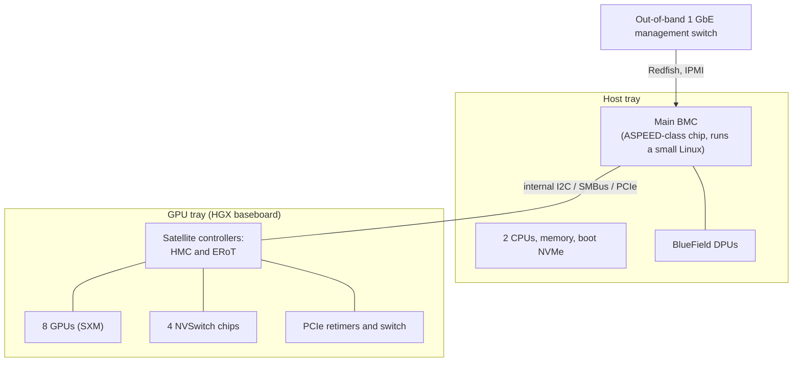

# 7.13 Redfish on NVIDIA DGX and HGX: BMC, GPU baseboard and management

| | |
|---|---|
| Level | Intermediate to Advanced |
| Priority tier | 1 |
| Lab venue | Laptop |
| Part | Part 7: Redfish and BMC |
| Status | Drafted (DMTF validators and Tacklebox run against mock; **untested** on live DGX/HGX) |

## Why this matters for AI infrastructure

Chapters 7.2 to 7.12 taught Redfish in general. A GPU cluster is not general: the server has a GPU baseboard with its own controllers, NVLink switch chips, DPUs, a very large power draw and a vendor-specific management stack. In a DGX SuperPOD, NVIDIA's reference designs say how the management network is built and which BMCs exist; in an HGX server built by an OEM, a different company owns the BMC. Knowing **who owns what** decides whom you call and which firmware bundle you may apply.

## Prerequisites and outcomes

You need chapters 7.1 to 7.12. After this chapter you can:

- tell DGX, HGX and rack-scale systems apart in terms of management
- explain the extra controllers on a GPU baseboard
- describe how a SuperPOD management network is built
- use NVSM and BCM's wrapper next to Redfish
- write an acceptance profile and test a service with DMTF's official tools
- record a real service and test your automation against the recording

## 1. Three kinds of NVIDIA GPU systems

| | **DGX** (NVIDIA-built server) | **HGX** (GPU baseboard in an OEM server) | **Rack-scale** (GB200 or GB300 NVL72) |
|---|---|---|---|
| Who builds the server | NVIDIA | Dell, HPE, Supermicro and others | NVIDIA reference rack |
| Whose BMC and BIOS | NVIDIA's | **the OEM's** | NVIDIA's compute trays |
| Firmware bundle | NVIDIA's validated bundle | OEM qualified bundle | NVIDIA's bundle |
| Support | NVIDIA | the OEM for the system, NVIDIA for the GPU parts | NVIDIA |

The user's HGX notes (volume 6) put it clearly: in an HGX server "firmware management is the single most dangerous operational task", because there are dozens of independent firmware ecosystems, and each has an owner: system BIOS and BMC (the OEM, for example Dell iDRAC), network cards (NVIDIA, often repackaged and certified by the OEM), GPU VBIOS, NVSwitch firmware, and the baseboard controllers (the HGX management controller, **HMC**, and the external root of trust, **ERoT**). The same notes' lab table says: enforce change control and make no independent firmware updates on OEM systems, because the OEM qualifies the bundle. The practical rule: **do not apply NVIDIA firmware to an OEM server unless the OEM supports that exact combination**.

## 2. Inside a GPU server, from the management point of view

The notes (volume 10 chapter 1) describe a DGX H100 as two trays in an 8U chassis:



The main BMC aggregates data from the **satellite controllers** on the GPU tray, so Redfish on the main BMC exposes GPU data. The notes list the sensors and endpoints as follows, and the BCM manual confirms the inventory (the 30 HGX components in chapter 7.10):

| What the notes say | Meaning |
|---|---|
| `/redfish/v1/Systems/DGX` | the host system (name as written in the notes for DGX H100 and H200) |
| `/redfish/v1/Systems/HGX_Baseboard_0` | the GPU baseboard as its own system |
| `/redfish/v1/Systems/HGX_Baseboard_0/Processors/GPU_SXM_<id>/EnvironmentMetrics` | per-GPU power and temperature readings |
| `/redfish/v1/Chassis/DGX/Sensors` | chassis sensors |
| `/redfish/v1/Managers/BMC` | the BMC |
| `/redfish/v1/UpdateService/FirmwareInventory` with `HostBMC_0` etc. | firmware inventory |
| `/redfish/v1/TelemetryService/MetricReports/NvidiaNMMetrics_0` | a telemetry report |

The BCM manual shows that names differ between generations: its GB300 examples list chassis such as `BMC_0`, `CBC_0`, `Chassis_0`, and its firmware lists use `HGX_FW_GPU_SXM_1` (with the number starting at 1) and `HGX_FW_NVSwitch_0` (starting at 0). The notes themselves warn: "Treat names in angle brackets as values you discover." Everything in section 2 is therefore a **starting point to confirm** on your platform, not a fixed API.

### What each controller does

| Part | Role (from the sources) |
|---|---|
| Main BMC | the Redfish and IPMI endpoint on the 1 GbE management network, always on |
| HMC (HGX management controller) | manages the baseboard (GPU, NVSwitch, retimers), reports to the main BMC |
| ERoT (external root of trust) | a security chip that authenticates firmware. The BCM firmware list has `HGX_FW_ERoT_BMC_0`, `ERoT_FPGA_0`, `ERoT_NVSwitch_n`, `ERoT_PCIeSwitch_0` |
| FPGA and CPLD | small logic chips for power sequencing and glue (`HGX_FW_FPGA_0`, `CPLDMB_0`) |
| PCIe retimers and switch | clean the PCIe signal between CPUs, GPUs and NICs (`HGX_FW_PCIeRetimer_n`) |

The BCM manual also shows that these parts are visible as separate firmware items and that **updating them takes an AC power cycle** on a DGX H100 (chapter 7.10).

## 3. Rack-scale: GB200 and GB300

In the DGX GB300 SuperPOD reference architecture each NVL72 rack has compute trays, **nine NVLink switch trays** and **eight power shelves**:

- Each **NVLink switch tray** has two COMe RJ45 ports for **NVOS** (the switch operating system) and **one BMC module with its own RJ45 port** for out-of-band management.
- Each **power shelf** has six 5.5 kW supplies in N redundancy (up to 33 kW), rear RJ45 ports for power brakes and other out-of-band functions, and a BMC port at the front.
- The management network is a **separate out-of-band (OOB) Ethernet fabric** of SN2201 switches that connects "the management ports of all devices including DGX GB300 compute trays, switch trays, and management servers, storage, networking gear, rack PDUs, and all other devices". The document says there is no case where an unprivileged user needs access to those ports, so they are separated by logical network separation. It carries "all IPMI related control traffic" and also the management of the InfiniBand and NVLink fabrics, and is rolled up into a dedicated VXLAN at the spine layer of each scalable unit.

Consequences for tooling:

1. One rack has dozens of BMCs: compute trays, switch trays, power shelves, plus PDUs. Your inventory must list them all.
2. The **NVLink switch tray is not managed with Redfish for firmware**: the BCM manual says its firmware commands use the **NVOS REST API** with separate credentials.
3. BCM subscribes to Redfish **events** from compute trays (kind `GB300`) and switch trays (`GB200SW`), as shown in the `redfishsubscriptions` output (chapter 7.5), and uses Redfish for leak detection on NVL8 hardware.
4. Liquid cooling (chapter 6.30) adds leak sensors and CDU data (chapter 7.8).

## 4. NVSM and BCM next to Redfish

Redfish is the out-of-band view. NVIDIA's **NVSM** (NVIDIA System Management) is the in-band view for DGX: it runs on the host and aggregates BMC data, host telemetry and GPU management data. The user's notes show `nvsm show health` and `nvsm show gpus`, and `nvsm dump health` for support bundles, with illustrative output that I did not reproduce.

The BCM manual (section 10.13) documents BCM's wrapper, the `nvsm` command in `cmsh` device mode:

| Command | What it does |
|---|---|
| `nvsm alerts` | lists the alerts NVSM detects, per node and component (the manual's example shows NVLink-C2C and GPU NVLink link problems) |
| `nvsm health` | runs an NVSM dump on the chosen nodes into a `.tar.xz` file under `/cm/shared/nvsm/<node>/`. "It can take about 15 minutes." `--quick` is faster but uses more memory and CPU |
| `nvsm status`, `nvsm stop` | check or abort a dump in progress |
| `nvsm info [--history]` | list the latest or past dump files (the example shows 417 MiB and 5.9 MiB files) |
| `nvsm versions [--details]` | component versions (BMC, CPLD, driver, DCGM, vBIOS and others) |

Use both views together. The BMC knows about fans, supplies and the state of a host that is down. NVSM and DCGM know about GPU errors, NVLink counters and clocks. In an investigation (chapters 7.8, 7.9, 7.11) you correlate them on one timeline.

## 5. Acceptance profiles: write down what "a good GPU node" must offer

How do you know a new server model offers the Redfish features your tools need? Write it down as a **profile** and test it. DMTF defines a profile format (the Redfish Interoperability Profile) and an official validator.

My profile `profiles/gpu_node_acceptance.json` states the minimum for an 8-GPU server: a `ComputerSystem` with `PowerState`, `Status` and `Processors` and a `Reset` action; `Processor` with `ProcessorType` and `Status`; `PCIeDevice` with a full `PCIeInterface`; `Port` with link state and speeds; `Chassis` with `Sensors`, `ThermalSubsystem` and `PowerSubsystem`; sensors with reading, type, units and physical context; `PowerSupply` with capacity and status; a `Manager` with firmware version and network protocol settings; an `UpdateService` with `FirmwareInventory` and a `SimpleUpdate` action that accepts `HTTPS`; software inventory with `Version` and `Updateable`; log services with `ClearLog`; account policy settings; and the event, task and session services.

Run both DMTF tools with one script:

```bash
pip install redfish_service_validator redfish_interop_validator
export REDFISH_PUBLICATIONS=/path/to/Redfish-Publications
code/part07/run_dmtf_validators.sh https://127.0.0.1:8443 admin adminpass /tmp/pki/ca.pem
```

### What happened on my mock

1. **First run, schema validation** (`rf_service_validator`, which checks every resource against the official schemas): 1,756 passed, **3 warnings**. They were real: drives were exposed under `Storage/<id>/Drives/<n>`, a URI the schema marks as deprecated (the current place is under the chassis), and `EventType` in `SSEFilterPropertiesSupported` is deprecated. I fixed both.
2. **First run, acceptance profile** (`rf_interop_validator`): 258 passed, **6 failed**. The failures included: the host system had no `Processors`, the chassis had no `ThermalSubsystem` and no `PowerSubsystem`, and (as written) every `ComputerSystem` had to have `LogServices` and a `Reset` action, which the GPU baseboard system does not have. The first three were real gaps in my mock, which I fixed. The last two are a **profile limitation**: a profile says "every ComputerSystem" and cannot say "this one but not that one", so I relaxed those two to `Recommended`.
3. **After the fixes:** service validator **1,944 passed, 0 warnings, 0 failures**. Acceptance profile **278 passed, 0 failed, 3 not tested**.
4. **Hardening profile** (`profiles/bmc_hardening.json`, used in chapter 7.15): **11 passed, 6 failed** on the default mock, as intended: HTTP, Telnet, IPMI and SSDP are on, NTP is off and Basic authentication is enabled.

One thing I learned about the tool: comparing a boolean property with `"Comparison": "Equal"` needs JSON booleans (`true`, `false`) in `Values`. With the strings `"True"` or `"true"` even correct values were reported as failures.

What a profile cannot do: it checks that things exist and have allowed values. It does not count devices ("eight GPUs") or check that readings are sensible. Use `rf_hardware.py` and `rf_inventory.py` for counts, and a baseline for firmware (chapter 7.10).

### DMTF's other command-line tools

The `Redfish-Tacklebox` package (installed as `redfish_utilities`) gives ready-made scripts. I ran three against the mock:

```text
rf_sys_inventory.py -r https://127.0.0.1:8443 -u admin -p adminpass     -> chassis, 2 CPUs, 8 GPUs, drives
rf_firmware_inventory.py ...                                            -> all 34 firmware items with versions
rf_sensor_list.py ...                                                   -> sensors, fans and supplies with thresholds
```

It also includes scripts for power reset (`rf_power_reset.py`, with `--system` and `--type` options), logs, accounts, certificates, updates and BIOS settings. They are good for a first look at any BMC. Their options differ from my tools, so read `--help`.

## 6. Record a real service, test offline forever

The safest way to build automation for a DGX you rarely have access to is to **record** its Redfish tree once and replay it. `rf_record.py` crawls a service with `GET` only, saves each resource as `index.json` in a folder (the DMTF mockup layout), and can replace serial numbers, UUIDs, MAC and IP addresses with placeholders (`--redact`):

```bash
python3 rf_record.py https://<bmc> <user> <password> ./dgx_h100_recording --redact
python3 redfish_mock.py --mockup ./dgx_h100_recording --port 8443
```

I tested the round trip on my mock: 153 resources recorded, replayed through `--mockup`, and a crawl of the replay found the same set of resources as the original (154 URIs counted by the crawler, including the live session). In `--mockup` mode the data is read-only, so a recording lets you test inventory, health, drift and parsing code but not actions.

Do this once on a real DGX, on one machine, with permission, and keep the recording in version control. Then every parser you write has real test data, and every new firmware release can be recorded and diffed against the old one.

## 7. A bring-up checklist for a new GPU server model

1. Identify the **owner** of the BMC and the firmware bundle (DGX, OEM HGX, rack-scale).
2. Connect the BMC to the OOB network; change factory credentials (chapter 7.4); set NTP; install your CA certificate (chapter 7.15).
3. **Record** the Redfish tree (`rf_record.py`).
4. Run the service validator and your acceptance profile; keep the reports.
5. Run `rf_inventory.py`, `rf_hardware.py`, `rf_sensors.py` and the firmware drift check.
6. Compare with the vendor's validated firmware bundle and update through the vendor's documented procedure (chapter 7.10).
7. Run the vendor's diagnostics and burn-in (the notes name `dcgmi diag -r 3`, then `-r 4` for extended; `nvbandwidth` for NVLink; `ib_write_bw` for the network) and keep the output as acceptance evidence. I did not run these tools.
8. Only then admit the node to the scheduler (chapter 6.14).

## 8. Exercises

1. Run `run_dmtf_validators.sh` on the mock. Open the HTML report and find one "Not tested" item. Why was it not tested?
2. Add a requirement to the acceptance profile (for example `Chassis.LocationIndicatorActive` as `Recommended`) and rerun it.
3. Write an acceptance profile for a DPU system: a `ComputerSystem` of type `DPU` with `Processors`, `Memory` and `Bios`.
4. Record one of DMTF's example trees served by the mock, replay it, and diff the two JSON folders. What differs?
5. List the BMCs in one GB300 NVL72 rack from the sources (compute trays, switch trays, power shelves). How many management addresses do you need?
6. Explain to a new engineer why an OEM HGX server's firmware must not be updated with NVIDIA's DGX bundle.

## 9. Interview angles

- "What is the difference between DGX and HGX for operations?" Who builds it, whose BMC and firmware bundle, who supports it.
- "What controllers sit on a GPU baseboard?" HMC, ERoT, FPGA and CPLD, retimers and switches, reporting to the main BMC.
- "How is the SuperPOD management network built?" A separate OOB Ethernet of SN2201 switches, VXLAN at the spine layer, connecting all BMCs, switch trays, power shelves and PDUs, with no user access.
- "How do you test Redfish compatibility of a new server model?" Schema validation, an interoperability profile of the features you use, and a recorded tree to test your parsers.
- "NVSM or Redfish?" Both: NVSM for host-side GPU health, Redfish for out-of-band hardware state and control.

## 10. Checkpoint questions (20)

1. Who owns the BMC on a DGX? On an OEM HGX server?
2. Why is firmware management especially risky on OEM HGX systems?
3. Name four controllers or chips on a GPU baseboard besides the GPUs.
4. What is an ERoT?
5. Why does the main BMC expose GPU data?
6. Why must you not hard-code NVIDIA's resource names?
7. How many NVLink switch trays and power shelves does a GB300 NVL72 rack have, per the reference architecture?
8. How is a NVLink switch tray's firmware managed in BCM?
9. What is the OOB network of a SuperPOD made of?
10. What does BCM's `nvsm health` do and how long may it take?
11. What does `redfishsubscriptions` show?
12. What is a Redfish Interoperability Profile?
13. What does the Service Validator check?
14. What can a profile not express?
15. Why did the Interop Validator fail my first profile run?
16. How must booleans be written in a profile `Values` list?
17. What does `rf_record.py --redact` replace?
18. Why record a real service?
19. What can you not test against a recording?
20. List four steps of bringing up a new GPU server model.

## 11. Sources and review notes

- **NVIDIA-DevOps notes:** volume 5 chapter 3 (DGX management plane, NVSM, the firmware-over-SSH argument), volume 10 chapter 1 (hardware hierarchy, dual-tray design, satellite controllers, the endpoint list, burn-in commands), volume 6 chapters 1 and 3 (HGX ownership and the firmware boundary), volume 6 lab 1 (OEM responsibility table). All unchecked against NVIDIA documents.
- **BCM 11 Administrator Manual:** appendix N (Redfish management and device naming), section 14.5 (firmware: component lists), section 10.13 (monitoring with `nvsm`).
- **NVIDIA DGX SuperPOD reference architecture for DGX GB300** (study corpus book `superpod-gb300-ra`): NVL72 rack contents, NVLink switch tray BMC and NVOS ports, power shelves, the OOB management network of SN2201 switches. The B200 reference architecture was searched for BMC details but returned none, so it is not used here.
- **DMTF tools and data:** Redfish-Service-Validator 3.1.8, Redfish-Interop-Validator 3.0.4, Redfish-Tacklebox (`redfish_utilities`), the profile schema `RedfishInteroperabilityProfile.v1_10_0` and the mockups in `Redfish-Publications` at commit `fa6d23d9`.
- **Run here:** the two validators and three Tacklebox scripts against the mock over HTTPS with a lab CA; `rf_record.py` round trip.
- **Not verified:** every NVIDIA-specific path, name and behaviour (`DGX`, `HGX_Baseboard_0`, `NvidiaNMMetrics_0`, power capping, OEM extensions), NVSM output, and whether a real DGX passes my profile. The profile is a teaching profile that I wrote. It is not NVIDIA's or DMTF's.
