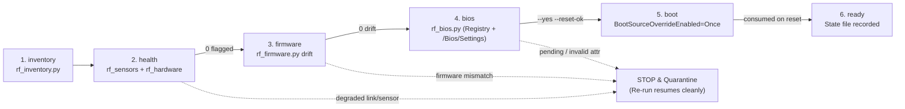

# 7.14 Fleet-scale hardware management and node lifecycle automation

| | |
|---|---|
| Level | Advanced |
| Priority tier | 1 |
| Lab venue | Laptop |
| Part | Part 7: Redfish and BMC |
| Status | Drafted (`lifecycle_lab.py`: 24 checks pass against mock; **untested** on live BMC) |

## Why this matters for AI infrastructure

Picture a rack of 128 GPU servers that has just arrived. Racking them is the easy part. The hard part is getting every server into the same state, with the same BIOS, firmware and boot setup, then proving it and keeping it that way for years. The notes put the stakes plainly: a distributed training job runs at the speed of its slowest GPU. One node with a different BIOS setting, or with older firmware, becomes a cluster-wide problem. This chapter takes the primitives of chapters 7.2 to 7.13 and turns them into a repeatable **node lifecycle**.

## Prerequisites and outcomes

You need chapters 7.5 and 7.7 to 7.12 before you start. When you finish this chapter, you should be able to change BIOS settings through Redfish and explain the difference between pending and live values. You should also use the attribute registry to check a setting before you send it, and use one-time and continuous boot override correctly.

Once you have that, you should be able to run a bring-up that is safe to repeat and stops at the first problem. You should also keep a fleet in line with baselines for firmware, BIOS and health, and work through five classic incidents with the right tools.

## 1. The fleet mindset in four ideas

Managing one server by hand is manageable. A fleet is not. Four ideas carry the rest of this chapter:

1. Describe the target state in files under version control: a firmware baseline, a BIOS target, an acceptance profile and an account policy.
2. Measure the real state the same way on every node, using inventory, hardware, sensors and logs.
3. Compare and report drift automatically and often.
4. Change things in small, verified, repeatable steps, with a human decision before anything risky.

The tools of Part 7 map onto these four ideas. The measuring tools are `rf_inventory.py`, `rf_hardware.py`, `rf_sensors.py` and `rf_logs.py`. The comparing tools are `rf_firmware.py drift` and `rf_bios.py plan`. The changing tools are `rf_firmware.py update`, `rf_bios.py apply` and `node_lifecycle.py`. `fleet_run.py` runs a read-only task on many BMCs. So you measure and compare first, and change only what the comparison shows.

## 2. BIOS settings: live, pending, and the registry

### 2.1 The Settings resource pattern

You send a new BIOS value, then read the BIOS back a moment later. The old value is still there. That is not a bug. A BIOS setting is read only when the machine boots, so a change has to be stored until the next reset. The spec's Settings resource, described in DSP0266 section 9.10, handles this with a fixed pattern:

- The main resource (`Bios`) shows the live values.
- It carries an annotation, `@Redfish.Settings`, with a `SettingsObject` link, the `SupportedApplyTimes`, and the `Time` of the last change.
- You send a `PATCH` to the Settings object, never to the live resource. The change is stored as pending.
- The pending values become live when the apply time comes. Here, that is `OnReset`.

Here is the sequence from my lab:

```text
PATCH .../Bios/Settings {"Attributes": {"PowerProfile": "MaxPerf"}}   -> 200, "ResetRequired" message
GET   .../Bios                  Attributes.PowerProfile = Balanced      (live: unchanged)
GET   .../Bios/Settings         Attributes = {"PowerProfile": "MaxPerf"} (pending)
POST  ComputerSystem.Reset GracefulRestart
GET   .../Bios                  Attributes.PowerProfile = MaxPerf       (live now)
GET   .../Bios/Settings         Attributes = {}                         (pending cleared)
```

Read the three states in order. The live value does not move until the reset, and the pending object empties once the reset applies it.

Base Command Manager (BCM) shows the same three states for a node. In `cmsh`, under `biossettings`, `status` prints a table with Configured (what BCM wants), Pending (staged on the node) and Live (running now). `bios check` lists the differences between configured and detected values, and `bios apply` stages the configuration. The manual's example changes the boot mode from UEFI to legacy. You set it, commit, run `bios apply`, then reset the node so the change becomes Live. The BCM book covers this in section 14.5, and I read only its boot-mode example.

:::note Correction to my notes
The notes' example answer to a BIOS `PATCH` shows the message ID `Base.1.8.UpdatePending`. That message exists in the **Update** registry, not in the **Base** registry. I checked the registry files. A BMC may return a vendor message instead. It may also return the Base message `ResetRequired`, which reads: "a component reset is required with the Reset action URI ... and ResetType ...". My mock uses that one. Do not match on the exact text. Check the HTTP status first, and then read the pending object.
:::

### 2.2 The attribute registry

BIOS settings differ so much between platforms that Redfish cannot fix their names. Instead, it uses an attribute registry, described in chapter 7.6. The registry is a JSON file, and the `AttributeRegistry` property of `Bios` names it. For each attribute, the file lists the display name, the type, the allowed values or range, the default, and whether the attribute is read-only or hidden. It also says whether a change needs a reset. The types are `Enumeration`, `Integer`, `String`, `Boolean` and `Password`.

A good tool reads the registry first, then validates a value before it sends it. My `rf_bios.py` works this way, and my mock checks on its side too. Here is what the lab returned for each bad request:

| Request | Answer |
|---|---|
| value not in the list (`PowerProfile: Turbo`) | 400, `PropertyValueNotInList` |
| unknown attribute | 400, `PropertyUnknown` |
| read-only attribute | 400, `PropertyNotWritable` |
| integer out of range or wrong type | 400 |
| read-only user | 403 |

Each row is a request the BMC refuses. The answer tells you which rule it broke.

### 2.3 What to set for AI: the notes' matrix, with cautions

The notes list a production BIOS matrix for AI nodes. Below, it appears with my lab's attribute names and the notes' own reasons. **Treat those reasons as claims I could not verify.** The final authority is your server vendor's tuning guide for your exact model.

| Setting (lab name) | Factory-style value | Target in the notes | Reason given in the notes |
|---|---|---|---|
| `PowerProfile` | Balanced | MaxPerf | stop CPU cores entering deep sleep states |
| `ProcCStates` | Enabled | Disabled | sleep-state wake-up latency adds jitter to collective operations |
| `SubNumaClustering` | Disabled | Enabled (SNC2 or SNC4 on Intel, NPS4 on AMD) | keep GPU-related memory traffic local and reduce cross-socket traffic |
| `PcieLinkSpeed` | Auto | Gen5 (force) | "Auto" may renegotiate to a lower generation under load |
| `PcieRelaxedOrdering` | Disabled | Enabled | needed for GPUDirect RDMA and GPUDirect Storage performance |
| `PcieMaxPayloadSize` | 256B | 512B | less overhead for 400 Gb/s NICs |
| `IommuMode` | Enabled | Enabled, with kernel parameter `iommu=pt` | needed for SR-IOV, passthrough avoids translation cost |
| `ProcHyperthreading` | Enabled | workload dependent | disable for some strict MPI codes, keep for Kubernetes agents |
| Above-4G decoding | Enabled | Enabled | lets the CPU map the large GPU memory regions |

Three cautions apply before you copy any of these values. A forced `Gen5` link only makes sense if every device on that path supports it. A `512B` payload only works if the platform supports it end to end. And the advice to "disable C-states" costs power and heat. I have not measured any of these effects. Treat the matrix as a checklist of questions for your vendor.

### 2.4 The tool

Start with `plan`, which only reads and compares. Then run `apply`, which sends the changes.

```bash
python3 rf_bios.py plan  http://<bmc> <user> <password> --target profiles/ai_node_bios.json
python3 rf_bios.py apply http://<bmc> <user> <password> --target profiles/ai_node_bios.json --yes --reset
```

On my mock, the real `plan` reported six differences, two of which were already right. After `apply --yes --reset`, the last line read `LIVE and verified`. A second `plan` then showed `0 to change`. Without `--yes`, `apply` only prints what it would send. The tool changes only the attributes that differ, so you can run it again and again. Engineers call this property idempotent. Run `plan` before every `apply`, and send the change only when the plan shows what you expect.

## 3. Boot override: one time or forever

Suppose you need to install an operating system over the network. The machine has to boot from the network once, then go back to its normal disk. The `Boot` object of the `ComputerSystem` gives you three controls for this:

- `BootSourceOverrideTarget` chooses the source, such as `Pxe`, `UefiHttp`, `Hdd`, `BiosSetup`, `Diags` and others. Chapter 7.7 covers the full list.
- `BootSourceOverrideEnabled` controls how long the override lasts. `Once` uses it at the next boot and then goes back to normal. `Continuous` uses it at every boot. `Disabled` turns it off.
- `BootSourceOverrideMode` is either `UEFI` or `Legacy`.

The lab shows both behaviours. Here is its output:

```text
PASS  a 'Once' boot override is used by the next restart and then switches itself off
PASS  the restart after that boots normally (no repeated PXE)
PASS  a 'Continuous' override keeps booting from the network on every restart (a classic provisioning trap)
```

The first line is the behaviour you want for provisioning. The second line confirms the network boot does not repeat. The third line is the trap, which the next paragraph explains.

Here is the trap. A `Continuous` network boot left in place makes the node reinstall itself at every restart. Always use `Once` for provisioning, and check afterwards that the override reads `Disabled`. For diagnosing why a network boot fails, use the D-T-B-I chain from chapter 6.22. The letters stand for DHCP, Transfer, Boot-mode and Image.

## 4. A node lifecycle you can re-run

A node that is racked but not yet ready sits in an awkward middle state. Part of its work is done, part is not, and someone has to decide where to resume. `code/part07/node_lifecycle.py` handles this by taking one node from "racked" to "ready" in six steps. The diagram shows the order and the places where a run stops.



Each step checks first and skips whatever is already right. The table shows what each step does and when it stops.

| Step | What it does | Stops when |
|---|---|---|
| `inventory` | saves what the BMC reports (evidence) | |
| `health` | runs the sensor and hardware checks from chapters 7.8 and 7.9 | any sensor, link or drive is flagged |
| `firmware` | compares versions with the baseline file | any component differs (updates are a separate, reviewed job, chapter 7.10) |
| `bios` | validates the target against the registry, stages it, optionally restarts and checks it is live | a value or attribute is not accepted, or the settings are not live |
| `boot` | sets a one-time network boot and checks that it was consumed | the override is refused or still set |
| `ready` | writes the record | |

Notice that the `firmware` step only compares. It never updates anything, because updates are a separate, reviewed job. Three rules shape the code:

- **Dry run by default.** Without `--yes`, the tool stops at the first step that would change something. Without `--reset-ok`, it never restarts the host. It stages the change and stops at `pending` instead.
- It stops at the first failure and gives a clear reason.
- A state file in JSON keeps each step's result, time and evidence. You can fix the cause and run the same command again. Steps that finished earlier are re-checked and skipped.

The lab runs the whole flow. Each line shows one case and whether it passed:

```text
PASS  dry run: stops at the first step that would change something, changes nothing
PASS  with --yes but no permission to restart, it stages and stops at 'pending'
PASS  with --reset-ok it finishes: BIOS live, boot override consumed, node ready
PASS  running it again is harmless: BIOS already matches, nothing is restarted again
PASS  a degraded GPU link stops the run at 'health' and nothing after it is attempted
PASS  after the fault is fixed the same command continues and completes
PASS  firmware drift stops the run at 'firmware' (updates are a separate, reviewed job)
PASS  a BIOS target with an invalid value or an unknown attribute is refused before anything is sent
```

This version is deliberately small. A production version would add a real burn-in step with DCGM diagnostics. It would attach the output of NVLink and network tests as evidence. It would also add batching and concurrency, covered in chapter 7.12, plus approval before risky steps and a link to your inventory or CMDB. The state machine around these additions stays the same. If you extend this tool, keep the state machine and build the production steps around it.

## 5. Keeping a fleet in line

A fleet that is ready today can drift by next month. The usual cause is a person who fixes one node by hand and then forgets it. Four habits keep the fleet in line.

As you build the fleet, keep the baselines in git. There is one file for firmware, one for BIOS, and one for account and protocol policy, which chapter 7.15 covers. A change to a baseline is a reviewed change. You can run inventory, firmware drift and hardware checks every night with the fleet runner, and send the exceptions to a ticket queue.

Make changes in waves: 1 node, then 1 rack, then 10 percent, then the rest. Check health between each wave. Keep every before and after as evidence, not memory. That means inventory snapshots, bundles and task results.

Never "fix" one node by hand and forget it. You either make the change everywhere through the baseline, or put the node on a documented exception list.

Parts returned for replacement, the RMA'd parts, need re-baselining. The notes' example of replacement nodes with old firmware, in chapter 7.10, is exactly this case. Put every replacement node back at step 1 of the lifecycle before it joins the pool.

## 6. Five scenarios from the notes, with the tools

These five scenarios come from volume 10, chapter 1. The commands in the notes are real, but the output on your system will differ. I mark where the Part 7 tools help.

### Scenario 1: "Ghost" throttling in a 64-node job

*All-reduce latency spikes at random, yet CPU and GPU utilisation look normal.* The notes name three boundaries to check, in this order: PCIe and link health, NVLink error counters, and thermal and power throttling.

For PCIe, check `dmesg` on the host for AER errors and `lspci -vvv` for `LnkSta`. Out of band, `rf_hardware.py` shows any link running below its maximum, covered in chapter 7.9. For NVLink, check `nvidia-smi nvlink` status and error counters on the host. That check belongs to Part 10. For thermal and power, `rf_sensors.py` reads fans, inlet temperature and supplies, as chapter 7.8 explains. On the host, check the clock event reasons with `nvidia-smi`. The notes point out that one throttled GPU slows all the others. To compare the suspect node with its healthy twins, run `rf_firmware.py drift`, covered in chapter 7.10.

### Scenario 2: Bringing up 128 DGX systems (1,024 GPUs)

The notes give three principles for this job: a separate out-of-band network, an immutable firmware baseline, and automated acceptance gates.

Out of band comes first. The notes use dual 1 GbE management switches that reach every BMC and PDU, with DHCP reservations and HTTP boot rather than TFTP. Chapters 7.1 and 6.22 cover the details. The baseline comes next. Push BIOS, BMC, GPU, NVSwitch and NIC firmware to the validated bundle, then confirm it with reads from `rf_firmware.py` and `rf_bios.py`.

The gate comes last. Only nodes with clean evidence enter the pool. The notes name `dcgmi diag -r 3`, which runs a validation pass of `~15` min, and `-r 4` for burn-in. They also name `nvbandwidth` for NVLink and `ib_write_bw` for the network. This gate is the part of `node_lifecycle.py` that you extend.

### Scenario 3: A "bricked" BMC after a bad firmware push

*The BMC does not answer ping, SSH or Redfish. The host is up, and the fans are at 100 percent.*

The notes give a recovery order with three steps. First, reset the BMC from the host, through the in-band interface. The notes write `ipmitool bmc reset cold`. Chapter 7.1 and the firmware steps use `ipmitool mc reset cold` instead. I believe `bmc` is an alias of `mc` in ipmitool, but I did not check. Second, if the flash is corrupted, field staff use the chassis BMC reset or a recovery image. Third, do a full AC power drain through the PDU.

Prevention matters more than recovery. Update the BMC in a first small wave, keep the recovery procedure written down, and never update BMC firmware on a whole rack at once. Keep `Manager.Reset` in mind too, from chapter 7.7. A restart request over Redfish needs a working BMC, so this scenario needs the in-band route.

### Scenario 4: A CUDA error with a clean OS log

Use chapter 7.11 for this one. Look at the BMC event log and the SEL around the time of the crash, and search for memory or PCIe fault events. Then check the GPU ECC counters on the host. Put both on one timeline. A DIMM fault means drain and replace. A GPU fault means a targeted test, and the notes name `dcgmi diag` for that test.

### Scenario 5: Moving to UEFI Secure Boot

The notes give four steps for this move. Use a signed shim and bootloader. Use HTTPS boot. Boot a signed kernel, or enroll an owner key. Then check over Redfish that Secure Boot is on. Chapter 7.15 covers Secure Boot in more detail, and it corrects one detail of the notes.

### 6.1 Deep dive: How each BIOS setting affects GPU collectives and RDMA

Section 2.3 asks you to audit and enforce BIOS settings on every GPU server before you run a single benchmark. Why does that matter so much? This section traces the hardware mechanism behind each row of the AI BIOS matrix. That way you can explain why one drifted setting creates a silent straggler in a 512-GPU job.

1. The first row covers the CPU power setting, `MaxPerf`, and the C-states setting, `Disabled`. By default, enterprise server BIOS profiles enable ACPI processor sleep states to save electricity when CPU cores are briefly idle. Those states are `C1E` and `C6`. During distributed training, the GPUs do the heavy matrix math. Host CPU threads orchestrate the CUDA kernel launches, feed the DataLoader rings, and take part in PMIx and NCCL control barriers. When a CPU core enters deep `C6` sleep while it waits a few hundred microseconds for a GPU kernel to finish, waking that core costs tens to hundreds of microseconds of wake-up latency. That delay comes before the core can flush the next RDMA door-bell or launch the next CUDA kernel. Multiply it across thousands of collective steps per hour and 512 ranks, and random C-state wake-up jitter becomes a 5-to-15% throughput loss.
2. The second row covers Sub-NUMA Clustering, which is `SNC2` or `SNC4` on Intel Xeon, and NUMA Per Socket, which is `NPS4` on AMD EPYC. A modern server socket holds several memory controller channels and several PCIe Gen5 root complexes, spread across chiplets or tiles. Suppose the BIOS groups the whole socket into one flat NUMA node, with `NPS1` or `SNC Disabled`. The Linux kernel then allocates host pinned memory for GPU 0 across all memory channels on the socket. That forces half of the DMA transfers between host memory and GPU 0 to cross internal die-to-die interconnects. Enabling `SNC2`/`SNC4` or `NPS4` shows the physical chiplet topology to Linux and Slurm (`task/affinity`). That lets `torchrun` and `slurmd` bind each GPU rank to the CPU cores and DDR5 memory channels next to that GPU's PCIe root complex.
3. The third row covers the PCIe settings. Three of them matter here: link speed, relaxed ordering and maximum payload size.
   - Leaving PCIe Link Speed on `Auto` lets runtime link-power management down-shift the PCIe lanes under transient electrical noise. Forcing `Gen5` makes a link that cannot sustain `32 GT/s` fail visibly during boot acceptance, rather than degrading silently in the middle of a job.
   - Enabling PCIe Relaxed Ordering lets PCIe switches and root complexes reorder non-dependent DMA write completions ahead of posted reads. This happens when transaction layer packets (TLPs) carry the Relaxed Ordering bit. The setting is mandatory for full line rate with GPUDirect RDMA and GPUDirect Storage (`nvidia-fs`) on `400 Gbps` ConnectX-7 adapters.
   - Raising PCIe Max Payload Size, or MPS, from `128B` or `256B` to `512B` halves the TLP header framing overhead for large streaming DMA transfers between GPU HBM and NVMe or RDMA endpoints.
4. The fourth row covers Above 4G Decoding, set to `Enabled`, and IOMMU passthrough, set with `iommu=pt`. Eight H100 GPUs with 80 GB of HBM3 each, or B200 GPUs with 180+ GB of HBM3e each, need more than a terabyte of 64-bit PCIe Base Address Register (BAR1) space. The BIOS maps that space as `MemoryMappedIO`. Without Above 4G Decoding and 64-bit PCIe resource allocation, UEFI runs out of 32-bit address space during POST and fails to initialize the GPUs. Pairing `IOMMU: Enabled` in the BIOS with `iommu=pt` on the Linux kernel command line keeps SR-IOV hardware virtualization support active. The `pt` value sets passthrough mode, which bypasses the per-packet IOMMU page-table translation overhead for bare-metal GPUDirect RDMA.

Before a benchmark, check each of these four rows on every server.

### 6.2 Designing an idempotent, resumable state machine for node bring-up

Look at how `code/part07/node_lifecycle.py` moves a node through six stages, from racked hardware to scheduler readiness: `inventory` $\rightarrow$ `health` $\rightarrow$ `firmware` $\rightarrow$ `bios` $\rightarrow$ `boot` $\rightarrow$ `ready`. Why is a persisted state machine so much safer than a linear shell script? The answer shows up when things go wrong.

Take a 128-node bring-up. At least five to ten percent of newly racked servers will hit a physical or configuration snag on Day 0. In the example, one server has a loose DAC cable, so the `health` gate fails. Two servers shipped from a different manufacturing batch with older BMC firmware, so the `firmware` gate fails. Another server times out during its reboot, so the `bios` gate stays `pending`.

Now picture a naive procedural script that does not check live state before it acts. You fix that one loose cable and run the script again. The script re-stages the BIOS settings and triggers a second, unnecessary reboot on every server that already finished. It is worse if the script does not stop at the first failed gate. It then starts an OS network boot (`boot` stage) on a node whose GPU PCIe riser runs at `Gen2 x4`, or whose BIOS still has `SubNumaClustering` disabled.

The fix is to make every gate in `node_lifecycle.py` check first and act second. The tool also writes a per-node JSON state ledger after every transition. Here is what that gives you:

- With no flags, `node_lifecycle.py` performs a 100% read-only dry run. It tells you the first gate where the node differs from its target state, and it sends no `PATCH` or `POST`.
- With `--yes` but without `--reset-ok`, it stages pending BIOS edits into `/Bios/Settings` during business hours. It does not interrupt or reboot the host.
- With `--yes --reset-ok` in a maintenance window, it runs the reboot. It then verifies that the live `/Bios` matches `profiles/ai_node_bios.json`. It confirms that `BootSourceOverrideEnabled: "Once"` was consumed and reset to `"Disabled"`. Last, it stamps the node `ready`.
- If you run the exact same command with `--yes --reset-ok` ten minutes later, it finds all six gates already matching the target. It finishes in under one second, with zero writes and zero reboots.

Use the dry run first, every time. It is the cheapest way to see where a node stands.

## Exercises

These exercises build on the lab and the tools from this chapter. You can work through them in any order, and each one asks you to read the code as well as run it.

1. Start with the 24-check lab. Run `python3 code/part07/lifecycle_lab.py`, which should report `24 passed, 0 failed`, and then read `code/part07/node_lifecycle.py`. Next, add a seventh step called `accounts`. It should check whether any `ManagerAccount` still has `PasswordChangeRequired: true`, and it should halt bring-up if it finds one.
2. Test the registry check in `code/part07/rf_bios.py`. Copy `code/part07/profiles/ai_node_bios.json` to `/tmp/bad_bios.json`, and add an invalid attribute, `"PowerProfile": "SuperTurbo"`. Then run `rf_bios.py plan --target /tmp/bad_bios.json`. You should confirm that `rf_bios.py` rejects the invalid enum against the `AttributeRegistry` before it sends any HTTP `PATCH` to the BMC.
3. Write a profile for a second platform. Inspect the `AttributeRegistry` JSON on the DMTF mockup `public-rackmount1`. Then write a target JSON file that maps equivalent performance and PCIe settings, using that platform's attribute names.
4. Build a wave rollout wrapper. Write a 20-line Python wrapper that runs `node_lifecycle.py` in waves. Wave 1 is one canary node, Wave 2 is 8 nodes, and Wave 3 is 32 nodes. The wrapper should abort at once if any node in the current wave fails a gate.
5. Prove the network boot trap for yourself. Trace checks 10–12 of `code/part07/lifecycle_lab.py`. You should be able to explain what happens to a newly installed OS on local NVMe when `BootSourceOverrideEnabled` stays set to `"Continuous"` with `BootSourceOverrideTarget: "UefiHttp"`, compared with `"Once"`.
6. Design a nightly drift audit for 500 nodes. Combine `fleet_run.py`, `rf_firmware.py drift`, `rf_bios.py plan` and `rf_hardware.py` into one scheduled, read-only nightly audit. It should compare all 500 nodes against the Git baselines. It should open an automated ticket whenever a node drifts, for example after a field RMA swap.

## 8. Interview angles

- "How do you make sure 500 nodes have identical BIOS settings?" Start with a baseline file and the attribute registry for validation, then use Redfish Settings objects. Reset the node, read the live values back, and run the whole thing as a repeatable lifecycle.
- "What is the difference between pending and live settings?" Pending settings wait until the apply time, which is usually a reset. The main resource shows what is running now.
- "How do you provision safely?" Use a one-time network boot, verify the override is gone, and stop on the first failed gate.
- "A job is slow on one node. Where do you start?" Compare that node with a healthy twin. Check firmware drift, BIOS drift, link speed and width, and thermals.
- "What would you automate first?" Inventory and drift detection, because the work is read-only and shows the size of the problem.

## Checkpoint questions (20)

<details>
<summary>1. What are the four core principles of fleet-scale hardware management?</summary>

1. Declare the target state in version-controlled files: a firmware baseline, a BIOS profile, an acceptance profile and a security policy.
2. Measure the actual state uniformly across every BMC, using `rf_inventory.py`, `rf_hardware.py`, `rf_sensors.py` and `rf_logs.py`.
3. Detect and report drift automatically on a schedule, using `rf_firmware.py drift` and `rf_bios.py plan`.
4. Apply changes in small, idempotent, verified waves. Explicit human approval, given through `--yes` and `--reset-ok`, comes before any disruptive step.
</details>

<details>
<summary>2. What architectural problem does the Redfish `@Redfish.Settings` resource pattern solve (DSP0266 §9.10)?</summary>

It handles attributes that take effect only at a future hardware event, such as UEFI BIOS attributes applied at the next host reboot. Those changes go into a writable pending Settings resource, `/Bios/Settings` or `/Bios/SD`. The active resource, `/Bios`, stays an accurate read-only view of what is currently running.
</details>

<details>
<summary>3. Which annotation and sub-property on `/redfish/v1/Systems/{id}/Bios` tells a client where to send its `PATCH` request?</summary>

The answer is `@Redfish.Settings.SettingsObject["@odata.id"]`. It points to `/redfish/v1/Systems/{id}/Bios/Settings` or to `/SD`.
</details>

<details>
<summary>4. Trace the values of `/Bios` (live) and `/Bios/Settings` (pending) before `PATCH`, immediately after `PATCH`, and after `ComputerSystem.Reset`.</summary>

- Before the `PATCH`, `/Bios` shows `"PowerProfile": "Balanced"`, and `/Bios/Settings` shows `{}`.
- Right after `PATCH /Bios/Settings {"Attributes": {"PowerProfile": "MaxPerf"}}`, the live `/Bios` still shows `"Balanced"`, and `/Bios/Settings` shows `{"PowerProfile": "MaxPerf"}`.
- After `ComputerSystem.Reset`, the live `/Bios` shows `"MaxPerf"`, and `/Bios/Settings` is cleared back to `{}`.
</details>

<details>
<summary>5. What does a Redfish `AttributeRegistry` JSON file contain, and how does a client locate it?</summary>

The `AttributeRegistry` property on `Bios` points to the file, and you can also find it under `/redfish/v1/Registries`. The file lists every platform BIOS attribute. For each one, it gives the `AttributeName`, the `Type` (`Enumeration`, `Integer`, `String`, `Boolean` or `Password`), the allowed `Value` list or numeric bounds, the `ReadOnly` and `ResetRequired` flags, and the `DefaultValue`.
</details>

<details>
<summary>6. Why does `code/part07/rf_bios.py` validate target BIOS settings against the `AttributeRegistry` before sending a `PATCH` request?</summary>

BIOS attribute names and enum values vary across server models and BIOS versions. For example, a misspelled value is caught locally. So the tool checks each value against the node's own `AttributeRegistry` first. That catches typos, unsupported values (`PropertyValueNotInList`) and read-only attributes locally, before any node state changes.
</details>

<details>
<summary>7. In NVIDIA Base Command Manager (`cmsh` `biossettings`, §14.5), what do the `Configured`, `Pending`, and `Live` columns represent, and which commands check and stage them?</summary>

- Configured: the target value defined in BCM for the node or category.
- Pending: the value staged on the BMC's `/Bios/Settings`, waiting for a reboot.
- Live: the value currently active on the booted server, read from `/Bios`.

`bios check` compares Configured with Live. `bios apply` stages the Configured values into Pending.
</details>

<details>
<summary>8. Why must you treat BIOS attribute names (such as `OperatingPerformance` vs `PowerProfile`) as platform-specific rather than universal Redfish standard names?</summary>

Unlike `ComputerSystem.PowerState`, UEFI setup variables are defined by each motherboard or BIOS vendor, such as AMI, Insyde, Dell or HPE. That is why Redfish hands their schema to per-platform `AttributeRegistry` files.
</details>

<details>
<summary>9. Name four BIOS settings commonly tuned for multi-GPU AI training nodes (`volume-10/01` §5.1) and the architectural reason for each.</summary>

1. Power profile set to Maximum Performance, with C-states disabled. This stops CPU core wake-up latency jitter from stalling synchronous MPI or NCCL collective barriers.
2. Sub-NUMA Clustering enabled, as `SNC2` or `SNC4`, or AMD `NPS4`. This pins GPU PCIe root complexes to local memory controllers and keeps cross-socket fabric traffic to a minimum.
3. PCIe Relaxed Ordering enabled and Max Payload Size set to `512B`. Both are required for optimal GPUDirect RDMA and GPUDirect Storage DMA throughput on `400G` ConnectX HCAs.
4. Above 4G Decoding enabled, and IOMMU passthrough through `iommu=pt`. Together they allow mapping eight GPU BAR spaces into 64-bit physical address space. Each one is `80 GB` or `141 GB` of HBM3, and the mapping happens without DMA translation overhead.
</details>

<details>
<summary>10. What is the difference between `BootSourceOverrideEnabled: "Once"` and `"Continuous"`, and why is `"Continuous"` a classic provisioning trap?</summary>

`"Once"` boots from `BootSourceOverrideTarget`, which is `Pxe` or `UefiHttp`, on the next reboot only. After that, it resets `BootSourceOverrideEnabled` to `"Disabled"`, so the newly installed OS boots from local disk. `"Continuous"` forces a network boot on every future reboot. The node then wipes and reinstalls itself in an infinite loop.
</details>

<details>
<summary>11. How does `code/part07/node_lifecycle.py` verify that a one-time PXE/HTTPBoot override was properly consumed?</summary>

After it triggers the host reset, it reads `ComputerSystem.Boot` again. It checks that `BootSourceOverrideEnabled` has gone from `"Once"` back to `"Disabled"`.
</details>

<details>
<summary>12. What are the six sequential gates in `code/part07/node_lifecycle.py`, and why does it halt on the first failed gate?</summary>

The six gates run in order: `inventory` → `health` → `firmware` → `bios` → `boot` → `ready`. The tool halts at the first failure, so you never provision an OS onto a node with a degraded PCIe link (`health`), an un-baselined GPU VBIOS (`firmware`), or an unapplied BIOS setting (`bios`).
</details>

<details>
<summary>13. What does the JSON state file written by `node_lifecycle.py` store, and how does it support idempotent re-execution?</summary>

For each of the six steps, the file records a timestamp, a status and an evidence summary. The status is `ok`, `failed`, `pending` or `dry-run`. When you re-run the tool after a fix, it checks the live state again. It skips changes that are already applied. For example, you will see BIOS settings that already match `Live` skipped, so you do not get a second reboot. Then it completes the remaining steps without redundant reboots.
</details>

<details>
<summary>14. What is the difference between passing `--yes` alone versus passing `--yes --reset-ok` to `node_lifecycle.py`?</summary>

If you pass `--yes` alone, `node_lifecycle.py` stages the non-disruptive changes with `PATCH /Bios/Settings`. It then stops safely at `"pending"` and does not reboot the server. Adding `--reset-ok` explicitly authorizes the tool to reboot the host with `ComputerSystem.Reset`. That reboot activates the BIOS settings and consumes the boot override.
</details>

<details>
<summary>15. Why does `node_lifecycle.py` stop and flag firmware drift at the `firmware` step rather than automatically flashing firmware inside the bring-up loop?</summary>

Flashing BMC, BIOS or 30-component GPU-tray firmware is high risk, so you keep it out of the bring-up loop. It needs the right package, quiescing, and DC or AC power-cycle activation rules, which Chapter 7.10 covers. That work belongs in a dedicated, reviewed maintenance task.
</details>

<details>
<summary>16. Which four declarative JSON profile/baseline files in `code/part07/profiles/` define a cluster's desired hardware state?</summary>

1. `gpu_node_acceptance.json` is a DMTF Redfish Interoperability Profile for hardware capabilities.
2. `ai_node_bios.json` holds the target BIOS attributes.
3. `bmc_policy.json` is the security policy for `rf_harden.py`.
4. `bmc_hardening.json` is a DMTF Interoperability Profile for hardened BMC protocols and account settings. It sits alongside the firmware baseline JSON.
</details>

<details>
<summary>17. Why must every RMA-replaced server or motherboard re-enter `node_lifecycle.py` at Step 1 before rejoining the Slurm/Kubernetes pool?</summary>

Spare motherboards and GPU trays sit on warehouse shelves for months. They almost always ship with factory-default BMC credentials. They also come with factory-default BIOS settings, such as `Balanced` power and `Auto` PCIe, and with older firmware versions. Admitting such a node straight into production would cause collective straggler slowdowns.
</details>

<details>
<summary>18. In Scenario 1 ("Ghost" throttling across a 64-node training job, `volume-10/01` §9), which three hardware boundaries do you inspect and with which tools?</summary>

1. PCIe link width or speed degradation. Out of band, check `rf_hardware.py`, reading `PCIeInterface` `LanesInUse` and `PCIeType`. In band, use `lspci -vvv` and `dmesg | grep -i aer`.
2. NVLink fabric errors. In band, use `nvidia-smi nvlink --status` and the `nvidia-smi nvlink -e` replay and symbol counters.
3. Thermal and power clock throttling. Out of band, use `rf_sensors.py` for fans, inlet temperature and PSUs, and `rf_firmware.py drift`. Correlate these with in-band `nvidia-smi --query-gpu=clocks.current.graphics,clocks_event_reasons.hw_slowdown`.
</details>

<details>
<summary>19. In Scenario 2 (Greenfield bring-up of 128 DGX H100 nodes), which three acceptance benchmarks must pass after firmware and BIOS baselining before nodes enter BCM/Slurm?</summary>

1. DCGM diagnostics. Run `dcgmi diag -r 3` for a validation pass of `~15` min, and `-r 4` for extended burn-in.
2. Intra-node NVLink bandwidth. Test it with `nvbandwidth`, and compare the result with the platform baseline of `900 GB/s` per H100.
3. Inter-node GPUDirect RDMA fabric bandwidth. Run `ib_write_bw`, and `all_reduce_perf` too, across the leaf switches. Check that each port reaches the `400 Gb/s` line rate.
</details>

<details>
<summary>20. In Scenario 3 (Recovering a hung/bricked BMC whose fans are at 100% while the host OS is still running), why can't you use Redfish `Manager.Reset`, and what is the 3-step escalation path?</summary>

Because the BMC's network stack and Redfish web server do not answer on the OOB network, `Manager.Reset` is out. Use this three-step escalation instead.

1. Do an in-band KCS cold reset. SSH into the running host Linux OS and run `sudo ipmitool mc reset cold`, or `ipmitool bmc reset cold`, over `/dev/ipmi0`.
2. Drain the node and cut AC power on its smart PDU outlets for `60` seconds. That resets the BMC standby rail.
3. Use smart hands for a physical pinhole or USB SPI recovery. If the BMC SPI flash is corrupt, re-flash it through the physical recovery port.
</details>

## Sources and review notes

- **Redfish Specification DSP0266 v1.21.0:** the Settings resource and settings annotations (9.10), operation apply time (7.12).
- **Redfish Resource and Schema Guide, official JSON Schemas and registries:** `Bios` v1.2, `AttributeRegistry` v1.5 (attribute types and entries), the Base registry (`ResetRequired`) and the Update registry (`UpdatePending`).
- **BCM 11 Administrator Manual, section 14.5:** the `biossettings` states (Configured, Pending, Live), `bios check`, `bios apply`.
- **NVIDIA-DevOps notes (`volume-10/01-bare-metal-and-bmc-lifecycle.md`):** section 5 (BIOS matrix and Redfish BIOS automation), section 9 (the five scenarios). The notes' BIOS rationale and attribute names (`OperatingPerformance`, `SubNumaClustering` and others) are unverified; I used my own lab names.
- **Chapter 6.22** for provisioning (HTTP boot, D-T-B-I).
- **Run here:** `rf_bios.py` (plan, apply, reset, verify), `node_lifecycle.py`, and `lifecycle_lab.py` (24 checks); the mock's BIOS, registry and attribute resources validate against the official DMTF schemas.
- **Not verified:** real BIOS attribute registries, real apply behaviour on DGX or HGX BMCs, anything about the numerical effect of the BIOS settings, and the burn-in tools (`dcgmi`, `nvbandwidth`, `ib_write_bw`), which I did not run.
