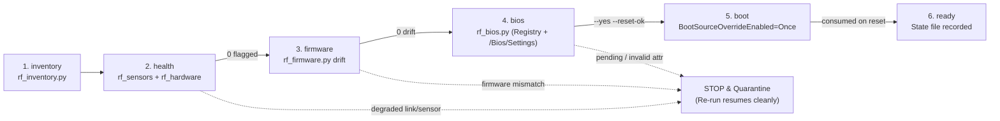

# 7.14 Fleet-scale hardware management and node lifecycle automation

| | |
|---|---|
| Level | Advanced |
| Priority tier | 1 |
| Lab venue | Laptop |
| Part | Part 7: Redfish and BMC |
| Status | Drafted (`lifecycle_lab.py`: 24 checks pass against mock; **untested** on live BMC) |

## Why this matters for AI infrastructure

Racking 128 GPU servers is the easy part. Getting every one of them to the same state, with the same BIOS, firmware and boot setup, proving it, and keeping it that way for years is the hard part. The user's notes say it plainly: a distributed training job runs at the speed of its slowest GPU, so one node with a different BIOS setting or an older firmware is a cluster-wide problem. This chapter turns the primitives of chapters 7.2 to 7.13 into a repeatable **node lifecycle**.

## Prerequisites and outcomes

You need chapters 7.5, 7.7 to 7.12. After this chapter you can:

- change BIOS settings through Redfish, and explain pending versus live
- use the attribute registry to validate a setting before sending it
- use one-time and continuous boot override correctly
- run a bring-up that is safe to repeat and stops on the first problem
- keep a fleet in line with baselines for firmware, BIOS and health
- work through five classic incidents with the right tools

## 1. The fleet mindset in four ideas

1. **Describe the target state in files** (firmware baseline, BIOS target, acceptance profile, account policy), in version control.
2. **Measure the real state** the same way on every node (inventory, hardware, sensors, logs).
3. **Compare and report drift** automatically and often.
4. **Change in small, verified, repeatable steps**, with a human decision before anything risky.

The tools of Part 7 map onto these: `rf_inventory.py`, `rf_hardware.py`, `rf_sensors.py`, `rf_logs.py` measure; `rf_firmware.py drift` and `rf_bios.py plan` compare; `rf_firmware.py update`, `rf_bios.py apply` and `node_lifecycle.py` change; `fleet_run.py` runs a read-only task on many BMCs.

## 2. BIOS settings: live, pending, and the registry

### 2.1 The Settings resource pattern

Some resources cannot change at once. A BIOS setting is read when the machine boots, so a change must be stored until the next reset. The spec's **Settings resource** (DSP0266 9.10) handles it with a fixed pattern:

- The main resource (`Bios`) shows the **live** values.
- It carries an annotation `@Redfish.Settings` with a `SettingsObject` link, the `SupportedApplyTimes`, and the `Time` of the last change.
- You `PATCH` the **Settings object**, never the live resource. The change is stored as **pending**.
- The pending values become live when the apply time comes (here: `OnReset`).

In my lab:

```text
PATCH .../Bios/Settings {"Attributes": {"PowerProfile": "MaxPerf"}}   -> 200, "ResetRequired" message
GET   .../Bios                  Attributes.PowerProfile = Balanced      (live: unchanged)
GET   .../Bios/Settings         Attributes = {"PowerProfile": "MaxPerf"} (pending)
POST  ComputerSystem.Reset GracefulRestart
GET   .../Bios                  Attributes.PowerProfile = MaxPerf       (live now)
GET   .../Bios/Settings         Attributes = {}                         (pending cleared)
```

BCM shows the same three states for a node. In `cmsh`, under `biossettings`, `status` prints a table with **Configured** (what BCM wants), **Pending** (staged on the node) and **Live** (running now). `bios check` lists differences between configured and detected values, and `bios apply` stages the configuration. The manual's example changes the boot mode from UEFI to legacy: set it, commit, `bios apply`, then reset the node for it to become Live. (The BCM book covers it in section 14.5; I read the boot-mode example only.)

:::note Correction to my notes
The notes' example answer to a BIOS `PATCH` shows the message ID `Base.1.8.UpdatePending`. The `UpdatePending` message exists in the **Update** registry, not in the **Base** registry (I checked the registry files). A BMC may use a vendor message, or the Base message `ResetRequired` ("a component reset is required with the Reset action URI ... and ResetType ..."), which my mock uses. Do not match on the exact text. Check the HTTP status and then read the pending object.
:::

### 2.2 The attribute registry

BIOS settings differ so much between platforms that Redfish cannot fix their names. It uses an **attribute registry** (chapter 7.6): a JSON file, named by the `AttributeRegistry` property of `Bios`, that lists each attribute with its display name, type (`Enumeration`, `Integer`, `String`, `Boolean`, `Password`), allowed values or range, default, whether it is read-only or hidden, and whether changing it needs a reset.

A good tool reads the registry first, then validates a value **before** sending it. My `rf_bios.py` does so, and my mock also checks on its side. In the lab:

| Request | Answer |
|---|---|
| value not in the list (`PowerProfile: Turbo`) | 400, `PropertyValueNotInList` |
| unknown attribute | 400, `PropertyUnknown` |
| read-only attribute | 400, `PropertyNotWritable` |
| integer out of range or wrong type | 400 |
| read-only user | 403 |

### 2.3 What to set for AI: the notes' matrix, with cautions

The user's notes list a "production BIOS matrix" for AI nodes. Here it is in my lab's attribute names, with the notes' reasons. The reasons are **claims from the notes that I could not verify**. The final authority is your server vendor's tuning guide for your exact model.

| Setting (lab name) | Factory-style value | Target in the notes | Reason given in the notes |
|---|---|---|---|
| `PowerProfile` | Balanced | MaxPerf | stop CPU cores entering deep sleep states |
| `ProcCStates` | Enabled | Disabled | sleep-state wake-up latency adds jitter to collective operations |
| `SubNumaClustering` | Disabled | Enabled (SNC2 or SNC4 on Intel, NPS4 on AMD) | keep GPU-related memory traffic local and reduce cross-socket traffic |
| `PcieLinkSpeed` | Auto | Gen5 (force) | "Auto" may renegotiate to a lower generation under load |
| `PcieRelaxedOrdering` | Disabled | Enabled | needed for GPUDirect RDMA and GPUDirect Storage performance |
| `PcieMaxPayloadSize` | 256B | 512B | less overhead for 400 Gb/s NICs |
| `IommuMode` | Enabled | Enabled, with kernel parameter `iommu=pt` | needed for SR-IOV, passthrough avoids translation cost |
| `ProcHyperthreading` | Enabled | workload dependent | disable for some strict MPI codes, keep for Kubernetes agents |
| Above-4G decoding | Enabled | Enabled | lets the CPU map the large GPU memory regions |

Notes for your own judgement: a forced `Gen5` link is only sensible if every device on that path supports it; `512B` payload only works if the platform supports it end to end; and "disable C-states" costs power and heat. I have **not** measured any of these. Treat the matrix as a checklist of questions for your vendor.

### 2.4 The tool

```bash
python3 rf_bios.py plan  http://<bmc> <user> <password> --target profiles/ai_node_bios.json
python3 rf_bios.py apply http://<bmc> <user> <password> --target profiles/ai_node_bios.json --yes --reset
```

Output of the real `plan` on my mock (six differences, two already right), and after `apply --yes --reset` the final line is `LIVE and verified`, and a second `plan` shows `0 to change`. `apply` without `--yes` only prints what it would send. The tool changes only the attributes that differ, so it can run again and again (**idempotent**).

## 3. Boot override: one time or forever

To install an operating system over the network you ask the machine to boot from the network once. The `Boot` object of the `ComputerSystem` has:

- `BootSourceOverrideTarget`: `Pxe`, `UefiHttp`, `Hdd`, `BiosSetup`, `Diags` and others (chapter 7.7),
- `BootSourceOverrideEnabled`: **`Once`** (use it at the next boot and then go back to normal), **`Continuous`** (use it every boot) or `Disabled`,
- `BootSourceOverrideMode`: `UEFI` or `Legacy`.

The lab shows both behaviours:

```text
PASS  a 'Once' boot override is used by the next restart and then switches itself off
PASS  the restart after that boots normally (no repeated PXE)
PASS  a 'Continuous' override keeps booting from the network on every restart (a classic provisioning trap)
```

The trap: a `Continuous` network boot left in place makes the node reinstall itself at every restart. Always use `Once` for provisioning, and verify afterwards that the override is `Disabled`. For diagnosing why a network boot fails, use the D-T-B-I chain from chapter 6.22 (DHCP, Transfer, Boot-mode, Image).

## 4. A node lifecycle you can re-run



`code/part07/node_lifecycle.py` takes one node from "racked" to "ready". It runs six steps; each **checks first and skips what is already right**:

| Step | What it does | Stops when |
|---|---|---|
| `inventory` | saves what the BMC reports (evidence) | |
| `health` | runs the sensor and hardware checks from chapters 7.8 and 7.9 | any sensor, link or drive is flagged |
| `firmware` | compares versions with the baseline file | any component differs (updates are a separate, reviewed job, chapter 7.10) |
| `bios` | validates the target against the registry, stages it, optionally restarts and checks it is live | a value or attribute is not accepted, or the settings are not live |
| `boot` | sets a one-time network boot and checks that it was consumed | the override is refused or still set |
| `ready` | writes the record | |

Rules in the code:

- **Dry run by default.** Without `--yes` it stops at the first step that would change something. Without `--reset-ok` it never restarts the host (it stages the change and stops at `pending`).
- **Stop at the first failure**, with a clear reason.
- **A state file** (JSON) keeps each step's result, time and the evidence, so you can fix the cause and run the same command again. The finished steps are re-checked and skipped.

The lab walks through it:

```text
PASS  dry run: stops at the first step that would change something, changes nothing
PASS  with --yes but no permission to restart, it stages and stops at 'pending'
PASS  with --reset-ok it finishes: BIOS live, boot override consumed, node ready
PASS  running it again is harmless: BIOS already matches, nothing is restarted again
PASS  a degraded GPU link stops the run at 'health' and nothing after it is attempted
PASS  after the fault is fixed the same command continues and completes
PASS  firmware drift stops the run at 'firmware' (updates are a separate, reviewed job)
PASS  a BIOS target with an invalid value or an unknown attribute is refused before anything is sent
```

This is deliberately small. A production version adds: a real burn-in step with DCGM diagnostics, NVLink and network tests whose output is attached as evidence; batching and concurrency (chapter 7.12); approval before risky steps; and a link to your inventory or CMDB. The state machine around it, however, is the same.

## 5. Keeping a fleet in line

- **Baselines in git:** one file for firmware, one for BIOS, one for account and protocol policy (chapter 7.15). A change to a baseline is a reviewed change.
- **Scheduled drift reports:** run inventory, firmware drift and hardware checks nightly with the fleet runner and send the exceptions to a ticket queue.
- **Waves for changes:** 1 node, then 1 rack, then 10 percent, then the rest, checking health between waves.
- **Evidence, not memory:** keep every before and after (inventory snapshots, bundles, task results).
- **Never "fix" one node by hand and forget it.** Either make the change everywhere through the baseline or put the node in a documented exception list.
- **RMA'd parts need re-baselining.** The notes' example of replacement nodes with old firmware (chapter 7.10) is exactly this case. A replacement node enters the lifecycle at step 1.

## 6. Five scenarios from the notes, with the tools

These are retold from volume 10 chapter 1. The commands in the notes are real commands whose output on your system will differ. I mark where my Part 7 tools help.

### Scenario 1: "Ghost" throttling in a 64-node job

*All-reduce latency spikes at random; CPU and GPU utilisation look normal.* The notes' three boundaries: (1) PCIe and link health, (2) NVLink error counters, (3) thermal and power throttling.

- PCIe: on the host `dmesg` for AER errors and `lspci -vvv` for `LnkSta`; out of band, **`rf_hardware.py`** shows any link below its maximum (chapter 7.9).
- NVLink: `nvidia-smi nvlink` status and error counters (host side, Part 10).
- Thermal and power: **`rf_sensors.py`** for fans, inlet temperature and supplies (chapter 7.8) and `nvidia-smi` clock event reasons on the host. The notes note that one throttled GPU slows all the others.
- Compare the suspect node with healthy twins using **`rf_firmware.py drift`** (chapter 7.10).

### Scenario 2: Bringing up 128 DGX systems (1,024 GPUs)

The notes' three principles: separate out-of-band network, immutable firmware baseline, automated acceptance gates.

- Out-of-band: dual 1 GbE management switches to every BMC and PDU, with DHCP reservations and HTTP boot rather than TFTP (chapters 7.1 and 6.22).
- Baseline: push BIOS, BMC, GPU, NVSwitch and NIC firmware to the validated bundle and assert it with reads (**`rf_firmware.py`**, **`rf_bios.py`**).
- Gate: only nodes with clean evidence enter the pool. The notes name `dcgmi diag -r 3` (about 15 minutes) and `-r 4` for burn-in, `nvbandwidth` for NVLink, and `ib_write_bw` for the network. That is the part of **`node_lifecycle.py`** you extend.

### Scenario 3: A "bricked" BMC after a bad firmware push

*The BMC does not answer ping, SSH or Redfish. The host is up, fans are at 100 percent.* The notes' recovery order: (1) reset the BMC from the host through the in-band interface (the notes write `ipmitool bmc reset cold`; chapter 7.1 and the firmware steps use `ipmitool mc reset cold`; I believe `bmc` is an alias of `mc` in ipmitool but did not check); (2) if the flash is corrupted, field staff use the chassis BMC reset or a recovery image; (3) a full AC power drain through the PDU. Prevention matters more: update the BMC in a first small wave, keep the recovery procedure written down, and never update BMC firmware on a whole rack at once. Also keep `Manager.Reset` in mind (chapter 7.7): a restart request over Redfish needs a working BMC, so this scenario needs the in-band route.

### Scenario 4: A CUDA error with a clean OS log

Use chapter 7.11: look at the BMC event log and SEL around the time of the crash for memory or PCIe fault events, check GPU ECC counters on the host, and put both on one timeline. A DIMM fault means drain and replace; a GPU fault means a targeted test (the notes name `dcgmi diag`).

### Scenario 5: Moving to UEFI Secure Boot

The notes' steps: signed shim and bootloader, HTTPS boot, a signed kernel (or enrolled owner key), and a Redfish check that Secure Boot is on. Chapter 7.15 covers Secure Boot and corrects one detail of the notes.

## Exercises

1. **Running the 24-check node lifecycle state machine (`code/part07/lifecycle_lab.py`):** Run `python3 code/part07/lifecycle_lab.py` (`24 passed, 0 failed`) and inspect `code/part07/node_lifecycle.py`. Add a seventh step (`accounts`) that checks whether any `ManagerAccount` still has `PasswordChangeRequired: true` and halts bring-up if found.
2. **Validating BIOS targets against the Attribute Registry (`code/part07/rf_bios.py`):** Copy `code/part07/profiles/ai_node_bios.json` to `/tmp/bad_bios.json`, add an invalid attribute `"PowerProfile": "SuperTurbo"`, and run `rf_bios.py plan --target /tmp/bad_bios.json`. Verify that `rf_bios.py` catches the invalid enum against the `AttributeRegistry` *before* sending any HTTP `PATCH` to the BMC.
3. **Writing a BIOS target profile for a second server platform:** Inspect the `AttributeRegistry` JSON on a DMTF mockup (`public-rackmount1`) and construct a target JSON file mapping equivalent performance and PCIe settings using that platform's attribute names.
4. **Building a wave-based rollout wrapper (`--wave N`):** Write a 20-line Python wrapper that runs `node_lifecycle.py` in waves (`Wave 1 = 1` canary node, `Wave 2 = 8` nodes, `Wave 3 = 32` nodes) and aborts immediately if any node in the current wave fails a gate.
5. **Proving the `Continuous` vs `Once` network boot trap:** Trace checks 10–12 of `code/part07/lifecycle_lab.py`. Explain what happens to a newly installed OS on local NVMe when `BootSourceOverrideEnabled` is left set to `"Continuous"` with `BootSourceOverrideTarget: "UefiHttp"` versus `"Once"`.
6. **Designing a nightly 500-node drift audit pipeline:** Combine `fleet_run.py`, `rf_firmware.py drift`, `rf_bios.py plan`, and `rf_hardware.py` into a scheduled read-only nightly audit that compares all 500 nodes against Git baselines and opens an automated ticket whenever a node drifts (for example, after a field RMA swap).

## 8. Interview angles

- "How do you make sure 500 nodes have identical BIOS settings?" A baseline file, the attribute registry for validation, Redfish Settings objects, reset, and reading the live values back; run it as a repeatable lifecycle.
- "What is the difference between pending and live settings?" Settings are stored until the apply time (usually reset); the main resource shows what is running now.
- "How do you provision safely?" One-time network boot, verify the override is gone, stop on the first failed gate.
- "A job is slow on one node. Where do you start?" Compare that node with a healthy twin: firmware drift, BIOS drift, link speed and width, thermals.
- "What would you automate first?" Inventory and drift detection, because it is read-only and shows the size of the problem.

## Checkpoint questions (20)

<details>
<summary>1. What are the four core principles of fleet-scale hardware management?</summary>

1. **Declare target state in version-controlled files** (firmware baseline, BIOS profile, acceptance profile, security policy).
2. **Measure actual state uniformly** across every BMC (`rf_inventory.py`, `rf_hardware.py`, `rf_sensors.py`, `rf_logs.py`).
3. **Detect and report drift automatically** on a schedule (`rf_firmware.py drift`, `rf_bios.py plan`).
4. **Apply changes in small, idempotent, verified waves** with explicit human approval (`--yes`, `--reset-ok`) before disruptive steps.
</details>

<details>
<summary>2. What architectural problem does the Redfish `@Redfish.Settings` resource pattern solve (DSP0266 §9.10)?</summary>

It separates attributes that can only take effect at a future hardware event (such as UEFI BIOS attributes applied at the next host reboot) into a writable **pending Settings resource** (`/Bios/Settings` or `/Bios/SD`) while keeping the **active resource** (`/Bios`) as an accurate read-only view of what is currently running.
</details>

<details>
<summary>3. Which annotation and sub-property on `/redfish/v1/Systems/{id}/Bios` tells a client where to send its `PATCH` request?</summary>

**`@Redfish.Settings.SettingsObject["@odata.id"]`** (which points to `/redfish/v1/Systems/{id}/Bios/Settings` or `/SD`).
</details>

<details>
<summary>4. Trace the values of `/Bios` (live) and `/Bios/Settings` (pending) before `PATCH`, immediately after `PATCH`, and after `ComputerSystem.Reset`.</summary>

- **Before `PATCH`:** `/Bios` has `"PowerProfile": "Balanced"`, `/Bios/Settings` has `{}`.
- **After `PATCH /Bios/Settings {"Attributes": {"PowerProfile": "MaxPerf"}}`:** `/Bios` (live) still shows `"Balanced"`, while `/Bios/Settings` (pending) shows `{"PowerProfile": "MaxPerf"}`.
- **After `ComputerSystem.Reset`:** `/Bios` (live) updates to `"MaxPerf"`, and `/Bios/Settings` (pending) is cleared back to `{}`.
</details>

<details>
<summary>5. What does a Redfish `AttributeRegistry` JSON file contain, and how does a client locate it?</summary>

Referenced by the `AttributeRegistry` property on `Bios` (and found under `/redfish/v1/Registries`), it lists every platform BIOS attribute along with its `AttributeName`, `Type` (`Enumeration`, `Integer`, `String`, `Boolean`, `Password`), allowed `Value` list or numeric bounds, `ReadOnly`, `ResetRequired`, and `DefaultValue`.
</details>

<details>
<summary>6. Why does `code/part07/rf_bios.py` validate target BIOS settings against the `AttributeRegistry` before sending a `PATCH` request?</summary>

Because BIOS attribute names and enum values vary across server models and BIOS versions. Pre-validating against the node's own `AttributeRegistry` catches typos, unsupported values (`PropertyValueNotInList`), and read-only attributes locally before mutating any node state.
</details>

<details>
<summary>7. In NVIDIA Base Command Manager (`cmsh` `biossettings`, §14.5), what do the `Configured`, `Pending`, and `Live` columns represent, and which commands check and stage them?</summary>

- **`Configured`:** The target value defined in BCM for the node/category.
- **`Pending`:** The value staged on the BMC's `/Bios/Settings` waiting for a reboot.
- **`Live`:** The value currently active on the booted server (`/Bios`).
`bios check` compares Configured vs Live, and `bios apply` stages Configured values into Pending.
</details>

<details>
<summary>8. Why must you treat BIOS attribute names (such as `OperatingPerformance` vs `PowerProfile`) as platform-specific rather than universal Redfish standard names?</summary>

Unlike `ComputerSystem.PowerState`, UEFI setup variables are defined by each motherboard/BIOS vendor (`AMI`, `Insyde`, `Dell`, `HPE`), which is why Redfish delegates their schema to per-platform `AttributeRegistry` files.
</details>

<details>
<summary>9. Name four BIOS settings commonly tuned for multi-GPU AI training nodes (`volume-10/01` §5.1) and the architectural reason for each.</summary>

1. **Power Profile = Maximum Performance / C-States Disabled:** Prevents CPU core wake-up latency jitter from stalling synchronous MPI/NCCL collective barriers.
2. **Sub-NUMA Clustering (`SNC2`/`SNC4` or AMD `NPS4`) Enabled:** Pins GPU PCIe root complexes to local memory controllers to minimize cross-socket fabric traffic.
3. **PCIe Relaxed Ordering = Enabled & Max Payload Size = `512B`:** Required for optimal GPUDirect RDMA / GPUDirect Storage DMA throughput on `400G` ConnectX HCAs.
4. **Above 4G Decoding = Enabled & IOMMU passthrough (`iommu=pt`):** Allows mapping eight `80 GB`/`141 GB` HBM3 GPU BAR spaces into 64-bit physical address space without DMA translation overhead.
</details>

<details>
<summary>10. What is the difference between `BootSourceOverrideEnabled: "Once"` and `"Continuous"`, and why is `"Continuous"` a classic provisioning trap?</summary>

`"Once"` boots from `BootSourceOverrideTarget` (`Pxe` or `UefiHttp`) on the **next reboot only**, then automatically resets `BootSourceOverrideEnabled` to `"Disabled"` so the newly installed OS boots from local disk thereafter. `"Continuous"` forces a network boot on **every** future reboot, causing the node to wipe and reinstall itself in an infinite loop.
</details>

<details>
<summary>11. How does `code/part07/node_lifecycle.py` verify that a one-time PXE/HTTPBoot override was properly consumed?</summary>

After triggering the host reset, it re-reads `ComputerSystem.Boot` and asserts that `BootSourceOverrideEnabled` has transitioned from `"Once"` back to **`"Disabled"`**.
</details>

<details>
<summary>12. What are the six sequential gates in `code/part07/node_lifecycle.py`, and why does it halt on the first failed gate?</summary>

The six gates are **`inventory` $\rightarrow$ `health` $\rightarrow$ `firmware` $\rightarrow$ `bios` $\rightarrow$ `boot` $\rightarrow$ `ready`**. Halting at the first failure prevents provisioning an OS onto a node that has a degraded PCIe link (`health`), an un-baselined GPU VBIOS (`firmware`), or an unapplied BIOS setting (`bios`).
</details>

<details>
<summary>13. What does the JSON state file written by `node_lifecycle.py` store, and how does it support idempotent re-execution?</summary>

It records the timestamp, status (`ok`, `failed`, `pending`, `dry-run`), and evidence summary for each of the six steps. When re-run after fixing a fault, `node_lifecycle.py` re-verifies live state, skips changes that are already applied (such as BIOS settings that already match `Live`), and completes the remaining steps without redundant reboots.
</details>

<details>
<summary>14. What is the difference between passing `--yes` alone versus passing `--yes --reset-ok` to `node_lifecycle.py`?</summary>

With `--yes` alone, `node_lifecycle.py` stages non-disruptive changes (`PATCH /Bios/Settings`) and stops safely at `"pending"` without rebooting the server. Adding **`--reset-ok`** explicitly authorizes the tool to reboot the host (`ComputerSystem.Reset`) to activate BIOS settings and consume the boot override.
</details>

<details>
<summary>15. Why does `node_lifecycle.py` stop and flag firmware drift at the `firmware` step rather than automatically flashing firmware inside the bring-up loop?</summary>

Because flashing BMC, BIOS, or 30-component GPU-tray firmware is a high-risk operation requiring specific package selection, quiescing, and DC/AC power-cycle activation rules (Chapter 7.10) that should be executed as a dedicated, reviewed maintenance task.
</details>

<details>
<summary>16. Which four declarative JSON profile/baseline files in `code/part07/profiles/` define a cluster's desired hardware state?</summary>

1. **`gpu_node_acceptance.json`** (DMTF Redfish Interoperability Profile for hardware capabilities).
2. **`ai_node_bios.json`** (target BIOS attributes).
3. **`bmc_policy.json`** (`rf_harden.py` security policy).
4. **`bmc_hardening.json`** (DMTF Interoperability Profile for hardened BMC protocols and account settings), alongside the firmware baseline JSON.
</details>

<details>
<summary>17. Why must every RMA-replaced server or motherboard re-enter `node_lifecycle.py` at Step 1 before rejoining the Slurm/Kubernetes pool?</summary>

Spare motherboards and GPU trays sit on warehouse shelves for months and almost always ship with factory-default BMC credentials, factory-default BIOS settings (`Balanced` power, `Auto` PCIe), and older firmware versions that would cause collective straggler slowdowns if admitted directly into production.
</details>

<details>
<summary>18. In Scenario 1 ("Ghost" throttling across a 64-node training job, `volume-10/01` §9), which three hardware boundaries do you inspect and with which tools?</summary>

1. **PCIe link width/speed degradation:** Out-of-band via `rf_hardware.py` (`PCIeInterface` `LanesInUse`/`PCIeType`) and in-band via `lspci -vvv` / `dmesg | grep -i aer`.
2. **NVLink fabric errors:** In-band via `nvidia-smi nvlink --status` and `nvidia-smi nvlink -e` replay/symbol counters.
3. **Thermal/power clock throttling:** Out-of-band via `rf_sensors.py` (fans, inlet temp, PSUs) and `rf_firmware.py drift`, correlated with in-band `nvidia-smi --query-gpu=clocks.current.graphics,clocks_event_reasons.hw_slowdown`.
</details>

<details>
<summary>19. In Scenario 2 (Greenfield bring-up of 128 DGX H100 nodes), which three acceptance benchmarks must pass after firmware and BIOS baselining before nodes enter BCM/Slurm?</summary>

1. **DCGM Diagnostics:** `dcgmi diag -r 3` (`~15` min validation) and `-r 4` (extended burn-in).
2. **Intra-node NVLink bandwidth:** `nvbandwidth` compared against the platform baseline (`900 GB/s` per H100).
3. **Inter-node GPUDirect RDMA fabric bandwidth:** `ib_write_bw` (and `all_reduce_perf`) across leaf switches verifying `400 Gb/s` line rate per port.
</details>

<details>
<summary>20. In Scenario 3 (Recovering a hung/bricked BMC whose fans are at 100% while the host OS is still running), why can't you use Redfish `Manager.Reset`, and what is the 3-step escalation path?</summary>

Because the BMC's network stack and Redfish web server are unresponsive on the OOB network. Instead:
1. **In-band KCS cold reset:** SSH into the running host Linux OS and run `sudo ipmitool mc reset cold` (or `ipmitool bmc reset cold`) over `/dev/ipmi0`.
2. **Out-of-band PDU AC power drain:** Drain the node and cut AC power on its smart PDU outlets for `60` seconds to reset the BMC standby rail.
3. **Smart-hands physical pinhole or USB SPI recovery:** If the BMC SPI flash is corrupt, re-flash via the physical recovery port.
</details>

## Sources and review notes

- **Redfish Specification DSP0266 v1.21.0:** the Settings resource and settings annotations (9.10), operation apply time (7.12).
- **Redfish Resource and Schema Guide, official JSON Schemas and registries:** `Bios` v1.2, `AttributeRegistry` v1.5 (attribute types and entries), the Base registry (`ResetRequired`) and the Update registry (`UpdatePending`).
- **BCM 11 Administrator Manual, section 14.5:** the `biossettings` states (Configured, Pending, Live), `bios check`, `bios apply`.
- **NVIDIA-DevOps notes (`volume-10/01-bare-metal-and-bmc-lifecycle.md`):** section 5 (BIOS matrix and Redfish BIOS automation), section 9 (the five scenarios). The notes' BIOS rationale and attribute names (`OperatingPerformance`, `SubNumaClustering` and others) are unverified; I used my own lab names.
- **Chapter 6.22** for provisioning (HTTP boot, D-T-B-I).
- **Run here:** `rf_bios.py` (plan, apply, reset, verify), `node_lifecycle.py`, and `lifecycle_lab.py` (24 checks); the mock's BIOS, registry and attribute resources validate against the official DMTF schemas.
- **Not verified:** real BIOS attribute registries, real apply behaviour on DGX or HGX BMCs, anything about the numerical effect of the BIOS settings, and the burn-in tools (`dcgmi`, `nvbandwidth`, `ib_write_bw`), which I did not run.
