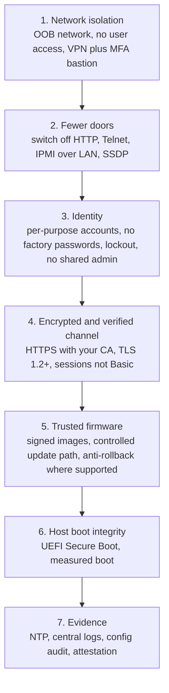
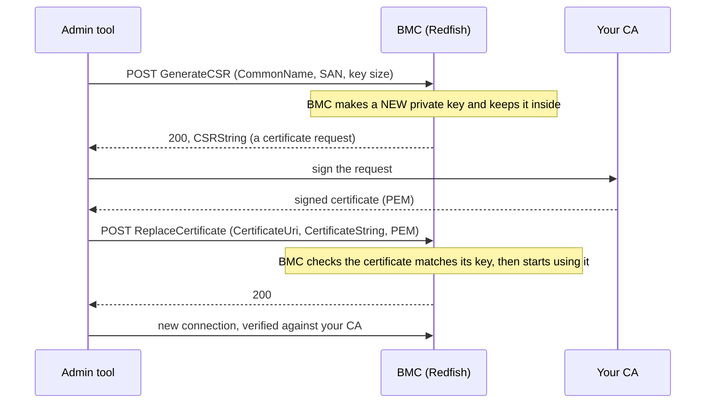

# 7.15 BMC security hardening and attestation

| | |
|---|---|
| Level | Advanced |
| Priority tier | 1 |
| Lab venue | Laptop |
| Part | Part 7: Redfish and BMC |
| Status | Drafted (`hardening_lab.py`: 29 checks pass over TLS mock; **untested** on live BMC) |

## Why this matters for AI infrastructure

The BMC is the most privileged computer in the rack. It can power the server on and off, mount a virtual disk, open a console, rewrite firmware and read hardware state. It works below the operating system, which means your normal security tools, such as an endpoint agent or an audit daemon on the host, cannot see it at all. An attacker who gets into the BMC is therefore working in a place your usual defences do not look.

The security material in the NVIDIA-DevOps notes puts the risk plainly. If the BMC is compromised, the server is lost. If the firmware is compromised, no operating system reinstall helps, because the bad code sits underneath the reinstall. GPU clusters also hold valuable data and expensive hardware, so they attract attackers. This chapter closes Part 7 with the controls that matter. It also shows tests for the ones you can run yourself.

## Prerequisites and outcomes

Before you start, work through chapters 7.1 to 7.4, 7.10 and 7.12. Those chapters cover the BMC basics, the account and protocol model, the firmware update path and the batch tooling that this chapter reuses. This chapter then covers the threat model in plain words, the layers of defence and what each one stops, and how to replace a BMC's self-signed certificate through Redfish. It shows how to audit and fix management protocols and account policy without locking yourself out. It explains UEFI Secure Boot through Redfish, including the difference between Setup Mode and User Mode, and it covers firmware signing, downgrade risk and tenant root access. The last part explains what attestation is, how to read its output, and which pieces are still missing.

## 1. The threat in plain words

Start with the attacker's view, because that is the view you need when you defend the BMC. Picture an attacker who has a password for the BMC web interface and nothing else. They do not need to break into the host, and they do not need to touch its disk. Someone who reaches your BMC can still do many things that an attacker on the host could not do, and they can do them without leaving a trace in the operating system's logs. The table lists those things and says why each one hurts.

| What they can do | Why it hurts |
|---|---|
| power off or reset servers | an outage, or repeated disruption of a long training run |
| attach virtual media and boot their own image | takes the host without touching its disk |
| open the console or send keystrokes (KVM) | see and control the machine |
| flash firmware | a persistent implant that survives reinstalls |
| read hardware state and logs | learn about the cluster |
| change settings (boot order, BIOS, accounts) | quiet persistence |

KVM here means keyboard, video and mouse over IP, the remote console that lets someone type into the server as if they were standing in front of it. Persistence means the attacker keeps a way back in after you think you have cleaned up. Notice that most rows in the table are about keeping access, not about one dramatic action.

The NVIDIA-DevOps notes on the bare-metal and BMC lifecycle add two more risks. A compromised BMC can steal secrets from memory through DMA, which means direct memory access, where a device reads memory without the CPU's help. It can also destroy hardware by changing thermal thresholds, so the cooling reacts too late to a hot part.

The NVIDIA-DevOps security notes state the requirement directly. They call it "the architectural mandate". The BMC network must be isolated from the AI data network, on a dedicated out-of-band network or a VLAN with firewall rules. Only authorised infrastructure administrators may reach it, and only through a VPN with multi-factor authentication. A VLAN is a virtual slice of a switch that keeps traffic separate. Multi-factor authentication means the login needs something you know and something you hold, such as a code from a phone. The next section shows how that mandate turns into layers.

## 2. Layers of defence

Think of the defences as a row of doors. An attacker has to get through all of them, and each door does a different job. A single weak door does not give the attacker the whole building, because the next door still stands. The diagram shows the seven layers in order, from the outside in.



No single layer is enough on its own. Layers protect each other, so a failure at one layer does not decide the outcome. If layer 1 fails, for example because someone plugs into the out-of-band (OOB) switch, layers 2 to 4 still stand. If a password leaks, lockout and per-purpose roles limit the damage. Each of the sections below takes one or two layers in turn.

### Layer 1: network isolation

The first door is the network itself. The DGX GB300 SuperPOD reference architecture shows how NVIDIA builds this layer. It uses a separate out-of-band Ethernet fabric of SN2201 switches. That fabric connects "the management ports of all devices", and it rolls up into a dedicated VXLAN at the spine layer of each scalable unit. No non-privileged user needs access, so the design relies on logical network separation, which means separate routing and access rules rather than separate cables. The same network carries IPMI traffic and manages the InfiniBand and NVLink fabrics. That is a lot of control in one place, and it is the reason the network has to be locked down.

The Supercomputers for Linux SysAdmins book gives the same advice in a few words, in its chapter 10. It calls the IPMI network "not really secure". IPMI is the older management protocol that many BMCs still speak, and it has weak protection by default. So put that network on a dedicated physical network, or on a dedicated VLAN that is enabled only on management nodes.

Follow these rules. Keep routes from user and data networks away from BMC addresses. A route is the path a packet takes, so a missing route means the packet cannot reach the BMC at all. Reach BMCs only from a hardened management host, a bastion, and require multi-factor authentication there. A bastion is a single, locked-down machine that every administrator must pass through. Log all access to it. Firewall BMC subnets in both directions. BMCs should not browse the internet either, apart from reaching approved NTP and log servers. NTP is the time protocol, and the BMC needs the right time so its logs line up with everything else.

### Layer 2: switch off what you do not use

Each open service is a possible door, and the second layer closes the doors you never use. The `ManagerNetworkProtocol` resource, covered in chapter 7.7, lists them: `HTTP`, `HTTPS`, `IPMI`, `SSH`, `Telnet`, `SNMP`, `SSDP`, `NTP`, `KVMIP`, `VirtualMedia` and more. A service that is switched on but unused still listens for connections, so it still counts as an open door. A hardened policy turns off plain `HTTP`, `Telnet` and `IPMI`. IPMI is the old, weakly protected remote protocol from chapter 7.1. The policy also turns off `SSDP` discovery, which chapter 7.2 covers, and turns on `NTP`. The notes' example does this with one `PATCH`:

```json
{ "IPMI": {"ProtocolEnabled": false}, "Telnet": {"ProtocolEnabled": false}, "HTTP": {"ProtocolEnabled": false}, "SSH": {"ProtocolEnabled": true, "Port": 22} }
```

Think before you switch anything off. A switched-off service can still be needed by a tool you forgot about. BCM may use IPMI for some functions on your BMCs, because the BCM manual lists IPMI, iLO, DRAC, CIMC and Redfish as supported BMC interface types. Virtual media or KVM may also be needed during repairs. Switch off only the services you have checked nothing depends on, and keep a documented way back, which chapter 7.14 covers in scenario 3. The way back matters most for the protocol you are connected over, which is why the audit tool later refuses to disable it.

### Layer 3: identity

Identity is the third door. All of chapter 7.4 applies here. In short, no factory passwords should remain in use, and the audit checks `PasswordChangeRequired` to find them. A factory password is the default one that ships with the device, and anyone who reads the manual knows it. Set a lockout threshold and a minimum password length, so repeated guesses stop working and short passwords are refused. Give each purpose its own account, with the lowest role that still works, and give each person a personal account, so that a log entry points to one human. Keep secrets in a secret manager, which is a vault that stores passwords and hands them out on request. Finally, audit credential drift across the fleet, as chapter 7.1 describes, because one node with an old password is enough to break the rest.

### Layer 4: a verified HTTPS channel

Traffic to the BMC carries passwords, tokens and firmware. It must be encrypted, so that someone watching the network cannot read it. The client must also check who answers. Otherwise an attacker on the path can pretend to be the BMC and collect the password the client sends. Encryption protects the data, and certificate checking protects you from the impostor. Both are needed, and the second one needs a certificate your clients trust. The next section shows how to put one on the BMC. Here is the full flow, as the lab runs it.

Before you change any setting, make sure the BMC is reachable only from the bastion and that clients verify its certificate. If you skip that check, you may open a window that the first attacker walks through.

## 3. Replacing the certificate through Redfish

A BMC ships with a self-signed certificate. A certificate is the identity card a server shows to clients, and a self-signed one is an identity card that the device printed for itself. Nobody outside the device vouches for that certificate, so a client that trusts only your CA will refuse it. That refusal is the correct behaviour, because it stops a fake BMC from passing as the real one. The standard way to replace it uses two actions of the `CertificateService`, one to create a request and one to install the answer. Chapter 7.4 covers the same workflow, and it corrects the notes on one point.



Read the diagram from top to bottom, because the order matters for a simple reason. The private key is created inside the BMC and never travels, so only the public request and the signed certificate cross the network. A CSR, or certificate signing request, is the public half of the request. Your CA checks it and signs it, and the BMC then matches the signed certificate to the key it kept. In the practice mock, the lab proves each rule in the table below.

| Check in the lab | Result |
|---|---|
| a client that trusts the lab CA refuses the BMC's self-signed certificate | yes, `CERTIFICATE_VERIFY_FAILED` |
| `ReplaceCertificate` with no pending request | 400, because the key must be made inside the BMC |
| `GenerateCSR` without `CommonName` | 400 |
| `GenerateCSR` returns a PEM request and no private key | yes |
| a valid certificate for a **different** key | 400, "does not match the pending key" |
| garbage text instead of a certificate | 400 |
| the CA-signed certificate | 200; **new connections** now verify with no `-k` |
| the `Certificate` resource afterwards | issuer `Lab Root CA`, subject `bmc-lab` |
| a user without `ConfigureManager` | 403 |

The `Certificate` resource shows `Issuer`, `Subject`, `ValidNotBefore`, `ValidNotAfter`, `SerialNumber`, `Fingerprint` and `KeyUsage`. Plan for expiry, because the hardening audit warns when less than 30 days remain. It flagged the lab's own 30-day certificate as expiring in 29 days, which is exactly the warning you want to see early. In a real fleet, issue certificates with a lifetime your automation can renew, and monitor the expiry date with `rf_harden.py audit`.

Real DGX and OEM BMCs may behave differently with `GenerateCSR`. Some BMCs have vendor-specific certificate steps, and the sequence on yours may not match the mock. Their handling of key algorithms and of applying the new certificate without restarting the web service can also differ. Test the whole sequence on one real BMC before you roll it out to the fleet.

## 4. The hardening audit tool

Once the channel and the certificate are in place, you still need a way to check the rest of the BMC against your policy. `code/part07/rf_harden.py` audits a BMC against a policy file, `profiles/bmc_policy.json`. A policy file is a list of settings you want, such as "HTTP off" or "password length 12". The tool compares the live BMC with that list and reports every difference. Every finding carries one of two labels. `FIX` means the tool can change the setting itself. `MANUAL` means a person must decide, because the right answer depends on your process. On the practice TLS mock, before hardening, the audit printed this:

```text
HIGH   FIX    HTTP is enabled (policy: off)
HIGH   FIX    Telnet is enabled (policy: off)
HIGH   FIX    IPMI is enabled (policy: off)
HIGH   MANUAL HTTPS certificate expires in 29 days
HIGH   MANUAL account 'factory' still has PasswordChangeRequired: a factory or reset password is in use
MEDIUM FIX    SSDP is enabled (policy: off)
MEDIUM FIX    NTP is off or has no servers: log timestamps will drift (chapter 7.11)
MEDIUM FIX    HTTP Basic authentication is Enabled (policy: Disabled)
MEDIUM FIX    MinPasswordLength is 8 (policy: 12)
MEDIUM MANUAL account 'factory' is a default-style administrator name: rename or disable it
MEDIUM MANUAL System_0: UEFI Secure Boot is not active (enable: False, mode: SetupMode)

7 fixable by this tool, 4 need a person
```

Read the output as a small worked example. The severity column runs from HIGH to MEDIUM, so the findings at the top matter most. Seven findings are fixable and four are manual, which makes 11 findings in all. The tool can fix seven of them by itself, and the other four need a person to decide.

Then `rf_harden.py apply --yes` sent seven `PATCH` requests. Four protocols went off, NTP went on with the policy servers, Basic authentication was disabled, and the minimum password length was set to 12. The tool then re-audited the BMC and reported `0 fixable finding(s) left`. A re-audit matters because it proves the change took effect, rather than trusting that the request was accepted.

The tool has four safety rules. It is a dry run unless you pass `--yes`, so a plain run only shows what would change. It refuses to switch off the protocol you are connected over, because that would lock you out of the BMC. In the lab, a request to disable HTTP over a plain-HTTP connection was refused with "would lock you out". It leaves accounts, certificates and Secure Boot for you to decide, because the right action depends on your process. It also re-reads the settings after it changes them, which is the re-audit described above.

### Checking with DMTF's validator

A second opinion helps. The lab's `profiles/bmc_hardening.json` states the same target as a DMTF interoperability profile, which is the same kind of profile you met in chapter 7.13. It asks for HTTPS on, HTTP, Telnet, IPMI and SSDP off, NTP on, Basic authentication disabled, lockout greater than zero, and a minimum password length of at least 12. Because two tools check the same target, they can disagree, and a disagreement shows you where a rule is unclear.

On the default mock, `rf_interop_validator` passed 11 checks and failed 6. The six failures were HTTP, Telnet, IPMI, SSDP, NTP and Basic authentication. That makes 17 checks in all. After `rf_harden.py apply --yes`, the validator reported 17 passed and 0 failed. Two independent tools agreeing is a good sign. Remember the lesson from chapter 7.13: boolean values in a profile must be JSON booleans, or the check fails even when the BMC is right.

### What the tool does not do

The tool does not read BMC-specific security features, so a clean audit is not a complete audit. It skips SSH key policy, LDAP or Active Directory integration, and role mapping, where the schema has `RemoteRoleMapping`. Role mapping decides which directory group gets which BMC role. It also skips multi-factor authentication settings and the `SecurityPolicy` resource. That resource holds the TLS and SPDM policy, including allowed versions, algorithms, and trusted and revoked certificates, as shown in DMTF's example. SPDM is the device-to-device security protocol that section 7 explains. A mature audit adds these checks, using the resources your BMC really has, and it treats the list here as a starting point rather than the finish line.

## 5. Firmware trust

Firmware is the small software inside each part of the server: the GPU, the NIC, the BIOS and the BMC. It runs before the operating system and below it, so it is trusted by everything above it. If an attacker replaces it with a malicious copy, that copy survives an operating system reinstall. Wiping the disk and installing again does nothing to a bad BIOS, because the BIOS runs first. The NVIDIA-DevOps security notes, in their chapter on hardware and firmware trust, explain the idea for beginners. Four defences follow from it.

1. Use signed firmware, backed by a hardware root of trust. A root of trust is a chip whose own code is trusted by design, and a security chip checks the signature of the next stage before that stage runs. The result is a chain: hardware root of trust, BIOS, bootloader, kernel. Each link checks the next before handing over control. The notes say NVIDIA GPUs and ConnectX NICs verify signatures of their own firmware, so an unsigned or altered image will not initialise. This chapter does not check that claim. The BCM firmware lists show the ERoT (external root of trust) chips as separate updatable items, as chapter 7.10 explains.
2. Control the update path. The notes describe a useful customer scenario. Users with `sudo` on the host could run firmware tools such as `nvfwupd` and `mstflint`, and flash devices with them. `sudo` is the command that runs one task with root's powers, so anyone with it can do nearly anything on the host. The notes' answer has three parts: remove tenant root access, run user tools in unprivileged containers, and allow firmware updates only from change-managed tooling that uses vendor-signed images. Change-managed tooling is the update process that records who asked for what and when. The notes also stress that device firmware is signed by the vendor, not by your CA. So what you control is who may run the update path.
3. Resist downgrades. A signed but old image that has a known vulnerability is still a valid image, so the signature alone does not protect you. The notes recommend checking each device's documentation for anti-rollback support, which is a hardware check that refuses older versions. Redfish helps in two ways. The `ForceUpdate` switch bypasses update policies from chapter 7.10, so limit it to one role or process. The inventory lets you spot an unexpected old version with `rf_firmware.py drift`.
4. Track provenance. Provenance means knowing where a file came from and that it has not changed since. Take images only from the vendor, verify hashes and signatures where the vendor provides them, and keep the update log. The update log holds the task messages from chapter 7.10, so each update leaves a record.

In Redfish terms, the BMC's role is limited to what the vendor exposes. Redfish does not define "make firmware read-only" as a standard action, so lockout features are vendor specific. Check each vendor's documentation for those features before you rely on one.

## 6. UEFI Secure Boot through Redfish

Secure Boot protects the host firmware at the start of every boot. It runs only bootloaders and kernels that are signed by keys held in its databases, so a tampered loader is refused before it can run. Redfish exposes these settings under the system, and you will meet three parts of them: the switch itself, the mode it is in, and the key databases behind it.

`SecureBoot` holds `SecureBootEnable`, the setting you want, and `SecureBootCurrentBoot`, the state that is active right now. Those two can differ, and that gap is the source of most Secure Boot confusion. `SecureBootMode` can be `SetupMode`, `UserMode`, `AuditMode` or `DeployedMode`. It also lists `SecureBootDatabases`. SetupMode means no platform key is enrolled yet, so the firmware is open to changes. UserMode means a platform key is enrolled and the rules are enforced.

The databases hold the keys. `PK` is the platform key. `KEK` is the key exchange key, and it controls updates to the other two databases. `db` lists the allowed signatures, and `dbx` lists the forbidden ones. Each database has `Certificates` and `Signatures` collections. The action `SecureBoot.ResetKeys` accepts `ResetAllKeysToDefault`, `DeleteAllKeys` or `DeletePK`. Those actions change which keys the firmware trusts, so treat them as sensitive operations that need a change record.

:::note Correction to the notes
The notes' scenario 5 says the signed boot chain needs "a trusted key enrolled in the BMC's secure boot database (db)". That is not quite right. The key databases belong to the host's UEFI firmware. Redfish only exposes them under the system's `SecureBoot` resource. The BMC is the management channel, not the owner of those keys.
:::

The lab proves four mechanics that tend to surprise people:

```text
PASS  enabling Secure Boot changes the setting but not the running state (CurrentBoot stays Disabled)
PASS  after a restart it is STILL not enforced because no platform key is enrolled (SetupMode)
PASS  ResetKeys to the default keys puts the system in UserMode
PASS  after the next restart Secure Boot is enforced
```

What this means for you is that setting `SecureBootEnable` to true is not enough. The change applies at the next boot, just as a BIOS setting does in chapter 7.14. Secure Boot protects you only when a platform key is enrolled, which is User Mode. So a checker must read `SecureBootCurrentBoot`, not only `SecureBootEnable`. The hardening audit does exactly that.

For the operating system side, the notes describe the usual Linux route. A signed shim, which is signed by the Microsoft UEFI CA, loads your signed bootloader. A shim is a small, widely trusted program that bridges the vendor's trust to your own bootloader. A kernel signed with your own key loads next. That key is a machine owner key enrolled with `mokutil`, which is the tool that adds keys to the list the shim trusts. The route also uses HTTPS instead of plain HTTP for the boot transfer, and Redfish confirms that Secure Boot is on. That flow is common Linux practice, but this lab did not exercise it, and DGX images may ship their own signing arrangements.

Before you rely on Secure Boot, reboot the host and confirm that `SecureBootCurrentBoot` reads enabled. Until you see that value after a reboot, the setting is only a request.

## 7. Attestation: what it is, and what I did not do

Attestation means proving what software and firmware a device is running. The question it answers is "is this the code I expect?", and the proof has to come from the device itself, not from a label on the box. Redfish has two mechanisms for this, and both sit under `ComponentIntegrity`.

The first is SPDM, the Security Protocol and Data Model. A device, called the responder, reports measurements, which are hashes of its firmware and configuration. A hash is a short fingerprint of a file, so a changed file gives a different fingerprint. The device signs the measurements with a key whose certificate chains to the vendor. The second is TPM, a trusted platform module. A TPM is a small security chip on the motherboard. It keeps PCR values, which are running hashes of what booted, and it can sign them.

A `ComponentIntegrity` resource reports the type and version, whether it is enabled, and the component it protects in `TargetComponentURI`. It also lists the measurements and the result of checking the device's identity. Its actions are `SPDMGetSignedMeasurements`, which takes a 32-byte nonce, a random value used only once, and returns a signed statement over the chosen measurements. The other action is `TPMGetSignedMeasurements`. The manager's `SecurityPolicy` sets the allowed SPDM and TLS versions and algorithms, and it lists the trusted and revoked certificates.

The lab includes a small read-only lister, `rf_attest.py`, and it was run on DMTF's rack-server example:

```text
4 ComponentIntegrity resource(s), 1 SecurityPolicy resource(s)
  TPM-0        TPM   enabled=True  ... measurements= 4 identity=Success health=OK
  USB-Integrity SPDM enabled=False ... measurements= 0
  SS-SPDM-1    SPDM  enabled=True  ... measurements= 3
  SS-SPDM-0    SPDM  enabled=True  ... measurements= 3
  SecurityPolicy: SPDM enabled=True verify_certificate=True; TLS client allowed versions=['1.2', '1.3']
```

Read this output as an inventory. It shows four `ComponentIntegrity` resources and one `SecurityPolicy`, and it proves nothing yet. A list tells you what the device could report, not whether the report is true.

Listing measurements is not attestation. Real attestation needs four things. First, a fresh nonce from you, so an old answer cannot be replayed. Second, a signed answer from the device. Third, a check of that signature through a certificate chain you trust. Fourth, a comparison of the measurements with known-good values from the vendor, kept somewhere an attacker cannot change them. The lab does not do steps 2 to 4, and no known-good values for any NVIDIA part are included here. Whether and how DGX, HGX and GB200 BMCs expose attestation through Redfish is a question to answer on your own hardware. Use `rf_attest.py` only to see what your BMC offers.

## 8. A BMC security checklist

Use this list as a final pass before you call a BMC hardened. A checklist is useful at the end of a long job, because it catches the step you forgot. Most lines point back to a section of this chapter or to an earlier chapter, so if one line is unclear, go back to its source before you tick it off.

1. Keep the BMC and OOB switch management on an isolated network. Allow access only through a bastion with MFA, and keep every route from tenant networks away from it.
2. Change all factory passwords at first contact, and handle `PasswordChangeRequired`. Do this before the BMC joins any shared network, because a default password on a reachable box is the easiest door to find.
3. Use per-purpose accounts and roles, give each person a personal account, and set lockout and password length.
4. Use HTTPS only, with TLS 1.2 or newer and certificates from your CA. Monitor expiry, and make clients verify the certificate, never with `-k`. The `-k` flag tells the client to skip verification, which removes the protection you just built.
5. Turn Basic authentication off, keep sessions on, and close sessions after use. A session that stays open is a token that stays valid for whoever holds it.
6. Turn off HTTP, Telnet, IPMI over LAN and SSDP unless a documented need exists, and turn NTP on.
7. Take firmware only from vendor-signed images, through change-managed tooling. Restrict `ForceUpdate`, and check drift nightly (chapter 7.10).
8. On each host, confirm that Secure Boot is active by reading `SecureBootCurrentBoot`, and keep tenants without root access on hosts.
9. Centralise your logs, get the clocks right (chapter 7.11), and subscribe to events (chapter 7.5). Logs from many devices are only useful if their clocks agree.
10. Keep a tested recovery path for a locked-out or bricked BMC (chapter 7.14).
11. Re-run the audit and the profile after every firmware update, because updates can reset settings.

### 8.1 Deep dive: How SPDM and TPM cryptographic attestation work end to end

Section 7 showed that listing `ComponentIntegrity` resources with `rf_attest.py` is an inventory check, not cryptographic attestation. Here is one level deeper. A production verifier, such as the attestation checks in NVIDIA Base Command Manager or an enterprise remote attestation service, follows four cryptographic steps. They come from an SPDM and TPM 2.0 verification handshake, which DSP2046 and the NVIDIA-DevOps security notes (`volume-18/ch2`) describe. A handshake is an agreed back-and-forth between two parties before any real data moves, and each step below answers one question the verifier must settle.

1. Identity and certificate chain verification (`CertificateChain`). Every authentic component with a hardware root of trust has a unique Device Identity Certificate, which is a certificate burned in at manufacturing. Examples include an NVIDIA GPU, an NVSwitch, a ConnectX NIC, or the HGX `ERoT` security controller. The certificate is provisioned into immutable silicon fuses at manufacturing, so software cannot overwrite it. Its leaf certificate is signed by an intermediate CA, which chains up to the hardware manufacturer's root CA. A chain is the list of certificates, each one signed by the next, that leads back to a root you trust. Before the verifier trusts any measurement, it fetches the device's certificate chain through Redfish, using `TargetComponentURI` and `Certificates`. It checks that the chain is valid up to the vendor's published root CA. It also checks that no certificate in the chain is revoked, using `SecurityPolicy`.
2. Freshness with a cryptographic nonce (`SPDMGetSignedMeasurements`). Suppose an attacker compromises a BMC, or intercepts traffic on an internal management bus. Could they record a known-good measurement response from yesterday and replay it forever after flashing malicious firmware? To block that replay, the verifier creates a new, unpredictable random `Nonce` for every challenge. It is 32 bytes, which is 64 hex characters. A nonce is a value used only once, so an old answer cannot match a new challenge. The verifier sends the nonce in `POST .../ComponentIntegrity/{id}/Actions/ComponentIntegrity.SPDMGetSignedMeasurements`. The request also names the `SlotId` of the device certificate and the `MeasurementIndices` to sign. Those two fields tell the device which certificate to use and which measurements to include.
3. Hardware-signed measurement quote (`SignedMeasurements`). Inside the target GPU or ERoT chip, the hardware root of trust hashes the running firmware blocks, the configuration fuses and the debug-port lock state into measurement registers. A register here is a small slot that holds a running hash, so each new block changes it. The chip then joins those digests with the verifier's nonce. It signs the combined payload with the device's internal private key, which cannot be extracted, not even by the BMC or the host OS. The chip returns the result as a base64-encoded `SignedMeasurements` blob. Base64 is a text encoding for binary data, so the signed bytes can travel inside a JSON reply.
4. Comparison against golden Reference Integrity Manifests (RIMs). The external verifier uses the device's verified public key to check the signature over the measurements and the nonce. It then compares each measurement digest, SHA-384 or SHA-512, with the vendor's signed Reference Integrity Manifest for that exact firmware version, `96.00.89.00.01`. A digest is the hash result from step 3, and a RIM is the vendor's signed list of the digests that a clean version should produce. If even one bit of GPU VBIOS, NVSwitch firmware or UEFI bootloader was modified, the hash comparison fails. The same happens if debug fuses are unlocked. The orchestrator then quarantines the node before any tenant workload or dataset touches it.

Without the vendor's signed manifests, a measurement listing has nothing to compare against.

### 8.2 Incident response when a BMC or firmware integrity alert fires (`volume-18/ch12`)

Picture the nightly report on a Monday morning. One production GPU node shows a firmware version that nobody approved, and the audit flags a BMC setting that was turned back on. What should your operations team do next? The first hour matters most, because the wrong move can destroy the evidence you need to understand what happened. The question starts with the audit results from `rf_harden.py audit` or `rf_firmware.py drift`, or with a hardware attestation check that flags an unexpected change on a production GPU node. The notes cover this in `nvidia-zero-to-hero/volume-18/chapter-12-incident-response-and-troubleshooting.md`.

Treat an unexpected BMC account, a modified `ManagerNetworkProtocol` setting (with `IPMI` or `Telnet` re-enabled), an unrecognized BMC X.509 certificate, or a drifted firmware version on a node with no open maintenance ticket as a Severity-1 security and reliability incident. Severity-1 is the top priority, which means a person is paged and the work starts now. Work through it in four steps.

1. Isolate both planes without destroying volatile evidence. Volatile evidence is information that disappears when the machine loses power, such as the contents of RAM. Drain and cordon the compute node in Slurm with `scontrol update NodeName=<node> State=DRAIN Reason="SecOps: BMC/FW drift quarantine"`. Cordon it in Kubernetes with `kubectl cordon`. Cordon means marking the node so no new work lands on it, while the running work stays where it is. Apply an OOB switch ACL that isolates the node's BMC port, so it can be reached only from the forensics bastion. An ACL is an access control list, a set of rules on the switch that allow or block traffic. Do not power-cycle the node or run `ClearLog` yet. Rebooting clears volatile RAM and resets transient BMC state, and clearing the log throws away the record of what happened.
2. Preserve the forensic bundles, both out-of-band and in-band. From the forensics bastion, run `rf_logs.py show` and `rf_logs.py collect --out <node>-forensic-bmc.bin`. These capture the full BMC `EventLog`, the `SEL` and the manager diagnostic state. Then run `rf_record.py` without `--redact` to snapshot the entire live Redfish resource tree. A snapshot without redaction keeps the real serial numbers and addresses, which is what an investigation needs. That includes `AccountService/Accounts`, `SessionService/Sessions`, `FirmwareInventory`, `SecureBoot` and `ComponentIntegrity`. On the host side, capture `nvsm dump health` and the auth and audit logs. Store the bundles somewhere the node cannot write to, so the evidence cannot be changed after the fact.
3. Work out whether the drift came from an unbaselined RMA or from unauthorised access. An unbaselined RMA is a replacement part that nobody brought back to the baseline. Cross-reference the node's chassis or board `SerialNumber` in `rf_inventory.py` against your CMDB and your data-center smart-hands tickets. Smart hands is the on-site technician service that swaps parts on request. The notes say that nine times out of ten in production clusters, sudden firmware, BIOS or BMC drift on a single node happens because a field technician swapped a failed motherboard or GPU tray and forgot to run `node_lifecycle.py` and `rf_harden.py apply`. So the most likely answer is the boring one, but you still check it before you assume it.
4. Remediate from golden images, and rotate secrets. A golden image is the known-good version you keep for rebuilds. If the cause was an unbaselined RMA, run the full firmware baseline with `rf_firmware.py update` and `ForceUpdate` to the golden `.fwpkg`. Then apply the BIOS profile with `rf_bios.py apply`, and run `rf_harden.py apply --yes`. Rotate the BMC password, and replace the BMC TLS certificate with `GenerateCSR` and `ReplaceCertificate`. Verify that `SecureBootCurrentBoot: "Enabled"`, and re-run `hardening_lab` and `rf_interop_validator` before the node returns to service. If unauthorised access is suspected, rotate the fleet BMC credentials with `cred_audit.py`, revoke active sessions, and re-flash all SPI ROMs out-of-band from known-good vendor images. An SPI ROM is the flash chip that holds the firmware, so re-flashing it from a known-good image removes anything an attacker wrote there.

Until the cause is known, keep the node cordoned and leave its logs untouched.

## Exercises

These steps were not run on a live BMC. They use the lab and the mock servers, so you can try each one on your laptop. Work through them in order, because the later steps assume the lab files from the earlier ones.

1. Run `python3 code/part07/hardening_lab.py`. The chapter reports `28` / `29` checks passing, so compare your own count with that. Next, map each group of checks in `code/part07/hardening_lab.py` to the 7 layers in the diagram in section 2. The four groups are `GenerateCSR` and `ReplaceCertificate`, the `rf_harden.py` protocol and account audit and apply, the self-lockout prevention, and the `SecureBoot` move from `SetupMode` to `UserMode`.
2. Make a copy of `code/part07/profiles/bmc_policy.json`. Edit the copy to require `"SSH": false` under `protocols`. Run `rf_harden.py audit` against it. Then list which out-of-band console and recovery paths you must verify before you disable SSH on a production BMC. Compare SOL, Redfish `SerialConsole` and KCS.
3. Use `GenerateCSR` in the `CertificateService` with `CommonName="bmc-lab"`. Add `AlternativeNames=["DNS:localhost", "IP:127.0.0.1"]` to the same request. Sign the BMC's CSR with the lab CA, using `tls_setup.sign_csr()` in `tls_setup.py`. Install the signed certificate with `ReplaceCertificate`. Check that HTTPS connections to `https://localhost:<port>` pass TLS verification with `REDFISH_CA`. Check the same for `https://127.0.0.1:<port>`.
4. Point `rf_harden.py apply --yes` at a mock server over plain `http://`. The policy requires `"HTTP": false`. Confirm that the tool refuses to disable HTTP over an active HTTP connection. The message should read `"refusing to disable HTTP while connected over HTTP"`.
5. Write a 5-point plan for an AI cluster. Researchers used to have `sudo` on bare-metal GPU hosts, which exposed `nvfwupd` and `mstflint`. The plan should remove host privilege for them. It should move their work into unprivileged containers. It should add out-of-band Redfish firmware lockdown. It should add nightly `rf_firmware.py drift` checks, as described in `volume-18/ch2`.
6. Serve `$REDFISH_PUBLICATIONS/mockups/public-rackmount1`. Then run `python3 code/part07/rf_attest.py http://127.0.0.1:8443 admin adminpass`. This explores the `ComponentIntegrity` resources. Inspect `TPM-0`, `SS-SPDM-0`, `SS-SPDM-1` and `SecurityPolicy`. Then write down the four cryptographic verification steps that turn a measurement listing into true hardware attestation.

## 10. Interview angles

Interviewers ask these questions to see whether you can reason about trust, not only name the settings. Each short answer below is the version you would give out loud, with the reason for each step included.

- "How do you secure BMCs in a GPU cluster?" Put the BMCs on an isolated management network, and reach them only through a bastion with MFA. Turn off the services you do not need, use per-purpose accounts, serve HTTPS from your own CA, accept firmware only through controlled tooling, and keep Secure Boot on for the hosts. Finish with central logs and regular audits.
- "How do you replace the BMC certificate at scale?" Use GenerateCSR so the key never leaves the BMC. Sign the request, call ReplaceCertificate, and verify the result with a client that trusts your CA. Monitor the expiry date.
- "Why check `SecureBootCurrentBoot` and not `SecureBootEnable`?" The setting only applies at the next boot. And with no platform key enrolled, nothing is enforced anyway.
- "What is attestation and what do you need beyond Redfish?" You need signed measurements tied to a fresh nonce, a certificate chain you trust, and known-good values to compare against.
- "A data scientist has sudo on the GPU hosts. What is the risk?" They can run firmware tools and flash devices. Remove root access, put their work in containers, and control the update path.

## Checkpoint questions (20)

<details>
<summary>1. Name six high-impact actions an attacker can perform if they compromise a server's BMC.</summary>

1. Power off or reset nodes repeatedly to disrupt training runs.
2. Mount malicious virtual media, such as an `.iso` file, and boot a rogue OS into RAM without touching host disks.
3. Access `iKVM` or `SOL` consoles to intercept console logins or change BIOS settings.
4. Flash persistent malicious or downgraded firmware onto the BIOS, BMC, GPUs or NICs.
5. Read hardware telemetry, serial numbers and event logs for reconnaissance.
6. Change boot order, BIOS attributes or BMC accounts to create persistent backdoor access.
</details>

<details>
<summary>2. What is the architectural mandate for BMC network isolation in the DGX SuperPOD Reference Architecture and `volume-18/ch2`?</summary>

The BMC out-of-band management network must be physically or logically isolated from all AI training, data and tenant networks. In a SuperPOD it is built from `SN2201` switches and rolled up into a dedicated spine VXLAN. Strict firewall rules protect it. Only authorised infrastructure administrators can reach it, and only through a bastion or VPN that requires multi-factor authentication (MFA).
</details>

<details>
<summary>3. List the seven defense-in-depth layers for BMC and hardware security covered in this chapter.</summary>

1. Network isolation: a dedicated OOB network, an MFA bastion, and no tenant routing.
2. Attack-surface minimisation: switch off `HTTP`, `Telnet`, `IPMI-over-LAN` and `SSDP` in `ManagerNetworkProtocol`.
3. Identity and least privilege: rotate factory passwords, use per-purpose `ReadOnly` and `Operator` accounts, and set a lockout policy.
4. Encrypted and verified transport: TLS 1.2 or newer, internal CA certificates, `SessionService` tokens, and `HTTPBasicAuth` set to `Disabled`.
5. Firmware trust and controlled update paths: hardware roots of trust (`ERoT`), vendor-signed bundles, and no tenant root or `sudo`.
6. Host boot integrity: UEFI Secure Boot in `UserMode`, with `PK`, `KEK`, `db` and `dbx` enrolled.
7. Continuous evidence and attestation: `NTP` clock sync, centralised SEL and event logs, `rf_harden.py` audits, and SPDM or TPM attestation.
</details>

<details>
<summary>4. Which four protocols in `ManagerNetworkProtocol` does `profiles/bmc_policy.json` disable by default, and which time-sync protocol does it enable?</summary>

It disables plain `HTTP`, `Telnet`, `IPMI` over LAN and `SSDP` discovery. It enables `NTP`, with approved time servers.
</details>

<details>
<summary>5. In the Redfish `CertificateService` workflow, why do you call `#CertificateService.GenerateCSR` before `#CertificateService.ReplaceCertificate`?</summary>

`GenerateCSR` makes the BMC create a new private key inside itself. It returns only the public request, `CSRString`. After your CA signs that request, `ReplaceCertificate` installs the signed certificate, which matches the key inside the BMC.
</details>

<details>
<summary>6. What security advantage does `GenerateCSR` on the BMC have over generating the private key and certificate on an admin laptop and uploading both?</summary>

When the BMC generates the key pair through `GenerateCSR`, the private key never leaves the BMC. It never crosses the network and never sits on an administrator's filesystem.
</details>

<details>
<summary>7. What happens if you call `ReplaceCertificate` with a valid CA-signed certificate whose public key does not match the BMC's pending CSR key?</summary>

The BMC rejects the request with HTTP `400 Bad Request`. The message reads `"certificate public key does not match the pending CSR key"`.
</details>

<details>
<summary>8. When `ReplaceCertificate` succeeds (`200 OK`), how can you verify that the BMC is actively serving the new certificate?</summary>

You can open a new TLS connection to the BMC, verified against your CA bundle with `REDFISH_CA=/path/to/ca.pem` and no `-k`. Then `GET` the `Certificate` resource under `NetworkProtocol/HTTPS/Certificates/1`. Check the `Issuer`, `Subject`, `ValidNotBefore` and `ValidNotAfter` fields.
</details>

<details>
<summary>9. In `code/part07/rf_harden.py`, which security findings are marked `FIX` (auto-remediable) versus `MANUAL` (requiring human action)?</summary>

- `FIX` (7 items on the default mock): disabling `HTTP`, `Telnet`, `IPMI` and `SSDP`. Enabling `NTP` and `NTPServers`. Setting `HTTPBasicAuth` to `"Disabled"`. Raising `MinPasswordLength` to 12 or more, and raising `AccountLockoutThreshold`.
- `MANUAL` (4 items on the default mock): replacing an expiring or self-signed X.509 certificate, rotating an account with `PasswordChangeRequired: true`, renaming or disabling default-style admin usernames such as `factory` or `admin`, and enrolling keys and enabling UEFI `SecureBoot`.
</details>

<details>
<summary>10. Why does `rf_harden.py apply --yes` refuse to disable `HTTP` when the client is connected to an `http://` endpoint?</summary>

Turning off plain HTTP while you are connected over `http://` would lock the administrator and the tool out of the BMC. You would be locked out if HTTPS is not yet verified and working.
</details>

<details>
<summary>11. Once `HTTPBasicAuth` is set to `"Disabled"` in `AccountService`, how must all automation scripts authenticate?</summary>

Every script you run must authenticate through Redfish sessions. It posts to `POST /redfish/v1/SessionService/Sessions` and then sends `X-Auth-Token`. OAuth 2.0 or mTLS also work where the BMC supports them. Any request that carries `Authorization: Basic ...` gets `401 Unauthorized`.
</details>

<details>
<summary>12. Under `/redfish/v1/Systems/{id}/SecureBoot/SecureBootDatabases`, what are the four standard UEFI key databases (`PK`, `KEK`, `db`, `dbx`)?</summary>

- `PK`, the Platform Key, sets ownership between the platform owner and UEFI firmware. It is a single key, and enrolling it moves UEFI from `SetupMode` to `UserMode`.
- `KEK`, the Key Exchange Key, holds the keys allowed to update `db` and `dbx`.
- `db`, the Signature Database, lists allowed certificates and SHA-256 hashes of trusted bootloaders, such as `shimx64.efi`, and option ROMs.
- `dbx`, the Forbidden Signature Database, lists revoked certificates and binary hashes known to be vulnerable.
</details>

<details>
<summary>13. Why does setting `PATCH /SecureBoot {"SecureBootEnable": true}` NOT immediately enforce Secure Boot, and what two conditions are required for enforcement (`hardening_lab.py`)?</summary>

1. Like BIOS settings, `SecureBootEnable: true` only takes effect after the next host reboot. Until then, `SecureBootCurrentBoot` stays `"Disabled"`.
2. If no Platform Key (`PK`) is enrolled, UEFI cannot enforce Secure Boot even after a reboot. In that case `SecureBootMode` is `"SetupMode"`. Enroll the keys, for example with `SecureBoot.ResetKeys` and `ResetAllKeysToDefault` to enter `UserMode`, and then reboot the host. Only then does `SecureBootCurrentBoot` become `"Enabled"`.
</details>

<details>
<summary>14. Do the UEFI Secure Boot databases (`PK`, `KEK`, `db`, `dbx`) protect the BMC's own firmware or the host operating system's boot chain?</summary>

They belong to the host system's UEFI firmware, and they protect the host boot chain. That chain runs from the BIOS through `shimx64.efi` and `grubx64.efi` to the Linux kernel `vmlinuz`. The BMC only exposes those host UEFI databases over Redfish, under `/redfish/v1/Systems/{id}/SecureBoot`.
</details>

<details>
<summary>15. What is a Hardware Root of Trust (such as NVIDIA `ERoT` on an HGX baseboard, `volume-18/ch2`)?</summary>

It is an immutable silicon security microcontroller. Its fuse-burned cryptographic public keys let it verify the digital signature of a component's firmware, such as the BMC, BIOS, GPU VBIOS, NVSwitch or PCIe switch. It does this in hardware, before it releases the main processor from reset.
</details>

<details>
<summary>16. Why can't an enterprise sign NVIDIA GPU VBIOS or ConnectX NIC firmware with its own internal corporate CA (`volume-18/ch2`)?</summary>

The public root-of-trust keys fused into GPU and NIC silicon at manufacturing belong to NVIDIA. The hardware boots only firmware signed with NVIDIA's private signing keys, so your corporate CA cannot sign it for you. What the enterprise controls is access to the firmware update path, such as `nvfwupd`, `mstflint` and Redfish `UpdateService`.
</details>

<details>
<summary>17. What is a firmware downgrade attack, and why does signature verification alone not stop it?</summary>

In a downgrade attack, the attacker flashes an older firmware version that the vendor did sign, but that contains a known, exploitable CVE. The old image carries a valid signature, so basic signature checks pass. Defence needs more: hardware anti-rollback fuses (`LowestSupportedVersion`), a restricted `ForceUpdate`, and no tenant `sudo` access on hosts.
</details>

<details>
<summary>18. Why is granting data scientists `sudo` / root access on bare-metal GPU compute nodes a critical firmware security vulnerability (`volume-18/ch2`)?</summary>

Root access on the host OS lets someone run in-band flashing and KCS tools such as `nvfwupd`, `mstflint` and `ipmitool`. With them, they can change device or BMC firmware and settings. Users should work inside unprivileged containers instead, without host root access.
</details>

<details>
<summary>19. Under Redfish `ComponentIntegrity`, what is the difference between **SPDM** and **TPM** attestation?</summary>

- SPDM, the Security Protocol and Data Model, is a DMTF standard. Peripheral components such as GPUs, NICs, NVSwitches and drives act as responders. They return hashes of their firmware and configuration, called measurements, signed by a device certificate that chains to the hardware vendor. The action is `SPDMGetSignedMeasurements`.
- TPM, the Trusted Platform Module, is a motherboard crypto-processor. It records cumulative boot hashes in Platform Configuration Registers (`PCRs`) and signs quotes over them. The action is `TPMGetSignedMeasurements`.
</details>

<details>
<summary>20. What four steps are required for real cryptographic attestation beyond simply listing `ComponentIntegrity` resources with `rf_attest.py`?</summary>

1. Generate a fresh cryptographic nonce, 32 random bytes, and call `SPDMGetSignedMeasurements` or `TPMGetSignedMeasurements`.
2. Receive the digitally signed measurement statement from the device.
3. Verify the digital signature and the device's X.509 certificate chain up to the manufacturer's root CA. Also check that the nonce matches, which blocks replay.
4. Compare the signed measurement hashes with an external, tamper-proof Reference Integrity Manifest (RIM), or golden measurement database, from the vendor.
</details>

## Sources and review notes

- **Redfish Specification DSP0266 v1.21.0:** TLS and certificates (13.1), sensitive data (13.2), authentication and sessions (13.3), authorization (13.4), account service (13.5), discovery with SSDP and its disable rule (12.4).
- **Redfish Resource and Schema Guide and the official JSON Schemas:** `CertificateService` (`GenerateCSR`, `ReplaceCertificate`), `Certificate`, `ManagerNetworkProtocol`, `AccountService`, `SecureBoot` (modes, `ResetKeys`), `SecureBootDatabase`, `ComponentIntegrity` (SPDM and TPM, signed-measurement actions) and `SecurityPolicy`.
- **NVIDIA-DevOps notes:** `nvidia-zero-to-hero/volume-18/chapter-02-hardware-and-firmware-trust.md` (hardware and firmware trust: the root of trust chain, the BMC as most dangerous component, the `sudo` customer scenario and the firmware lockdown answer), `nvidia-zero-to-hero/volume-18/chapter-12-incident-response-and-troubleshooting.md`, `nvidia-zero-to-hero/volume-18/chapter-12-volume-18-summary.md`, `nvidia-zero-to-hero/volume-18/index.md`, and `volume-10/01-bare-metal-and-bmc-lifecycle.md` sections 6 and 9 (BMC security commands, scenario 5 on Secure Boot). All unverified against NVIDIA documents; one correction is in section 6.
- **DGX GB300 SuperPOD reference architecture** (out-of-band network design). **Supercomputers for Linux SysAdmins** chapter 10 (separate IPMI network). **BCM 11 Administrator Manual** (BMC interface types, firmware ERoT items).
- **DMTF tools:** Redfish-Interop-Validator 3.0.4 with my profile `bmc_hardening.json`; DMTF example trees for `ComponentIntegrity` and `SecurityPolicy` (commit `fa6d23d9`).
- **Run here:** `hardening_lab.py` (29 checks, real TLS, real lab CA), `rf_harden.py` (audit and apply), `rf_attest.py` (read-only, DMTF example), the interop validator before and after hardening.
- **Not verified:** any behaviour of a real BMC for the actions above, NVIDIA firmware lockdown and anti-rollback features, real attestation on any NVIDIA part, and the Linux Secure Boot flow (shim, MOK) which I only retell.
