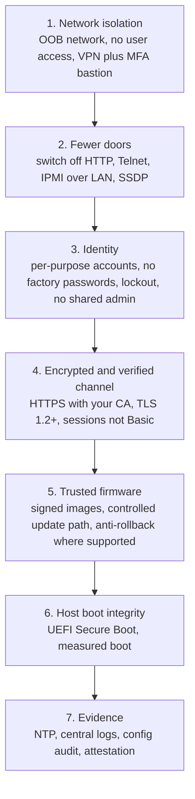
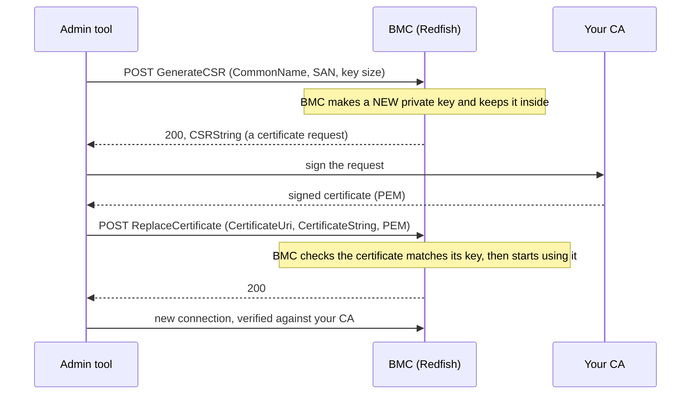

# 7.15 BMC security hardening and attestation

| | |
|---|---|
| Level | Advanced |
| Priority tier | 1 |
| Lab venue | Laptop |
| Part | Part 7: Redfish and BMC |
| Status | Drafted (`hardening_lab.py`: 29 checks pass over TLS mock; **untested** on live BMC) |

## Why this matters for AI infrastructure

The BMC is the most privileged computer in the rack. It can power the server on and off, mount a virtual disk, open a console, rewrite firmware and read hardware state, and it works below the operating system where your normal security tools cannot see. The user's Security volume (volume 18) puts it plainly: if the BMC is compromised, the server is lost, and if firmware is compromised, no operating system reinstall helps. GPU clusters also hold valuable data and expensive hardware, so they attract attackers. This chapter closes Part 7 with the controls that matter and tests of the ones you can test.

## Prerequisites and outcomes

You need chapters 7.1 to 7.4, 7.10 and 7.12. After this chapter you can:

- explain the BMC threat model in simple words
- list the layers of BMC defence and what each stops
- replace a BMC's self-signed certificate through Redfish, step by step
- audit and fix management protocols and account policy, safely
- use Secure Boot through Redfish, and explain Setup Mode versus User Mode
- explain firmware signing, downgrade risk and tenant root access
- explain what attestation is, read it, and say what is still missing

## 1. The threat in plain words

An attacker who reaches your BMC can do things an attacker on the host cannot:

| What they can do | Why it hurts |
|---|---|
| power off or reset servers | an outage, or repeated disruption of a long training run |
| attach virtual media and boot their own image | takes the host without touching its disk |
| open the console or send keystrokes (KVM) | see and control the machine |
| flash firmware | a persistent implant that survives reinstalls |
| read hardware state and logs | learn about the cluster |
| change settings (boot order, BIOS, accounts) | quiet persistence |

The notes (volume 10) add that a compromised BMC can steal secrets from memory through DMA, or destroy hardware by changing thermal thresholds. The Security volume says "the architectural mandate" is that the BMC network must be isolated from the AI data network, on a dedicated out-of-band network or VLAN with firewall rules, reachable only through a VPN with multi-factor authentication by authorised infrastructure administrators. The next section is that mandate in practice.

## 2. Layers of defence



No single layer is enough. If layer 1 fails (someone plugs into the OOB switch), layers 2 to 4 still stand. If a password leaks, lockout and per-purpose roles limit damage.

### Layer 1: network isolation

The DGX GB300 SuperPOD reference architecture shows how NVIDIA builds it: a separate **out-of-band Ethernet fabric** of SN2201 switches that connects "the management ports of all devices", rolled up into a dedicated VXLAN at the spine layer of each scalable unit, with no case where a non-privileged user needs access, so it is secured by logical network separation. It carries IPMI traffic and the management of the InfiniBand and NVLink fabrics. SCL (the SysAdmin book, chapter 10) gives the same advice in a few words: the IPMI network is "not really secure", so put it on a dedicated physical network or a dedicated VLAN enabled only on management nodes.

Rules to follow: no route from user or data networks to BMC addresses; reach BMCs only from a hardened management host (bastion) with MFA; log all access to it; firewall BMC subnets in both directions (BMCs should not browse the internet either, other than to approved NTP and log servers).

### Layer 2: switch off what you do not use

Each open service is a possible door. The `ManagerNetworkProtocol` resource (chapter 7.7) lists them: `HTTP`, `HTTPS`, `IPMI`, `SSH`, `Telnet`, `SNMP`, `SSDP`, `NTP`, `KVMIP`, `VirtualMedia` and more. A hardened policy turns off plain `HTTP`, `Telnet`, `IPMI` (the old, weakly protected remote protocol, chapter 7.1) and `SSDP` discovery (chapter 7.2), and turns on `NTP`. The notes' example does this with one `PATCH`:

```json
{ "IPMI": {"ProtocolEnabled": false}, "Telnet": {"ProtocolEnabled": false}, "HTTP": {"ProtocolEnabled": false}, "SSH": {"ProtocolEnabled": true, "Port": 22} }
```

Think before you switch off: BCM may use IPMI for some functions on your BMCs (the BCM manual says IPMI, iLO, DRAC, CIMC and Redfish are all supported BMC interface types), and virtual media or KVM may be needed during repairs. Switch off what you have tested without, and keep a documented way back (chapter 7.14 scenario 3).

### Layer 3: identity

All of chapter 7.4 applies. In short: no factory passwords (the audit checks `PasswordChangeRequired`), a lockout threshold, a minimum password length, per-purpose accounts with the lowest role that works, personal accounts for people, secrets in a secret manager, and an audit of credential drift across the fleet (chapter 7.1).

### Layer 4: a verified HTTPS channel

Traffic to the BMC carries passwords, tokens and firmware, so it must be encrypted **and the client must check who answers**, or an attacker on the path can pretend to be the BMC. That needs a certificate your clients trust. Here is the full flow, which I ran.

## 3. Replacing the certificate through Redfish

A BMC ships with a self-signed certificate. The standard way to replace it (chapter 7.4, correcting the notes) uses two actions of the `CertificateService`:



Why this order: the private key is created **inside the BMC** and never travels, so only the public request and the signed certificate cross the network. In my mock the lab proves each rule:

| Check in the lab | Result |
|---|---|
| a client that trusts the lab CA refuses the BMC's self-signed certificate | yes, `CERTIFICATE_VERIFY_FAILED` |
| `ReplaceCertificate` with no pending request | 400, because the key must be made inside the BMC |
| `GenerateCSR` without `CommonName` | 400 |
| `GenerateCSR` returns a PEM request and no private key | yes |
| a valid certificate for a **different** key | 400, "does not match the pending key" |
| garbage text instead of a certificate | 400 |
| the CA-signed certificate | 200; **new connections** now verify with no `-k` |
| the `Certificate` resource afterwards | issuer `Lab Root CA`, subject `bmc-lab` |
| a user without `ConfigureManager` | 403 |

The `Certificate` resource shows `Issuer`, `Subject`, `ValidNotBefore`, `ValidNotAfter`, `SerialNumber`, `Fingerprint` and `KeyUsage`. Plan for expiry: the hardening audit warns when less than 30 days remain (it flagged my own 30-day lab certificate as expiring in 29 days). In a real fleet, issue certificates with a lifetime your automation can renew, and monitor the expiry date (`rf_harden.py audit`).

What I did not test: how real DGX or OEM BMCs handle `GenerateCSR` (some BMCs have vendor-specific certificate steps), whether they apply the new certificate without a restart of the web service, and their key algorithm choices.

## 4. The hardening audit tool

`code/part07/rf_harden.py` audits against a policy file (`profiles/bmc_policy.json`) and labels each finding **FIX** (the tool can change it) or **MANUAL** (a person must decide). On my TLS mock, before hardening:

```text
HIGH   FIX    HTTP is enabled (policy: off)
HIGH   FIX    Telnet is enabled (policy: off)
HIGH   FIX    IPMI is enabled (policy: off)
HIGH   MANUAL HTTPS certificate expires in 29 days
HIGH   MANUAL account 'factory' still has PasswordChangeRequired: a factory or reset password is in use
MEDIUM FIX    SSDP is enabled (policy: off)
MEDIUM FIX    NTP is off or has no servers: log timestamps will drift (chapter 7.11)
MEDIUM FIX    HTTP Basic authentication is Enabled (policy: Disabled)
MEDIUM FIX    MinPasswordLength is 8 (policy: 12)
MEDIUM MANUAL account 'factory' is a default-style administrator name: rename or disable it
MEDIUM MANUAL System_0: UEFI Secure Boot is not active (enable: False, mode: SetupMode)

7 fixable by this tool, 4 need a person
```

Then `rf_harden.py apply --yes` sent seven `PATCH` requests (four protocols off, NTP on with the policy servers, Basic authentication disabled, minimum password length 12), re-audited, and reported `0 fixable finding(s) left`. Safety rules in the tool:

- **Dry run unless `--yes`.**
- **It refuses to switch off the protocol it is connected over.** In the lab, a request to disable HTTP over a plain-HTTP connection is refused with "would lock you out".
- **Accounts, certificates and Secure Boot stay manual**, because the right action depends on your process.
- It re-reads the settings after changing them.

### Checking with DMTF's validator

My `profiles/bmc_hardening.json` states the same target as a DMTF interoperability profile (HTTPS on; HTTP, Telnet, IPMI and SSDP off; NTP on; Basic auth disabled; lockout greater than zero; minimum password length at least 12). Result of `rf_interop_validator` on the default mock: 11 passed, **6 failed** (HTTP, Telnet, IPMI, SSDP, NTP and Basic auth). After `rf_harden.py apply --yes`: **17 passed, 0 failed**. Two independent tools agreeing is a good sign. Remember the lesson from chapter 7.13: boolean values in a profile must be JSON booleans.

### What the tool does not do

It does not read BMC-specific security features: SSH key policy, LDAP or Active Directory integration, role mapping (the schema has `RemoteRoleMapping`), multi-factor authentication settings, or the `SecurityPolicy` resource (TLS and SPDM policy: allowed versions, algorithms, trusted and revoked certificates, shown in DMTF's example). A mature audit adds these, using the resources your BMC really has.

## 5. Firmware trust

The Security volume's chapter on hardware and firmware trust explains the idea for beginners: firmware is the small software inside each part (GPU, NIC, BIOS, BMC). If an attacker replaces it with a malicious copy, it survives an operating system reinstall. Defences:

1. **Signed firmware and a hardware root of trust.** A security chip checks the signature of the next stage before it runs, forming a chain (hardware root of trust, BIOS, bootloader, kernel). The notes say NVIDIA GPUs and ConnectX NICs verify signatures of their own firmware, so an unsigned or altered image will not initialise. (From the notes; not verified by me.) The BCM firmware lists show the ERoT (external root of trust) chips as separate updatable items (chapter 7.10).
2. **A controlled update path.** The notes' customer scenario is useful: users with `sudo` on the host could run firmware tools (`nvfwupd`, `mstflint`) and flash devices. The notes' answer: remove tenant root access, run user tools in unprivileged containers, and allow firmware updates only from change-managed tooling using vendor-signed images. The notes also stress that device firmware is signed by the **vendor**, not by your CA, so what you control is **who may run the update path**.
3. **Downgrade resistance.** A signed but old, vulnerable image is still a valid image. The notes recommend checking each device's documentation for anti-rollback support. Redfish helps in two ways: `ForceUpdate` is the switch that bypasses update policies (chapter 7.10), so limit it to a role or process; and the inventory lets you detect an unexpected old version (`rf_firmware.py drift`).
4. **Provenance.** Take images only from the vendor, verify hashes and signatures where the vendor gives them, and keep the update log (task messages, chapter 7.10).

In Redfish terms, the BMC's role is limited to what the vendor exposes. Redfish does not define "make firmware read-only" as a standard action, so lockout features are vendor specific.

## 6. UEFI Secure Boot through Redfish

Secure Boot is for the **host** firmware: it only runs bootloaders and kernels signed by keys in its databases. Redfish exposes it under the system:

- `SecureBoot`: `SecureBootEnable` (what you want), `SecureBootCurrentBoot` (what is active now), `SecureBootMode` (`SetupMode`, `UserMode`, `AuditMode`, `DeployedMode`), and `SecureBootDatabases`;
- `SecureBootDatabases`: `PK` (platform key), `KEK`, `db` (allowed signatures) and `dbx` (forbidden signatures), each with `Certificates` and `Signatures` collections;
- action `SecureBoot.ResetKeys` with `ResetAllKeysToDefault`, `DeleteAllKeys` or `DeletePK`.

:::note Correction to my notes
The notes' scenario 5 says the signed boot chain needs "a trusted key enrolled in the BMC's secure boot database (db)". The key databases belong to the **host's UEFI firmware**, and Redfish only exposes them under the system's `SecureBoot` resource. The BMC is the management channel, not the owner of those keys.
:::

My lab proves the mechanics that surprise people:

```text
PASS  enabling Secure Boot changes the setting but not the running state (CurrentBoot stays Disabled)
PASS  after a restart it is STILL not enforced because no platform key is enrolled (SetupMode)
PASS  ResetKeys to the default keys puts the system in UserMode
PASS  after the next restart Secure Boot is enforced
```

Meaning: setting `SecureBootEnable` to true is not enough. The change applies at the next boot (like a BIOS setting, chapter 7.14), and Secure Boot only protects when a platform key is enrolled (User Mode). A checker must read `SecureBootCurrentBoot`, not only `SecureBootEnable`. My audit does.

For the operating system side, the notes describe the usual Linux route: a signed shim (signed by the Microsoft UEFI CA) that loads your signed bootloader, a kernel signed with your own key (a machine owner key enrolled with `mokutil`), HTTPS instead of plain HTTP for the boot transfer, and Redfish to confirm that Secure Boot is on. That flow is standard Linux practice, but I did not test it, and DGX images may ship their own signing arrangements.

## 7. Attestation: what it is, and what I did not do

**Attestation** means proving what software and firmware a device is running. Two Redfish mechanisms, both under `ComponentIntegrity`:

- **SPDM** (Security Protocol and Data Model): a device (the *responder*) can report **measurements** (hashes of its firmware and configuration) and sign them with a key whose certificate chains to the vendor.
- **TPM**: a trusted platform module keeps **PCR** values (running hashes of what booted) and can sign them.

A `ComponentIntegrity` resource reports its type and version, whether it is enabled, which component it protects (`TargetComponentURI`), the measurements, and the result of checking the device's identity. Actions: `SPDMGetSignedMeasurements` (give a 32-byte nonce, get a signed statement over chosen measurements) and `TPMGetSignedMeasurements`. The manager's `SecurityPolicy` sets the allowed SPDM and TLS versions and algorithms and the trusted and revoked certificates.

I wrote a small read-only lister, `rf_attest.py`, and ran it on DMTF's rack-server example:

```text
4 ComponentIntegrity resource(s), 1 SecurityPolicy resource(s)
  TPM-0        TPM   enabled=True  ... measurements= 4 identity=Success health=OK
  USB-Integrity SPDM enabled=False ... measurements= 0
  SS-SPDM-1    SPDM  enabled=True  ... measurements= 3
  SS-SPDM-0    SPDM  enabled=True  ... measurements= 3
  SecurityPolicy: SPDM enabled=True verify_certificate=True; TLS client allowed versions=['1.2', '1.3']
```

**What this is not.** Listing measurements is not attestation. Real attestation needs: (1) a fresh nonce from you, (2) a signed answer from the device, (3) checking the signature through a certificate chain you trust, and (4) comparing the measurements with known-good values from the vendor, held somewhere an attacker cannot change. I did none of steps 2 to 4 and I have no known-good values for any NVIDIA part. Whether and how DGX, HGX and GB200 BMCs expose attestation through Redfish is **not verified**. Use `rf_attest.py` only as a way to see what your BMC offers.

## 8. A BMC security checklist

1. BMC and OOB switch management on an isolated network; access only through a bastion with MFA; no route from tenant networks.
2. Change all factory passwords at first contact; handle `PasswordChangeRequired`.
3. Per-purpose accounts and roles; a personal account for each person; lockout and password length set.
4. HTTPS only, TLS 1.2 or newer, certificates from your CA, expiry monitored; clients verify (never `-k`).
5. Basic authentication off; sessions on; sessions closed after use.
6. HTTP, Telnet, IPMI over LAN and SSDP off unless a documented need exists; NTP on.
7. Firmware only from vendor-signed images through change-managed tooling; `ForceUpdate` restricted; drift checked nightly (chapter 7.10).
8. Host: Secure Boot active (read `SecureBootCurrentBoot`); tenants without root on hosts.
9. Logs centralised, clocks right (chapter 7.11); events subscribed (chapter 7.5).
10. A tested recovery path for a locked-out or bricked BMC (chapter 7.14).
11. Re-run the audit and the profile after every firmware update, because updates can reset settings.

## Exercises

1. **Mapping the 29 security checks to the 7 defense layers (`code/part07/hardening_lab.py`):** Run `python3 code/part07/hardening_lab.py` (`28` / `29` checks pass) and map each group of checks in `code/part07/hardening_lab.py` (`GenerateCSR`/`ReplaceCertificate`, `rf_harden.py` protocol & account audit/apply, self-lockout prevention, and `SecureBoot` `SetupMode` $\rightarrow$ `UserMode`) to the 7 layers in Figure 1.
2. **Enforcing `SSH: false` in `profiles/bmc_policy.json`:** Edit a copy of `code/part07/profiles/bmc_policy.json` to require `"SSH": false` under `protocols`, run `rf_harden.py audit`, and list what out-of-band console/recovery paths (`SOL` vs Redfish `SerialConsole` vs KCS) you must verify before disabling SSH on a production BMC.
3. **End-to-end CSR generation and SAN verification (`CertificateService` & `tls_setup.py`):** Using `GenerateCSR` (`CommonName="bmc-lab"`, `AlternativeNames=["DNS:localhost", "IP:127.0.0.1"]`) and `tls_setup.sign_csr()`, sign the BMC's CSR with the lab CA, install it via `ReplaceCertificate`, and verify that HTTPS connections to both `https://localhost:<port>` and `https://127.0.0.1:<port>` pass TLS verification with `REDFISH_CA`.
4. **Proving the anti-self-lockout guard in `rf_harden.py`:** Connect `rf_harden.py apply --yes` to a mock server over plain `http://` while the policy requires `"HTTP": false`. Verify that `rf_harden.py` refuses to disable HTTP over an active HTTP connection (`"refusing to disable HTTP while connected over HTTP"`).
5. **Remediating the defense-contractor tenant `sudo` audit finding (`volume-18/ch2`):** Write a 5-point remediation plan for an AI cluster where researchers previously had `sudo` on bare-metal GPU hosts (`nvfwupd`, `mstflint` exposure), combining host privilege removal, unprivileged containers, out-of-band Redfish firmware lockdown, and nightly `rf_firmware.py drift` checks.
6. **Inspecting SPDM and TPM `ComponentIntegrity` resources (`code/part07/rf_attest.py`):** Serve `$REDFISH_PUBLICATIONS/mockups/public-rackmount1` and run `python3 code/part07/rf_attest.py http://127.0.0.1:8443 admin adminpass`. Inspect `TPM-0`, `SS-SPDM-0`, `SS-SPDM-1`, and `SecurityPolicy`, and write down the four cryptographic verification steps required to turn a measurement listing into true hardware attestation.

## 10. Interview angles

- "How do you secure BMCs in a GPU cluster?" Isolated management network with a bastion and MFA, services minimised, per-purpose accounts, verified HTTPS from your CA, signed firmware only through controlled tooling, Secure Boot on hosts, central logs and regular audits.
- "How do you replace the BMC certificate at scale?" GenerateCSR so the key never leaves the BMC, sign, ReplaceCertificate, verify with a client that trusts your CA, monitor expiry.
- "Why check `SecureBootCurrentBoot` and not `SecureBootEnable`?" The setting applies at the next boot, and with no platform key enrolled nothing is enforced.
- "What is attestation and what do you need beyond Redfish?" Signed measurements with a nonce, a trusted certificate chain, and known-good values.
- "A data scientist has sudo on the GPU hosts. What is the risk?" They can run firmware tools and flash devices. Remove root, containerise, control the update path.

## Checkpoint questions (20)

<details>
<summary>1. Name six high-impact actions an attacker can perform if they compromise a server's BMC.</summary>

1. **Power off or reset nodes** repeatedly to disrupt training runs.
2. **Mount malicious virtual media** (`.iso`) and boot a rogue OS into RAM without touching host disks.
3. **Access `iKVM` or `SOL` consoles** to intercept console logins or modify BIOS settings.
4. **Flash persistent malicious or downgraded firmware** onto the BIOS, BMC, GPUs, or NICs.
5. **Read hardware telemetry, serial numbers, and event logs** for reconnaissance.
6. **Modify boot order, BIOS attributes, or BMC accounts** for persistent backdoor access.
</details>

<details>
<summary>2. What is the architectural mandate for BMC network isolation in the DGX SuperPOD Reference Architecture and `volume-18/ch2`?</summary>

The BMC out-of-band management network (`SN2201` switches in a SuperPOD, rolled up into a dedicated spine VXLAN) must be **physically or logically isolated from all AI training/data/tenant networks**, protected by strict firewall rules, and reachable **only via a bastion/VPN requiring Multi-Factor Authentication (MFA)** by authorized infrastructure administrators.
</details>

<details>
<summary>3. List the seven defense-in-depth layers for BMC and hardware security covered in this chapter.</summary>

1. **Network isolation** (dedicated OOB network, MFA bastion, no tenant routing).
2. **Attack-surface minimization** (disable `HTTP`, `Telnet`, `IPMI-over-LAN`, `SSDP` in `ManagerNetworkProtocol`).
3. **Identity & least privilege** (rotate factory passwords, per-purpose `ReadOnly`/`Operator` accounts, lockout policy).
4. **Encrypted & verified transport** (TLS 1.2+, internal CA certificates, `SessionService` tokens, `HTTPBasicAuth: Disabled`).
5. **Firmware trust & controlled update paths** (hardware roots of trust `ERoT`, vendor-signed bundles, no tenant root/`sudo`).
6. **Host boot integrity** (UEFI Secure Boot in `UserMode` with enrolled `PK`/`KEK`/`db`/`dbx`).
7. **Continuous evidence & attestation** (`NTP` clock sync, centralized SEL/EventLogs, `rf_harden.py` audits, SPDM/TPM attestation).
</details>

<details>
<summary>4. Which four protocols in `ManagerNetworkProtocol` does `profiles/bmc_policy.json` disable by default, and which time-sync protocol does it enable?</summary>

It disables plain **`HTTP`**, **`Telnet`**, **`IPMI`** (IPMI-over-LAN), and **`SSDP`** multicast discovery, and enables **`NTP`** with approved time servers.
</details>

<details>
<summary>5. In the Redfish `CertificateService` workflow, why do you call `#CertificateService.GenerateCSR` before `#CertificateService.ReplaceCertificate`?</summary>

Calling `GenerateCSR` causes the BMC to generate a **new private key internally inside the BMC** and return only the public Certificate Signing Request (`CSRString`). Once your CA signs the CSR, `ReplaceCertificate` installs the signed public certificate matching that internal private key.
</details>

<details>
<summary>6. What security advantage does `GenerateCSR` on the BMC have over generating the private key and certificate on an admin laptop and uploading both?</summary>

When the BMC generates the keypair internally via `GenerateCSR`, the **private key never leaves the BMC and never traverses the network** or sits on an administrator's filesystem.
</details>

<details>
<summary>7. What happens if you call `ReplaceCertificate` with a valid CA-signed certificate whose public key does not match the BMC's pending CSR key?</summary>

The BMC rejects the request with HTTP **`400 Bad Request`** (`"certificate public key does not match the pending CSR key"`).
</details>

<details>
<summary>8. When `ReplaceCertificate` succeeds (`200 OK`), how can you verify that the BMC is actively serving the new certificate?</summary>

Open a **new** TLS connection to the BMC verified against your CA bundle (`REDFISH_CA=/path/to/ca.pem` without `-k`), and `GET` the `Certificate` resource under `NetworkProtocol/HTTPS/Certificates/1` to confirm `Issuer`, `Subject`, `ValidNotBefore`, and `ValidNotAfter`.
</details>

<details>
<summary>9. In `code/part07/rf_harden.py`, which security findings are marked `FIX` (auto-remediable) versus `MANUAL` (requiring human action)?</summary>

- **`FIX` (7 items on default mock):** Disabling `HTTP`, `Telnet`, `IPMI`, and `SSDP`, enabling `NTP` + `NTPServers`, setting `HTTPBasicAuth: "Disabled"`, and raising `MinPasswordLength` (`>= 12`) and `AccountLockoutThreshold`.
- **`MANUAL` (4 items on default mock):** Replacing an expiring/self-signed X.509 certificate, rotating an account with `PasswordChangeRequired: true`, renaming/disabling default-style admin usernames (`factory`/`admin`), and enrolling keys / enabling UEFI `SecureBoot`.
</details>

<details>
<summary>10. Why does `rf_harden.py apply --yes` refuse to disable `HTTP` when the client is connected to an `http://` endpoint?</summary>

Disabling the plain HTTP protocol while connected over `http://` would immediately **lock the administrator and tool out of the BMC** if HTTPS is not yet verified and working.
</details>

<details>
<summary>11. Once `HTTPBasicAuth` is set to `"Disabled"` in `AccountService`, how must all automation scripts authenticate?</summary>

They must authenticate exclusively via **Redfish Sessions** (`POST /redfish/v1/SessionService/Sessions` and `X-Auth-Token`, or OAuth 2.0 / mTLS where configured); any request carrying `Authorization: Basic ...` is rejected with `401 Unauthorized`.
</details>

<details>
<summary>12. Under `/redfish/v1/Systems/{id}/SecureBoot/SecureBootDatabases`, what are the four standard UEFI key databases (`PK`, `KEK`, `db`, `dbx`)?</summary>

- **`PK` (Platform Key):** Top-level key establishing ownership between the platform owner and UEFI firmware (`1` key; enrolling `PK` transitions UEFI from `SetupMode` to `UserMode`).
- **`KEK` (Key Exchange Key):** Keys authorized to update `db` and `dbx`.
- **`db` (Signature Database):** Allowed public certificates and SHA-256 hashes of trusted bootloaders (`shimx64.efi`) and option ROMs.
- **`dbx` (Forbidden Signature Database):** Revoked/blocklisted certificates and binary hashes known to be vulnerable.
</details>

<details>
<summary>13. Why does setting `PATCH /SecureBoot {"SecureBootEnable": true}` NOT immediately enforce Secure Boot, and what two conditions are required for enforcement (`hardening_lab.py`)?</summary>

1. Like BIOS settings, `SecureBootEnable: true` only takes effect **after the next host system reboot** (`SecureBootCurrentBoot` remains `"Disabled"` until reboot).
2. If no Platform Key (`PK`) is enrolled (`SecureBootMode == "SetupMode"`), UEFI still cannot enforce Secure Boot even after a reboot. Keys must be enrolled (e.g., via `SecureBoot.ResetKeys` with `ResetAllKeysToDefault` to enter **`UserMode`**) and the host rebooted before `SecureBootCurrentBoot` becomes `"Enabled"`.
</details>

<details>
<summary>14. Do the UEFI Secure Boot databases (`PK`, `KEK`, `db`, `dbx`) protect the BMC's own firmware or the host operating system's boot chain?</summary>

They belong to the **host system's UEFI firmware** and protect the **host boot chain** (`BIOS` $\rightarrow$ `shimx64.efi` $\rightarrow$ `grubx64.efi` $\rightarrow$ Linux kernel `vmlinuz`). The BMC merely exposes those host UEFI databases over Redfish under `/redfish/v1/Systems/{id}/SecureBoot`.
</details>

<details>
<summary>15. What is a Hardware Root of Trust (such as NVIDIA `ERoT` on an HGX baseboard, `volume-18/ch2`)?</summary>

An immutable silicon security microcontroller with fuse-burned cryptographic public keys that verifies the digital signature of a component's firmware (BMC, BIOS, GPU VBIOS, NVSwitch, PCIe switch) in hardware **before** releasing the main processor from reset.
</details>

<details>
<summary>16. Why can't an enterprise sign NVIDIA GPU VBIOS or ConnectX NIC firmware with its own internal corporate CA (`volume-18/ch2`)?</summary>

Because the public root-of-trust keys fused into GPU and NIC silicon at manufacturing belong to **NVIDIA**, so the hardware will only boot firmware signed by NVIDIA's private signing keys. Therefore, the enterprise controls **access to the firmware update path** (`nvfwupd`, `mstflint`, Redfish `UpdateService`) rather than signing device firmware itself.
</details>

<details>
<summary>17. What is a firmware downgrade attack, and why does signature verification alone not stop it?</summary>

In a downgrade attack, an attacker flashes an **older, legitimately vendor-signed firmware version** that contains a known exploitable CVE. Because the old image carries a valid vendor signature, basic signature checks pass—defending against it requires hardware anti-rollback fuses (`LowestSupportedVersion`), restricting `ForceUpdate`, and removing tenant `sudo` access on hosts.
</details>

<details>
<summary>18. Why is granting data scientists `sudo` / root access on bare-metal GPU compute nodes a critical firmware security vulnerability (`volume-18/ch2`)?</summary>

Root access on the host OS allows running in-band hardware flashing and KCS tools (`nvfwupd`, `mstflint`, `ipmitool`) to alter device/BMC firmware or configurations. Users should run inside unprivileged containers without host root access.
</details>

<details>
<summary>19. Under Redfish `ComponentIntegrity`, what is the difference between **SPDM** and **TPM** attestation?</summary>

- **SPDM (Security Protocol and Data Model):** A DMTF standard where peripheral hardware components (GPUs, NICs, NVSwitches, drives) act as responders that return cryptographic hashes (measurements) of their firmware and configuration signed by a device certificate chaining to the hardware vendor (`SPDMGetSignedMeasurements`).
- **TPM (Trusted Platform Module):** A motherboard crypto-processor that records cumulative boot hashes in Platform Configuration Registers (`PCRs`) and signs quotes over them (`TPMGetSignedMeasurements`).
</details>

<details>
<summary>20. What four steps are required for real cryptographic attestation beyond simply listing `ComponentIntegrity` resources with `rf_attest.py`?</summary>

1. Generate a fresh cryptographic **nonce** (`32` random bytes) and invoke `SPDMGetSignedMeasurements` / `TPMGetSignedMeasurements`.
2. Receive the **digitally signed measurement statement** from the device.
3. Verify the **digital signature and device X.509 certificate chain** up to the manufacturer's root CA (and verify the nonce matches to prevent replay).
4. Compare the signed measurement hashes against an external, tamper-proof **Reference Integrity Manifest (RIM) / golden measurement database** from the vendor.
</details>

## Sources and review notes

- **Redfish Specification DSP0266 v1.21.0:** TLS and certificates (13.1), sensitive data (13.2), authentication and sessions (13.3), authorization (13.4), account service (13.5), discovery with SSDP and its disable rule (12.4).
- **Redfish Resource and Schema Guide and the official JSON Schemas:** `CertificateService` (`GenerateCSR`, `ReplaceCertificate`), `Certificate`, `ManagerNetworkProtocol`, `AccountService`, `SecureBoot` (modes, `ResetKeys`), `SecureBootDatabase`, `ComponentIntegrity` (SPDM and TPM, signed-measurement actions) and `SecurityPolicy`.
- **NVIDIA-DevOps notes:** `nvidia-zero-to-hero/volume-18/chapter-02-hardware-and-firmware-trust.md` (hardware and firmware trust: the root of trust chain, the BMC as most dangerous component, the `sudo` customer scenario and the firmware lockdown answer), `nvidia-zero-to-hero/volume-18/chapter-12-incident-response-and-troubleshooting.md`, `nvidia-zero-to-hero/volume-18/chapter-12-volume-18-summary.md`, `nvidia-zero-to-hero/volume-18/index.md`, and `volume-10/01-bare-metal-and-bmc-lifecycle.md` sections 6 and 9 (BMC security commands, scenario 5 on Secure Boot). All unverified against NVIDIA documents; one correction is in section 6.
- **DGX GB300 SuperPOD reference architecture** (out-of-band network design). **Supercomputers for Linux SysAdmins** chapter 10 (separate IPMI network). **BCM 11 Administrator Manual** (BMC interface types, firmware ERoT items).
- **DMTF tools:** Redfish-Interop-Validator 3.0.4 with my profile `bmc_hardening.json`; DMTF example trees for `ComponentIntegrity` and `SecurityPolicy` (commit `fa6d23d9`).
- **Run here:** `hardening_lab.py` (29 checks, real TLS, real lab CA), `rf_harden.py` (audit and apply), `rf_attest.py` (read-only, DMTF example), the interop validator before and after hardening.
- **Not verified:** any behaviour of a real BMC for the actions above, NVIDIA firmware lockdown and anti-rollback features, real attestation on any NVIDIA part, and the Linux Secure Boot flow (shim, MOK) which I only retell.
