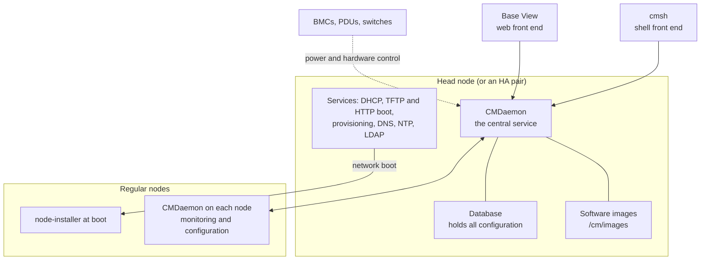
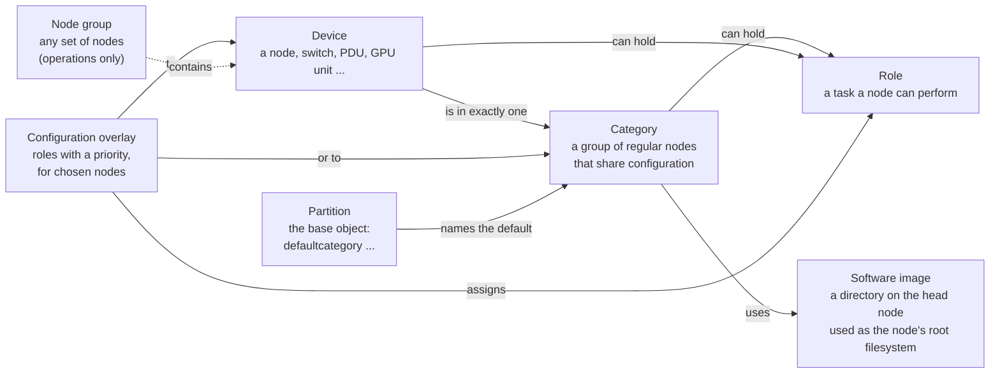

# 8.1 BCM architecture and concepts

| | |
|---|---|
| Level | Beginner |
| Priority tier | 1 |
| Lab venue | Laptop |
| Part | Part 8: NVIDIA Base Command Manager |
| Status | Drafted (`bcm_model_lab.py`: 35 checks pass; cluster commands **untested** on live BCM) |

## Why this matters for AI infrastructure

Picture a cluster with hundreds of nodes and one change that has to reach every one of them. It might be a new driver, a corrected DNS server or a different kernel parameter. Someone has to answer a few hard questions before anything moves. How does a blank node get its operating system in the first place? How do you change a setting on 500 nodes at once, without logging in to each one? How do you power-cycle a rack that has stopped answering, and how does the scheduler learn what each node is?

Those questions come up on every large GPU cluster, and they are the reason NVIDIA Base Command Manager, usually shortened to BCM, exists. BCM is the management software in NVIDIA's DGX SuperPOD reference designs. The SuperPOD architecture documents name Base Command Manager and Mission Control among the in-cluster services, so when you open one of those designs, BCM is part of the picture.

You will meet BCM on the job whether or not you ever choose it. Once you know its objects and rules, you can read any BCM cluster and predict what a change will do before you make it. That is the goal of this chapter. Learn the objects first, and the rest of the cluster becomes much easier to read.

## Prerequisites and outcomes

You need Linux basics before you start, and Part 7 helps too, because it explains the baseboard management controller (BMC) that BCM talks to. This chapter walks through the parts of a BCM cluster, the daemon that runs it, the two front ends you type into (Base View in the browser and `cmsh` in the shell), the object model that holds its settings, the rule that decides which value a node gets, and the first mistakes that most teams make. Each section builds on the one before it, so read them in order the first time.

## 1. What BCM is, in simple words

Picture your first day on a cluster that someone else built. A colleague points at the management box and says it runs everything. The manual gives a short answer to what that box does. BCM "contains tools and applications to facilitate the installation, administration, and monitoring of a cluster". That one sentence covers three jobs. BCM installs the cluster, it lets you administer it day to day, and it watches the cluster while it runs.

BCM runs on top of a normal Linux distribution. It does not replace the distribution. Your nodes still run Linux, and your usual tools still work on them. BCM adds a layer that manages the install, the settings and the health of the machines.

The 11 installation manual lists the supported platforms. They are the Red Hat family (RHEL and Rocky 8 and 9), SUSE Enterprise Server 15, Ubuntu (22.04, 24.04 and a newer LTS), and DGX OS 7 and 8, on x86_64 and arm64. Not every feature exists on every operating system and every architecture. That is why the same manual keeps a feature matrix, and why you should check the matrix before you promise a feature to a team.

A basic BCM cluster is made of the parts in the table below. Learn each part, because each one is a place where a problem can start. When a node is missing from a job, the cause is usually in one of these parts.

| Part | Role |
|---|---|
| **Head node** (sometimes called master node) | the control point. Controls everything else, and provides central storage, workload management, user management, DNS and DHCP. Normally the only machine on the external network. Often replicated as a passive head node for high availability (chapter 8.12) |
| **Regular nodes** | compute nodes (the heavy work), plus login nodes, storage nodes and others |
| **Managed Ethernet switches** | the internal network |
| **Power distribution units (PDUs)** (optional) | let the head node switch nodes on and off |

The head node is the one to watch. Everything else depends on it. If the head node is slow, every node feels it. If the head node is down, you lose the control point for the whole cluster, even though the compute nodes may still be running jobs. That is why the head node gets the most careful planning in the chapters that follow.

The most useful sentence in the installation manual is the one about provisioning. Provisioning means putting a working operating system and a set of settings onto a machine. Every time a compute node starts, the software on its local drive is synchronized with a software image kept on the head node. A node can always be brought back to a known state, and replacing a broken node becomes a simple job. The manual puts it this way: "Software changes need to be carried out only once (in the software image)". This is the heart of BCM. You do not log in to 500 nodes to change them. You change an image or a setting once, and the nodes follow.

The diagram below shows the parts and how they talk to each other. Read it from the top down. The head node sits in the middle, and every other box either sends requests to it or receives its services.



Notice that both front ends, the BMCs and the regular nodes all talk to CMDaemon on the head node. Nothing talks to a node directly when BCM is in charge of it. That single point of contact is what makes the cluster predictable. Before you change a node, ask whether the change belongs in the software image, so that every node that follows the image gets it.

## 2. The parts of the daemon, front ends and files

Suppose Base View stops answering after a firewall change. The page times out, and your first guess could be the network, the daemon or the browser. To tell those apart, you need to know which ports CMDaemon uses and which files it owns. This section walks through them, along with the front ends and the files that matter most.

CMDaemon is the cluster management daemon. A daemon is a program that runs quietly in the background and waits for requests. CMDaemon runs on the head node and on every regular node, and all management goes through it. During normal operation, the only management route to CMDaemon is TCP port `8081` over SSL. SSL is the encryption layer that protects the traffic. Clients authenticate with client-side X509v3 certificates, which are digital identity cards that prove who is asking.

Two port directives in `/cm/local/apps/cmd/etc/cmd.conf` control how CMDaemon listens. A directive is a setting written in a configuration file. `Port = 8080` is the non-SSL HTTP port, with a default of `8080`. By default it is used only during `init` / pre-init boot. It is required when `bootloaderprotocol` is set to `HTTP`, the default, because most bootloaders do not support HTTPS. `SSLPort = 8081` is the SSL port, with a default of `8081`. Base View and `cmsh` use it for all communication once CMDaemon is up.

`SSLPortOnly = no` is the default. With `no`, both 8080 and 8081 listen, although only 8081 is used after startup. Setting `SSLPortOnly = yes` disables the non-SSL port, but that is allowed only when `bootloaderprotocol` is not `HTTP`. The rule ties the port choice to the boot method, so you cannot change one without checking the other.

The `cm-cmd-ports` tool lists the ports and changes them. Run `cm-cmd-ports -l` to see `http 8080` and `https 8081` across three files: `/cm/images/<image>/cm/local/apps/cmd/etc/cmd.conf`, `/cm/local/apps/cmd/etc/cmd.conf` and `/cm/node-installer/scripts/node-installer.conf`. The same port has to match in all three places, which is why a manual edit to only one file causes trouble. You change the ports with the tool's `--http` and `--https` options, but that takes more than one command. The tool does not update the head node firewall for you. You must update `/etc/shorewall/rules` and run `shorewall reload`. From BCM 12 onwards, Shorewall is superseded by `nftables`, so the firewall step changes with the version. Then run `softwareimage updateprovisioners` and `fspart; trigger -a`. Restart `cmd` on the active head node first, then on the passive head node. Push `cmd.conf` to running regular nodes before you restart `cmd` on them.

On the head node, the configuration file is `/cm/local/apps/cmd/etc/cmd.conf`. It sets `Master = master` by default, which makes the head node start in head mode and regular nodes start in node mode. On regular nodes, the file lives inside the software image, so a change there reaches the node only through the image. After you edit `cmd.conf`, restart the `cmd` service so the daemon reads the new values.

Two front ends talk to CMDaemon and offer the same functions. Base View is the web GUI, and `cmsh` is the shell. The manual says you do not need to learn both. Base View is served on port 8081 at `/base-view`, so the address is `https://<head>:8081/base-view`. Remove the `base-view` package to disable it. Use Base View when you want to look around and click through settings. Use `cmsh` when you want a command you can repeat or script. For real programs, the manual recommends the Python bindings from the Developer Manual instead of batch `cmsh`, because the bindings handle errors more cleanly than text parsing does.

CMDaemon Lite (`cm-lite-daemon`, a Python service) is a minimal alternative. It fits devices where a full daemon is overkill, such as small network devices, and it uses one node license.

For day-to-day checks, `cmdaemonctl full-status` shows the version, uptime, sessions, worker threads and request rate. These numbers tell you whether the daemon is busy or idle before you start to guess. `cmdaemonctl debugon` and `debugoff` switch debug logging. Turn debug logging off in production, because the logs grow fast and can fill a disk. Logs go to `/var/log/cmdaemon`. In `cmsh` device mode, `cmdaemonversions` lists the daemon version of every node, and the manual expects the same version everywhere. A mixed version list is a clue to look for when behaviour differs between two nodes. The `cm-change-passwd` tool changes four administrative passwords in one dialog: head node root, software image root, node-installer root, and MySQL root. On an HA pair, run it on both head nodes, so the two stay in step.

CMDaemon writes many system files, and it owns them. A generated file carries the header "This file was automatically generated by cmd. Do not edit manually!" A manual edit to that file is overwritten, unless you list the file in the `FrozenFile` directive of `cmd.conf`, for example `FrozenFile = { "/etc/dhcpd.conf" }`. If a generated file has a hand edit and is not frozen, CMDaemon raises an event and saves your copy in `/var/spool/cmd/saved-config-files`. Your change is not lost, but it is not active either. This one rule prevents many confusing "my change disappeared" tickets, so it is worth remembering on your first day.

Authentication gets its own chapter (chapter 8.6 goes deeper), but here is the outline. `cmsh` uses PEM certificates. PEM is a text format for keys and certificates. A fresh install creates an administrator certificate for root at `/root/.cm/admin.pem` and `/root/.cm/admin.key`. A certificate carries a profile, and the profile decides what its holder may do. `admin` is the built-in profile that allows everything. Run `cm-check-certificates.sh` to see whether certificates are current, so that an expired certificate does not surprise you during a late-night change.

The safe habit is simple. Change the setting in BCM, and let CMDaemon write the file for you. If you find yourself editing a file under `/etc` on a node, stop and ask which object should own that setting.

## 3. The object model

Most BCM mistakes come from not knowing which object a setting belongs to. A setting placed on the wrong object either reaches too many nodes or too few. This section is the most important part of the chapter, so take it slowly. BCM keeps the cluster in a database as objects. An object is a named record with properties, and each object owns a different kind of setting.

The diagram below shows how the objects connect. Read the arrows as "is in", "uses", "can hold" or "assigns". Those verbs are the relationships you need to remember.



Notice that a device sits in exactly one category, while a node group only collects devices for operations. Keep that difference in mind through the rest of the chapter. A category is about configuration. A group is about doing something to a set of machines at once.

### 3.1 Devices

Start with the question every on-call engineer asks first: is this device supposed to be up? A device is a component of the cluster that BCM manages. The manual lists these types: head node, physical node, virtual node, cloud node, GPU unit, chassis, switch (Ethernet, InfiniBand, Myrinet), lite node, power distribution unit, rack sensor kit and generic device. Each type can have a different set of properties and operations. A device has properties, such as rack position, host name or switch port, and operations, such as power on. What you can do depends on the type. You can mount a filesystem on a node, but not on a switch, because a switch has no filesystem to mount onto.

Every device has a state, and the state tells you what BCM expects. The table below shows the four states. The important column is the one that says whether BCM monitors the device, because that decides whether a problem raises an alert.

| State | The device is | Monitored? | Meaning |
|---|---|---|---|
| `[ UP ]` | up | yes | normal |
| `[ DOWN ]` | down | yes | down but meant to be up: **a failure** |
| `[ CLOSED ] (UP)` | up | mostly ignored | deliberately set aside |
| `[ CLOSED ] (DOWN)` | down | mostly ignored | the administrator **deliberately** took it down and wants it ignored |

The difference between `DOWN` and `CLOSED (DOWN)` is the most useful one in this table. A `DOWN` device needs a fix, because somebody expects it to be running. A `CLOSED (DOWN)` device is down on purpose, perhaps because it is waiting for a part. The model code returns only the `DOWN` nodes as failures, which matches the way an on-call engineer should read the list. When a rack looks red, the first job is to separate the real failures from the ones someone closed on purpose.

### 3.2 Software images

A node that boots needs a complete Linux filesystem to start from. In BCM, that filesystem is the software image. A software image is a blueprint for the contents of the local filesystems on a regular node. In practice it is a directory on the head node, normally under `/cm/images/<name>`, that holds a full Linux filesystem. A fresh install creates `default-image`. The manual adds these facts.

The image uses the same Linux family as the head node by default. Other families are supported, but they are harder to manage, because every package and every update has to match. RHEL 8 with Rocky 8, and RHEL 9 with Rocky 9, mix without problems, because Rocky is binary compatible with RHEL. SLES and Ubuntu mixes need "quite some effort", which the manual states without giving a recipe. Plan for that extra work before you choose a mixed setup.

At boot, the node-provisioning system gives the node a copy of the image. A running node can be re-synchronised to pick up image changes without a reboot, using the `imageupdate` command from chapter 8.4. Re-synchronising means copying the image's contents onto the node again, so the node matches the image. You can also lock an image, so no node picks it up while you work on it.

You change an image with normal Linux tools, such as `chroot` and `rpm`. `chroot` runs a command inside a directory as if that directory were the root of the system, and `rpm` manages packages on Red Hat style systems. Chapters 8.4 and 8.13 show the safe method, which keeps the image and the head node in step.

Lock the image before you work on it if nodes are still provisioning from it. A node that copies a half-changed image can boot in an odd state, and the fault is then hard to trace. Locking first is a small step that avoids a confusing failure later.

### 3.3 Categories

Suppose a rack holds nodes that need the same disk layout, the same monitoring and the same roles. A category is how you give them one shared configuration. A category is a group of regular nodes that share the same configuration. It lets you configure and operate on many nodes at once, such as setting one disk layout for a group or rebooting a whole category with one command.

Every regular node is in exactly one category at all times. The default is `default`, unless you change it. To change the default for new nodes, set `defaultcategory` in the partition's base object. This is a small detail, but it explains why a new node sometimes looks different from its neighbours. It may have joined a category you did not expect.

People usually split categories by hardware or by task. The manual's examples are `nodes-ib` (InfiniBand), `nodes-highmem`, `login` and `storage`. As a rule of thumb, make a new category when the configuration differs from the others, whether that is monitoring, disk layout or roles. If two groups of nodes differ only in a host name pattern, a separate category usually adds work without adding any real difference.

A category and a software image do not map one to one. Several categories can share an image, and a category can be switched to another image. A common case is a training category and an inference category that both run the same base image but need different roles. Before you create a category, ask whether its nodes need a configuration the others do not have.

### 3.4 Node groups

Sometimes you need to reboot one rack, and you do not care how its nodes are configured. That is what a node group is for. A node group is any collection of nodes for convenience. It can mix head nodes and regular nodes, in any categories. A node can be in zero or more groups, which is the key difference from categories.

Groups are for operations on a set, such as "reboot rack5". Because the members may have different configurations, you cannot change configuration through a group. The manual's examples are `brokenhardware`, `headnodes` and `rack5`. A group named `brokenhardware` is a good example of a temporary set. You put nodes in it while they are being repaired, and you take them out when the repair is done. Use a group to act on nodes, and a category to configure them.

### 3.5 Roles

A node sometimes needs one specific job switched on, such as netbooting other nodes. A role is how you switch it on. A role is a task a node can perform, and giving a node a role switches on that function. Examples are `boot`, which lets the node netboot others with the `dhcpd` service, plus `provisioning`, `storage` and the Slurm client role. Netbooting means starting a machine over the network instead of from its own drive. Some roles take parameters. The Slurm client role, for example, takes queues and GPU counts, so the same role can describe a small node or a large one.

Four rules govern roles. Each rule answers a question you will ask sooner or later.

1. A role can go to a single node, or to a whole category, in which case every node in that category has it. The question to ask is how many nodes should get the job.
2. You cannot create roles. The `add` command does not exist in role mode, by design, so you can only `assign` the roles BCM provides. The question is what to do when BCM has no role for your job. The answer is in rule 5, through overlays.
3. If a category has a role with some parameters, you can override those parameters for one node. Assign the same role to that node again with different parameters. This is how one node in a category can have a different GPU count without changing the category for everyone else.
4. Every assignment has a priority, and the higher one wins. The next section gives the numbers.

If you need a function that BCM does not offer as a role, build a configuration overlay instead. That is the BCM way of getting the effect of a custom role.

### 3.6 Configuration overlays

Suppose you need a custom function on a set of nodes, and BCM has no role for it. A configuration overlay solves that problem. It is a group of roles that you assign to chosen nodes or categories, with a priority. It is the BCM way to get what a custom role would give. You can build your own overlay, because the `add` command works in `configurationoverlay` mode, even though it does not work in role mode.

The priority table is worth memorising, because it decides which role wins when two assignments clash. A priority is a number. When two assignments give the same role to the same node with different settings, the higher number wins. The table shows where each assignment's priority comes from.

| Assignment comes from | Priority |
|---|---|
| a category | **250** (fixed) |
| a configuration overlay | 0 to 1000, **default 500** |
| a node | **750** (fixed) |
| overlay set to **-1** | the overlay is ignored |

By default, a node beats an overlay, and an overlay beats a category. An overlay may not use 250 or 750, because those belong to the category and node levels. A worked example makes this concrete. Say an overlay is set to 600. It beats the category at 250, because 600 is higher. It loses to a node at 750, because 750 is higher still. So a node-level role always has the final say, unless the overlay is set above it.

Read the numbers closely, because they lead to a case the manual does not spell out. An overlay with a priority above 750, up to 1000, would outrank a node-level role. The manual gives the numbers and the rule that the highest priority determines the role. It gives no example of this case. So the claim that such an overlay would win is an inference from the numbers, not a rule the manual quotes. The model follows the numbers, and the lab marks that check as a reading of the manual rather than a quoted rule. Test the case on your own system before you rely on it.

### 3.7 How Auto Scaler (`cm-scale`) uses overlays and categories

Some clusters run Kubernetes and Slurm side by side. Kubernetes runs services and containers, and Slurm runs batch jobs. When one queue backs up while the other sits idle, someone has to move nodes from the idle side to the busy side. That is the practical reason BCM separates categories from configuration overlays. Categories hold the software image and boot settings, and overlays hold the workload manager roles. Changing an overlay is a light change, while changing a category would mean a different image and a different disk setup. NVIDIA Base Command Manager Auto Scaler shows the idea in action.

Auto Scaler runs as the `cm-scale` daemon on nodes that hold the `ScaleServer` role. It watches pending work across workload engines, which are the schedulers that place jobs on nodes. The `wlmresources` command in `cmsh` `device` mode shows what it sees. Reading that output is the quickest way to see why a node did or did not move.

Sharing nodes between Kubernetes and Slurm works like this. When both Kubernetes and Slurm settings are added to the `ScaleServer` role, `cm-scale` repurposes a free node from one scheduler to the other. It does this by switching the node's configuration overlays. For example, an idle Kubernetes worker can become a Slurm node "pretty much immediately" when Slurm jobs are queued. The node's category stays the same, and its disk is not re-provisioned. Because the disk stays as it is, the switch is fast compared with a full reinstall.

Sharing nodes between LSF and Slurm, cloudbursting and power saving work differently. LSF is another workload manager. Cloudbursting means adding cloud machines to a local queue when the local cluster is full. Here `cm-scale` can repurpose nodes between categories when a job finishes. It can power down idle physical nodes, then start them again when jobs arrive, which takes several minutes. Power saving is useful, but it adds a delay that users notice, so plan for it. It can also extend queues to cloud nodes through Cluster Extension.

Resource matching is the last piece. `cm-scale` matches CPUs, which can be fractional in Kubernetes, along with memory and GPU count and type. A fractional CPU is a share of a core, which is common in container platforms. For Kubernetes, it natively matches `nvidia.com/gpu`, which is the name Kubernetes uses for a GPU resource. It uses `maxPods` from the `kubelet` role, which is the limit on how many pods a node runs. It also tracks job `parallelism` through `kube_job_spec_parallelism`. It checks extra resources only when they are listed in `KUBE_EXTENDED_RESOURCES` in `config.py`, so a resource you do not list is simply not matched.

The practical rule is to keep images and categories steady, and let overlays do the switching. A steady image and category mean the disk and the base system never change under a running job. The switching then happens in the small layer that is cheap to change.

### 3.8 BCM and Ansible: where the boundary sits

Many teams already manage servers with Ansible, a tool that runs a list of tasks on many machines from a playbook. Before you put BCM and Ansible side by side, you need to know who owns which job. BCM is not a replacement for Ansible, and Ansible is not a bare-metal boot and provisioning engine. Bare-metal means a physical machine with nothing installed on it yet. The table shows who owns each job and why.

| Responsibility | Natural owner | Why |
|---|---|---|
| Bare-metal PXE boot, disk partitioning, image sync, install modes | **BCM** | Handled before `/sbin/init` by `node-installer` and CMDaemon |
| Kernel version, extended ramdisk (`createramdisk`), kernel parameters | **BCM** | Stored on the `softwareimage`, `category`, or `device` object |
| Power control, head-node HA failover, BMC/Redfish sensors | **BCM** | Driven by `CMDaemon` and `cmha` |
| Slurm and Kubernetes cluster roles and overlays | **BCM** | Managed by `cm-wlm-setup`, `cm-kubernetes-setup`, and `cm-scale` |
| Site-specific policy files, extra agents, or managing BCM objects as code in Git | **Ansible** (or BCM chroot—pick **one** owner per file) | BCM ships the `brightcomputing.bcm110` Ansible collection (chapter 8.13, section 6) so playbooks can manage categories, users, and devices from Git; mixing live Ansible edits on nodes with BCM image sync causes drift |

The last row is where the overlap starts, and it is where most problems begin. BCM ships the `brightcomputing.bcm110` collection, which lets playbooks manage categories, users and devices from Git. A playbook that edits the same file BCM also writes will fight with it. Live Ansible edits on nodes, mixed with BCM image sync, cause drift, which means the nodes slowly stop matching what anyone thinks they match. So pick one owner per file. If BCM owns the file, change it through BCM. If Ansible owns it, keep BCM away from it.

## 4. Where does a value come from? Three rules

You set a value on a node, but the node still shows a different one. Which level won? Three rules answer that question. The first two cover settings on a node, and the third covers roles. Once you know these rules, a confusing value stops being a mystery, because you can walk through the levels in order.

For a setting on a node, the rules work like this.

1. Normal values are inherited. A node gets the value from its category. A value you set on the node overrules the category, but only for that node. This is the everyday case, and it is the one you will see most often.
2. Yes/no (Boolean) values are not inherited in the same way. The category value and the node value are combined with OR. OR is a logical rule that gives true when either side is true. By default both are false, so at first it looks like normal inheritance. But a node cannot switch off a Boolean that its category switches on. The manual's examples are `datanode` and `installbootrecord`.
3. Roles are resolved by priority, as section 3.6 explains.

The model implements these rules, and it prints where each value came from. It works like the BCM `credentialsoverview` command in chapter 7.1, which shows which level supplies a credential. The output tells you the source of each answer, so you can see the reason and not just the result. Part of the lab's output is below. The lab output was produced by the model, and the cluster commands were not run on a live BCM system.

```text
PASS  a non-Boolean value is inherited from the category (2.1.3)
PASS  a value set on the node overrules the category value (2.1.3)
PASS  Booleans are NOT inherited: category OR node, so a node cannot switch off a category 'true' (2.1.3)
PASS  a configuration overlay (default priority 500) beats the category (250) (2.1.6)
PASS  a node-level role (750) still beats an overlay at the default priority (2.1.6)
PASS  an overlay with priority -1 is ignored (2.1.6)
PASS  overlay priority 250 is forbidden (2.1.6)
...
30 passed, 0 failed
```

Run the lab with `python3 bcm_model_lab.py` in `code/part08`. Each line starts with PASS or FAIL, followed by the rule it checks and the section of the manual it comes from. If a check ever fails, the model's reading of the manual was wrong, so the lab also catches your mistakes. A failing check is a prompt to go back to the manual, not a reason to change the rule until the check passes.

A worked example shows all three rules at work. Say you have a category `dgx` with the Slurm client role at 8 GPUs and a kernel parameter `iommu=pt`. One node, `dgx-01`, has a bad GPU, so it can only offer 4 GPUs to the scheduler. You set its Slurm client role to 4 GPUs on the node itself, and you give it extra kernel parameters. In the model, `dgx-01` gets 4 GPUs, because the node-level 750 beats the category-level 250. It also gets its own kernel parameter string, and everything else comes from `dgx`. The other nodes keep 8 GPUs. If you had put a `datanode` flag on the category instead, `dgx-01` could not turn it off, because the Boolean rule would keep the category's `true` in place.

When a value looks wrong, first ask whether it is a Boolean. A Boolean cannot be switched off on one node, so that check comes before anything else. If it is not a Boolean, ask whether a node setting exists. If neither answers the question, look at the roles and their priorities.

## 5. A few practical points from the manual

Users reach for compilers and libraries on every node, and the manual has a few practical points about how to set that up. Three points matter most in daily work, and each one prevents a common support call. They are about environment modules, SSH between nodes and scope.

The modules environment, Environment Modules, sets up compilers and libraries for users. A module is a small file that changes the shell's search paths, so a chosen version of a compiler or library becomes available. Users run `module avail` to see what is available, and `module load` to set one up. Applications split into local ones, which live on the node, and shared ones, which live on shared storage. To see the shared applications, load the `shared` module. The manual advises against loading `shared` automatically for root on a cluster whose shared storage is not on the head node. The reason is that root logins could hang if that storage is down, and a hung login is hard to fix from a console. You can set a default environment for all users in `/etc/profile.d`, and in the `default-environment` meta-module, which is empty by default. Lmod can replace the default Tcl modules. Lmod is a newer module system that uses the same idea. Set `ENABLE_LMOD` in `cm-lmod-init.sh`, change it in the image for regular nodes, and apply it with `imageupdate`.

SSH is the second point. SSH is the secure shell that lets you run commands on another machine. Passwordless SSH works from the head node to regular nodes by default, which is how BCM and many tools reach the nodes. For root, going from a regular node back to the head node, the system asks for a password "as a security consideration". That prompt is intended, because a compromised node should not be able to take over the head node without a fight. You can restrict user logins to regular nodes with the `usernodelogin` option, so users reach the cluster through the login nodes you planned.

The third point is scope. BCM has separate manuals for cloudbursting, edge, containerization, the developer API and NVIDIA Mission Control. This part of the handbook follows the administrator, installation and containerization manuals. If a question falls outside those three, check the right manual before you assume BCM does or does not do it.

For a cluster whose shared storage sits off the head node, keep `shared` out of root's login, and let users load it themselves. That one choice avoids a hung root login during a storage outage.

## 6. BCM and SuperPOD

You open a SuperPOD design document and see a list of software names. Which one manages the nodes? Which one runs the jobs? The DGX GB300 SuperPOD reference architecture answers that question, and it is worth reading slowly, because the names are close and they do different jobs. The document says NVIDIA Mission Control "is used to manage all DGX GB300 SuperPOD deployments", and it calls Mission Control a full-stack solution for AI factories. A full stack means it covers the layers from hardware up to the user's workload.

The same document lists Base Command Manager, Slurm and Kubernetes as in-cluster services. These services reach the outside world, such as the NGC registry, code repositories and data sources, through the border network. The border network is the boundary between the cluster and the rest of the company or the internet. Mission Control builds on BCM. Chapters 8.15 and 8.16 cover this in detail.

For now, when you see a SuperPOD, look for the BCM layer. It is the layer that provisions and manages the nodes, and it ties in Slurm and Kubernetes. If you can point to that layer in a diagram, you already know where a provisioning problem will start.

## 7. Common first mistakes

The mistakes below are the ones this chapter has already warned about. Each one has a clear fix, and each fix points back to a rule you have just read. Use this list as a checklist during your first weeks with a cluster.

1. Editing a generated file by hand loses the change. Add the file to `FrozenFile`, or change the setting in BCM.
2. Expecting a node to switch off a Boolean that its category switches on will fail, because the two values are combined with OR.
3. Changing a setting on one node when the whole category needs it, or the reverse, leaves new nodes looking different. Then you wonder why.
4. Trying to create a custom role fails. Build an overlay instead.
5. Treating `DOWN` and `CLOSED (DOWN)` as the same hides the difference between a failure and a deliberate shutdown.
6. Not knowing a node's category is costly, because nodes in a surprising category inherit surprising settings.
7. Changing an image while nodes are provisioning from it can cause trouble. Lock the image first, as chapter 8.4 explains, so no node picks up a half-changed image.

If a change disappears, check the generated-file rule first. It explains most of those tickets. If a node behaves differently from its neighbours, check its category and then its Boolean settings. Those two checks catch most of the rest.

### 7.1 Mental model: How CMDaemon reconciles database state into Linux files

Moving from SSH and Ansible on single servers to BCM on an AI factory forces one shift in thinking above all. You need to know who owns `/etc`. On a single server, the answer is obvious, because you own the files and you edit them. On a BCM cluster, the answer changes, and that change is the source of most early confusion.

On a standalone Linux server, the files in `/etc` are the source of truth. Those files include `/etc/dhcp/dhcpd.conf`, `/etc/exports`, `/etc/named.conf`, `/etc/slurm/slurm.conf` and `/etc/fstab`. If you edit `/etc/exports` and run `exportfs -ra`, the change is permanent, because nothing else writes that file. On a BCM cluster, those files are build artifacts, not the source of truth. A build artifact is something a process produces from the real input, and you should not edit it by hand. The real source of truth is the object graph stored in the MySQL database on the head node, which CMDaemon manages in memory while it runs.

Every time you run `commit` in `cmsh`, or click Save in Base View, CMDaemon does the work. You might be adding a node, changing an IP range, or modifying a category's NFS mounts. CMDaemon evaluates the inheritance rules across partitions, categories, overlays and devices. It then regenerates the affected daemon configuration files on the head node. Finally, it pushes the relevant state to regular node CMDaemon instances over TCP port `8081`. It stamps the top of each generated file with "This file was automatically generated by cmd. Do not edit manually!" Then it reloads or signals the Linux service behind the file, such as `dhcpd`, `named`, `nfs-server` or `slurmctld`. Each of these services reads its file once at start or on a signal, so the reload is what makes the new value active.

Once that reconciliation loop is clear, the architecture of BCM becomes predictable. You never SSH into a compute node to fix a mount in `/etc/fstab` or edit `/etc/resolv.conf`. The next time CMDaemon reconciles state, or the node reboots from its software image, your manual edit is wiped away. Ask a better question instead: which BCM object owns this property? The objects are `partition`, `network`, `category`, `configurationoverlay`, `softwareimage` and `device`. Change the property once on that object, commit, and let CMDaemon propagate the change across all five hundred nodes in a consistent way.

The next time a file on a node looks wrong, find the BCM object that owns it before you touch the file. That one habit prevents most of the late-night fixes that undo each other.

## Exercises

These exercises use the model and the rules from this chapter. Each one asks for a short answer in your own words, and you can check your answers with the model whenever you are unsure. Use the model as a teaching aid, and let the manual have the last word.

1. Run `python3 bcm_model_lab.py`. Choose three of the checks, and explain each rule in a sentence of your own.
2. Extend the model. Add a node group called `rack5`. Then write a function that returns the `Slurm client` GPU count for every node in that group.
3. The model has an overlay at priority 600 and another at 400. Both give a node a role. Which one wins, and why? Run the model to confirm your answer.
4. For each job, say which object you would use: device, category, group, role, overlay or image. The jobs are a disk layout, the Slurm client role for all DGX nodes, the one broken node that needs 4 GPUs, "reboot everything in rack 5", and a different kernel for a test group.
5. In your own words, explain why the manual forbids overlay priorities 250 and 750.
6. Read section 2.6.5 of the manual. Then write a short rule for your team about editing files on the head node.

## 9. Interview angles

- "What does BCM do?" It installs and boots nodes from images on the head node. It applies configuration through objects, controls power and hardware, monitors the cluster, and integrates Slurm and Kubernetes.
- "Category or group?" A category carries configuration, and every regular node is in exactly one. A group is only a set for operations, and a node can be in zero or more.
- "A node ignores its category's setting. Why?" Either the node has its own value, or the setting is a Boolean that combines with OR, or a higher-priority role or overlay applies.
- "Why can't I add a custom role?" It is by design. Create a configuration overlay instead.
- "DOWN versus CLOSED (DOWN)?" One is a failure, and the other is a deliberate shutdown.
- "Where do you change software for 500 nodes?" In the software image, then re-sync or reboot the nodes.

If you can answer all six without notes, you have the core of this chapter.

## Checkpoint questions (20)

<details>
<summary>1. What is the BCM head node responsible for in a cluster?</summary>

The head node, also called the master node, is the central control point. It runs the primary `CMDaemon` and the MySQL configuration database, and it stores software images under `/cm/images`. It also serves DHCP, TFTP/HTTP boot, DNS, NTP and LDAP. On top of that, it manages BMCs, PDUs and switches, and it coordinates the workload managers, Slurm and Kubernetes.
</details>

<details>
<summary>2. What does CMDaemon do, where does it run, and which TCP ports does it use (`Port` vs `SSLPort`)?</summary>

CMDaemon (`cmd`) is the core cluster management daemon. It runs on the head node, where `Master = master` in `/cm/local/apps/cmd/etc/cmd.conf` sets it, and on every regular node. In normal operation, all management traffic from `cmsh` and Base View uses TCP port `8081` over SSL (`SSLPort = 8081`), with X.509v3 client certificates for authentication. The non-SSL `Port = 8080` is used only during `init` / pre-init HTTP boot.
</details>

<details>
<summary>3. Name the two administrative front ends to CMDaemon and where each is accessed.</summary>

The first is Base View, the web GUI. You reach it at `https://<head>:8081/base-view`, and the `base-view` package provides it. The second is `cmsh`, the interactive and scriptable cluster management shell on the head node.
</details>

<details>
<summary>4. What happens if you manually edit a configuration file generated by CMDaemon, and what does the `FrozenFile` directive in `cmd.conf` do?</summary>

CMDaemon overwrites any file that carries the header "This file was automatically generated by cmd. Do not edit manually!" It saves your manual copy to `/var/spool/cmd/saved-config-files` and raises an event. Listing a file path in the `FrozenFile` directive of `cmd.conf` stops that overwrite, for example `FrozenFile = { "/etc/dhcpd.conf" }`.
</details>

<details>
<summary>5. What is a `Device` object in BCM, and name six device types supported by the manual.</summary>

A `Device` is any managed hardware or virtual component in the cluster. The manual lists head node, physical node, virtual node, cloud node, GPU unit, chassis, switch (Ethernet/InfiniBand), lite node, PDU and rack sensor kit.
</details>

<details>
<summary>6. What is the operational difference between a node in state `[ DOWN ]` and `[ CLOSED ] (DOWN)`?</summary>

A node in `[ DOWN ]` is unreachable or down when it should be running. That is an active failure, and it triggers monitoring alerts. A node in `[ CLOSED ] (DOWN)` was taken offline on purpose with `close`, and monitoring is told to ignore it.
</details>

<details>
<summary>7. What is a BCM Software Image physically on the head node?</summary>

It is a directory on the head node, normally `/cm/images/<image-name>`, such as `/cm/images/default-image`. The directory holds a complete Linux root filesystem tree, a kernel and a ramdisk. It is the blueprint for regular nodes.
</details>

<details>
<summary>8. Can multiple node categories share the same Software Image?</summary>

Yes. Categories and software images have a many-to-one relationship. For example, `gpu-train` and `gpu-infer` can both point to `/cm/images/default-image`, and each can use its own disk layout, roles or kernel parameters.
</details>

<details>
<summary>9. How many categories can a regular node belong to at any given time?</summary>

Exactly one. The node uses `default` unless you change it with `defaultcategory` on the `base` partition or `set category` on the node.
</details>

<details>
<summary>10. How many node groups can a node belong to?</summary>

Zero or more. Groups such as `rack5` or `brokenhardware` are examples.
</details>

<details>
<summary>11. Why can you run operational commands (like reboot) on a node group, but cannot set configuration properties through a node group?</summary>

A node can belong to several groups at once, and a group can mix head nodes and regular nodes from different categories. If groups could hold configuration, the inheritance would conflict. Configuration therefore belongs to partitions, categories, overlays and nodes.
</details>

<details>
<summary>12. What is a Role in BCM, and can an administrator create a brand-new custom Role type?</summary>

A role such as `boot`, `provisioning`, `storage`, `slurmclient` or `kubelet` switches on a specific service or function on a node or category. Administrators cannot create new role types, because `add` does not exist in `role` mode by design. Instead, you group existing roles into a configuration overlay.
</details>

<details>
<summary>13. What numeric priorities do category-assigned roles, configuration overlays (by default), and node-assigned roles have?</summary>

Roles assigned by a category get priority `250`, which is fixed. A configuration overlay gets `500` by default, and you can set it from `0` to `1000`, excluding `250` and `750`. Roles assigned to a node get `750`, which is also fixed. The highest number wins.
</details>

<details>
<summary>14. Why are priorities `250` and `750` forbidden on a Configuration Overlay?</summary>

The number 250 is reserved for category-level role assignments, and 750 is reserved for node-level ones. Keeping them free makes the tie-breaks between categories, overlays and nodes deterministic.
</details>

<details>
<summary>15. What happens when a Configuration Overlay's priority is set to `-1`?</summary>

The overlay is disabled. Role resolution ignores it completely.
</details>

<details>
<summary>16. How are non-Boolean settings resolved between a node and its category?</summary>

They use standard override inheritance. A node inherits its category's value, unless you set an explicit value on the node. In that case, the node's value wins.
</details>

<details>
<summary>17. How are Boolean (`yes`/`no`) settings resolved between a category and a node, and what trap does this create?</summary>

Booleans such as `datanode` and `installbootrecord` are combined with a logical OR, so the result is `category_val OR node_val`. That is the trap. If the category sets a Boolean to `yes`, a single node cannot switch it off, because `true OR false` is still `true`.
</details>

<details>
<summary>18. Which four administrative passwords does `cm-change-passwd` update in a single dialog?</summary>

It updates the head node `root` password, the software image `root` password, the `node-installer` `root` password and the MySQL `root` password. On an HA cluster, run `cm-change-passwd` on both head nodes.
</details>

<details>
<summary>19. What does `cmdaemonversions` in `cmsh` `device` mode display, and why does it matter?</summary>

It lists the running CMDaemon version and build across the head node and every regular node. It matters because the manual requires all nodes to run the same CMDaemon revision, which keeps protocol and database schemas aligned.
</details>

<details>
<summary>20. How does BCM Auto Scaler (`cm-scale`) repurpose nodes between Slurm and Kubernetes without re-provisioning their disks?</summary>

A node with the `ScaleServer` role runs `cm-scale`. It watches pending queues through `wlmresources`, and it switches idle nodes between Slurm and Kubernetes configuration overlays, which have priority `500`. The node's active workload-manager roles change in place. Its category and software image stay untouched.
</details>

## Sources and review notes

- **BCM 11 Administrator Manual:** chapter 1 (introduction), chapter 2 in full: concepts (2.1: devices, images, categories, groups, roles, overlays), modules (2.2), authentication (2.3: passwords, SSH, certificates, profiles), Base View (2.4, I read the introduction and the navigation overview), cmsh startup and aliases (2.5.1, retold lightly here and fully in 8.5), CMDaemon (2.6: configuration, versions, logging, `FrozenFile`, Lite), chapter 8 section 8.1 (Auto Scaler `cm-scale` use cases and resource constraints, pages 467 to 469), and Appendix C pages 905 to 907 (`Master`, `Port = 8080`, `SSLPort = 8081`, `SSLPortOnly = no`, `cm-cmd-ports`).
- **BCM 11 Installation Manual**, chapter 2 (platforms, cluster structure).
- **DGX GB300 SuperPOD reference architecture:** Mission Control and the in-cluster services.
- **NVIDIA-DevOps notes**, volume 10 chapter 2 (`docs/volume-10/02-nvidia-base-command-manager.md`, read in full): architecture, the object model, priorities, ports (`Port = 8080` HTTP during `init`/HTTP boot and `SSLPort = 8081` HTTPS for management, confirmed in Administrator Manual Appendix C pp. 905–906), the `cm-change-passwd` note, the Auto Scaler (`cm-scale`) overlay-switching note, the BCM versus Ansible boundary (section 10), and the author's own warnings that an earlier draft invented details (Pacemaker-based HA, BitTorrent image distribution and boot modes `SYNCLOCAL` and `BITTORRENT` do not appear in the BCM 11 manual).
- **Corrections to the author's notes:** none for the rewritten `volume-10` chapter 2 (its `Port = 8080` / `SSLPort = 8081` claim on p. 906 is confirmed by Administrator Manual Appendix C, which explains that 8080 is used only during `init` / HTTP boot while 8081 is used for all SSL management).
- **Run here:** `bcm_model_lab.py` (35 checks).
- **Not verified:** everything about a real BCM system: ports, command output, the exact meaning of settings beyond what the manual says, and whether newer BCM point releases changed any rule.
