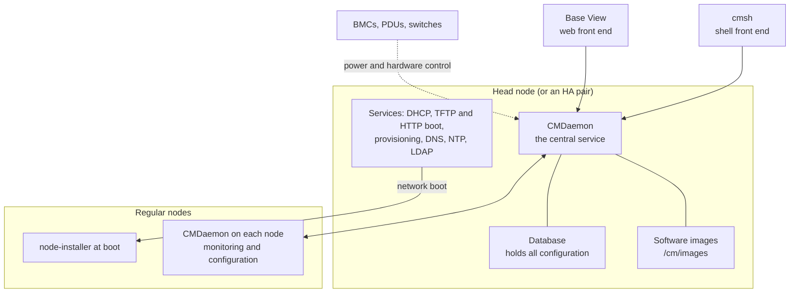
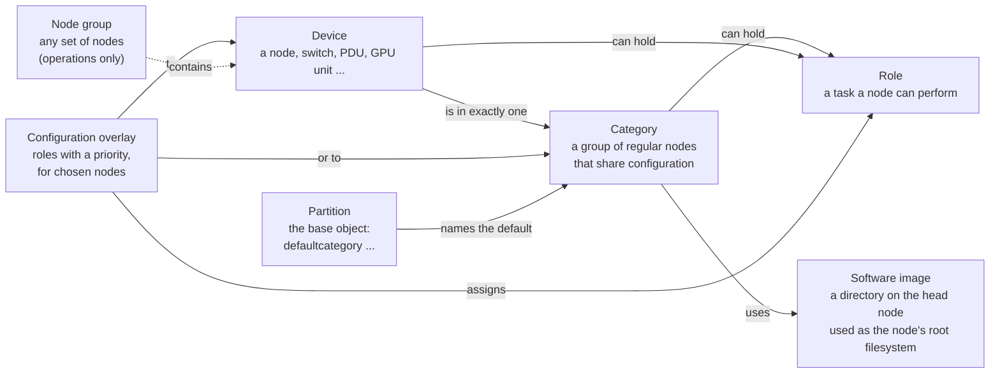

# 8.1 BCM architecture and concepts

| | |
|---|---|
| Level | Beginner |
| Priority tier | 1 |
| Lab venue | Laptop |
| Part | Part 8: NVIDIA Base Command Manager |
| Status | Drafted (`bcm_model_lab.py`: 35 checks pass; cluster commands **untested** on live BCM) |

## Why this matters for AI infrastructure

A GPU cluster has hundreds of nodes. Someone has to answer: how does a blank node get its operating system, how do you change a setting on 500 nodes at once, how do you power-cycle a rack, how does the scheduler learn what each node is? BCM is NVIDIA's answer, and it is the management software of NVIDIA's DGX SuperPOD reference designs (the SuperPOD architecture documents name Base Command Manager and Mission Control among the in-cluster services). If you know the BCM objects and rules, you can read any BCM cluster and predict what a change will do.

## Prerequisites and outcomes

You need Linux basics, and Part 7 helps (BMCs). After this chapter you can:

- explain what BCM does and which parts it is made of
- explain devices, software images, categories, node groups, roles and configuration overlays
- predict which value or role a node gets when settings clash
- explain Base View, `cmsh` and CMDaemon
- explain the common first mistakes

## 1. What BCM is, in simple words

The manual's first sentence: BCM "contains tools and applications to facilitate the installation, administration, and monitoring of a cluster". It runs **on top of a normal Linux distribution**. The 11 installation manual lists supported platforms: Red Hat family (RHEL and Rocky 8 and 9), SUSE Enterprise Server 15, Ubuntu (22.04, 24.04 and a newer LTS) and **DGX OS 7 and 8**, on x86_64 and arm64. The same manual keeps a feature matrix because not every feature exists on every OS and architecture.

A basic BCM cluster has:

| Part | Role |
|---|---|
| **Head node** (sometimes called master node) | the control point. Controls everything else, and provides central storage, workload management, user management, DNS and DHCP. Normally the only machine on the external network. Often replicated as a passive head node for high availability (chapter 8.12) |
| **Regular nodes** | compute nodes (the heavy work), plus login nodes, storage nodes and others |
| **Managed Ethernet switches** | the internal network |
| **Power distribution units (PDUs)** (optional) | let the head node switch nodes on and off |

The most useful sentence in the installation manual is the one on provisioning: every time a compute node starts, the software on its local drive is **synchronized with a software image kept on the head node**, so a node can always be brought back to a known state, and replacing a broken node is easy. "Software changes need to be carried out only once (in the software image)". This is the heart of BCM: you do not log in to 500 nodes to change them. You change an image or a setting and the nodes follow.



## 2. The parts of the daemon, front ends and files

- **CMDaemon** is the cluster management daemon. It runs on the head node and on every regular node. All management goes through it. During normal operation, the only management route to CMDaemon is **TCP port 8081** over SSL, authenticated with client-side X509v3 certificates. Two port directives in `/cm/local/apps/cmd/etc/cmd.conf` control how CMDaemon listens:
  - **`Port = 8080`** (default `8080`): the non-SSL HTTP port. By default it is used **only during `init` / pre-init boot** (and is required when `bootloaderprotocol` is set to `HTTP`, the default, because most bootloaders do not support HTTPS).
  - **`SSLPort = 8081`** (default `8081`): the SSL HTTPS port used for all communication with Base View and `cmsh` once CMDaemon is up.
  - **`SSLPortOnly = no`** (default `no`): when `no`, both 8080 and 8081 listen, though only 8081 is used after startup; setting `SSLPortOnly = yes` disables the non-SSL port, which is only allowed if `bootloaderprotocol` is **not** `HTTP`.
  - **`cm-cmd-ports`**: lists (`cm-cmd-ports -l`, showing `http 8080` and `https 8081` across `/cm/images/<image>/cm/local/apps/cmd/etc/cmd.conf`, `/cm/local/apps/cmd/etc/cmd.conf`, and `/cm/node-installer/scripts/node-installer.conf`) and changes (`--http`, `--https`) the ports. It does **not** update the head node firewall automatically: you must update `/etc/shorewall/rules` and run `shorewall reload` (from BCM 12 onwards Shorewall is superseded by `nftables`), run `softwareimage updateprovisioners` and `fspart; trigger -a`, restart `cmd` on the **active** head node first and then the passive head node, and push `cmd.conf` to running regular nodes before restarting `cmd` on them.
  - The head node's configuration file is `/cm/local/apps/cmd/etc/cmd.conf` (`Master = master` by default, which makes the head node start in head mode and regular nodes start in node mode); for regular nodes it lives inside the software image. After editing `cmd.conf`, restart the `cmd` service.
- **Two front ends** talk to CMDaemon and offer the same functions: **Base View** (a web GUI) and **`cmsh`** (a shell). The manual says an administrator need not learn both. Base View is served on port 8081 at `/base-view` (`https://<head>:8081/base-view`); the `base-view` package can be removed to disable it. `cmsh` suits scripting; for real programs the manual recommends the Python bindings of the Developer Manual instead of batch `cmsh`.
- **CMDaemon Lite** (`cm-lite-daemon`, a Python service) is a minimal alternative for devices where a full daemon is overkill. It uses one node license.
- **Checks and tools:** `cmdaemonctl full-status` shows version, uptime, sessions, worker threads and request rate; `cmdaemonctl debugon` and `debugoff` switch debug logging (turn it off in production, the logs grow fast); logs go to `/var/log/cmdaemon`; `cmdaemonversions` in `cmsh` device mode lists the daemon version of every node, and the manual expects the same version everywhere. `cm-change-passwd` changes the four administrative passwords (head node root, software image root, node-installer root, MySQL root) in one dialog; on an HA pair run it on both head nodes.
- **Generated files.** CMDaemon writes many system files. A file it generates carries the header "This file was automatically generated by cmd. Do not edit manually!" and a manual edit is overwritten, unless you list the file in the `FrozenFile` directive of `cmd.conf` (for example `FrozenFile = { "/etc/dhcpd.conf" }`). If a generated file had a hand edit and is not frozen, CMDaemon raises an event and saves your copy in `/var/spool/cmd/saved-config-files`. This one rule prevents many confusing "my change disappeared" tickets.

Authentication (chapter 8.6 goes deeper): `cmsh` uses PEM certificates. A fresh install makes an administrator certificate for root at `/root/.cm/admin.pem` and `/root/.cm/admin.key`. A certificate carries a **profile**, which decides what the holder may do. `admin` is the built-in profile that allows everything. `cm-check-certificates.sh` checks whether certificates are current.

## 3. The object model

This is the most important part of the chapter. BCM keeps the cluster in a database as **objects**. Most BCM mistakes come from not knowing which object a setting belongs to.



### 3.1 Devices

A **device** is a component of the cluster. The manual's list: head node, physical node, virtual node, cloud node, GPU unit, chassis, switch (Ethernet, InfiniBand, Myrinet), lite node, power distribution unit, rack sensor kit and generic device. A device has properties (rack position, host name, switch port) and operations (power on). What you can do depends on the type: you can mount a filesystem on a node but not on a switch.

Every device has a **state**:

| State | The device is | Monitored? | Meaning |
|---|---|---|---|
| `[ UP ]` | up | yes | normal |
| `[ DOWN ]` | down | yes | down but meant to be up: **a failure** |
| `[ CLOSED ] (UP)` | up | mostly ignored | deliberately set aside |
| `[ CLOSED ] (DOWN)` | down | mostly ignored | the administrator **deliberately** took it down and wants it ignored |

The difference between `DOWN` and `CLOSED (DOWN)` is the most useful one: the first needs a fix, the second is on purpose. My model code returns only the `DOWN` nodes as failures.

### 3.2 Software images

A **software image** is "a blueprint for the contents of the local filesystems on a regular node". In practice it is a **directory on the head node** (normally under `/cm/images/<name>`) holding a full Linux filesystem. A fresh install creates `default-image`. Facts from the manual:

- By default the image uses the same Linux family as the head node. Different families are supported but harder to manage. RHEL 8 with Rocky 8, and RHEL 9 with Rocky 9, mix without problems because Rocky is binary compatible; SLES and Ubuntu mixes need "quite some effort".
- At boot the node-provisioning system gives the node a copy. A running node can be **re-synchronised** to pick up image changes without rebooting (the `imageupdate` command, chapter 8.4).
- An image can be **locked** so no node picks it up while you work on it.
- You change an image with normal Linux tools (`chroot`, `rpm`, and so on). Chapter 8.4 and 8.13 show the safe method.

### 3.3 Categories

A **category** is "a group of regular nodes that share the same configuration". It lets you configure and operate on many nodes at once: one disk layout for a group, or one reboot for a whole category.

- A regular node is in **exactly one category at all times**, `default` unless changed. You can change the default for new nodes with `defaultcategory` in the partition's base object.
- People usually split categories by hardware or by task. The manual's examples: `nodes-ib` (InfiniBand), `nodes-highmem`, `login`, `storage`. The rule of thumb: make a new category when the configuration (monitoring, disk layout, roles) differs from the others.
- A category and a software image do not map one to one. Several categories can share an image, and a category can be switched to another image.

### 3.4 Node groups

A **node group** is any collection of nodes for convenience: any mix of head nodes and regular nodes, in any categories. A node can be in **zero or more** groups. Groups are for **operations** on a set (for example "reboot rack5"). Because the members may have different configurations, **you cannot change configuration through a group**. Examples from the manual: `brokenhardware`, `headnodes`, `rack5`.

### 3.5 Roles

A **role** is a task a node can perform. Giving a node a role switches on that function. Examples: `boot` (the node can netboot others, with the `dhcpd` service), `provisioning`, `storage`, the Slurm client role. Roles can have parameters (the Slurm client role takes queues and GPU counts).

Rules:

1. A role can be given to a single node or to a whole category (then every node in it has it).
2. **You cannot create roles.** The `add` command does not exist in role mode, "by design". You can only `assign` roles that BCM provides.
3. If a category has a role with some parameters, you can **override the parameters for one node** by assigning the same role to that node again with different parameters.
4. Every assignment has a **priority**. The higher one wins.

### 3.6 Configuration overlays

A **configuration overlay** is a group of roles that you assign to chosen nodes or categories, with a priority. It is the BCM way to get what a custom role would give: you can build your own overlay (the `add` command works in `configurationoverlay` mode).

**The priority table.** This is worth memorising:

| Assignment comes from | Priority |
|---|---|
| a category | **250** (fixed) |
| a configuration overlay | 0 to 1000, **default 500** |
| a node | **750** (fixed) |
| overlay set to **-1** | the overlay is ignored |

An overlay may not use 250 or 750 (those belong to category and node). So by default: **node beats overlay, overlay beats category**. By the numbers, an overlay with a priority above 750 (up to 1000) would outrank a node-level role. The manual gives the numbers and the rule "the highest priority determines the role", but no example of this case, so that last point is **my reading**, not a quoted rule. My model follows the numbers, and the lab marks that check as "my reading".

### 3.7 How Auto Scaler (`cm-scale`) uses overlays and categories

A practical reason BCM separates **categories** (the software image and boot settings) from **configuration overlays** (workload manager roles) appears in **NVIDIA Base Command Manager Auto Scaler**. Auto Scaler runs as the `cm-scale` daemon on nodes that hold the `ScaleServer` role and watches pending work across workload engines (`wlmresources` in `cmsh` `device` mode shows what it sees):

- **Sharing nodes between Kubernetes and Slurm:** when both Kubernetes and Slurm settings are added to the `ScaleServer` role, `cm-scale` repurposes a free node from one scheduler to the other **by switching its configuration overlays** (for example turning an idle Kubernetes worker into a Slurm node "pretty much immediately" when Slurm jobs are queued, without changing the node's category or re-provisioning its disk).
- **Sharing nodes between LSF and Slurm, or cloudbursting / power saving:** `cm-scale` can also repurpose nodes between categories when a job finishes, power down idle physical nodes and start them when jobs arrive (several minutes), or extend queues to cloud nodes via Cluster Extension.
- **Resource matching:** `cm-scale` matches CPUs (fractional in Kubernetes), memory, and GPU count and type (for Kubernetes it natively matches `nvidia.com/gpu`, uses `maxPods` from the `kubelet` role, tracks job `parallelism` via `kube_job_spec_parallelism`, and checks extra resources only if listed in `KUBE_EXTENDED_RESOURCES` in `config.py`).

### 3.8 BCM and Ansible: where the boundary sits

BCM is not a replacement for Ansible and Ansible is not a bare-metal boot/provisioning engine:

| Responsibility | Natural owner | Why |
|---|---|---|
| Bare-metal PXE boot, disk partitioning, image sync, install modes | **BCM** | Handled before `/sbin/init` by `node-installer` and CMDaemon |
| Kernel version, extended ramdisk (`createramdisk`), kernel parameters | **BCM** | Stored on the `softwareimage`, `category`, or `device` object |
| Power control, head-node HA failover, BMC/Redfish sensors | **BCM** | Driven by `CMDaemon` and `cmha` |
| Slurm and Kubernetes cluster roles and overlays | **BCM** | Managed by `cm-wlm-setup`, `cm-kubernetes-setup`, and `cm-scale` |
| Site-specific policy files, extra agents, or managing BCM objects as code in Git | **Ansible** (or BCM chroot—pick **one** owner per file) | BCM ships the `brightcomputing.bcm110` Ansible collection (chapter 8.13, section 6) so playbooks can manage categories, users, and devices from Git; mixing live Ansible edits on nodes with BCM image sync causes drift |

## 4. Where does a value come from? Three rules

For a **setting of a node**:

1. **Normal values are inherited.** A node gets the value from its category. Setting the value on the node overrules the category for that node only.
2. **Yes/no (Boolean) values are not inherited.** The category value and the node value are combined with **OR**. By default both are false, so at first it looks like normal inheritance. But a node **cannot switch off** a Boolean that its category switches on. The manual's examples are `datanode` and `installbootrecord`.
3. **Roles** are resolved by priority as in section 3.6.

My model implements these and prints where a value came from (like the BCM `credentialsoverview` command in chapter 7.1, which shows which level supplies a credential). Part of the output of the lab:

```text
PASS  a non-Boolean value is inherited from the category (2.1.3)
PASS  a value set on the node overrules the category value (2.1.3)
PASS  Booleans are NOT inherited: category OR node, so a node cannot switch off a category 'true' (2.1.3)
PASS  a configuration overlay (default priority 500) beats the category (250) (2.1.6)
PASS  a node-level role (750) still beats an overlay at the default priority (2.1.6)
PASS  an overlay with priority -1 is ignored (2.1.6)
PASS  overlay priority 250 is forbidden (2.1.6)
...
30 passed, 0 failed
```

Run it with `python3 bcm_model_lab.py` in `code/part08`. If a check ever fails, my reading of the manual was wrong, so the lab is also a way to find my own mistakes.

**A worked example.** You have a category `dgx` with the Slurm client role (8 GPUs) and a kernel parameter `iommu=pt`. One node, `dgx-01`, has a bad GPU, so you set its Slurm client role to 4 GPUs on the node itself, and give it extra kernel parameters. Result in the model: `dgx-01` gets 4 GPUs (node 750 beats category 250), its own kernel parameter string, and everything else from `dgx`. The other nodes keep 8 GPUs. If instead you had put a `datanode` flag on the category, `dgx-01` could not turn it off.

## 5. A few practical points from the manual

- **Modules.** The "modules environment" (Environment Modules) sets up compilers and libraries for users. `module avail`, `module load`. Applications split into **local** (on the node) and **shared** (on shared storage; load the `shared` module to see them). The manual advises against loading `shared` automatically for root on a cluster whose shared storage is not on the head node, because root logins could hang if that storage is down. Administrators can set a default environment for all users in `/etc/profile.d` and in the `default-environment` meta-module (empty by default). Lmod can replace the default Tcl modules (`ENABLE_LMOD` in `cm-lmod-init.sh`, changed in the image for regular nodes and applied with `imageupdate`).
- **SSH.** Passwordless SSH works from the head node to regular nodes by default; for root from a regular node to the head node a password is requested "as a security consideration". User logins to regular nodes can be restricted with the `usernodelogin` option.
- **Scope.** BCM has separate manuals for cloudbursting, edge, containerization, the developer API and NVIDIA Mission Control. This part of the handbook follows the administrator, installation and containerization manuals.

## 6. BCM and SuperPOD

The DGX GB300 SuperPOD reference architecture says NVIDIA Mission Control software "is used to manage all DGX GB300 SuperPOD deployments" and calls it a full-stack solution for AI factories. It lists Base Command Manager, Slurm and Kubernetes as in-cluster services that reach the outside world (NGC registry, code repositories, data sources) through the border network. Mission Control builds on BCM. Chapters 8.15 and 8.16 cover this. For now: when you see a SuperPOD, expect BCM to be the layer that provisions and manages its nodes and ties in Slurm and Kubernetes.

## 7. Common first mistakes

1. **Editing a generated file by hand** and losing the change (use `FrozenFile`, or change the setting in BCM).
2. **Expecting a node to switch off a Boolean its category switches on.**
3. **Changing a setting on one node when the whole category needs it** (or the reverse), then wondering why new nodes differ.
4. **Trying to create a custom role.** Make an overlay.
5. **Treating `DOWN` and `CLOSED (DOWN)` alike.**
6. **Not knowing a node's category.** Nodes in a surprising category inherit surprising settings.
7. **Changing an image while nodes are provisioning from it** (lock it first, chapter 8.4).

## 8. Exercises

1. Run `python3 bcm_model_lab.py`. Pick three checks and explain each rule in one sentence of your own.
2. Extend the model: add a node group `rack5` and write a function that returns the `Slurm client` GPU count for every node in the group.
3. In the model, an overlay at priority 600 and another at 400 both give a node a role. Which wins and why? Confirm by running it.
4. Write down which object (device, category, group, role, overlay, image) you would use for: a disk layout; the Slurm client role for all DGX nodes; the one broken node that needs 4 GPUs; "reboot everything in rack 5"; a different kernel for a test group.
5. Explain in your own words why the manual forbids overlay priorities 250 and 750.
6. Read section 2.6.5 of the manual and write a short rule for your team about editing files on the head node.

## 9. Interview angles

- "What does BCM do?" Installs and boots nodes from images on the head node, applies configuration through objects, controls power and hardware, monitors, and integrates Slurm and Kubernetes.
- "Category or group?" Category carries configuration, one per node; a group is only a set for operations, many per node.
- "A node ignores its category's setting. Why?" The node may have its own value, or the setting is a Boolean (OR), or a higher-priority role or overlay applies.
- "Why can't I add a custom role?" By design; create a configuration overlay.
- "DOWN versus CLOSED (DOWN)?" Failure versus a deliberate shutdown.
- "Where do you change software for 500 nodes?" In the software image, then re-sync or reboot the nodes.

## 10. Checkpoint questions (20)

1. What is the head node responsible for?
2. What does CMDaemon do and where does it run?
3. Name the two front ends.
4. What does the `FrozenFile` directive do?
5. What is a device, and name four device types.
6. What is the difference between `DOWN` and `CLOSED (DOWN)`?
7. What is a software image physically?
8. Can two categories use the same image?
9. How many categories can a regular node be in?
10. How many node groups?
11. Why can't you configure nodes through a node group?
12. What is a role? Can you create one?
13. What priority do category-assigned roles have? Node-assigned? Overlays by default?
14. Which overlay priorities are forbidden and why?
15. What does overlay priority -1 mean?
16. How are non-Boolean values resolved between node and category?
17. How are Boolean values resolved?
18. Name the four passwords `cm-change-passwd` changes.
19. What does `cmdaemonversions` show and why does it matter?
20. What does a certificate profile control?

## 11. Sources and review notes

- **BCM 11 Administrator Manual:** chapter 1 (introduction), chapter 2 in full: concepts (2.1: devices, images, categories, groups, roles, overlays), modules (2.2), authentication (2.3: passwords, SSH, certificates, profiles), Base View (2.4, I read the introduction and the navigation overview), cmsh startup and aliases (2.5.1, retold lightly here and fully in 8.5), CMDaemon (2.6: configuration, versions, logging, `FrozenFile`, Lite), chapter 8 section 8.1 (Auto Scaler `cm-scale` use cases and resource constraints, pages 467 to 469), and Appendix C pages 905 to 907 (`Master`, `Port = 8080`, `SSLPort = 8081`, `SSLPortOnly = no`, `cm-cmd-ports`).
- **BCM 11 Installation Manual**, chapter 2 (platforms, cluster structure).
- **DGX GB300 SuperPOD reference architecture:** Mission Control and the in-cluster services.
- **NVIDIA-DevOps notes**, volume 10 chapter 2 (`docs/volume-10/02-nvidia-base-command-manager.md`, read in full): architecture, the object model, priorities, ports (`Port = 8080` HTTP during `init`/HTTP boot and `SSLPort = 8081` HTTPS for management, confirmed in Administrator Manual Appendix C pp. 905–906), the `cm-change-passwd` note, the Auto Scaler (`cm-scale`) overlay-switching note, the BCM versus Ansible boundary (section 10), and the author's own warnings that an earlier draft invented details (Pacemaker-based HA, BitTorrent image distribution and boot modes `SYNCLOCAL` and `BITTORRENT` do not appear in the BCM 11 manual).
- **Corrections to the author's notes:** none for the rewritten `volume-10` chapter 2 (its `Port = 8080` / `SSLPort = 8081` claim on p. 906 is confirmed by Administrator Manual Appendix C, which explains that 8080 is used only during `init` / HTTP boot while 8081 is used for all SSL management).
- **Run here:** `bcm_model_lab.py` (35 checks).
- **Not verified:** everything about a real BCM system: ports, command output, the exact meaning of settings beyond what the manual says, and whether newer BCM point releases changed any rule.
