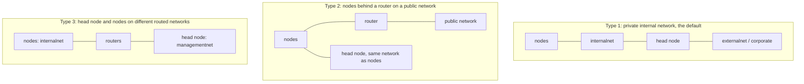

# 8.2 Planning and installing BCM

| | |
|---|---|
| Level | Beginner |
| Priority tier | 1 |
| Lab venue | Laptop |
| Part | Part 8: NVIDIA Base Command Manager |
| Status | Drafted (`install_lab.py`: 32 checks pass; cluster commands **untested** on live BCM) |

## Why this matters for AI infrastructure

The install is the one step you cannot casually redo. The manual says plainly that the head node disk layout is hard to change later, that the license is tied to a MAC address, and that network choices decide how every node boots. A person who plans first installs once. A person who clicks through the installer rebuilds the cluster.

## Prerequisites and outcomes

You need chapter 8.1 (objects) and basic networking (Part 3 of this handbook). After this chapter you can:

- size a head node and check it against the manual's numbers
- choose between the three network topologies and explain the DHCP consequence
- plan node names and IP addresses so BOOTIF and BMC addresses do not collide
- choose a disk layout and know which choice is hard to undo
- read license information and catch an expiry or a node-count problem early
- describe the install steps, the first-boot checks and how new nodes are found
- write and read a burn-in configuration
- explain why SELinux is off by default and what it costs to turn on

## 1. What you are installing

BCM is installed on **one machine first: the head node**. That machine then provisions every other node over the network (chapter 8.4). So the whole plan is really about the head node and the network it sits on.


The manual gives two ways to install the head node. The usual one is booting the **ISO** (bare metal) and answering the installer screens. The other is an **Ansible-based add-on installer** (collection `brightcomputing.installer.head_node`) that turns an existing supported Linux into a head node. I read the first in full and the second only in part, so treat the Ansible path as "exists, see the manual".

## 2. Hardware, in the manual's words

The manual's minimums are small. The head node needs 2 network interfaces for the common topology, at least 80 GB of disk, and 8 GB of RAM is recommended. A regular node needs 1 GB of RAM and one network interface. Real AI nodes are far bigger, so these are floors, not plans.

The more useful part is Appendix B, which gives **formulas for how head node load grows with cluster size**:

| What | Formula in the manual |
|---|---|
| Head node RAM | RAM of the operating system and other processes, plus 100 MB, plus 1.8 MB per node (good for up to 100 metrics and health checks per device); about 1 MB more per device for each further 100 |
| Head node disk | the OS without BCM, plus 5 GB per regular node image, plus 100 kB per metric or health check per device |
| Regular node RAM | its own processes, plus 50 MB, plus 10 kB per node in the cluster |

The manual also shows what it observed: at 1000 nodes CMDaemon plus the database used about 16 GB of RAM, CMDaemon alone about 2 GB, and about 10 GB of disk; at 2000 nodes double that; at 5000 nodes about 64 GB, 10 GB and 50 GB. For clusters above 1000 nodes the manual suggests a head node with 24 cores, 128 GB of RAM and a 512 GB SSD, because the extra RAM caches the filesystem.

**Check it yourself.** `bcm_plan.py` implements the formulas and `install_lab.py` compares them with the observed table. The formula for CMDaemon alone matches the table within about 12 percent (1.9 GB against 2 at 1000 nodes). The disk formula runs a little above the observed numbers, because the manual's observed figure leaves out the 5 GB image. The point is the shape: **head node load grows linearly with node count, and RAM for caching, not for CMDaemon, is why big heads are big.**

## 3. The three network topologies

The installer asks you to pick one. This is the most important planning choice, because it decides how nodes reach the outside world and how DHCP works.



| Type | In plain words | Networks the installer defines | Watch out for |
|---|---|---|---|
| 1 | Nodes sit on a private network; traffic to the outside goes **through the head node**. The default and most common | externalnet and internalnet | Anyone outside needs routing or a proxy to reach a node |
| 2 | Nodes reach the outside **through a router**, not the head node; nodes and head node are still on the same network | internalnet only | A DHCP clash with an existing DHCP server; a relay agent may be needed if nodes span several subnets; nodes are not isolated |
| 3 | Head node and nodes are on **different networks**, joined by routers | internalnet and managementnet | Layer 3 between head and nodes, so **DHCP and PXE need a relay agent**, set up by the network team, outside BCM |

The beginner rule: Type 1 gives you the simplest, most isolated cluster. Type 2 and 3 exist for clusters that live inside a bigger network. Both put real work on the network team.

## 4. Names and addresses

**Node names.** The installer asks for a base name and a number of digits. The default gives `node001`, `node002` and so on. With three digits the largest is `node999`, so 1000 nodes do not fit. Pick the digits for the size you expect to grow to.

**Addresses.** Nodes get sequential addresses on each network, starting just after the network's base address. A node has more than one interface (its boot interface and its BMC), and by default each would get the same sequence on the same network. The manual's fix is an **IP offset**: for example an offset of `0.0.0.20` on the BMC network puts the BMC of the first node at `10.141.0.21` while its boot interface stays at `10.141.0.1`. The manual calls the overlap confusing, and the planner shows why: ten nodes with no offset collide on all ten addresses.

```python
import bcm_plan as p
boot = p.interface_addresses("10.141.0.0/16", 10)               # 10.141.0.1 ... .10
ipmi = p.interface_addresses("10.141.0.0/16", 10, "0.0.0.20")   # 10.141.0.21 ... .30
assert p.overlap(boot, ipmi) == []
```

## 5. Disk layout: the choice you cannot easily undo

The installer proposes a layout for the head node. The manual's default depends on drive size: below about 500 GB it uses one big partition; otherwise a standard layout with separate `/tmp` and `/var`. Both have a `/boot`, an EFI partition and swap. The manual warns that **the head node layout is hard to change after install**, and offers disk encryption (LUKS) as an install option. Decide both before you click Next. The practical reason to prefer separate `/var`: logs and the database live there and can fill it.

## 6. Licensing

You need a license for a real cluster; an evaluation license is also possible. The manual's points:

- `cmsh -c "main licenseinfo"` shows the licensee, serial number, start and end time, edition, type, licensed nodes and accelerators, and the **MAC address** the license is tied to.
- `verify-license verify`, `verify-license info` and `verify-license monthsleft` are the checks; `request-license` and `install-license` get and install a license.
- Head nodes count as nodes. An expired license stops CMDaemon from starting (the manual shows the log message `License has expired`).
- Because the license is tied to the head node's MAC address, **replacing a head node's network card means a new license**. Plan for this in a hardware swap (chapter 8.13).

`license_check.py` reads the `licenseinfo` table and warns when a license is expired, near expiry, over its node or accelerator count, or above 90 percent of it. Run `python3 license_check.py sample_licenseinfo.txt --now 2025-03-01` to see it. The 90 percent and 3-month thresholds are **my** choices, not the manual's.

## 7. The install, step by step

I summarise the manual's bare-metal flow. The exact screens differ slightly by version.

1. Boot the ISO. The boot menu lets you pass the kernel parameter `netconf` to set up the installer's own network.
2. Accept the license text and set the basics the installer asks for (language, keyboard, time zone; the exact order is in the manual).
3. Choose the **network topology** (section 3), then enter the head node name, passwords and the networks (external, internal, BMC) with their addresses and offsets (section 4).
4. Configure the **BMC** settings if the nodes have BMCs, so BCM can power-cycle them later (chapter 8.7).
5. Choose the **disk layout** (section 5) and the software image source.
6. Review the summary and confirm. The installer then installs the head node (my summary; the manual's exact final screens are not reproduced here).

**First boot checks.** Log in as root, then confirm: the license (`cmsh -c "main licenseinfo"`), that CMDaemon is running (`systemctl status cmd.service`, shown in the manual's section 2.6.1), and that Base View answers on port 8081 of the head node. Then boot a regular node with network boot enabled. It gets an address from the head node's DHCP, loads the node installer over PXE and appears as a **new, unnamed node**.

**Identifying nodes.** New nodes show up by MAC address. Assign them names in order with `device newnodes -s -n node001..node032` in cmsh (the manual's example), or in Base View. Power on nodes in the order you want the names, or match MACs to a list.

**GPUs.** The manual's quickstart for GPU nodes: check the card is visible (`lspci`), then use `cm-wlm-setup` to set up the workload manager with GPU support (chapter 8.8).

## 8. Burn-in testing

A new node can fail under load in the first days. BCM has a **burn framework** to find that before users do.

- A burn run reboots the node into the node installer, runs a **burn configuration** (an XML file stored in CMDaemon, with a simpler editor in cmsh `partition` mode, `burnconfigs`), and reports results.
- **The default configuration is destructive: it wipes all attached drives.** The node then reverts to its software image on the next provisioning. Never burn a node that holds data.
- The framework needs working **power management** (a BMC such as IPMI, iLO or Redfish, Part 7 and chapter 8.7), because the scripts power-cycle the node.
- A configuration has an optional `<mail>` list, a `<pre-install>` part (runs in the small node-installer environment) and a `<post-install>` part (runs in the full OS). Each holds **phases**, and each phase holds **tests**.
- Rules: phases must exist, have unique names and be written in alphanumeric order (so number them `01-`, `02-`). Tests in a phase run at the same time. A test marked `endless="1"` runs until every non-endless test in its phase finishes, which suits monitors like `mce_check` (machine check exceptions) and `kmon` (kernel log).
- `memtest86` never ends by itself. On big clusters the manual suggests relying on `hpl` and `memtester` instead.

Commands, from cmsh device mode: `burn --config default-destructive -n node001 start`, then `burn status`, `burn log`, `burn stop`. The log lives at `/var/spool/burn/<mac>/`. Test status letters: **S** started, **W** warning, **F** failed, **P** passed. A line such as `disktest (SF,61)` means started and failed, with a custom value of 61 (the disk speed).

Two practical tips from the manual: test a **short** configuration on one node first (a long burn can fail hours in on a path you could have checked in ten minutes), and consider moving `/var/spool/burn` off the head node, since logs grow large (`BurnSpoolDir` in `cmd.conf` and `burnSpoolHost`/`burnSpoolPath` in `node-installer.conf`).

`burn_config.py` checks a configuration against these rules, and reads a burn status line. It is a teaching tool: the real schema is `burnconfig.xsd` on the head node.

## 9. SELinux: off by default, for a reason

SELinux is **disabled by default** in BCM. The manual says to enable it only if your organisation's rules demand it, because the policies need custom work and make problems harder to trace. If you do: set the mode to **permissive** first, make sure `cmd` runs unconfined, set the mode in the `selinuxsettings` submode (node, category or partition level), and manage it through BCM, not on the node directly, or CMDaemon and the node disagree. A trap: in FULL or AUTO provisioning modes, re-syncing from an image **without SELinux file contexts erases the contexts** on the node. The manual's fix is a cloned image where you run `setfiles` against the image, again after any image update.

## 10. Common first mistakes

1. Choosing the topology without asking the network team (types 2 and 3 involve DHCP relay or clashes).
2. Choosing too few digits for node names.
3. Leaving BOOTIF and BMC on the same sequence of addresses.
4. Accepting the default disk layout without thinking about `/var`, or about encryption.
5. Forgetting that the license follows the head node's MAC address.
6. Running the default burn on a node with data.
7. Putting 20 hours of burn tests behind a spool path that was never tested.
8. Turning on SELinux enforcing on day one.

### 10.1 Deep dive: Why head-node disk and network planning cannot be deferred

Why does Section 5 warn so strongly that the head node's disk layout and network topology are the two choices you cannot casually change after installation? Walk through what happens physically on the head node over the first year of operating a large GPU cluster.

During initial installation, the BCM ISO installer partitions the head node's local drives and extracts `default-image` under `/cm/images/default-image`. On Day 1, that single software image occupies roughly five to ten gigabytes. Three months later, your team clones `default-image` to create `dgx-h100-cuda12-4`, `dgx-h100-cuda12-6-canary`, `login-image`, and `storage-image`, and stages several `135 MB` `.fwpkg` firmware bundles plus offline Kubernetes air-gap tarballs. Each cloned software image on an `ext4` or `xfs` filesystem is a full directory tree of twenty to forty gigabytes. At the same time, MySQL under `/var/lib/mysql` is recording monitoring samples and job accounting records across hundreds of nodes, and `/var/spool/burn` is collecting hardware burn-in logs.

If an engineer clicked straight through the installer on a single small root partition without sizing `/cm/images` and separating `/var`, filling `/var/log` or `/var/spool/burn` during a rack burn-in run starves MySQL of disk space on `/`. When MySQL cannot write to disk, `CMDaemon` stops accepting commits, DHCP lease updates stall, and the entire cluster control plane freezes. Putting `/var`, `/cm/images`, and `/tmp` on properly sized partitions (or LVM volumes that can be extended online) during the initial ISO install prevents a full head-node rebuild later.

The same permanence applies to the **network topology (Types 1, 2, and 3)** and **node digit width (`node001` vs `node0001`)**:
- In **Type 1**, the head node is the strict Layer-3 boundary between `internalnet` and `externalnet`. Compute nodes have private IPs (`10.141.0.x`), use the head node (`10.141.255.254`) as their default gateway, and never touch the corporate network directly. This is the gold standard for dedicated AI factories because DHCP, PXE, TFTP, and HTTP boot traffic on `internalnet` are completely isolated from corporate IT switches.
- In **Type 2**, nodes and the head node share a routed corporate subnet and use an external router as their default gateway. If corporate IT already runs a DHCP server on that VLAN—or blocks rogue DHCP servers via DHCP snooping on the top-of-rack switches—your compute nodes will either boot into the wrong corporate PXE environment or fail to get a lease at all.
- In **Type 3**, the head node sits in a central management rack (`managementnet`) separated by Layer-3 spine routers from the compute racks (`internalnet`). Because PXE `DHCPDISCOVER` packets are Layer-2 broadcasts (`255.255.255.255`), they die at the first Layer-3 router unless the network engineering team configures `ip helper-address` (DHCP relay) on every rack subnet pointing to the head node's IP (and both head nodes in an HA pair).

### 10.2 Designing a production burn-in gate with `burnconfigs`

When a vendor delivers sixty-four new GPU servers, the worst mistake an operations team can make is installing Slurm and opening the queue to researchers the same afternoon. Infant-mortality hardware failures follow a steep "bathtub curve": marginal HBM3 memory stacks, cold-soldered SXM mezzanine pins, optical transceivers that drop lanes at `65 °C`, and weak power supplies almost always fail during their first twenty-four to forty-eight hours under sustained thermal and electrical load.

BCM's built-in **burn framework** (`burnconfigs` under `partition` mode and `burn` under `device` mode) automates this exact pre-production stress test, but using it safely in an AI data center requires three operational rules:

1. **Understand the `<pre-install>` versus `<post-install>` execution split:** When you start a burn (`burn --config <name> -n node001..node064 start`), BCM reboots the target nodes into the lightweight RAM-based `node-installer` environment and runs all `<pre-install>` phases first. Because the node's local drives are not mounted as a root filesystem during `<pre-install>`, destructive block-level disk tests (`disktest`) and low-level memory sweeps can write across every sector of every NVMe drive without corrupting a running OS. Once all `<pre-install>` phases pass, the burn engine automatically provisions the node's full software image onto disk, boots into the production Linux kernel, and executes the `<post-install>` phases—where full-stack tests like `hpl` (Linpack), GPU DCGM stress tests, and InfiniBand bandwidth checks run with full driver support.
2. **Pair bounded stress tests with `endless="1"` hardware monitors:** Inside any burn phase (`01-precheck`, `02-stress`), all tests listed in that phase launch in parallel. By pairing a timed compute/memory stress test (such as `hpl` or `memtester`) with background monitors marked `endless="1"` (such as `mce_check` watching for CPU Machine Check Exceptions and `kmon` watching kernel logs for PCIe AER or Xid errors), the monitors run continuously for the exact duration of the stress test and automatically stop as soon as the last non-endless test in that phase finishes. Never put an unbounded test like `memtest86` into an automated multi-phase burn without a time limit, because `memtest86` loops forever until stopped by hand.
3. **Clone and customize `default-destructive` before touching existing racks:** Because `default-destructive` wipes all attached storage drives, create a separate non-destructive burn profile (`post-maint-burn`) that omits destructive `<pre-install>` disk wipes for re-validating nodes after minor component swaps (such as a fan or optical transceiver replacement). Always test a new burn XML with a five-minute run on a single canary node first to verify that `/var/spool/burn/<mac>/` receives logs cleanly and that `burn status` transitions from `S` (started) to `P` (passed) without hanging on a missing BMC power-control credential.

### 10.3 Navigating the SELinux and LUKS encryption trade-offs

Regulated government, defense, and healthcare AI clusters frequently mandate two host security controls at installation time: **LUKS disk encryption** and **SELinux mandatory access control**. Both are supported in BCM 11, and both carry specific operational constraints you must plan for on Day 0:

- **LUKS disk encryption:** The BCM head-node installer offers LUKS encryption for head-node partitions, and regular node disk-layout XMLs can encrypt local compute-node partitions. Remember that encrypting the head node's disks requires entering the LUKS passphrase on the head-node console (or BMC `iKVM`/`SOL`) whenever the head node cold-boots or recovers from a power outage—meaning an unattended reboot of a single head node will wait at the pre-root passphrase prompt until an operator connects over out-of-band console.
- **SELinux across software images:** When SELinux is required on compute nodes, never run `setenforce 1` manually over `pdsh`. Manage it through BCM's `selinuxsettings` (`Initialize = yes`, `Mode = permissive` first, `Policy = targeted`, `Allow NFS home directories = yes`), ensure `rsyncxattr` is configured properly in `fspart` (or run `setfiles` inside a cloned software image after every package update), and verify all audit denials in `permissive` mode across a full training job lifecycle before switching to `enforcing`.

### 10.4 Pre-installation worksheet for a new AI cluster

Before booting the BCM installation ISO on the primary head node, walk through this eight-row worksheet with the facility, network, and storage engineering teams and commit the agreed answers to your cluster design repository:

| Planning Item | Decision to Record Before Running Installer | Where It Lands in BCM |
|---|---|---|
| **1. Network Topology** | Type 1 (isolated `internalnet` behind head NAT), Type 2 (shared VLAN), or Type 3 (routed L3 subnets with DHCP relay) | Installer network topology screen |
| **2. Node Naming & Digits** | Prefix (`node`, `dgx`, `gpu`) and zero-padded digit width (`3` digits up to `999` nodes, `4` digits for `1,000+` nodes) | `partition[base]` naming settings |
| **3. Subnet & IP Offsets** | Base CIDR for `internalnet` (`10.141.0.0/16`), `bmcnet` (`10.148.0.0/16`), `ibnet` (`10.149.0.0/16`), and BMC IP offset (`0.0.0.20`) | `network` objects & `addinterface` |
| **4. Head-Node Disk Layout** | Separate `/var`, `/tmp`, and `/cm/images` partitions (or LVM), plus optional LUKS encryption | Installer disk partitioning screen |
| **5. License Binding** | Primary head-node MAC address (plus secondary head-node MAC if building an HA pair) | `main licenseinfo` / `install-license` |
| **6. BMC Credentials** | Initial `bmcsettings` username (`bright` or site admin), user slot ID (`4`), and `firmwaremanagemode` | `partition[base] -> bmcsettings` |
| **7. Burn-In Spool & Policy** | Location of `/var/spool/burn` (`BurnSpoolDir`) and choice of `<pre-install>` / `<post-install>` burn XML | `partition[base] -> burnconfigs` |
| **8. SELinux & FIPS Mode** | Disabled (default) vs `permissive`/`enforcing` on compute categories (`selinuxsettings`, `fips`) | `category` / `partition` security settings |

## Exercises

1. Run `python3 install_lab.py`. Pick three checks and explain each in your own words.
2. Use `bcm_plan.py` to size a head node for 256 nodes with 150 metrics per device, then for 2000 nodes. Compare with the manual's table.
3. Plan names and addresses for 64 GPU nodes: pick the digits, the internal network, the BMC offset, and prove no overlap.
4. Write a burn configuration with a hardware check, a disk test and a stress phase. Run `burn_config.py` on it. Fix what it flags.
5. Edit `sample_licenseinfo.txt` so the cluster is at 95 percent of its node license. What does `license_check.py` say?
6. Explain to a colleague, in five sentences, why a Type 3 network needs a DHCP relay.

## 12. Interview angles

- "What do you decide before installing BCM?" Topology, node naming and digits, IP offsets, disk layout and encryption, license and its MAC binding, BMC access.
- "Type 1 versus Type 2?" Type 1 isolates nodes behind the head node, which routes to the outside; Type 2 puts nodes on a network that reaches outside through a router.
- "How do you prove new hardware is healthy?" Burn-in with a tested configuration, on one node first.
- "Why is SELinux off by default?" Policies are site-specific and add support cost; enable only when required, start permissive.
- "How does the head node grow with the cluster?" Roughly linearly in RAM and disk; large heads add RAM for caching.

## Checkpoint questions (20)

<details>
<summary>1. Which machine in a BCM cluster do you install first, and why?</summary>

You install the **head node** first, because it hosts `CMDaemon`, the MySQL database, DHCP/TFTP/HTTP boot services, and the `/cm/images` software images used to provision every regular node over the network.
</details>

<details>
<summary>2. Name the two supported methods for installing a BCM head node.</summary>

1. **Bare-metal ISO installer:** Booting the head node directly from the BCM installation DVD/ISO and completing the graphical/text wizard.
2. **Ansible add-on installer (`brightcomputing.installer.head_node`):** Converting an existing supported Linux host into a BCM head node.
</details>

<details>
<summary>3. What are the Installation Manual's minimum hardware requirements for a head node versus its recommendation for clusters above 1,000 nodes?</summary>

- **Minimums:** `2` NICs (for Type 1), at least `80 GB` disk, and `8 GB` RAM recommended (`1 GB` RAM and `1` NIC minimum for a regular node).
- **Above `1,000` nodes (Appendix B):** `24` CPU cores, `128 GB` RAM, and a `512 GB` SSD.
</details>

<details>
<summary>4. State the Appendix B formulas for head node RAM and disk scaling as a function of node count.</summary>

- **Head node RAM:** `OS_RAM + 100 MB + 1.8 MB * N_nodes` (for up to `100` metrics/health checks per device, plus `~1 MB` per device for each additional `100` metrics).
- **Head node disk:** `OS_disk + 5 GB * N_images + 100 kB * N_metrics * N_devices`.
</details>

<details>
<summary>5. At 1,000 nodes, `CMDaemon` itself uses only ~2 GB of RAM (`~16 GB` with MySQL). Why does the manual recommend 128 GB of RAM on the head node?</summary>

Because the Linux kernel uses the extra head-node RAM as **page cache** for `/cm/images` and `/cm/shared`, allowing software image transfers (`rsync`) and shared NFS reads to be served from memory rather than disk.
</details>

<details>
<summary>6. Describe a BCM **Type 1** network topology.</summary>

In **Type 1** (the default), regular nodes sit on an isolated private network (`internalnet`) and have no direct connection to the external network; the head node has two NICs (`internalnet` and `externalnet`) and acts as the NAT/routing gateway between the cluster and the outside world.
</details>

<details>
<summary>7. How does a **Type 2** network topology differ from Type 1, and what DHCP hazard does it introduce?</summary>

In **Type 2**, only `internalnet` is defined by the installer, and both the head node and regular nodes sit on a shared campus/datacenter network that reaches the outside world through an external router. Because the network is shared, the head node's DHCP server can **clash with an existing corporate DHCP server**.
</details>

<details>
<summary>8. Describe a **Type 3** network topology and explain why it requires an external DHCP relay (`ip helper-address`).</summary>

In **Type 3**, the head node sits on `managementnet` while regular nodes sit on separate routed subnets (`internalnet`) separated by Layer-3 routers. Because DHCP broadcast packets (`DHCPDISCOVER`) do not cross Layer-3 routers by default, the network team must configure a **DHCP relay agent** on the routers pointing to the head node.
</details>

<details>
<summary>9. Which network objects does the BCM installer create by default for Type 1, Type 2, and Type 3?</summary>

- **Type 1:** `internalnet` and `externalnet` (plus `globalnet`).
- **Type 2:** `internalnet` only (plus `globalnet`).
- **Type 3:** `internalnet` and `managementnet` (plus `globalnet`).
</details>

<details>
<summary>10. Why is choosing `3` digits for node numbering (`node001`) a problem if your cluster grows to 1,000 nodes?</summary>

Three digits only accommodate `node001` through `node999` (`999` nodes maximum); adding a 1,000th node requires 4 digits (`node0001`).
</details>

<details>
<summary>11. What is an **IP offset** in the BCM installer (such as `0.0.0.20` for BMC interfaces), and what collision does it prevent?</summary>

When a node's boot interface (`BOOTIF`) and its `bmc` interface share the same subnet, both default to starting at `.1` (`10.141.0.1`), causing every node's BMC IP to collide with a boot IP. Setting an IP offset (e.g., `0.0.0.20` for `10` nodes) shifts the BMC sequence to `10.141.0.21`..`.30`.
</details>

<details>
<summary>12. How does the installer's default head-node disk layout change around the `500 GB` disk threshold, and why is `/var` separation important?</summary>

Below `~500 GB`, the installer defaults to a single root `/` partition (plus `/boot`, EFI, and swap); at `500 GB` and above, it creates separate `/tmp` and **`/var`** partitions. Separating `/var` prevents MySQL monitoring tables, `/var/spool/burn`, and `/var/log` from filling `/` and wedging the head node.
</details>

<details>
<summary>13. What hardware identifier is a BCM license cryptographically bound to, and what happens if you replace that component?</summary>

The license is bound to the **MAC address** of the head node's primary network interface. Replacing the head node motherboard or NIC changes the MAC address and requires requesting/installing a re-hosted license.
</details>

<details>
<summary>14. Which commands display and verify the installed BCM license?</summary>

`cmsh -c "main licenseinfo"` (in `cmsh`), and the CLI utilities `verify-license verify`, `verify-license info`, and `verify-license monthsleft`.
</details>

<details>
<summary>15. What happens to `CMDaemon` when the BCM cluster license expires?</summary>

`CMDaemon` **refuses to start** (logging `License has expired`), halting cluster management and provisioning until a valid license is installed with `install-license`.
</details>

<details>
<summary>16. When brand-new regular nodes PXE-boot for the first time, how do you assign them sequential names `node001..node032`?</summary>

Power the nodes on in physical rack order and run **`device newnodes -s -n node001..node032`** in `cmsh` (which assigns names in the order their MAC addresses were detected and saves them).
</details>

<details>
<summary>17. Why is BCM's `default-destructive` burn-in configuration dangerous if run on an existing production node?</summary>

Because `default-destructive` **wipes and overwrites all attached storage drives** during disk stress testing (re-provisioning the node from its software image afterward).
</details>

<details>
<summary>18. What hardware management prerequisite must be working before you start a BCM `burn` run?</summary>

Working **power control** (such as a configured BMC via IPMI or Redfish), because the burn framework automatically power-cycles and reboots the node between `<pre-install>` and `<post-install>` phases.
</details>

<details>
<summary>19. In a BCM burn XML configuration, how are phases ordered, and when does a test marked `endless="1"` terminate?</summary>

Phases must have unique names and execute in **alphanumeric sort order** (e.g., `01-hwcheck`, `02-stress`). All tests within a phase start in parallel; a background monitor test marked `endless="1"` (such as `mce_check` or `kmon`) runs until **every non-endless test in that same phase completes**.
</details>

<details>
<summary>20. Why is SELinux disabled by default in BCM, and what trap occurs if you re-sync a node from an image that lacks SELinux file contexts?</summary>

SELinux is disabled by default because custom cluster paths and daemons require site-specific policy tuning (start in `permissive` mode with `cmd` unconfined). In `FULL` or `AUTO` install modes, syncing from an image where `setfiles` has not labeled the SELinux file contexts will **erase the file contexts on the compute node**.
</details>

## Sources and review notes

- **BCM 11 Installation Manual:** chapter 1 (quickstart: GUI install, first boot, adding nodes, GPUs), chapter 3 (hardware, ISO flow, topologies 3.3.9, network screens 3.3.13, naming 3.3.11, IP offset 3.3.15, disk layout 3.3.17, LUKS; the Ansible installer only partly read), chapter 4 (licensing), chapter 6 (changing head node network parameters), chapter 11 (burning nodes), chapter 12 (SELinux; I read the RHEL 8 and Rocky 9 part), appendix B (hardware formulas and observed table) and appendix C (scope of support).
- **Run here:** `install_lab.py` (32 checks): the Appendix B formulas against the observed table, naming limits, IP offsets, disk layout choice, topology table, license warnings, burn configuration rules and burn status parsing.
- **My own choices, not the manual's:** the 3-month and 90 percent license warnings; the choice of first-boot checks.
- **Not read:** the Ansible installer in full, chapters 5, 7, 8, 9 and 10 of the Installation Manual (registration, third-party software, HPC SDK, CUDA, OFED), the SELinux sections for other distributions, and the BCM installation on cloud or virtual machines.
- **Not verified:** everything about a real BCM system: screen order, command output, behaviour on a newer point release.
