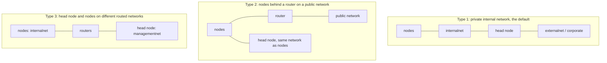

# 8.2 Planning and installing BCM

| | |
|---|---|
| Level | Beginner |
| Priority tier | 1 |
| Lab venue | Laptop |
| Part | Part 8: NVIDIA Base Command Manager |
| Status | Drafted (`install_lab.py`: 32 checks pass; cluster commands **untested** on live BCM) |

## Why this matters for AI infrastructure

Picture a new cluster on the day the hardware arrives. The racks are in place, the cables are run, and someone is ready to click through the installer because the schedule is tight. The install is the one step you cannot casually redo. Once the head node is set up, several choices are hard to change. The manual says the head node disk layout is hard to change later. It also says the license is tied to a MAC address, which is the fixed hardware address of a network card. Network choices decide how every node boots and how it finds the head node. If you plan first, you install once. If you click through, you may end up rebuilding the cluster on a day when the users are already waiting.

This chapter is about the planning that comes before the first click. It walks through the head node's size, the network layout, the names and addresses, the disk, the license and the install path. After that comes the testing that proves new nodes are sound, and a short note on SELinux, the security layer that ships turned off. Each part answers a question you will face in the first week.

## Prerequisites and outcomes

Before you start, read chapter 8.1, which covers BCM objects. You should also be comfortable with basic networking from Part 3 of this handbook, because the topology choice is really a networking choice. The chapter then covers the head node sizing formulas, the three network topologies, naming and IP offsets, the disk and license choices, the install steps and first boot, the burn-in configuration, and the SELinux warning. Each section can be read on its own once you have the vocabulary from chapter 8.1.

## 1. What you are installing

Imagine the head node arriving first. It is one server in a rack, and it is the machine everything else will depend on. You install BCM on that machine before anything else. The head node then provisions every other node over the network, which chapter 8.4 covers. So planning BCM really means planning the head node and the network it sits on.

The diagram below shows the order of the work. Read it from left to right. Each step depends on the one before it, and the planning happens before the first box.


The manual gives two ways to install a head node. The usual way is to boot the ISO on bare metal and answer the installer screens. An ISO is a disk image file, and booting it means starting the machine from that image. The other way is an Ansible-based add-on installer, the collection `brightcomputing.installer.head_node`. It turns an existing supported Linux machine into a head node. The ISO path is the one this chapter follows in detail, because it is the path most teams take. Treat the Ansible path as something the manual describes, and check the manual before you rely on it. This chapter does not walk through the Ansible path step by step.

## 2. Hardware, in the manual's words

Picture a planning meeting where someone asks for the head node spec and the answer is already on a slide. The manual's minimums look small. The head node needs 2 network interfaces for the common topology and at least 80 GB of disk. The manual recommends 8 GB of RAM. A regular node needs only 1 GB of RAM and one network interface. Real AI nodes are far bigger than that, so treat these numbers as floors, not plans. A floor is the least the software can run on. A plan is what you buy so that the cluster keeps working as it grows.

The more useful part is Appendix B. It gives formulas for how head node load grows with cluster size. A formula here is a rule that turns a node count into a memory or disk figure. The table below lists them.

| What | Formula in the manual |
|---|---|
| Head node RAM | RAM of the operating system and other processes, plus 100 MB, plus 1.8 MB per node (good for up to 100 metrics and health checks per device); about 1 MB more per device for each further 100 |
| Head node disk | the OS without BCM, plus 5 GB per regular node image, plus 100 kB per metric or health check per device |
| Regular node RAM | its own processes, plus 50 MB, plus 10 kB per node in the cluster |

As you read these rows, notice the pattern. Every term that grows is multiplied by a count of nodes, devices or images. Metrics and health checks are the readings BCM takes, such as temperatures and load, and every reading adds a little to the head node's load. That is why the same cluster can need more head node memory once monitoring is turned up. The manual also reports what it measured. At 1000 nodes, CMDaemon plus the database used about 16 GB of RAM. CMDaemon alone used about 2 GB, and the disk use came to about 10 GB. At 2000 nodes the figures were double that. At 5000 nodes the manual reports about 64 GB, 10 GB and 50 GB, in the same order. Those observed numbers show how the formulas play out in practice.

For clusters above 1000 nodes, the manual suggests a head node with 24 cores, 128 GB of RAM and a 512 GB SSD. A core is one processing unit inside a CPU, and an SSD is a solid-state drive. Why so much RAM? The extra memory caches the filesystem, so it is not there for CMDaemon. A cache keeps recently read files in memory, so the next read is fast. Image transfers and shared reads benefit from that cache, which is why a big head node feels fast even when the daemon itself is small.

Try the formulas yourself. The `bcm_plan.py` script implements these formulas, and `install_lab.py` compares them with the observed table. The formula gives 1.9 GB for CMDaemon at 1000 nodes. The table shows 2 GB, so the two agree within about 12 percent. The disk formula runs a little above the observed numbers, because the observed figure leaves out the 5 GB image. The shape matters more than any single figure. **Head node load grows in a straight line with node count, and the RAM for caching is why big heads are big.** Suppose you size your head node from the minimums. You would be planning from floors, not plans, so use the formulas instead.

## 3. The three network topologies

The installer asks you to pick one of three. This is the most important planning choice you will make. It decides how nodes reach the outside world, and it decides how DHCP works. DHCP is the service that hands out addresses when a machine starts, and it is the first thing a node asks for when it boots. Each diagram below shows one arrangement. The table after them explains what each one means in practice.



| Type | In plain words | Networks the installer defines | Watch out for |
|---|---|---|---|
| 1 | Nodes sit on a private network; traffic to the outside goes **through the head node**. The default and most common | externalnet and internalnet | Anyone outside needs routing or a proxy to reach a node |
| 2 | Nodes reach the outside **through a router**, not the head node; nodes and head node are still on the same network | internalnet only | A DHCP clash with an existing DHCP server; a relay agent may be needed if nodes span several subnets; nodes are not isolated |
| 3 | Head node and nodes are on **different networks**, joined by routers | internalnet and managementnet | Layer 3 between head and nodes, so **DHCP and PXE need a relay agent**, set up by the network team, outside BCM |

Layer 3 means the IP layer of the network stack, where routers work. PXE, which stands for Preboot Execution Environment, is the way a machine boots from the network. A relay agent is a small service that carries DHCP and PXE requests across a router, so the head node can answer them.

If you are unsure, start from the simplest case. Type 1 gives you the most isolated cluster with the least work, because the head node is the only door. Types 2 and 3 exist for clusters that live inside a bigger network, and both put real work on the network team. Talk to that team before you commit to either one. The network team will know whether an existing DHCP server already runs on the same network, and that answer alone can rule out Type 2.

## 4. Names and addresses

Picture a cluster that starts with a few nodes and grows every quarter. Node names come first, and they have to survive that growth. The installer asks for a base name and a number of digits. With the default, you get `node001`, `node002`, and so on. Three digits stop at `node999`, so a 1000-node cluster will not fit. Choose the digit count for the size you expect to grow to, not the size you have today. Renaming nodes later is possible, but it touches every record that uses the names.

Addresses work differently. Nodes get sequential addresses on each network, starting just after the network's base address. A base address is the first address of a network's block, and a node takes the next free number in the block. A node usually has more than one interface. It has a boot interface, which is the one used for provisioning, and a BMC, the management controller that lets BCM power-cycle the machine. By default, both interfaces would draw from the same sequence on the same network. That is the clash the manual wants you to avoid.

The manual's fix is an **IP offset**. An offset moves the start of a sequence further along the block, so two interfaces never claim the same number. Take an offset of `0.0.0.20` on the BMC network. The first node's BMC then moves to `10.141.0.21`, and its boot interface stays at `10.141.0.1`. The manual calls this overlap confusing, and it is easy to see why. Without the offset, the BMC and boot addresses would collide, and the second interface would fail with an address conflict. The planner makes it concrete: ten nodes with no offset collide on all ten addresses.

Here is the same check in code. The first call builds the boot addresses, and the second builds the BMC addresses with the offset. The assert then confirms that the two ranges never overlap.

```python
import bcm_plan as p
boot = p.interface_addresses("10.141.0.0/16", 10)               # 10.141.0.1 ... .10
ipmi = p.interface_addresses("10.141.0.0/16", 10, "0.0.0.20")   # 10.141.0.21 ... .30
assert p.overlap(boot, ipmi) == []
```

The assert passes only when the offset keeps the two ranges apart. If you change the number of nodes or the offset, run the check again, because a new offset can bring the ranges back together. Write the offset into your plan before you install, because the installer asks for it on the network screens. Changing it after the install means changing the network object later, which is possible but tedious.

## 5. Disk layout: the choice you cannot easily undo

The installer proposes a disk layout for the head node, and the proposal depends on drive size. A disk layout is the plan that splits the drive into partitions, which are separate areas with their own filesystems. Below about 500 GB, you get one big partition. At 500 GB or more, you get a standard layout with separate `/tmp` and `/var` partitions. Both layouts include a `/boot`, an EFI partition and swap. The `/boot` partition holds the kernel files, EFI is the firmware partition that starts the machine, and swap is extra space used when memory runs short.

The warning here matters most. The manual says the head node layout is hard to change after install. It also offers disk encryption with LUKS as an install option. LUKS is the standard Linux tool that encrypts a disk, so the data stays unreadable if the drive is removed. Settle both questions before you click Next, because the answers shape the whole head node.

Why prefer a separate `/var`? Logs and the database live there, and they can fill the partition. A full `/var` is a problem you would rather avoid on a head node, because the database and the logs both need room to write. Picture a head node whose `/var` fills up during a long burn-in run. Writes start to fail, and the daemon stops being able to record its state. Decide the layout and the encryption choice before the installer reaches this screen, because the screen moves quickly.

## 6. Licensing

Picture a cluster that stops on a Monday morning because nobody renewed the license. A real cluster needs a license, and an evaluation license also works, which lets you test the software before you buy. The license is the permission that lets CMDaemon run, so it matters from the first day. The manual's key points follow.

- Run `cmsh -c "main licenseinfo"` to see the licensee, serial number, start and end time, edition, type, licensed nodes and accelerators, and the MAC address the license is tied to. An accelerator here means a GPU or similar device counted against the license.
- Use `verify-license verify`, `verify-license info` and `verify-license monthsleft` to check the license. Use `request-license` to ask for one and `install-license` to install it. The check that reports the months left is the one to run on a calendar reminder, so the renewal happens before the deadline.
- Head nodes count as nodes too. When the license expires, CMDaemon will not start, and the manual shows the log message `License has expired`. An expired license is therefore a full outage of the management layer, not just a warning light.
- The license is tied to the head node's MAC address. If you replace the head node's network card, you need a new license. Plan for this during a hardware swap, which chapter 8.13 covers.

The `license_check.py` script reads the `licenseinfo` table. It warns when a license has expired or is close to expiry. It also warns when the cluster is over its node or accelerator count, or above 90 percent of that count. To see it work, run `python3 license_check.py sample_licenseinfo.txt --now 2025-03-01`. The 90 percent and 3-month thresholds are the lab's own choices, not the manual's. Check your expiry date now, before the cluster is in production, because an expired license stops CMDaemon.

## 7. The install, step by step

Picture the day you finally boot the installer. The steps below follow the manual's bare-metal flow. The flow is the order of the questions, so it helps to know them before you start. The exact screens differ a little between versions, so treat this as a map and check the screens you actually see.

1. Boot the ISO. The boot menu lets you pass the kernel parameter `netconf` to set up the installer's own network. A kernel parameter is an option handed to Linux when it starts.
2. Accept the license text, then set the basics: language, keyboard and time zone. The manual gives the exact order.
3. Choose the network topology from section 3. Then enter the head node name, the passwords, and the external, internal and BMC networks, with their addresses and offsets from section 4.
4. If your nodes have BMCs, configure those settings now. BCM can then power-cycle the nodes later, as chapter 8.7 explains.
5. Choose the disk layout from section 5, and choose the software image source.
6. Review the summary and confirm. The installer then installs the head node. The manual's exact final screens are not reproduced here, so this step is a summary of the manual's flow, not a screen-by-screen guide.

Once the head node is up, log in as root and run a few checks. Start with the license, because a license problem stops everything else. Confirm the license with `cmsh -c "main licenseinfo"`. Confirm that CMDaemon is running with `systemctl status cmd.service`, which the manual shows in its section 2.6.1. Then check that Base View answers on port 8081 of the head node. If all three checks pass, the head node is ready for nodes.

Next, boot a regular node with network boot enabled. The node gets an address from the head node's DHCP server and loads the node installer over PXE. The node installer is the small program that prepares the machine before the full system takes over. The new node then appears as a new, unnamed node in BCM.

New nodes appear by MAC address, not by name. A MAC address is the hardware identifier on each network card, and it is the only thing that tells two nodes apart before they have names. You give them names in order with `device newnodes -s -n node001..node032` in cmsh, which is the manual's example. You can do the same in Base View. Power on the nodes in the order you want them named, or match each MAC address to a list. Powering on in rack order is the simplest way to keep names and positions aligned.

For GPU nodes, the manual's quickstart starts with a visibility check. Run `lspci` to confirm the card shows up. The `lspci` command lists the hardware on the PCI bus, and a GPU that is missing from that list will not work later. Then run `cm-wlm-setup` to set up the workload manager with GPU support, which chapter 8.8 covers. Run the head node checks before you power on any regular node, so a problem on the head node does not look like a problem on every node.

## 8. Burn-in testing

A new node can look healthy on day one and still fail under load in its first days. Memory errors, a weak power supply and a loose cable often show up only when the machine is working hard for hours. BCM has a burn framework that finds those failures before your users do. Burn-in means stressing new hardware on purpose, so the weak parts fail while the machine is still in the lab and not in a training run.

A burn run reboots the node into the node installer. It then runs a burn configuration, which is an XML file stored in CMDaemon. XML is a structured text format that uses tags to describe nested parts. You can also edit that file with a simpler editor, in cmsh `partition` mode under `burnconfigs`. When the run ends, it reports its results, and you read those results with the status and log commands shown below.

The default configuration is destructive: it wipes all attached drives. The node then reverts to its software image on the next provisioning. Never burn a node that holds data, because the wipe cannot be undone. The framework also needs working power management, such as a BMC like IPMI, iLO or Redfish. Part 7 and chapter 8.7 cover that setup. The scripts power-cycle the node, so the burn needs that control to work. A burn that cannot reboot the node will stall, and the stall is easy to mistake for a slow test.

A configuration has three parts. It has an optional `<mail>` list, which names who receives the report. It has a `<pre-install>` part, which runs in the small node-installer environment. It has a `<post-install>` part, which runs in the full OS. Each part holds phases, and each phase holds tests. A phase is a stage of the run, and a test is one check inside that stage.

Phases must exist, have unique names, and be written in alphanumeric order, so you number them `01-`, `02-`. Tests in one phase run at the same time. A test marked `endless="1"` runs until every non-endless test in its phase finishes. That suits monitors such as `mce_check`, which watches for machine check exceptions, and `kmon`, which watches the kernel log. Machine check exceptions are hardware error reports from the processor. The `memtest86` test never ends by itself. On big clusters, the manual suggests relying on `hpl` and `memtester` instead, because they finish on their own.

From cmsh device mode, the commands are `burn --config default-destructive -n node001 start`, then `burn status`, `burn log` and `burn stop`. The log lives at `/var/spool/burn/<mac>/`. The status letters are S for started, W for warning, F for failed and P for passed. Read a line such as `disktest (SF,61)` as started and failed, with a custom value of 61. That 61 is the disk speed, reported by the test in its own unit. Learn to read the letters early, because a status line is the quickest way to see where a run went wrong.

The manual offers two practical tips. First, test a **short** configuration on one node before you run a long one. A long burn can fail hours in on a path you could have checked in ten minutes. Second, consider moving `/var/spool/burn` off the head node, because the logs grow large. You do that with `BurnSpoolDir` in `cmd.conf`, and with `burnSpoolHost` and `burnSpoolPath` in `node-installer.conf`. Moving the spool keeps the head node's disk free for the database.

The `burn_config.py` script checks a configuration against these rules, and it reads a burn status line. It is a teaching tool. The real schema is `burnconfig.xsd` on the head node, so treat that file as the final word when a check and the schema disagree.

## 9. SELinux: off by default, for a reason

Picture a node that refuses a connection that worked yesterday, with no clear error in the log. SELinux is a security layer that limits what each program may do, even when it runs as root. BCM ships with SELinux disabled. The manual says to enable it only if your organisation's rules demand it. The policies need custom work, and they make problems harder to trace, because a blocked action can look like an ordinary failure. Many clusters never need SELinux at all, so the default is a reasonable starting point.

If you do enable it, follow the manual's order. Set the mode to permissive first, which logs violations without blocking them. Make sure `cmd` runs unconfined, which means CMDaemon itself is not restricted by the policy. Then set the mode in the `selinuxsettings` submode, at the node, category or partition level. Permissive mode lets you find the violations before enforcement starts breaking things.

Manage SELinux through BCM, not directly on the node. Otherwise CMDaemon and the node disagree about the mode, and the next reconciliation may overwrite your change. This is the same rule as the one about generated files in chapter 8.1.

Watch for one trap. In FULL or AUTO provisioning modes, a re-sync from an image without SELinux file contexts erases those contexts on the node. File contexts are the labels that tell SELinux what each file is for. The manual's fix is a cloned image, where you run `setfiles` against the image. `setfiles` applies the correct labels to the files in a directory tree. Repeat that after every image update, because each update can bring back unlabeled files. Leave SELinux off unless a rule requires it, and if one does, start in permissive mode.

## 10. Common first mistakes

Each mistake below points back to a choice from this chapter. Read them as a checklist before the install, because most of them are cheap to avoid on day one and expensive to fix later.

1. You pick the topology without asking the network team, even though Types 2 and 3 involve DHCP relays or clashes.
2. You choose too few digits for node names.
3. You leave BOOTIF and BMC on the same sequence of addresses.
4. You accept the default disk layout without thinking about `/var`, or about encryption.
5. You forget that the license follows the head node's MAC address.
6. You run the default burn on a node that holds data.
7. You put 20 hours of burn tests behind a spool path that was never tested.
8. You turn on SELinux enforcing on day one.

### 10.1 Deep dive: Why head-node disk and network planning cannot be deferred

Section 5 warns that the head node's disk layout and network topology are hard to change once the install is done. Why so strongly? Follow the head node through its first year on a large GPU cluster. The story shows how small early choices turn into a big problem later.

During the initial installation, the BCM ISO installer partitions the head node's local drives and extracts `default-image` under `/cm/images/default-image`. On day 1, that one software image takes roughly five to ten gigabytes. Three months later, your team has cloned `default-image` into `dgx-h100-cuda12-4`, `dgx-h100-cuda12-6-canary`, `login-image` and `storage-image`. A clone is a full copy of an image, which lets you test a change without touching the original. They also stage several 135 MB firmware bundles with the `.fwpkg` extension, plus offline Kubernetes air-gap tarballs. An air-gap tarball is a packed archive of everything needed to install software on a network with no internet. Each cloned image on an `ext4` or `xfs` filesystem is a full directory tree of twenty to forty gigabytes.

Here is the arithmetic. Four clones at twenty to forty gigabytes each come to 80 to 160 GB, before any logs are counted. Meanwhile, MySQL under `/var/lib/mysql` records monitoring samples and job accounting records across hundreds of nodes. Accounting records are the logs of who ran what and for how long. `/var/spool/burn` collects the hardware burn-in logs. Each of these areas grows at its own pace, and none of them shrinks by itself.

Now picture an engineer who clicks straight through the installer. The head node has one small root partition, and `/cm/images` and `/var` were never sized. During a rack burn-in run, `/var/log` or `/var/spool/burn` fills up. That starves MySQL of disk space on `/`. Once MySQL cannot write to disk, CMDaemon stops accepting commits, DHCP lease updates stall, and the whole control plane freezes. A commit is a saved change, and a lease is the address a node holds. Put `/var`, `/cm/images` and `/tmp` on properly sized partitions during the initial ISO install. You can also use LVM volumes, which can be extended online. LVM is the Linux volume manager, and it lets you grow a partition later without a reinstall. Doing this now prevents a full head-node rebuild later, which would mean moving every image and every setting again.

The same permanence applies to the network topology and to node digit width, such as `node001` against `node0001`. Here is how the three topologies differ in the way that matters for permanence.

- In **Type 1**, the head node is the strict Layer-3 boundary between `internalnet` and `externalnet`. Compute nodes use private addresses such as `10.141.0.x`. Their default gateway is the head node at `10.141.255.254`, so they never touch the corporate network directly. Dedicated AI factories treat this as the gold standard, because DHCP, PXE, TFTP and HTTP boot traffic on `internalnet` stays isolated from corporate IT switches. TFTP and HTTP boot are the file transfer methods a node uses to fetch its boot files.
- In **Type 2**, nodes and the head node share a routed corporate subnet, and an external router is their default gateway. If corporate IT already runs a DHCP server on that VLAN, or blocks rogue DHCP servers with DHCP snooping on the top-of-rack switches, your compute nodes can go wrong. They will either boot into the wrong corporate PXE environment or fail to get a lease at all. A VLAN is a virtual network split on shared switches, and DHCP snooping is a switch feature that blocks unauthorized DHCP servers.
- In **Type 3**, the head node sits in a central management rack, `managementnet`. Layer-3 spine routers separate it from the compute racks on `internalnet`. PXE `DHCPDISCOVER` packets are Layer-2 broadcasts to `255.255.255.255`, so they die at the first Layer-3 router. A broadcast is a message sent to every machine on a segment, and a router does not forward it. The fix is `ip helper-address` on every rack subnet, pointing at the head node's IP. That setting is a DHCP relay. In an HA pair, point it at both head nodes, so a failover does not break boot.

Settle the topology and the digit width with the network team before the installer asks for them. Those two answers are the hardest to change later, and they affect every node you add.

### 10.2 Designing a production burn-in gate with `burnconfigs`

Picture a vendor delivering sixty-four new GPU servers. The worst move is to install Slurm and open the queue to researchers that same afternoon. Early failures follow a steep "bathtub curve", where the risk is highest at the start of a machine's life and falls off after that. Marginal HBM3 memory stacks, cold-soldered SXM mezzanine pins, optical transceivers that drop lanes at `65 °C`, and weak power supplies almost always fail in the first twenty-four to forty-eight hours of sustained thermal and electrical load. A burn-in gate is a set of tests that every new server must pass before it joins the queue, and it catches those failures while the machines are still easy to return.

BCM's built-in burn framework automates this pre-production stress test. You reach its settings through `burnconfigs` under `partition` mode, and you start runs with `burn` under `device` mode. Using it safely in an AI data center takes three rules.

The first rule is to understand the split between `<pre-install>` and `<post-install>`. When you start a burn, for example `burn --config <name> -n node001..node064 start`, BCM reboots the target nodes into the lightweight, RAM-based node-installer environment. It runs every `<pre-install>` phase first. The node's local drives are not mounted as a root filesystem at that point, so nothing important is running on them. So destructive block-level disk tests, such as `disktest`, and low-level memory sweeps can write across every sector of every NVMe drive without corrupting a running OS. NVMe is a fast type of solid-state drive. Once all `<pre-install>` phases pass, the burn engine provisions the full software image onto disk and boots the production Linux kernel. Then it runs the `<post-install>` phases. Full-stack tests run there with full driver support. Examples are `hpl`, the Linpack test that stresses floating-point work, GPU DCGM stress tests, and InfiniBand bandwidth checks.

The second rule is to pair bounded stress tests with `endless="1"` hardware monitors. Inside any burn phase, such as `01-precheck` or `02-stress`, every test in that phase launches in parallel. Pair a timed stress test, such as `hpl` or `memtester`, with background monitors marked `endless="1"`. For example, `mce_check` watches for CPU Machine Check Exceptions, and `kmon` watches the kernel logs for PCIe AER or Xid errors. AER is the PCIe error reporting feature, and Xid is the error code family NVIDIA GPUs use in the kernel log. The monitors then run for exactly as long as the stress test, and they stop when the last non-endless test in the phase finishes. Never put an unbounded test such as `memtest86` into an automated multi-phase burn without a time limit. It loops forever until someone stops it by hand, and the rest of the gate never runs.

The third rule is to clone and customize `default-destructive` before you touch existing racks. Because `default-destructive` wipes all attached storage drives, create a separate, non-destructive burn profile. Call it `post-maint-burn`, and leave out the destructive `<pre-install>` disk wipes. Use that profile to re-validate nodes after a minor component swap, such as a fan or an optical transceiver. Before you rely on any new burn XML, test it on one canary node with a five-minute run. A canary is a single machine used to test a change before it reaches the rest. Check that `/var/spool/burn/<mac>/` receives logs cleanly. Also check that `burn status` moves from `S` (started) to `P` (passed), and that it does not hang on a missing BMC power-control credential. Burn in every new rack before users see it.

### 10.3 Navigating the SELinux and LUKS encryption trade-offs

Regulated clusters, such as government, defense and healthcare systems, often require two host security controls at install time. Those are LUKS disk encryption and SELinux mandatory access control. Mandatory access control means the policy, not the user, decides what a program may touch. BCM 11 supports both. Each one brings constraints you must plan for on Day 0, which means the day of the install, before any workload runs.

With LUKS, the BCM head-node installer offers encryption for head-node partitions. Regular node disk-layout XMLs can encrypt local compute-node partitions too. An encrypted head node asks for the LUKS passphrase on the console, or through the BMC's `iKVM` or `SOL`, every time it cold-boots or recovers from a power outage. iKVM and SOL are remote console tools that let you see and type at a machine over the network. So an unattended reboot leaves one head node stuck at the pre-root passphrase prompt. It stays there until an operator connects through an out-of-band console. Out-of-band means a path that does not depend on the machine's normal network or operating system. Plan who will answer that prompt at three in the morning before you turn encryption on.

With SELinux, never run `setenforce 1` by hand over `pdsh` when SELinux is required on compute nodes. `pdsh` runs a command on many nodes at once, and a manual change that way bypasses BCM. Manage it through BCM's `selinuxsettings` instead. Set `Initialize = yes`, and set `Mode = permissive` first. Use `Policy = targeted` and `Allow NFS home directories = yes`. The targeted policy confines only the services it names, which is the usual choice. Make sure `rsyncxattr` is configured properly in `fspart`, or run `setfiles` inside a cloned software image after every package update. The `rsyncxattr` setting keeps extended file attributes, including labels, when files are copied. Verify every audit denial in `permissive` mode across a full training job lifecycle, so you see every action the policy would block. Only then switch to `enforcing`.

### 10.4 Pre-installation worksheet for a new AI cluster

Before you boot the installation ISO on the primary head node, walk through this eight-row worksheet with the facility, network and storage engineering teams. Each row is a decision someone has to own, and each one lands in a specific place in BCM. Commit the agreed answers to your cluster design repository, so the decisions survive the people who made them.

| Planning Item | Decision to Record Before Running Installer | Where It Lands in BCM |
|---|---|---|
| **1. Network Topology** | Type 1 (isolated `internalnet` behind head NAT), Type 2 (shared VLAN), or Type 3 (routed L3 subnets with DHCP relay) | Installer network topology screen |
| **2. Node Naming & Digits** | Prefix (`node`, `dgx`, `gpu`) and zero-padded digit width (`3` digits up to `999` nodes, `4` digits for `1,000+` nodes) | `partition[base]` naming settings |
| **3. Subnet & IP Offsets** | Base CIDR for `internalnet` (`10.141.0.0/16`), `bmcnet` (`10.148.0.0/16`), `ibnet` (`10.149.0.0/16`), and BMC IP offset (`0.0.0.20`) | `network` objects & `addinterface` |
| **4. Head-Node Disk Layout** | Separate `/var`, `/tmp`, and `/cm/images` partitions (or LVM), plus optional LUKS encryption | Installer disk partitioning screen |
| **5. License Binding** | Primary head-node MAC address (plus secondary head-node MAC if building an HA pair) | `main licenseinfo` / `install-license` |
| **6. BMC Credentials** | Initial `bmcsettings` username (`bright` or site admin), user slot ID (`4`), and `firmwaremanagemode` | `partition[base] -> bmcsettings` |
| **7. Burn-In Spool & Policy** | Location of `/var/spool/burn` (`BurnSpoolDir`) and choice of `<pre-install>` / `<post-install>` burn XML | `partition[base] -> burnconfigs` |
| **8. SELinux & FIPS Mode** | Disabled (default) vs `permissive`/`enforcing` on compute categories (`selinuxsettings`, `fips`) | `category` / `partition` security settings |

Each row says what to decide and where that decision lands in BCM. Fill in every row before you open the installer. A row left blank is usually a question that someone will answer later, under pressure, and that is the moment most of the expensive rebuilds start.

## Exercises

Work through these in order. Each one builds on the planning you did in this chapter, so keep your notes from one exercise to the next. Each exercise names one job, and each one points at one command or one rule. The lab checks run against a model, and the cluster steps were not run on a live system.

1. Start by running `python3 install_lab.py`. Choose three of its checks. Explain each one in your own words.
2. Use `bcm_plan.py` to size a head node twice. First size it for 256 nodes with 150 metrics per device. Then size it for 2000 nodes. Compare your results with the manual's table.
3. Plan names and addresses for 64 GPU nodes. Pick the digit width, the internal network and the BMC offset. Then prove that no addresses overlap.
4. Write a burn configuration that has a hardware check, a disk test and a stress phase. Run `burn_config.py` on it. Fix whatever it flags.
5. Edit `sample_licenseinfo.txt` so the cluster sits at 95 percent of its node license. Run the check. What does `license_check.py` say?
6. A colleague asks why a Type 3 network needs a DHCP relay. Explain it to them in five sentences.

## 12. Interview angles

- "What do you decide before installing BCM?" Answer with the topology, the node naming and digit width, the IP offsets, the disk layout and encryption, the license and its MAC binding, and BMC access.
- "Type 1 versus Type 2?" Type 1 isolates nodes behind the head node, which routes traffic to the outside. Type 2 puts nodes on a network that reaches the outside through a router.
- "How do you prove new hardware is healthy?" Run a burn-in with a tested configuration, starting on one node.
- "Why is SELinux off by default?" Policies are specific to each site and add support cost. Enable SELinux only when required, and start in permissive mode.
- "How does the head node grow with the cluster?" Roughly linearly, in both RAM and disk. Large heads add RAM mainly for caching.

## Checkpoint questions (20)

<details>
<summary>1. Which machine in a BCM cluster do you install first, and why?</summary>

Install the **head node** first. It runs `CMDaemon`, the MySQL database, the DHCP, TFTP and HTTP boot services, and it holds the `/cm/images` software images. Every regular node is provisioned over the network from there.
</details>

<details>
<summary>2. Name the two supported methods for installing a BCM head node.</summary>

There are two. The first is the bare-metal ISO installer, which boots the head node from the BCM installation DVD or ISO and walks you through a graphical or text wizard. The second is the Ansible add-on installer, `brightcomputing.installer.head_node`, which converts an existing supported Linux host into a BCM head node.
</details>

<details>
<summary>3. What are the Installation Manual's minimum hardware requirements for a head node versus its recommendation for clusters above 1,000 nodes?</summary>

The minimums are 2 NICs for Type 1, at least 80 GB of disk, and 8 GB of RAM recommended. A regular node needs 1 GB of RAM and one NIC at minimum. Above 1,000 nodes, Appendix B recommends 24 CPU cores, 128 GB of RAM and a 512 GB SSD.
</details>

<details>
<summary>4. State the Appendix B formulas for head node RAM and disk scaling as a function of node count.</summary>

Head node RAM is OS RAM plus 100 MB plus 1.8 MB per node. That covers up to 100 metrics and health checks per device, and each further 100 metrics adds about 1 MB per device. Head node disk is the OS disk plus 5 GB per image, plus 100 kB per metric per device.
</details>

<details>
<summary>5. At 1,000 nodes, `CMDaemon` itself uses only ~2 GB of RAM (`~16 GB` with MySQL). Why does the manual recommend 128 GB of RAM on the head node?</summary>

The extra RAM is not for CMDaemon. The Linux kernel uses spare RAM as page cache for `/cm/images` and `/cm/shared`. That means image transfers with `rsync` and shared NFS reads come from memory instead of disk.
</details>

<details>
<summary>6. Describe a BCM **Type 1** network topology.</summary>

In Type 1, which is the default, regular nodes sit on a private network, `internalnet`, with no direct connection to the outside. The head node has two NICs, `internalnet` and `externalnet`. It acts as the NAT and routing gateway between the cluster and the outside world.
</details>

<details>
<summary>7. How does a **Type 2** network topology differ from Type 1, and what DHCP hazard does it introduce?</summary>

In Type 2, the installer defines only `internalnet`. The head node and the regular nodes both sit on a shared campus or datacenter network, which reaches the outside through an external router. Because that network is shared, the head node's DHCP server can clash with an existing corporate DHCP server.
</details>

<details>
<summary>8. Describe a **Type 3** network topology and explain why it requires an external DHCP relay (`ip helper-address`).</summary>

In Type 3, the head node sits on `managementnet`, while regular nodes sit on separate routed subnets, `internalnet`, divided by Layer-3 routers. DHCP broadcasts, the `DHCPDISCOVER` packets, do not cross Layer-3 routers by default. So the network team must set up a DHCP relay agent on the routers, pointing at the head node.
</details>

<details>
<summary>9. Which network objects does the BCM installer create by default for Type 1, Type 2, and Type 3?</summary>

- **Type 1:** `internalnet` and `externalnet`, plus `globalnet`.
- **Type 2:** `internalnet` only, plus `globalnet`.
- **Type 3:** `internalnet` and `managementnet`, plus `globalnet`.
</details>

<details>
<summary>10. Why is choosing `3` digits for node numbering (`node001`) a problem if your cluster grows to 1,000 nodes?</summary>

Three digits cover only `node001` through `node999`, so the cluster tops out at 999 nodes. A 1,000th node needs four digits, as in `node0001`.
</details>

<details>
<summary>11. What is an **IP offset** in the BCM installer (such as `0.0.0.20` for BMC interfaces), and what collision does it prevent?</summary>

When a node's boot interface (`BOOTIF`) and its `bmc` interface share a subnet, both start at `.1`. So `10.141.0.1` goes to both, and every node's BMC address collides with a boot address. An offset such as `0.0.0.20` moves the BMC sequence to `10.141.0.21` through `.30` for 10 nodes.
</details>

<details>
<summary>12. How does the installer's default head-node disk layout change around the `500 GB` disk threshold, and why is `/var` separation important?</summary>

Below about 500 GB, the installer defaults to one root `/` partition, plus `/boot`, EFI and swap. At 500 GB and above, it creates separate `/tmp` and **`/var`** partitions. Separating `/var` keeps MySQL monitoring tables, `/var/spool/burn` and `/var/log` from filling `/` and wedging the head node.
</details>

<details>
<summary>13. What hardware identifier is a BCM license cryptographically bound to, and what happens if you replace that component?</summary>

The license is bound to the MAC address of the head node's primary network interface. If you replace the motherboard or the NIC, the MAC address changes. You then need to request and install a re-hosted license.
</details>

<details>
<summary>14. Which commands display and verify the installed BCM license?</summary>

Use `cmsh -c "main licenseinfo"` inside cmsh. For checks, use the `verify-license` utilities: `verify-license verify`, `verify-license info` and `verify-license monthsleft`.
</details>

<details>
<summary>15. What happens to `CMDaemon` when the BCM cluster license expires?</summary>

CMDaemon refuses to start and logs `License has expired`. Cluster management and provisioning stop until you install a valid license with `install-license`.
</details>

<details>
<summary>16. When brand-new regular nodes PXE-boot for the first time, how do you assign them sequential names `node001..node032`?</summary>

Power the nodes on in physical rack order, then run **`device newnodes -s -n node001..node032`** in `cmsh`. The command assigns names in the order the MAC addresses were detected, and it saves them.
</details>

<details>
<summary>17. Why is BCM's `default-destructive` burn-in configuration dangerous if run on an existing production node?</summary>

Because `default-destructive` **wipes and overwrites all attached storage drives** during its disk stress tests. The node is then re-provisioned from its software image.
</details>

<details>
<summary>18. What hardware management prerequisite must be working before you start a BCM `burn` run?</summary>

Working **power control** is required, such as a BMC configured for IPMI or Redfish. The burn framework power-cycles and reboots the node between the `<pre-install>` and `<post-install>` phases.
</details>

<details>
<summary>19. In a BCM burn XML configuration, how are phases ordered, and when does a test marked `endless="1"` terminate?</summary>

Phases must have unique names and run in **alphanumeric sort order**, such as `01-hwcheck` and then `02-stress`. Tests in a phase start in parallel. An `endless="1"` monitor, such as `mce_check` or `kmon`, keeps running until **every non-endless test in that same phase completes**.
</details>

<details>
<summary>20. Why is SELinux disabled by default in BCM, and what trap occurs if you re-sync a node from an image that lacks SELinux file contexts?</summary>

SELinux is disabled by default because custom cluster paths and daemons need site-specific policy tuning. Start in `permissive` mode, with `cmd` unconfined. In `FULL` or `AUTO` install modes, syncing from an image where `setfiles` has not labeled the SELinux file contexts will **erase the file contexts on the compute node**.
</details>

## Sources and review notes

- **BCM 11 Installation Manual:** chapter 1 (quickstart: GUI install, first boot, adding nodes, GPUs), chapter 3 (hardware, ISO flow, topologies 3.3.9, network screens 3.3.13, naming 3.3.11, IP offset 3.3.15, disk layout 3.3.17, LUKS; the Ansible installer only partly read), chapter 4 (licensing), chapter 6 (changing head node network parameters), chapter 11 (burning nodes), chapter 12 (SELinux; I read the RHEL 8 and Rocky 9 part), appendix B (hardware formulas and observed table) and appendix C (scope of support).
- **Run here:** `install_lab.py` (32 checks): the Appendix B formulas against the observed table, naming limits, IP offsets, disk layout choice, topology table, license warnings, burn configuration rules and burn status parsing.
- **My own choices, not the manual's:** the 3-month and 90 percent license warnings; the choice of first-boot checks.
- **Not read:** the Ansible installer in full, chapters 5, 7, 8, 9 and 10 of the Installation Manual (registration, third-party software, HPC SDK, CUDA, OFED), the SELinux sections for other distributions, and the BCM installation on cloud or virtual machines.
- **Not verified:** everything about a real BCM system: screen order, command output, behaviour on a newer point release.
