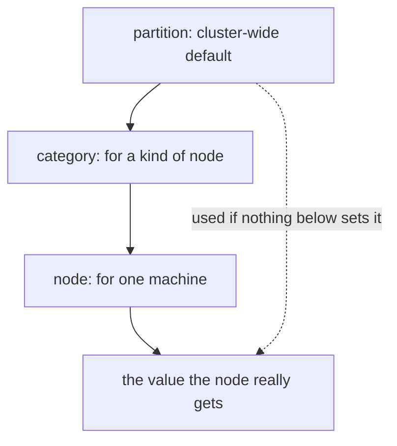

# 8.3 Cluster configuration: networks, nodes and categories

| | |
|---|---|
| Level | Beginner to intermediate |
| Priority tier | 1 |
| Lab venue | Laptop |
| Part | Part 8: NVIDIA Base Command Manager |
| Status | Drafted from the BCM 11 Administrator Manual, chapter 3 (sections 3.1, 3.2, 3.3, 3.4, 3.5, 3.13, 3.14, 3.15, 3.16, 3.17.1 to 3.17.3 in part, 3.20 read; 3.6 to 3.12 and 3.18 to 3.19 not read, see the sources). **No BCM system was available.** `code/part08/bcm_netconf.py` is **my model of the rules the manual states**, and `netconf_lab.py` checks 54 of them. It tests my reading of the manual, not BCM itself. Every command shown is from the manual and untested here |

## Why this matters for AI infrastructure

After the install, almost everything you do in BCM is "change a setting and decide how far it reaches". A GPU cluster has several networks (management, compute fabric, storage, BMC), several kinds of node (login, CPU, GPU) and settings that must be identical on hundreds of machines. The skill is knowing the level at which a setting lives, so one change reaches the nodes you mean and no others.

## Prerequisites and outcomes

You need chapters 8.1 (objects and inheritance) and 8.2 (install). After this chapter you can:

- find and change the cluster-wide settings, and know which ones email you
- explain the default networks and the four places an internal network setting can come from
- configure interfaces, static routes, bridges, VLANs and bonds, and avoid the bond mistakes the manual warns about
- check addresses and connectivity with the built-in tools
- explain disk layouts, NFS exports and mounts, and services, and where each inherits from
- place devices in racks and set GPU options per node or category
- choose between "let CMDaemon do it" and the three escape routes the manual describes

## 1. The shape of it: partition, overlay, category, node

The cluster-wide settings live in the **partition** object (in cmsh, `partition use base`; in Base View, **Cluster > Settings**). The manual says these values "can in some cases be overridden by more specific configuration levels, such as (configuration-)overlay-level, category-level, or node-level". That is the inheritance rule from chapter 8.1 again, applied to settings such as time zone, name servers and network choices. Whenever you read a setting in this chapter, ask: *partition, category or node?*

## 2. Cluster-wide settings (section 3.1)

The settings window lists name and time settings, networks and several objects. The ones to know:

| Setting | Default in the manual | Notes |
|---|---|---|
| Cluster name | `BCM 11.0 Cluster` | |
| Administrator email | set at install | Receives license, failed-service and failover mails (below) |
| Name servers | none, or from DHCP | `0.0.0.0` means "use what DHCP gave the head node". Use static addresses on a cluster with HA |
| Time servers | `0.pool.ntp.org`, `1.`, `2.` | Set on the head node |
| Time zone | set at install | Can also be set on a node, category, edge site or cloud region |
| Externally visible IP | `0.0.0.0` | Public address, if the cluster has one |
| Default category | `default` | The category new nodes join |
| Default burn configuration | `default-destructive` | Chapter 8.2 |
| Sign installer certificates | `AUTO` | Chapter 8.4 |

Objects that already exist (BMC, SNMP, provisioning) and objects you create when you need them (SELinux, switch access, ZTP, NetQ, UFM, NMX manager) hang off the same window.

**BMC defaults.** User name `bright`, a random password made at install, user ID 4, privilege administrator, power reset delay 0. They are set only if you configured BMC networks at install (chapter 8.7 and Part 7).

**Email.** By default BCM sends admin mail to root. Set the address in `partition use base` (the manual's cmsh example spells the property `administratore-mail`; use tab completion to confirm the name on your version). Three events send mail: **a month before the license expires** (and daily in the last week), **a head node service that fails on its first ever boot**, and **a failed automatic failover**. The head node runs Postfix with no relay host set; set `relayhost` in the partition. Test with `cmsh -c "main; testemail"`.

**FIPS.** FIPS mode can be set per node or per category (node wins), needs a reboot, and **cannot be set on the head node through CMDaemon**, because a bad FIPS boot configuration could leave the head node unbootable.

**Open-file limits.** BCM sets `fs.file-max` to 131072 in `/etc/sysctl.d/90-cm-sysctl.conf` and the per-user `nofile` to 131072 in `91-cm-limits.conf` (head node and the image). To change file-max, add your own later file (`91-site-...conf`) rather than editing BCM's. The kernel source's rule of thumb is memory in MB times 10 (128 GB gives 1,280,000). Do not let users compile or test on the head node.

## 3. Networks (section 3.2)

### The three default networks

| Network | Purpose |
|---|---|
| `internalnet` | Booting nodes and all cluster management traffic; default management network. Also used for storage and jobs if nothing else exists |
| `externalnet` | The link to the outside (corporate or campus). The only network where BCM supports IPv6 |
| `globalnet` | A name-space helper: nodes are named `node001.cm.cluster`, whether local or cloud. **Do not remove it.** Only its domain name is sensibly changed |

Each network object is a **layer 3** (IP) network; several can share one layer 2 segment. Important fields, from the manual's table: base address, netmask bits, gateway, domain name, MTU (1500 default), **dynamic range** (a temporary DHCP range for nodes while they PXE boot), **node booting** (this network may be used to boot nodes), **lock down dhcpd** (refuse new, unknown MAC addresses), **management allowed**, and **layer 3** (route per device through a switch, `/31` per device and port, `/30` possible for some switches). The manual also lists IMEX options for NVIDIA IMEX peer lists on multi-node NVLink systems.

**Defaults of the internal network:** base `10.141.0.0`, 16 bits, node addresses from `10.141.0.1`, dynamic range `10.141.128.0` to `10.141.143.255`, domain `eth.cluster`. The manual does not recommend the dynamic range, because it can clash with static addresses. `lockdowndhcpd` is how you stop unknown machines from getting a boot address on your cluster network once all your nodes are known.

### Four places an internal-network value can come from

1. the **network object** (base address, gateway, MTU, domain),
2. the **cluster object** (management network, node name prefix, digits, default category, default image),
3. the **device interface** (its IP, its network, `BOOTIF`),
4. the **node category** (default gateway, management network, name server, time server, search domain).

The default gateway shows the order: a **category** default gateway wins; otherwise the **network** gateway; if that is `0.0.0.0`, the DHCP server on the head node hands out `10.141.255.254`, the head node's alias. `bcm_netconf.default_gateway` implements exactly this order.

### Interfaces

A node's boot interface is `BOOTIF`, on `internalnet`. Its address is a **static** address by default, which the manual recommends because a node that loses the head node keeps working. Each interface also has `onnetworkpriority`, which decides which interface answers name-resolution queries (higher wins). Defaults by type: bridge 80, bond 70, physical 60, VLAN 50, alias 40, tunnel 30, netmap 20, BMC 10.

A new interface on a running node is added in `device > interfaces`, then the node is rebooted (a reboot activates network changes).

### Names, DNS and search domains

- Reach the head node from inside the cluster with the alias `master`. Do not call the head node `master`.
- Add extra names for an interface with `additionalhostnames` in the interface. Do **not** edit `/etc/hosts` for cluster hosts; let BCM's DNS (named) do it.
- To add your own DNS zones, put them in the **include file** the manual names (`/etc/named.conf.include` on RHEL 9/10 and SLES 15; `/etc/bind/named.conf.include` on Ubuntu). BCM does not touch that file. By default the head node's name server answers only internal queries; the `PublicDNS` directive opens it to outside queries.
- `/etc/resolv.conf` is written by CMDaemon from, in order: the global network, other networks, category search domains, partition search domains. Older glibc versions read only **6** entries. A domain may carry an index (`example.com:1`), CMDaemon sorts by index and writes the six lowest. The manual's advice for more than six: use FQDNs instead of forcing a newer glibc.

### The head node's outside address

The cluster object has no IP address. In a **Type 1** network the cluster's address is the head node's external interface; in Types 2 and 3 it is an upstream router and not part of BCM. After changing external settings, **reboot the head node**. DHCP for the external interface is possible but the manual says it is not recommended for production, because DHCP problems make network troubleshooting harder.

### Routes and port forwarding

- **Static routes** are a `staticroutes` submode on a device or category: name, gateway, destination, interface. CMDaemon makes the OS run `ip route add` when the interface comes up.
- **Port forwarding** (`portforward` in device mode) opens a port on the head node that forwards to a port on a node, using one `socat` process per rule. Example from the manual: `portforward create node001 1234 4321`. The head node's firewall (Shorewall) can block it. `portforward bmc node001` forwards the BMC web port (443) and console port. This is the safe way to reach a node's BMC from outside a Type 1 cluster.

### Tools to check the network

| Tool | Use |
|---|---|
| `routes` (device mode) | Routes of many nodes at once; filter with `awk` to find odd gateways |
| `ipaddresses` and `ipaddresses --check` | Compare the address BCM has configured with the one detected. States: **OK**, **Mismatch**, **Not detected**, **Not configured**. Exits non-zero if any is not OK |
| `connections` | Which ports are listening on which nodes |
| `connectivity` | ICMP pings along each node route on the management network; `--statistics` shows how uniform latencies are |
| `cm-iperf.py` | Bandwidth between node pairs |

`cm-iperf.py` checks **n(n−1)/2** pairs at about 10 seconds each. The manual says a 1000-node run would take about two months; the lab computes 58 days. Use `--count`, `-r` (random pairs) and `-p` (parallel threads).

## 4. Bridges, VLANs and bonds (sections 3.3 to 3.5)

- **Bridge** (`br<number>`): joins segments at layer 2. Member interfaces must have **empty IP and network**.
- **VLAN**: `add vlan BOOTIF.1` in the interfaces submode, then set its network and IP.
- **Bond**: `add bond bond0`, set network, IP, `mode` and `interfaces`. Seven modes: 0 balance-rr (the default), 1 active-backup, 2 balance-xor, 3 broadcast, 4 802.3ad, 5 balance-tlb, 6 balance-alb. Set the mode with the **mode property**, not as an option; a commit with `mode=` inside the options **fails validation**.

Rules that trip people up, all from the manual:

1. The **provisioning interface cannot be a member of a bond** (but a bond can be the provisioning interface, with one member used for PXE).
2. For failover bonds, **`miimon` is off by default** and should be set (`miimon=100` is the common value).
3. On a bonded **HA head node**, rename the shared alias interfaces (`eth0:0` to `bond0:0`) and change the head node's provisioning interface name to the bond.
4. In BCM 11, the node installer accepts **any** MAC address of a bonded interface when identifying a node.
5. The bonding kernel module must be in the node's software image for regular nodes.

`bcm_netconf.validate_interfaces` checks these.

InfiniBand setup (section 3.6) and the switch, NetQ and UFM sections (3.8 to 3.12) are not covered here; Part 12 covers AI networking.

## 5. Disks, NFS and services

**Disk layouts (3.13).** A disk layout is an XML file stored in the **CMDaemon database** (the files in `.../htdocs/disk-setup/` are only templates). A category's layout is inherited by its nodes; a node's own layout overrides it; `clear` on the node returns to the category's. Templates cover the default layout, hardware or software RAID, LVM, diskless and semi-diskless. Switch a node to diskless with the template `slave-diskless.xml`, then reboot; it runs from RAM. **A head node's disk layout cannot be changed by BCM after install** (ordinary Linux administration, with backups).

**NFS exports (3.14.1).** On the head node, `fsexports` lists exports (name, path, hosts, write). Three are built in since BCM 9.0 and come with the `headnode` role: `/var/spool/burn`, `/home` and `/cm/shared`. They cannot simply be removed; set `disableautomaticexports` in the headnode role. Your own exports can be removed or **disabled**.

**NFS mounts (3.14.2).** `fsmounts` on a category or node: device (`basecm11:/modeldata`), mount point, filesystem, options (add `_netdev` to wait for the network). A node shows its category's mounts marked `[default]` (the category name). **To remove a category mount, remove it in the category**, not on the node. A removed mount is not unmounted until the node reboots. To give some nodes a mount and not others, put them in another category, or set the mount per node. Mount **order** matters (a parent mounted first, the subtree after); use `up` and `down`. Autofs mounts must be added to `excludelistupdate` or an image update can wipe them (chapter 8.4).

Diskless nodes can mount rarely used subtrees from the head node's image over NFS to save RAM; the manual's example frees about 440 MB. The manual notes the BCM default NFS versions are a mix of 3 and 4 (as of its August 2025 date), with a procedure to move to 4 only.

**Services (3.15).** Services (like `cups`, `autofs`) can be added in `services` for a device or category, with `monitored` (watched), `autostart` (restart a failed service) and `runif` (HA: active, passive, always, preferpassive). If autostart is on and **you stop the service through BCM, BCM will not restart it** until you start it through BCM again. A service's own configuration stays with the service and the OS (`systemctl disable` controls start at boot).

## 6. Racks and chassis (3.16)

A rack is 42U by default. Put a device in a rack with `set rack` and `set deviceposition`, or fill positions with `addrackposition -n node001..node010 rack2` (first free slots, `--position`, `--force`). **The position is the top of the device.** Chassis (blade enclosures) have members and a `chassisposition` (slot, position, width). `rackoverview` shows UP/DOWN/CLOSED counts, cores, GPUs, power and, for NVIDIA racks, NVLink switches and power shelves. The model in `bcm_netconf.Rack` shows the placement rules.

## 7. GPU settings (3.17)

In `gpusettings` (node or category), add `nvidia 1-3` or `all` for a range of GPU slots. A range may be one number, `0-2`, `1,3-5`, or `all`/`*`. Options if supported: `clockspeeds`, `clocksyncboostmode`, `computemode` (default, exclusive thread, exclusive process, prohibited), `eccmode`, `powerlimit` (`min`, `max`, a number, `default`). **No value means the hardware default; a node value overrides a category value.** The `cuda-dcgm` package must be installed for GPU metrics. `updatedevicepowerconfig` sets power limits for GPUs or CPUs (`--dry-run` available); setting a limit both there and in `gpusettings` may conflict.

**MIG.** BCM can manage MIG (multi-instance GPU). The manual's rule: use **one** MIG tool. If you use the DGX `nvidia-migmanager.service` or the GPU operator's `nvidia-mig-manager` instead, BCM leaves MIG alone. After MIG is enabled, the whole GPU is no longer a device and GPU utilisation metrics are unavailable unless you enable profiling metrics (use with care). I read the concepts and the warnings; the MIG command details are for Part 10.

## 8. Going beyond CMDaemon: the manual's order of preference

Section 3.20 ranks the ways to change a node, and says the first is preferred:

1. **Configure through CMDaemon** (cmsh or Base View). CMDaemon then tracks the state.
2. **Use a different image** for a category or node (clone the image, clone the category, set the image, move nodes).
3. **Place files through the image**: `/cm/images/<image>/cm/conf/category/<category>/<path>` or `.../node/<node>/<path>` or `.../node/<MAC with dashes>/<path>`. Copied just before the node installer's finalize stage. **Node-level wins over category-level.**
4. **`FrozenFile`**: stop CMDaemon rewriting a file. The manual says avoid it where possible.
5. **`initialize` and `finalize` scripts**: run at the initrd stage, before CMDaemon on the node starts. Good for a setting that gets overwritten by the node installer on every boot (the manual's example appends an `ETHTOOL_OPTS` line to an interface file).
6. A **shared directory** with software the nodes run.

The reason for the order is maintenance: the further you move from CMDaemon, the more you must track yourself.

## 9. Common first mistakes

1. Changing one node when the category should change (or the reverse).
2. Editing `/etc/hosts` or `resolv.conf` by hand instead of the interface or network object.
3. Making the provisioning interface a bond member.
4. Forgetting `miimon` on a failover bond.
5. Removing `globalnet`, or a built-in NFS export.
6. Setting a node's mount when the category should carry it (it then is not removable from the node view).
7. Using DHCP for the head node's external interface in production.
8. Putting static node addresses in the dynamic DHCP range.
9. Freezing files because it is quick.
10. Running `cm-iperf.py` on a big cluster with defaults.

## 10. Exercises

1. Run `python3 netconf_lab.py`. Pick four checks and explain each rule in your own words.
2. Plan a two-network cluster: management (`10.141.0.0/16`) and storage (`10.150.0.0/16`) with 64 nodes. Write down which object holds each setting.
3. Use `Rack` to place 18 nodes, a switch and a PDU in one rack. What does `--force` risk?
4. List which of these you would do in the category, and which on one node: a different disk layout for one broken node; an NFS mount for all GPU nodes; a power limit on GPU 3 of one node; a static route to a license server for everyone.
5. Explain why the manual calls the dynamic DHCP range not recommended.
6. Write the cmsh commands (from the manual's examples, untested) to bond `eth1` and `eth2` as `bond0` in active-backup mode with `miimon=100`.

## 11. Interview angles

- "Where does a node get its default gateway?" Category default gateway, then the network's gateway, then the head node alias `10.141.255.254` through DHCP.
- "Why is the provisioning interface not allowed in a bond?" The manual states it as a restriction and does not give the reason; a bond can itself be the provisioning interface, and then the node installer brings up the bond and all its members before provisioning.
- "How do you expose a node's service to the outside on a Type 1 cluster?" `portforward` on the head node (socat), watching the firewall.
- "A node's configured IP and its real IP differ. How do you find it fleet-wide?" `ipaddresses --check`.
- "You need a setting BCM does not model. What are your options and which is best?" Image file placement or initialize/finalize scripts before `FrozenFile`.

## 12. Checkpoint questions (20)

1. What is the partition, and where do you edit it?
2. Which three events make BCM email the administrator?
3. Why can't you set FIPS on the head node through CMDaemon?
4. What are `internalnet`, `externalnet` and `globalnet` for?
5. What does "lock down dhcpd" do?
6. Name the four sources of an internal-network value.
7. In what order is a node's default gateway decided?
8. What does `onnetworkpriority` decide?
9. How many search domains does an older glibc read, and what does the index suffix do?
10. When is the cluster's IP address part of BCM, and when not?
11. What does `portforward` do and what can block it?
12. What are the four states of `ipaddresses --check`?
13. How many pairs does `cm-iperf.py` check for n nodes?
14. Which bonding mode is the default, and which is active-backup?
15. Can the provisioning interface be a bond member? Can a bond be the provisioning interface?
16. Where is a disk layout stored?
17. Can BCM change the head node's disk layout after install?
18. How do you remove a category's NFS mount from a node?
19. If you stop a monitored service with autostart on through BCM, what happens?
20. What is the order of preference for configuring beyond CMDaemon?

## 13. Sources and review notes

- **BCM 11 Administrator Manual, chapter 3:** 3.1 (cluster settings, email, FIPS, open files), 3.2 (networks, interfaces, DNS, routes, port forwarding, tools), 3.3 (bridges), 3.4 (VLANs, the cmsh part), 3.5 (bonds), 3.13 (disk layouts), 3.14 (NFS), 3.15 (services, read in part), 3.16 (racks, chassis), 3.17.1 to 3.17.3 (GPU settings; MIG concepts and warnings, AMD GPUs skipped), 3.20 (beyond CMDaemon).
- **Not read:** 3.6 (InfiniBand), 3.7 (BMC; read for 8.7), 3.8 to 3.12 (switches, Cumulus, NetQ, UFM), the MIG commands, 3.18 (Prometheus exporters), 3.19 (custom scripts), 3.21 (saving configuration files), appendices A, C, D and E.
- **NVIDIA-DevOps notes**, volume 10 chapter 13: read for chapters 8.4, 8.11 and 8.12; its provisioning and HA claims are checked there.
- **Run here:** `netconf_lab.py` (54 checks): networks and ranges, gateway order, search domains, interface priority, `ipaddresses --check`, `cm-iperf` arithmetic, bond, bridge and VLAN rules, disk and mount inheritance, image file placement, racks, GPU ranges and settings.
- **My own choices, not the manual's:** where unindexed search domains land after indexed ones; that a rack device of height *h* occupies *h* units counted from its top position; that a node mount for the same mount point as a category mount wins.
- **Not verified:** everything about a real BCM system: command output, version differences, and every IMEX field beyond the manual's description.
