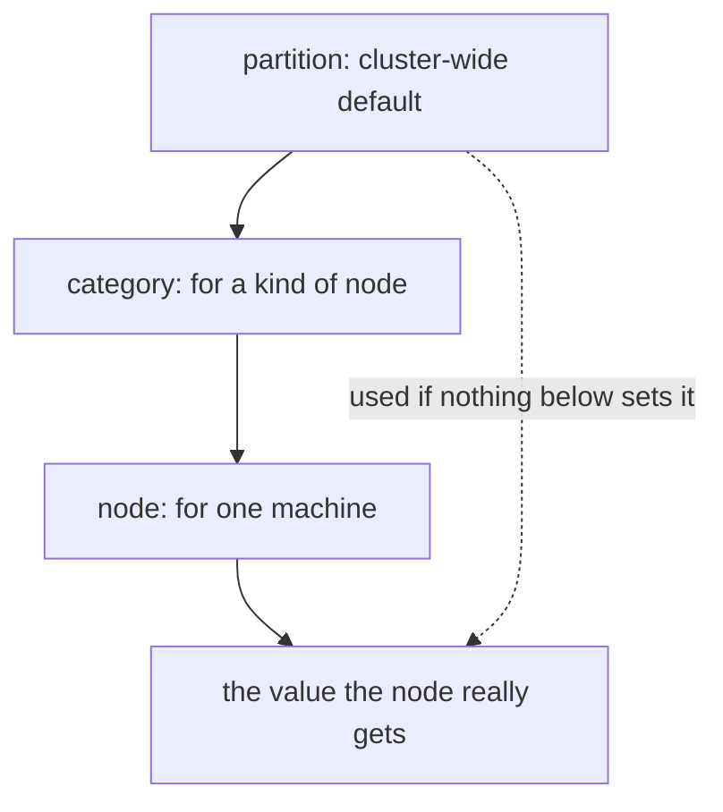

# 8.3 Cluster configuration: networks, nodes and categories

| | |
|---|---|
| Level | Beginner to intermediate |
| Priority tier | 1 |
| Lab venue | Laptop |
| Part | Part 8: NVIDIA Base Command Manager |
| Status | Drafted (`netconf_lab.py`: 67 checks pass; cluster commands **untested** on live BCM) |

## Why this matters for AI infrastructure

Picture a GPU node that resolves names differently from its neighbours. Nothing has crashed, and the node still boots. Someone changed a setting at one level when the change belonged at another. After the install, most of your work in BCM is changing a setting and deciding how far that change should reach. A GPU cluster has several networks: management, compute fabric, storage and BMC. It also has several kinds of node: login, CPU and GPU. Some settings must be identical on hundreds of machines.

The skill is knowing the level at which a setting lives. Set it at that level, and one change reaches the nodes you mean and no others.

## Prerequisites and outcomes

Before you start, read chapter 8.1 on objects and inheritance, and chapter 8.2 on the install. This chapter uses the vocabulary from both.

When you finish, you should be able to find and change the cluster-wide settings, and you will know which of them send you email. You should also explain the default networks and the four places an internal network setting can come from. From there you can configure interfaces, static routes, bridges, VLANs and bonds, and avoid the bond mistakes the manual warns about.

You should also be able to check addresses and connectivity with the built-in tools. You will explain disk layouts, NFS exports and mounts, and services, and say where each one inherits from. Last, you can place devices in racks, set GPU options per node or category, and choose between "let CMDaemon do it" and the three escape routes the manual describes.

## 1. The shape of it: partition, overlay, category, node

Every setting in this chapter lives at one of several levels, and the node receives the final value. The cluster-wide settings live in the **partition** object. In cmsh, you open it with `partition use base`. In Base View, you find it under **Cluster > Settings**.

The manual says these values "can in some cases be overridden by more specific configuration levels, such as (configuration-)overlay-level, category-level, or node-level". That is the inheritance rule from chapter 8.1 again, and it applies to settings such as time zone, name servers and network choices. When you read a setting in this chapter, ask one question: is it a partition, category or node setting?



Follow the arrows from the top. The partition value applies only when nothing below it sets the same setting. Before you change a setting, decide which level should own it.

## 2. Cluster-wide settings (section 3.1)

The settings window holds the name and time settings, the networks and several objects that apply to the whole cluster. The table lists the ones you should know, with the manual's default for each. Learn them early, because they shape the whole cluster before you change anything else.

| Setting | Default in the manual | Notes |
|---|---|---|
| Cluster name | `BCM 11.0 Cluster` | |
| Administrator email | set at install | Receives license, failed-service and failover mails (below) |
| Name servers | none, or from DHCP | `0.0.0.0` means "use what DHCP gave the head node". Use static addresses on a cluster with HA |
| Time servers | `0.pool.ntp.org`, `1.`, `2.` | Set on the head node |
| Time zone | set at install | Can also be set on a node, category, edge site or cloud region |
| Externally visible IP | `0.0.0.0` | Public address, if the cluster has one |
| Default category | `default` | The category new nodes join |
| Default burn configuration | `default-destructive` | Chapter 8.2 |
| Sign installer certificates | `AUTO` | Chapter 8.4 |

The objects that already exist, such as BMC, SNMP and provisioning, sit in the same window. So do the objects you create when you need them, such as SELinux, switch access, ZTP, NetQ, UFM and NMX manager.

The BMC defaults are the user name `bright`, a random password made at install, user ID 4, the administrator privilege, and a power reset delay of 0. BCM sets them only if you configured BMC networks at install. Chapter 8.7 and Part 7 cover those networks.

Suppose the license runs out and nobody reads the root mailbox. BCM sends admin mail to root by default, so the warning goes there unless you change it. To change the address, run `partition use base` and set the property. The manual's cmsh example spells it `administratore-mail`, so use tab completion to confirm the name on your version. Three events send mail. A month before the license expires, BCM sends a warning, and it repeats daily in the last week. BCM also sends mail when a head node service fails on its first ever boot, and when an automatic failover fails. The head node runs Postfix with no relay host set, so set `relayhost` in the partition. Test the setup with `cmsh -c "main; testemail"`.

FIPS mode can be set per node or per category, and the node setting wins. It needs a reboot. You cannot set it on the head node through CMDaemon, because a bad FIPS boot configuration could leave the head node unbootable.

BCM sets `fs.file-max` to 131072 in `/etc/sysctl.d/90-cm-sysctl.conf`. It sets the per-user `nofile` limit to 131072 in `91-cm-limits.conf`. Both apply to the head node and to the image. If you need a different file-max, do not edit BCM's file. Add your own later file, such as `91-site-...conf`, instead. The kernel source gives a rule of thumb of memory in MB times 10, so 128 GB gives 1,280,000. Do not let users compile or test on the head node.

Keep site-specific file-max changes in your own file, and leave BCM's files alone.

## 3. Networks (section 3.2)

### The three default networks

BCM ships with three network objects. Each one has a different job, so know them before you change a network setting. The table lists what each one is for.

| Network | Purpose |
|---|---|
| `internalnet` | Booting nodes and all cluster management traffic; default management network. Also used for storage and jobs if nothing else exists |
| `externalnet` | The link to the outside (corporate or campus). The only network where BCM supports IPv6 |
| `globalnet` | A name-space helper: nodes are named `node001.cm.cluster`, whether local or cloud. **Do not remove it.** Only its domain name is sensibly changed |

Each network object is a layer 3 (IP) network, and several of them can share one layer 2 segment. The manual's table lists the important fields. They are the base address, the netmask bits, the gateway, the domain name, and the MTU, whose default is 1500. The dynamic range is a temporary DHCP range that nodes use while they PXE boot. Node booting says whether this network may be used to boot nodes. Lock down dhcpd refuses new, unknown MAC addresses. Management allowed and layer 3 complete the list. The layer 3 option gives each device a route through a switch, with a `/31` per device and port. A `/30` is possible for some switches. The manual also lists IMEX options for NVIDIA IMEX peer lists on multi-node NVLink systems.

The defaults of the internal network are a base of `10.141.0.0` with 16 bits, and node addresses that start at `10.141.0.1`. The dynamic range runs from `10.141.128.0` to `10.141.143.255`, and the domain is `eth.cluster`. The manual does not recommend the dynamic range, because it can clash with static addresses. `lockdowndhcpd` is how you stop unknown machines from getting a boot address on your cluster network, once all your nodes are known.

### Four places an internal-network value can come from

An internal-network value can come from four places. When you need to know where a value came from, check these four in turn.

1. The **network object** supplies the base address, gateway, MTU and domain.
2. The **cluster object** supplies the management network, node name prefix, digits, default category and default image.
3. The **device interface** supplies its IP, its network and `BOOTIF`.
4. The **node category** supplies the default gateway, management network, name server, time server and search domain.

The default gateway shows the order best. A category default gateway wins. If the category has none, the network's gateway is used. If that gateway is `0.0.0.0`, the DHCP server on the head node hands out `10.141.255.254`, which is the head node's alias. The function `bcm_netconf.default_gateway` implements exactly this order.

### Interfaces

A node's boot interface is `BOOTIF`, and it sits on `internalnet`. Its address is static by default. The manual recommends that, because a node that loses the head node keeps working. Each interface also has `onnetworkpriority`. It decides which interface answers name-resolution queries, and a higher number wins. Each interface type has a default priority.

| Interface type | Default `onnetworkpriority` |
|---|---|
| Bridge | 80 |
| Bond | 70 |
| Physical | 60 |
| VLAN | 50 |
| Alias | 40 |
| Tunnel | 30 |
| Netmap | 20 |
| BMC | 10 |

To add a new interface on a running node, use `device > interfaces`. Then reboot the node, because a reboot activates network changes.

### Names, DNS and search domains

Reach the head node from inside the cluster with the alias `master`. Do not call the head node `master`. To add extra names for an interface, use `additionalhostnames` in the interface. Do not edit `/etc/hosts` for cluster hosts. Let BCM's DNS, named, do that work.

To add your own DNS zones, put them in the include file the manual names. That file is `/etc/named.conf.include` on RHEL 9/10 and SLES 15, and `/etc/bind/named.conf.include` on Ubuntu. BCM does not touch that file. By default, the head node's name server answers only internal queries. The `PublicDNS` directive opens it to outside queries.

CMDaemon writes `/etc/resolv.conf` from four sources, in this order: the global network, other networks, category search domains, and partition search domains. Older glibc versions read only 6 entries. A domain may carry an index, such as `example.com:1`. CMDaemon sorts by index and writes the six lowest. For more than six domains, the manual advises using FQDNs instead of forcing a newer glibc.

### The head node's outside address

The cluster object has no IP address of its own. In a Type 1 network, the cluster's address is the head node's external interface. In Types 2 and 3, the address belongs to an upstream router, which is not part of BCM. After you change external settings, reboot the head node. DHCP for the external interface is possible, but the manual says it is not recommended for production, because DHCP problems make network troubleshooting harder.

### Routes and port forwarding

Static routes are a `staticroutes` submode on a device or a category. Each route has a name, a gateway, a destination and an interface. CMDaemon makes the OS run `ip route add` when the interface comes up.

Port forwarding uses `portforward` in device mode. It opens a port on the head node and forwards traffic to a port on a node, with one `socat` process per rule. The manual's example is `portforward create node001 1234 4321`. The head node's firewall, Shorewall, can block that traffic. `portforward bmc node001` forwards the BMC web port, 443, and the console port. This is the safe way to reach a node's BMC from outside a Type 1 cluster.

### Tools to check the network

Use these built-in tools when an address or a path looks wrong. The table shows what each one is for.

| Tool | Use |
|---|---|
| `routes` (device mode) | Routes of many nodes at once; filter with `awk` to find odd gateways |
| `ipaddresses` and `ipaddresses --check` | Compare the address BCM has configured with the one detected. States: **OK**, **Mismatch**, **Not detected**, **Not configured**. Exits non-zero if any is not OK |
| `connections` | Which ports are listening on which nodes |
| `connectivity` | ICMP pings along each node route on the management network; `--statistics` shows how uniform latencies are |
| `cm-iperf.py` | Bandwidth between node pairs |

Be careful with `cm-iperf.py`. It checks n(n−1)/2 pairs, at about 10 seconds each. The manual says a 1000-node run would take about two months, and the lab computes 58 days. Use `--count`, `-r` for random pairs, and `-p` for parallel threads to keep the run manageable.

Before you run `cm-iperf.py` on a large cluster, decide how many pairs you really need to test.

## 4. Bridges, VLANs and bonds (sections 3.3 to 3.5)

Picture a bond you built the quick way, with the defaults. Node networking often combines bridges, VLANs and bonds on one machine. Each one changes how packets reach the wire, so a small mistake here can take a node off the network. Start with the three building blocks, then read the rules the manual warns about.

A bridge, named `br<number>`, joins network segments at layer 2. Its member interfaces must have an empty IP and an empty network. A VLAN is added with `add vlan BOOTIF.1` in the interfaces submode, and then you set its network and IP. A bond is added with `add bond bond0`. You then set its network, IP, `mode` and `interfaces`. Bonds come in seven modes, and mode 0 is the default.

| Mode | Name |
|---|---|
| 0 | balance-rr (the default) |
| 1 | active-backup |
| 2 | balance-xor |
| 3 | broadcast |
| 4 | 802.3ad |
| 5 | balance-tlb |
| 6 | balance-alb |

Set the mode with the mode property, not as an option. A commit with `mode=` inside the options fails validation.

Five rules trip people up, and all of them come from the manual.

1. The provisioning interface cannot be a member of a bond. A bond can, however, be the provisioning interface, with one member used for PXE.
2. For failover bonds, `miimon` is off by default, so set it. `miimon=100` is the common value.
3. On a bonded HA head node, rename the shared alias interfaces from `eth0:0` to `bond0:0`. Also change the head node's provisioning interface name to the bond.
4. In BCM 11, the node installer accepts any MAC address of a bonded interface when it identifies a node.
5. The bonding kernel module must be in the node's software image for regular nodes.

The function `bcm_netconf.validate_interfaces` checks these rules for you.

### 4.1 InfiniBand interfaces, `mlxconfig`, and subnet managers

In an AI cluster, Ethernet usually carries management and often storage. InfiniBand, or RoCE, carries the GPU-to-GPU collectives that Part 12 covers. Setting up InfiniBand in BCM involves five areas, and each one depends on the one before it.

The first area is the OFED packages. By default, BCM installs the Linux distribution's OFED packages on the head node and in the software images. If InfiniBand was enabled during install, BCM also writes `/etc/rdma/modules/infiniband.conf` and `rdma.conf` automatically. You can replace the distribution OFED with NVIDIA DOCA Mellanox OFED, for the whole cluster or for specific images, using `cm-doca-ofed-install.sh`. Chapters 8.2 and 8.14 describe that script. To verify a running node, run `ibstat`. You want to see `State: Active` and `Physical state: LinkUp`.

The second area is the Mellanox adapter settings, which you manage with `mlxconfig`. The `mlxconfig` command in `device` mode inspects and sets ConnectX adapter firmware parameters. Examples include `mlxconfig node001 --adapters`, `--interface ib0`, and `--pci-address 0000:03:00.0 --port 1`, with `--detail-level 1` for more detail. To change a setting immediately, use `--set link_type=ETH` or `--set link_type_p1=ETH`. Some changes stay `pending` until the node reboots.

For persistent adapter settings, declare them as `MLX_` fields in `extra_values`. Use `set -e MLX_<field> <value>` on a category, a node or an interface. When the same field is set at more than one level, the precedence is:

```text
category.extra_values < node.extra_values < interface.extra_values
```

The interface setting wins over the node setting, and the node setting wins over the category setting. Category and node settings apply to every discovered Mellanox adapter on the node, which the manual shows as `*`. An interface setting applies to that one interface. For a VLAN or bond interface, BCM resolves the setting to the underlying physical interfaces. Boolean values `true` and `false` go to `mlxconfig` as `1` and `0`. Reconciliation is idempotent. If the current or pending value already matches, BCM does nothing. To see the resolved policy without querying the node, run `mlxconfig node001 --desired`.

The third area is the subnet manager. Every InfiniBand subnet needs at least one active subnet manager, which is `opensm`, or `opensmd` on SLES. The manual recommends running two subnet managers per subnet. One becomes active, and the other stays passive for failover. On large clusters, use dedicated nodes or managed switches for them. You can start a subnet manager through CMDaemon in one of two ways. The first is to assign the role with `cmsh -c "device roles <node>; assign subnetmanager; commit"`, or in Base View under `Devices > All Devices > <node> > Settings > Roles > + Add > [SubnetManagerRole]`. The second is to add the service in the `services` submode with `add opensm; set autostart yes; set monitored yes; commit`.

The fourth area is IP over InfiniBand, which the manual calls `ibnet`. The recommended defaults for the network object are `name = ibnet`, `domainname = ib.cluster`, `type = internal`, `baseaddress = 10.149.0.0`, and `netmaskbits = 16`, which is `/16`. By default, IPoIB interfaces use datagram mode. Datagram mode scales better, and its MTU goes up to 4k. Set `set connectedmode yes` on `interfaces[ib0]` to switch to connected mode, which allows an MTU up to 64k. If nodes PXE-boot or provision over InfiniBand, as chapter 8.4 describes, the file `/cm/node-installer/scripts/ipoib_mode` must match. Run `echo datagram > /cm/node-installer/scripts/ipoib_mode` to set it. To add `ib0` across many nodes at once, use `addinterface -n node001..node150 physical ib0 ibnet 10.149.0.1`. Give the head node `10.149.255.254`, and reboot the head node to activate it.

The fifth area is checking connectivity. `ping node015.ib.cluster` tests reachability. For bandwidth and latency, use the Intel MPI Benchmark, IMB, which is pre-installed at `/cm/shared/apps/imb/current`. Run `./setup.sh` first, then `module load openmpi/gcc`, and then `mpirun -np 2 -machinefile ../nodes IMB-MPI1 PingPong`.

For each InfiniBand subnet, decide where its two subnet managers will run before you build the fabric.

### 4.2 Switches, SNMP, Cumulus Linux, ZTP, NetQ, UFM, and `device` helpers

BCM also manages network switches, fabric managers and a few special devices. The paragraphs below cover switch ports and SNMP first, then Cumulus Linux switches, then the commands for finding ports and nodes.

Switch ports have one legacy trap. Setting `switchports` at node level, as in `set node003 switchports switch01:1`, still works, but it breaks when a node has several interfaces. Since BCM 10, assign `switchports` inside the node's interfaces submode instead, as in `interfaces; set eth1 switchports switch01:2`. That form supports bonding. It is also required when CMDaemon Lite manages a Cumulus switch. APC PDUs must have `set powercontrol apc`, or BCM ignores their port list by default.

SNMP is enabled by default, with `disablesnmp = no`. Partition settings flow down to the devices, and `snmpsettings -s` shows the effective values. The default community strings are `readstring = public` and `writestring = private`. Versions `v1`, `v2c` and `v3` are supported. The `file` option exists only for internal SNMP-walk debugging. In `v3`, `authenticationprotocol` defaults to `md5` and can be set to `sha`. `privacyprotocol` defaults to `des` and can be set to `aes`. Assigning the `snmptrap` role to a node runs `snmptrapd`, with the defaults `Add services = yes`, `Event = yes`, `Mail = yes`, `Access = public` and `Server = localhost`.

Cumulus Linux switches boot through ONIE, which wipes any existing switch OS image. They then receive their day-0 setup through ZTP. The ZTP address is `http://10.141.255.254:8080/switch/<name>/cumulus-ztp.sh`. BCM generates that script on boot from `cumulus-ztp.sh`, or immediately when you run `initialize`. Put Cumulus images, which are `.bin` files, in `/cm/local/apps/cmd/etc/htdocs/switch/images/`.

Authentication and the daemon you choose depend on the cluster. DGX SuperPODs run full CMDaemon with certificate authentication on Cumulus switches. On most other clusters, CMDaemon Lite is the recommended choice. Enable it with `set hasclientdaemon yes`. It uses the credentials in `accesssettings`, whose defaults are `username = cumulus`, `Rest port = 8765`, `Update in ztp = no` and `Update in NV = no`. A password change takes effect when the switch reboots. The old discovery script, `/cm/local/apps/cmd/scripts/cm-cumulus-switch.py`, is deprecated. You need it only for Cumulus Linux 4, not for Cumulus 5 or later.

The `nvconfiguration` submode has three `nvconfigurationmode` options. Each one decides where the switch's configuration commands come from.

- `auto`: BCM's settings become `auto`-type `nv set` commands. They cover the hostname, timezone, SNMP, NTP, DNS and syslog, which point at `10.141.255.254`, and they set `br_default` to vlan-aware. You can add `manual`-type `nv set` commands as well. Run `apply` to push the commands to the switch. Only `manual`-type commands can be deleted, with `nv del`.
- `manual`: Running `manual` inside `nvconfiguration` copies the `auto` stack into the `manual` stack. You can then edit or delete any command, for example with `nv del 1-2`, followed by `commit` and `apply`. The `auto` commands are ignored in this mode.
- `file`: This mode uses a YAML file. Set it with `set nvconfigurationfile startup.yaml`, and place the file in `/cm/local/apps/cmd/etc/htdocs/switch/<switch>/`. The file is applied over ZTP, or through `cm-import-startup` with `cm-startup.yaml` on DGX SuperPODs. `apply` is not used in `file` mode.

The `ztpsettings` defaults are `checkimageonboot = yes`, `runztponeachboot = yes`, `installlitedaemon = yes`, `enableapi = no` and `enableexternalaccessapi = no`. All three SSH key files are unset by default. They are `authorizedkeyfileroot`, `authorizedkeyfilecumulus` for the Cumulus API user, and `authorizedkeyfileadmin` for the NVLink switch API user.

Uplinks need care. A port that connects to another switch must be marked as an uplink, as in `set switch01 uplinks 15 16`. That tells CMDaemon to ignore the port during MAC-to-port learning. Otherwise, transit traffic corrupts the node port mapping.

Five commands help you trace ports and nodes. `showport [-s switch01] <MAC>` finds the `switch:port` for a MAC address. `finddevicebyswitchport switch01:1` does the reverse. For a breakout port, use `switch01:1s1`. With one port it prints only the hostname, and with several ports each line starts with `switch:port`. `switchoverview` lists port status, speed, the uplink flag and the MACs that SNMP detected. `setmacviaswitchport [--dry-run] [-f|--force] [--index N]` fills device MACs from the switch port tables. It refuses to overwrite an existing MAC unless you give `--force`. `checkfactorydefaultpassword [--update]` tests factory switch passwords, and with `--update` it replaces them. If switch firmware is buggy and you want to disable port-based node identification, run `clear switchports`.

A few helper commands cover nodes and DPUs. `nodeoverview` shows uptime, load, memory, WLM slots, and NIC and disk use. `minimalconfig` shows the exact category, overlays, head nodes and data producers applied to a node. `checkremotemount -n node001 /cm/shared` checks a remote mount, and it takes the options `--file`, `-f` and `--clear`. `proxysettings` and `selinuxsettings` are also available. The `selinuxsettings` defaults are `Initialize = yes`, `Mode = permissive`, `Policy = targeted`, and `Allow NFS home directories = yes`. `additionalnodeinformation` runs custom scripts. You register them with `cm-manipulate-advanced-config.py -g "AdditionalNodeInfo=info-1,info-2"`, and point each one at a file with `-g "info-1=/cm/shared/info-1.sh"`. Add `-a` to run them on the active head node.

`remotedaemon install|remove <device>` installs or removes CMDaemon on an OS that is already running, without reprovisioning. Its main use is a BlueField DPU whose Ubuntu OS was already installed by DPF. The device must already be defined in BCM as a compute node, must run Ubuntu, and must be reachable from the active head node over SSH using `accesssettings`. It must also reach the active head node over HTTPS. Use `-f` or `--force` to reinstall. Add `--purge-repo` when you remove the daemon, to remove the BCM repo as well.

NetQ and UFM connect through `partition[base] -> netqsettings` and `ufmsettings`. Their defaults are `Port = 443` and `Verify SSL = no`. You also set a server, a username, a password, certificates and Prometheus metric forwarders. Once connected, NetQ and UFM telemetry become BCM measurables. To sample any Prometheus exporter, such as UFM on `http://<ip>:9001/metrics`, add it with `monitoring setup -> add prometheus UFM` and set `urls`. Older exporters that require HTTP GET need `-e NoPostAllowed yes`. Then set `nodeexecutionfilters -> active`, so that only the active head node polls the exporter. The reverse direction also exists. `EnablePrometheusExporterService` in `cmd.conf` makes CMDaemon export its own Prometheus metrics.

For hardware that does not fit the standard model, BCM supports `custompowerscript`, `custompingscript` (which can use `$CMD_IP`), `customremoteconsolescript`, and `sysinfo` custom scripts. The `retrydelay` default is `30` s, and its minimum is `5` s. Use `triggersysinfo` to run the `sysinfo` script across nodes.

Before you bring a switch under BCM, mark its uplinks. Otherwise, transit traffic will corrupt the node port mapping.

## 5. Disks, NFS and services

Disks, NFS exports and services look like three separate topics, but they follow the same inheritance rule as everything else. A category can carry them, and a node can override them. Knowing which level owns each one tells you where to make the change.

Section 3.13 of the manual covers disk layouts. A disk layout is an XML file stored in the CMDaemon database. The files in `.../htdocs/disk-setup/` are only templates. A category's layout is inherited by its nodes, and a node can have its own layout, which overrides the category's. Running `clear` on the node returns it to the category's layout. The templates cover the default layout, hardware or software RAID, LVM, diskless and semi-diskless setups. To switch a node to diskless, use the template `slave-diskless.xml` and reboot. The node then runs from RAM. BCM cannot change a head node's disk layout after install. You manage that with ordinary Linux administration, and you should keep backups.

Section 3.14.1 covers NFS exports. On the head node, `fsexports` lists the exports, with their name, path, hosts and write setting. Three exports have been built in since BCM 9.0, and they come with the `headnode` role. They are `/var/spool/burn`, `/home` and `/cm/shared`. You cannot simply remove them. Instead, set `disableautomaticexports` in the headnode role. Your own exports can be removed, or disabled.

Section 3.14.2 covers NFS mounts. You set them with `fsmounts` on a category or a node. Each mount has a device, such as `basecm11:/modeldata`, a mount point, a filesystem and options. Add `_netdev` to the options to make the mount wait for the network. A node shows its category's mounts marked `[default]`, with the category name beside them. To remove a category mount, remove it in the category, not on the node. A removed mount is not unmounted until the node reboots. To give some nodes a mount and not others, put those nodes in another category, or set the mount per node. Mount order matters, because a parent must mount before its subtree. Use `up` and `down` to set the order. Autofs mounts must be added to `excludelistupdate`, or an image update can wipe them. Chapter 8.4 explains why.

Diskless nodes can mount rarely used subtrees from the head node's image over NFS, which saves RAM. The manual's example frees about 440 MB this way. It also notes that BCM's default NFS versions are a mix of 3 and 4, as of its August 2025 date, and it gives a procedure to move to version 4 only.

Section 3.15 covers services. Services such as `cups` and `autofs` can be added in the `services` submode of a device or a category. Each service has three settings to decide. `monitored` means BCM watches the service. `autostart` tells BCM to restart a failed service. `runif` controls HA behaviour, with the values active, passive, always and preferpassive. If `autostart` is on and you stop the service through BCM, BCM will not restart it until you start it through BCM again. A service's own configuration stays with the service and the OS. `systemctl disable` controls whether the service starts at boot.

Before you mount something on a category, check that every node in that category should have it.

## 6. Racks and chassis (3.16)

A rack is 42U by default. You place a device in a rack with `set rack` and `set deviceposition`. To fill positions in bulk, use `addrackposition -n node001..node010 rack2`, which takes the first free slots. The `--position` and `--force` options refine that command. The position you set is the top of the device.

Chassis, such as blade enclosures, have members and a `chassisposition`. That holds the slot, the position and the width. `rackoverview` shows the UP, DOWN and CLOSED counts, the cores, the GPUs and the power. For NVIDIA racks, it also shows NVLink switches and power shelves. The model `bcm_netconf.Rack` shows the placement rules.

Check the free positions before you add devices.

## 7. GPU settings (3.17)

GPU settings tell BCM how to treat each GPU on a node. You can set them on a node or on a category. Start with the everyday options, then read the MIG rules, because MIG changes the GPU itself.

In `gpusettings`, add `nvidia 1-3` or `all` to target a range of GPU slots. A range may be a single number, `0-2`, `1,3-5`, or `all` or `*`. If the hardware supports them, the options are `clockspeeds`, `clocksyncboostmode`, `computemode`, `eccmode` and `powerlimit`. The `computemode` values are default, exclusive thread, exclusive process and prohibited. The `powerlimit` values are `min`, `max`, a number, or `default`. No value means the hardware default, and a node value overrides a category value.

GPU metrics need the `cuda-dcgm` package installed. The command `updatedevicepowerconfig` sets power limits for GPUs or CPUs, and it accepts `--dry-run`. Setting a limit both there and in `gpusettings` may cause a conflict.

BCM can also manage Multi-Instance GPU, or MIG, which splits a physical GPU into slices. Chapter 10.24 in Part 10 covers the GPU internals. Several rules matter here, and each one below comes from the manual.

Use only one MIG management tool. If you use the DGX native `nvidia-migmanager.service` or the Kubernetes GPU Operator's `nvidia-mig-manager`, BCM leaves MIG alone. Never run several MIG managers at the same time.

Utilization and `gpuprofiling` need care. Once MIG is enabled on a GPU, the full physical GPU is no longer available as a device, and standard GPU utilization metrics stop by default. You can still watch the physical GPU profiling metrics in `device` mode, with `gpuprofiling show` and `gpuprofiling watch 1003`. For example, `1002` is `gpu_profiling_sm_active` and `1003` is `gpu_profiling_sm_occupancy`. Be careful, because this may affect performance.

The slice sizes are fixed on Ampere and newer GPUs. The Ampere GA100 needs compute capability 8.0, CUDA 11+, and driver `450.80.02+`. A memory slice is 1/8th of the physical GPU memory. An SM slice is 1/7th of the physical SMs. A GPU slice combines one memory slice with one SM slice, and a physical GPU has at most 7 GPU slices. Slices form a GPU instance, GI, which holds one or more compute instances, CIs. If you leave any of the 7 GPU slices unallocated, those SMs go to waste.

Enabling MIG is done with the `mig` command in `device` mode. `mig status` shows the `Active` and `Pending` state for each GPU. `mig enable [gpu-list]` and `mig disable [gpu-list]` set the `Pending` state, and they accept node-list syntax such as `3,5-7`. On A100 GPUs, a pending MIG change needs a node reboot before it becomes active. On H100 and newer GPUs, no reboot is needed.

Profile names follow the pattern `<slices>g.<mem>gb`, with `+me` added for media extensions. Examples are `1g.5gb`, `2g.10gb`, `3g.20gb`, `4g.20gb` and `7g.40gb`. Use `mig profiles [gpu]` to list the profiles your GPU supports. To make a profile list persistent, set `migprofiles` in `gpusettings -> use nvidia:0 -> set migprofiles <spec>; commit`. Then run `mig apply`. Until you run `mig apply`, `mig show` stays empty. A command such as `mig apply --profile 1g.5gb,2g.10gb` applies profiles immediately, but the `--profile` option is not persistent, and it is lost on reboot.

The `<N>*<profile>` syntax repeats a GPU instance. For example, `7*1g.5gb` fills all seven slices. A mixed list such as `5*1g.5gb,2g.10gb` uses all 7 GPU slices. The list `2*1g.5gb,2g.10gb` wastes 3 of the 7 slices. Appending `:<k>` creates a compute instance of `k+1` slices. The index starts at 0, so `:0` gives `1c.<profile>`, and `:1` gives `2c.<profile>`. The highest index, `:N-1`, equals `<profile>`. For example, `2g.10gb:0:0` expands to `2g.10gb:1c.2g.10gb:1c.2g.10gb`. That creates one 2-slice GPU instance holding two 1-slice compute instances. Hardware restrictions still apply. On `A100-PCIE-40GB`, `7g.40gb:3` is allowed, but `7g.40gb:4` is not.

Overallocation is easy to miss. If a profile list asks for more than 7 GPU slices, BCM does not reject the whole string. Instead, the slices that come after the budget of 7 is used up are silently left unallocated. Take `5*1g.5gb,2g.10gb`. Five `1g` slices and one `2g` slice add up to 7, so everything fits. Now take `6*1g.5gb,2g.10gb`. The six `1g.5gb` instances use 6 slices, and the `2g.10gb` needs 2 more, which makes 6 + 2 = 8 in total. BCM allocates the six `1g.5gb` instances and none of the `2g.10gb` instance. The same thing happens with `7*1g.5gb,2g.10gb`, which allocates seven `1g.5gb` instances and no `2g.10gb`. It also happens with `70*1g.5gb,2g.10gb`, which allocates 7 `1g.5gb` instances and no `2g.10gb`.

Before you apply a MIG profile list, add up the GPU slices and make sure the total is 7 or less.

## 8. Going beyond CMDaemon: the manual's order of preference

Sometimes CMDaemon has no setting for what you need. Section 3.20 of the manual ranks the ways to go beyond it, and the first option is always the preferred one. The reason is maintenance. The further you move away from CMDaemon, the more you have to track yourself.

1. **Configure through CMDaemon** in cmsh or Base View. CMDaemon then tracks the state.
2. **Use a different image** for a category or a node. You clone the image, clone the category, set the image, and move the nodes.
3. **Place files through the image.** Put them in `/cm/images/<image>/cm/conf/category/<category>/<path>`, or in `.../node/<node>/<path>`, or in `.../node/<MAC with dashes>/<path>`. BCM copies them just before the node installer's finalize stage. A node-level file wins over a category-level file.
4. **Use `FrozenFile`** to stop CMDaemon rewriting a file. The manual says to avoid it where possible.
5. **Use `initialize` and `finalize` scripts.** They run at the initrd stage, before CMDaemon on the node starts. They suit a setting that the node installer overwrites on every boot. The manual's example appends an `ETHTOOL_OPTS` line to an interface file.
6. **Use a shared directory** for the software the nodes run.

Start at item 1, and move down the list only when CMDaemon has no setting for the job.

## 9. Common first mistakes

These ten mistakes come up again and again in the first weeks with BCM. Read the list before you change a live cluster.

1. Changing one node when the category should change, or the reverse.
2. Editing `/etc/hosts` or `/etc/resolv.conf` by hand, instead of changing the interface or network object.
3. Making the provisioning interface a bond member.
4. Forgetting `miimon` on a failover bond.
5. Removing `globalnet`, or a built-in NFS export.
6. Setting a node's mount when the category should carry it. The mount then cannot be removed from the node view.
7. Using DHCP for the head node's external interface in production.
8. Putting static node addresses in the dynamic DHCP range.
9. Freezing files because it is quick.
10. Running `cm-iperf.py` on a big cluster with its defaults.

When a change feels quick, check its level first, because most of these mistakes start with the wrong level.

## Exercises

Work through these on the lab machine. Each one asks you to apply a rule from this chapter.

1. Run `python3 netconf_lab.py`. Choose four of the checks, and explain each rule in your own words.
2. Plan a two-network cluster. The management network is `10.141.0.0/16`, and the storage network is `10.150.0.0/16`, with 64 nodes. Write down which object holds each setting.
3. Use `Rack` to place 18 nodes, a switch and a PDU in one rack. What does `--force` risk?
4. For each change, decide whether it belongs in the category or on one node. The changes are: a different disk layout for one broken node; an NFS mount for all GPU nodes; a power limit on GPU 3 of one node; and a static route to a license server for everyone.
5. Explain why the manual calls the dynamic DHCP range not recommended.
6. Write the cmsh commands that bond `eth1` and `eth2` as `bond0` in active-backup mode with `miimon=100`. Base them on the manual's examples. You will not test them on a live system.

## 11. Interview angles

Interviewers often ask questions like these. Each answer names the fact worth remembering.

- "Where does a node get its default gateway?" It comes from the category's default gateway first, then from the network's gateway, and finally from the head node alias `10.141.255.254`, which DHCP hands out.
- "Why is the provisioning interface not allowed in a bond?" The manual states the rule as a restriction and does not give the reason. A bond can itself be the provisioning interface. In that case, the node installer brings up the bond and all its members before provisioning.
- "How do you expose a node's service to the outside on a Type 1 cluster?" Use `portforward` on the head node, which runs socat, and keep an eye on the firewall.
- "A node's configured IP and its real IP differ. How do you find it fleet-wide?" Run `ipaddresses --check`.
- "You need a setting BCM does not model. What are your options and which is best?" Image file placement, or initialize and finalize scripts, come before `FrozenFile`.

## Checkpoint questions (20)

<details>
<summary>1. What is the `partition` object in BCM, and how do you open it in `cmsh` and Base View?</summary>

The `partition` object, named `base`, holds the cluster-wide settings. Those include the cluster name, the admin email, the DNS and NTP servers, the default category, and the BMC, SNMP, UFM and NetQ settings. In `cmsh`, run **`partition use base`**. In Base View, open **Cluster > Settings**.
</details>

<details>
<summary>2. Which three cluster events cause BCM to automatically send an email to the administrator?</summary>

1. **License expiration warning:** BCM sends it one month before the license expires, and daily during the final week.
2. **First-boot service failure:** A head-node service fails on its very first boot after installation.
3. **Failed automatic HA failover:** An automatic failover between the active and passive head nodes fails.
</details>

<details>
<summary>3. Why can FIPS mode be enabled on regular nodes and categories through CMDaemon, but NOT on the head node through CMDaemon?</summary>

A wrong FIPS kernel or boot configuration could leave the head node unbootable. If that happened, the whole cluster management plane would go down with it.
</details>

<details>
<summary>4. What are the three default network objects (`internalnet`, `externalnet`, `globalnet`) and why must `globalnet` never be deleted?</summary>

- **`internalnet` (`10.141.0.0/16`, `eth.cluster`):** This is the default network for PXE-booting nodes and internal cluster management.
- **`externalnet`:** It connects the head node to the corporate or campus network. It is the only network where BCM supports IPv6.
- **`globalnet` (`cm.cluster`):** It gives the cluster one namespace, such as `node001.cm.cluster`, across local and cloud nodes. Never remove it.
</details>

<details>
<summary>5. What does `lockdowndhcpd` on a network object do?</summary>

After every legitimate node's MAC address is recorded in BCM, `lockdowndhcpd` tells `dhcpd` to refuse leases to unknown MAC addresses. That stops rogue or unconfigured machines from netbooting on the cluster network.
</details>

<details>
<summary>6. Name the four BCM object levels from which an internal-network parameter can originate.</summary>

1. The **network object** (`internalnet`: base address, netmask, gateway, MTU, domain).
2. The **cluster / partition object** (`base`: management network, naming prefix and digits, default category).
3. The **device interface** (`interfaces[BOOTIF]`: IP address and network binding).
4. The **node category** (default gateway, management network, DNS and NTP servers, search domains).
</details>

<details>
<summary>7. In what exact fallback order is a regular node's default gateway determined?</summary>

First, the category's default gateway is used, if one is set. If not, the network object's gateway is used. If that gateway is `0.0.0.0`, DHCP hands out **`10.141.255.254`**, the head node's internal alias.
</details>

<details>
<summary>8. What does `onnetworkpriority` on a node interface control, and what is the default priority order across interface types?</summary>

It decides which interface IP is returned when the node's primary hostname is resolved. The highest number wins. The defaults, from highest to lowest, are **bridge (`80`) $>$ bond (`70`) $>$ physical (`60`) $>$ VLAN (`50`) $>$ alias (`40`) $>$ tunnel (`30`) $>$ netmap (`20`) $>$ BMC (`10`)**.
</details>

<details>
<summary>9. How many search domains in `/etc/resolv.conf` do older `glibc` resolvers read, and how does BCM's `:index` suffix order them?</summary>

Older `glibc` resolvers read only the first **`6`** search domains. When you add an index, such as `example.com:1`, CMDaemon sorts the search domains by ascending index. It then writes the six lowest-indexed domains.
</details>

<details>
<summary>10. How do you add custom DNS zones to the head node's BIND server without `CMDaemon` overwriting them?</summary>

Put custom zones in **`/etc/named.conf.include`** on RHEL, Rocky and SLES, or in **`/etc/bind/named.conf.include`** on Ubuntu. CMDaemon includes that file automatically and never overwrites it.
</details>

<details>
<summary>11. How does `portforward` in `cmsh` `device` mode work, and what does `portforward bmc node001` do?</summary>

`portforward` starts a `socat` listener on the head node. The listener forwards traffic to a port on an internal node, as in `portforward create node001 1234 4321`. The head node's Shorewall or `nftables` firewall still applies. `portforward bmc node001` forwards the node's BMC HTTPS port, 443, and its console port. That lets engineers reach an internal BMC on a Type-1 cluster from outside.
</details>

<details>
<summary>12. What are the four status values reported by `ipaddresses --check` in `cmsh` `device` mode?</summary>

**`OK`** means the configured IP matches the live IP. **`Mismatch`** means the live IP differs from the BCM configuration. **`Not detected`** means the IP is configured in BCM but not seen on the node. **`Not configured`** means the IP is live on the node but missing from BCM.
</details>

<details>
<summary>13. How many node pairs does `cm-iperf.py` test by default across $n$ nodes, and why must you pass `--count` or `-r` on a 1,000-node cluster?</summary>

It tests all **$n(n - 1) / 2$** pairs, at `~10` seconds per pair. On `1,000` nodes, that is nearly half a million pairs, or about `~58` days of continuous running. So you must use `-r` for a random sample, `--count`, and `-p` for parallel threads.
</details>

<details>
<summary>14. In BCM interface bonding, which mode is default (`0`), which is `active-backup` (`1`), and why does putting `mode=` inside bond `options` fail validation?</summary>

Mode `0` (`balance-rr`) is the default. Mode `1` is `active-backup`. Mode `4` is `802.3ad`, which is LACP. In BCM, you set the bonding mode with the dedicated `mode` property, as in `set mode 1`. Do not put it inside the free-form `options` string, where you set `miimon=100`.
</details>

<details>
<summary>15. Can a node's provisioning interface (`BOOTIF`) be a slave member of a bond? Can `bond0` itself be the provisioning interface?</summary>

A physical interface named as the `provisioninginterface` cannot be a member of a bond. However, `bond0` itself can be set as the `provisioninginterface`. In that case, the node installer brings up `bond0` and its member NICs during boot.
</details>

<details>
<summary>16. When configuring persistent Mellanox ConnectX parameters (`MLX_<field>`) in `extra_values`, what is the precedence order across BCM objects, and how does IPoIB `datagram` mode differ from `connected` mode?</summary>

The precedence is **`category.extra_values < node.extra_values < interface.extra_values`**. For IPoIB on `ibnet`, which defaults to `10.149.0.0/16`, datagram mode is the default. It scales better across many peers, and its MTU goes up to `4k`, which is `4092`. Connected mode, set with `set connectedmode yes`, allows an MTU up to `64k`, which is `65520`.
</details>

<details>
<summary>17. Where are node disk layouts stored in BCM, and why can't BCM modify the head node's disk layout after installation?</summary>

BCM stores disk layouts as XML documents inside the **`CMDaemon` database**. The database is seeded from templates in `.../htdocs/disk-setup/`, such as `slave-diskless.xml`. A regular node's layout is applied when `node-installer` partitions the node at boot. The head node is already running and never goes through `node-installer`, so BCM cannot change its layout after installation.
</details>

<details>
<summary>18. Which three NFS exports are built into the `headnode` role since BCM 9.0, and how do you remove a category-inherited `fsmount` from a node?</summary>

The three built-in head-node exports are **`/var/spool/burn`**, **`/home`** and **`/cm/shared`**. They are controlled by `disableautomaticexports`. A category `fsmount` marked `[default]` cannot be deleted on the node object. Instead, remove it in the category, or move the node to a different category.
</details>

<details>
<summary>19. In BCM's Multi-Instance GPU (`mig`) management (§3.17.3), how many GPU slices exist on an A100/H100 GPU, which GPU generation requires a reboot to enable MIG, and what happens if `migprofiles` specifies more than 7 slices (e.g., `6*1g.5gb,2g.10gb`)?</summary>

An A100 or H100 has **7 GPU slices**, made of 7 SM slices and 8 memory slices. Enabling or disabling MIG needs a node reboot on A100, but not on H100 or newer GPUs. If `migprofiles` asks for more than 7 slices, BCM silently drops the slices that come after the budget of 7 is used up. The example `6*1g.5gb,2g.10gb` asks for 6 + 2 = 8 slices, so BCM allocates six `1g.5gb` instances and no `2g.10gb` instance.
</details>

<details>
<summary>20. List the manual's 6-level order of preference (§3.20) when you need to configure a node beyond standard CMDaemon properties.</summary>

1. **Configure through `CMDaemon`** in `cmsh` or Base View whenever a native property exists.
2. **Use a cloned or separate software image** for the category or node.
3. **Place image files** under `/cm/images/<img_name>/cm/conf/category/<cat>/<path>` or `.../node/<node>/<path>`. A node-level file wins over a category-level file.
4. **Use the `FrozenFile` directive** in `cmd.conf`. Avoid it when possible.
5. **Use `initialize` and `finalize` scripts**, which run during the pre-init node-installer stage.
6. **Use the shared directory** (`/cm/shared`) for site scripts and software.
</details>

## Sources and review notes

- **BCM 11 Administrator Manual, chapter 3:** 3.1 (cluster settings, email, FIPS, open files), 3.2 (networks, interfaces, DNS, routes, port forwarding, tools), 3.3 (bridges), 3.4 (VLANs, the cmsh part), 3.5 (bonds), 3.6 (InfiniBand OFED, `mlxconfig` and `MLX_` extra_values precedence, subnet managers, `ibnet` datagram vs connected mode, IMB PingPong), 3.8 (switches, interface-level `switchports`, APC PDUs, SNMP v1/v2c/v3 and `snmptrap` role), 3.9 (Cumulus switches, ONIE, ZTP, CMDaemon Lite vs YAML preconfiguration, `nvconfigurationmode` `auto`/`manual`/`file`, `uplinks`, `showport`, `finddevicebyswitchport`, `switchoverview`, `setmacviaswitchport`, `checkfactorydefaultpassword`), 3.10 (`nodeoverview`, `additionalnodeinformation`, `minimalconfig`, `checkremotemount`, `proxysettings`, `selinuxsettings`, `remotedaemon` for DPUs), 3.11 (NetQ settings), 3.12 (UFM settings), 3.13 (disk layouts), 3.14 (NFS), 3.15 (services, read in part), 3.16 (racks, chassis), 3.17.1 to 3.17.3 (GPU settings and full MIG configuration commands, `gpuprofiling`, `:k` colon syntax, and overallocation behavior; AMD GPUs skipped), 3.18 (sampling a Prometheus exporter), 3.19 (custom scripts), 3.20 (beyond CMDaemon).
- **Not read:** 3.7 (BMC; read for 8.7), 3.21 (saving configuration files), appendices A and E (Appendix C read for 8.1 and 8.12; Appendix D LUKS part read in 8.16 search).
- **NVIDIA-DevOps notes**, volume 10 chapter 2 and chapter 13: read in full (see `planning/ledgers/8-01.md` and `planning/ledgers/8-03.md`).
- **Run here:** `netconf_lab.py` (67 checks): networks and ranges, gateway order, search domains, interface priority, `ipaddresses --check`, `cm-iperf` arithmetic, bond, bridge and VLAN rules, disk and mount inheritance, image file placement, racks, GPU ranges and settings, plus (`added in the gap pass`) `mlxconfig` `MLX_` precedence, IPoIB datagram/connected MTU, Cumulus `nvconfigurationmode`, `setmacviaswitchport`, `remotedaemon` DPU prerequisites, and MIG profile parsing, colon syntax, reboot rules, and overallocation truncation.
- **My own choices, not the manual's:** where unindexed search domains land after indexed ones; that a rack device of height *h* occupies *h* units counted from its top position; that a node mount for the same mount point as a category mount wins.
- **Not verified:** everything about a real BCM system: command output, version differences, and every IMEX field beyond the manual's description.
