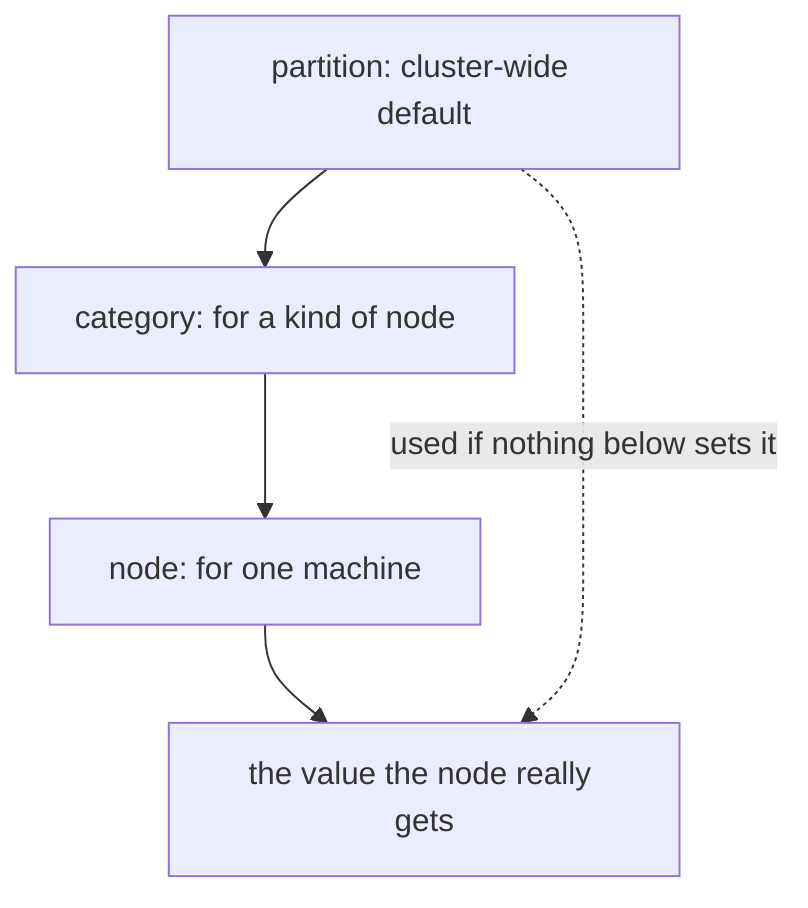

# 8.3 Cluster configuration: networks, nodes and categories

| | |
|---|---|
| Level | Beginner to intermediate |
| Priority tier | 1 |
| Lab venue | Laptop |
| Part | Part 8: NVIDIA Base Command Manager |
| Status | Drafted (`netconf_lab.py`: 67 checks pass; cluster commands **untested** on live BCM) |

## Why this matters for AI infrastructure

After the install, almost everything you do in BCM is "change a setting and decide how far it reaches". A GPU cluster has several networks (management, compute fabric, storage, BMC), several kinds of node (login, CPU, GPU) and settings that must be identical on hundreds of machines. The skill is knowing the level at which a setting lives, so one change reaches the nodes you mean and no others.

## Prerequisites and outcomes

You need chapters 8.1 (objects and inheritance) and 8.2 (install). After this chapter you can:

- find and change the cluster-wide settings, and know which ones email you
- explain the default networks and the four places an internal network setting can come from
- configure interfaces, static routes, bridges, VLANs and bonds, and avoid the bond mistakes the manual warns about
- check addresses and connectivity with the built-in tools
- explain disk layouts, NFS exports and mounts, and services, and where each inherits from
- place devices in racks and set GPU options per node or category
- choose between "let CMDaemon do it" and the three escape routes the manual describes

## 1. The shape of it: partition, overlay, category, node

The cluster-wide settings live in the **partition** object (in cmsh, `partition use base`; in Base View, **Cluster > Settings**). The manual says these values "can in some cases be overridden by more specific configuration levels, such as (configuration-)overlay-level, category-level, or node-level". That is the inheritance rule from chapter 8.1 again, applied to settings such as time zone, name servers and network choices. Whenever you read a setting in this chapter, ask: *partition, category or node?*



## 2. Cluster-wide settings (section 3.1)

The settings window lists name and time settings, networks and several objects. The ones to know:

| Setting | Default in the manual | Notes |
|---|---|---|
| Cluster name | `BCM 11.0 Cluster` | |
| Administrator email | set at install | Receives license, failed-service and failover mails (below) |
| Name servers | none, or from DHCP | `0.0.0.0` means "use what DHCP gave the head node". Use static addresses on a cluster with HA |
| Time servers | `0.pool.ntp.org`, `1.`, `2.` | Set on the head node |
| Time zone | set at install | Can also be set on a node, category, edge site or cloud region |
| Externally visible IP | `0.0.0.0` | Public address, if the cluster has one |
| Default category | `default` | The category new nodes join |
| Default burn configuration | `default-destructive` | Chapter 8.2 |
| Sign installer certificates | `AUTO` | Chapter 8.4 |

Objects that already exist (BMC, SNMP, provisioning) and objects you create when you need them (SELinux, switch access, ZTP, NetQ, UFM, NMX manager) hang off the same window.

**BMC defaults.** User name `bright`, a random password made at install, user ID 4, privilege administrator, power reset delay 0. They are set only if you configured BMC networks at install (chapter 8.7 and Part 7).

**Email.** By default BCM sends admin mail to root. Set the address in `partition use base` (the manual's cmsh example spells the property `administratore-mail`; use tab completion to confirm the name on your version). Three events send mail: **a month before the license expires** (and daily in the last week), **a head node service that fails on its first ever boot**, and **a failed automatic failover**. The head node runs Postfix with no relay host set; set `relayhost` in the partition. Test with `cmsh -c "main; testemail"`.

**FIPS.** FIPS mode can be set per node or per category (node wins), needs a reboot, and **cannot be set on the head node through CMDaemon**, because a bad FIPS boot configuration could leave the head node unbootable.

**Open-file limits.** BCM sets `fs.file-max` to 131072 in `/etc/sysctl.d/90-cm-sysctl.conf` and the per-user `nofile` to 131072 in `91-cm-limits.conf` (head node and the image). To change file-max, add your own later file (`91-site-...conf`) rather than editing BCM's. The kernel source's rule of thumb is memory in MB times 10 (128 GB gives 1,280,000). Do not let users compile or test on the head node.

## 3. Networks (section 3.2)

### The three default networks

| Network | Purpose |
|---|---|
| `internalnet` | Booting nodes and all cluster management traffic; default management network. Also used for storage and jobs if nothing else exists |
| `externalnet` | The link to the outside (corporate or campus). The only network where BCM supports IPv6 |
| `globalnet` | A name-space helper: nodes are named `node001.cm.cluster`, whether local or cloud. **Do not remove it.** Only its domain name is sensibly changed |

Each network object is a **layer 3** (IP) network; several can share one layer 2 segment. Important fields, from the manual's table: base address, netmask bits, gateway, domain name, MTU (1500 default), **dynamic range** (a temporary DHCP range for nodes while they PXE boot), **node booting** (this network may be used to boot nodes), **lock down dhcpd** (refuse new, unknown MAC addresses), **management allowed**, and **layer 3** (route per device through a switch, `/31` per device and port, `/30` possible for some switches). The manual also lists IMEX options for NVIDIA IMEX peer lists on multi-node NVLink systems.

**Defaults of the internal network:** base `10.141.0.0`, 16 bits, node addresses from `10.141.0.1`, dynamic range `10.141.128.0` to `10.141.143.255`, domain `eth.cluster`. The manual does not recommend the dynamic range, because it can clash with static addresses. `lockdowndhcpd` is how you stop unknown machines from getting a boot address on your cluster network once all your nodes are known.

### Four places an internal-network value can come from

1. the **network object** (base address, gateway, MTU, domain),
2. the **cluster object** (management network, node name prefix, digits, default category, default image),
3. the **device interface** (its IP, its network, `BOOTIF`),
4. the **node category** (default gateway, management network, name server, time server, search domain).

The default gateway shows the order: a **category** default gateway wins; otherwise the **network** gateway; if that is `0.0.0.0`, the DHCP server on the head node hands out `10.141.255.254`, the head node's alias. `bcm_netconf.default_gateway` implements exactly this order.

### Interfaces

A node's boot interface is `BOOTIF`, on `internalnet`. Its address is a **static** address by default, which the manual recommends because a node that loses the head node keeps working. Each interface also has `onnetworkpriority`, which decides which interface answers name-resolution queries (higher wins). Defaults by type: bridge 80, bond 70, physical 60, VLAN 50, alias 40, tunnel 30, netmap 20, BMC 10.

A new interface on a running node is added in `device > interfaces`, then the node is rebooted (a reboot activates network changes).

### Names, DNS and search domains

- Reach the head node from inside the cluster with the alias `master`. Do not call the head node `master`.
- Add extra names for an interface with `additionalhostnames` in the interface. Do **not** edit `/etc/hosts` for cluster hosts; let BCM's DNS (named) do it.
- To add your own DNS zones, put them in the **include file** the manual names (`/etc/named.conf.include` on RHEL 9/10 and SLES 15; `/etc/bind/named.conf.include` on Ubuntu). BCM does not touch that file. By default the head node's name server answers only internal queries; the `PublicDNS` directive opens it to outside queries.
- `/etc/resolv.conf` is written by CMDaemon from, in order: the global network, other networks, category search domains, partition search domains. Older glibc versions read only **6** entries. A domain may carry an index (`example.com:1`), CMDaemon sorts by index and writes the six lowest. The manual's advice for more than six: use FQDNs instead of forcing a newer glibc.

### The head node's outside address

The cluster object has no IP address. In a **Type 1** network the cluster's address is the head node's external interface; in Types 2 and 3 it is an upstream router and not part of BCM. After changing external settings, **reboot the head node**. DHCP for the external interface is possible but the manual says it is not recommended for production, because DHCP problems make network troubleshooting harder.

### Routes and port forwarding

- **Static routes** are a `staticroutes` submode on a device or category: name, gateway, destination, interface. CMDaemon makes the OS run `ip route add` when the interface comes up.
- **Port forwarding** (`portforward` in device mode) opens a port on the head node that forwards to a port on a node, using one `socat` process per rule. Example from the manual: `portforward create node001 1234 4321`. The head node's firewall (Shorewall) can block it. `portforward bmc node001` forwards the BMC web port (443) and console port. This is the safe way to reach a node's BMC from outside a Type 1 cluster.

### Tools to check the network

| Tool | Use |
|---|---|
| `routes` (device mode) | Routes of many nodes at once; filter with `awk` to find odd gateways |
| `ipaddresses` and `ipaddresses --check` | Compare the address BCM has configured with the one detected. States: **OK**, **Mismatch**, **Not detected**, **Not configured**. Exits non-zero if any is not OK |
| `connections` | Which ports are listening on which nodes |
| `connectivity` | ICMP pings along each node route on the management network; `--statistics` shows how uniform latencies are |
| `cm-iperf.py` | Bandwidth between node pairs |

`cm-iperf.py` checks **n(n−1)/2** pairs at about 10 seconds each. The manual says a 1000-node run would take about two months; the lab computes 58 days. Use `--count`, `-r` (random pairs) and `-p` (parallel threads).

## 4. Bridges, VLANs and bonds (sections 3.3 to 3.5)

- **Bridge** (`br<number>`): joins segments at layer 2. Member interfaces must have **empty IP and network**.
- **VLAN**: `add vlan BOOTIF.1` in the interfaces submode, then set its network and IP.
- **Bond**: `add bond bond0`, set network, IP, `mode` and `interfaces`. Seven modes: 0 balance-rr (the default), 1 active-backup, 2 balance-xor, 3 broadcast, 4 802.3ad, 5 balance-tlb, 6 balance-alb. Set the mode with the **mode property**, not as an option; a commit with `mode=` inside the options **fails validation**.

Rules that trip people up, all from the manual:

1. The **provisioning interface cannot be a member of a bond** (but a bond can be the provisioning interface, with one member used for PXE).
2. For failover bonds, **`miimon` is off by default** and should be set (`miimon=100` is the common value).
3. On a bonded **HA head node**, rename the shared alias interfaces (`eth0:0` to `bond0:0`) and change the head node's provisioning interface name to the bond.
4. In BCM 11, the node installer accepts **any** MAC address of a bonded interface when identifying a node.
5. The bonding kernel module must be in the node's software image for regular nodes.

`bcm_netconf.validate_interfaces` checks these.

### 4.1 InfiniBand interfaces, `mlxconfig`, and subnet managers

In an AI cluster, Ethernet carries management and often storage, while InfiniBand (or RoCE) carries GPU-to-GPU collectives (Part 12). Setting up InfiniBand in BCM covers five areas:

1. **OFED packages:** by default, BCM installs the Linux distribution's OFED packages on the head node and in software images, and writes `/etc/rdma/modules/infiniband.conf` and `rdma.conf` automatically if InfiniBand was enabled during install. You can replace distribution OFED with NVIDIA DOCA Mellanox OFED for the whole cluster or specific images (`cm-doca-ofed-install.sh`, chapter 8.2 and 8.14). Verify on a running node with `ibstat` (`State: Active`, `Physical state: LinkUp`).
2. **Mellanox adapter settings with `mlxconfig`:** the `device` mode `mlxconfig` command inspects and sets ConnectX adapter firmware parameters (`mlxconfig node001 --adapters`, `--interface ib0`, `--pci-address 0000:03:00.0 --port 1`, `--detail-level 1`, or immediate `--set link_type=ETH` / `--set link_type_p1=ETH`; some changes stay `pending` until reboot).
   - **Persistent `MLX_` policy (`extra_values`):** declare persistent adapter settings with `set -e MLX_<field> <value>` on a category, a node, or an interface. When the same field is defined at multiple levels, **the precedence is:**
     ```text
     category.extra_values < node.extra_values < interface.extra_values
     ```
   - Category and node settings apply to all discovered Mellanox adapters on the node (`*`); interface settings apply to that interface (and for a VLAN or bond interface, BCM resolves the setting to the underlying physical interface(s)). Boolean values (`true`/`false`) are passed to `mlxconfig` as `1` or `0`. Reconciliation is idempotent (if current or pending value already matches, BCM does nothing) and `mlxconfig node001 --desired` displays the resolved policy without querying the node.
3. **Subnet managers:** every InfiniBand subnet needs at least one active subnet manager (`opensm`, or `opensmd` on SLES). **The manual recommends running 2 subnet managers per subnet** (one becomes active, the other stays passive for failover; on large clusters use dedicated nodes or managed switches). In BCM, start it through CMDaemon in one of two ways:
   - Assign the role: `cmsh -c "device roles <node>; assign subnetmanager; commit"` (Base View: `Devices > All Devices > <node> > Settings > Roles > + Add > [SubnetManagerRole]`).
   - Or add the service in `services` submode: `add opensm; set autostart yes; set monitored yes; commit`.
4. **IP over InfiniBand (`ibnet`) settings:** recommended defaults for the network object are `name = ibnet`, `domainname = ib.cluster`, `type = internal`, `baseaddress = 10.149.0.0`, `netmaskbits = 16` (`/16`).
   - **Datagram vs connected mode:** by default, IPoIB interfaces use **datagram mode** (scales better, **MTU up to 4k**). Setting `set connectedmode yes` on `interfaces[ib0]` switches to **connected mode** (**MTU up to 64k**). If nodes PXE-boot or provision over InfiniBand (chapter 8.4), `/cm/node-installer/scripts/ipoib_mode` must match (`echo datagram > /cm/node-installer/scripts/ipoib_mode`).
   - Bulk-add `ib0` across nodes with `addinterface -n node001..node150 physical ib0 ibnet 10.149.0.1` and give the head node `10.149.255.254` (reboot the head node to activate).
5. **Verifying connectivity:** `ping node015.ib.cluster` tests reachability; for bandwidth and latency, use the **Intel MPI Benchmark (IMB)** pre-installed at `/cm/shared/apps/imb/current` (`./setup.sh`, `module load openmpi/gcc`, `mpirun -np 2 -machinefile ../nodes IMB-MPI1 PingPong`).

### 4.2 Switches, SNMP, Cumulus Linux, ZTP, NetQ, UFM, and `device` helpers

BCM also manages network switches, fabric managers, and special devices:

- **Switch ports and SNMP:**
  - **Assigning switch ports at interface level:** setting `switchports` at node level (`set node003 switchports switch01:1`) is a legacy option that breaks when a node has multiple interfaces. Since BCM 10, **assign `switchports` inside the node's `interfaces` submode** (`interfaces; set eth1 switchports switch01:2`), which supports bonding and is required if CMDaemon Lite manages a Cumulus switch.
  - **APC PDUs:** must have `set powercontrol apc`, otherwise BCM ignores their port list by default.
  - **SNMP (`snmpsettings`):** enabled by default (`disablesnmp = no`), with partition settings inherited by devices (`snmpsettings -s` shows effective values). Default community strings are `readstring = public` and `writestring = private`. Versions `v1`, `v2c`, and `v3` are supported (`file` is for internal SNMP-walk debugging only). In `v3`, `authenticationprotocol` (`md5` default, or `sha`) and `privacyprotocol` (`des` default, or `aes`) are configurable. Assigning the `snmptrap` role to a node runs `snmptrapd` (defaults: `Add services = yes`, `Event = yes`, `Mail = yes`, `Access = public`, `Server = localhost`).
- **Cumulus Linux switches and ZTP:**
  - Cumulus switches boot via **ONIE** (which wipes any existing switch OS image) and provision day-0 via **ZTP** (`http://10.141.255.254:8080/switch/<name>/cumulus-ztp.sh`, generated on boot from `cumulus-ztp.sh` or immediately via `initialize`). Cumulus images (`.bin`) go in `/cm/local/apps/cmd/etc/htdocs/switch/images/`.
  - **Authentication and daemon choice:** DGX SuperPODs run full CMDaemon with certificate authentication on Cumulus switches; on most other clusters **CMDaemon Lite** (`set hasclientdaemon yes`) is recommended, using credentials in `accesssettings` (default `username = cumulus`, `Rest port = 8765`, `Update in ztp = no`, `Update in NV = no`; password changes take effect on switch reboot). The old `/cm/local/apps/cmd/scripts/cm-cumulus-switch.py` discovery script is deprecated and needed only for Cumulus Linux 4 (not Cumulus 5+).
  - **Three `nvconfigurationmode` options (`nvconfiguration` submode):**
    1. `auto`: BCM settings (hostname, timezone, SNMP, NTP/DNS/syslog `10.141.255.254`, `br_default` vlan-aware) become `auto`-type `nv set ...` commands; you can also add `manual`-type `nv set` commands; run `apply` to push to the switch. Only `manual`-type commands can be deleted (`nv del`).
    2. `manual`: running `manual` inside `nvconfiguration` copies the `auto` stack into the `manual` stack so you can edit or delete (`nv del 1-2; commit; apply`) any command; `auto` commands are ignored.
    3. `file`: uses a YAML file (`set nvconfigurationfile startup.yaml`, placed in `/cm/local/apps/cmd/etc/htdocs/switch/<switch>/`) applied over ZTP (or via `cm-import-startup` with `cm-startup.yaml` on DGX SuperPODs); `apply` is not used in `file` mode.
  - **`ztpsettings` defaults:** `checkimageonboot = yes`, `runztponeachboot = yes`, `installlitedaemon = yes`, `enableapi = no`, `enableexternalaccessapi = no`, and all three SSH key files (`authorizedkeyfileroot`, `authorizedkeyfilecumulus` for the Cumulus API user, and `authorizedkeyfileadmin` for the **NVLink switch** API user) are unset by default.
- **Uplinks and port-discovery commands:**
  - **Uplinks (`set switch01 uplinks 15 16`):** ports connected to other switches **must** be marked as uplinks so CMDaemon ignores them during MAC-to-port learning; otherwise transit traffic corrupts node port mapping.
  - **`showport [-s switch01] <MAC>`** finds `switch:port` for a MAC; **`finddevicebyswitchport switch01:1`** (or breakout `switch01:1s1`) is the converse (one port prints just the hostname; multiple ports prefix each line with `switch:port`); **`switchoverview`** lists port status, speed, uplink flag, and SNMP-detected MACs; **`setmacviaswitchport [--dry-run] [-f|--force] [--index N]`** populates device MACs from switch port tables (refuses to overwrite an existing MAC unless `--force` is given); **`checkfactorydefaultpassword [--update]`** tests (and with `--update` replaces) factory switch passwords. To disable port-based node identification on buggy switch firmware, run `clear switchports`.
- **Node and DPU helper commands:**
  - `nodeoverview` (uptime, load, memory, WLM slots, NIC and disk use), `minimalconfig` (the exact category, overlays, head nodes, and data producers applied to a node), `checkremotemount -n node001 /cm/shared` (`--file`, `-f`, `--clear`), `proxysettings`, and `selinuxsettings` (`Initialize = yes`, `Mode = permissive`, `Policy = targeted`, `Allow NFS home directories = yes`).
  - `additionalnodeinformation`: runs custom scripts registered via `cm-manipulate-advanced-config.py -g "AdditionalNodeInfo=info-1,info-2"` and `-g "info-1=/cm/shared/info-1.sh"` (`-a` runs on the active head node).
  - **`remotedaemon install|remove <device>`:** installs or removes `CMDaemon` on an **already-running OS without reprovisioning** (primary use case: a BlueField **DPU** whose Ubuntu OS was already installed by DPF). Prerequisites: device already defined in BCM as a compute node, running Ubuntu, reachable from the active head node over SSH using `accesssettings`, and able to reach the active head node over HTTPS (`-f|--force` reinstalls; `--purge-repo` removes the BCM repo on removal).
- **NetQ, UFM, Prometheus sampling, and custom scripts:**
  - `partition[base] -> netqsettings` and `ufmsettings` both connect BCM to a running NetQ or UFM server (defaults: `Port = 443`, `Verify SSL = no`, plus `server`, `username`, `password`, certificates, and `Prometheus metric forwarders`), turning NetQ and UFM telemetry into BCM measurables.
  - To sample any Prometheus exporter (such as UFM on `http://<ip>:9001/metrics`), add `monitoring setup -> add prometheus UFM`, set `urls`, optionally set `-e NoPostAllowed yes` for older exporters that require HTTP GET, and set `nodeexecutionfilters -> active` so only the active head node polls it. (Conversely, `EnablePrometheusExporterService` in `cmd.conf` makes CMDaemon export Prometheus metrics.)
  - For non-standard hardware, BCM supports `custompowerscript`, `custompingscript` (using `$CMD_IP`), `customremoteconsolescript`, and `sysinfo` custom scripts (`retrydelay` default `30` s, minimum `5` s; triggered across nodes with `triggersysinfo`).

## 5. Disks, NFS and services

**Disk layouts (3.13).** A disk layout is an XML file stored in the **CMDaemon database** (the files in `.../htdocs/disk-setup/` are only templates). A category's layout is inherited by its nodes; a node's own layout overrides it; `clear` on the node returns to the category's. Templates cover the default layout, hardware or software RAID, LVM, diskless and semi-diskless. Switch a node to diskless with the template `slave-diskless.xml`, then reboot; it runs from RAM. **A head node's disk layout cannot be changed by BCM after install** (ordinary Linux administration, with backups).

**NFS exports (3.14.1).** On the head node, `fsexports` lists exports (name, path, hosts, write). Three are built in since BCM 9.0 and come with the `headnode` role: `/var/spool/burn`, `/home` and `/cm/shared`. They cannot simply be removed; set `disableautomaticexports` in the headnode role. Your own exports can be removed or **disabled**.

**NFS mounts (3.14.2).** `fsmounts` on a category or node: device (`basecm11:/modeldata`), mount point, filesystem, options (add `_netdev` to wait for the network). A node shows its category's mounts marked `[default]` (the category name). **To remove a category mount, remove it in the category**, not on the node. A removed mount is not unmounted until the node reboots. To give some nodes a mount and not others, put them in another category, or set the mount per node. Mount **order** matters (a parent mounted first, the subtree after); use `up` and `down`. Autofs mounts must be added to `excludelistupdate` or an image update can wipe them (chapter 8.4).

Diskless nodes can mount rarely used subtrees from the head node's image over NFS to save RAM; the manual's example frees about 440 MB. The manual notes the BCM default NFS versions are a mix of 3 and 4 (as of its August 2025 date), with a procedure to move to 4 only.

**Services (3.15).** Services (like `cups`, `autofs`) can be added in `services` for a device or category, with `monitored` (watched), `autostart` (restart a failed service) and `runif` (HA: active, passive, always, preferpassive). If autostart is on and **you stop the service through BCM, BCM will not restart it** until you start it through BCM again. A service's own configuration stays with the service and the OS (`systemctl disable` controls start at boot).

## 6. Racks and chassis (3.16)

A rack is 42U by default. Put a device in a rack with `set rack` and `set deviceposition`, or fill positions with `addrackposition -n node001..node010 rack2` (first free slots, `--position`, `--force`). **The position is the top of the device.** Chassis (blade enclosures) have members and a `chassisposition` (slot, position, width). `rackoverview` shows UP/DOWN/CLOSED counts, cores, GPUs, power and, for NVIDIA racks, NVLink switches and power shelves. The model in `bcm_netconf.Rack` shows the placement rules.

## 7. GPU settings (3.17)

In `gpusettings` (node or category), add `nvidia 1-3` or `all` for a range of GPU slots. A range may be one number, `0-2`, `1,3-5`, or `all`/`*`. Options if supported: `clockspeeds`, `clocksyncboostmode`, `computemode` (default, exclusive thread, exclusive process, prohibited), `eccmode`, `powerlimit` (`min`, `max`, a number, `default`). **No value means the hardware default; a node value overrides a category value.** The `cuda-dcgm` package must be installed for GPU metrics. `updatedevicepowerconfig` sets power limits for GPUs or CPUs (`--dry-run` available); setting a limit both there and in `gpusettings` may conflict.

**MIG.** BCM can manage Multi-Instance GPU (MIG; Part 10 chapter 10.24 covers the GPU internals). The rules and commands:
- **Use only one MIG management tool:** if you use the DGX native `nvidia-migmanager.service` or the Kubernetes GPU Operator's `nvidia-mig-manager`, BCM leaves MIG alone; never run multiple MIG managers simultaneously.
- **Utilization vs `gpuprofiling`:** once MIG is enabled on a GPU, the full physical GPU is no longer available as a device and standard GPU utilization metrics stop by default. You can still watch physical GPU profiling metrics in `device` mode with `gpuprofiling show` and `gpuprofiling watch 1003` (for example `1002` `gpu_profiling_sm_active`, `1003` `gpu_profiling_sm_occupancy`), with caution that it may affect performance.
- **Slices and hierarchy:** on Ampere (GA100, compute capability 8.0, CUDA 11+, driver `450.80.02+`) and newer GPUs, a **memory slice** is 1/8th of physical GPU memory, an **SM slice** is 1/7th of physical SMs, and a **GPU slice** combines one memory slice and one SM slice (at most **7 GPU slices** per physical GPU). Slices form a **GPU instance (GI)**, which contains one or more **compute instances (CIs)**. Leaving any of the 7 GPU slices unallocated wastes those SMs.
- **Enabling MIG (`mig` command in `device` mode):** `mig status` shows `Active` and `Pending` states per GPU; `mig enable [gpu-list]` and `mig disable [gpu-list]` set the `Pending` state (accepting node-list syntax like `3,5-7`). **On A100 GPUs, pending MIG state changes require a node reboot to become active; on H100 and newer GPUs, no reboot is required.**
- **Profile syntax and persistence:** `mig profiles [gpu]` lists supported profiles, named `<slices>g.<mem>gb` (plus `+me` for media extensions, for example `1g.5gb`, `2g.10gb`, `3g.20gb`, `4g.20gb`, `7g.40gb`).
  - Set persistently in `gpusettings -> use nvidia:0 -> set migprofiles <spec>; commit`, then apply with **`mig apply`** (`mig show` is empty until `mig apply` runs).
  - Running `mig apply --profile 1g.5gb,2g.10gb` applies profiles immediately, **but `--profile` is not persistent and is lost on reboot**.
  - **Multipliers and compute-instance colon syntax:** `<N>*<profile>` repeats a GPU instance (for example `7*1g.5gb`, or heterogeneous `5*1g.5gb,2g.10gb` which uses all 7 GPU slices, whereas `2*1g.5gb,2g.10gb` wastes 3 of 7 slices). Appending `:<k>` (0-indexed!) creates a compute instance of `k+1` slices (`1c.<profile>` for `:0`, `2c.<profile>` for `:1`, up to `:N-1` which equals `<profile>`), so `2g.10gb:0:0` (expanded: `2g.10gb:1c.2g.10gb:1c.2g.10gb`) creates one 2-slice GPU instance containing two 1-slice compute instances. (Hardware restrictions still apply: on `A100-PCIE-40GB`, `7g.40gb:3` is allowed, `7g.40gb:4` is not.)
  - **Overallocation trap:** if a profile list asks for more than 7 GPU slices, BCM does not reject the whole string—**slices that arrive after the budget of 7 is exhausted are silently not allocated**. For example, `5*1g.5gb,2g.10gb` allocates five `1g` and one `2g` (7 slices total), whereas `6*1g.5gb,2g.10gb`, `7*1g.5gb,2g.10gb`, and `70*1g.5gb,2g.10gb` allocate 6, 7, and 7 of the `1g.5gb` instances respectively and **none** of the `2g.10gb` instance.

## 8. Going beyond CMDaemon: the manual's order of preference

Section 3.20 ranks the ways to change a node, and says the first is preferred:

1. **Configure through CMDaemon** (cmsh or Base View). CMDaemon then tracks the state.
2. **Use a different image** for a category or node (clone the image, clone the category, set the image, move nodes).
3. **Place files through the image**: `/cm/images/<image>/cm/conf/category/<category>/<path>` or `.../node/<node>/<path>` or `.../node/<MAC with dashes>/<path>`. Copied just before the node installer's finalize stage. **Node-level wins over category-level.**
4. **`FrozenFile`**: stop CMDaemon rewriting a file. The manual says avoid it where possible.
5. **`initialize` and `finalize` scripts**: run at the initrd stage, before CMDaemon on the node starts. Good for a setting that gets overwritten by the node installer on every boot (the manual's example appends an `ETHTOOL_OPTS` line to an interface file).
6. A **shared directory** with software the nodes run.

The reason for the order is maintenance: the further you move from CMDaemon, the more you must track yourself.

## 9. Common first mistakes

1. Changing one node when the category should change (or the reverse).
2. Editing `/etc/hosts` or `resolv.conf` by hand instead of the interface or network object.
3. Making the provisioning interface a bond member.
4. Forgetting `miimon` on a failover bond.
5. Removing `globalnet`, or a built-in NFS export.
6. Setting a node's mount when the category should carry it (it then is not removable from the node view).
7. Using DHCP for the head node's external interface in production.
8. Putting static node addresses in the dynamic DHCP range.
9. Freezing files because it is quick.
10. Running `cm-iperf.py` on a big cluster with defaults.

## Exercises

1. Run `python3 netconf_lab.py`. Pick four checks and explain each rule in your own words.
2. Plan a two-network cluster: management (`10.141.0.0/16`) and storage (`10.150.0.0/16`) with 64 nodes. Write down which object holds each setting.
3. Use `Rack` to place 18 nodes, a switch and a PDU in one rack. What does `--force` risk?
4. List which of these you would do in the category, and which on one node: a different disk layout for one broken node; an NFS mount for all GPU nodes; a power limit on GPU 3 of one node; a static route to a license server for everyone.
5. Explain why the manual calls the dynamic DHCP range not recommended.
6. Write the cmsh commands (from the manual's examples, untested) to bond `eth1` and `eth2` as `bond0` in active-backup mode with `miimon=100`.

## 11. Interview angles

- "Where does a node get its default gateway?" Category default gateway, then the network's gateway, then the head node alias `10.141.255.254` through DHCP.
- "Why is the provisioning interface not allowed in a bond?" The manual states it as a restriction and does not give the reason; a bond can itself be the provisioning interface, and then the node installer brings up the bond and all its members before provisioning.
- "How do you expose a node's service to the outside on a Type 1 cluster?" `portforward` on the head node (socat), watching the firewall.
- "A node's configured IP and its real IP differ. How do you find it fleet-wide?" `ipaddresses --check`.
- "You need a setting BCM does not model. What are your options and which is best?" Image file placement or initialize/finalize scripts before `FrozenFile`.

## Checkpoint questions (20)

<details>
<summary>1. What is the `partition` object in BCM, and how do you open it in `cmsh` and Base View?</summary>

The `partition` object (`base`) holds cluster-wide global settings (cluster name, admin email, DNS/NTP servers, default category, BMC/SNMP/UFM/NetQ settings). You edit it in `cmsh` with **`partition use base`** or in Base View under **Cluster > Settings**.
</details>

<details>
<summary>2. Which three cluster events cause BCM to automatically send an email to the administrator?</summary>

1. **License expiration warning:** One month before the BCM license expires (and daily during the final week).
2. **First-boot service failure:** A head-node service that fails on its very first boot after installation.
3. **Failed automatic HA failover:** When an automatic failover between active and passive head nodes fails.
</details>

<details>
<summary>3. Why can FIPS mode be enabled on regular nodes and categories through CMDaemon, but NOT on the head node through CMDaemon?</summary>

Because an incomplete or mismatched FIPS kernel/boot configuration could leave the head node itself **unbootable**, taking down the entire cluster management plane.
</details>

<details>
<summary>4. What are the three default network objects (`internalnet`, `externalnet`, `globalnet`) and why must `globalnet` never be deleted?</summary>

- **`internalnet` (`10.141.0.0/16`, `eth.cluster`):** Default network for PXE-booting nodes and internal cluster management.
- **`externalnet`:** Uplinks the head node to the corporate/campus network (the only network where BCM supports IPv6).
- **`globalnet` (`cm.cluster`):** Provides the unified cluster namespace (`node001.cm.cluster`) across local and cloud nodes; **never remove it**.
</details>

<details>
<summary>5. What does `lockdowndhcpd` on a network object do?</summary>

Once all legitimate cluster nodes have had their MAC addresses recorded in BCM, enabling `lockdowndhcpd` configures `dhcpd` to **refuse DHCP leases to unknown MAC addresses**, preventing rogue or unconfigured machines from netbooting on the cluster network.
</details>

<details>
<summary>6. Name the four BCM object levels from which an internal-network parameter can originate.</summary>

1. The **network object** (`internalnet`: base address, netmask, gateway, MTU, domain).
2. The **cluster / partition object** (`base`: management network, naming prefix/digits, default category).
3. The **device interface** (`interfaces[BOOTIF]`: IP address, network binding).
4. The **node category** (default gateway, management network, DNS/NTP servers, search domains).
</details>

<details>
<summary>7. In what exact fallback order is a regular node's default gateway determined?</summary>

1. The **category's** default gateway (if set).
2. Otherwise, the **network object's** gateway.
3. If the network gateway is `0.0.0.0`, DHCP hands out **`10.141.255.254`** (the head node's internal alias).
</details>

<details>
<summary>8. What does `onnetworkpriority` on a node interface control, and what is the default priority order across interface types?</summary>

It determines which interface IP is returned when resolving the node's primary hostname (highest number wins). Defaults from highest to lowest: **bridge (`80`) $>$ bond (`70`) $>$ physical (`60`) $>$ VLAN (`50`) $>$ alias (`40`) $>$ tunnel (`30`) $>$ netmap (`20`) $>$ BMC (`10`)**.
</details>

<details>
<summary>9. How many search domains in `/etc/resolv.conf` do older `glibc` resolvers read, and how does BCM's `:index` suffix order them?</summary>

Older `glibc` resolvers read only the **first `6` search domains**. Attaching `:index` (such as `example.com:1`) causes `CMDaemon` to sort search domains by ascending index and write the `6` lowest-indexed domains first.
</details>

<details>
<summary>10. How do you add custom DNS zones to the head node's BIND server without `CMDaemon` overwriting them?</summary>

Place custom zones in **`/etc/named.conf.include`** (on RHEL/Rocky and SLES) or **`/etc/bind/named.conf.include`** (on Ubuntu), which `CMDaemon` includes automatically and never overwrites.
</details>

<details>
<summary>11. How does `portforward` in `cmsh` `device` mode work, and what does `portforward bmc node001` do?</summary>

`portforward` spawns a `socat` listener on the head node that forwards traffic to an internal node port (`portforward create node001 1234 4321`), subject to the head node's Shorewall/`nftables` firewall. `portforward bmc node001` forwards the node's BMC HTTPS (`443`) and console ports through the head node so engineers can reach a Type-1 internal BMC remotely.
</details>

<details>
<summary>12. What are the four status values reported by `ipaddresses --check` in `cmsh` `device` mode?</summary>

**`OK`** (configured IP matches live detected IP), **`Mismatch`** (live IP differs from BCM config), **`Not detected`** (configured in BCM but not seen on node), and **`Not configured`** (live on node but not in BCM).
</details>

<details>
<summary>13. How many node pairs does `cm-iperf.py` test by default across $n$ nodes, and why must you pass `--count` or `-r` on a 1,000-node cluster?</summary>

It tests all **$n(n - 1) / 2$** pairs at `~10` seconds per pair. On `1,000` nodes, that is `499500` pairs (`~58` days continuously), so you must use `-r` (random sample), `--count`, and `-p` (parallel threads).
</details>

<details>
<summary>14. In BCM interface bonding, which mode is default (`0`), which is `active-backup` (`1`), and why does putting `mode=` inside bond `options` fail validation?</summary>

Mode `0` (`balance-rr`) is the default and Mode `1` is `active-backup` (Mode `4` is `802.3ad` LACP). In BCM, the bonding mode **must be set via the dedicated `mode` property** (`set mode 1`), not inside the free-form `options` string (where you set `miimon=100`).
</details>

<details>
<summary>15. Can a node's provisioning interface (`BOOTIF`) be a slave member of a bond? Can `bond0` itself be the provisioning interface?</summary>

A physical interface named as `provisioninginterface` **cannot** be a member of a bond; however, **`bond0` itself CAN be set as the `provisioninginterface`** (in which case the node installer brings up `bond0` and its member NICs during boot).
</details>

<details>
<summary>16. When configuring persistent Mellanox ConnectX parameters (`MLX_<field>`) in `extra_values`, what is the precedence order across BCM objects, and how does IPoIB `datagram` mode differ from `connected` mode?</summary>

The precedence order is **`category.extra_values < node.extra_values < interface.extra_values`**. For IPoIB (`ibnet`, default `10.149.0.0/16`), **datagram mode** (the default) scales better across many peers with an **MTU up to `4k` (`4092`)**, whereas **connected mode** (`set connectedmode yes`) supports an **MTU up to `64k` (`65520`)**.
</details>

<details>
<summary>17. Where are node disk layouts stored in BCM, and why can't BCM modify the head node's disk layout after installation?</summary>

Disk layouts are XML documents stored inside the **`CMDaemon` database** (seeded from templates in `.../htdocs/disk-setup/`, such as `slave-diskless.xml`). Regular node layouts are applied when `node-installer` partitions the node at boot, whereas the head node is already running live and never runs `node-installer`.
</details>

<details>
<summary>18. Which three NFS exports are built into the `headnode` role since BCM 9.0, and how do you remove a category-inherited `fsmount` from a node?</summary>

The three built-in head-node exports are **`/var/spool/burn`**, **`/home`**, and **`/cm/shared`** (controlled by `disableautomaticexports`). A category `fsmount` marked `[default]` on a node **cannot be deleted on the node object**—you must either remove it in the category or move that node to a different category.
</details>

<details>
<summary>19. In BCM's Multi-Instance GPU (`mig`) management (§3.17.3), how many GPU slices exist on an A100/H100 GPU, which GPU generation requires a reboot to enable MIG, and what happens if `migprofiles` specifies more than 7 slices (e.g., `6*1g.5gb,2g.10gb`)?</summary>

An A100/H100 has **7 GPU slices** (`7` SM slices and `8` memory slices). Enabling/disabling MIG requires a **node reboot on A100**, but **no reboot on H100 and newer GPUs**. If `migprofiles` exceeds 7 slices (`6*1g.5gb,2g.10gb` asks for `6 + 2 = 8` slices), BCM **silently drops slices that arrive after the budget of 7 is exhausted** (allocating six `1g.5gb` instances and zero `2g.10gb` instances).
</details>

<details>
<summary>20. List the manual's 6-level order of preference (§3.20) when you need to configure a node beyond standard CMDaemon properties.</summary>

1. **Configure through `CMDaemon`** (`cmsh` / Base View) whenever a native property exists.
2. **Use a cloned/separate Software Image** for the category or node.
3. **Image file placement** (`/cm/images/<img_name>/cm/conf/category/<cat>/<path>` or `.../node/<node>/<path>`, where node wins over category).
4. **`FrozenFile` directive** in `cmd.conf` (avoid when possible).
5. **`initialize` and `finalize` scripts** (run during the pre-init node-installer stage).
6. **Shared directory** (`/cm/shared`) holding site scripts/software.
</details>

## Sources and review notes

- **BCM 11 Administrator Manual, chapter 3:** 3.1 (cluster settings, email, FIPS, open files), 3.2 (networks, interfaces, DNS, routes, port forwarding, tools), 3.3 (bridges), 3.4 (VLANs, the cmsh part), 3.5 (bonds), 3.6 (InfiniBand OFED, `mlxconfig` and `MLX_` extra_values precedence, subnet managers, `ibnet` datagram vs connected mode, IMB PingPong), 3.8 (switches, interface-level `switchports`, APC PDUs, SNMP v1/v2c/v3 and `snmptrap` role), 3.9 (Cumulus switches, ONIE, ZTP, CMDaemon Lite vs YAML preconfiguration, `nvconfigurationmode` `auto`/`manual`/`file`, `uplinks`, `showport`, `finddevicebyswitchport`, `switchoverview`, `setmacviaswitchport`, `checkfactorydefaultpassword`), 3.10 (`nodeoverview`, `additionalnodeinformation`, `minimalconfig`, `checkremotemount`, `proxysettings`, `selinuxsettings`, `remotedaemon` for DPUs), 3.11 (NetQ settings), 3.12 (UFM settings), 3.13 (disk layouts), 3.14 (NFS), 3.15 (services, read in part), 3.16 (racks, chassis), 3.17.1 to 3.17.3 (GPU settings and full MIG configuration commands, `gpuprofiling`, `:k` colon syntax, and overallocation behavior; AMD GPUs skipped), 3.18 (sampling a Prometheus exporter), 3.19 (custom scripts), 3.20 (beyond CMDaemon).
- **Not read:** 3.7 (BMC; read for 8.7), 3.21 (saving configuration files), appendices A and E (Appendix C read for 8.1 and 8.12; Appendix D LUKS part read in 8.16 search).
- **NVIDIA-DevOps notes**, volume 10 chapter 2 and chapter 13: read in full (see `planning/ledgers/8-01.md` and `planning/ledgers/8-03.md`).
- **Run here:** `netconf_lab.py` (67 checks): networks and ranges, gateway order, search domains, interface priority, `ipaddresses --check`, `cm-iperf` arithmetic, bond, bridge and VLAN rules, disk and mount inheritance, image file placement, racks, GPU ranges and settings, plus (`added in the gap pass`) `mlxconfig` `MLX_` precedence, IPoIB datagram/connected MTU, Cumulus `nvconfigurationmode`, `setmacviaswitchport`, `remotedaemon` DPU prerequisites, and MIG profile parsing, colon syntax, reboot rules, and overallocation truncation.
- **My own choices, not the manual's:** where unindexed search domains land after indexed ones; that a rack device of height *h* occupies *h* units counted from its top position; that a node mount for the same mount point as a category mount wins.
- **Not verified:** everything about a real BCM system: command output, version differences, and every IMEX field beyond the manual's description.
