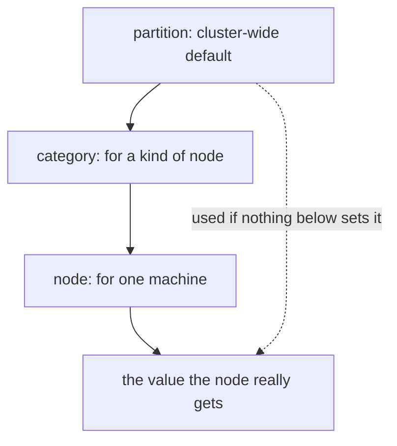

# 8.3 Cluster configuration: networks, nodes and categories

| | |
|---|---|
| Level | Beginner to intermediate |
| Priority tier | 1 |
| Lab venue | Laptop |
| Part | Part 8: NVIDIA Base Command Manager |
| Status | Drafted (`netconf_lab.py`: 67 checks pass; cluster commands **untested** on live BCM) |

## Why this matters for AI infrastructure

Picture a GPU node that resolves names differently from its neighbours. Nothing has crashed, and the node still boots. Its jobs run, but a training script fails when it looks up a storage host, and only that one node behaves this way. Someone changed a setting at one level when the change belonged at another. That is the typical shape of a configuration problem in BCM. The cluster keeps running, and the mismatch hides until a job touches the wrong path.

After the install, most of your work in BCM is changing a setting and deciding how far that change should reach. A GPU cluster has several networks: management, compute fabric, storage and BMC. A compute fabric is the high-speed network that GPUs use to talk to each other during training. It also has several kinds of node: login, CPU and GPU. Some settings must be identical on hundreds of machines, and others must differ on just one. The job is to put each setting at the right level, so the change reaches the nodes you mean and no others.

## Prerequisites and outcomes

Before you start, read chapter 8.1 on objects and inheritance, and chapter 8.2 on the install. This chapter uses the vocabulary from both. Inheritance here means a node takes its value from a higher level unless it has its own.

The chapter walks through the cluster-wide settings and the network objects, including the four places an internal network value can come from. It then covers interfaces, bridges, VLANs and bonds, along with the bond mistakes the manual warns about. After that comes the tools for checking addresses and connectivity, then disk layouts, NFS exports and mounts, and services. Last are racks, GPU settings and the order of preference for going beyond what CMDaemon does. Each part names the level that owns its setting, so you always know where a change should go.

## 1. The shape of it: partition, overlay, category, node

Picture two nodes in the same category that show different DNS answers after a change. The cause is almost always the level where the setting was placed. Every setting in this chapter lives at one of several levels, and the node receives the final value. Think of the levels as a set of layers stacked from the cluster down to one machine. The cluster-wide settings live in the **partition** object. In cmsh, you open it with `partition use base`. In Base View, you find it under **Cluster > Settings**. The partition is the outermost layer, and it sets the defaults for everything below it.

The manual says these values "can in some cases be overridden by more specific configuration levels, such as (configuration-)overlay-level, category-level, or node-level". That is the inheritance rule from chapter 8.1 again, and it applies to settings such as time zone, name servers and network choices. When you read a setting in this chapter, ask one question: is it a partition, category or node setting? The answer tells you where a change belongs.



Follow the arrows from the top. The partition value applies only when nothing below it sets the same setting. A category value overrides the partition, and a node value overrides both. Before you change a setting, decide which level should own it, because a change at the wrong level either reaches too many nodes or too few.

## 2. Cluster-wide settings (section 3.1)

Picture the first hour after the install, when you open the cluster settings and see a long list. The settings window holds the name and time settings, the networks and several objects that apply to the whole cluster. The table lists the ones you should know, with the manual's default for each. Learn them early, because they shape the whole cluster before you change anything else.

| Setting | Default in the manual | Notes |
|---|---|---|
| Cluster name | `BCM 11.0 Cluster` | |
| Administrator email | set at install | Receives license, failed-service and failover mails (below) |
| Name servers | none, or from DHCP | `0.0.0.0` means "use what DHCP gave the head node". Use static addresses on a cluster with HA |
| Time servers | `0.pool.ntp.org`, `1.`, `2.` | Set on the head node |
| Time zone | set at install | Can also be set on a node, category, edge site or cloud region |
| Externally visible IP | `0.0.0.0` | Public address, if the cluster has one |
| Default category | `default` | The category new nodes join |
| Default burn configuration | `default-destructive` | Chapter 8.2 |
| Sign installer certificates | `AUTO` | Chapter 8.4 |

The objects that already exist, such as BMC, SNMP and provisioning, sit in the same window. So do the objects you create when you need them, such as SELinux, switch access, ZTP, NetQ, UFM and NMX manager. ZTP stands for zero touch provisioning, the way a switch configures itself on first boot, and NetQ and UFM are monitoring and fabric management products that BCM can connect to.

The BMC defaults are the user name `bright`, a random password made at install, user ID 4, the administrator privilege, and a power reset delay of 0. BCM sets them only if you configured BMC networks at install. Chapter 8.7 and Part 7 cover those networks, so read them before you rely on remote power control.

Suppose the license runs out and nobody reads the root mailbox. BCM sends admin mail to root by default, so the warning goes there unless you change it. To change the address, run `partition use base` and set the property. The manual's cmsh example spells it `administratore-mail`, so use tab completion to confirm the name on your version. Three events send mail. A month before the license expires, BCM sends a warning, and it repeats daily in the last week. BCM also sends mail when a head node service fails on its first ever boot, and when an automatic failover fails. Failover means the passive head node takes over from the active one. The head node runs Postfix with no relay host set, so set `relayhost` in the partition. A relay host is the outside mail server your cluster sends through. Test the setup with `cmsh -c "main; testemail"`, so you know the mail path works before you need it.

FIPS mode can be set per node or per category, and the node setting wins. FIPS is a government standard for cryptographic modules, and turning it on changes how the operating system handles encryption. It needs a reboot. You cannot set it on the head node through CMDaemon, because a bad FIPS boot configuration could leave the head node unbootable. A head node that will not boot takes the whole management layer with it, so the manual keeps that change out of the daemon.

BCM sets `fs.file-max` to 131072 in `/etc/sysctl.d/90-cm-sysctl.conf`. The file-max value is the total number of open files the system allows. It sets the per-user `nofile` limit to 131072 in `91-cm-limits.conf`, which is the per-user cap on open files. Both apply to the head node and to the image. If you need a different file-max, do not edit BCM's file. Add your own later file, such as `91-site-...conf`, instead. That way an upgrade does not erase your setting, and BCM's file stays as it shipped. The kernel source gives a rule of thumb of memory in MB times 10, so 128 GB gives 1,280,000. Do not let users compile or test on the head node, because a compile can use memory and files that the head node needs for management.

Keep site-specific file-max changes in your own file, and leave BCM's files alone.

## 3. Networks (section 3.2)

Picture a node that cannot reach the storage server while every other node can. The first place to look is the network objects, which act as the address books of the cluster. Each one says which addresses belong to which role, and each node picks its address from them. You will return to these objects whenever a node cannot reach something, so it helps to know what each one holds.

### The three default networks

BCM ships with three network objects. Each one has a different job, so know them before you change a network setting. The table lists what each one is for.

| Network | Purpose |
|---|---|
| `internalnet` | Booting nodes and all cluster management traffic; default management network. Also used for storage and jobs if nothing else exists |
| `externalnet` | The link to the outside (corporate or campus). The only network where BCM supports IPv6 |
| `globalnet` | A name-space helper: nodes are named `node001.cm.cluster`, whether local or cloud. **Do not remove it.** Only its domain name is sensibly changed |

A name space here means one shared set of host names, so a node has the same name whether it runs in your rack or in the cloud. Each network object is a layer 3 (IP) network, and several of them can share one layer 2 segment. A layer 2 segment is a single switched network, while layer 3 is where routing happens. The manual's table lists the important fields. They are the base address, the netmask bits, the gateway, the domain name, and the MTU, whose default is 1500. The MTU is the largest packet the network carries in one piece. The dynamic range is a temporary DHCP range that nodes use while they PXE boot. Node booting says whether this network may be used to boot nodes. Lock down dhcpd refuses new, unknown MAC addresses. Management allowed and layer 3 complete the list. The layer 3 option gives each device a route through a switch, with a `/31` per device and port. A `/30` is possible for some switches. A `/31` and a `/30` are small address blocks sized for a point-to-point link. The manual also lists IMEX options for NVIDIA IMEX peer lists on multi-node NVLink systems. IMEX is the memory-sharing service that links GPUs across nodes in some systems.

The defaults of the internal network are a base of `10.141.0.0` with 16 bits, and node addresses that start at `10.141.0.1`. The 16 bits are the netmask, which gives a large block of addresses. The dynamic range runs from `10.141.128.0` to `10.141.143.255`, and the domain is `eth.cluster`. The manual does not recommend the dynamic range, because it can clash with static addresses. A static address is one you assign by hand and keep, while the dynamic range is handed out to whichever machine asks first. `lockdowndhcpd` is how you stop unknown machines from getting a boot address on your cluster network, once all your nodes are known.

### Four places an internal-network value can come from

An internal-network value can come from four places. When you need to know where a value came from, check these four in turn. This list is the practical version of the inheritance rule, and it is the first thing to check when a network value looks wrong.

1. The **network object** supplies the base address, gateway, MTU and domain.
2. The **cluster object** supplies the management network, node name prefix, digits, default category and default image.
3. The **device interface** supplies its IP, its network and `BOOTIF`.
4. The **node category** supplies the default gateway, management network, name server, time server and search domain.

The default gateway shows the order best. A category default gateway wins. If the category has none, the network's gateway is used. If that gateway is `0.0.0.0`, the DHCP server on the head node hands out `10.141.255.254`, which is the head node's alias. The function `bcm_netconf.default_gateway` implements exactly this order, so you can test the order yourself rather than trusting a memory of it.

### Interfaces

A node's boot interface is `BOOTIF`, and it sits on `internalnet`. Its address is static by default. The manual recommends that, because a node that loses the head node keeps working. A node with a static address can still reach its own services even when DHCP is unavailable. Each interface also has `onnetworkpriority`. It decides which interface answers name-resolution queries, and a higher number wins. Name resolution is the lookup that turns a host name into an address. Each interface type has a default priority.

| Interface type | Default `onnetworkpriority` |
|---|---|
| Bridge | 80 |
| Bond | 70 |
| Physical | 60 |
| VLAN | 50 |
| Alias | 40 |
| Tunnel | 30 |
| Netmap | 20 |
| BMC | 10 |

The table shows a clear order. Bridges win over bonds, bonds over physical ports, and BMC interfaces come last. So when a node has several addresses, the name resolves to the one with the highest priority.

To add a new interface on a running node, use `device > interfaces`. Then reboot the node, because a reboot activates network changes. The reboot is the step people forget, and a new interface that looks configured in BCM is not yet active on the node until the reboot.

### Names, DNS and search domains

Reach the head node from inside the cluster with the alias `master`. Do not call the head node `master`, because the alias is reserved for the head node role. To add extra names for an interface, use `additionalhostnames` in the interface. Do not edit `/etc/hosts` for cluster hosts. Let BCM's DNS, named, do that work. A hand edit to `/etc/hosts` on one node is invisible to every other node, and that is exactly the kind of drift BCM is there to prevent.

To add your own DNS zones, put them in the include file the manual names. A DNS zone is a block of names that one server answers for. That file is `/etc/named.conf.include` on RHEL 9/10 and SLES 15, and `/etc/bind/named.conf.include` on Ubuntu. BCM does not touch that file. By default, the head node's name server answers only internal queries. The `PublicDNS` directive opens it to outside queries. Leave it closed unless you have a reason to answer outside requests.

CMDaemon writes `/etc/resolv.conf` from four sources, in this order: the global network, other networks, category search domains, and partition search domains. The resolv.conf file tells a node which name servers to ask and which domains to try. Older glibc versions read only 6 entries. Glibc is the C library that does name lookups on Linux. A domain may carry an index, such as `example.com:1`. CMDaemon sorts by index and writes the six lowest. For more than six domains, the manual advises using FQDNs instead of forcing a newer glibc. An FQDN is a fully qualified domain name, which spells out the whole name so no search list is needed.

### The head node's outside address

The cluster object has no IP address of its own. In a Type 1 network, the cluster's address is the head node's external interface. In Types 2 and 3, the address belongs to an upstream router, which is not part of BCM. An upstream router is the device that connects your network to the next one up. After you change external settings, reboot the head node so the change takes effect. DHCP for the external interface is possible, but the manual says it is not recommended for production, because DHCP problems make network troubleshooting harder. A head node that changes its address under you is hard to find from a distance.

### Routes and port forwarding

Static routes are a `staticroutes` submode on a device or a category. Each route has a name, a gateway, a destination and an interface. A static route is a fixed path that tells a machine where to send traffic for one destination. CMDaemon makes the OS run `ip route add` when the interface comes up, so the route returns after every reboot.

Port forwarding uses `portforward` in device mode. It opens a port on the head node and forwards traffic to a port on a node, with one `socat` process per rule. Socat is a small relay tool that copies traffic between two endpoints. The manual's example is `portforward create node001 1234 4321`. The head node's firewall, Shorewall, can block that traffic, so check the firewall if a forward does not work. `portforward bmc node001` forwards the BMC web port, 443, and the console port. This is the safe way to reach a node's BMC from outside a Type 1 cluster, because it goes through the head node instead of opening the network.

### Tools to check the network

Use these built-in tools when an address or a path looks wrong. The table shows what each one is for, and the first two are the ones you will use most.

| Tool | Use |
|---|---|
| `routes` (device mode) | Routes of many nodes at once; filter with `awk` to find odd gateways |
| `ipaddresses` and `ipaddresses --check` | Compare the address BCM has configured with the one detected. States: **OK**, **Mismatch**, **Not detected**, **Not configured**. Exits non-zero if any is not OK |
| `connections` | Which ports are listening on which nodes |
| `connectivity` | ICMP pings along each node route on the management network; `--statistics` shows how uniform latencies are |
| `cm-iperf.py` | Bandwidth between node pairs |

Be careful with `cm-iperf.py`. It checks n(n−1)/2 pairs, at about 10 seconds each. The count n(n−1)/2 is the number of distinct pairs among n nodes, so it grows quickly as the cluster grows. The manual says a 1000-node run would take about two months, and the lab computes 58 days. Use `--count`, `-r` for random pairs, and `-p` for parallel threads to keep the run manageable. A sample of random pairs usually tells you enough about the fabric without the full run.

Before you run `cm-iperf.py` on a large cluster, decide how many pairs you really need to test. A question such as "is any rack slow" needs a sample, while "is every pair fast" needs the full run, and the two cost very different amounts of time.

## 4. Bridges, VLANs and bonds (sections 3.3 to 3.5)

Picture a bond you built the quick way, with the defaults. It looks fine on the screen, and then one switch port fails and the node drops off the network. The problem was not the bond itself. The bond was set up with options the manual warns about. Node networking often combines bridges, VLANs and bonds on one machine. Each one changes how packets reach the wire, so a small mistake here can take a node off the network. Start with the three building blocks, then read the rules the manual warns about.

A bridge, named `br<number>`, joins network segments at layer 2. Its member interfaces must have an empty IP and an empty network, because the bridge itself carries the address. A VLAN is a virtual network on a shared link, and it is added with `add vlan BOOTIF.1` in the interfaces submode. You then set its network and IP. A bond combines several physical links into one logical link, which gives you failover or more bandwidth. A bond is added with `add bond bond0`. You then set its network, IP, `mode` and `interfaces`. Bonds come in seven modes, and mode 0 is the default.

| Mode | Name |
|---|---|
| 0 | balance-rr (the default) |
| 1 | active-backup |
| 2 | balance-xor |
| 3 | broadcast |
| 4 | 802.3ad |
| 5 | balance-tlb |
| 6 | balance-alb |

Set the mode with the mode property, not as an option. A commit with `mode=` inside the options fails validation, so the system will refuse the change instead of guessing. Validation here means BCM checks the object before it saves it, and rejects anything that does not fit the schema.

Five rules trip people up, and all of them come from the manual. Each one is a place where a reasonable guess turns out wrong, so read them before you build the bond.

1. The provisioning interface cannot be a member of a bond. A bond can, however, be the provisioning interface, with one member used for PXE. The provisioning interface is the one the node uses to boot and install itself, so it has to exist before the bond is built.
2. For failover bonds, `miimon` is off by default, so set it. `miimon=100` is the common value. The miimon setting is the link-monitoring interval in milliseconds, and without it the bond may not notice a dead link.
3. On a bonded HA head node, rename the shared alias interfaces from `eth0:0` to `bond0:0`. Also change the head node's provisioning interface name to the bond. An alias is a second address on the same interface, and the name has to follow the bond.
4. In BCM 11, the node installer accepts any MAC address of a bonded interface when it identifies a node. This means a bonded node can be recognised by any of its member cards.
5. The bonding kernel module must be in the node's software image for regular nodes. A kernel module is a driver that loads on demand, and without it the image cannot create the bond.

The function `bcm_netconf.validate_interfaces` checks these rules for you. Run it after every change to an interface list, because a rule you forgot is easier to catch in a check than in a late-night outage.

### 4.1 InfiniBand interfaces, `mlxconfig`, and subnet managers

Picture a new GPU rack where the training traffic runs slower than the vendor promised. Before you blame the fabric, check the setup. In an AI cluster, Ethernet usually carries management and often storage. InfiniBand, or RoCE, carries the GPU-to-GPU collectives that Part 12 covers. A collective is a communication pattern where many GPUs exchange data together, such as an all-reduce during training. RoCE is RDMA over Converged Ethernet, which provides the same kind of fast transfer over Ethernet hardware. Setting up InfiniBand in BCM involves five areas, and each one depends on the one before it. Work through them in order, because a later step fails quietly when an earlier one is missing.

The first area is the OFED packages. OFED stands for OpenFabrics Enterprise Distribution, the software stack that drives InfiniBand and RDMA hardware. By default, BCM installs the Linux distribution's OFED packages on the head node and in the software images. If InfiniBand was enabled during install, BCM also writes `/etc/rdma/modules/infiniband.conf` and `rdma.conf` automatically. You can replace the distribution OFED with NVIDIA DOCA Mellanox OFED, for the whole cluster or for specific images, using `cm-doca-ofed-install.sh`. Chapters 8.2 and 8.14 describe that script. To verify a running node, run `ibstat`. You want to see `State: Active` and `Physical state: LinkUp`. Active state with link up means the port is ready to carry traffic.

The second area is the Mellanox adapter settings, which you manage with `mlxconfig`. Mellanox is the adapter family, and ConnectX is its line of network cards. The `mlxconfig` command in `device` mode inspects and sets ConnectX adapter firmware parameters. Firmware is the software that runs on the card itself. Examples include `mlxconfig node001 --adapters`, `--interface ib0`, and `--pci-address 0000:03:00.0 --port 1`, with `--detail-level 1` for more detail. To change a setting immediately, use `--set link_type=ETH` or `--set link_type_p1=ETH`. Some changes stay `pending` until the node reboots, because the firmware reads the new value only at start.

For persistent adapter settings, declare them as `MLX_` fields in `extra_values`. The `extra_values` property is a free list of extra settings on an object. Use `set -e MLX_<field> <value>` on a category, a node or an interface. When the same field is set at more than one level, the precedence is:

```text
category.extra_values < node.extra_values < interface.extra_values
```

The interface setting wins over the node setting, and the node setting wins over the category setting. This is the same idea as the rest of the chapter, with the most specific level on top. Category and node settings apply to every discovered Mellanox adapter on the node, which the manual shows as `*`. An interface setting applies to that one interface. For a VLAN or bond interface, BCM resolves the setting to the underlying physical interfaces, because the firmware lives on the physical card. Boolean values `true` and `false` go to `mlxconfig` as `1` and `0`, since the firmware expects numbers. Reconciliation is idempotent. That word means that running the same step twice gives the same result, so BCM does nothing when the current or pending value already matches. To see the resolved policy without querying the node, run `mlxconfig node001 --desired`. That command shows what BCM intends, which is useful before you change anything.

The third area is the subnet manager. Every InfiniBand subnet needs at least one active subnet manager, which is `opensm`, or `opensmd` on SLES. A subnet manager is the process that assigns addresses and routes on the InfiniBand fabric, so the fabric cannot work without one. The manual recommends running two subnet managers per subnet. One becomes active, and the other stays passive for failover. On large clusters, use dedicated nodes or managed switches for them, so the subnet manager does not compete with jobs for CPU. You can start a subnet manager through CMDaemon in one of two ways. The first is to assign the role with `cmsh -c "device roles <node>; assign subnetmanager; commit"`, or in Base View under `Devices > All Devices > <node> > Settings > Roles > + Add > [SubnetManagerRole]`. The second is to add the service in the `services` submode with `add opensm; set autostart yes; set monitored yes; commit`.

The fourth area is IP over InfiniBand, which the manual calls `ibnet`. IP over InfiniBand, or IPoIB, carries ordinary IP traffic over the InfiniBand fabric. The recommended defaults for the network object are `name = ibnet`, `domainname = ib.cluster`, `type = internal`, `baseaddress = 10.149.0.0`, and `netmaskbits = 16`, which is `/16`. By default, IPoIB interfaces use datagram mode. Datagram mode scales better, and its MTU goes up to 4k. Datagram mode sends each packet without a dedicated connection to each peer, which is why it scales. Set `set connectedmode yes` on `interfaces[ib0]` to switch to connected mode, which allows an MTU up to 64k. Connected mode keeps a connection open per peer, which allows larger packets but costs more memory as peers grow. If nodes PXE-boot or provision over InfiniBand, as chapter 8.4 describes, the file `/cm/node-installer/scripts/ipoib_mode` must match. Run `echo datagram > /cm/node-installer/scripts/ipoib_mode` to set it. To add `ib0` across many nodes at once, use `addinterface -n node001..node150 physical ib0 ibnet 10.149.0.1`. Give the head node `10.149.255.254`, and reboot the head node to activate it.

The fifth area is checking connectivity. `ping node015.ib.cluster` tests reachability, which tells you the name and the route work. For bandwidth and latency, use the Intel MPI Benchmark, IMB, which is pre-installed at `/cm/shared/apps/imb/current`. A benchmark gives you a number to compare against the fabric's expected speed, and a number far below expectation points to a problem with the link, the subnet manager or the configuration. Run `./setup.sh` first, then `module load openmpi/gcc`, and then `mpirun -np 2 -machinefile ../nodes IMB-MPI1 PingPong`. The PingPong test sends messages back and forth between two processes, which measures latency and bandwidth.

For each InfiniBand subnet, decide where its two subnet managers will run before you build the fabric. Moving a subnet manager later is possible, but the fabric is unstable while it moves.

### 4.2 Switches, SNMP, Cumulus Linux, ZTP, NetQ, UFM, and `device` helpers

Picture a new switch that is plugged in, powered on and still invisible to the cluster. BCM also manages network switches, fabric managers and a few special devices. A fabric manager is the software that controls a switch fabric as one system. The paragraphs below cover switch ports and SNMP first, then Cumulus Linux switches, then the commands for finding ports and nodes. SNMP is the simple network protocol that reports device status and counters, and it is how BCM sees many switches and PDUs.

Switch ports have one legacy trap. Setting `switchports` at node level, as in `set node003 switchports switch01:1`, still works, but it breaks when a node has several interfaces. A node with two network cards cannot say which card sits on which port with a single node-level value. Since BCM 10, assign `switchports` inside the node's interfaces submode instead, as in `interfaces; set eth1 switchports switch01:2`. That form supports bonding, because each member interface can name its own port. It is also required when CMDaemon Lite manages a Cumulus switch. APC PDUs must have `set powercontrol apc`, or BCM ignores their port list by default. APC is a brand of power distribution unit, and the setting tells BCM how to read its outlet list.

SNMP is enabled by default, with `disablesnmp = no`. Partition settings flow down to the devices, and `snmpsettings -s` shows the effective values. The default community strings are `readstring = public` and `writestring = private`. A community string works as a shared password in SNMP v1 and v2c. Those defaults are well known, so change them on any cluster that a stranger could reach. Versions `v1`, `v2c` and `v3` are supported. The `file` option exists only for internal SNMP-walk debugging, which is a way of reading every value a device exposes. In `v3`, `authenticationprotocol` defaults to `md5` and can be set to `sha`. `privacyprotocol` defaults to `des` and can be set to `aes`. Prefer the stronger options where your switches support them. Assigning the `snmptrap` role to a node runs `snmptrapd`, with the defaults `Add services = yes`, `Event = yes`, `Mail = yes`, `Access = public` and `Server = localhost`. A trap is a message a device sends when something happens, and `snmptrapd` is the receiver that collects those messages.

Cumulus Linux switches boot through ONIE, which wipes any existing switch OS image. ONIE is the small boot environment that installs a network operating system on a bare switch. They then receive their day-0 setup through ZTP. The ZTP address is `http://10.141.255.254:8080/switch/<name>/cumulus-ztp.sh`. BCM generates that script on boot from `cumulus-ztp.sh`, or immediately when you run `initialize`. Put Cumulus images, which are `.bin` files, in `/cm/local/apps/cmd/etc/htdocs/switch/images/`. Day-0 means the first setup, before the switch carries traffic, so getting it right here saves a visit to the rack.

Authentication and the daemon you choose depend on the cluster. DGX SuperPODs run full CMDaemon with certificate authentication on Cumulus switches. On most other clusters, CMDaemon Lite is the recommended choice, because it is lighter. Enable it with `set hasclientdaemon yes`. It uses the credentials in `accesssettings`, whose defaults are `username = cumulus`, `Rest port = 8765`, `Update in ztp = no` and `Update in NV = no`. A password change takes effect when the switch reboots, so plan the change for a maintenance window. The old discovery script, `/cm/local/apps/cmd/scripts/cm-cumulus-switch.py`, is deprecated. You need it only for Cumulus Linux 4, not for Cumulus 5 or later.

The `nvconfiguration` submode has three `nvconfigurationmode` options. Each one decides where the switch's configuration commands come from. Pick the mode before you write any switch commands, because mixing modes gives you two sources of truth.

- `auto`: BCM's settings become `auto`-type `nv set` commands. They cover the hostname, timezone, SNMP, NTP, DNS and syslog, which point at `10.141.255.254`, and they set `br_default` to vlan-aware. NTP is the time service, DNS is name lookup and syslog is the log stream. You can add `manual`-type `nv set` commands as well. Run `apply` to push the commands to the switch. Only `manual`-type commands can be deleted, with `nv del`, because BCM owns the `auto` commands.
- `manual`: Running `manual` inside `nvconfiguration` copies the `auto` stack into the `manual` stack. You can then edit or delete any command, for example with `nv del 1-2`, followed by `commit` and `apply`. The `auto` commands are ignored in this mode. Choose this mode when you need full control and accept that you now own every line.
- `file`: This mode uses a YAML file. YAML is a plain text format for structured settings. Set it with `set nvconfigurationfile startup.yaml`, and place the file in `/cm/local/apps/cmd/etc/htdocs/switch/<switch>/`. The file is applied over ZTP, or through `cm-import-startup` with `cm-startup.yaml` on DGX SuperPODs. `apply` is not used in `file` mode, because the file is the whole configuration.

The `ztpsettings` defaults are `checkimageonboot = yes`, `runztponeachboot = yes`, `installlitedaemon = yes`, `enableapi = no` and `enableexternalaccessapi = no`. These defaults mean the switch checks its image and runs ZTP on each boot, and the API stays off until you open it. All three SSH key files are unset by default. They are `authorizedkeyfileroot`, `authorizedkeyfilecumulus` for the Cumulus API user, and `authorizedkeyfileadmin` for the NVLink switch API user. An SSH key file lets a named user log in without a password, so set them only for users you trust.

Uplinks need care. An uplink is a port that connects one switch to another, rather than to a node. A port that connects to another switch must be marked as an uplink, as in `set switch01 uplinks 15 16`. That tells CMDaemon to ignore the port during MAC-to-port learning. MAC learning is how BCM works out which node sits behind which port, by watching the addresses that come in. Otherwise, transit traffic corrupts the node port mapping, because a MAC address seen on an uplink looks like it belongs to that uplink's port.

Five commands help you trace ports and nodes. `showport [-s switch01] <MAC>` finds the `switch:port` for a MAC address. `finddevicebyswitchport switch01:1` does the reverse. For a breakout port, use `switch01:1s1`. A breakout port splits one physical port into several smaller ones. With one port it prints only the hostname, and with several ports each line starts with `switch:port`. `switchoverview` lists port status, speed, the uplink flag and the MACs that SNMP detected. `setmacviaswitchport [--dry-run] [-f|--force] [--index N]` fills device MACs from the switch port tables. It refuses to overwrite an existing MAC unless you give `--force`, so a dry run first is the safe habit. `checkfactorydefaultpassword [--update]` tests factory switch passwords, and with `--update` it replaces them. If switch firmware is buggy and you want to disable port-based node identification, run `clear switchports`.

When a node misbehaves, two commands tell you the most. `nodeoverview` gives a one-screen view of uptime, load, memory, workload manager slots, and network and disk use. `minimalconfig` shows the exact category, overlays, head nodes and data producers applied to the node, so you can see where a setting came from. A data producer is a source of monitoring data. Use `minimalconfig` first when a node's behaviour does not match its category, because it answers the question "which level won" directly. The table lists the other helpers.

| Command | What it does |
|---|---|
| `checkremotemount -n node001 /cm/shared` | Checks a remote mount. It takes the options `--file`, `-f` and `--clear`. |
| `proxysettings` | Holds the proxy settings. |
| `selinuxsettings` | Holds the SELinux settings. The defaults are `Initialize = yes`, `Mode = permissive`, `Policy = targeted`, and `Allow NFS home directories = yes`. |
| `additionalnodeinformation` | Runs custom scripts. |

To use `additionalnodeinformation`, register the scripts with `cm-manipulate-advanced-config.py -g "AdditionalNodeInfo=info-1,info-2"`. Point each one at a file with `-g "info-1=/cm/shared/info-1.sh"`. Add `-a` to run them on the active head node. Registering the names first and then pointing each name at a file keeps the list easy to audit.

`remotedaemon install|remove <device>` installs or removes CMDaemon on an OS that is already running, without reprovisioning. Its main use is a BlueField DPU whose Ubuntu OS was already installed by DPF. A DPU is a data processing unit, a card with its own processor, and DPF is the framework that installs its OS. The device must already be defined in BCM as a compute node, must run Ubuntu, and must be reachable from the active head node over SSH using `accesssettings`. It must also reach the active head node over HTTPS. Use `-f` or `--force` to reinstall. Add `--purge-repo` when you remove the daemon, to remove the BCM repo as well, so nothing is left behind on the card.

NetQ and UFM connect through `partition[base] -> netqsettings` and `ufmsettings`. Their defaults are `Port = 443` and `Verify SSL = no`. You also set a server, a username, a password, certificates and Prometheus metric forwarders. Prometheus is a metrics system that collects numbers from exporters, which are small services that publish those numbers. Once connected, NetQ and UFM telemetry become BCM measurables, which means you can graph and alert on them like any other metric. To sample any Prometheus exporter, such as UFM on `http://<ip>:9001/metrics`, add it with `monitoring setup -> add prometheus UFM` and set `urls`. Older exporters that require HTTP GET need `-e NoPostAllowed yes`. Then set `nodeexecutionfilters -> active`, so that only the active head node polls the exporter. Polling from one node avoids duplicate traffic and duplicate samples. The reverse direction also exists. `EnablePrometheusExporterService` in `cmd.conf` makes CMDaemon export its own Prometheus metrics, so an outside collector can read BCM's numbers.

For hardware that does not fit the standard model, BCM supports `custompowerscript`, `custompingscript` (which can use `$CMD_IP`), `customremoteconsolescript`, and `sysinfo` custom scripts. A custom script lets you teach BCM about a device it does not know how to control. The `retrydelay` default is `30` s, and its minimum is `5` s. The retry delay is the pause between attempts when a script fails. Use `triggersysinfo` to run the `sysinfo` script across nodes.

Before you bring a switch under BCM, mark its uplinks. Otherwise, transit traffic will corrupt the node port mapping. Marking uplinks is one of the cheapest steps in the whole chapter, and skipping it creates some of the hardest port problems to trace.

## 5. Disks, NFS and services

Picture a researcher who reports that `/home` is missing on half the nodes. Disks, NFS exports and services look like three separate topics, but they follow the same inheritance rule as everything else. A category can carry them, and a node can override them. NFS, the Network File System, shares a folder from one machine so other machines can mount it. A service is a program that runs on a node, such as a print server or an automounter. Knowing which level owns each one tells you where to make the change.

Section 3.13 of the manual covers disk layouts. A disk layout is an XML file stored in the CMDaemon database. The files in `.../htdocs/disk-setup/` are only templates, which means they are starting points that the database copies. A category's layout is inherited by its nodes, and a node can have its own layout, which overrides the category's. Running `clear` on the node returns it to the category's layout. The templates cover the default layout, hardware or software RAID, LVM, diskless and semi-diskless setups. RAID combines several drives for speed or safety, and diskless means the node runs without a local disk. To switch a node to diskless, use the template `slave-diskless.xml` and reboot. The node then runs from RAM. BCM cannot change a head node's disk layout after install. You manage that with ordinary Linux administration, and you should keep backups. The head node is already running, so the installer that writes layouts is no longer there to do it.

Section 3.14.1 covers NFS exports. On the head node, `fsexports` lists the exports, with their name, path, hosts and write setting. Three exports have been built in since BCM 9.0, and they come with the `headnode` role. They are `/var/spool/burn`, `/home` and `/cm/shared`. You cannot simply remove them, because the headnode role depends on them. Instead, set `disableautomaticexports` in the headnode role. Your own exports can be removed, or disabled.

Section 3.14.2 covers NFS mounts. You set them with `fsmounts` on a category or a node. Each mount has a device, such as `basecm11:/modeldata`, a mount point, a filesystem and options. The device is the exported path on the server, and the mount point is where it appears on the node. Add `_netdev` to the options to make the mount wait for the network. Without it, the node may try to mount before the network is up and fail at boot. A node shows its category's mounts marked `[default]`, with the category name beside them. To remove a category mount, remove it in the category, not on the node. A removed mount is not unmounted until the node reboots, so expect the old mount to stay until then. To give some nodes a mount and not others, put those nodes in another category, or set the mount per node. Mount order matters, because a parent must mount before its subtree. Use `up` and `down` to set the order. Autofs mounts must be added to `excludelistupdate`, or an image update can wipe them. Autofs mounts a path on demand, and an image update that rewrites the path removes that setting. Chapter 8.4 explains why.

Diskless nodes can mount rarely used subtrees from the head node's image over NFS, which saves RAM. The manual's example frees about 440 MB this way. It also notes that BCM's default NFS versions are a mix of 3 and 4, as of its August 2025 date, and it gives a procedure to move to version 4 only. Version 4 has a simpler setup and one port, which is why many sites prefer it.

Section 3.15 covers services. Services such as `cups` and `autofs` can be added in the `services` submode of a device or a category. CUPS is the printing service, and autofs is the on-demand mount service. Each service has three settings to decide. `monitored` means BCM watches the service. `autostart` tells BCM to restart a failed service. `runif` controls HA behaviour, with the values active, passive, always and preferpassive. HA behaviour decides whether the service runs on the active head node, the passive one, or both. If `autostart` is on and you stop the service through BCM, BCM will not restart it until you start it through BCM again. Otherwise the service would come back the moment you stopped it, which would be confusing. A service's own configuration stays with the service and the OS. `systemctl disable` controls whether the service starts at boot. That is separate from BCM's own settings, so a service can be disabled at boot and still be managed by BCM.

Before you mount something on a category, check that every node in that category should have it. A category mount reaches every node in it, and a node that should not have the mount will get it anyway.

## 6. Racks and chassis (3.16)

Picture a technician who asks which rack slot is free before a new server arrives. A rack is 42U by default. U is the standard height unit for racks, and a device occupies a whole number of units. You place a device in a rack with `set rack` and `set deviceposition`. To fill positions in bulk, use `addrackposition -n node001..node010 rack2`, which takes the first free slots. The `--position` and `--force` options refine that command. `--position` chooses where to start, and `--force` overrides a conflict, which is the risky part. The position you set is the top of the device.

Chassis, such as blade enclosures, have members and a `chassisposition`. A chassis is a shared box that holds several smaller devices, such as a set of blade servers. The chassis position holds the slot, the position and the width. `rackoverview` shows the UP, DOWN and CLOSED counts, the cores, the GPUs and the power. For NVIDIA racks, it also shows NVLink switches and power shelves. An NVLink switch connects GPUs inside a rack, and a power shelf is a shared power unit. The model `bcm_netconf.Rack` shows the placement rules, so you can check a plan before you enter it in the cluster.

Check the free positions before you add devices. A rack that looks full on paper can still have a gap that is too narrow for the next device, so count units before you commit.

## 7. GPU settings (3.17)

Picture a GPU that runs slower than its neighbours on the same node type. GPU settings tell BCM how to treat each GPU on a node. You can set them on a node or on a category. A GPU setting controls things like clock speed, power limit and memory error correction. Start with the everyday options, then read the MIG rules, because MIG changes the GPU itself.

In `gpusettings`, add `nvidia 1-3` or `all` to target a range of GPU slots. A range may be a single number, `0-2`, `1,3-5`, or `all` or `*`. If the hardware supports them, the options are `clockspeeds`, `clocksyncboostmode`, `computemode`, `eccmode` and `powerlimit`. Clock speeds set how fast the GPU runs. ECC mode turns on error correction in memory. The `computemode` values are default, exclusive thread, exclusive process and prohibited. Exclusive modes allow only one process to use the GPU at a time, and prohibited blocks new work entirely. The `powerlimit` values are `min`, `max`, a number, or `default`. No value means the hardware default, and a node value overrides a category value. So a single node can differ from its category without a second setting to undo.

GPU metrics need the `cuda-dcgm` package installed. DCGM is NVIDIA's data center GPU monitoring tool, and without the package BCM has no GPU numbers to show. The command `updatedevicepowerconfig` sets power limits for GPUs or CPUs, and it accepts `--dry-run`, which shows the changes without making them. Setting a limit both there and in `gpusettings` may cause a conflict, so pick one place for each limit and stick to it.

BCM can also manage Multi-Instance GPU, or MIG, which splits a physical GPU into slices. Each slice acts like a smaller, separate GPU with its own memory and compute. Chapter 10.24 in Part 10 covers the GPU internals. Several rules matter here, and each one below comes from the manual. Read the whole group before you enable MIG on a production node, because a MIG change can take a GPU out of service.

Use only one MIG management tool. If you use the DGX native `nvidia-migmanager.service` or the Kubernetes GPU Operator's `nvidia-mig-manager`, BCM leaves MIG alone. Two managers fighting over the same GPU produce changes that neither one can explain. Never run several MIG managers at the same time.

Utilization and `gpuprofiling` need care. Once MIG is enabled on a GPU, the full physical GPU is no longer available as a device, and standard GPU utilization metrics stop by default. Utilization here means how busy the GPU is, so the number you were watching disappears. You can still watch the physical GPU profiling metrics in `device` mode, with `gpuprofiling show` and `gpuprofiling watch 1003`. For example, `1002` is `gpu_profiling_sm_active` and `1003` is `gpu_profiling_sm_occupancy`. SM stands for streaming multiprocessor, the core unit of a GPU. Active measures how often the SMs have work, and occupancy measures how full they are. Be careful, because profiling can affect performance, so use it for a short look rather than leaving it on.

The slice sizes are fixed on Ampere and newer GPUs. Ampere is an NVIDIA GPU generation. The Ampere GA100 needs compute capability 8.0, CUDA 11+, and driver `450.80.02+`. Compute capability is the feature level of the GPU, and CUDA is the programming platform. A memory slice is 1/8th of the physical GPU memory. An SM slice is 1/7th of the physical SMs. A GPU slice combines one memory slice with one SM slice, and a physical GPU has at most 7 GPU slices. Slices form a GPU instance, GI, which holds one or more compute instances, CIs. A compute instance is the part of a GPU instance that runs work. If you leave any of the 7 GPU slices unallocated, those SMs go to waste, so a partial layout costs you capacity.

Enabling MIG is done with the `mig` command in `device` mode. `mig status` shows the `Active` and `Pending` state for each GPU. `mig enable [gpu-list]` and `mig disable [gpu-list]` set the `Pending` state, and they accept node-list syntax such as `3,5-7`. Pending means the change is queued and not yet live. On A100 GPUs, a pending MIG change needs a node reboot before it becomes active. On H100 and newer GPUs, no reboot is needed. Check the GPU model before you plan a maintenance window, because the difference decides how long the change takes.

Profile names follow the pattern `<slices>g.<mem>gb`, with `+me` added for media extensions. Examples are `1g.5gb`, `2g.10gb`, `3g.20gb`, `4g.20gb` and `7g.40gb`. Read the name as slices first and memory second. Use `mig profiles [gpu]` to list the profiles your GPU supports, because not every profile exists on every card. To make a profile list persistent, set `migprofiles` in `gpusettings -> use nvidia:0 -> set migprofiles <spec>; commit`. Then run `mig apply`. Until you run `mig apply`, `mig show` stays empty. A command such as `mig apply --profile 1g.5gb,2g.10gb` applies profiles immediately, but the `--profile` option is not persistent, and it is lost on reboot. Use the `migprofiles` setting when the layout must survive a restart.

The `<N>*<profile>` syntax repeats a GPU instance. For example, `7*1g.5gb` fills all seven slices. A mixed list such as `5*1g.5gb,2g.10gb` uses all 7 GPU slices. The list `2*1g.5gb,2g.10gb` wastes 3 of the 7 slices. Appending `:<k>` creates a compute instance of `k+1` slices. The index starts at 0, so `:0` gives `1c.<profile>`, and `:1` gives `2c.<profile>`. The highest index, `:N-1`, equals `<profile>`. For example, `2g.10gb:0:0` expands to `2g.10gb:1c.2g.10gb:1c.2g.10gb`. That creates one 2-slice GPU instance holding two 1-slice compute instances. Hardware restrictions still apply. On `A100-PCIE-40GB`, `7g.40gb:3` is allowed, but `7g.40gb:4` is not, because the card does not offer that many compute instances.

Overallocation is easy to miss. If a profile list asks for more than 7 GPU slices, BCM does not reject the whole string. Instead, the entries that come after the budget of 7 is used up are silently left unallocated. Silent means there is no error message, so the missing slices only show up when a job cannot find the device it expects. Take `5*1g.5gb,2g.10gb`. Five `1g` slices and one `2g` slice add up to 7, so everything fits. Now take `6*1g.5gb,2g.10gb`. The six `1g.5gb` instances use 6 slices, and the `2g.10gb` needs 2 more, which makes 8 in total. BCM allocates the six `1g.5gb` instances and none of the `2g.10gb` instance. A longer first entry gives the same result. Both `7*1g.5gb,2g.10gb` and `70*1g.5gb,2g.10gb` allocate seven `1g.5gb` instances and no `2g.10gb`, because the budget is used up before the last entry.

Before you apply a MIG profile list, add up the GPU slices and make sure the total is 7 or less. Adding up takes a minute, and a list that looks right can still hide a silent drop.

## 8. Going beyond CMDaemon: the manual's order of preference

Sometimes CMDaemon has no setting for what you need. Picture a vendor tool that expects a file in a fixed place, and no BCM property puts it there. Section 3.20 of the manual ranks the ways to go beyond CMDaemon, and the first option is always the preferred one. The reason is maintenance. The further you move away from CMDaemon, the more you have to track yourself, because BCM can no longer tell you what the node should look like.

1. **Configure through CMDaemon** in cmsh or Base View. CMDaemon then tracks the state.
2. **Use a different image** for a category or a node. You clone the image, clone the category, set the image, and move the nodes.
3. **Place files through the image.** Put them in `/cm/images/<image>/cm/conf/category/<category>/<path>`, or in `.../node/<node>/<path>`, or in `.../node/<MAC with dashes>/<path>`. BCM copies them just before the node installer's finalize stage. A node-level file wins over a category-level file.
4. **Use `FrozenFile`** to stop CMDaemon rewriting a file. The manual says to avoid it where possible, because a frozen file no longer follows BCM's changes.
5. **Use `initialize` and `finalize` scripts.** They run at the initrd stage, before CMDaemon on the node starts. The initrd is the small early-boot filesystem Linux uses before the real root is mounted. They suit a setting that the node installer overwrites on every boot. The manual's example appends an `ETHTOOL_OPTS` line to an interface file.
6. **Use a shared directory** for the software the nodes run.

Start at item 1, and move down the list only when CMDaemon has no setting for the job. Each step down adds a little more of your own tracking, and the list is ordered so that the cheapest maintenance comes first.

## 9. Common first mistakes

These ten mistakes come up again and again in the first weeks with BCM. Read the list before you change a live cluster, because a single one of these can take a rack offline. Each item names the level or the rule that the earlier sections explained.

1. Changing one node when the category should change, or the reverse.
2. Editing `/etc/hosts` or `/etc/resolv.conf` by hand, instead of changing the interface or network object.
3. Making the provisioning interface a bond member.
4. Forgetting `miimon` on a failover bond.
5. Removing `globalnet`, or a built-in NFS export.
6. Setting a node's mount when the category should carry it. The mount then cannot be removed from the node view.
7. Using DHCP for the head node's external interface in production.
8. Putting static node addresses in the dynamic DHCP range.
9. Freezing files because it is quick.
10. Running `cm-iperf.py` on a big cluster with its defaults.

When a change feels quick, check its level first, because most of these mistakes start with the wrong level. A quick fix at the wrong level is usually the one that comes back later.

## Exercises

These exercises use the netconf model and the rules from this chapter. The model checks the rules, and the cluster commands in the exercises are written from the manual's examples. Those commands were not run on a live system. Each exercise asks for one decision or one command, so you can work through them in any order.

1. Run `python3 netconf_lab.py`. Choose four of the checks, and explain each rule in your own words.
2. Plan a two-network cluster. The management network is `10.141.0.0/16`, and the storage network is `10.150.0.0/16`, with 64 nodes. Write down which object holds each setting.
3. Use `Rack` to place 18 nodes, a switch and a PDU in one rack. What does `--force` risk?
4. One broken node needs a different disk layout. Decide whether it belongs in the category or on that node. Then decide the same for an NFS mount used by all GPU nodes, a power limit on GPU 3 of one node, and a static route to a license server that everyone needs.
5. Explain why the manual calls the dynamic DHCP range not recommended.
6. Write the cmsh commands that bond `eth1` and `eth2` as `bond0` in active-backup mode with `miimon=100`. Base them on the manual's examples.

## 11. Interview angles

Interviewers often ask questions like these. Each answer names the fact worth remembering, so practise saying it in your own words.

- "Where does a node get its default gateway?" It comes from the category's default gateway first, then from the network's gateway, and finally from the head node alias `10.141.255.254`, which DHCP hands out.
- "Why is the provisioning interface not allowed in a bond?" The manual states the rule as a restriction and does not give the reason. A bond can itself be the provisioning interface. In that case, the node installer brings up the bond and all its members before provisioning.
- "How do you expose a node's service to the outside on a Type 1 cluster?" Use `portforward` on the head node, which runs socat, and keep an eye on the firewall.
- "A node's configured IP and its real IP differ. How do you find it fleet-wide?" Run `ipaddresses --check`.
- "You need a setting BCM does not model. What are your options and which is best?" Image file placement, or initialize and finalize scripts, come before `FrozenFile`.

## Checkpoint questions (20)

<details>
<summary>1. What is the `partition` object in BCM, and how do you open it in `cmsh` and Base View?</summary>

The `partition` object, named `base`, holds the cluster-wide settings. Those include the cluster name, the admin email, the DNS and NTP servers, the default category, and the BMC, SNMP, UFM and NetQ settings. In `cmsh`, run **`partition use base`**. In Base View, open **Cluster > Settings**.
</details>

<details>
<summary>2. Which three cluster events cause BCM to automatically send an email to the administrator?</summary>

1. **License expiration warning:** BCM sends it one month before the license expires, and daily during the final week.
2. **First-boot service failure:** A head-node service fails on its very first boot after installation.
3. **Failed automatic HA failover:** An automatic failover between the active and passive head nodes fails.
</details>

<details>
<summary>3. Why can FIPS mode be enabled on regular nodes and categories through CMDaemon, but NOT on the head node through CMDaemon?</summary>

A wrong FIPS kernel or boot configuration could leave the head node unbootable. If that happened, the whole cluster management plane would go down with it.
</details>

<details>
<summary>4. What are the three default network objects (`internalnet`, `externalnet`, `globalnet`) and why must `globalnet` never be deleted?</summary>

- **`internalnet` (`10.141.0.0/16`, `eth.cluster`):** This is the default network for PXE-booting nodes and internal cluster management.
- **`externalnet`:** It connects the head node to the corporate or campus network. It is the only network where BCM supports IPv6.
- **`globalnet` (`cm.cluster`):** It gives the cluster one namespace, such as `node001.cm.cluster`, across local and cloud nodes. Never remove it.
</details>

<details>
<summary>5. What does `lockdowndhcpd` on a network object do?</summary>

After every legitimate node's MAC address is recorded in BCM, `lockdowndhcpd` tells `dhcpd` to refuse leases to unknown MAC addresses. That stops rogue or unconfigured machines from netbooting on the cluster network.
</details>

<details>
<summary>6. Name the four BCM object levels from which an internal-network parameter can originate.</summary>

1. The **network object** (`internalnet`: base address, netmask, gateway, MTU, domain).
2. The **cluster / partition object** (`base`: management network, naming prefix and digits, default category).
3. The **device interface** (`interfaces[BOOTIF]`: IP address and network binding).
4. The **node category** (default gateway, management network, DNS and NTP servers, search domains).
</details>

<details>
<summary>7. In what exact fallback order is a regular node's default gateway determined?</summary>

First, the category's default gateway is used, if one is set. If not, the network object's gateway is used. If that gateway is `0.0.0.0`, DHCP hands out **`10.141.255.254`**, the head node's internal alias.
</details>

<details>
<summary>8. What does `onnetworkpriority` on a node interface control, and what is the default priority order across interface types?</summary>

It decides which interface IP is returned when the node's primary hostname is resolved. The highest number wins. The defaults, from highest to lowest, are **bridge (`80`) $>$ bond (`70`) $>$ physical (`60`) $>$ VLAN (`50`) $>$ alias (`40`) $>$ tunnel (`30`) $>$ netmap (`20`) $>$ BMC (`10`)**.
</details>

<details>
<summary>9. How many search domains in `/etc/resolv.conf` do older `glibc` resolvers read, and how does BCM's `:index` suffix order them?</summary>

Older `glibc` resolvers read only the first **`6`** search domains. When you add an index, such as `example.com:1`, CMDaemon sorts the search domains by ascending index. It then writes the six lowest-indexed domains.
</details>

<details>
<summary>10. How do you add custom DNS zones to the head node's BIND server without `CMDaemon` overwriting them?</summary>

Put custom zones in **`/etc/named.conf.include`** on RHEL, Rocky and SLES, or in **`/etc/bind/named.conf.include`** on Ubuntu. CMDaemon includes that file automatically and never overwrites it.
</details>

<details>
<summary>11. How does `portforward` in `cmsh` `device` mode work, and what does `portforward bmc node001` do?</summary>

`portforward` starts a `socat` listener on the head node. The listener forwards traffic to a port on an internal node, as in `portforward create node001 1234 4321`. The head node's Shorewall or `nftables` firewall still applies. `portforward bmc node001` forwards the node's BMC HTTPS port, 443, and its console port. That lets engineers reach an internal BMC on a Type-1 cluster from outside.
</details>

<details>
<summary>12. What are the four status values reported by `ipaddresses --check` in `cmsh` `device` mode?</summary>

**`OK`** means the configured IP matches the live IP. **`Mismatch`** means the live IP differs from the BCM configuration. **`Not detected`** means the IP is configured in BCM but not seen on the node. **`Not configured`** means the IP is live on the node but missing from BCM.
</details>

<details>
<summary>13. How many node pairs does `cm-iperf.py` test by default across $n$ nodes, and why must you pass `--count` or `-r` on a 1,000-node cluster?</summary>

It tests all **$n(n - 1) / 2$** pairs, at `~10` seconds per pair. On `1,000` nodes, that is nearly half a million pairs, or about `~58` days of continuous running. So you must use `-r` for a random sample, `--count`, and `-p` for parallel threads.
</details>

<details>
<summary>14. In BCM interface bonding, which mode is default (`0`), which is `active-backup` (`1`), and why does putting `mode=` inside bond `options` fail validation?</summary>

Mode `0` (`balance-rr`) is the default. Mode `1` is `active-backup`. Mode `4` is `802.3ad`, which is LACP. In BCM, you set the bonding mode with the dedicated `mode` property, as in `set mode 1`. Do not put it inside the free-form `options` string, where you set `miimon=100`.
</details>

<details>
<summary>15. Can a node's provisioning interface (`BOOTIF`) be a slave member of a bond? Can `bond0` itself be the provisioning interface?</summary>

A physical interface named as the `provisioninginterface` cannot be a member of a bond. However, `bond0` itself can be set as the `provisioninginterface`. In that case, the node installer brings up `bond0` and its member NICs during boot.
</details>

<details>
<summary>16. When configuring persistent Mellanox ConnectX parameters (`MLX_<field>`) in `extra_values`, what is the precedence order across BCM objects, and how does IPoIB `datagram` mode differ from `connected` mode?</summary>

The precedence is **`category.extra_values < node.extra_values < interface.extra_values`**. For IPoIB on `ibnet`, which defaults to `10.149.0.0/16`, datagram mode is the default. It scales better across many peers, and its MTU goes up to `4k`, which is `4092`. Connected mode, set with `set connectedmode yes`, allows an MTU up to `64k`, which is `65520`.
</details>

<details>
<summary>17. Where are node disk layouts stored in BCM, and why can't BCM modify the head node's disk layout after installation?</summary>

BCM stores disk layouts as XML documents inside the **`CMDaemon` database**. The database is seeded from templates in `.../htdocs/disk-setup/`, such as `slave-diskless.xml`. A regular node's layout is applied when `node-installer` partitions the node at boot. The head node is already running and never goes through `node-installer`, so BCM cannot change its layout after installation.
</details>

<details>
<summary>18. Which three NFS exports are built into the `headnode` role since BCM 9.0, and how do you remove a category-inherited `fsmount` from a node?</summary>

The three built-in head-node exports are **`/var/spool/burn`**, **`/home`** and **`/cm/shared`**. They are controlled by `disableautomaticexports`. A category `fsmount` marked `[default]` cannot be deleted on the node object. Instead, remove it in the category, or move the node to a different category.
</details>

<details>
<summary>19. In BCM's Multi-Instance GPU (`mig`) management (§3.17.3), how many GPU slices exist on an A100/H100 GPU, which GPU generation requires a reboot to enable MIG, and what happens if `migprofiles` specifies more than 7 slices (e.g., `6*1g.5gb,2g.10gb`)?</summary>

An A100 or H100 has **7 GPU slices**, made of 7 SM slices and 8 memory slices. Enabling or disabling MIG needs a node reboot on A100, but not on H100 or newer GPUs. If `migprofiles` asks for more than 7 slices, BCM silently drops the slices that come after the budget of 7 is used up. The example `6*1g.5gb,2g.10gb` asks for 6 + 2 = 8 slices, so BCM allocates six `1g.5gb` instances and no `2g.10gb` instance.
</details>

<details>
<summary>20. List the manual's 6-level order of preference (§3.20) when you need to configure a node beyond standard CMDaemon properties.</summary>

1. **Configure through `CMDaemon`** in `cmsh` or Base View whenever a native property exists.
2. **Use a cloned or separate software image** for the category or node.
3. **Place image files** under `/cm/images/<img_name>/cm/conf/category/<cat>/<path>` or `.../node/<node>/<path>`. A node-level file wins over a category-level file.
4. **Use the `FrozenFile` directive** in `cmd.conf`. Avoid it when possible.
5. **Use `initialize` and `finalize` scripts**, which run during the pre-init node-installer stage.
6. **Use the shared directory** (`/cm/shared`) for site scripts and software.
</details>

## Sources and review notes

- **BCM 11 Administrator Manual, chapter 3:** 3.1 (cluster settings, email, FIPS, open files), 3.2 (networks, interfaces, DNS, routes, port forwarding, tools), 3.3 (bridges), 3.4 (VLANs, the cmsh part), 3.5 (bonds), 3.6 (InfiniBand OFED, `mlxconfig` and `MLX_` extra_values precedence, subnet managers, `ibnet` datagram vs connected mode, IMB PingPong), 3.8 (switches, interface-level `switchports`, APC PDUs, SNMP v1/v2c/v3 and `snmptrap` role), 3.9 (Cumulus switches, ONIE, ZTP, CMDaemon Lite vs YAML preconfiguration, `nvconfigurationmode` `auto`/`manual`/`file`, `uplinks`, `showport`, `finddevicebyswitchport`, `switchoverview`, `setmacviaswitchport`, `checkfactorydefaultpassword`), 3.10 (`nodeoverview`, `additionalnodeinformation`, `minimalconfig`, `checkremotemount`, `proxysettings`, `selinuxsettings`, `remotedaemon` for DPUs), 3.11 (NetQ settings), 3.12 (UFM settings), 3.13 (disk layouts), 3.14 (NFS), 3.15 (services, read in part), 3.16 (racks, chassis), 3.17.1 to 3.17.3 (GPU settings and full MIG configuration commands, `gpuprofiling`, `:k` colon syntax, and overallocation behavior; AMD GPUs skipped), 3.18 (sampling a Prometheus exporter), 3.19 (custom scripts), 3.20 (beyond CMDaemon).
- **Not read:** 3.7 (BMC; read for 8.7), 3.21 (saving configuration files), appendices A and E (Appendix C read for 8.1 and 8.12; Appendix D LUKS part read in 8.16 search).
- **NVIDIA-DevOps notes**, volume 10 chapter 2 and chapter 13: read in full.
- **Run here:** `netconf_lab.py` (67 checks): networks and ranges, gateway order, search domains, interface priority, `ipaddresses --check`, `cm-iperf` arithmetic, bond, bridge and VLAN rules, disk and mount inheritance, image file placement, racks, GPU ranges and settings, plus (`added in the gap pass`) `mlxconfig` `MLX_` precedence, IPoIB datagram/connected MTU, Cumulus `nvconfigurationmode`, `setmacviaswitchport`, `remotedaemon` DPU prerequisites, and MIG profile parsing, colon syntax, reboot rules, and overallocation truncation.
- **My own choices, not the manual's:** where unindexed search domains land after indexed ones; that a rack device of height *h* occupies *h* units counted from its top position; that a node mount for the same mount point as a category mount wins.
- **Not verified:** everything about a real BCM system: command output, version differences, and every IMEX field beyond the manual's description.
