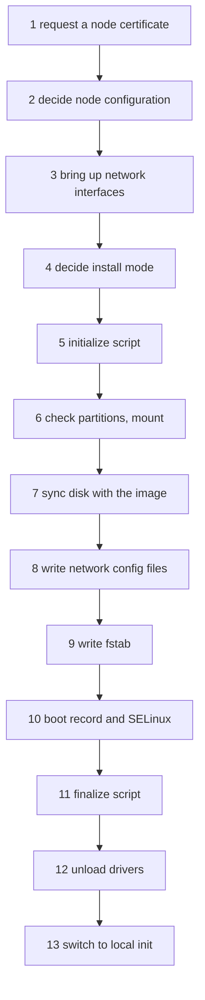
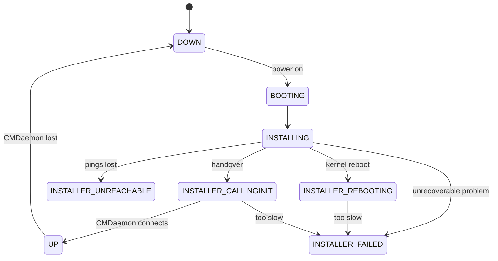

# 8.4 Node provisioning: images, kernels, categories and the PXE flow

| | |
|---|---|
| Level | Beginner to intermediate |
| Priority tier | 1 |
| Lab venue | Laptop |
| Part | Part 8: NVIDIA Base Command Manager |
| Status | Drafted (`provision_lab.py`: 82 checks pass; cluster commands **untested** on live BCM) |

## Why this matters for AI infrastructure

A GPU cluster is only as good as its worst node. Provisioning is how BCM makes 500 nodes identical: every node boots, gets the same software image, and joins the cluster without anyone logging in. When it goes wrong you get nodes that will not boot, nodes that quietly lost their local data, or nodes running an old image. This chapter is the "how a node comes up" story, step by step, and where each step can break.

## Prerequisites and outcomes

You need chapters 8.1 to 8.3. After this chapter you can:

- walk through the PXE boot and the 13 steps of the node installer
- choose and explain an install mode, and say which ones can erase local data
- explain how BCM recognises a new node and what the seven identification cases mean
- scale provisioning with boot and provisioning roles
- update a running node from the image safely (dry run first)
- manage software images and kernels without breaking the next reboot
- read node states and use `close`, `open`, `mute` and `drain` correctly
- work through the troubleshooting list in order

## 1. The big picture

**Booting** and **provisioning** are different jobs. Booting gets a small program (the boot loader, then a kernel and a ramdisk) onto the node. Provisioning copies the **software image** (a complete Linux filesystem) onto the node's disk. The head node does both by default; you can hand each job to other nodes when the cluster grows.

## 2. Before the kernel loads (5.1)

- Nodes **boot from the network by default**. On x86_64 this is PXE. The head node runs a TFTP server, and the files live under `/tftpboot/pxelinux.cfg/`.
- The boot loader shows a **menu**. If nobody picks anything within the timeout, the **AUTO** install mode runs. The timeout is 5 seconds, written `TIMEOUT 50` (deciseconds). Do not change the menu files unless you must.
- A per-node **PXE label** (`set pxelabel MEMTEST`, for example) overrides the menu default for one node or a whole category. Setting it to `localdrive` makes the node boot from its own disk, which the manual discourages because it makes management harder.
- The boot protocol is `bootloaderprotocol`, **HTTP by default**. Even then the first stage is still TFTP on x86_64, and HTTP takes over for the kernel and ramdisk. Set `tftp` if your hardware cannot switch over. **HTTPS** almost never works. **ARMv8 nodes boot over TFTP only** and get a GRUB binary.
- On disked nodes BCM also installs **iPXE** on the drive as a fallback if the BIOS PXE attempt fails.
- **Boot role.** DHCP and TFTP can be overwhelmed when hundreds of nodes boot together: random nodes fail to boot, and a different set each time. The fix is to give the `boot` role to one regular node per rack or subnet. The head node always has the boot role.

## 3. The node installer: 13 steps (5.4)

After the ramdisk is up, a program called the **node installer** runs on the node.

**1. Certificate.** The node asks the head node for a certificate. The setting `signinstallercertificates` is `AUTO` (default) or `MANUAL`. A network can refine this with `allowautosign`: Always, Automatic (default; only networks of type internal), Never, or Secret (for edge sites). In an untrusted network use MANUAL and approve each request in `cert` mode (`listrequests`, `issuecertificate`). The certificate is stored under `/cm/node-installer/certificates/<MAC>/`; if a node gets a bad certificate, delete that directory so it can ask again.

**2. Who am I?** The installer asks CMDaemon whether the booting MAC address belongs to a known node, and which switch port the node is on. Section 4 below covers the seven cases.

**3. Network.** It brings up the interfaces, but first checks that each IP address is not already in use. `BOOTIF` is a special name that means "whichever interface I booted from". Non-provisioning interfaces stay down unless `bringupduringinstall` is `yes` (up during install) or `yesandkeep` (up and stays up).

**4. Install mode.** See section 5.

**5. Initialize script.** Runs before disks are touched (category script first, then node script). For hardware the standard flow does not know how to start.

**6. Partitions.** Checks (or creates) the layout from the node's disk-layout XML, then mounts.

**7. Sync.** Copies the image to the node using rsync. Which files are skipped depends on the exclude lists (section 8). `provisioninginterface` picks the interface that receives the data (default `BOOTIF`; choose the fastest one). `provisioningtransport` is `rsyncdaemon` (unencrypted) or `rsyncssh` (encrypted, heavy on the provisioner).

**8 and 9.** Writes the interface files and `/etc/fstab`.

**10.** Optionally writes a boot record so the node can start from its own disk (`installbootrecord`), and sets up SELinux if configured.

**11. Finalize script.** Runs just before the handover. The right place to append a setting that the installer would otherwise overwrite every boot.

**12. Unload drivers.** The IPMI drivers are needed to configure the BMC, then keep using CPU and power; by default they are unloaded here (`removeModulesBeforeInit`).

**13.** Hands over to `/sbin/init` on the local disk. The node then behaves like any Linux machine.

## 4. Who is this node? The seven cases (5.4.2)

A new or returning node can be recognised by its **MAC address**, by the **switch port** it is plugged into, or both. The manual has a seven-row truth table:

| # | Node known? | Port detected? | Port configuration | Result |
|---|---|---|---|---|
| 1 | no | yes | found | suggested, accepted after a timeout |
| 2 | no | yes | none | **manual**: dialog loops |
| 3 | no | no | none | **manual**: dialog loops |
| 4 | yes | yes | same as the MAC's | suggested, accepted |
| 5 | yes | yes | **differs** from the MAC's | **manual**: port mismatch |
| 6 | yes | no | the MAC's config expects a port | **manual**: port mismatch |
| 7 | yes | yes | the MAC's config has no port | suggested, accepted |

Practical meaning: a **brand-new node with no switch configuration always stops for a human** (cases 2 and 3). A **port mismatch (cases 5 and 6)** usually means two nodes were swapped by mistake, and the installer protects you by stopping. For case 6 the manual's simplest fix is `cmsh -c "device clear node001 switchports; commit"` (or enable port detection on the switch).

**Naming new nodes: `newnodes`.** In cmsh device mode, `newnodes` lists MAC addresses waiting to be named. `newnodes -s -n node001..node032` assigns names in the order the nodes arrived. So **power nodes on in the order you want them named**. `-w` assigns without saving; `-s` saves; `-o 1` skips the first arrival; `-f` forces a name that is already taken (and moves it to the new MAC; use with care). The lab checks the manual's `-o` example.

**Node objects can also be created in advance** (`add physicalnode node002 10.141.0.2` in device mode, the Base View node creation wizard, or `foreach --clone`). A node object with no MAC address is a **placeholder**; the installer lets someone pick the identity at the console.

## 5. Install modes (5.4.4)

The install mode decides what the installer does to the node's disk. Five values:

| Mode | Disk check | What happens | Wipes data? |
|---|---|---|---|
| **FULL** | none | repartition, new filesystems, full image copy | **yes** |
| **AUTO** (default) | yes | healthy: quick incremental sync. Unhealthy: becomes FULL | only if unhealthy |
| **MAIN** | none | drops into **maintenance mode**; drive untouched | no |
| **NOSYNC** | yes | healthy: **no sync**, local contents kept. Unhealthy: rewrite partitions and FULL sync | only if unhealthy |
| **SKIP** | none | no check and no sync, for data recovery | no |

**The trap, in the manual's words:** NOSYNC "should therefore not be regarded as a way to protect data". The manual's own example: a burn run (chapter 8.2) destroys the partition layout; on the next reboot the layout no longer matches, so even NOSYNC does a FULL sync. A failing drive that renumbers (`/dev/sdb` becomes `/dev/sda`) or a node with a new MAC address can do the same to AUTO and NOSYNC.

**Where the mode comes from.** The manual states: *"The node-installer looks for install-mode execution settings in this order:"*
1. The category's **`newnodeinstallmode`** property (default **`FULL`**, used when a node is detected to be new).
2. The **PXE menu** option chosen on the node console before loading the kernel and ramdisk (affects the current boot only; default **`AUTO`**).
3. The node's **`nextinstallmode`** property (cleared automatically after the node-installer finishes its installation tasks; empty unless set during the current uptime).
4. The node's **`installmode`** property (by default auto-linked to the category's `installmode`, showing **`AUTO (Category)`**).
5. The category's **`installmode`** property (default **`AUTO`**).
6. A **console dialog** during the node-installer run, which *"gives the user a last opportunity to overrule the install-mode value as determined by the node-installer"* (default **`AUTO`**).

**Note on precedence:** while item 1 applies to new nodes, item 4 is auto-linked to item 5 by default, and item 6 explicitly overrules the value determined by the earlier steps, the manual text does **not** state whether a non-default PXE menu selection (2) beats an explicitly set `nextinstallmode` (3) or a non-linked node `installmode` (4) when both are set simultaneously. Treat that interaction as unresolved by the manual text and verify on a test node before relying on simultaneous overrides.

**Protecting nodes that hold data.** Set `datanode yes` on a node or category (Boolean: category OR node). Then any FULL install, even one that AUTO or NOSYNC falls back to, **waits for a human to confirm**: at the console, or `installerinteractions -w -n node001 --confirm` (also `--deny`, to go to maintenance mode). The manual also describes XML assertions (halt if the expected drive is missing) and `blockdevicesclearedonnextboot` (the opposite: erase named devices on the next boot, ignoring `datanode`; be careful).

**A mass planned reboot without a re-sync:** `device foreach -n node001..node999 (set nextinstallmode nosync)`, then commit.

## 6. Scaling provisioning: provisioning nodes (5.2)

The head node always has a **provisioning role**. Give the role to other nodes to share image traffic. Its parameters:

| Parameter | Meaning |
|---|---|
| `provisioningslots` | How many nodes it serves at once. **Default 10.** Lower it if the NIC or disk saturates |
| `allimages` | `onlocaldisk` (default), `onlocaldiskexceptsharedimages`, `onsharedstorage`, or `no` (then only `localimages` / `sharedimages`) |
| `nodegroups` | If set, this provisioner serves only nodes in those groups, and those nodes only use provisioners that list the group. Nodes in no group use provisioners with no nodegroups. Use it to build a rack-by-rack hierarchy |

The head node's housekeeping rules:

- First come, first served. Among eligible provisioners, the one with the **fewest started tasks** gets the request.
- A cluster-wide ceiling `MaxNumberOfProvisioningThreads` (in the head node's `cmd.conf`) limits all provisioning together.
- No free provisioner: the request is **deferred** and retried when a task finishes. A **locked image** also defers.
- A failed transfer is retried **5 times**, then fails. A provisioner that loses connectivity keeps its requests for **180 seconds**, then they fail.
- **Cold start order:** head node, then provisioning nodes (they must be provisioned too), then everything else.
- Provisioners keep a **copy of every image they serve**, in the same path as the head node. Give them disk for it.
- `updateprovisioners` pushes images to the provisioners. It runs by itself after changes made through cmsh or Base View, **and every midnight (UTC)** by default. After you change an image **outside** BCM (a file copied in from the shell) you must run it yourself. A provisioner being updated serves nobody until it finishes.
- `dirtyautoupdatetimeout` (default **300 s**) stops it from running too often. 0 disables the automatic trigger.
- `drain` and `undrain` (in `softwareimage` mode) stop a provisioner from taking new requests while active ones finish. `provisioningstatus` shows slots and state; `synclog` shows what rsync did; `syncinfo` gives statistics.

What this does **not** fix: CMDaemon, the database and monitoring data still live on the head node (and its HA partner). Provisioning nodes scale image delivery and booting, not the whole management plane.

## 7. Software images and kernels (5.3, chapter 9)

A **software image** is a directory such as `/cm/images/default-image` on the head node. It contains a kernel and a ramdisk. The ramdisk holds the drivers needed to reach the network and the disk; the rest of the image arrives later.

**Kernel modules** (for the ramdisk) can be set on the image, the category or the node. **A lower level replaces the higher level completely; it does not add to it.** A wrong list at a lower level can stop a node from booting. Normally set them on the image only. Changing the list makes CMDaemon rebuild the ramdisk (`createramdisk`).

**Safe habits from the manual:**

1. **Clone a working image before changing it.**
2. Change an image with `cm-chroot-sw-img /cm/images/default-image` (it mounts the special directories for you) and use `yum`, `zypper` or `apt` inside it. Or use `yum --installroot`.
3. **Lock the image first** (`softwareimage lock default-image`) if package tools complain that it is being provisioned; unlock afterwards.
4. A new kernel in an image is **not used until you set the image's `kernelversion`** (commit; tab completion lists the choices). BCM keeps old kernels instead of the distribution's "keep 3".
5. After a kernel or module change made with a package manager, **run `createramdisk`**. The package manager updates the normal ramdisk, not BCM's extended one. If you forget, nodes fail while loading the ramdisk.
6. Inside a chroot, `uname -a` shows the kernel running **outside** the chroot. To see the kernel the node will load: `cmsh -c "softwareimage; use default-image; get kernelversion"`.
7. A `chrootprocess` health check warns when a daemon is running inside an image.
8. Keep the **node-installer image** (`/cm/node-installer`) updated too.
9. `yum --exclude kernel update` (or `apt-mark hold`, `zypper addlock`) keeps a kernel from changing.
10. On an HA head node, change the passive head first when installing a kernel, because the active head's network might stop and trigger a failover.
11. **Kernel parameters for GPU nodes:** kernel command-line parameters for an image are stored in the `kernelparameters` property of `softwareimage` mode (for example `append kernelparameters " VLANID=89"`). Do not treat `numa_balancing=0` and `iommu=pt` as universal BCM defaults: NVIDIA's DOCA host-configuration documentation lists `iommu=pt` for specific cases (such as resolving `IO_PAGE_FAULT` DMA errors in `dmesg` or enabling certain DOCA services). Add kernel parameters for a documented reason and test on a canary category first.

**Changing a node and saving it back (`grabimage`).** The cleanest way to change an image is directly (chroot). `grabimage` copies from a running node **into** the image, using `excludelistgrab`; `grabimage -i <newimage>` makes a new image using `excludelistgrabnew`. The manual warns that unwanted changes can be captured, so compare the images (its tip: `vimdiff <(cd image1; find . | sort) <(cd image2; find . | sort)`).

### 7.1 InfiniBand and VLAN provisioning

By default BCM provisions nodes over Ethernet, because the `rdma` (or `openibd` on SLES) init script only loads InfiniBand kernel modules *after* the node-provisioning stage finishes.

**InfiniBand provisioning:** to provision nodes at InfiniBand speeds during the pre-init stage, two changes are required (assuming `ibnet` is already configured as in chapter 8.3):
1. **Add the HCA's InfiniBand drivers to the software image's ramdisk:** find the exact modules loaded by `rdma` on a booted node (`lsmod | cut -f1 -d" " > /tmp/a; systemctl start rdma-load-modules@rdma; lsmod | cut -f1 -d" " > /tmp/b; diff /tmp/a /tmp/b`; note that on RHEL 7+ `rdma` can only be started once per boot and cannot be stopped). Then add those modules (for example `mlx4_ib`, `ib_ipoib`, `ib_umad`) under `softwareimage use default-image; kernelmodules; add ...; commit`, which regenerates the ramdisk.
2. **Set the provisioning interface to `ib0`:** `device; foreach -n node001..node150 (set provisioninginterface ib0); commit`.
   - **Critical `BOOTIF` rule:** the interface from which a node boots (`BOOTIF`) **must not** also be configured as a separate named interface for that node in CMDaemon. If `BOOTIF` is `ib0`, do not also keep a separate `ib0` interface entry on the node—change either `BOOTIF` or the `ib0` configuration so node installation can succeed.

**VLAN provisioning (supported since BCM 8.2):** requires four things together:
1. A **VLAN network and node VLAN interface** (chapter 8.3).
2. The **`8021q` (`rtnl-link-vlan`) kernel module** added to the software image (`softwareimage use default-image; kernelmodules; add 8021q; commit`), because recent distributions ship it as a module rather than built into the base kernel (when loaded on the node, `lsmod | grep 8021q` shows `8021q`, `garp`, and `mrp`).
3. **BIOS VLAN support:** the node's BIOS network options must have `VLANID` set. **If the BIOS does not support setting a VLAN ID, PXE over VLAN cannot work** (check for a NIC firmware/BIOS update).
4. **`VLANID` in the image's `kernelparameters`:** `softwareimage use default-image; append kernelparameters " VLANID=89"; commit`.

### 7.2 Creating custom, DGX, multi-distro, and multi-arch images (`cm-create-image` and `cm-image`)

When you need a new software image from scratch, for a DGX platform, or for a different Linux distribution (`multidistro` / `multiOS`) or CPU architecture (`multiarch`: `x86_64` and `aarch64` / ARMv8), BCM provides two tools:

**1. `cm-create-image` (from the `cluster-tools` package):** builds a software image from a **base distribution archive** (`basetar`, such as `/data/UBUNTU2404.tar.gz` on the BCM ISO, or a tar/rsync taken from a clean "base host" regular node—never a head node—excluding `/proc`, `/sys`, `/tmp/*`, `/var/log/*`, `/etc/HOSTNAME`, `/etc/udev/rules.d/*persistent*.rules`, `/root/.ssh`, etc.).
- **SELinux note:** to use SELinux on compute nodes, extended attributes must **not** be used (`fspart; foreach * (set rsyncxattr no)`).
- **Key `cm-create-image` options:**
  - `--fromarchive <tar.gz>` (`-a`), `--fromdir <dir>` (`-d`), `--fromhost <hostname>` (like `grabimage`, works on unmanaged generic nodes too if passwordless SSH works), or `--frombfb <file>`, with `--imagename <name>` (`-n`) and optional `--imagedir <dir>` (`-i`, must exist beforehand; default `/cm/images/<name>`). If the image name already exists, `cm-create-image` exits unless `-f` or `--updateimage` is used.
  - `--skipdist`: skips installing additional base distribution packages (required when the source directory already contains them, such as a **DGX OS** image which already includes Ubuntu). Combining `--updateimage --skipdist` updates an existing DGX image in place.
  - `--dgx` and `--dgx-type {dgx_h100, dgx_b200, dgx_a100, dgx_gb200, dgx_h200, dgx_b300, dgx_gb300}`: builds a DGX platform image (for example from `UBUNTU2404.tar.gz`) and sets the standardized kernel parameters for that GPU platform.
  - `--extra-pkg-group <group>`: installs extra packages defined in `/cm/local/apps/cluster-tools/config/<DIST>-dist-extrapackages.xml` (such as `doca_ofed_2.9.1-2`, `doca_ofed_2.9.3`, `doca_ofed_2.10.0-093520`, `doca_ofed_3.0.0`).
  - `-e` (do not overwrite custom repo files in the image) and `-s` (skip additional base distribution packages) for offline image creation from local repos.
  - **Package selection and default kernel modules:** package lists live in `/cm/local/apps/cluster-tools/config/<DIST>-config-dist.xml` (`image="master"` for head node packages, `image="slave"` for regular node images), and default boot kernel modules are read from `/cm/local/apps/cluster-tools/config/<DIST>-slavekernelmodules`. Logs go to `/var/log/cm-create-image-<imagename>.log`.
  - **Pre-11.30.0 `doca.list` bug on B200/GB200:** for DGX images created by `cm-create-image` in BCM versions **earlier than 11.30.0** on B200, GB200 and similar hardware, you must remove `/etc/apt/sources.list.d/doca.list` inside the image (`cm-chroot-sw-img`, `rm /etc/apt/sources.list.d/doca.list`, reboot nodes); if left in place, **`cm-kubernetes-setup` fails at around 22% progress**.

**2. Multi-distro, multi-arch, `nodearchosinfo`, and `cm-image`:**
- **Compatibility matrix:** head nodes running **RHEL 8, RHEL 9, or Ubuntu (22.04, 24.04, 26.04)** on `x86_64` or `aarch64` can serve compute node images of **RHEL 8, RHEL 9, Ubuntu 22.04, Ubuntu 24.04, and Ubuntu 26.04 on both `x86_64` and `aarch64`**, plus **SLES 15 on `x86_64` only** (SLES 15 is `x86_64`-only both as a head node and as an image).
- **`device nodearchosinfo`:** displays `Reported arch`, `Reported OS`, `Reported timestamp`, `Configured arch`, and `Configured OS` per node, and warns if reported and configured OS differ. Because the reported fields update only when the node's `CMDaemon` connects, **an unchanged timestamp after a reboot means the node failed to come up into `CMDaemon`**.
- **`cm-image` (`module load cm-image`):** wraps `cm-create-image` (`cm-image create {all|node-installer|swimage|fromfile|cmshared}`, `cm-image remove`, `cm-image package`, `cm-image shell`). Running `cm-image create all -a <arch> -d <distro> --source <basetar>` creates four things together and updates `/cm/shared` and `/cm/node-installer` `fspart` entries:
  1. Software image: `/cm/images/default-image-<distro>-<arch>`
  2. Node-installer image: `/cm/node-installer-<distro>-<arch>`
  3. Shared directory: `/cm/shared-<distro>-<arch>`
  4. Category: `default-<distro>-<arch>` (and sets `primaryimage` in `partition[base]->archos[<arch>/<os>]`; if `primaryimage` is set manually, a category using that image should exist).
- **Mandatory `FULL` install when switching a node's OS:** enabling a new distribution with `cm-image` modifies critical paths, so all regular nodes should be rebooted, and any node moved to a new OS category **should have `set nextinstallmode FULL` before rebooting** so leftover files from the old OS do not corrupt the new image. If you copy a `cm-image` directory from another cluster, register it in CMDaemon with `cm-image create swimage -a <arch> -d <distro> --add-only`.
- **ARMv8 (`aarch64`) node settings:** on the ARMv8 category set `set bootloaderprotocol tftp`, and on the ARMv8 software image set `set kerneloutputconsole ttyAMA0`. (For Fujitsu A64FX ARMv8 nodes, set `bmcsettings -> set extraarguments "-L USER -t 0x30"` and switch the `ipmi` monitoring producer multiplexer to the `a64fx` resource.)

## 8. Updating a running node: `imageupdate` and exclude lists (5.6)

Three directions, three lists:

| Operation | List used | Direction |
|---|---|---|
| `imageupdate` | `excludelistupdate` | image to **running** node (sync) |
| install, FULL | `excludelistfullinstall` | image to starting node (full) |
| install, AUTO healthy | `excludelistsyncinstall` | image to starting node (sync) |
| `grabimage` | `excludelistgrab` | node to existing image (sync) |
| `grabimage -i` | `excludelistgrabnew` | node to new image (full) |

**`imageupdate` is a dry run by default.** It writes nothing. Read the result with `synclog`, then run `imageupdate -n node001 -w` to apply.

**The update list has two parts.** Paths on the first part: if they exist on the node they are left alone; if missing, they are copied from the image. Paths on the second part (prefixed `no-new-files:`): left alone if present, **not copied** if missing. **Everything on neither part is overwritten from the image, and node-only files are deleted.** The manual: content not on the lists "is normally not protected from deletion".

**Protected automatically:** statically imported filesystems of these types are skipped: NFS, Lustre, FUSE, CephFS, CIFS, PanFS, FhGFS, BeeGFS, GlusterFS and GPFS. **Not protected:** **autofs mounts** (BCM cannot see them reliably) and filesystems you mounted by hand into the image. Add those to the exclude list yourself, or an update can wipe them.

**Two more traps.** (1) **The five-minute trap:** if an image changed within `dirtyautoupdatetimeout`, the provisioners may not have it, so nodes do not get it; run `updateprovisioners` right before `imageupdate`. (2) For larger changes the manual suggests a **reboot** instead (a reboot does an AUTO install of the latest image and restarts all services). **Reinstall node** in Base View is like a reboot but forces a FULL install.

`excludelistmanipulatescript` lets you rewrite the lists on the fly, and `excludelist get full /` shows what a node would really use. Be careful: the manual notes that saving a script with a single stray space can do harm.

## 9. Node states (5.5)

A healthy boot goes **BOOTING, INSTALLING (with messages such as "checking disks", "provisioning started"), INSTALLER_CALLINGINIT, UP**. UP means the node's CMDaemon has connected to the head node.

- `BOOTING` can be seen only if an interface is called `BOOTIF` (or one interface carries the revision tag `bootif`).
- **CLOSED** is added by the administrator (`close -m "fan dead" -n node001`) and shows as `UP/CLOSED` or `DOWN/CLOSED`. It stays through reboots. The only way out is `open` (through a short OPENING state, about 5 seconds, never more than 30). OPEN is never printed.
- **A closed node keeps running jobs**, because the workload manager does not depend on CMDaemon. Drain first (not obligatory).
- **mute** keeps the state but silences alerts and triggers, for maintenance. Remember to `unmute`.
- `restart-required` appears after changes to network settings, disk setup, software image or category.

## 10. When a node will not boot: a checklist (5.8)

In this order:

1. **Does the network allow boot?** `network use internalnet; get nodebooting` must be yes. Is `lockdowndhcpd` on (new nodes get no lease)? Is a **rogue DHCP server** on the network (`nmap --script broadcast-dhcp-discover` can list them)?
2. **BIOS:** boot order (the boot NIC first); UEFI network boot can be buggy, try legacy; **spanning tree (STP) on the switch** makes nodes randomly fail to boot, so disable it on managed switches.
3. **Cables, switch, wrong interface.** Test with a direct cable. Since BCM 9.0 the consistent naming scheme (`eno1`) is the default and recommended.
4. **TFTP hung** (`ps ax | grep [t]ftp`) or the TFTP-to-HTTP switch hung: set `bootloaderprotocol tftp`.
5. **Node installer log:** `/var/log/node-installer` on the head node (facility `local5`); on the node console press Alt+F7. Debug logging is a field in `node-installer.conf`. No log at all can mean the image is **locked** (`provisioningstatus -a` says "request deferred") or `nodegroups` is wrong.
6. **Provisioning log:** `synclog`. An rsync exit code 23 is a transfer error (the manual's example: a missing `lscratch` mount point in the image).
7. **Ramdisk fails** after an image update: run `createramdisk`; check the kernel module lists at every level. "No space left on device" while making the ramdisk: raise `RamdiskCreationTmpfsSize` (the default tmpfs was 256 MB before 11.31.0 and 512 MB from then on).
8. **Ramdisk cannot start the network:** add the NIC's kernel module to the image (`kernelmodules`, then `add e1000`, as in the manual).
9. **Cannot create the disk layout:** the log shows the device not found; check the layout XML against the real device name.
10. **Cannot start the BMC:** add IPMI modules to the image; if the BMC still fails, `setupBmc`, `failOnMissingBmc` and `failOnFailedBmcCommand` in `node-installer.conf` loosen the checks; a BMC in a glitchy state may need a **cold reset** (`ipmitool ... mc reset cold`). Read the BMC's SEL for CPU, ECC and memory errors. (Part 7 shows the Redfish way.)

## 11. Booting from the node's own disk (5.4.10)

Four things must all be true: `installbootrecord yes`, **the BIOS tries the disk before the network**, a **working bootloader** (default syslinux, a custom image may need `grub`), and **`BOOTIF` renamed to a real device name** such as `eth0`, because `BOOTIF` means nothing when the node did not PXE boot. This is a step toward a standalone node; most AI clusters keep netbooting instead.

## 12. Common first mistakes

1. Treating NOSYNC as data protection.
2. Not setting `datanode` on nodes that hold local data.
3. Powering nodes on in random order and then wondering about names.
4. Editing an image by hand and forgetting `updateprovisioners`.
5. Running `imageupdate -w` without reading `synclog`.
6. Installing a kernel into an image and forgetting `kernelversion` and `createramdisk`.
7. Expecting kernel modules at node level to add to the image's list.
8. Leaving autofs mounts off the exclude list.
9. Closing a node and assuming its jobs stopped.
10. Leaving STP on a managed switch.

## Exercises

1. Run `python3 provision_lab.py`. Pick four checks and explain each rule in your own words.
2. Add a fourth provisioner with `nodegroups={"rack-b"}` and show where nodes in `rack-b` and nodes in no group go.
3. A node has useful local data. Which settings keep it safe if its drive renumbers? Test them with `install_plan`.
4. Write the sequence of commands (from this chapter, untested) to put a new kernel into `gpu-image` safely.
5. For an update of 200 nodes, write a runbook: lock, update, `updateprovisioners`, dry run, review, `-w`, verify.
6. Use `sync_update` to show what happens to a file that is only on the node, with and without an exclude entry.

## 14. Interview angles

- "Walk me through a BCM node boot." PXE, kernel and ramdisk, certificate, identification, interfaces, install mode, disk check, rsync, config files, finalize script, init, CMDaemon connects.
- "A node lost its data after a reboot. Why?" A FULL install: forced mode, or AUTO and NOSYNC falling back after a partition or MAC change. Prevent with `datanode` and assertions.
- "How do you roll an image to 500 nodes?" Edit in a chroot, lock if needed, `updateprovisioners`, `imageupdate` dry run, review, `-w`, or reboot for larger changes.
- "What does CLOSED mean?" Monitoring stops; jobs do not. Only `open` clears it.
- "How does the head node avoid being the bottleneck?" Boot role, provisioning role, slots, nodegroups; but CMDaemon and the database stay on the head.

## Checkpoint questions (20)

1. What is the difference between **booting** (`boot` role) and **provisioning** (`provisioning` role) in BCM?

**Booting** delivers the initial network bootloader (`pxelinux` / `iPXE` / `GRUB`), kernel, and ramdisk via DHCP, TFTP, and HTTP (`boot` role). **Provisioning** transfers and synchronizes the full multi-gigabyte **software image** root filesystem onto the node's local drives via `rsync` (`provisioning` role).

2. Which network protocol does the very first PXE stage use on `x86_64` even when `bootloaderprotocol` is set to `HTTP` (the default)?

The first PXE stage on `x86_64` still uses **TFTP** (from `/tftpboot/pxelinux.cfg/`) to fetch the initial boot menu/loader, after which **HTTP** takes over to transfer the larger kernel and ramdisk. (On ARMv8 `aarch64` nodes, `bootloaderprotocol` must be `tftp` only.)

3. What cluster symptom indicates that the head node's `boot` role is overloaded, and how do you fix it?

During a mass cluster boot ("boot storm"), random nodes fail to get DHCP leases or time out on TFTP, with a different set of nodes failing on each attempt. The fix is to assign the **`boot` role** to one regular node per rack or subnet.

4. List the 13 sequential steps executed by the BCM `node-installer` (§5.4).

1. Request a node X.509 certificate (`signinstallercertificates` / `allowautosign`).
2. Determine node identity and configuration (MAC and switch port).
3. Bring up network interfaces (`BOOTIF`, IP conflict check).
4. Determine the **install mode** (`FULL`, `AUTO`, `MAIN`, `NOSYNC`, `SKIP`).
5. Run the **`initialize` script** (category then node).
6. Check/create disk partitions (`disksetup` XML) and mount filesystems.
7. Synchronize local disks with the **software image** via `rsync`.
8. Write network interface configuration files.
9. Write `/etc/fstab`.
10. Install the local boot record (`installbootrecord`) and configure SELinux.
11. Run the **`finalize` script** (category then node).
12. Unload temporary installer drivers (`removeModulesBeforeInit`, e.g., IPMI).
13. Hand over execution (`pivot_root` / `exec`) to **`/sbin/init`** on the local disk.

5. What do `signinstallercertificates` (on the partition) and `allowautosign` (on a network) control during Step 1 of `node-installer`?

`signinstallercertificates` (`AUTO` default or `MANUAL`) controls whether `CMDaemon` automatically signs new node certificate requests. `allowautosign` (`Always`, `Automatic` for internal networks only, `Never`, or `Secret`) refines this per network; on untrusted networks, set `MANUAL` and approve requests in `cert` mode (`listrequests`, `issuecertificate`).

6. What is `BOOTIF` in BCM, and what rule applies if you provision over InfiniBand (`ib0`)?

`BOOTIF` is a special interface alias representing *"whichever physical network interface the node PXE-booted from."* Critically, the interface from which a node boots (`BOOTIF`) **must not also be configured as a separate named interface** (such as a separate `ib0` entry) on that node in `CMDaemon`.

7. Name the five BCM install modes (`FULL`, `AUTO`, `MAIN`, `NOSYNC`, `SKIP`) and what each does.

- **`FULL`:** Repartitions drives, creates fresh filesystems, and copies the full software image (wipes local data).
- **`AUTO` (default):** Checks disk partition layout; if healthy, runs a fast incremental `rsync`; if unhealthy/mismatched, falls back to **`FULL`**.
- **`MAIN`:** Drops the node into the interactive `node-installer` maintenance shell without touching disks.
- **`NOSYNC`:** Checks disk layout; if healthy, skips `rsync` and boots existing disk contents; if unhealthy/mismatched, falls back to **`FULL`**.
- **`SKIP`:** Skips both the disk check and `rsync` (used for emergency data recovery).

8. Which three install modes can wipe local disk data, and why is `NOSYNC` NOT a data-protection mechanism?

**`FULL`**, **`AUTO`**, and **`NOSYNC`** can all wipe local disks. Because both `AUTO` and `NOSYNC` check the partition table first and automatically fall back to a **`FULL` repartition and sync** if the partition layout does not match (for example, after a destructive burn run, a drive renumbering `/dev/sdb` $\rightarrow$ `/dev/sda`, or a MAC swap), `NOSYNC` must never be relied on to protect local data.

9. How does `datanode yes` protect a node that holds important local data, and how does it combine between category and node?

When `datanode` is `yes`, any `FULL` install (including an automatic fallback from `AUTO` or `NOSYNC`) **halts and waits for explicit human confirmation** on the console or via `installerinteractions -w -n node001 --confirm` (or `--deny` to enter maintenance mode). Because `datanode` is a Boolean, it combines via **`category OR node`**.

10. In the 7-case node identification table (§5.4.2), which four cases halt and wait for manual human intervention?

- **Cases 2 and 3:** A brand-new unknown MAC address where no switch-port rule identifies the node.
- **Cases 5 and 6 (Port mismatch):** A known MAC address that boots on a **different switch port** than configured (Case 5), or where no switch port is detected even though the node's config expects one (Case 6)—protecting you when two servers are physically cabled to the wrong ports.

11. What is the default number of `provisioningslots` on a provisioning node, and how does the head node pick among multiple eligible provisioners?

The default is **`10` slots** (`provisioningslots`). Requests are handled first-come, first-served, and among eligible provisioners (matching `nodegroups`), the head node assigns the request to the provisioner with the **fewest started tasks**.

12. After how many failed transfer attempts does a provisioning request fail, and how long does a disconnected provisioner hold active requests?

A failed transfer is retried **`5` times** before failing, and a provisioner that loses connectivity holds its active requests for **`180` seconds** before they fail.

13. What do `updateprovisioners` and `dirtyautoupdatetimeout` (default `300 s`) do, and what is the "five-minute trap"?

`updateprovisioners` syncs software image changes from the head node out to the provisioning nodes. `dirtyautoupdatetimeout` (`300` seconds) rate-limits automatic triggers after `cmsh`/Base View edits, and changes made directly in a shell chroot outside `cmsh` do **not** trigger it automatically until midnight UTC—so if you run `imageupdate` on compute nodes before running `updateprovisioners`, nodes pull stale files from the provisioners.

14. Is `imageupdate` a live write or a dry run by default, and what flag applies the changes to a running node?

`imageupdate` is a **dry run by default** (it writes nothing and logs planned changes to `synclog`). You must pass **`-w`** (`imageupdate -n node001 -w`) to actually write changes to the running node.

15. In `excludelistupdate`, what is the difference between a standard excluded path and a path prefixed with `no-new-files:`?

- **Standard excluded path:** If the file/directory already exists on the node, it is left untouched; if it is missing on the node, it is copied from the image.
- **`no-new-files:` path:** Left untouched if present on the node, and **not copied** even if missing on the node.
Any path on neither list is overwritten from the image, and node-only files outside the exclude list are **deleted**.

16. Which network/parallel filesystems does BCM automatically protect during `imageupdate`, and which mount type must you manually add to `excludelistupdate`?

BCM automatically skips statically mounted **NFS, Lustre, FUSE, CephFS, CIFS, PanFS, FhGFS, BeeGFS, GlusterFS, and GPFS** filesystems. However, **`autofs` mounts** (and manual ad-hoc mounts) are **not** detected automatically and must be added to `excludelistupdate` or `imageupdate -w` can wipe them.

17. When kernel modules (`kernelmodules`) are configured on a software image, a category, and a node, do lower levels append to or replace higher levels?

A lower level **completely replaces** the higher level's list—it does **not** append to it. Setting an incomplete `kernelmodules` list on a node or category will drop the image's storage/network drivers and prevent the node from booting.

18. After installing a new kernel package inside a chrooted software image (`cm-chroot-sw-img`), what two `cmsh` steps are required so nodes actually boot the new kernel?

1. Set the image's **`kernelversion`** property (`softwareimage use default-image; set kernelversion <ver>; commit`).
2. Run **`createramdisk`** so BCM rebuilds its extended provisioning initrd with the new kernel's modules.

19. What are the four requirements for PXE provisioning over a tagged VLAN (§5.3.4), and what is the pre-11.30.0 `cm-create-image` `doca.list` bug on B200/GB200?

VLAN provisioning requires: (1) a VLAN network and node VLAN interface, (2) the **`8021q`** kernel module in the image's `kernelmodules`, (3) **BIOS PXE VLAN ID support** enabled on the node, and (4) **`VLANID=<id>`** appended to the image's `kernelparameters`. On BCM versions prior to `11.30.0`, DGX images created with `cm-create-image` for B200/GB200 must have `/etc/apt/sources.list.d/doca.list` removed inside the image or `cm-kubernetes-setup` fails at `~22%`.

20. If you run `close -m "fan dead" -n node001` in `cmsh`, what happens to Slurm or Kubernetes jobs currently running on `node001`?

**Running jobs continue executing**, because `close` only tells `CMDaemon` to stop monitoring/provisioning the node; the workload manager (`slurmd` / `kubelet`) is independent. Always **drain** the node in the scheduler first before closing or powering it off.

## Sources and review notes

- **BCM 11 Administrator Manual, chapter 5:** 5.1 (PXE, labels, protocol, boot role), 5.2 (provisioning nodes, housekeeping), 5.3 (kernel modules, 5.3.3 InfiniBand provisioning, 5.3.4 VLAN provisioning), 5.4 (all 13 steps, install-mode execution list in 5.4.4), 5.5 (states), 5.6 (live updates and exclude lists), 5.7 (adding nodes), 5.8 (troubleshooting, to the BMC section).
- **Chapter 9:** 9.3 (kernels), 9.4 (packages in images, `cm-chroot-sw-img`), 9.5 (non-RPM software, `grabimage`), 9.6 (`cm-create-image`, base archives, `rsyncxattr no` for SELinux, `--skipdist`, `--updateimage`, `--dgx`, `--dgx-type`, `--extra-pkg-group`, `image="slave"`, pre-11.30.0 `doca.list` removal on B200/GB200), and 9.7 (multi-distro and multi-arch Table 9.1, `nodearchosinfo`, `cm-image create all`, `archos` `primaryimage`, ARMv8 `tftp` and `ttyAMA0`, Fujitsu `a64fx`). (Sections 9.1 and 9.2 are covered in chapter 8.13.)
- **NVIDIA-DevOps notes**, volume 10 chapter 2 and chapter 13: provisioning tiers, image drift, kernel parameters (`iommu=pt`), and the remediation tiers. Its own preface says an earlier draft invented a "proxy tier", BitTorrent seeding and Pacemaker; it was rewritten against the manual, and the facts used here agree with the manual text I read. Its remediation-tier model is the author's design recommendation, not a BCM feature; chapter 8.11 covers it.
- **Run here:** `provision_lab.py` (82 checks): boot path, install modes and the datanode guard, the seven identification cases, `newnodes`, node states, the scheduler (slots, groups, fewest tasks, deferral, locks, retries, 180 s), the update timeout trap, kernel module override, standalone boot, exclude-list sync, plus (`added in the gap pass`) InfiniBand and VLAN provisioning prerequisites, `cm-create-image` options and the pre-11.30.0 `doca.list` check, Table 9.1 multi-arch/multi-distro compatibility, `cm-image create all` artifacts, `nodearchosinfo` stale-timestamp detection, and ARMv8 settings.
- **My own choices, not the manual's:** tie-breaking between equally loaded provisioners; the "automatic" reading for a known node with no ports involved; treating the six install-mode places as a list without a verified precedence.
- **Not verified:** everything about a real BCM system: screens, command output, defaults on a newer point release.
