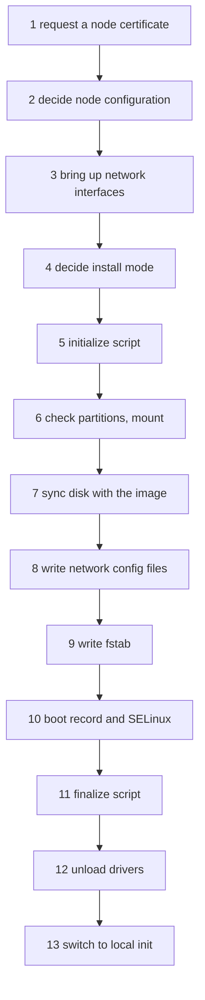
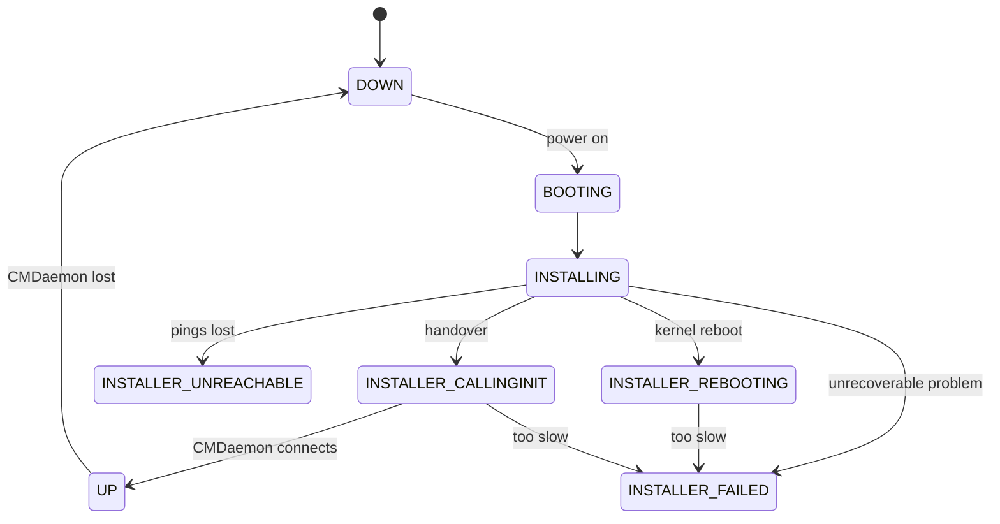

# 8.4 Node provisioning: images, kernels, categories and the PXE flow

| | |
|---|---|
| Level | Beginner to intermediate |
| Priority tier | 1 |
| Lab venue | Laptop |
| Part | Part 8: NVIDIA Base Command Manager |
| Status | Drafted (`provision_lab.py`: 82 checks pass; cluster commands **untested** on live BCM) |

## Why this matters for AI infrastructure

Picture a rack of new GPU servers powering on. Half of them sit at a boot prompt, and the rest come up with last month's software. Provisioning exists to prevent that kind of day. BCM's job is to make 500 nodes identical. Each node boots, receives the same software image, and joins the cluster without anyone logging in to it.

A GPU cluster is only as good as its worst node. When provisioning goes wrong, you get nodes that will not boot, nodes that quietly lost their local data, or nodes running an old image. This chapter follows a node from power-on to a working cluster member, step by step. It also points out where each step can break.

## Prerequisites and outcomes

Before you start, read chapters 8.1 to 8.3. When you finish this chapter, you should be able to do the following:

- walk through the PXE boot and the 13 steps of the node installer.
- choose and explain an install mode, and say which ones can erase local data.
- explain how BCM recognises a new node and what the seven identification cases mean.
- scale provisioning with boot and provisioning roles.
- update a running node from the image safely, starting with a dry run.
- manage software images and kernels without breaking the next reboot.
- read node states and use `close`, `open`, `mute` and `drain` correctly.
- work through the troubleshooting list in order.

## 1. The big picture

Booting and provisioning are two different jobs, and it helps to keep them apart. Booting gets a small program onto the node: first the boot loader, then a kernel and a ramdisk. Provisioning copies the **software image** onto the node's disk. The image is a complete Linux filesystem that runs to many gigabytes.

By default, the head node does both jobs. When the cluster grows, you can hand each job to other nodes.

When a node fails to come up, first work out whether it failed while booting or while provisioning. The fixes for the two are different.

## 2. Before the kernel loads (5.1)

Suppose a node powers on and nobody is standing at its console. What happens next is decided before the Linux kernel loads. Nodes boot from the network by default. On `x86_64` that means PXE, and the head node runs a TFTP server. The files for that server live under `/tftpboot/pxelinux.cfg/`.

The boot loader then shows a menu. If nobody picks an entry before the timeout, the **AUTO** install mode runs. The timeout is 5 seconds, written `TIMEOUT 50` in deciseconds. Leave the menu files alone unless you really must change them.

A per-node PXE label overrides the menu default. For example, `set pxelabel MEMTEST` changes what one node boots, and it can change a whole category the same way. Setting the label to `localdrive` makes the node boot from its own disk instead. The manual discourages that, because it makes management harder.

The boot protocol is set by `bootloaderprotocol`, and its default is HTTP. Even then, the first stage is still TFTP on `x86_64`, and HTTP takes over only for the kernel and ramdisk. If your hardware cannot make that switch, set `tftp`. HTTPS almost never works. ARMv8 nodes boot over TFTP only, and they get a GRUB binary.

On nodes with a disk, BCM also installs iPXE on the drive. It acts as a fallback if the BIOS PXE attempt fails.

DHCP and TFTP can be overwhelmed when hundreds of nodes boot together. You see random nodes fail to boot, and a different set fails each time. The fix is to give the `boot` role to one regular node per rack or subnet. The head node always has the boot role. On a large cluster, plan the `boot` role before the first mass power-on, not after the first failed boot.

## 3. The node installer: 13 steps (5.4)

Once the ramdisk is running, a program called the **node installer** takes over. It works through 13 steps in a fixed order. The diagram shows that order. The numbered notes after it explain what each step does and where it can go wrong.

**1. Certificate.** The node asks the head node for a certificate. The setting `signinstallercertificates` is `AUTO` by default, or `MANUAL`. A network can refine this with `allowautosign`: Always, Automatic (the default, which applies only to networks of type internal), Never, or Secret (for edge sites). On an untrusted network, use MANUAL and approve each request in `cert` mode with `listrequests` and `issuecertificate`. The certificate is stored under `/cm/node-installer/certificates/<MAC>/`. If a node gets a bad certificate, delete that directory so the node can ask again.

**2. Who am I?** The installer asks CMDaemon whether the booting MAC address belongs to a known node, and which switch port the node is plugged into. Section 4 below covers the seven cases.

**3. Network.** The installer brings up the interfaces. First, though, it checks that each IP address is not already in use. `BOOTIF` is a special name for whichever interface the node booted from. Other interfaces stay down during install, unless you set `bringupduringinstall` to `yes` (up during install) or `yesandkeep` (up, and it stays up).

**4. Install mode.** The installer decides the install mode. Section 5 explains the options.

**5. Initialize script.** This script runs before the disks are touched. The category script runs first, then the node script. If you have hardware that the standard flow does not know how to start, use this script for it.

**6. Partitions.** The installer checks the layout in the node's disk-layout XML, creates the partitions if they are missing, and then mounts them.

**7. Sync.** The installer copies the image to the node with rsync. The exclude lists in section 8 decide which files are skipped. `provisioninginterface` picks the interface that receives the data. Its default is `BOOTIF`, but you should choose the fastest one. `provisioningtransport` is either `rsyncdaemon`, which is unencrypted, or `rsyncssh`, which is encrypted and puts more load on the provisioner.

**8 and 9.** The installer writes the interface files and `/etc/fstab`.

**10.** The installer can write a boot record, so the node can start from its own disk (`installbootrecord`). It also sets up SELinux if that is configured.

**11. Finalize script.** This script runs just before the handover. It is the right place to append a setting that the installer would otherwise overwrite on every boot.

**12. Unload drivers.** The IPMI drivers are needed to configure the BMC. After that they keep using CPU and power, so by default they are unloaded here (`removeModulesBeforeInit`).

**13. Hand over.** The node passes control to `/sbin/init` on the local disk. From then on, it behaves like any Linux machine.

When a node stalls, find the step it reached before you change anything.

## 4. Who is this node? The seven cases (5.4.2)

A new or returning node can be recognised by its **MAC address**, by the **switch port** it is plugged into, or by both. The manual has a seven-row truth table. Read it as a set of questions about what the head node already knows.

| # | Node known? | Port detected? | Port configuration | Result |
|---|---|---|---|---|
| 1 | no | yes | found | suggested, accepted after a timeout |
| 2 | no | yes | none | **manual**: dialog loops |
| 3 | no | no | none | **manual**: dialog loops |
| 4 | yes | yes | same as the MAC's | suggested, accepted |
| 5 | yes | yes | **differs** from the MAC's | **manual**: port mismatch |
| 6 | yes | no | the MAC's config expects a port | **manual**: port mismatch |
| 7 | yes | yes | the MAC's config has no port | suggested, accepted |

In practice, a brand-new node with no switch configuration always stops for a human. Those are cases 2 and 3. A port mismatch, in cases 5 and 6, usually means two nodes were swapped by mistake. The installer protects you by stopping. For case 6, the manual's simplest fix is `cmsh -c "device clear node001 switchports; commit"`. You can also enable port detection on the switch.

Naming new nodes is where `newnodes` comes in. In cmsh device mode, `newnodes` lists the MAC addresses that are waiting to be named. Running `newnodes -s -n node001..node032` assigns names in the order the nodes arrived. That is why you should power nodes on in the order you want them named. A few flags adjust this. `-w` assigns a name without saving it, and `-s` saves it. `-o 1` skips the first arrival. `-f` forces a name that is already taken and moves it to the new MAC, so use it with care. The lab checks the manual's `-o` example.

You can also create node objects before the hardware arrives. Use `add physicalnode node002 10.141.0.2` in device mode, the Base View node creation wizard, or `foreach --clone`. A node object with no MAC address is a **placeholder**. The installer then lets someone pick the identity at the console.

Before the racks arrive, decide the naming order, so you do not have to rename nodes at the console.

## 5. Install modes (5.4.4)

The install mode tells the installer what to do with the node's disk. Pick the wrong one and the node can lose its local data. The table lists the five values.

| Mode | Disk check | What happens | Wipes data? |
|---|---|---|---|
| **FULL** | none | repartition, new filesystems, full image copy | **yes** |
| **AUTO** (default) | yes | healthy: quick incremental sync. Unhealthy: becomes FULL | only if unhealthy |
| **MAIN** | none | drops into **maintenance mode**; drive untouched | no |
| **NOSYNC** | yes | healthy: **no sync**, local contents kept. Unhealthy: rewrite partitions and FULL sync | only if unhealthy |
| **SKIP** | none | no check and no sync, for data recovery | no |

The manual is blunt about NOSYNC. It says NOSYNC "should therefore not be regarded as a way to protect data". Its own example shows why. A burn run (chapter 8.2) destroys the partition layout. On the next reboot, the layout no longer matches, so even NOSYNC does a FULL sync. A failing drive that renumbers (`/dev/sdb` becomes `/dev/sda`), or a node with a new MAC address, can do the same thing to AUTO and NOSYNC.

The installer looks for the install mode in a fixed order. The manual states: *"The node-installer looks for install-mode execution settings in this order:"*

1. The category's **`newnodeinstallmode`** property (default **`FULL`**, used when a node is detected to be new).
2. The **PXE menu** option chosen on the node console before loading the kernel and ramdisk (affects the current boot only; default **`AUTO`**).
3. The node's **`nextinstallmode`** property (cleared automatically after the node-installer finishes its installation tasks; empty unless set during the current uptime).
4. The node's **`installmode`** property (by default auto-linked to the category's `installmode`, showing **`AUTO (Category)`**).
5. The category's **`installmode`** property (default **`AUTO`**).
6. A **console dialog** during the node-installer run, which *"gives the user a last opportunity to overrule the install-mode value as determined by the node-installer"* (default **`AUTO`**).

Be careful with precedence here. Item 1 applies to new nodes. Item 4 is auto-linked to item 5 by default. Item 6 overrules whatever the earlier steps chose. The manual does not say whether a non-default PXE menu selection (item 2) beats an explicitly set `nextinstallmode` (item 3). It also does not say how that compares with an unlinked node `installmode` (item 4) when both are set. Treat that interaction as unresolved, and verify it on a test node before you rely on simultaneous overrides.

Protecting nodes that hold data is the job of `datanode`. Set `datanode yes` on a node or a category. Because it is a Boolean, the category and node values combine as category OR node. Once it is set, any FULL install waits for a human to confirm, even when AUTO or NOSYNC falls back to FULL. Confirm at the console, or run `installerinteractions -w -n node001 --confirm`. The `--deny` flag sends the node to maintenance mode instead. The manual also describes XML assertions, which halt the install if the expected drive is missing. It describes `blockdevicesclearedonnextboot` too, which does the opposite. It erases the named devices on the next boot and ignores `datanode`, so be careful with it.

If you plan a mass reboot and do not want a re-sync, you can set the mode for many nodes at once: `device foreach -n node001..node999 (set nextinstallmode nosync)`, then commit.

Mark any node that holds local data with `datanode yes`, so that a FULL install waits for you.

## 6. Scaling provisioning: provisioning nodes (5.2)

When many nodes install at once, they all pull the image from the head node. The provisioning role lets you hand that traffic to other nodes. The head node always has the provisioning role, and you can give it to other nodes to share the image traffic. Each parameter below controls one part of that job.

| Parameter | Meaning |
|---|---|
| `provisioningslots` | How many nodes it serves at once. **Default 10.** Lower it if the NIC or disk saturates |
| `allimages` | `onlocaldisk` (default), `onlocaldiskexceptsharedimages`, `onsharedstorage`, or `no` (then only `localimages` / `sharedimages`) |
| `nodegroups` | If set, this provisioner serves only nodes in those groups, and those nodes only use provisioners that list the group. Nodes in no group use provisioners with no nodegroups. Use it to build a rack-by-rack hierarchy |

The default of 10 slots is easy to reason about. Suppose you add a second provisioner and leave both at the default. Each one serves 10 nodes at once, so together they serve 20 (10 plus 10). If the NIC or disk saturates, lower the value on that provisioner.

The head node follows a few housekeeping rules. Requests are first come, first served. Among the eligible provisioners, the one with the fewest started tasks gets the request. A cluster-wide ceiling, `MaxNumberOfProvisioningThreads` in the head node's `cmd.conf`, limits all provisioning together. If no provisioner is free, the request is deferred and retried when a task finishes. A locked image also defers the request. A failed transfer is retried 5 times before it fails. A provisioner that loses connectivity keeps its requests for 180 seconds, and then they fail.

Cold-start order matters. Start the head node first, then the provisioning nodes, because they must be provisioned too. Start everything else after that. Provisioners also keep a copy of every image they serve, in the same path as the head node, so give them disk space for it.

Images reach the provisioners through `updateprovisioners`. It runs by itself after changes made through cmsh or Base View, and by default it also runs every midnight (UTC). If you change an image outside BCM, for example by copying a file in from the shell, you must run it yourself. A provisioner that is being updated serves nobody until the update finishes. The setting `dirtyautoupdatetimeout`, with a default of 300 s, stops the automatic run from firing too often. Setting it to 0 disables the automatic trigger.

`drain` and `undrain`, in `softwareimage` mode, stop a provisioner from taking new requests while its active ones finish. `provisioningstatus` shows slots and state. `synclog` shows what rsync did, and `syncinfo` gives statistics.

Provisioning nodes scale image delivery and booting. They do not move the whole management plane. CMDaemon, the database and the monitoring data still live on the head node and on its HA partner. If the head node is the limit, add provisioning nodes for image traffic, and plan the management services separately.

## 7. Software images and kernels (5.3, chapter 9)

A software image is a directory on the head node, such as `/cm/images/default-image`. It holds a kernel and a ramdisk. The ramdisk carries the drivers a node needs to reach the network and the disk. The rest of the image arrives later, during provisioning.

A wrong kernel module list at a lower level can stop a node from booting, so image changes need care. Kernel modules for the ramdisk can be set on the image, on the category, or on the node. **A lower level replaces the higher level completely; it does not add to it.** Normally, set the list on the image only. Changing the list makes CMDaemon rebuild the ramdisk with `createramdisk`.

The manual lists 11 safe habits, and following them keeps an image change from breaking the next reboot. Start with habit 1: clone a working image before you change it. Then change the image with `cm-chroot-sw-img /cm/images/default-image`, which mounts the special directories for you. Inside it, use `yum`, `zypper` or `apt`. You can also use `yum --installroot`. If the package tools complain that the image is being provisioned, lock it first with `softwareimage lock default-image`, and unlock it afterwards. A new kernel in an image is not used until you set the image's `kernelversion`. Commit the change, and tab completion lists the choices. BCM keeps old kernels instead of the distribution's "keep 3".

Habits 5, 6 and 7 cover kernel and module checks. After a kernel or module change made with a package manager, run `createramdisk`. The package manager updates the normal ramdisk, not BCM's extended one. If you forget, nodes fail while loading the ramdisk. Inside a chroot, `uname -a` shows the kernel running outside the chroot. To see the kernel the node will load, run `cmsh -c "softwareimage; use default-image; get kernelversion"`. A `chrootprocess` health check warns you when a daemon is running inside an image.

Habit 8 is to keep the node-installer image at `/cm/node-installer` updated too. Habit 9 stops a kernel from changing, using `yum --exclude kernel update`, `apt-mark hold` or `zypper addlock`. Habit 10 applies to HA head nodes. Change the passive head first when you install a kernel, because the active head's network might stop and trigger a failover.

Habit 11 covers kernel parameters. They live in the `kernelparameters` property of `softwareimage` mode. For example, `append kernelparameters " VLANID=89"` adds one. Do not treat `numa_balancing=0` and `iommu=pt` as universal BCM defaults. NVIDIA's DOCA host-configuration documentation lists `iommu=pt` for specific cases, such as resolving `IO_PAGE_FAULT` DMA errors in `dmesg` or enabling certain DOCA services. Add a kernel parameter only for a documented reason, and test it on a canary category first.

Sometimes you change a node first and save the result back into an image with `grabimage`. The cleaner route is to change the image directly, in a chroot. `grabimage` copies from a running node into the image, using `excludelistgrab`. `grabimage -i <newimage>` makes a new image instead, using `excludelistgrabnew`. The manual warns that unwanted changes can be captured this way. Compare the images before you trust the result. The manual's tip is `vimdiff <(cd image1; find . | sort) <(cd image2; find . | sort)`.

### 7.1 InfiniBand and VLAN provisioning

By default, BCM provisions nodes over Ethernet. The reason is that the `rdma` init script (or `openibd` on SLES) loads the InfiniBand kernel modules only after the node-provisioning stage finishes. To provision at InfiniBand speed during the pre-init stage, you need two changes. This assumes `ibnet` is already configured, as in chapter 8.3.

1. **Put the HCA's InfiniBand drivers in the image's ramdisk.** First find the modules that `rdma` loads on a booted node. Run `lsmod | cut -f1 -d" " > /tmp/a`, then `systemctl start rdma-load-modules@rdma`, then `lsmod | cut -f1 -d" " > /tmp/b`, and finally `diff /tmp/a /tmp/b`. On RHEL 7 and later, `rdma` can only be started once per boot, and it cannot be stopped. Then add those modules, such as `mlx4_ib`, `ib_ipoib` and `ib_umad`, with `softwareimage use default-image; kernelmodules; add ...; commit`. That regenerates the ramdisk.
2. **Set the provisioning interface to `ib0`.** Run `device; foreach -n node001..node150 (set provisioninginterface ib0); commit`.
   - **Critical `BOOTIF` rule:** the interface a node boots from (`BOOTIF`) must not also be configured as a separate named interface for that node in CMDaemon. If `BOOTIF` is `ib0`, do not keep a separate `ib0` interface entry on the node. Change either `BOOTIF` or the `ib0` configuration, so that node installation can succeed.

**VLAN provisioning (supported since BCM 8.2)** needs four things together:

1. A VLAN network and a node VLAN interface, as set up in chapter 8.3.
2. The `8021q` (`rtnl-link-vlan`) kernel module in the software image. Recent distributions ship it as a module, not built into the base kernel, so add it with `softwareimage use default-image; kernelmodules; add 8021q; commit`. When the module is loaded on the node, `lsmod | grep 8021q` shows `8021q`, `garp` and `mrp`.
3. BIOS VLAN support. The node's BIOS network options must have `VLANID` set. If the BIOS cannot set a VLAN ID, PXE over VLAN cannot work. In that case, check for a NIC firmware or BIOS update.
4. `VLANID` in the image's `kernelparameters`, set with `softwareimage use default-image; append kernelparameters " VLANID=89"; commit`.

### 7.2 Creating custom, DGX, multi-distro, and multi-arch images (`cm-create-image` and `cm-image`)

Sometimes you need a software image from scratch. That might be for a DGX platform, for a different Linux distribution (`multidistro` / `multiOS`), or for a different CPU architecture (`multiarch`: `x86_64` and `aarch64` / ARMv8). BCM provides two tools for this job.

**1. `cm-create-image`, from the `cluster-tools` package.** This tool builds an image from a base distribution archive, called the `basetar`. The archive can be `/data/UBUNTU2404.tar.gz` from the BCM ISO. It can also be a tar or rsync copy taken from a clean base host. A base host is a regular node, never a head node. When you take that copy, exclude `/proc`, `/sys`, `/tmp/*`, `/var/log/*`, `/etc/HOSTNAME`, `/etc/udev/rules.d/*persistent*.rules`, `/root/.ssh`, and so on.

- **SELinux note:** to use SELinux on compute nodes, extended attributes must not be used. Run `fspart; foreach * (set rsyncxattr no)`.
- **The main options.** `--fromarchive <tar.gz>` (`-a`) builds from an archive. `--fromdir <dir>` (`-d`) builds from a directory. `--fromhost <hostname>` works like `grabimage`, and it also works on unmanaged generic nodes, as long as passwordless SSH works. `--frombfb <file>` is the fourth source. Pair any of these with `--imagename <name>` (`-n`) and, optionally, `--imagedir <dir>` (`-i`). The image directory must already exist, and it defaults to `/cm/images/<name>`. If the image name already exists, `cm-create-image` exits unless you add `-f` or `--updateimage`.
- **`--skipdist`** skips installing extra base distribution packages. You need it when the source already contains them, such as a DGX OS image that already includes Ubuntu. Combining `--updateimage --skipdist` updates an existing DGX image in place.
- **`--dgx` and `--dgx-type`.** `--dgx` builds a DGX platform image, for example from `UBUNTU2404.tar.gz`, and sets the standardized kernel parameters for that GPU platform. `--dgx-type` takes one of `{dgx_h100, dgx_b200, dgx_a100, dgx_gb200, dgx_h200, dgx_b300, dgx_gb300}`.
- **`--extra-pkg-group <group>`** installs extra packages defined in `/cm/local/apps/cluster-tools/config/<DIST>-dist-extrapackages.xml`. The examples in that file include `doca_ofed_2.9.1-2`, `doca_ofed_2.9.3`, `doca_ofed_2.10.0-093520` and `doca_ofed_3.0.0`.
- **`-e` and `-s`.** `-e` keeps custom repo files in the image from being overwritten, and `-s` skips the additional base distribution packages. Both suit offline image creation from local repos.
- **Package selection and default kernel modules.** Package lists live in `/cm/local/apps/cluster-tools/config/<DIST>-config-dist.xml`. The `image="master"` entries cover head node packages, and `image="slave"` entries cover regular node images. Default boot kernel modules are read from `/cm/local/apps/cluster-tools/config/<DIST>-slavekernelmodules`. Logs go to `/var/log/cm-create-image-<imagename>.log`.
- **Pre-11.30.0 `doca.list` bug on B200 and GB200.** Before BCM 11.30.0, DGX images that `cm-create-image` builds for B200, GB200 and similar hardware need one fix. Remove `/etc/apt/sources.list.d/doca.list` inside the image, using `cm-chroot-sw-img` and `rm /etc/apt/sources.list.d/doca.list`, then reboot the nodes. If the file stays, `cm-kubernetes-setup` fails at around 22% progress.

**2. Multi-distro, multi-arch, `nodearchosinfo`, and `cm-image`.** The compatibility matrix tells you which images a head node can serve. A head node running RHEL 8, RHEL 9, or Ubuntu (22.04, 24.04, 26.04) on `x86_64` or `aarch64` can serve compute node images of RHEL 8, RHEL 9, Ubuntu 22.04, Ubuntu 24.04, and Ubuntu 26.04, on both `x86_64` and `aarch64`. It can also serve SLES 15, but only on `x86_64`. SLES 15 is `x86_64`-only both as a head node and as an image.

- **`device nodearchosinfo`** shows, for each node, the `Reported arch`, `Reported OS` and `Reported timestamp`, next to the `Configured arch` and `Configured OS`. It warns when the reported and configured OS differ. The reported fields update only when the node's CMDaemon connects. So an unchanged timestamp after a reboot means the node failed to come up into CMDaemon.
- **`cm-image`**, loaded with `module load cm-image`, wraps `cm-create-image`. Its subcommands are `cm-image create {all|node-installer|swimage|fromfile|cmshared}`, `cm-image remove`, `cm-image package` and `cm-image shell`. Running `cm-image create all -a <arch> -d <distro> --source <basetar>` creates four things together, and it updates the `fspart` entries for `/cm/shared` and `/cm/node-installer`:
  1. Software image: `/cm/images/default-image-<distro>-<arch>`
  2. Node-installer image: `/cm/node-installer-<distro>-<arch>`
  3. Shared directory: `/cm/shared-<distro>-<arch>`
  4. Category: `default-<distro>-<arch>`. It also sets `primaryimage` in `partition[base]->archos[<arch>/<os>]`. If you set `primaryimage` by hand, a category that uses that image should exist.

**Switching a node's OS needs a FULL install.** Enabling a new distribution with `cm-image` changes critical paths, so all regular nodes should be rebooted. Any node moved to a new OS category should first get `set nextinstallmode FULL`, before it reboots. That keeps leftover files from the old OS from corrupting the new image. If you copy a `cm-image` directory from another cluster, register it in CMDaemon with `cm-image create swimage -a <arch> -d <distro> --add-only`.

**ARMv8 (`aarch64`) node settings.** On the ARMv8 category, set `set bootloaderprotocol tftp`. On the ARMv8 software image, set `set kerneloutputconsole ttyAMA0`. For Fujitsu A64FX ARMv8 nodes, also set `bmcsettings -> set extraarguments "-L USER -t 0x30"`, and switch the `ipmi` monitoring producer multiplexer to the `a64fx` resource.

Decide which distributions and architectures you need before you run `cm-image create`.

## 8. Updating a running node: `imageupdate` and exclude lists (5.6)

Suppose a node is busy running jobs, and you need to push a new image to it without a reboot. The safe approach is to see every change before you write any of them. Three directions, three lists:

| Operation | List used | Direction |
|---|---|---|
| `imageupdate` | `excludelistupdate` | image to **running** node (sync) |
| install, FULL | `excludelistfullinstall` | image to starting node (full) |
| install, AUTO healthy | `excludelistsyncinstall` | image to starting node (sync) |
| `grabimage` | `excludelistgrab` | node to existing image (sync) |
| `grabimage -i` | `excludelistgrabnew` | node to new image (full) |

`imageupdate` is a dry run by default. It writes nothing. Read the result with `synclog`, then run `imageupdate -n node001 -w` to apply it.

The update list has two parts. Paths on the first part are left alone if they exist on the node. If they are missing, they are copied from the image. Paths on the second part, prefixed `no-new-files:`, are left alone if they are present. They are not copied if they are missing. Everything on neither part is overwritten from the image, and files that exist only on the node are deleted. The manual notes that content not on the lists "is normally not protected from deletion".

BCM protects some filesystems on its own. It skips statically imported filesystems of these types: NFS, Lustre, FUSE, CephFS, CIFS, PanFS, FhGFS, BeeGFS, GlusterFS and GPFS. It does not protect autofs mounts, because BCM cannot see them reliably. It also does not protect filesystems you mounted by hand into the image. Add those to the exclude list yourself, or an update can wipe them.

Two traps catch people. (1) The first is the five-minute trap. If an image changed within `dirtyautoupdatetimeout`, the provisioners may not have the new copy yet, so the nodes do not get it. Run `updateprovisioners` right before `imageupdate`. (2) The second trap is the size of the change. For larger changes, the manual suggests a reboot instead. A reboot does an AUTO install of the latest image and restarts all services. Reinstall node in Base View is like a reboot, but it forces a FULL install.

`excludelistmanipulatescript` lets you rewrite the lists on the fly. `excludelist get full /` shows what a node would really use. Be careful with the script, though. The manual notes that saving it with a single stray space can do harm. For a larger change, weigh the reboot the manual suggests against a live update.

## 9. Node states (5.5)

A node's state tells you what it is doing, so read it before you touch anything. A healthy boot moves through BOOTING, then INSTALLING with messages such as "checking disks" and "provisioning started", then INSTALLER_CALLINGINIT, and finally UP. UP means the node's CMDaemon has connected to the head node.

You only see BOOTING if an interface is called `BOOTIF`, or if one interface carries the revision tag bootif.

CLOSED is set by the administrator, for example with `close -m "fan dead" -n node001`. A closed node shows as `UP/CLOSED` or `DOWN/CLOSED`, and it stays closed through reboots. The only way out is `open`, which passes through a short OPENING state of about 5 seconds, and never more than 30. OPEN is never printed.

A closed node keeps running its jobs, because the workload manager does not depend on CMDaemon. That is why you should drain a node before you close it, even though the manual does not require it. `mute` is a different tool. It keeps the state but silences alerts and triggers, which helps during maintenance. Remember to run `unmute` afterwards.

`restart-required` appears after you change network settings, disk setup, the software image or the category. It tells you the node needs a restart before the change takes effect.

## 10. When a node will not boot: a checklist (5.8)

A node that will not boot is frustrating, because the cause could be in the network, the BIOS, the image or the BMC. Work through this list in order. Each check rules out one layer before you move on to the next.

1. **Does the network allow boot?** Run `network use internalnet; get nodebooting`, which must return yes. Check whether `lockdowndhcpd` is on, because then new nodes get no lease. Also look for a rogue DHCP server on the network. `nmap --script broadcast-dhcp-discover` can list them.
2. **BIOS.** Check the boot order, and put the boot NIC first. UEFI network boot can be buggy, so try legacy boot. Spanning tree (STP) on the switch can make nodes fail to boot at random, so disable it on managed switches.
3. **Cables, switch, and the wrong interface.** Test with a direct cable. Since BCM 9.0, the consistent naming scheme (`eno1`) is the default and the recommended choice.
4. **TFTP hung.** Check with `ps ax | grep [t]ftp`. If the TFTP-to-HTTP switch is hung, set `bootloaderprotocol tftp`.
5. **Node installer log.** The log is `/var/log/node-installer` on the head node, under facility `local5`. On the node console, press Alt+F7. Debug logging is a field in `node-installer.conf`. If there is no log at all, the image may be locked (`provisioningstatus -a` says "request deferred"), or `nodegroups` may be wrong.
6. **Provisioning log.** Run `synclog`. An rsync exit code 23 means a transfer error. The manual's example is a missing `lscratch` mount point in the image.
7. **Ramdisk fails after an image update.** Run `createramdisk`, and check the kernel module lists at every level. If you see "No space left on device" while the ramdisk is being made, raise `RamdiskCreationTmpfsSize`. The default tmpfs was 256 MB before 11.31.0, and 512 MB from 11.31.0 onwards.
8. **Ramdisk cannot start the network.** Add the NIC's kernel module to the image. Use `kernelmodules`, then `add e1000`, as in the manual.
9. **Cannot create the disk layout.** The log shows that the device was not found. Check the layout XML against the real device name.
10. **Cannot start the BMC.** Add the IPMI modules to the image. If the BMC still fails, the settings `setupBmc`, `failOnMissingBmc` and `failOnFailedBmcCommand` in `node-installer.conf` loosen the checks. A BMC in a glitchy state may need a cold reset, with `ipmitool ... mc reset cold`. Read the BMC's SEL for CPU, ECC and memory errors before you decide a reset is needed. Part 7 shows the Redfish way.

Read the BMC's SEL before you reach for a cold reset.

## 11. Booting from the node's own disk (5.4.10)

Suppose a node should boot from its own disk. Four things must all be true. First, `installbootrecord yes` must be set. Second, the BIOS must try the disk before the network. Third, the node needs a working bootloader. The default is syslinux, and a custom image may need `grub`. Fourth, `BOOTIF` must be renamed to a real device name such as `eth0`. `BOOTIF` means nothing when the node did not PXE boot, so the name has to change.

Most AI clusters keep netbooting instead. Unless you have a clear reason to run standalone nodes, leave them on netboot.

## 12. Common first mistakes

Most of these mistakes are easy to make on a busy day. Here are ten to avoid.

1. Treating NOSYNC as data protection.
2. Not setting `datanode` on nodes that hold local data.
3. Powering nodes on in random order, and then wondering why the names are wrong.
4. Editing an image by hand and forgetting `updateprovisioners`.
5. Running `imageupdate -w` without reading `synclog` first.
6. Installing a kernel into an image and forgetting `kernelversion` and `createramdisk`.
7. Expecting kernel modules set at node level to add to the image's list.
8. Leaving autofs mounts off the exclude list.
9. Closing a node and assuming its jobs stopped.
10. Leaving STP on a managed switch.

Before your next image change, check the steps about provisioners, sync logs and kernel versions first.

## Exercises

These exercises use the lab script and the commands from this chapter. The commands were never run on a live BCM system, so treat the lab output as a rehearsal.

1. Run `python3 provision_lab.py`. Pick four checks, and explain each rule in your own words.
2. Add a fourth provisioner with `nodegroups={"rack-b"}`. Then show where nodes in `rack-b` go, and where nodes in no group go.
3. A node holds useful local data. Which settings keep that data safe if its drive renumbers? Test your answer with `install_plan`.
4. Write the sequence of commands, taken from this chapter and untested, that puts a new kernel into `gpu-image` safely.
5. Your update covers 200 nodes. Write a runbook with these steps in order: lock, update, `updateprovisioners`, dry run, review, `-w`, verify.
6. Use `sync_update` to show what happens to a file that exists only on the node. Run it once with an exclude entry and once without one.

## 14. Interview angles

These are the questions to be ready for, with a short answer for each.

- **"Walk me through a BCM node boot."** Start with PXE, then the kernel and ramdisk. After that come the certificate, identification, interfaces, install mode, disk check, rsync and config files. Then the finalize script and init run, and finally CMDaemon connects, and you have covered the whole chain.
- **"A node lost its data after a reboot. Why?"** A FULL install did it. Either the mode was forced to FULL, or AUTO or NOSYNC fell back to FULL after a partition or MAC change. You can prevent it with `datanode` and assertions.
- **"How do you roll an image out to 500 nodes?"** Edit in a chroot, lock if needed, run `updateprovisioners`, do an `imageupdate` dry run, review it, apply with `-w`, or reboot for larger changes.
- **"What does CLOSED mean?"** Monitoring stops, but jobs do not. Only `open` clears it.
- **"How does the head node avoid being the bottleneck?"** Use the boot role, the provisioning role, slots and nodegroups. CMDaemon and the database still stay on the head node, though.

## Checkpoint questions (20)

1. What is the difference between **booting** (`boot` role) and **provisioning** (`provisioning` role) in BCM?

Booting is the `boot` role's job. It delivers the first network bootloader (`pxelinux`, `iPXE` or `GRUB`), the kernel and the ramdisk, using DHCP, TFTP and HTTP. Provisioning is the `provisioning` role's job. It copies the full, multi-gigabyte **software image** root filesystem onto the node's local drives with `rsync`.

2. Which network protocol does the very first PXE stage use on `x86_64` even when `bootloaderprotocol` is set to `HTTP` (the default)?

The first PXE stage still uses **TFTP** on `x86_64`. It fetches the initial boot menu or loader from `/tftpboot/pxelinux.cfg/`. After that, **HTTP** takes over to move the larger kernel and ramdisk. On ARMv8 `aarch64` nodes, `bootloaderprotocol` must be `tftp` only.

3. What cluster symptom indicates that the head node's `boot` role is overloaded, and how do you fix it?

You see a boot storm. Random nodes fail to get DHCP leases or time out on TFTP, and a different set of nodes fails on each attempt. The fix is to give the **`boot` role** to one regular node per rack or subnet.

4. List the 13 sequential steps executed by the BCM `node-installer` (§5.4).

1. Request a node X.509 certificate (`signinstallercertificates` / `allowautosign`).
2. Determine node identity and configuration (MAC and switch port).
3. Bring up network interfaces (`BOOTIF`, IP conflict check).
4. Determine the **install mode** (`FULL`, `AUTO`, `MAIN`, `NOSYNC`, `SKIP`).
5. Run the **`initialize` script** (category, then node).
6. Check or create disk partitions (`disksetup` XML) and mount filesystems.
7. Synchronize local disks with the **software image** via `rsync`.
8. Write network interface configuration files.
9. Write `/etc/fstab`.
10. Install the local boot record (`installbootrecord`) and configure SELinux.
11. Run the **`finalize` script** (category, then node).
12. Unload temporary installer drivers (`removeModulesBeforeInit`, for example IPMI).
13. Hand over execution (`pivot_root` / `exec`) to **`/sbin/init`** on the local disk.

5. What do `signinstallercertificates` (on the partition) and `allowautosign` (on a network) control during Step 1 of `node-installer`?

`signinstallercertificates` decides whether CMDaemon signs new node certificate requests on its own. Its values are `AUTO`, the default, or `MANUAL`. `allowautosign` refines that per network, with the values `Always`, `Automatic` (for internal networks only), `Never` or `Secret`. On an untrusted network, set `MANUAL` and approve each request in `cert` mode with `listrequests` and `issuecertificate`.

6. What is `BOOTIF` in BCM, and what rule applies if you provision over InfiniBand (`ib0`)?

`BOOTIF` is a special interface alias. It means whichever physical network interface the node PXE-booted from. The rule is strict. The interface the node boots from (`BOOTIF`) must not also be configured as a separate named interface, such as a separate `ib0` entry, on that node in CMDaemon.

7. Name the five BCM install modes (`FULL`, `AUTO`, `MAIN`, `NOSYNC`, `SKIP`) and what each does.

- **`FULL`:** Repartitions the drives, creates fresh filesystems and copies the full software image. This wipes local data.
- **`AUTO` (default):** Checks the partition layout. If it is healthy, it runs a fast incremental `rsync`. If it is unhealthy or mismatched, it falls back to **`FULL`**.
- **`MAIN`:** Drops the node into the interactive `node-installer` maintenance shell without touching the disks.
- **`NOSYNC`:** Checks the disk layout. If it is healthy, it skips `rsync` and boots the existing disk contents. If it is unhealthy or mismatched, it falls back to **`FULL`**.
- **`SKIP`:** Skips both the disk check and the `rsync`. It is used for emergency data recovery.

8. Which three install modes can wipe local disk data, and why is `NOSYNC` NOT a data-protection mechanism?

**`FULL`**, **`AUTO`** and **`NOSYNC`** can all wipe local disks. Both `AUTO` and `NOSYNC` check the partition table first. If the layout does not match, they fall back to a **`FULL`** repartition and sync. For example, a destructive burn run, a drive that renumbers from `/dev/sdb` to `/dev/sda`, or a MAC swap can cause that mismatch. So never rely on `NOSYNC` to protect local data.

9. How does `datanode yes` protect a node that holds important local data, and how does it combine between category and node?

When `datanode` is `yes`, any `FULL` install, including an automatic fallback from `AUTO` or `NOSYNC`, stops and waits for explicit human confirmation. Confirm on the console, or run `installerinteractions -w -n node001 --confirm`. Use `--deny` to send the node into maintenance mode instead. Because `datanode` is a Boolean, the category and node values combine as **category OR node**.

10. In the 7-case node identification table (§5.4.2), which four cases halt and wait for manual human intervention?

- **Cases 2 and 3:** The MAC address is new, and no switch-port rule identifies the node.
- **Cases 5 and 6 (port mismatch):** A known MAC address boots on a different switch port than the one configured (Case 5). Or no switch port is detected, even though the configuration expects one (Case 6). The installer stops in both cases, which protects you when two servers are cabled to the wrong ports.

11. What is the default number of `provisioningslots` on a provisioning node, and how does the head node pick among multiple eligible provisioners?

The default is **`10` slots** (`provisioningslots`). Requests are handled first come, first served. Among the eligible provisioners, which are the ones matching `nodegroups`, the head node sends each request to the provisioner with the **fewest started tasks**.

12. After how many failed transfer attempts does a provisioning request fail, and how long does a disconnected provisioner hold active requests?

For example, a failed transfer is retried **5 times** before it fails. A provisioner that loses connectivity holds its active requests for **180 seconds** before they fail.

13. What do `updateprovisioners` and `dirtyautoupdatetimeout` (default `300 s`) do, and what is the "five-minute trap"?

`updateprovisioners` pushes software image changes from the head node out to the provisioning nodes. `dirtyautoupdatetimeout`, 300 seconds by default, rate-limits the automatic triggers that follow `cmsh` or Base View edits. Changes made directly in a shell chroot, outside `cmsh`, do **not** trigger it automatically until midnight UTC. That is the five-minute trap. If you run `imageupdate` on compute nodes before running `updateprovisioners`, the nodes pull stale files from the provisioners.

14. Is `imageupdate` a live write or a dry run by default, and what flag applies the changes to a running node?

`imageupdate` is a **dry run by default**. It writes nothing, and it logs the planned changes to `synclog`. If you want the changes written to a running node, pass **`-w`**, as in `imageupdate -n node001 -w`.

15. In `excludelistupdate`, what is the difference between a standard excluded path and a path prefixed with `no-new-files:`?

A standard excluded path is left alone if it already exists on the node. If it is missing, it is copied from the image. A path prefixed with `no-new-files:` is left alone if it is present, and it is **not copied** even if it is missing. Any path on neither list is overwritten from the image, and node-only files outside the exclude list are **deleted**.

16. Which network/parallel filesystems does BCM automatically protect during `imageupdate`, and which mount type must you manually add to `excludelistupdate`?

BCM automatically skips statically mounted **NFS, Lustre, FUSE, CephFS, CIFS, PanFS, FhGFS, BeeGFS, GlusterFS and GPFS** filesystems. `autofs` mounts are not detected automatically, and neither are manual ad hoc mounts. Add them to `excludelistupdate`, or `imageupdate -w` can wipe them.

17. When kernel modules (`kernelmodules`) are configured on a software image, a category, and a node, do lower levels append to or replace higher levels?

A lower level **completely replaces** the higher level's list. It does not append to it. An incomplete `kernelmodules` list on a node or category drops the image's storage and network drivers, and then the node cannot boot.

18. After installing a new kernel package inside a chrooted software image (`cm-chroot-sw-img`), what two `cmsh` steps are required so nodes actually boot the new kernel?

Two steps are needed. First, set the image's **`kernelversion`** property with `softwareimage use default-image; set kernelversion <ver>; commit`. Second, run **`createramdisk`**, so BCM rebuilds its extended provisioning initrd with the new kernel's modules.

19. What are the four requirements for PXE provisioning over a tagged VLAN (§5.3.4), and what is the pre-11.30.0 `cm-create-image` `doca.list` bug on B200/GB200?

VLAN provisioning needs four things: a VLAN network and node VLAN interface, the **`8021q`** kernel module in the image's `kernelmodules`, **BIOS PXE VLAN ID support** enabled on the node, and **`VLANID=<id>`** appended to the image's `kernelparameters`. Separately, before BCM 11.30.0, DGX images that `cm-create-image` builds for B200 or GB200 must have `/etc/apt/sources.list.d/doca.list` removed inside the image. If you skip that, `cm-kubernetes-setup` fails at around 22%.

20. If you run `close -m "fan dead" -n node001` in `cmsh`, what happens to Slurm or Kubernetes jobs currently running on `node001`?

**Running jobs keep executing.** `close` only tells `CMDaemon` to stop monitoring and provisioning the node. The workload manager, `slurmd` or `kubelet`, does not depend on CMDaemon. Still, you should drain the node in the scheduler before you close it or power it off.

## Sources and review notes

- **BCM 11 Administrator Manual, chapter 5:** 5.1 (PXE, labels, protocol, boot role), 5.2 (provisioning nodes, housekeeping), 5.3 (kernel modules, 5.3.3 InfiniBand provisioning, 5.3.4 VLAN provisioning), 5.4 (all 13 steps, install-mode execution list in 5.4.4), 5.5 (states), 5.6 (live updates and exclude lists), 5.7 (adding nodes), 5.8 (troubleshooting, to the BMC section).
- **Chapter 9:** 9.3 (kernels), 9.4 (packages in images, `cm-chroot-sw-img`), 9.5 (non-RPM software, `grabimage`), 9.6 (`cm-create-image`, base archives, `rsyncxattr no` for SELinux, `--skipdist`, `--updateimage`, `--dgx`, `--dgx-type`, `--extra-pkg-group`, `image="slave"`, pre-11.30.0 `doca.list` removal on B200/GB200), and 9.7 (multi-distro and multi-arch Table 9.1, `nodearchosinfo`, `cm-image create all`, `archos` `primaryimage`, ARMv8 `tftp` and `ttyAMA0`, Fujitsu `a64fx`). (Sections 9.1 and 9.2 are covered in chapter 8.13.)
- **NVIDIA-DevOps notes**, volume 10 chapter 2 and chapter 13: provisioning tiers, image drift, kernel parameters (`iommu=pt`), and the remediation tiers. Its own preface says an earlier draft invented a "proxy tier", BitTorrent seeding and Pacemaker; it was rewritten against the manual, and the facts used here agree with the manual text I read. Its remediation-tier model is the author's design recommendation, not a BCM feature; chapter 8.11 covers it.
- **Run here:** `provision_lab.py` (82 checks): boot path, install modes and the datanode guard, the seven identification cases, `newnodes`, node states, the scheduler (slots, groups, fewest tasks, deferral, locks, retries, 180 s), the update timeout trap, kernel module override, standalone boot, exclude-list sync, plus (`added in the gap pass`) InfiniBand and VLAN provisioning prerequisites, `cm-create-image` options and the pre-11.30.0 `doca.list` check, Table 9.1 multi-arch/multi-distro compatibility, `cm-image create all` artifacts, `nodearchosinfo` stale-timestamp detection, and ARMv8 settings.
- **My own choices, not the manual's:** tie-breaking between equally loaded provisioners; the "automatic" reading for a known node with no ports involved; treating the six install-mode places as a list without a verified precedence.
- **Not verified:** everything about a real BCM system: screens, command output, defaults on a newer point release.
