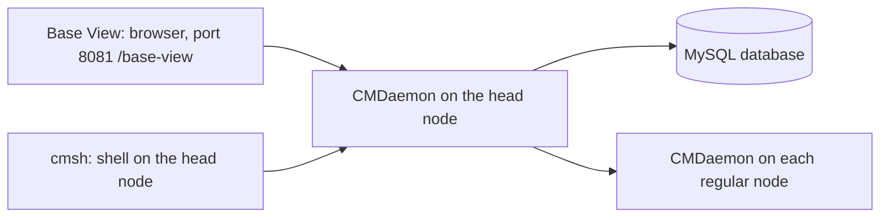

# 8.5 cmsh and Base View: administering the cluster

| | |
|---|---|
| Level | Beginner to intermediate |
| Priority tier | 1 |
| Lab venue | Laptop |
| Part | Part 8: NVIDIA Base Command Manager |
| Status | Drafted from the BCM 11 Administrator Manual, sections 2.4 (Base View; I read the access, login and navigation parts, not every screen), 2.5 (the cluster management shell, read in full) and 2.6 (CMDaemon; 2.6.1 and 2.6.2). **No BCM system was available.** `code/part08/cmsh_sim.py` is **my simulator of the behaviour the manual's sessions show**, and `cmsh_lab.py` checks 55 of them. It tests my reading of the manual, not cmsh itself. It is not a cmsh clone: it covers only the features listed in this chapter. Every command shown is from the manual and untested here |

## Why this matters for AI infrastructure

Everything in chapters 8.3 and 8.4 was done through `cmsh` or Base View. Most real work on a cluster is repetition: the same change to 8 nodes, or 512, or one rack. cmsh is built for that, and its habits (commit, list a range, dry run) are what separate a calm change from an outage. In an interview, "show me how you would change a setting on a rack" is a cmsh question.

## Prerequisites and outcomes

You need chapters 8.1 to 8.4. After this chapter you can:

- choose between Base View and cmsh, and know they reach the same CMDaemon
- navigate cmsh modes and objects, and read the prompt, including the asterisks
- use the commit model safely (`modified`, `refresh`, `commit`)
- write node lists for a rack, a range, a stride, or an exclusion
- loop over many nodes with `foreach` and `range`, clone and rename nodes
- script cmsh and get JSON-like output
- inspect and restart CMDaemon, and say what it listens on

## 1. Two front ends, one daemon



Both talk to **CMDaemon on the head node**, never straight to the daemons on other nodes. CMDaemon accepts **only SSL connections on TCP port 8081**, and authenticates with client X509 certificates (chapter 8.1 and 8.6). It keeps its data in a MySQL database on the head node. If CMDaemon stops, you lose management, but jobs run on: the workload manager is independent.

| | Base View | cmsh |
|---|---|---|
| What | Web GUI | Shell with modes and tab completion |
| Strength | Overview dashboards, discovery, one-off changes | Repeatable changes, scripts, bulk edits, exact commands in tickets |
| Reach it | `https://<head>:8081/base-view` | run `cmsh` on the head node |
| Caution | Changing many nodes is slow and hard to review | Typos act on many nodes at once |

The manual's browser table lists recent Chrome, Edge, Firefox and Safari versions; mobile browsers are not supported. The head node's plain landing page is served by Apache, and its certificate (default is a distribution self-signed one) is something you should replace. Base View is the `base-view` package; removing it turns the GUI off.

## 2. Base View in a few lines

- A **resource tree** on the left: Cluster, Networking, Provisioning, Grouping, Devices, Cloud, Containers and more. Selecting one opens its page.
- **Cluster > Overview** is the landing page: GPU, CPU and memory utilisation, job slots, device status counts (nodes, switches, NVLink switches, power shelves: closed, down, total, up), cores and GPUs, failing health checks, running and queued jobs, disk use, license information, and (for newer hardware) pages for leak detection, IMEX management and rack management.
- Two button types: one **opens an existing object**, the other (**+**) **creates a new one**. A **breadcrumb trail** at the top of each subwindow takes you back without saving.
- Every chapter of this part names the Base View path next to the cmsh command. They do the same thing.

## 3. cmsh: starting it

```bash
cmsh                      # interactive, on the head node
cmsh -c "device status node001; main showprofile"    # batch: commands separated by ;
echo "device status" | cmsh                          # piped
cmsh -f myscript.cmsh -q -x                          # run a file, quit on error, echo commands
```

Useful options from the manual's help: `-u` start unconnected, `-n` skip the rc file, `-x` echo, `-q` quit at the first error, `-Q` no quit confirmation, `--color=no`, `--hide-events` (hide events in an interactive session), `--disable-events` (for scripts; it works together with `--wait`), `-i`/`-k` alternative certificate and key.

**Start-up files.** `/etc/cmshrc` first, then your own dotfiles: `~/.cm/cmsh/.cmshrc`, `~/.cm/.cmshrc`, `~/.cmshrc`, where "the shortest path overrides". Put aliases and `groupingsyntax` there.

**Aliases.** Built in: `..` is exit, `/` is home, `?` is help, `ds` is `device status`, `ls` is `list`. Make your own with `alias lv device list virtualnode`, and `export > file` / `run file` to move them. Any script in `~/.cm/cmsh/` named `name.cmsh` becomes the alias `name`. Scripts take arguments with defaults: `device use ${1-node001}`.

## 4. Modes, objects and the prompt

cmsh groups functions in **modes** (device, category, network, partition, softwareimage, monitoring, user, and more; Appendix M shows the full tree). Inside a mode you work with **objects** (a device, a category). The prompt shows where you are:

```text
[basecm11]%                      top level
[basecm11->device]%              device mode
[basecm11->device[node001]]%     the object node001
[basecm11->device*[node001*]]%   uncommitted changes in the mode and in the object
```

- `path` prints a string that takes you back here (`home;device;use node001;`). Paste it after `cmsh -c`.
- One line can run a command in a mode without going there: `device status node001`. A semicolon **does** enter the mode: `device; status node001`.
- `home` goes to the top, `exit` goes up one level, `goto -` returns to where you came from. `bookmark` and `goto` save places.
- Prefix a command with `!` to run a shell command (`!hostname -f`); backticks substitute output; `>`, `>>` and `|` redirect.
- `ssh node001` (in device mode), `time ds node001`, and `watch -n 3 status -n node001,node002` do what they say.

## 5. The commit model: the habit that matters most

Changes in cmsh are **local until you commit**. The asterisks remind you. The commands, in plain words:

| Command | Meaning |
|---|---|
| `use X` | make X the current object |
| `add [type] name` | create an object **and drop into it** (device mode needs a type: `add physicalnode node100 10.141.0.100`) |
| `set prop value` / `get prop` | change / read a property (can name the object: `set node001 mac ...`) |
| `clear prop` | unset it (a MAC becomes `00:00:00:00:00:00`) |
| `append` / `removefrom` | edit a multi-valued property |
| `modified` | list objects with uncommitted changes: `+` new, `-` to be removed, blank changed |
| `refresh` | **undo local changes** |
| `commit` | send them to CMDaemon (`-w` waits for background work, such as cloning an image) |
| `remove X` | **propose** removal; it happens at `commit` (data is kept unless `-d`; image revisions need `-a`) |
| `clone A B` | copy an object; for a device, BCM guesses a new IP (see below) |
| `swap A B` | exchange the names of two objects (useful for two nodes swapped in a rack) |
| `usedby`, `validate` | what depends on it; check its properties |

**The safe routine:** make the change, run `modified`, read it, then `commit`. If it looks wrong, `refresh`. A `remove` followed by a forgotten `commit` leaves an asterisk, not a deletion; a `commit` executes pending removals **whichever mode it is run in**, even when the asterisk is not in the prompt (the lab tests this).

**Booleans** accept `yes`, `1`, `on`, `true` and `no`, `0`, `off`, `false`, in any case.

**Inherited values.** `get bootloaderprotocol` on a node shows `HTTP (mydefaultimage)` when the value comes from the category, which is a quick way to see where a value originates (chapter 8.1's rules).

**Cloning IP guesses.** The lab reproduces the manual's examples: cloning `node001` (10.141.0.1) to `node022..node024` gives `.22`, `.23`, `.24`. If the new names differ in digit count (`node02` from `node001`), the manual prints `Base name mismatch, IP settings will not be modified!` and the IPs duplicate until you use `--next-ip`. Cloning copies object settings, **not the software image data**, and not switch port settings. Always inspect the result.

## 6. Listing, formatting, JSON

- `list` shows objects. `list -f hostname:14,switchports:15,ip` picks columns and widths. `format` alone shows the current format and every valid field; `format -r` resets.
- Width rules: a number is fixed; `0` is the widest entry; `[10-14]` fits the text between 10 and 14 characters; longer text is cut with a `+` as the last character (`largenameforn+`). `sort type mac` sorts.
- `list --json` and `show --json` give whole objects as JSON. A different trick: `list -f hostname,ip,mac,status -d {}` turns the **selected columns** into JSON with the column names as keys; run `color off` first, or `cmsh --color=no -c "device; list -f hostname,ip -d {}"`.

## 7. Node lists: say which nodes, once

The same syntax works in `foreach`, `-n` options and most node-selecting commands:

| Form | Example | Means |
|---|---|---|
| ad hoc | `node001,node003,node005` | exactly these |
| sequence | `node001..node004` or `node00[1-4]` | four nodes |
| extended | `node[001-002]s[001-005]` | 10 names (all combinations) |
| rack style | `r[1-2]n[01-03]` | `r1n01 ... r2n03` |
| exclusion | `node001..node005,-node002..node003` | 001, 004, 005 |
| stride | `node00[1..7:2]` | 001, 003, 005, 007 |
| mixed | `node[001-100],-node[004-100:4]` | all except every fourth |
| from a file | `^/path/to/list` | one list per file |

You cannot mix square brackets and `..` in one argument. `groupingsyntax bracket|dot|auto` sets how lists are printed (auto reads both, prints dots). Group options are everywhere: `-n` nodes, `-g` group, `-c` category, `-r` rack, `-h` chassis, `-e` overlay, `-l` role, `-m` image, `-t` type, `-s` status, with `-u` union (the default) or `-i` intersection. **Check intersection or union before a risky command**: `-c gpu -r rack5` unions by default.

`cmsh_sim.expand_nodelist` and `format_nodelist` implement these forms.

## 8. Doing many things: `foreach`, `range`, `rename`

```text
foreach -n node001..node004 (set category gpu; get hostname)
foreach -c default --status UP (get ip)
foreach --clone node001 -n node022..node024 ()        # make 3 new nodes, then commit
```

- `foreach * (...)` loops over everything in the mode. `-v` prints a header per object. `--status UP` filters by state. `-q` stops at an unknown command.
- **Power commands are blocked inside `foreach` and `range`.** The manual shows `foreach -n node001 (power status)` refused with "This command is not allowed inside foreach/range ... Specify the node selection directly on the command instead", because loop timing can stack up power-on operations (a large power demand, and trouble for cloud instances). Write `power on -n node001..node016` instead (chapter 8.7). `foreach -v` prints a time-stamped header per object, handy for debugging.
- `range -n node[001-024]` is the modal version: later commands in the mode apply to the whole range, and the prompt shows `{...}`. Setting values inside submodes needs a semicolon on one line: `roles; assign slurmclient; commit`.
- **`rename`** renames in bulk. `rename node001..node003 test` gives `test1, test2, test3` (numbering restarts at 1 and pads to the count: ten nodes give `test01..test10`); `test%04d` sets the digits; `rename node[001-005] test0[1,2,5-7]` is an exact mapping (the sizes must match); `rename node[001-004] alice,bob,charlie,dave` is exact; `rename node[001-100:2] left[001-050]` takes every second node. Source names are sorted alphabetically first. Use `--dry-run`, then `commit`; `refresh` throws away the proposal (and any other pending change).

## 9. Cluster-wide settings: the `partition` mode

There is exactly one partition, called `base`, which stands for the whole physical cluster (cluster partitioning is a future idea in the manual). `partition use base; show` lists the global settings from chapter 8.3: cluster name, name servers, time servers, default category, burn configuration, and submodes for BMC, SNMP, SELinux and others.

## 10. CMDaemon from the shell

- `systemctl status cmd.service` (also stop/start/restart), and `pdsh -a "systemctl restart cmd; systemctl is-active cmd"` for all regular nodes that are up.
- `cmdaemonctl`: `full-status`, `debugon`, `debugoff`, `logconf`, `upgrade` (the database). Do not leave debug on; it costs performance.
- Configuration: `/cm/local/apps/cmd/etc/cmd.conf` on the head node (inside the image for regular nodes). `FrozenFile` and the other directives are in Appendix C (chapter 8.1).
- `cmsh` writes its history to `~/.cm/.cmshhistory` (use `history -t` for timestamps). `environment node001` shows the `CMD_*` variables that scripts get, and `-e` makes them exportable.

## 11. Habits that keep clusters safe

1. `modified` before every `commit`.
2. Select nodes with a **printed** list first: run `list` with the same selection options, check the count, then run the action.
3. Prefer `-c category` for permanent changes, `-n` for exceptions (chapter 8.1).
4. Put repeated procedures in `~/.cm/cmsh/*.cmsh` scripts and run them with `-f -q -x`.
5. Label changes: `set revision "ticket 1234"` is a free-text property on every object.
6. A dry run, where the command has one (`imageupdate`, `rename --dry-run`, `updatedevicepowerconfig --dry-run`).
7. Keep `--disable-events` for scripts so event noise does not hide output.

## 12. Common first mistakes

1. Forgetting `commit` and wondering why nothing changed.
2. Forgetting that `commit` also executes a pending `remove`.
3. A semicolon between mode and command when you meant a one-liner (or the reverse).
4. A node list that selects more than intended (union vs intersection).
5. Cloning nodes and trusting the guessed IP and MAC.
6. Trying to power nodes from inside `foreach` or `range` (refused); give the selection to the power command itself.
7. Mixing brackets and dots in one list.
8. Leaving CMDaemon in debug.
9. Editing the same object in Base View and cmsh at once.

## 13. Exercises

1. Run `python3 cmsh_lab.py`. Pick four checks and explain each rule in your own words.
2. Using `cmsh_sim.Session`, reproduce the manual's add/commit/remove session and write down each prompt. Then find where the asterisks disappear.
3. Write node lists for: all nodes of racks 1 to 3 with 8 nodes each; every odd node of a 64-node cluster; all of `node001..node032` except `node013`.
4. A script changes the category of nodes 5 to 8. Write it so that it prints the affected nodes first, then asks for `commit` only if the count is 4.
5. Rename `node[001-004]` and `node[005-008]` so that the odd and even nodes become `left` and `right`.
6. Explain the difference between `device status node001` and `device; status node001`.

## 14. Interview angles

- "How do you change a setting on one rack safely?" Select with a printed node list or `-r`, `get` first, `set`, `modified`, `commit`, verify, then use `refresh` if something looks wrong.
- "Base View or cmsh?" Both reach CMDaemon on 8081; Base View to look and explain, cmsh to repeat and script.
- "What does the asterisk mean?" Uncommitted local changes in that mode or object.
- "What does `remove` do on its own?" Proposes a removal; nothing happens until `commit`; image data stays unless `-d`.
- "Why can't you `foreach` a power-on?" Loop timing can stack up power-on operations; cmsh blocks it and wants the selection on the power command.
- "What happens if CMDaemon stops?" You lose management, monitoring and provisioning decisions; running jobs continue.

## 15. Checkpoint questions (20)

1. Which port does CMDaemon accept connections on, and how is it secured?
2. What database does CMDaemon use on the head node?
3. What URL reaches Base View?
4. What do the asterisks in the cmsh prompt mean?
5. What is the order of cmsh start-up files?
6. Name three built-in aliases.
7. What does `-c` do on the cmsh command line, and what does `-f` do?
8. What does `commit -w` wait for?
9. What does `refresh` do?
10. What does `modified` show with `+` and `-`?
11. What happens to image data on `remove`? Which options change that?
12. How does `clone` guess an IP, and when does it not?
13. What spellings does a Boolean accept?
14. Write a node list for every second node from `node001` to `node099`.
15. Why can you not write `node[1-3]..node5`?
16. How do you exclude one node from a range?
17. What is the difference between `foreach` and `range`?
18. Why does cmsh refuse power commands inside `foreach` and `range`?
19. What does `rename node001..node003 test` give?
20. What is the `base` partition?

## 16. Sources and review notes

- **BCM 11 Administrator Manual:** 2.4 (Base View: access, login, navigation; the full Cluster resource tree was read only in part), 2.5 (cmsh: invocation, rc files, aliases, options, modes, objects, `format`, `list`, `foreach`, `range`, node lists, `rename`, `bookmark`, JSON output; read in full), 2.6 (CMDaemon, 2.6.1 and 2.6.2), and the start of Appendix M (tree view of cmsh modes).
- **Port note:** the Administrator Manual says management goes through TCP 8081 only (SSL). The notes' extra port 8080 (HTTP) is not stated in the manual text I read, but `cm-cmd-ports --http ... --https ...` exists (seen in the Containerization Manual); details in chapter 8.1.
- **Run here:** `cmsh_lab.py` (55 checks): node lists, `groupingsyntax` output, `rename`, `format` widths, prompts and asterisks for add/commit/remove, `modified`, `refresh`, `clear`, Booleans, inherited `get`, `clone` IP rules, `foreach --clone` with and without `--next-ip`.
- **My own choices, not the manual's:** that a mode-prefixed one-liner leaves the mode unchanged except `add` and `clone` (this matches the manual's two examples); the "next free" address being the lowest unused one; fixed-width columns also being cut with `+`.
- **Not read or not covered:** the many mode-specific commands (monitoring, user, process, cert, and so on, which later chapters use); events and the `events` command; the command-line `cm-*` tools; Base View screens beyond Cluster; the developer API manual.
- **Not verified:** everything about a real BCM system: output formats, version differences.
