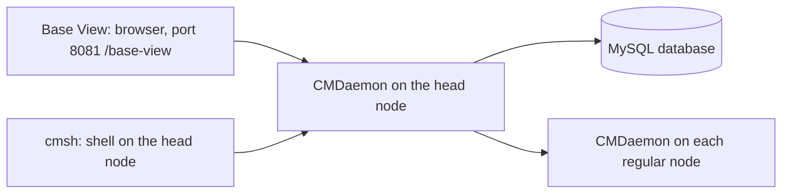

# 8.5 cmsh and Base View: administering the cluster

| | |
|---|---|
| Level | Beginner to intermediate |
| Priority tier | 1 |
| Lab venue | Laptop |
| Part | Part 8: NVIDIA Base Command Manager |
| Status | Drafted (`cmsh_lab.py`: 55 checks pass; cluster commands **untested** on live BCM) |

## Why this matters for AI infrastructure

Picture a setting that must change on a whole rack of GPU servers. Doing it by hand, one node at a time, is slow and easy to get wrong. Everything in chapters 8.3 and 8.4 was done through `cmsh` or Base View. Most real work on a cluster is repetition, though: the same change to 8 nodes, or 512, or one rack. `cmsh` is built for that repetition. Its habits, such as commit, listing a range and the dry run, are what separate a calm change from an outage. In an interview, "show me how you would change a setting on a rack" is a `cmsh` question.

## Prerequisites and outcomes

Before you read on, you need chapters 8.1 to 8.4. This chapter builds on the tools those chapters introduced. When you finish, you should be able to do the following:

- Choose between Base View and `cmsh`, knowing that both reach the same CMDaemon.
- Move through `cmsh` modes and objects, and read the prompt, asterisks included.
- Use the commit model safely with `modified`, `refresh` and `commit`.
- Write node lists for a rack, a range, a stride or an exclusion.
- Loop over many nodes with `foreach` and `range`, and clone and rename nodes.
- Script `cmsh` and get JSON-like output.
- Inspect and restart CMDaemon, and say which port it listens on.

## 1. Two front ends, one daemon

When you have Base View open in one window and `cmsh` in another, which program actually answers you? Both of them talk to CMDaemon on the head node, and never straight to the daemons on other nodes. The diagram shows the path.



For all management traffic, CMDaemon uses SSL connections on TCP port 8081. That port is set by `SSLPort = 8081` in `cmd.conf`. Clients authenticate with client X509 certificates, which chapters 8.1 and 8.6 cover. The non-SSL `Port = 8080` is used only during `init` and HTTP boot, as chapter 8.1 explains.

CMDaemon keeps its data in a MySQL database on the head node. If CMDaemon stops, you lose management, but your jobs keep running, because the workload manager is independent.

The two front ends suit different jobs, as the table shows.

| | Base View | cmsh |
|---|---|---|
| What | Web GUI | Shell with modes and tab completion |
| Strength | Overview dashboards, discovery, one-off changes | Repeatable changes, scripts, bulk edits, exact commands in tickets |
| Reach it | `https://<head>:8081/base-view` | run `cmsh` on the head node |
| Caution | Changing many nodes is slow and hard to review | Typos act on many nodes at once |

Check your browser first. The manual lists recent Chrome, Edge, Firefox and Safari versions, and mobile browsers are not supported. The head node's plain landing page is served by Apache. Its certificate is a distribution self-signed one by default, and you should replace it. Base View comes from the `base-view` package, so removing that package turns the GUI off.

For a change you will repeat or need to record, reach for `cmsh`. Keep Base View for looking around.

## 2. Base View in a few lines

Say you log in to Base View to see how the cluster is doing. The page you land on is Cluster > Overview. The left side holds a resource tree with Cluster, Networking, Provisioning, Grouping, Devices, Cloud, Containers and more. Selecting an item there opens its page.

The Overview page shows GPU, CPU and memory utilisation, job slots, cores and GPUs, and disk use. It also lists failing health checks, running and queued jobs, and license information. Device status counts cover nodes, switches, NVLink switches and power shelves, shown as closed, down, total and up.

For newer hardware, the Overview adds pages for leak detection, IMEX management and rack management.

Two kinds of button do most of the work. One opens an existing object. The other, marked +, creates a new one. A breadcrumb trail at the top of each subwindow takes you back without saving anything.

Every chapter in this part gives the Base View path next to its `cmsh` command, and the two do the same thing. Learn the Base View path first, then the matching `cmsh` line, so you can check one against the other.

## 3. cmsh: starting it

You are on the head node and need one quick answer. Four forms of `cmsh` cover most work.

```bash
cmsh                      # interactive, on the head node
cmsh -c "device status node001; main showprofile"    # batch: commands separated by ;
echo "device status" | cmsh                          # piped
cmsh -f myscript.cmsh -q -x                          # run a file, quit on error, echo commands
```

The first line opens an interactive session. The `-c` option runs semicolon-separated commands, then exits. Piping works too. The last line runs a file and combines `-q` and `-x`, which quit at the first error and echo each command.

Some options are worth knowing. `--hide-events` hides events in an interactive session. `--disable-events` is meant for scripts, and it works together with `--wait`. `-u` starts unconnected, `-n` skips the rc file, `-Q` skips the quit confirmation, and `--color=no` turns colour off. `-i`/`-k` set an alternative certificate and key.

When `cmsh` starts, it reads `/etc/cmshrc` first, then your dotfiles `~/.cm/cmsh/.cmshrc`, `~/.cm/.cmshrc` and `~/.cmshrc`. The shortest path overrides earlier settings. Put your aliases and `groupingsyntax` there.

`cmsh` has built-in aliases: `..` exits one level, `/` goes home, `?` shows help, `ds` means `device status`, and `ls` means `list`. Make your own with `alias lv device list virtualnode`, and move them with `export > file` and `run file`. A script named `name.cmsh` in `~/.cm/cmsh/` becomes the alias `name`, and scripts can take defaults, such as `device use ${1-node001}`.

When a sequence must run the same way every time, put it in a file and run it with `-f`, `-q` and `-x`.

## 4. Modes, objects and the prompt

Lost in `cmsh`? The prompt tells you exactly where you are. `cmsh` groups its functions into modes, such as device, category, network, partition, softwareimage, monitoring and user. Appendix M shows the full tree. Inside a mode you work with objects, such as a single device or a category.

Here is how the prompt changes as you go deeper, and as changes pile up.

```text
[basecm11]%                      top level
[basecm11->device]%              device mode
[basecm11->device[node001]]%     the object node001
[basecm11->device*[node001*]]%   uncommitted changes in the mode and in the object
```

The asterisks mark uncommitted changes. The first one, after `device`, means the device mode has pending changes. The second, after `node001`, means the node object has them too.

`path` prints a string that takes you back to this spot, such as `home;device;use node001;`. You can paste it after `cmsh -c`. One line can run a command in a mode without going there. `device status node001` does that. A semicolon does enter the mode, so `device; status node001` leaves you in device mode.

`home` goes to the top, `exit` goes up one level, and `goto -` returns to where you came from. `bookmark` and `goto` save places for later. Prefix a command with `!` to run a shell command, such as `!hostname -f`. Backticks substitute output, and `>`, `>>` and `|` redirect it.

Two more lines are handy. `ssh node001` works in device mode. `time ds node001` and `watch -n 3 status -n node001,node002` do what their names say.

Read the prompt before every change, because the asterisks tell you what has not been committed yet.

## 5. The commit model: the habit that matters most

Your `cmsh` edits stay local until you commit them. That delay is a safety net, and you need to know how to use it. Each command in the table fits one step of the cycle.

| Command | Meaning |
|---|---|
| `use X` | make X the current object |
| `add [type] name` | create an object **and drop into it** (device mode needs a type: `add physicalnode node100 10.141.0.100`) |
| `set prop value` / `get prop` | change / read a property (can name the object: `set node001 mac ...`) |
| `clear prop` | unset it (a MAC becomes `00:00:00:00:00:00`) |
| `append` / `removefrom` | edit a multi-valued property |
| `modified` | list objects with uncommitted changes: `+` new, `-` to be removed, blank changed |
| `refresh` | **undo local changes** |
| `commit` | send them to CMDaemon (`-w` waits for background work, such as cloning an image) |
| `remove X` | **propose** removal; it happens at `commit` (data is kept unless `-d`; image revisions need `-a`) |
| `clone A B` | copy an object; for a device, BCM guesses a new IP (see below) |
| `swap A B` | exchange the names of two objects (useful for two nodes swapped in a rack) |
| `usedby`, `validate` | what depends on it; check its properties |

The safe routine is short. Make the change, run `modified`, read what it lists, then run `commit`. If the list looks wrong, run `refresh` to throw the changes away.

A forgotten `commit` after a `remove` leaves an asterisk, not a deletion. A `commit` executes pending removals whichever mode it runs in, though, even when the asterisk is not in the prompt. The lab tests this.

Boolean properties accept `yes`, `1`, `on` and `true`, or `no`, `0`, `off` and `false`, in any letter case.

When `get bootloaderprotocol` on a node shows `HTTP (mydefaultimage)`, the value comes from the category. Chapter 8.1 has the rules.

When you clone a device, `cmsh` guesses its new IP. The lab reproduces the manual's examples. Cloning `node001`, whose IP is 10.141.0.1, to `node022..node024` gives `.22`, `.23` and `.24`. If the digit count differs, as with `node02` from `node001`, the manual prints `Base name mismatch, IP settings will not be modified!` and the IPs duplicate until you use `--next-ip`. Cloning copies object settings, not the software image data or switch port settings, so always inspect the result.

Make `modified` a reflex, and read its output before every commit.

## 6. Listing, formatting, JSON

Long node listings are hard to scan, so `list` lets you choose the columns. `list` shows objects. Use `list -f hostname:14,switchports:15,ip` to pick columns and widths. Run `format` by itself to see the current format and every valid field, and `format -r` resets it.

Width rules work like this. A number fixes the width. A `0` means the widest entry sets it. A range such as `[10-14]` fits text between 10 and 14 characters. Longer text is cut, and a `+` marks the cut, as in `largenameforn+`. Use `sort type mac` to sort the list.

`list --json` and `show --json` print whole objects as JSON. If you only need some columns, `list -f hostname,ip,mac,status -d {}` turns the selected columns into JSON. The column names become the keys. Run `color off` first, or use `cmsh --color=no -c "device; list -f hostname,ip -d {}"`.

If a script will read the output, choose the columns with `-f` and the JSON form with `-d {}`.

## 7. Node lists: say which nodes, once

Typing 512 node names by hand is slow and error-prone. A node list lets you name the nodes once. The same syntax works in `foreach`, in the `-n` option and in most node-selecting commands. The table shows the forms.

| Form | Example | Means |
|---|---|---|
| ad hoc | `node001,node003,node005` | exactly these |
| sequence | `node001..node004` or `node00[1-4]` | four nodes |
| extended | `node[001-002]s[001-005]` | 10 names (all combinations) |
| rack style | `r[1-2]n[01-03]` | `r1n01 ... r2n03` |
| exclusion | `node001..node005,-node002..node003` | 001, 004, 005 |
| stride | `node00[1..7:2]` | 001, 003, 005, 007 |
| mixed | `node[001-100],-node[004-100:4]` | all except every fourth |
| from a file | `^/path/to/list` | one list per file |

Two rules trip people up. You cannot mix square brackets and `..` in one argument. The `groupingsyntax bracket|dot|auto` setting controls how lists are printed. The `auto` setting reads both forms and prints dots.

Group options appear almost everywhere. `-n` selects nodes, `-g` a group, `-c` a category, `-r` a rack, `-h` a chassis, `-e` an overlay, `-l` a role, `-m` an image, `-t` a type, and `-s` a status. Add `-u` for union, which is the default, or `-i` for intersection. `-c gpu -r rack5` unions by default, so check which one you are using before a risky command.

Decide whether you want union or intersection before you press Enter on any risky command.

The simulator functions `cmsh_sim.expand_nodelist` and `format_nodelist` implement these forms.

## 8. Doing many things: `foreach`, `range`, `rename`

Suppose you must set one category on four nodes. Typing each change by hand invites mistakes, so loop instead.

```text
foreach -n node001..node004 (set category gpu; get hostname)
foreach -c default --status UP (get ip)
foreach --clone node001 -n node022..node024 ()        # make 3 new nodes, then commit
```

The first line sets a category and reads a hostname on four nodes. The second reads the IP of every UP node in the default category. The third makes three new nodes from `node001`, and you then commit them.

`foreach * (...)` loops over everything in the mode. `-v` prints a header for each object, `--status UP` filters by state, and `-q` stops at an unknown command.

Power commands are blocked inside `foreach` and `range`. The manual shows `foreach -n node001 (power status)` refused with "This command is not allowed inside foreach/range ... Specify the node selection directly on the command instead." Loop timing can stack up power-on operations. That means a large power demand, and trouble for cloud instances. So write `power on -n node001..node016` instead, as chapter 8.7 explains. `foreach -v` prints a time-stamped header per object, which helps when you debug.

`range -n node[001-024]` is the modal version. Later commands in that mode apply to the whole range, and the prompt shows `{...}`. To set values inside a submode, put the commands on one line with semicolons, such as `roles; assign slurmclient; commit`.

The `rename` command renames nodes in bulk. `rename node001..node003 test` gives `test1`, `test2` and `test3`. Numbering restarts at 1 and pads to the width of the count, so ten nodes give `test01..test10`. Use `test%04d` to set the digits yourself. `rename node[001-005] test0[1,2,5-7]` is an exact mapping, and the sizes must match. `rename node[001-004] alice,bob,charlie,dave` is exact as well. `rename node[001-100:2] left[001-050]` takes every second node.

Source names are sorted alphabetically first. Run `--dry-run` first, then `commit`. A `refresh` throws away the proposal, and any other pending change with it. Dry-run every rename, and commit only once the proposed names match what you expected.

## 9. Cluster-wide settings: the `partition` mode

Cluster-wide settings live in the `partition` mode. There is exactly one partition, called `base`. It stands for the whole physical cluster, and the manual notes that cluster partitioning is a future idea.

`partition use base; show` lists the global settings from chapter 8.3. These include the cluster name, name servers, time servers, the default category, the burn configuration, and submodes for BMC, SNMP, SELinux and others.

Read these global settings once, so you know which values your later changes build on.

## 10. CMDaemon from the shell

When Base View and `cmsh` both stop responding, look at the daemon behind them first. Use `systemctl status cmd.service`, or the same command with stop, start or restart. To restart it on every regular node that is up, run `pdsh -a "systemctl restart cmd; systemctl is-active cmd"`.

The `cmdaemonctl` tool has several subcommands: `full-status`, `debugon`, `debugoff`, `logconf` and `upgrade`, which upgrades the database. Do not leave debug on, because it costs performance.

The configuration file is `/cm/local/apps/cmd/etc/cmd.conf` on the head node. Regular nodes keep their copy inside the image. Appendix C covers `FrozenFile` and the other directives, as chapter 8.1 explains.

`cmsh` writes its history to `~/.cm/.cmshhistory`. Use `history -t` to see timestamps. `environment node001` shows the `CMD_*` variables that scripts receive, and adding `-e` makes them exportable.

After any investigation, run `cmdaemonctl debugoff` before you move on.

## 11. Habits that keep clusters safe

Seven habits keep your hands steady when you type fast.

1. Run `modified` before every `commit`.
2. Pick nodes from a printed `list` with the same selection options, and check the count.
3. Prefer `-c category` for permanent changes, and `-n` for exceptions. Chapter 8.1 covers this.
4. Put repeated procedures in `~/.cm/cmsh/*.cmsh` scripts, and run them with `-f -q -x`.
5. Label changes with `set revision "ticket 1234"`, a free-text property on every object.
6. Use a dry run where the command has one, such as `imageupdate`, `rename --dry-run` or `updatedevicepowerconfig --dry-run`.
7. Keep `--disable-events` in scripts, so event noise does not hide the output.

## 12. Common first mistakes

Most first mistakes in `cmsh` come from habits you have not built yet. The list below names nine common ones, so you can spot them before they cost you.

1. Forgetting `commit` and wondering why nothing changed.
2. Forgetting that `commit` also executes a pending `remove`.
3. Putting a semicolon between mode and command when you meant a one-liner, or the reverse.
4. Writing a node list that selects more than you intended, because of union versus intersection.
5. Cloning nodes and trusting the guessed IP and MAC.
6. Trying to power nodes from inside `foreach` or `range`. `cmsh` refuses it, so give the selection to the power command itself.
7. Mixing brackets and dots in one list.
8. Leaving CMDaemon in debug.
9. Editing the same object in Base View and `cmsh` at once.

### 12.1 Mastering `cmsh` for zero-mistake fleet operations

Picture a `cmsh` session on a live production cluster. One `foreach` or `range` command can modify or reboot five hundred GPU servers at once. The gap between a junior administrator and a senior systems engineer shows up in the first thirty seconds of that session. Disciplined operators follow the same four-step rhythm on every interactive change: **Scope → Mutate → Audit (`modified`) → Commit**.

Here is how each step protects the cluster from fat-finger outages.

First, scope the change with a dry-run `list`. Whenever you combine selection filters, such as `-c gpu-nodes` (category), `-r rack05` (rack), `-g maintenance` (group) or `--status DOWN`, remember that `cmsh` defaults to union (`-u`), not intersection (`-i`). Suppose you type `device power off -c gpu-nodes -r rack05` meaning only the GPU nodes inside Rack 5. The union default selects every GPU node in the entire data center, plus every device in Rack 5. For an intersection you must pass `-i` explicitly, as in `-i -c gpu-nodes -r rack05`. Run `device list -i -c gpu-nodes -r rack05` first, count the rows on screen, and run the mutating command only when the list matches your expectation.

Second, make the change in local memory and watch the asterisks. When you run `set`, `add`, `clear`, `append`, `removefrom` or `remove`, nothing reaches CMDaemon yet. The edits sit in your local `cmsh` process, and the prompt changes from `[basecm11->device[node001]]%` to `[basecm11->device*[node001*]]%`. This local staging lets you inspect derived values with `get` and `show`, check dependencies with `usedby`, and run `validate` before touching live nodes.

Third, audit every pending object with `modified` before you type `commit`. Suppose ten minutes ago you ran `remove node042` while investigating a broken node. A Slack message then distracted you. You moved to `category use default`, changed a kernel parameter, and typed `commit`. Because `commit` flushes all pending modifications in the session, that forgotten `remove node042` executes right alongside your kernel parameter change. Running `modified` before every `commit` prints a concise table of every object queued for creation (`+`), deletion (`-`) or modification (blank). If anything in that table surprises you, run `refresh` to discard the local changes and start fresh.

Fourth, use `commit -w` in scripts that image or clone. Some commits start heavy background work on the head node, such as cloning a thirty-gigabyte software image (`clone default-image cuda12-test`) or regenerating an initrd ramdisk. In a batch script, such as `cmsh -f rollout.cmsh -q -x`, a plain `commit` returns immediately while the background copy is still running. The next line then fails if it touches the image that is not finished. Passing **`commit -w`** blocks until all background tasks from that commit complete.

### 12.2 Scripting and exporting structured data from `cmsh` into Python and CI pipelines

Interactive `cmsh` is optimized for human tab-completion. Day-2 operations, though, often need cluster inventory, switch-port mappings or job status in Python scripts, Ansible inventories or monitoring checks. BCM offers three escalating ways to connect `cmsh` to outside automation.

1. Formatted JSON column projections, written as `list -f ... -d {}`. When you need only a few fields across hundreds of devices, `list --json` gets verbose, because it serializes every property of every object. Combine `-f` for field selection with `-d {}` for the JSON delimiter, and add `--color=no`:
   ```bash
   cmsh --color=no -c "device; list -f hostname,ip,mac,category,status -d {}"
   ```
   This prints clean JSON objects with only the five requested keys. You can pipe them straight into `jq` or into `python3 -c "import sys, json; ..."`.
2. Idempotent `.cmsh` scripts, run with `-f -q -x --disable-events`. A repeatable setup, such as creating four networks, six categories and ten Slurm queues on a new test cluster, belongs in a version-controlled `.cmsh` file. Run it with `cmsh -f setup.cmsh -q -x --disable-events`. The `-q` flag halts the script at the first syntax or validation error, so it never commits a half-configured object. The `-x` flag echoes each command into the CI log. `--disable-events` keeps asynchronous cluster event banners out of your script's stdout.
3. Custom parameterized aliases in `~/.cm/cmsh/`. Any script saved as `~/.cm/cmsh/<name>.cmsh` becomes a command called `<name>` inside an interactive session. It can take positional parameters with defaults, such as `${1-node001}`. Teams often keep read-only diagnostic macros this way. A `rackcheck.cmsh` script, for example, prints `status`, `ipaddresses --check`, `bmceventlog --tail 5` and `roles; list -p` for a given rack. Put such macros in `/etc/cmshrc` or shared dotfiles, and every on-call engineer gets the same one-word triage commands.

### 12.3 Diagnosing and recovering `CMDaemon` (`cmd.service`) on the head node

Both `cmsh` and Base View are thin clients. They talk over TLS port `8081` to CMDaemon on the head node. So what do you do if `cmsh` hangs on startup, or prints `Unable to connect to 127.0.0.1:8081`?

First, tell your stakeholders this. A stopped or restarting CMDaemon on the head node does not kill running Slurm or Kubernetes jobs. Compute nodes keep executing their active training steps, `slurmctld` and `kube-apiserver` keep running, and NFS mounts stay up. What pauses is cluster management. New nodes cannot PXE-provision, `cmsh` and Base View cannot connect, and BCM health triggers pause.

To diagnose `cmd.service` on the head node, follow four steps in order.

1. Check the service and the database first. Run `systemctl status cmd.service` and `systemctl status mysql.service` (or `mariadb.service`). CMDaemon stores all object state in MySQL. So `cmd.service` refuses to start if MySQL is down, if `/var` is `100%` full, which you can check with `df -h /var`, or if the BCM license has expired. Check the license with `verify-license verify`, and read `/var/log/cmdaemon` for clues.
2. Inspect `cmdaemonctl full-status`. When `cmd` runs but feels sluggish, this command reports active client sessions, worker thread use and request rates. A runaway script that opened hundreds of concurrent `cmsh` processes in a shell loop shows up here immediately.
3. Check `/var/log/cmdaemon` and turn off stray debug logging. Someone who ran `cmdaemonctl debugon` during an earlier investigation, and forgot `cmdaemonctl debugoff`, leaves verbose debug trace logging on. That logging can fill `/var/log/cmdaemon` at gigabytes per hour and stall worker threads on disk I/O.
4. Verify daemon versions across the fleet. After any head-node package update, run `cmsh -c "device; cmdaemonversions"` to confirm that the head node and all regular nodes run compatible CMDaemon builds.

Work through the four steps in order, and note what each one shows before you change anything.

### 12.4 Side-by-side translation: Common cluster tasks in Base View vs `cmsh`

Even if you do ninety percent of your daily engineering work in `cmsh`, you should know how the same operations look in Base View. That helps when you train new operators or walk executives and auditors through a live dashboard. Every view in the web UI reads and writes the same CMDaemon objects over TCP port `8081`.

| Operational Task | `cmsh` Command Sequence | Base View Navigation Path |
|---|---|---|
| **Check overall cluster & rack health** | `device; status` / `rackoverview` / `healthoverview` | **Cluster > Overview** (or **Devices > Racks**) |
| **Inspect or edit global cluster settings** | `partition use base; show` | **Cluster > Settings** |
| **Create or clone a node category** | `category; clone default gpu-h100; commit` | **Grouping > Categories > `+` (or Clone)** |
| **Move a rack of nodes into a category** | `device; foreach -r rack03 (set category gpu-h100); commit` | **Devices > Nodes** (multi-select rows → Edit → Category) |
| **Inspect role priorities on a node** | `device use node001; roles; list -p` | **Devices > All Devices > `node001` > Settings > Roles** |
| **Check or stage BIOS attributes** | `device use node001; biossettings; status` / `bios apply` | **Devices > All Devices > `node001` > BIOS** |
| **Watch live metrics and health graphs** | `monitoring; samplenow node001` / `latesthealthdata` | Top-right **Monitoring** icon → **Critical Services** |
| **Hold, release, or inspect a WLM job** | `wlm; jobs; list` / `info <id>` / `hold <id>` | Top-right **HPC** icon → **Jobs** (`..` action menu) |

Notice why experienced teams avoid editing the same object in Base View and `cmsh` at the same time. Whichever session commits second overwrites the properties the first one committed. Use Base View for visual awareness, time-series metric exploration and one-off inspection. Use `cmsh`, with `modified` and `set revision "<ticket>"`, whenever you change cluster state.

When you onboard a new engineer, have them pair Base View with `cmsh` during their first week. In Base View's left-hand resource tree, they can look at a category, overlay or rack layout and see how the objects connect. Then they run `path` and `show` on the same object in `cmsh`. That shows them the exact CLI path and property names that go into your change-management runbooks and `.cmsh` scripts. The habit builds a visual sense of the object graph and muscle memory for the command line.

## Exercises

Work through these after you have read the chapter. Each one uses the same skills as the sections above.

1. Run `python3 cmsh_lab.py`. Choose four of its checks, and explain each rule in your own words.
2. With `cmsh_sim.Session`, replay the manual's add, commit and remove session. Write down each prompt as you go, and note the point where the asterisks disappear.
3. Write a node list for each of these. Cover all nodes of racks 1 to 3, with 8 nodes each. Cover every odd node of a 64-node cluster. Cover all of `node001..node032` except `node013`.
4. A script changes the category of nodes 5 to 8. Write it so that it prints the affected nodes first, then asks for `commit` only if the count is 4.
5. Rename `node[001-004]` and `node[005-008]` so that the odd and even nodes become `left` and `right`.
6. Explain the difference between `device status node001` and `device; status node001`.

## 14. Interview angles

These are the questions this chapter prepares you for.

"How do you change a setting on one rack safely?" Select with a printed node list or `-r`, and run `get` first. Then `set`, `modified` and `commit`, verify the result, and use `refresh` if something looks wrong.

"Base View or cmsh?" Both reach CMDaemon on 8081. Use Base View to look and explain, and `cmsh` to repeat and script.

"What does the asterisk mean?" It marks uncommitted local changes in that mode or object.

"What does `remove` do on its own?" It proposes a removal. Nothing happens until `commit`, and image data stays unless `-d` is given.

"Why can't you `foreach` a power-on?" Loop timing can stack up power-on operations. So `cmsh` blocks it and wants the selection on the power command.

"What happens if CMDaemon stops?" You lose management, monitoring and provisioning decisions, but running jobs continue.

## Checkpoint questions (20)

<details>
<summary>1. On which TCP port does CMDaemon accept management connections from `cmsh` and Base View, and how is it authenticated?</summary>

CMDaemon listens on **TCP port `8081` over SSL**, set by `SSLPort = 8081` in `cmd.conf`. Clients prove who they are with client-side X.509v3 PEM certificates, found at `/root/.cm/admin.pem` and `/root/.cm/admin.key`. The non-SSL `Port = 8080` comes into play only during `init` or pre-init HTTP boot.
</details>

<details>
<summary>2. Which database engine does CMDaemon use on the head node to store cluster configuration and monitoring metadata?</summary>

CMDaemon keeps its configuration and monitoring metadata in **MySQL / MariaDB**, which runs on the head node.
</details>

<details>
<summary>3. What is the URL for Base View, and which package can be removed if a site wants to disable the web GUI?</summary>

Base View lives at `https://<head-node>:8081/base-view`. The **`base-view`** package serves it, so removing that package turns the GUI off.
</details>

<details>
<summary>4. What do the asterisks `*` in the `cmsh` prompt `[basecm11->device*[node001*]]%` indicate?</summary>

They mean there are **uncommitted local modifications** that have not yet gone to CMDaemon through `commit`. The `device*` part shows pending changes in device mode, and `node001*` shows pending changes on the `node001` object.
</details>

<details>
<summary>5. In what order does `cmsh` load startup `rc` files, and which path wins on conflict?</summary>

`cmsh` reads `/etc/cmshrc` first. Then it reads your dotfiles `~/.cm/cmsh/.cmshrc`, `~/.cm/.cmshrc` and `~/.cmshrc`. The shortest path wins, so it overrides the earlier settings.
</details>

<details>
<summary>6. Name four built-in `cmsh` aliases.</summary>

`..` goes up one level, `/` goes home to the top level, `?` shows help, `ds` runs `device status`, and `ls` runs `list`.
</details>

<details>
<summary>7. What is the difference between `cmsh -c "..."` and `cmsh -f script.cmsh -q -x`?</summary>

`-c` runs a semicolon-separated string of commands in batch mode and then exits. `-f` runs the commands in a script file. With `-q`, it stops at the first error. With `-x`, it echoes each command before running it.
</details>

<details>
<summary>8. What does `commit -w` do compared to a plain `commit`?</summary>

`commit -w` **waits** for long background operations, such as cloning a multi-gigabyte software image, to finish before it returns the prompt. A plain `commit` returns without waiting.
</details>

<details>
<summary>9. How do you discard uncommitted local changes in `cmsh` before `commit`?</summary>

Run **`refresh`**. It reloads the object or mode state from CMDaemon and clears your uncommitted edits.
</details>

<details>
<summary>10. What does the `modified` command display, and what do the prefixes `+`, `-`, and blank mean?</summary>

`modified` lists every object in the current mode that has uncommitted changes. A **`+`** marks a newly added object, a **`-`** marks an object set for removal with `remove`, and a blank prefix marks an existing object with changed properties.
</details>

<details>
<summary>11. When you `remove` a software image in `cmsh` and `commit`, what happens to the files under `/cm/images/<name>` by default, and which flag deletes them?</summary>

By default, `remove` deletes only the database object and keeps the image directory on disk. To delete the files as well, pass **`-d`**, as in `remove -d <image>`. To remove image revisions, add **`-a`**.
</details>

<details>
<summary>12. When cloning `node001` (`10.141.0.1`) to `node022..node024`, how does `cmsh` guess the new IP addresses, and when does IP guessing fail?</summary>

When the base name and digit count match, as with `node001` to `node022..node024`, `cmsh` substitutes the trailing number into the host part of the IP, giving `.22`, `.23` and `.24`. If the base name or digit width differs, as with `node001` to `node02`, `cmsh` prints `Base name mismatch, IP settings will not be modified!` and the IP duplicates `.1` unless you pass **`--next-ip`**.
</details>

<details>
<summary>13. Which eight case-insensitive strings does `cmsh` accept for Boolean properties?</summary>

The true values are **`yes`**, **`1`**, **`on`** and **`true`**. The false values are **`no`**, **`0`**, **`off`** and **`false`**. Case does not matter.
</details>

<details>
<summary>14. Write a compact `cmsh` node list expression for every odd-numbered node from `node001` to `node099`.</summary>

Use **`node0[01..99:2]`**, or equally **`node[001-099:2]`**, with the `:2` stride suffix.
</details>

<details>
<summary>15. Why is `node[001-003]..node005` rejected by the `cmsh` node-list parser?</summary>

`cmsh` does not allow square-bracket range syntax `[...]` and double-dot range syntax `..` in the same range token. A double dot inside brackets, as in `node00[1..7:2]`, is valid.
</details>

<details>
<summary>16. Write a `cmsh` node list expression that selects `node001` through `node032` excluding `node013` and `node014`.</summary>

Use **`node001..node032,-node013..node014`**. Each excluded range or node gets a `,-` prefix.
</details>

<details>
<summary>17. What is the difference between `foreach -n node001..node024 (...)` and `range -n node[001-024]`?</summary>

`foreach` runs the parenthesized block once across the selected nodes, then returns you to the normal prompt. `range` opens a modal range context with a `{...}` prompt. There, every command you type applies to all nodes in the range until you leave it.
</details>

<details>
<summary>18. Why does `cmsh` refuse to run `power` commands inside `foreach` or `range` (`foreach -n node001 (power on)`)?</summary>

Loop timing could stack concurrent power-on surges across racks or cloud APIs, so `cmsh` refuses. Pass the selection to the `power` command itself instead: **`power on -n node001..node016`**.
</details>

<details>
<summary>19. What new hostnames are produced by `rename node001..node003 test` versus `rename node001..node010 test`?</summary>

`rename` restarts numbering at `1` and pads to the width of the total count. Three nodes become **`test1`, `test2` and `test3`**. Ten nodes become **`test01..test10`**. Use `test%04d` to force four-digit padding.
</details>

<details>
<summary>20. How do you export selected columns of `device list` as JSON objects from the command line?</summary>

Run **`cmsh --color=no -c "device; list -f hostname,ip,mac,status -d {}"`**. For full objects, use `list --json` or `show --json` instead.
</details>

## Sources and review notes

- **BCM 11 Administrator Manual:** 2.4 (Base View: access, login, navigation; the full Cluster resource tree was read only in part), 2.5 (cmsh: invocation, rc files, aliases, options, modes, objects, `format`, `list`, `foreach`, `range`, node lists, `rename`, `bookmark`, JSON output; read in full), 2.6 (CMDaemon, 2.6.1 and 2.6.2), and the start of Appendix M (tree view of cmsh modes).
- **Port note:** Administrator Manual section 2.6 says management goes through TCP 8081 only (SSL), and Appendix C (pp. 905–906) states the two `cmd.conf` directives: `Port = 8080` (non-SSL HTTP, used only during `init` / HTTP boot) and `SSLPort = 8081` (SSL HTTPS, used for all communication with Base View and `cmsh`), both changeable with `cm-cmd-ports --http ... --https ...` (details in chapter 8.1).
- **Run here:** `cmsh_lab.py` (55 checks): node lists, `groupingsyntax` output, `rename`, `format` widths, prompts and asterisks for add/commit/remove, `modified`, `refresh`, `clear`, Booleans, inherited `get`, `clone` IP rules, `foreach --clone` with and without `--next-ip`.
- **My own choices, not the manual's:** that a mode-prefixed one-liner leaves the mode unchanged except `add` and `clone` (this matches the manual's two examples); the "next free" address being the lowest unused one; fixed-width columns also being cut with `+`.
- **Not read or not covered:** the many mode-specific commands (monitoring, user, process, cert, and so on, which later chapters use); events and the `events` command; the command-line `cm-*` tools; Base View screens beyond Cluster; the developer API manual.
- **Not verified:** everything about a real BCM system: output formats, version differences.
